# L023 单词 + 文章

快速机器解析：语音为单模型转写，未进行独立交叉校对或人工复核；画面每秒采样并按变化选帧，短时文字和标记可能遗漏。截图时间约有 1 秒误差。图片有损压缩；遇到疑点请按时间查看 Google Drive 原视频。

## 00:00:00–00:00:30

Hello everyone, welcome to Capsule Academy. This is Leo. Today we're going to learn new concept English Book Two Lesson Twenty Three Words and Story. 那老习惯进入正式课程之前呢，我们先看几个问题。第一，如何用英文去表达这个土味情话，对吧？你使我完整啊。第二，如何去表达海淀区啊区的这个概念。最后一个问题，如何表达吃惊啊？带着这三个问题，Hope you gonna enjoy it.

### 画面 00:00:00

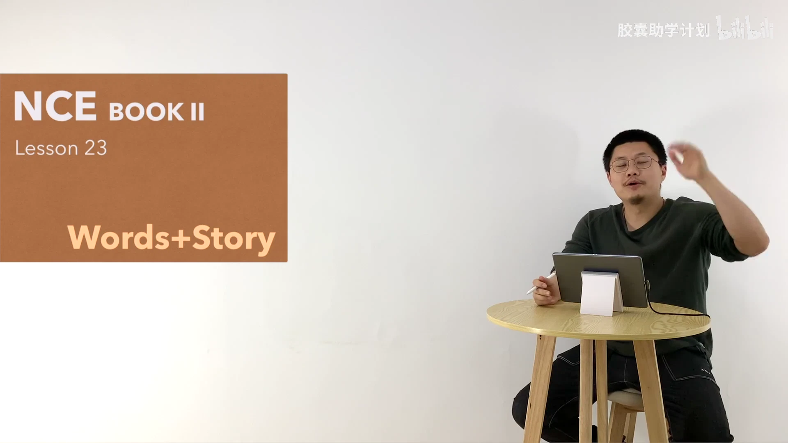

文字识别：bilL / 胶囊助学计划 / NCE / BOOKI"I / Lesson 23 / Words+Story

### 画面 00:00:02

文字识别：Bibii / 胶囊助学计划 / NCE / BOOKII / Lesson 23 / Words+Story

### 画面 00:00:05

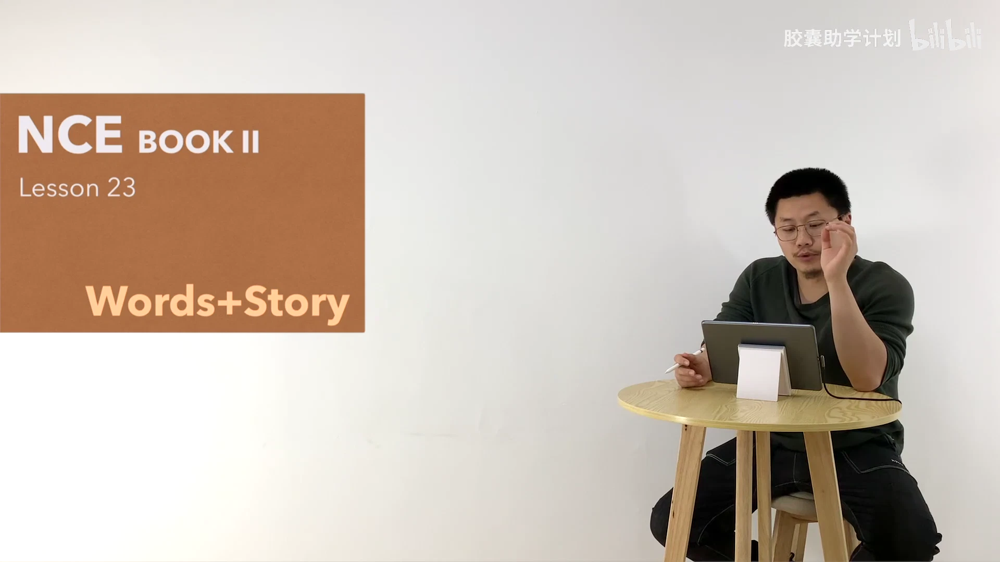

文字识别：bibi / 胶囊助学计划 / NCE / BOOK I"I / Lesson 23 / Words+Story

### 画面 00:00:10

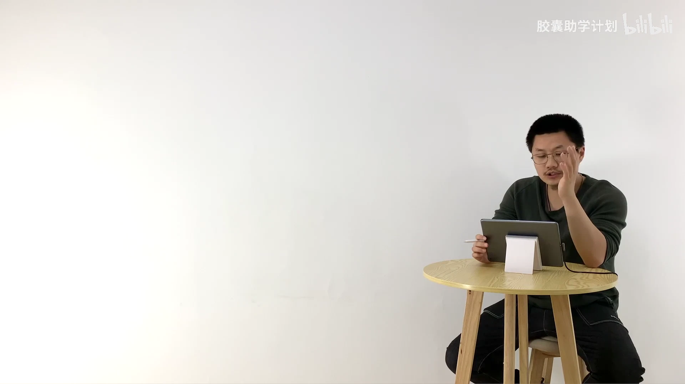

文字识别：胶囊助学计划l

### 画面 00:00:12

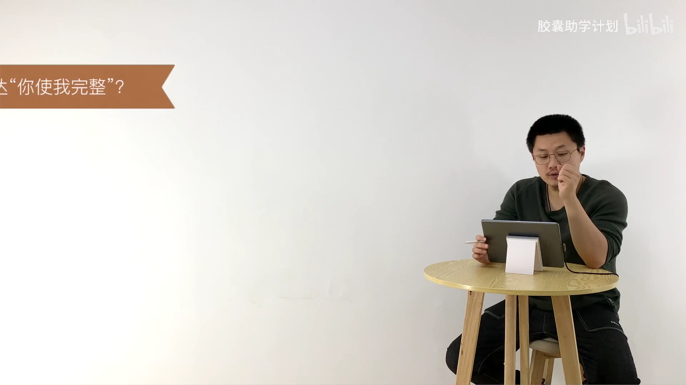

文字识别：胶囊助学计划il / 达“你使我完整”?

### 画面 00:00:14

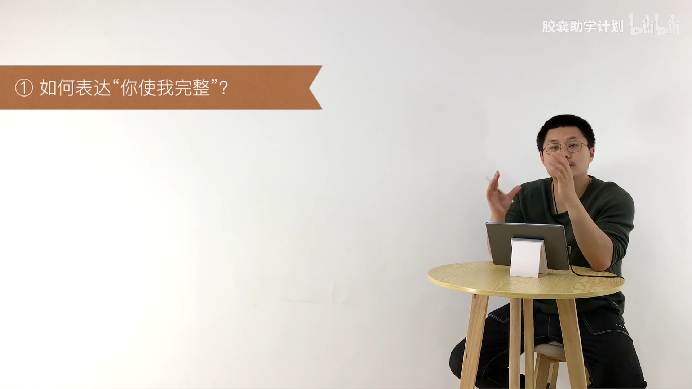

文字识别：胶囊助学计划 / ①如何表达“你使我完整”？

### 画面 00:00:19

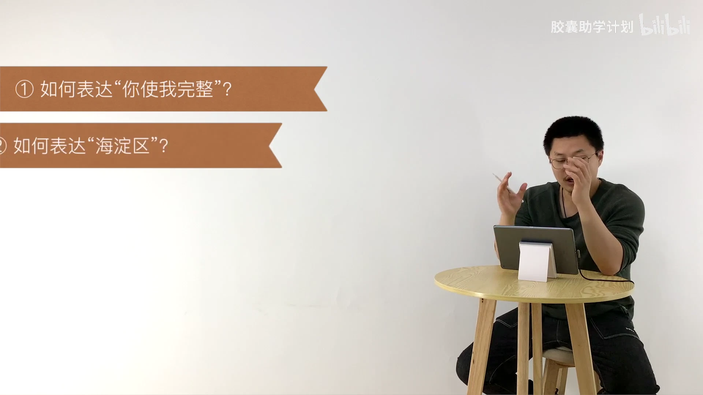

文字识别：BiiBil / 胶囊助学计划 / ①如何表达“你使我完整” / 如何表达“海淀区”?

### 画面 00:00:21

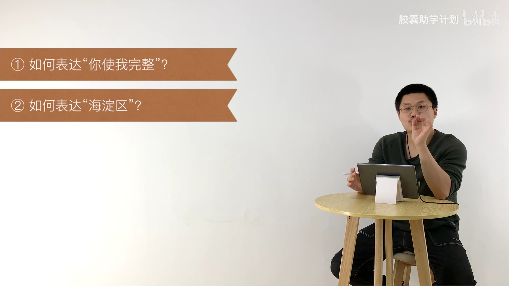

文字识别：biiilti / 胶囊助学计划 / ①如何表达“你使我完整” / 如何表达“海淀区”?

### 画面 00:00:23

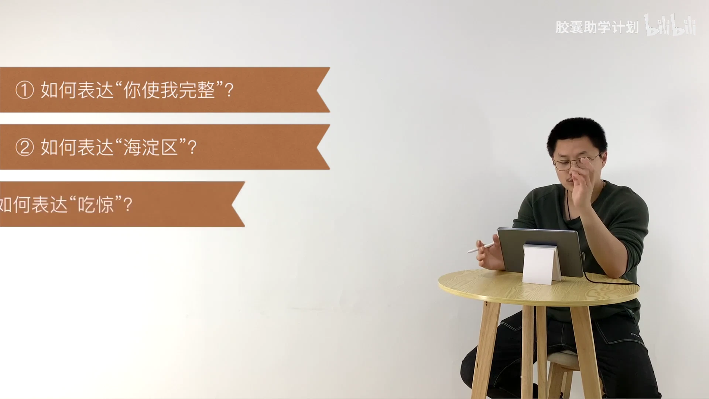

文字识别：bitblt / 胶囊助学计划 / ①如何表达“你使我完整” / 如何表达“海淀区”? / 如何表达“吃惊”

### 画面 00:00:25

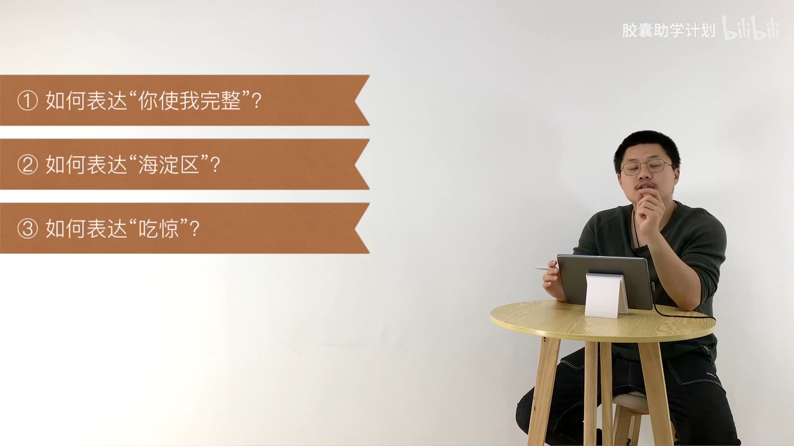

文字识别：Biilii / 胶囊助学计划 / ①如何表达“你使我完整” / 如何表达“海淀区”? / 如何表达“吃惊”？

### 画面 00:00:28

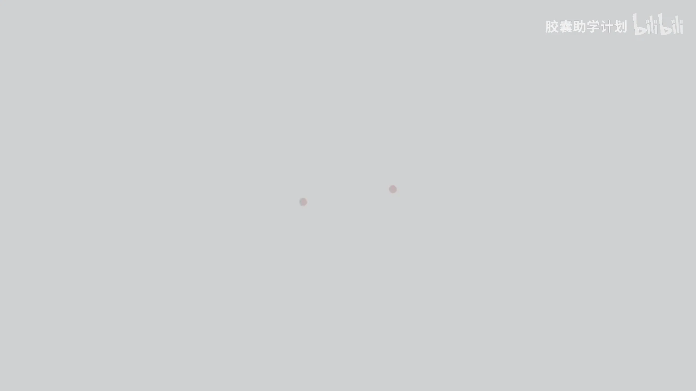

文字识别：胶囊助学计划出 / •

## 00:00:30–00:01:00

好，那我们先说一下啊，呃，我们每一个单元啊，新概念二册都是二十四课，一共有四个单元，所以二十四乘以四一共是九十六课。每个单元的第二十三课和二十四课都是对前二十二课的一个总结和复习，所以它没有新的语法。对于各位来说呢，我们就是简单过一下单词，过一下文章，

### 画面 00:00:32

文字识别：交囊助学计划 / 胶囊助学计划

### 画面 00:00:34

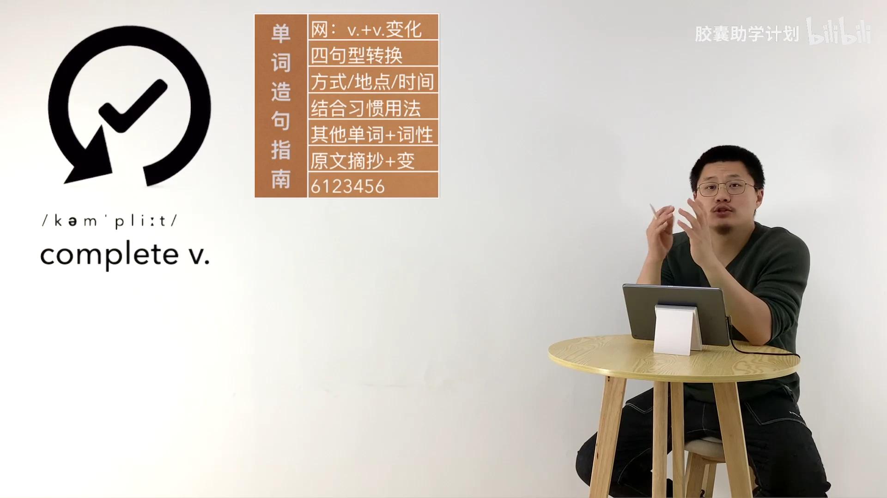

文字识别：单词造句指南 / 网：v.+v.变化 / 胶囊助学计划 / 四句型转换 / 方式/地点/时间 / 结合习惯用法 / 其他单词+词性 / 原文摘抄+变 / 6123456 / /kam'pli:t/ / complete v.

### 画面 00:00:36

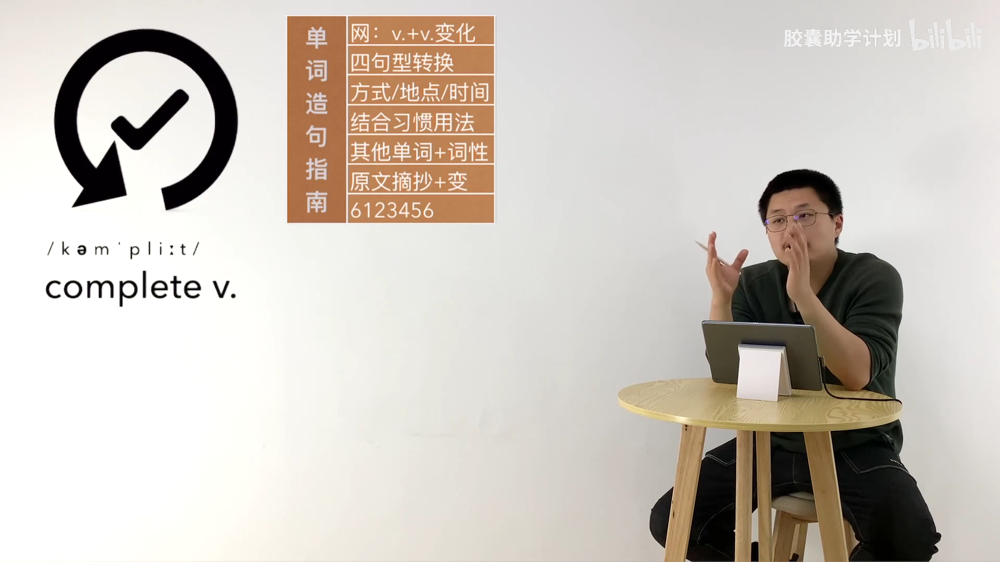

文字识别：单词造句指南 / 网：v.+v.变化 / 胶囊助学计划 / Bifbii / 四句型转换 / 方式/地点/时间 / 结合习惯用法 / 其他单词+词性 / 原文摘抄+变 / 6123456 / /kam'pli:t/ / complete v.

### 画面 00:00:40

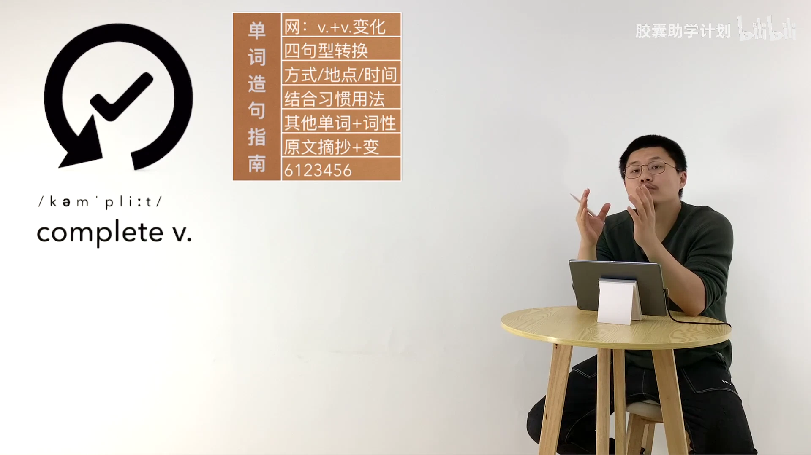

文字识别：单词造句指南 / 网：v.+v.变化 / 胶囊助学计划 / biL / 四句型转换 / 方式/地点/时间 / 结合习惯用法 / 其他单词+词性 / 原文摘抄+变 / 6123456 / /kam'pli:t/ / complete v.

### 画面 00:00:45

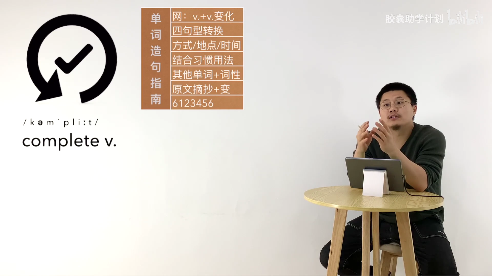

文字识别：单词造句指南 / 网：v.+v.变化 / 胶囊助学计划 / 四句型转换 / 方式/地点/时间 / 结合习惯用法 / 其他单词+词性 / 原文摘抄+变 / 6123456 / /kam'pli:t/ / complete v.

### 画面 00:00:53

文字识别：单词造句指南 / 网：v.+v.变化 / 胶囊助学计划 / LiB / 四句型转换 / 方式/地点/时间 / 结合习惯用法 / 其他单词+词性 / 原文摘抄+变 / 6123456 / /kam'pli:t/ / complete v.

## 00:01:00–00:01:30

做一下练习就可以了。是一个对于大家来说是一个查漏补缺和放松的这样一个课程啊。这样一周，OK，好，那我们不多说，我们直接看一下单词。哎，第一个单词 complete， complete， OK，它是完成的意思啊。 complete， OK，好，那注意它是一个动词，我们尝试造一个句子，利用二十一课咱们刚刚学过的情态动词的被动，对吧？比如说 will be done，我们去造一个句子叫做

### 画面 00:01:11

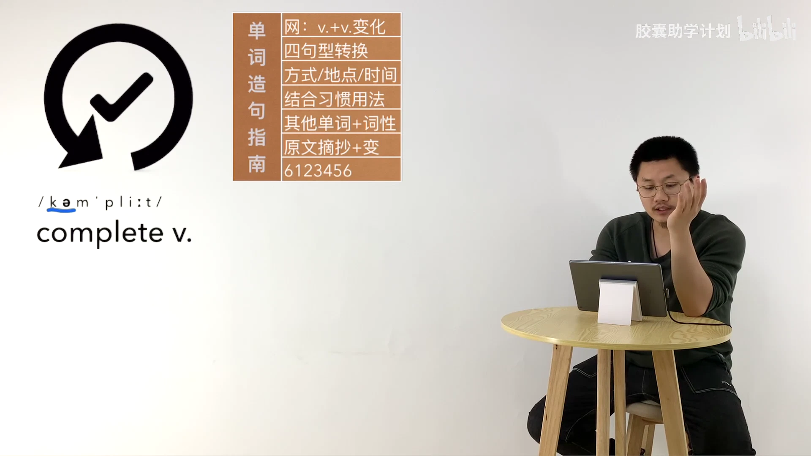

文字识别：单词造句指南 / 网：v.+v.变化 / 胶囊助学计划 / 四句型转换 / 方式/地点/时间 / 结合习惯用法 / 其他单词+词性 / 原文摘抄+变 / 6123456 / /kam'pli:t/ / complete v.

### 画面 00:01:14

文字识别：单词造句指南 / 网：v.+v.变化 / 胶囊助学计划 / BitLit / 四句型转换 / 方式/地点/时间 / 结合习惯用法 / 其他单词+词性 / 原文摘抄+变 / 6123456 / /kam'pli:t/ / complete v.

### 画面 00:01:16

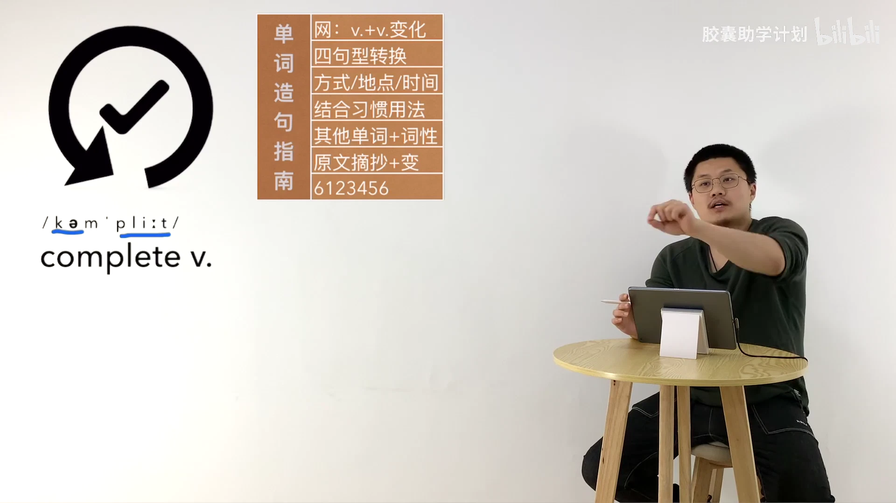

文字识别：单词造句指南 / 网：v.+v.变化 / 胶囊助学计划 / BiLii / 四句型转换 / 方式/地点/时间 / 结合习惯用法 / 其他单词+词性 / 原文摘抄+变 / 6123456 / /kam'pli:t/ / complete v.

### 画面 00:01:20

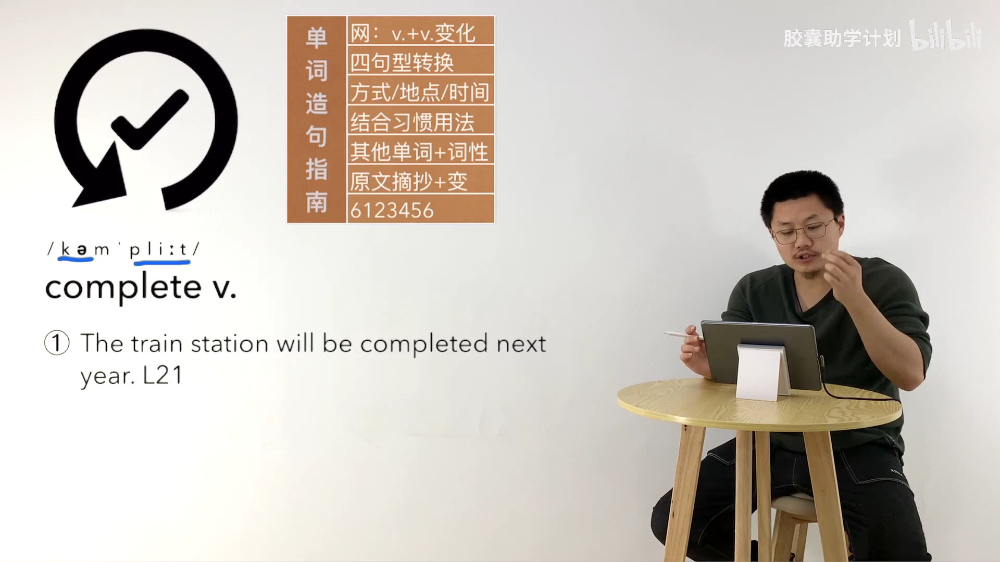

文字识别：单词造句指南 / 网：v.+v.变化 / 胶囊助学计划 / BiLii / 四句型转换 / 方式/地点/时间 / 结合习惯用法 / 其他单词+词性 / 原文摘抄+变 / 6123456 / /kampli:t/ / complete v. / ) The train station will be completed next / year. L21

### 画面 00:01:23

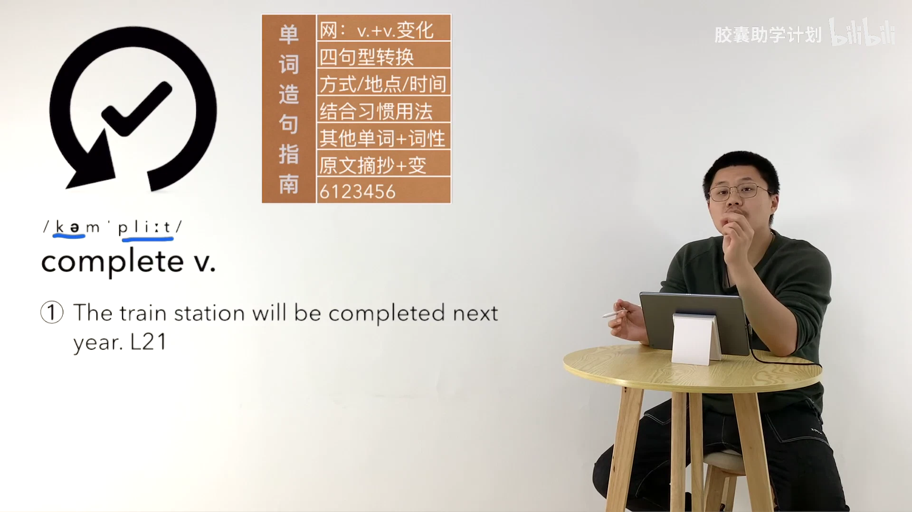

文字识别：单词造句指南 / 网：v.+v.变化 / 胶囊助学计划 / BitLii / 四句型转换 / 方式/地点/时间 / 结合习惯用法 / 其他单词+词性 / 原文摘抄+变 / 6123456 / /kam'pli:t/ / complete v. /  The train station will be completed next / year. L21

### 画面 00:01:25

文字识别：单词造句指南 / 网：v.+v.变化 / 胶囊助学计划 / BiLit / 四句型转换 / 方式/地点/时间 / 结合习惯用法 / 其他单词+词性 / 原文摘抄+变 / 6123456 / /kampli:t/ / complete v. /  The train station will be completed next / year. L21

## 00:01:30–00:02:00

The train station will be completed next year. 好，明年火车站将被完成。来一个，那下一个，我们把它变完一般疑问句，再直接给它做一个特殊疑问句，叫做 When will the train station be completed? 啊，什么时候这个火车站将被完成？啊，各位还可以去做改变一下时态呀，啊，比如说被动，我们还有很多结构，对吧？Can be done，对吧？和时态

### 画面 00:01:30

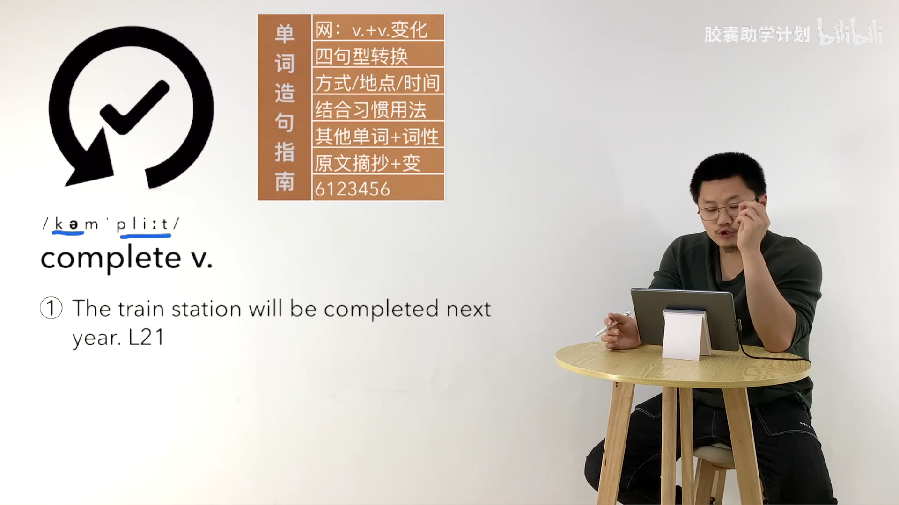

文字识别：单词造句指南 / 网：v.+v.变化 / 胶囊助学计划 / BiLii / 四句型转换 / 方式/地点/时间 / 结合习惯用法 / 其他单词+词性 / 原文摘抄+变 / 6123456 / /kampli:t/ / complete v. /  The train station will be completed next / year. L21

### 画面 00:01:35

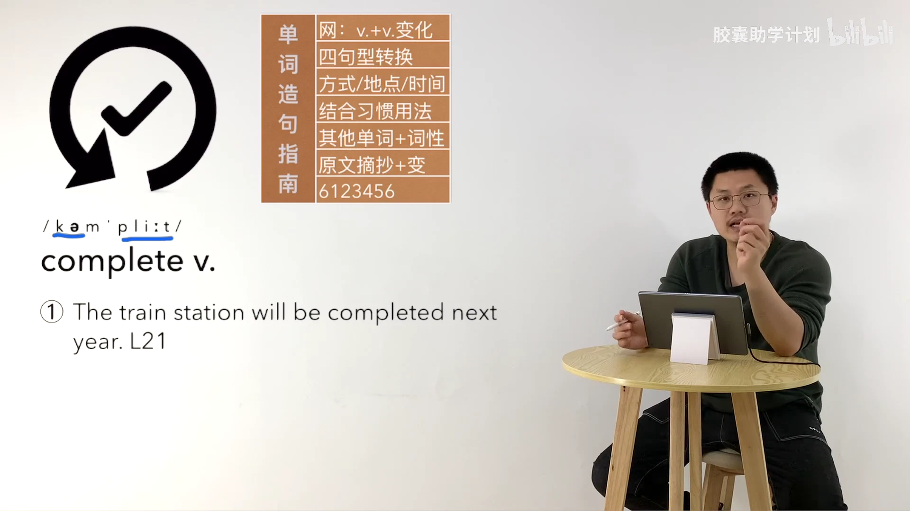

文字识别：单词造句指南 / 网：v.+v.变化 / 胶囊助学计划 / 四句型转换 / 方式/地点/时间 / 结合习惯用法 / 其他单词+词性 / 原文摘抄+变 / 6123456 / /kampli:t/ / complete v. /  The train station will be completed next / year. L21

### 画面 00:01:38

文字识别：单词造句指南 / 网：v.+v.变化 / 胶囊助学计划 / Bibi / 四句型转换 / 方式/地点/时间 / 结合习惯用法 / 其他单词+词性 / 原文摘抄+变 / 6123456 / /kam'pli:t/ / complete v. / ① The train station will be completed next / year. L21 / When will the train station be completed?

### 画面 00:01:41

文字识别：单词造句指南 / 网：v.+v.变化 / 胶囊助学计划 / 四句型转换 / 方式/地点/时间 / 结合习惯用法 / 其他单词+词性 / 原文摘抄+变 / 6123456 / /kampli:t/ / complete v. / ① The train station will be completed next / year. L21 / When will the train station be completed?

### 画面 00:01:45

文字识别：单词造句指南 / 网：v.+v.变化 / 胶囊助学计划 / 四句型转换 / 方式/地点/时间 / 结合习惯用法 / 其他单词+词性 / 原文摘抄+变 / 6123456 / /kam'pli:t/ / complete v. / ① The train station will be completed next / year. L21 / When will the train station be completed?

### 画面 00:01:52

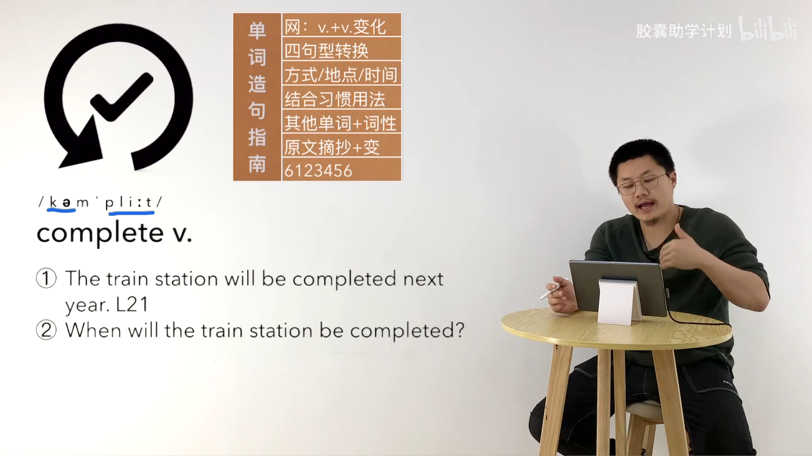

文字识别：单词造句指南 / 网：v.+v.变化 / 胶囊助学计划 / 四句型转换 / 方式/地点/时间 / 结合习惯用法 / 其他单词+词性 / 原文摘抄+变 / 6123456 / /kam'pli:t/ / complete v. / ① The train station will be completed next / year. L21 / When will the train station be completed?

### 画面 00:01:55

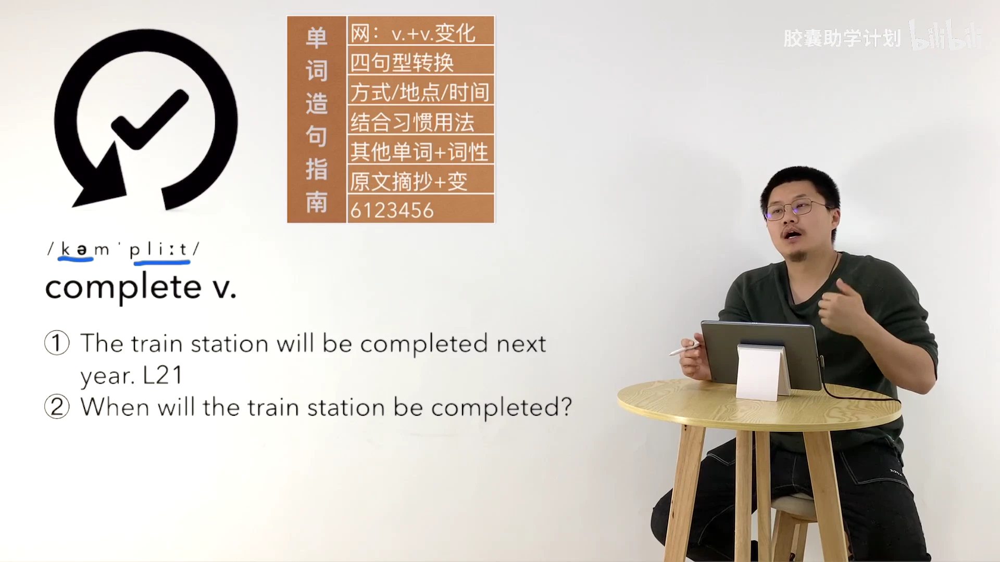

文字识别：单词造句指南 / 网：v.+v.变化 / 胶囊助学计划 / 四句型转换 / 方式/地点/时间 / 结合习惯用法 / 其他单词+词性 / 原文摘抄+变 / 6123456 / /kam'pli:t/ / complete v. / ① The train station will be completed next / year. L21 / When will the train station be completed?

## 00:02:00–00:02:30

的各种被动，情态的情态动词的各种被动，各位可以套起来。Complete这个单词，嗯，对于各位来说就可以造出很轻松造出五个句子了，好吧？那接下来呢，我们看一个电影片段，这个就是我们在最开始提到的那个土味情话，对吧？啊，叫做你使我完整啊，很深情。你，you complete me. OK.那注意力集中来了。I love you. You

### 画面 00:02:00

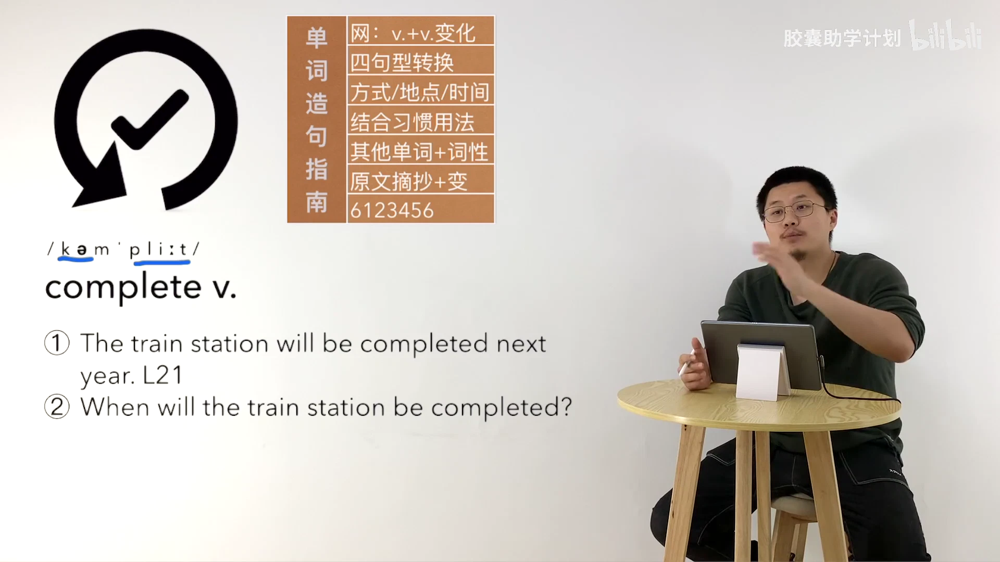

文字识别：单词造句指南 / 网：v.+v.变化 / 胶囊助学计划 / 四句型转换 / 方式/地点/时间 / 结合习惯用法 / 其他单词+词性 / 原文摘抄+变 / 6123456 / /kam'pli:t/ / complete v. / ① The train station will be completed next / year. L21 / When will the train station be completed?

### 画面 00:02:08

文字识别：单词造句指南 / 网：v.+v.变化 / 胶囊助学计划 / 四句型转换 / 方式/地点/时间 / 结合习惯用法 / 其他单词+词性 / 原文摘抄+变 / 6123456 / /kam'pli:t/ / complete v. / ① The train station will be completed next / year. L21 / When will the train station be completed?

### 画面 00:02:10

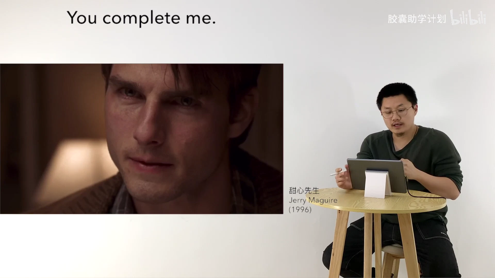

文字识别：You complete me. /  bit i / 胶囊助学计划 / 甜心先生 / Jerry Maguire / (1996)

### 画面 00:02:13

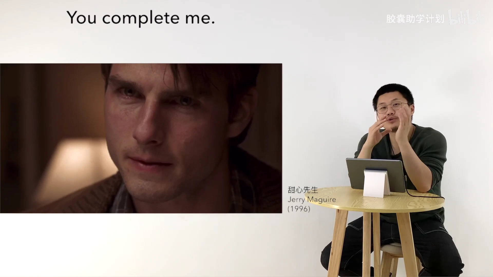

文字识别：You complete me. / 胶囊助学计划 / 甜心先生 / Jerry Maguire / (1996)

### 画面 00:02:22

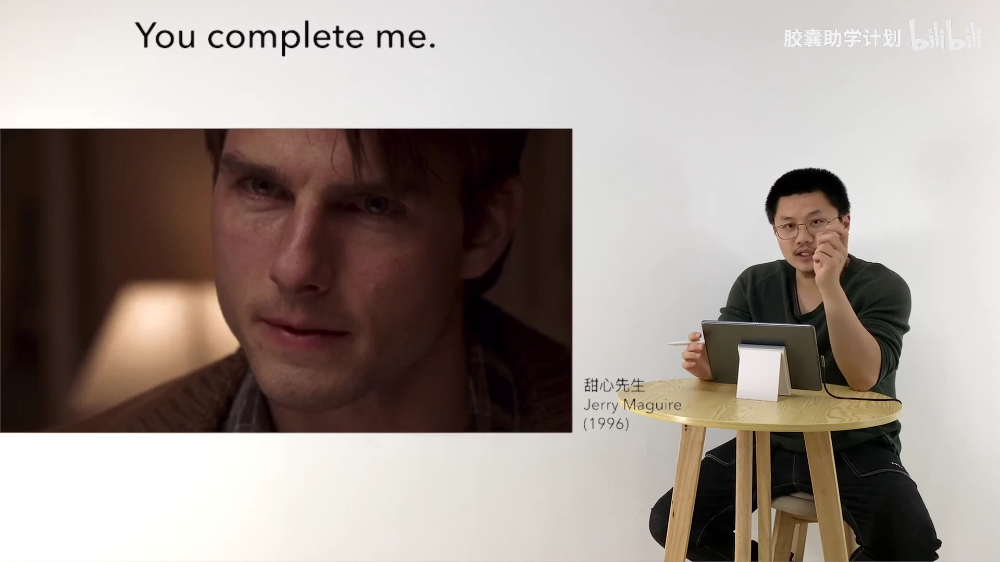

文字识别：You complete me. / 胶囊助学计划 / 甜心先生 / Jerry Maguire / (1996)

### 画面 00:02:24

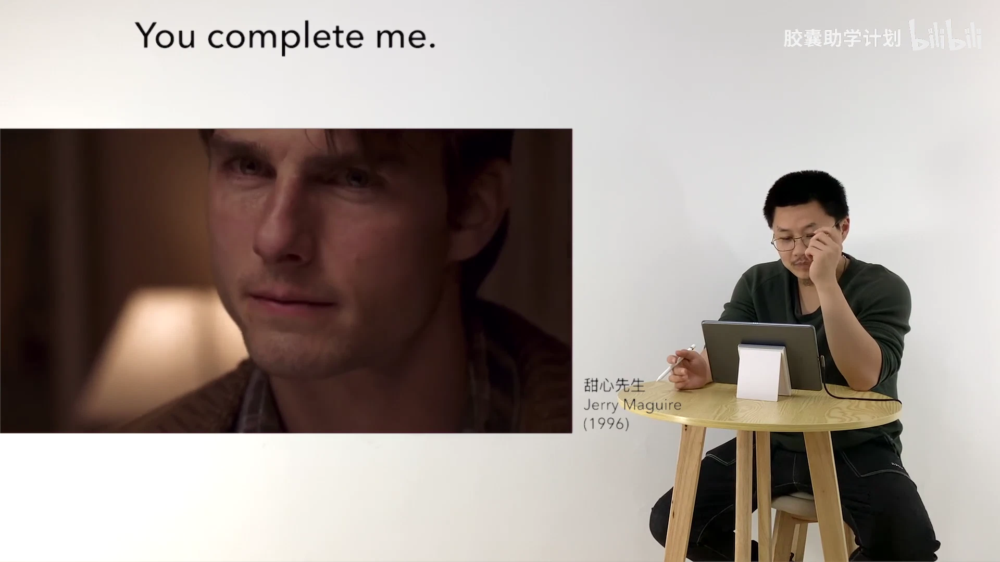

文字识别：You complete me. / 胶囊助学计划Lil / 甜心先生 / Jerry Maguire / (1996)

### 画面 00:02:26

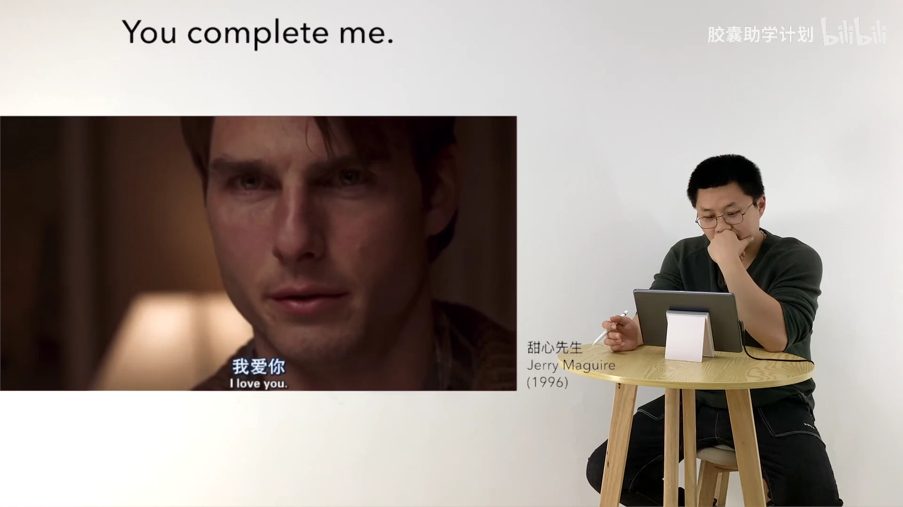

文字识别：You complete me. / 胶囊助学计划 / 甜心先生 / 我爱你 / Jerry Maguire / Ilove you. / (1996)

### 画面 00:02:28

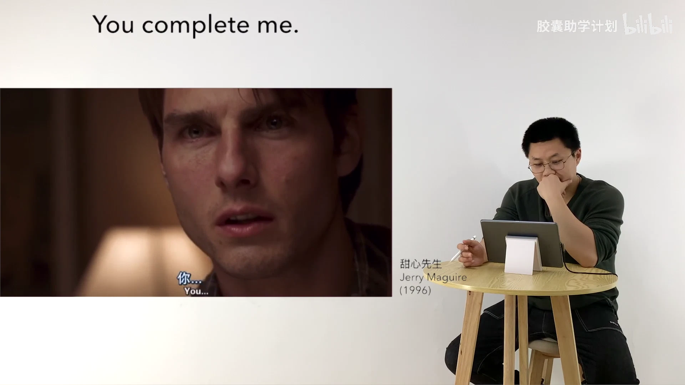

文字识别：You complete me. / BitLi / 胶囊助学计划 / 甜心先生 / 你.. / Jerry Maguire / You... / (1996)

## 00:02:30–00:03:00

complete me. Am I just had shut up? Just shut up. You had me at hello. You had me at hello. Okay,啊再跟我读一遍，叫做You complete me. Okay, very good.好，下一个单词跟我一起读一下，叫做Modern Modern啊，你也可以在后面加一个儿化音，因为有字母二嘛，对

### 画面 00:02:30

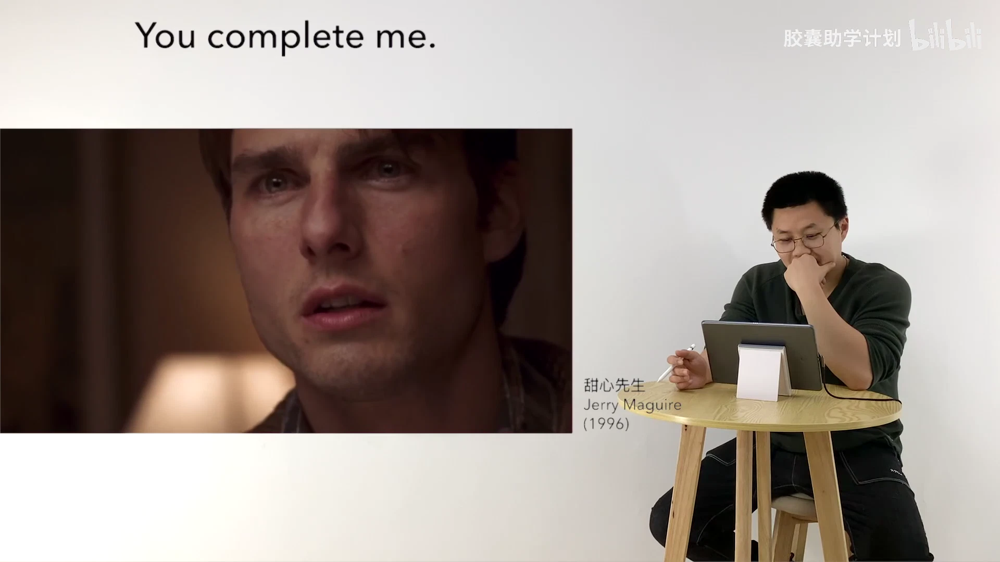

文字识别：You complete me. / 胶囊助学计划 / 甜心先生 / Jerry Maguire / (1996)

### 画面 00:02:32

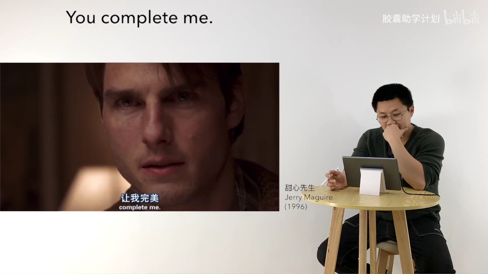

文字识别：You complete me. / Bitbit / 胶囊助学计划 / 甜心先生 / 让我完美 / Jerry Maguire / complete me. / (1996)

### 画面 00:02:34

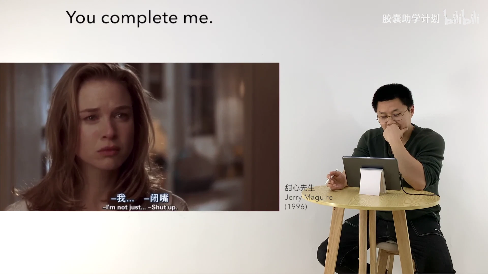

文字识别：You complete me. / bitLi / 胶囊助学计划 / 甜心先生 / —我.-闭嘴 / Jerry Maguire / —I'm not just...-Shut up. / (1996)

### 画面 00:02:36

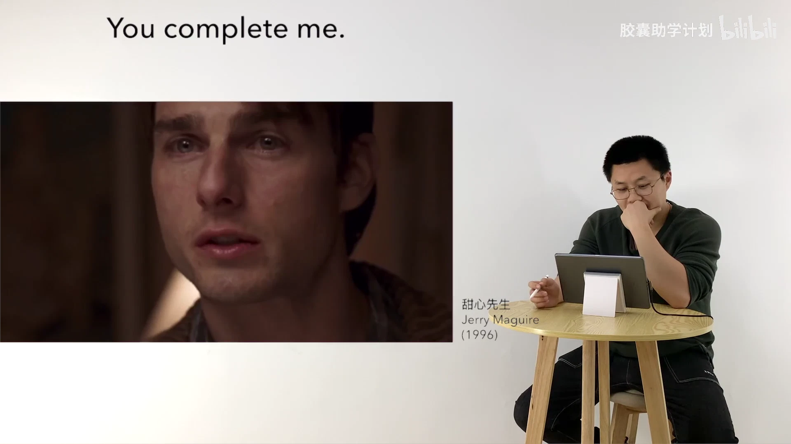

文字识别：You complete me. / biltlilt / 胶囊助学计划 / 甜心先生 / Jerry Maguire / (1996)

### 画面 00:02:38

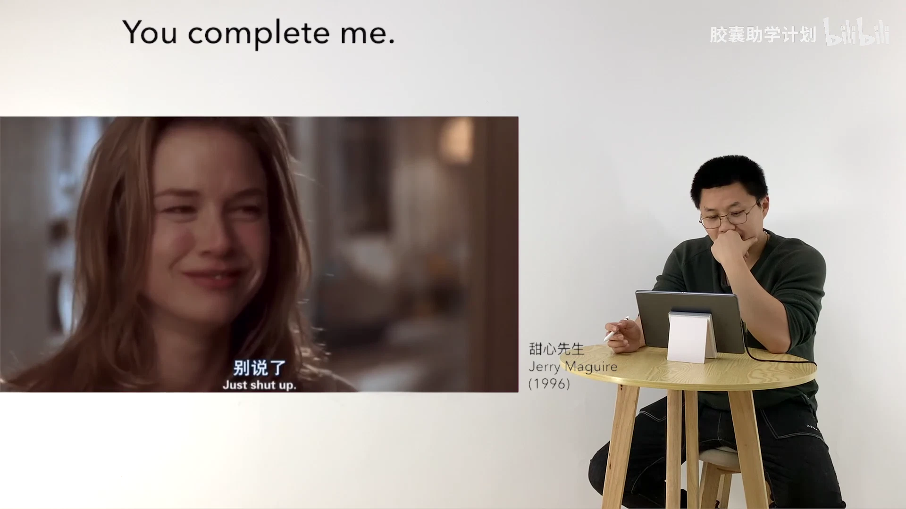

文字识别：You complete me. / Bitbili / 胶囊助学计划 / 甜心先生 / 别说了 / Jerry Maguire / Just shut up. / (1996)

### 画面 00:02:40

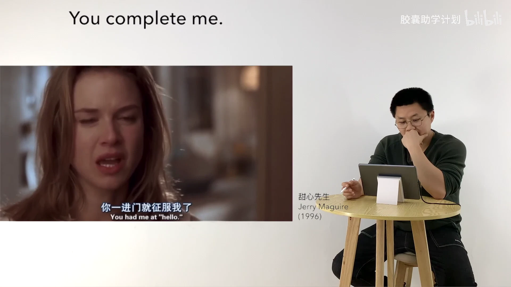

文字识别：You complete me. / 胶囊助学计划 / 甜心先生 / 你一进门就征服我了 / Jerry Maguire / You had me at"hello." / (1996)

### 画面 00:02:42

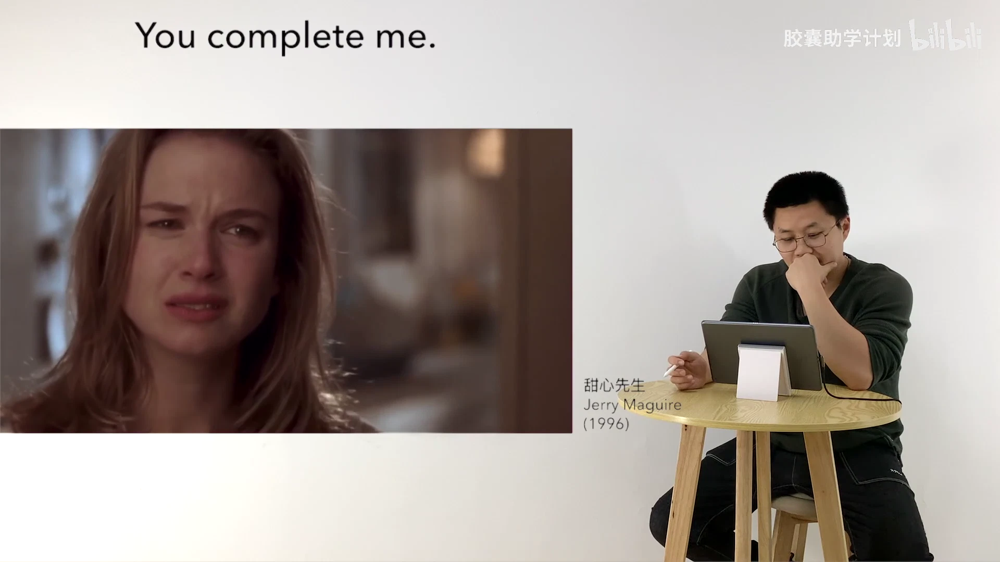

文字识别：You complete me. / 胶囊助学计划 / 甜心先生 / Jerry Maguire / (1996)

### 画面 00:02:44

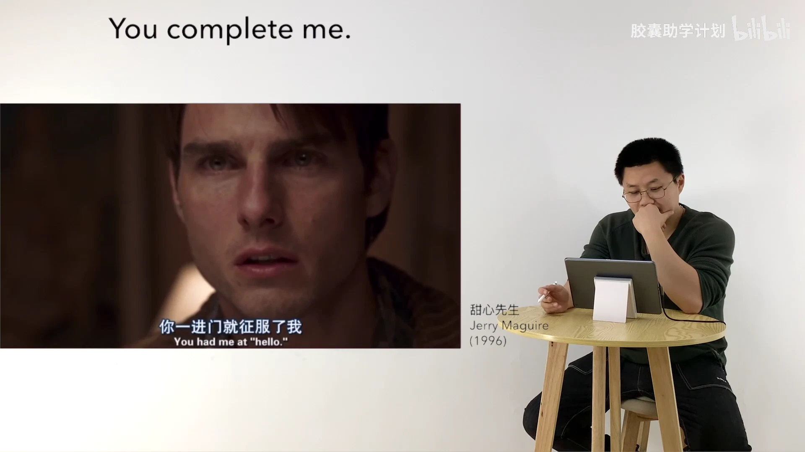

文字识别：You complete me. / bibli / 胶囊助学计划 / 甜心先生 / 你一进门就征服了我 / Jerry Maguire / You had me at"hello." / (1996)

### 画面 00:02:46

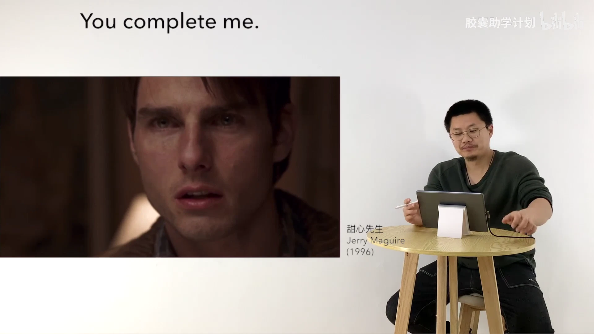

文字识别：You complete me. / 胶囊助学计划H / 甜心先生 / Jerry Maguire / (1996)

### 画面 00:02:52

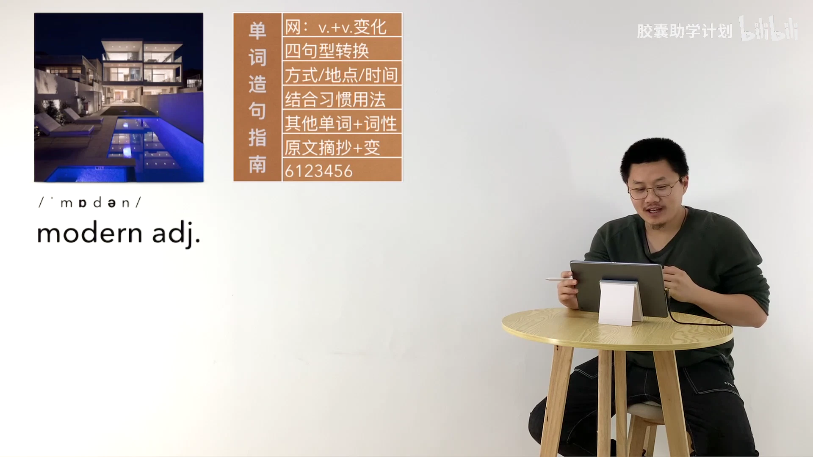

文字识别：单词造句指南 / 网：v.+v.变化 / 胶囊助学计划 / Bibii / 四句型转换 / 方式/地点/时间 / 结合习惯用法 / 其他单词+词性 / 原文摘抄+变 / 6123456 / /'mpdan/ / modern adj.

### 画面 00:02:54

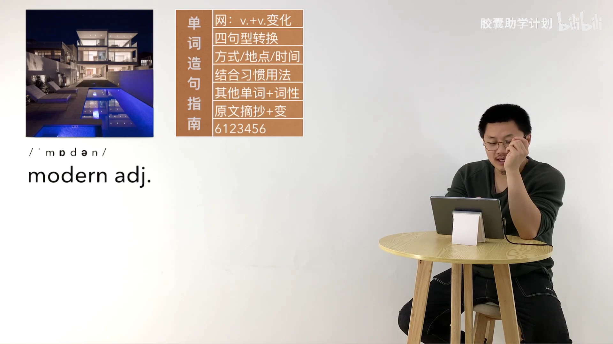

文字识别：单词造句指南 / 网：v.+v.变化 / 胶囊助学计划 / Bibii / 四句型转换 / 方式/地点/时间 / 结合习惯用法 / 其他单词+词性 / 原文摘抄+变 / 6123456 / /'mpdan/ / modern adj.

### 画面 00:02:56

文字识别：单词造句指南 / 网：v.+v.变化 / 胶囊助学计划 / 四句型转换 / 方式/地点/时间 / 结合习惯用法 / 其他单词+词性 / 原文摘抄+变 / 6123456 / /'mpdan / / modern adj.

## 00:03:00–00:03:30

吧？Modern, modern, OK, modern。哦，它指的是现代的，那现代的，比如说我们说 modern house, modern chair, OK，就特别现代化，一看就不是那种老式的。那它的反义词对应的就是我们汉语说老式的，对吧？很现代化的某个东西。那你看 modern 它是一个形容词，那我们看词性的角度，它就要加名词，比如说 modern house, modern chair，布拉布拉布拉等等，对吧？我们之前学过的很多东西都可

### 画面 00:03:00

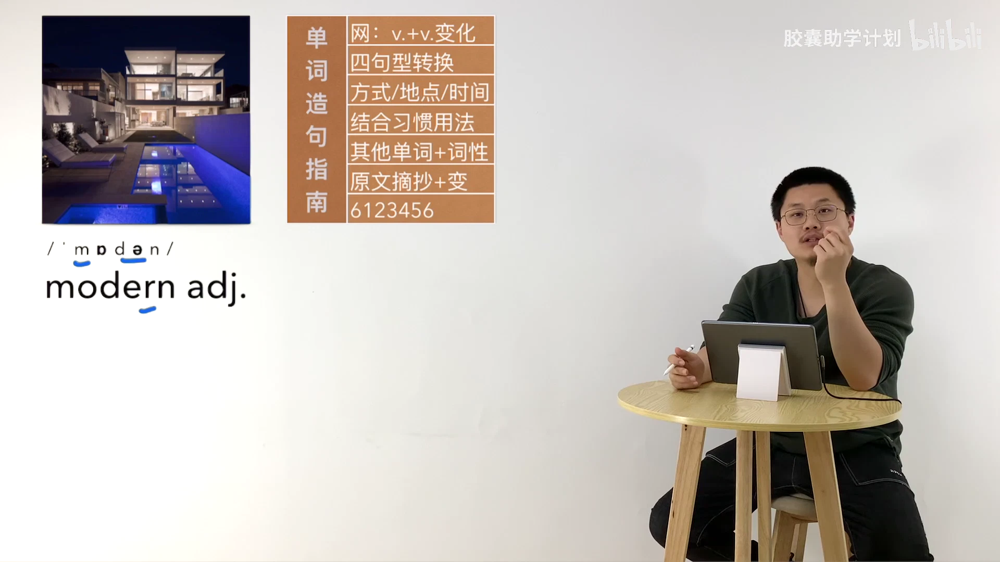

文字识别：单词造句指南 / 网：v.+v.变化 / 胶囊助学计划 / 四句型转换 / 方式/地点/时间 / 结合习惯用法 / 其他单词+词性 / 原文摘抄+变 / 6123456 / /'mpdan/ / modern adj.

### 画面 00:03:03

文字识别：单词造句指南 / 网：v.+v.变化 / 胶囊助学计划 / 四句型转换 / 方式/地点/时间 / 结合习惯用法 / 其他单词+词性 / 原文摘抄+变 / 6123456 / /mpdan/ / modern adj.

### 画面 00:03:06

文字识别：单词造句指南 / 网：v.+v.变化 / 胶囊助学计划 / Biibli / 四句型转换 / 方式/地点/时间 / 结合习惯用法 / 其他单词+词性 / 原文摘抄+变 / 6123456 / /mpdan/ / modern adj.

### 画面 00:03:11

文字识别：单词造句指南 / 网：v.+v.变化 / 胶囊助学计划 / 四句型转换 / 方式/地点/时间 / 结合习惯用法 / 其他单词+词性 / 原文摘抄+变 / 6123456 / /mpdan/ / modern adj. / ① modern house/chair...

### 画面 00:03:16

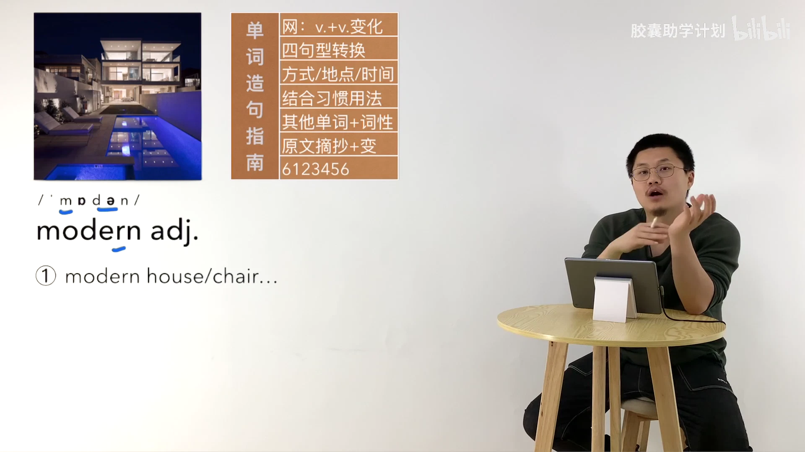

文字识别：单词造句指南 / 网：v.+v.变化 / 胶囊助学计划 / Biii / 四句型转换 / 方式/地点/时间 / 结合习惯用法 / 其他单词+词性 / 原文摘抄+变 / 6123456 / /mpdan/ / modern adj. / ① modern house/chair...

### 画面 00:03:21

文字识别：单词造句指南 / 网：v.+v.变化 / 胶囊助学计划 / Bitbii / 四句型转换 / 方式/地点/时间 / 结合习惯用法 / 其他单词+词性 / 原文摘抄+变 / 6123456 / /mpdan/ / modern adj. / modern house/chair... / 1

### 画面 00:03:25

文字识别：单词造句指南 / 网：v.+v.变化 / 胶囊助学计划 / BiBii / 四句型转换 / 方式/地点/时间 / 结合习惯用法 / 其他单词+词性 / 原文摘抄+变 / 6123456 / /mpdan/ / modern adj. / ① modern house/chair...

### 画面 00:03:28

文字识别：单词造句指南 / 网：v.+v.变化 / 胶囊助学计划 / Bitbi / 四句型转换 / 方式/地点/时间 / 结合习惯用法 / 其他单词+词性 / 原文摘抄+变 / 6123456 / /'mpd an/ / modern adj. / ① modern house/chair...

## 00:03:30–00:04:00

以用 modern 去做一个小的限定。那对于他来说，到这儿还不够，我们还要要么去结合其他习惯用法，要么去找另一个词性，也就是动词。那如何去找动词呢？还是我在这儿继续在尝试强调一下。今天不给各位找，但是家庭作业其中之一就是回去各位自己去找。各位习惯的方式是直接拿一个字，先想一句汉语，然后

### 画面 00:03:30

文字识别：单词造句指南 / 网：v.+v.变化 / 胶囊助学计划 / Bibii / 四句型转换 / 方式/地点/时间 / 结合习惯用法 / 其他单词+词性 / 原文摘抄+变 / 6123456 / /mpd an/ / modern adj. / ① modern house/chair...

### 画面 00:03:33

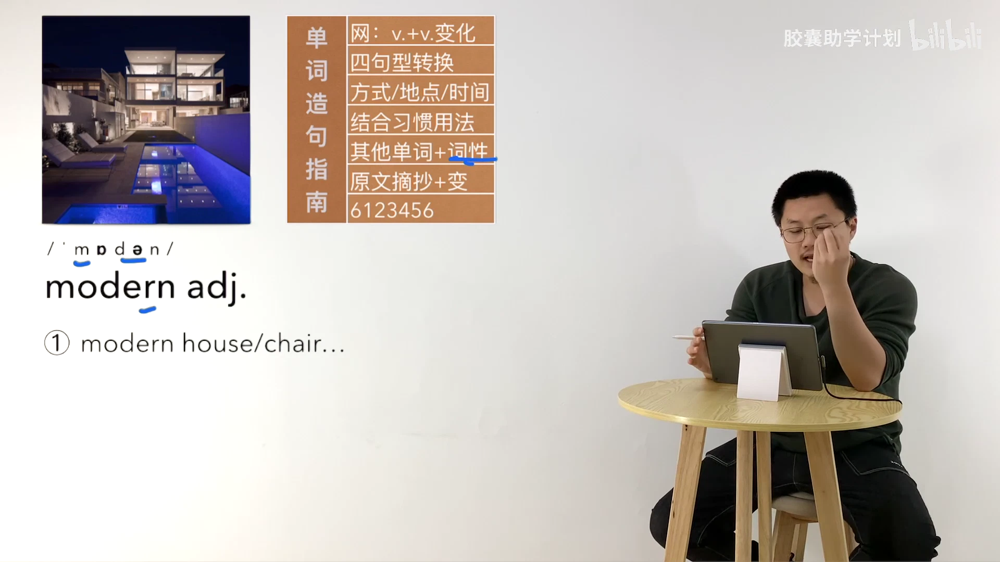

文字识别：单词造句指南 / 网：v.+v.变化 / 胶囊助学计划 / Biltbili / 四句型转换 / 方式/地点/时间 / 结合习惯用法 / 其他单词+词性 / 原文摘抄+变 / 6123456 / /mpd an/ / modern adj. / ) modern house/chair... / 1

### 画面 00:03:35

文字识别：单词造句指南 / 网：v.+v.变化 / 胶囊助学计划 / Bitbi / 四句型转换 / 方式/地点/时间 / 结合习惯用法 / 其他单词+词性 / 原文摘抄+变 / 6123456 / /mpdan/ / modern adj. / modern house/chair..

### 画面 00:03:37

文字识别：单词造句指南 / 网：v.+v.变化 / 胶囊助学计划 / 四句型转换 / 方式/地点/时间 / 结合习惯用法 / 其他单词+词性 / 原文摘抄+变 / 6123456 / /mpdan/ / modern adj. / modern house/chair.. / 1

### 画面 00:03:39

文字识别：单词造句指南 / 网：v.+v.变化 / 胶囊助学计划 / Bitbii / 四句型转换 / 方式/地点/时间 / 结合习惯用法 / 其他单记+词性 / 原文摘抄+变 / 6123456 / /mpdan/ / modern adj. / modern house/chair...

### 画面 00:03:41

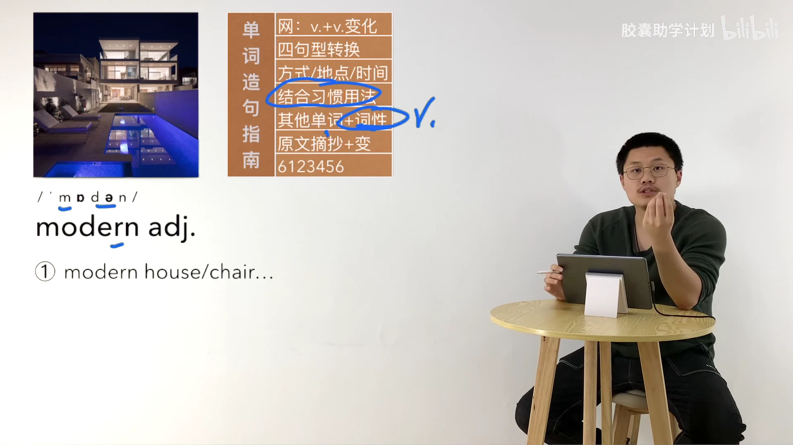

文字识别：单词造句指南 / 网：v.+v.变化 / 胶囊助学计划 / 四句型转换 / 方式/地点/时间 / 结合习惯用法 / V / 其他单记+词性 / 原文摘抄+变 / 6123456 / /mpdan/ / modern adj. / modern house/chair..

### 画面 00:03:45

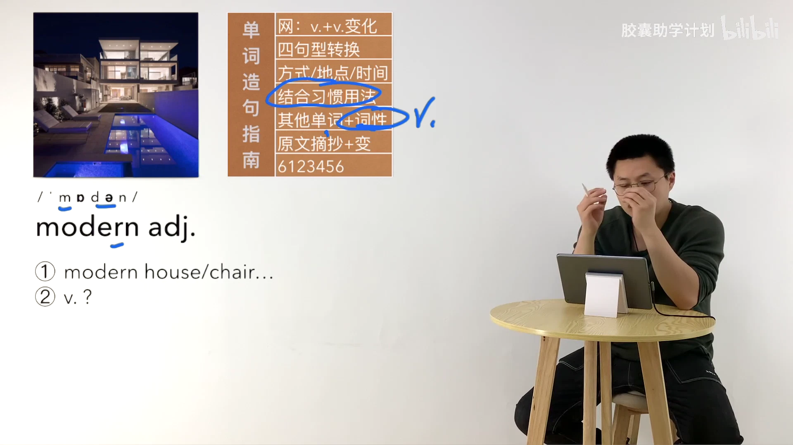

文字识别：单词造句指南 / 网：v.+v.变化 / 胶囊助学计划 / 四句型转换 / 方式/地点/时间 / 结合习惯用法 / V / 其他单记+词性 / 原文摘抄+变 / 6123456 / /mpdan/ / modern adj. / modern house/chair.. / v.?

### 画面 00:03:51

文字识别：单词造句指南 / 网：v.+v.变化 / 胶囊助学计划 / BitBii / 四句型转换 / 方式/地点/时间 / 结合习惯用法 / V. / 其他单记+词性 / 原文摘抄+变 / 6123456 / /mpdan/ / modern adj. / modern house/chair.. / v.?

### 画面 00:03:55

文字识别：单词造句指南 / 网：v.+v.变化 / 胶囊助学计划 / LiHLi / 四句型转换 / 方式/地点/时间 / 结合习惯用法 / V / 其他单记+词性 / 原文摘抄+变 / 6123456 / /mpdan/ / modern adj. / modern house/chair.. / v.?

## 00:04:00–00:04:30

拿字典把这句汉语当中的动词给查到，然后呢，你会发现，哎，这个表示这个汉语意思的动词可能有好几个，然后您随便看谁顺眼，随便找一个拿出来造一个句子，这样的错误率非常的高，因为它你做了一个错误的前提假设，认为只要是汉语这么用，那英文这个动词必定也可以这么用，但英文往往不是这样的，所以这样错误率很高。那如何保证自己

### 画面 00:04:01

文字识别：单词造句指南 / 网：v.+v.变化 / 胶囊助学计划 / Bitbii / 四句型转换 / 方式/地点/时间 / 结合习惯用法 / V / 其他单记+词性 / 原文摘抄+变 / 6123456 / /mpdan/ / modern adj. / modern house/chair.. / v.?

### 画面 00:04:13

文字识别：单词造句指南 / 网：v.+v.变化 / 胶囊助学计划 / bitbili / 四句型转换 / 方式/地点/时间 / 结合习惯用法 / V. / 其他单记+词性 / 原文摘抄+变 / 6123456 / /mpdan/ / modern adj. / modern house/chair.. / v.?

### 画面 00:04:18

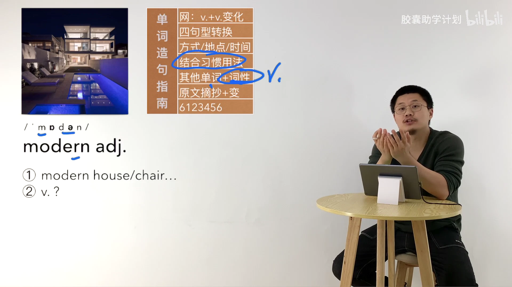

文字识别：单词造句指南 / 网：v.+v.变化 / 胶囊助学计划 / Bibii / 四句型转换 / 方式/地点/时间 / 结合习惯用法 / V / 其他单记+词性 / 原文摘抄+变 / 6123456 / /mpd an/ / modern adj. / modern house/chair.. / v.?

### 画面 00:04:23

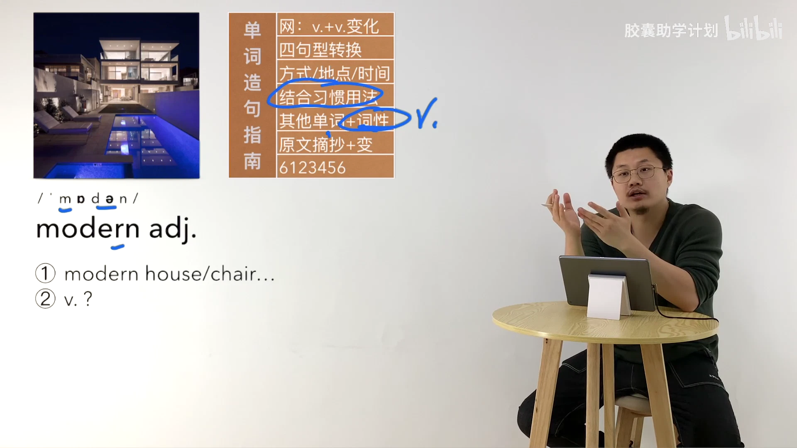

文字识别：单词造句指南 / 网：v.+v.变化 / 胶囊助学计划 / Bibii / 四句型转换 / 方式/地点/时间 / 结合习惯用法 / V. / 其他单记+词性 / 原文摘抄+变 / 6123456 / /mpdan/ / modern adj. / modern house/chair.. / v.?

### 画面 00:04:26

文字识别：单词造句指南 / 网：v.+v.变化 / 胶囊助学计划 / bilbili / 四句型转换 / 方式/地点/时间 / 结合习惯用法 / V / 其他单记+词性 / 原文摘抄+变 / 6123456 / /mpdan/ / modern adj. / modern house/chair.. / v.?

## 00:04:30–00:05:00

的这个错误率降低呢？一般来说，整体上来说啊，您尽可能去找我们之前学过的一些非常简单的动词，您别去找那些没学过的，因为各位没法判断它能不能跟 modern chair 连在一起，对吧？比如说，你一定能判断的最简单的一个动词，我们新一就学过，叫做 buy，对吧？ buy a modern chair, buy a modern house, OK，这个 buy 的动词对于各位来说，哎，我们就先放到这儿。如果我们只

### 画面 00:04:33

文字识别：单词造句指南 / 网：v.+v.变化 / 胶囊助学计划 / bitbil / 四句型转换 / 方式/地点/时间 / 结合习惯用法 / V / 其他单记+词性 / 原文摘抄+变 / 6123456 / /mpd an/ / modern adj. / modern house/chair.. / v.?

### 画面 00:04:35

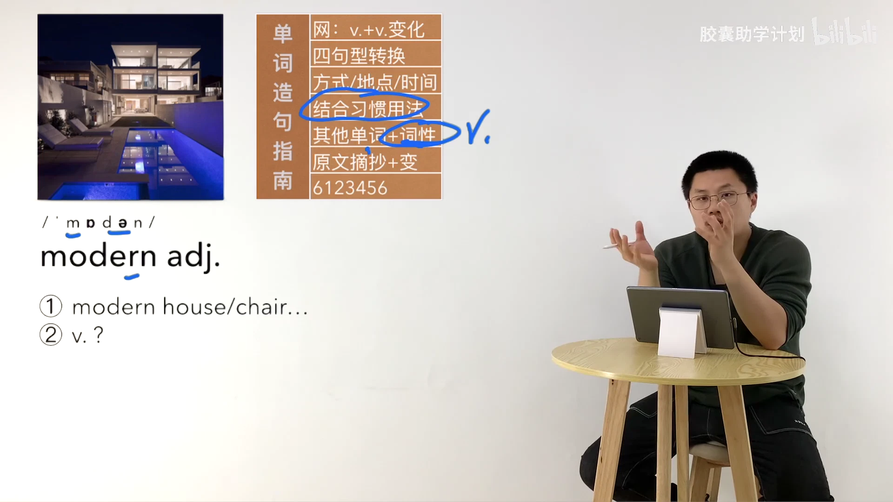

文字识别：单词造句指南 / 网：v.+v.变化 / 胶囊助学计划 / 四句型转换 / 方式/地点/时间 / 结合习惯用法 / V. / 其他单记+词性 / 原文摘抄+变 / 6123456 / /mpd an/ / modern adj. / modern house/chair.. / v.?

### 画面 00:04:40

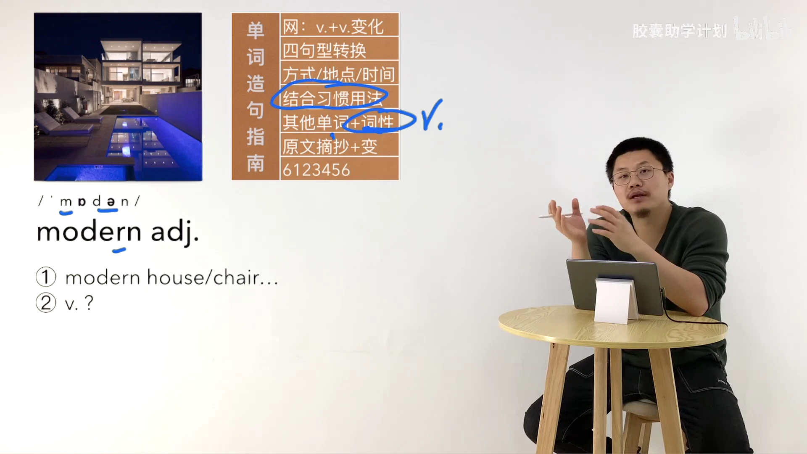

文字识别：单词造句指南 / 网：v.+v.变化 / 胶囊助学计划 / 四句型转换 / 方式/地点/时间 / 结合习惯用法 / V / 其他单记+词性 / 原文摘抄+变 / 6123456 / /mpdan/ / modern adj. / modern house/chair.. / v.?

### 画面 00:04:43

文字识别：单词造句指南 / 网：v.+v.变化 / 胶囊助学计划 / Biibii / 四句型转换 / 方式/地点/时间 / 结合习惯用法 / V. / 其他单记+词性 / 原文摘抄+变 / 6123456 / /mpd an/ / modern adj. / modern house/chair.. / v.?

### 画面 00:04:49

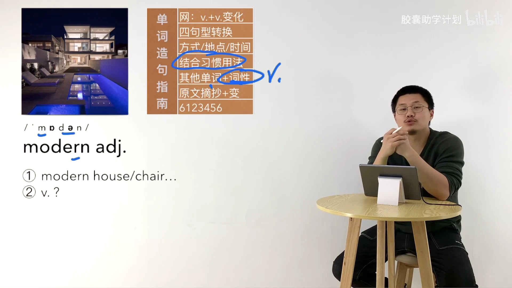

文字识别：单词造句指南 / 网：v.+v.变化 / 胶囊助学计划 / 四句型转换 / 方式/地点/时间 / 结合习惯用法 / V. / 其他单记+词性 / 原文摘抄+变 / 6123456 / /mpd an/ / modern adj. / modern house/chair.. / v.?

### 画面 00:04:55

文字识别：单词造句指南 / 网：v.+v.变化 / 胶囊助学计划 / Bibit / 四句型转换 / 方式/地点/时间 / 结合习惯用法 / V. / 其他单记+词性 / 原文摘抄+变 / 6123456 / /mpd an/ / modern adj. / modern house/chair.. / v.?

### 画面 00:04:57

文字识别：单词造句指南 / 网：v.+v.变化 / 胶囊助学计划 / Litbii / 四句型转换 / 方式/地点/时间 / 结合习惯用法 / V. / 其他单记+词性 / 原文摘抄+变 / 6123456 / /mpdan/ / modern adj. / modern house/chair.. / V.? / b

### 画面 00:04:59

文字识别：单词造句指南 / 网：v.+v.变化 / 胶囊助学计划 / biltbii / 四句型转换 / 方式/地点/时间 / 结合习惯用法 / V. / 其他单记+词性 / 原文摘抄+变 / 6123456 / /mpd an / / modern adj. / modern house/chair.. / V.? / bwm

## 00:05:00–00:05:30

是造五个句子，其实您找到 by 这个动词，我们配合前两点，换情态动词啊，换情态动词，主动被动，时态，主动被动，这四个结构，包括情态动词表推测，对吧？这五个东西，基本上对于各位来说，造出来二三十个句子就已经很轻松了，对吧？当然了，如果你还有点自我要求，你再往前翻一翻，看看有没有什么别的动词能跟它去连起来，比如说建造一个 modern

### 画面 00:05:03

文字识别：单词造句指南 / 网：v.+v.变化 / 胶囊助学计划 / 四句型转换 / 方式/地点/时间 / 结合习惯用法 / V / 其他单记+词性 / 原文摘抄+变 / 6123456 / /'mpd an/ / modern adj. / modern house/chair... / V.? / bwm

### 画面 00:05:05

文字识别：单词造句指南 / 网：v.+v.变化 / 胶囊助学计划 / Bibili / 四句型转换 / 方式/地点/时间 / 结合习惯用法 / V / 其他单记+词性 / 原文摘抄+变 / 6123456 / /mpdan/ / modern adj. / modern house/chair... / V.? / bwm

### 画面 00:05:07

文字识别：单词造句指南 / 网：v.+v.变化 / 胶囊助学计划 / 四句型转换 / 方式/地点/时间 / 结合习惯用法 / V / 其他单记+词性 / 原文摘抄+变 / 6123456 / /mpdan/ / modern adj. / modern house/chair... / V.? / bwm

### 画面 00:05:10

文字识别：单词造句指南 / 网：v.+v.变化 / 胶囊助学计划 / 四句型转换 / 方式/地点/时间 / 结合习惯用法 / V / 其他单记+词性 / 原文摘抄+变 / 6123456 / /mpdan/ / modern adj. / modern house/chair.. / V.? / bwm

### 画面 00:05:16

文字识别：单词造句指南 / 网：v.+v.变化 / 胶囊助学计划 / Litbi / 四句型转换 / 方式/地点/时间 / 结合习惯用法 / V / 其他单记+词性 / 原文摘抄+变 / 6123456 / /mpdan/ / modern adj. / modern house/chair... / V.? / bwm

### 画面 00:05:20

文字识别：单词造句指南 / 网：v.+v.变化 / 胶囊助学计划 / Bitbii / 四句型转换 / 方式/地点/时间 / 结合习惯用法 / V / 其他单记+词性 / 原文摘抄+变 / 6123456 / /mpdan/ / modern adj. / modern house/chair... / V.? / bwm

### 画面 00:05:23

文字识别：单词造句指南 / 网：v.+v.变化 / 胶囊助学计划 / bitBit / 四句型转换 / 方式/地点/时间 / 结合习惯用法 / V / 其他单记+词性 / 原文摘抄+变 / 6123456 / /mpdan/ / modern adj. / modern house/chair... / V.? / bwm

### 画面 00:05:25

文字识别：单词造句指南 / 网：v.+v.变化 / 胶囊助学计划 / Bitbil / 四句型转换 / 方式/地点/时间 / 结合习惯用法 / V / 其他单记+词性 / 原文摘抄+变 / 6123456 / /mpdan/ / modern adj. / modern house/chair... / V.? / bwm

### 画面 00:05:28

文字识别：单词造句指南 / 网：v.+v.变化 / 胶囊助学计划 / BiLii / 四句型转换 / 方式/地点/时间 / 结合习惯用法 / V. / 其他单记+词性 / 原文摘抄+变 / 6123456 / /mpdan/ / modern adj. / modern house/chair... / V.? / bwm

## 00:05:30–00:06:00

house, OK? 所以今天各位的一个小家庭作业就是您往前翻，不要找字典，您往前翻看我们之前学过的动词有哪些可以跟 modern house 或 modern chair。当然，您也可以自己去啊换一些别的名词，能连起来，然后造一个小的句子出来，再进行一些四句型转化。对于各位来说啊，一个 modern 造一百个句子完全不是一件难事儿了，是吧？这要自己去试了啊。OK，下

### 画面 00:05:31

文字识别：单词造句指南 / 网：v.+v.变化 / 胶囊助学计划 / 四句型转换 / 方式/地点/时间 / 结合习惯用法 / V. / 其他单记+词性 / 原文摘抄+变 / 6123456 / /'mpdan/ / modern adj. / modern house/chair... / V.? / bwm

### 画面 00:05:36

文字识别：单词造句指南 / 网：v.+v.变化 / 胶囊助学计划 / 四句型转换 / 方式/地点/时间 / 结合习惯用法 / V. / 其他单记+词性 / 原文摘抄+变 / 6123456 / /mpdan/ / modern adj. / modern house/chair... / V.? / bwm

### 画面 00:05:41

文字识别：单词造句指南 / 网：v.+v.变化 / 胶囊助学计划 / BitBii / 四句型转换 / 方式/地点/时间 / 结合习惯用法 / V. / 其他单记+词性 / 原文摘抄+变 / 6123456 / /mpdan/ / modern adj. / modern house/chair... / V.? / bwm

### 画面 00:05:46

文字识别：单词造句指南 / 网：v.+v.变化 / 胶囊助学计划 / 四句型转换 / 方式/地点/时间 / 结合习惯用法 / V / 其他单记+词性 / 原文摘抄+变 / 6123456 / /mpdan/ / modern adj. / modern house/chair... / V.? / bwm

### 画面 00:05:50

文字识别：单词造句指南 / 网：v.+v.变化 / 胶囊助学计划 / bitbl / 四句型转换 / 方式/地点/时间 / 结合习惯用法 / 其他单记+词性 / 原文摘抄+变 / 6123456 / /mpdan/ / modern adj. / modern house/chair... / V.? / bwm

### 画面 00:05:55

文字识别：单词造句指南 / 网：v.+v.变化 / 胶囊助学计划 / Biltbiti / 四句型转换 / 方式/地点/时间 / 结合习惯用法 / V. / 其他单记+词性 / 原文摘抄+变 / 6123456 / /mpdan/ / modern adj. / modern house/chair... / V.? / bwm

### 画面 00:05:59

文字识别：单词造句指南 / 网：v.+v.变化 / 胶囊助学计划 / 四句型转换 / 方式/地点/时间 / 结合习惯用法 / 其他单词+词性 / 原文摘抄+变 / 6123456 / /streind3/ / strange adj.

## 00:06:00–00:06:30

一个单词，注意把它这儿浊化一下，浊对吧？来，strange，strange啊，叫做非常奇怪的。比如说它是形容词，我们先造一句话吧，说This picture looks so strange啊，说这张照片啊，这张图片呢看起来好奇怪呀。OK，肯定句给各位了，我们进行四句型转化，然后在这儿呢，哎，我配合了一个新概念，一册六十七课咱们就学过的一个语法，叫做否定

### 画面 00:06:01

文字识别：单词造句指南 / 网：v.+v.变化 / 胶囊助学计划 / Bibii / 四句型转换 / 方式/地点/时间 / 结合习惯用法 / 其他单词+词性 / 原文摘抄+变 / 6123456 / /streind3/ / strange adj.

### 画面 00:06:04

文字识别：单词造句指南 / 网：v.+v.变化 / 胶囊助学计划 / Bitbii / 四句型转换 / 方式/地点/时间 / 结合习惯用法 / 其他单词+词性 / 原文摘抄+变 / 6123456 / /streind3/ / strange adj.

### 画面 00:06:06

文字识别：单词造句指南 / 网：v.+v.变化 / 胶囊助学计划 / Bibii / 四句型转换 / 方式/地点/时间 / 结合习惯用法 / 其他单词+词性 / 原文摘抄+变 / 6123456 / /streind3/ / strange adj.

### 画面 00:06:09

文字识别：单词造句指南 / 网：v.+v.变化 / 胶囊助学计划 / Bibii / 四句型转换 / 方式/地点/时间 / 结合习惯用法 / 其他单词+词性 / 原文摘抄+变 / 6123456 / /streind3/ / strange adj. / ① This picture looks so strange.

### 画面 00:06:11

文字识别：单词造句指南 / 网：v.+v.变化 / 胶囊助学计划 / Bitbil / 四句型转换 / 方式/地点/时间 / 结合习惯用法 / 其他单词+词性 / 原文摘抄+变 / 6123456 / /streind3/ / strange adj. / ① This picture looks so strange.

### 画面 00:06:16

文字识别：单词造句指南 / 网：v.+v.变化 / 胶囊助学计划 / BiiBii / 四句型转换 / 方式/地点/时间 / 结合习惯用法 / 其他单词+词性 / 原文摘抄+变 / 6123456 / /streind3/ / strange adj. / ① This picture looks so strange.

### 画面 00:06:20

文字识别：单词造句指南 / 网：v.+v.变化 / 胶囊助学计划 / BiLii / 四句型转换 / 方式/地点/时间 / 结合习惯用法 / 其他单词+词性 / 原文摘抄+变 / 6123456 / /streind3/ / strange adj. / D This picture looks so strange.

### 画面 00:06:25

文字识别：单词造句指南 / 网：v.+v.变化 / 胶囊助学计划 / LitLii / 四句型转换 / 方式/地点/时间 / 结合习惯用法 / 其他单词+词性 / 原文摘抄+变 / 6123456 / /streind3/ / strange adj. /  This picture looks so strange. / Doesn't this picture look strange?

### 画面 00:06:28

文字识别：单词造句指南 / 网：v.+v.变化 / 胶囊助学计划 / 四句型转换 / 方式/地点/时间 / 结合习惯用法 / 其他单词+词性 / 原文摘抄+变 / 6123456 / /streind3/ / strange adj. /  This picture looks so strange. / 1 / Doesn't this picture look strange?

## 00:06:30–00:07:00

疑问句，叫做 Doesn't this picture look strange？说难道这张图片看起来不奇怪吗？OK，以及 Why does this picture look so strange？说为什么它看起来如此的奇怪呢？OK，很简单，其实我们就是做了一点点四句型的转换。OK，好，下一个单词我们管它叫做 district district。OK，我们管它叫区啊，比如说海淀 district 叫海

### 画面 00:06:30

文字识别：单词造句指南 / 网：v.+v.变化 / 胶囊助学计划 / LitLii / 四句型转换 / 方式/地点/时间 / 结合习惯用法 / 其他单词+词性 / 原文摘抄+变 / 6123456 / /streind3/ / strange adj. / This picture looks so strange. / Doesn't this picture look strange?

### 画面 00:06:35

文字识别：单词造句指南 / 网：v.+v.变化 / 胶囊助学计划 / 四句型转换 / 方式/地点/时间 / 结合习惯用法 / 其他单词+词性 / 原文摘抄+变 / 6123456 / /streind3/ / strange adj. /  This picture looks so strange. / Doesn't this picture look strange?

### 画面 00:06:38

文字识别：单词造句指南 / 网：v.+v.变化 / 胶囊助学计划 / bill / 四句型转换 / 方式/地点/时间 / 结合习惯用法 / 其他单词+词性 / 原文摘抄+变 / 6123456 / /streind3/ / strange adj. / ① This picture looks so strange. / Doesn't this picture look strange? / 2） / Why does this picture look so strange? / 3

### 画面 00:06:40

文字识别：单词造句指南 / 网：v.+v.变化 / 胶囊助学计划 / 四句型转换 / 方式/地点/时间 / 结合习惯用法 / 其他单词+词性 / 原文摘抄+变 / 6123456 / /streind3/ / strange adj. /  This picture looks so strange. / 1 / Doesn't this picture look strange? / 2 / Why does this picture look so strange? / 3

### 画面 00:06:46

文字识别：单词造句指南 / 网：v.+v.变化 / 胶囊助学计划 / 四句型转换 / 方式/地点/时间 / 结合习惯用法 / 其他单词+词性 / 原文摘抄+变 / 6123456 / /streind3/ / strange adj. / ① This picture looks so strange. / Doesn't this picture look strange? / 2 / Why does this picture look so strange? / 3

### 画面 00:06:48

文字识别：单词造句指南 / 网：v.+v.变化 / 胶囊助学计划 / 四句型转换 / 方式/地点/时间 / 结合习惯用法 / 其他单词+词性 / 原文摘抄+变 / 6123456 / /streind3/ / strange adj. / D This picture looks so strange. / Doesn't this picture look strange? / 2 / Why does this picture look so strange? / 3

### 画面 00:06:50

文字识别：单词造句指南 / 网：v.+v.变化 / 胶囊助学计划 / Bibii / 四句型转换 / 方式/地点/时间 / 结合习惯用法 / 其他单词+词性 / 原文摘抄+变 / 6123456 / /'distrikt/ / district n.

### 画面 00:06:53

文字识别：单词造句指南 / 网：v.+v.变化 / 胶囊助学计划 / LiltLii / 四句型转换 / 方式/地点/时间 / 结合习惯用法 / 其他单词+词性 / 原文摘抄+变 / 6123456 / /'dIstrikt/ / district n.

### 画面 00:06:55

文字识别：单词造句指南 / 网：v.+v.变化 / 胶囊助学计划 / BiLii / 四句型转换 / 方式/地点/时间 / 结合习惯用法 / 其他单词+词性 / 原文摘抄+变 / 6123456 / /'dIstrikt/ / district n.

### 画面 00:06:58

文字识别：单词造句指南 / 网：v.+v.变化 / 胶囊助学计划 / BitBi / 四句型转换 / 方式/地点/时间 / 结合习惯用法 / 其他单词+词性 / 原文摘抄+变 / 6123456 / /'distrikt/ / district n. / Haidian District

## 00:07:00–00:07:30

区啊，各位就会表达了，对吧？那朝阳区触类旁通啊，照葫芦画瓢，Chaoyang District, very good.好，比如说I lived in Haidian District, very good.那把它，这说我曾经是这样，我配合了一个动词变化，一般过去时，我把它变四句型进行转化，叫Did you live in Haidian District?你说哎呀，我现在假设我人在深圳，对吧？然后呢，我说我跟朋友聊天，说我曾经啊住海淀区，或

### 画面 00:07:00

文字识别：单词造句指南 / 网：v.+v.变化 / 胶囊助学计划 / Bitbii / 四句型转换 / 方式/地点/时间 / 结合习惯用法 / 其他单词+词性 / 原文摘抄+变 / 6123456 / /'distrikt/ / district n. / Haidian District

### 画面 00:07:04

文字识别：单词造句指南 / 网：v.+v.变化 / 胶囊助学计划 / 四句型转换 / 方式/地点/时间 / 结合习惯用法 / 其他单词+词性 / 原文摘抄+变 / 6123456 / /'distrikt/ / district n. / Haidian District

### 画面 00:07:07

文字识别：单词造句指南 / 网：v.+v.变化 / 胶囊助学计划 / BiLii / 四句型转换 / 方式/地点/时间 / 结合习惯用法 / 其他单词+词性 / 原文摘抄+变 / 6123456 / /'distrikt/ / district n. / Haidian District

### 画面 00:07:10

文字识别：单词造句指南 / 网：v.+v.变化 / 胶囊助学计划 / BiBii / 四句型转换 / 方式/地点/时间 / 结合习惯用法 / 其他单词+词性 / 原文摘抄+变 / 6123456 / /'distrikt/ / district n. / Haidian District / I lived in Haidian District.

### 画面 00:07:14

文字识别：单词造句指南 / 网：v.+v.变化 / 胶囊助学计划 / biltBilt / 四句型转换 / 方式/地点/时间 / 结合习惯用法 / 其他单词+词性 / 原文摘抄+变 / 6123456 / /'dIstrikt/ / district n. / Haidian District / I lived in Haidian District.

### 画面 00:07:16

文字识别：单词造句指南 / 网：v.+v.变化 / 胶囊助学计划 / BitLii / 四句型转换 / 方式/地点/时间 / 结合习惯用法 / 其他单词+词性 / 原文摘抄+变 / 6123456 / /'dIstrikt/ / district n. / Haidian District / I lived in Haidian District.

### 画面 00:07:19

文字识别：单词造句指南 / 网：v.+v.变化 / 胶囊助学计划 / Bitbi / 四句型转换 / 方式/地点/时间 / 结合习惯用法 / 其他单词+词性 / 原文摘抄+变 / 6123456 / /'distrikt/ / district n. / Haidian District / I lived in Haidian District. / Did you live in Haidian District?

### 画面 00:07:21

文字识别：单词造句指南 / 网：v.+v.变化 / 胶囊助学计划 / Bibii / 四句型转换 / 方式/地点/时间 / 结合习惯用法 / 其他单词+词性 / 原文摘抄+变 / 6123456 / /'dIstrikt/ / district n. / Haidian District / I lived in Haidian District. / Did you live in Haidian District?

### 画面 00:07:25

文字识别：单词造句指南 / 网：v.+v.变化 / 胶囊助学计划 / LiHLI / 四句型转换 / 方式/地点/时间 / 结合习惯用法 / 其他单词+词性 / 原文摘抄+变 / 6123456 / /'dIstrikt/ / district n. / Haidian District / )I lived in Haidian District. / 2 / Did you live in Haidian District?

### 画面 00:07:28

文字识别：单词造句指南 / 网：v.+v.变化 / 胶囊助学计划 / BiliBit / 四句型转换 / 方式/地点/时间 / 结合习惯用法 / 其他单词+词性 / 原文摘抄+变 / 6123456 / /'dIstrikt/ / district n. / )Haidian District / )I lived in Haidian District. / 2 / Did you live in Haidian District?

## 00:07:30–00:08:00

或者他问说，哎，你原来住海淀区啊？OK，玩一个，然后我们再结合各种特殊疑问词，这个各位可以暂停屏幕，立刻进行一个口语练习，我就不一一带着各位去练了。OK，好啊，带一个吧，说Where did you live？是吧？当然跟这跟这跟海淀District没关系了啊，直接问的是海淀District，玩一个。接下来呢，我们直接进入文章，文章并不难，全是我们之前学过的语法，我稍微慢一点，

### 画面 00:07:33

文字识别：单词造句指南 / 网：v.+v.变化 / 胶囊助学计划 / 四句型转换 / 方式/地点/时间 / 结合习惯用法 / 其他单词+词性 / 原文摘抄+变 / 6123456 / /'dIstrikt/ / district n. / Haidian District / I lived in Haidian District. / Did you live in Haidian District? / why/who/when...

### 画面 00:07:36

文字识别：单词造句指南 / 网：v.+v.变化 / 胶囊助学计划 / 四句型转换 / 方式/地点/时间 / 结合习惯用法 / 其他单词+词性 / 原文摘抄+变 / 6123456 / /'dIstrikt/ / district n. / Haidian District / I lived in Haidian District. / Did you live in Haidian District? / why/who/when...

### 画面 00:07:40

文字识别：单词造句指南 / 网：v.+v.变化 / 胶囊助学计划 / 四句型转换 / 方式/地点/时间 / 结合习惯用法 / 其他单词+词性 / 原文摘抄+变 / 6123456 / /dIstrikt/ / district n. / Haidian District / I lived in Haidian District. / Did you live in Haidian District? / why/who/when...

### 画面 00:07:44

文字识别：单词造句指南 / 网：v.+v.变化 / 胶囊助学计划 / bilibili / 四句型转换 / 方式/地点/时间 / 结合习惯用法 / 其他单词+词性 / 原文摘抄+变 / 6123456 / /dIstrikt/ / district n. / Haidian District / I lived in Haidian District. / Did you live in Haidian District? / why/who/when... / Where did you live?

### 画面 00:07:46

文字识别：单词造句指南 / 网：v.+v.变化 / 胶囊助学计划 / Bitbii / 四句型转换 / 方式/地点/时间 / 结合习惯用法 / 其他单词+词性 / 原文摘抄+变 / 6123456 / /'dIstrikt/ / district n. / Haidian District / I lived in Haidian District. / Did you live in Haidian District? / why/who/when... / Where did you live?

### 画面 00:07:50

文字识别：单词造句指南 / 网：v.+v.变化 / 胶囊助学计划 / Blbii / 四句型转换 / 方式/地点/时间 / 结合习惯用法 / 其他单词+词性 / 原文摘抄+变 / 6123456 / /'dIstrikt/ / district n. / Haidian District / I lived in Haidian District. / Did you live in Haidian District? / why/who/when... / Where did you live?

### 画面 00:07:52

文字识别：胶囊助学计划bl出 / I had a letter from my sister yesterday. / She lives in Nigeria. / In her letter, she said that she would come to / England next year. / If she comes, she will get a surprise.

## 00:08:00–00:08:30

带着各位去看一看啊。来了，I had a letter from my sister yesterday。好，首先 yesterday 和 had 这两个单词放到一起是很舒服的，都是表过去，对不对？哎，它是一般过去式。其次呢，我们从来没见过这个短语叫 had a letter from somebody。但是我们结合上下文，我认为你多少就我们不结合上下文，我们就结合这句话，我总觉得你能猜出来。

### 画面 00:08:22

文字识别：胶囊助学计划bl出 / I had a letter from my sister yesterday. / She lives in Nigeria. / In her letter, she said that she would come to / England next year. / If she comes, she will get a surprise.

### 画面 00:08:24

文字识别：胶囊助学计划 / I had a letter from my sister yesterday. / She lives in Nigeria. / In her letter, she said that she would come to / England next year. / If she comes, she will get a surprise.

## 00:08:30–00:09:00

这个 had 在这个地方特别像我们之前学过的一个单词叫 receive，是吧？我也说不好，我觉得这就是汉语感啊。叫做 I received a letter from my sister yesterday. 两个完全是一码事儿。继续，一般现一般过去时。下一句话说 she lives in Nigeria。好，她住在尼日利亚。注意 she lives in Nigeria。各位看到 lives 陈述客观事实，叫做一

### 画面 00:08:30

文字识别：胶囊助学计划H出 / I had a letter from my sister yesterday. / She lives in Nigeria. / In her letter, she said that she would come to / England next year. / If she comes, she will get a surprise.

## 00:09:00–00:09:30

般现在时，对吧？OK，In her letter，在她信当中，she said that，哎，后边一个典型的宾语从句，她说的是什么呢？She would come to England next year。她将来到英格兰 next year，叫做明年。其实这个 would 啊，我们在这个地方也有的老师会把它归为是一个时态，有的老师会把它不归为一个时态啊。这个对于各位来说呢，其实我们

### 画面 00:09:00

文字识别：胶囊助学计划bl出 / I had a letter from my sister yesterday. / She lives in Nigeria. / In her letter, she said that she would come to / England next year. / If she comes, she will get a surprise.

### 画面 00:09:24

文字识别：胶囊助学计划l / I had a letter from my sister yesterday. / She lives in Nigeria. / In her letter, she said that she would come to / England next year. / If she comes, she will get a surprise.

## 00:09:30–00:10:00

从不归为时态的那个角度去想，你想一下啊，如果是一个宾语从句，我们给它画一下，前面你用的是 said，那后面这个地方时态就要倒退一下，原来是 will next year 嘛，对吧？原来是 will，他之前说他将怎么怎么样，那这个地方你就要把 will 换成 would，我们之前有学过，对吧？所以在这儿我们就不多提了，不把它当做时态去处理啊。 If she comes，第十六课学

### 画面 00:09:36

文字识别：胶囊助学计划bl出 / I had a letter from my sister yesterday. / She lives in Nigeria. / In her letter, she said fhat she would come to / England next year, / If she comes, she will get a surprise.

### 画面 00:09:40

文字识别：胶囊助学计划b出 / I had a letter from my sister yesterday. / She lives in Nigeria / In her letter, she aidfhat she would come to / England next year, / If she comes, she will get a surprise.

### 画面 00:09:44

文字识别：胶囊助学计划l出 / She lives in Nigeria / In her letter, she aid fhat she would come to / England next year, / If she comes, she will get a surprise.

## 00:10:00–00:10:30

的，如果怎么怎么样，对吧？主将主将从现，对吧？主 She will get a surprise. Will 主将一般将来时，从句一般现在时。如果她来，对吧？如果她来，她将哎大吃一惊。 Okay, will get a surprise. 哎吃惊，对吧？ Continue. Where now? 说我们现在 living in a beautiful new house in the country. 我们现在正居住在一个特别美丽的新房

### 画面 00:10:14

文字识别：胶囊助学计划H山 / She lives in Nigeria / In her letter, she aidfhat she would come to / England next year, / If she comes, she will get a surprise.

### 画面 00:10:18

文字识别：胶囊助学计划bi鼎 / We are now living in a beautiful new house in the country. / Work on it had begun before my sister left. / The house was completed five months ago. / In my letter, I told her that she could stay with us.

## 00:10:30–00:11:00

子在乡下。现在进行时，work on it had began before my sister left. 好，我们先看这个 before，这是我们之前学的 before after 和 had done did 的那个用法，不知道各位还记不记得，对吧？我们是讲一个人在法国开车的那个小故事啊，在那课我们学到的，包括 as soon as，我们把 before 先加一个圈儿，前后其实呢就是两句话。我们先看第一句

### 画面 00:10:48

文字识别：胶囊助学计划b出l / We are now living in a beautiful new house in the country. / Work on it had begun before my sister left. / The house was completed five months ago. / In my letter, I told her that she could stay with us.

### 画面 00:10:56

文字识别：胶囊助学计划bill / We are now living in a beautiful new house in the country. / Work on it had begun before my sister left. / The house was completed five months ago. / In my letter, I told her that she could stay with us.

## 00:11:00–00:11:30

话，叫 Work on it had began. 好，Work on it，在它上面的工作啊，这个表达其实不是非常典型，至少对于新概念这个课程当中来说啊，已经开始了。过去完成时，在什么之前呢？在 My sister left，在我妹妹离开英国之前，英格兰之前，已经开始建造这座房子了。The house说

### 画面 00:11:03

文字识别：胶囊助学计划bitl / We are now living in a beautiful new house in the country. / Work on it had begun/before my sister left. / The house was completed five months ago. / In my letter, I told her that she could stay with us.

### 画面 00:11:14

文字识别：胶囊助学计划ll / We are now living in a beautiful new house in the country. / Work on it had begun/before my sister left. / The house was completed five months ago. / In my letter, I told her that she could stay with us.

## 00:11:30–00:12:00

这个房子was completed.好了，一般过去时的被动was was加d.第十课在学的，对吧？Five months ago,五个月之前。In my letter,在我的信当中呢，I told her that又是一个宾语从句。把你看前面是told，所以把can要换成could。我记得这应该是咱们第十五课学的，对吧？关于宾语从句那课。我告诉他什么呢？She could stay with us.她可以

### 画面 00:11:32

文字识别：胶囊助学计划l出 / We are now living in a beautiful new house in the country. / Work on it had begun/before my sister left. / The house was completed five months ago. / In my letter, I told her that she could stay with us.

## 00:12:00–00:12:30

can stay with us and stay with us. Okay, continue. The house has many large rooms. Say this house has many large rooms. Say this house has many large rooms. Say this house has many large rooms. Say this house has many large rooms. Say this house has many large rooms. Say this house has many large rooms. Say this house has many large rooms. Say this house has many large rooms. Say this house has many large rooms. Say this house has many large rooms. Say this house has many large rooms. Say this house has many large rooms. Say this house has many large rooms. Say this house has many large rooms. Say this house has many large rooms. Say this house has many large rooms.

### 画面 00:12:02

文字识别：胶囊助学计划ll / We are now living in a beautiful new house in the country. / Work on it had begun/before my sister left. / The house was completed five months ago. / In my letter, I told her that she could stay with us.

### 画面 00:12:06

文字识别：胶囊助学计划出 / The house has many large rooms and there / is a lovely garden. / It is a very modern house, so it looks strange / to some people. / It must be the only modern house in the / district.

## 00:12:30–00:13:00

棒。It is a very modern house. 它是一个非常现代化的房子。那对应的就是老式的房子，对吧？So，所以呢，哎，这个实际上你看，so前面是一个逗号啊，提前铺垫一下。等在二十五课啊，马上我们就会学到了各种连词，比如说and， but， so啊。其实第一个单元我们已经见过很多了，但是没系统性的讲。It looks strange.

### 画面 00:12:36

文字识别：胶囊助学计划bi山 / The house has many large rooms and there / is a lovely garden. / It is a very modern house, so it looks strange / to some people. / It must be the only modern house in the / district.

### 画面 00:12:46

文字识别：胶囊助学计划 / L7 / The house has many large rooms and there / is a lovely garden. / It is a very modern house,So / t looks strange / to some people. / It must be the only modern house in the / district.

### 画面 00:12:58

文字识别：胶囊助学计划 / L25 / The house has many large rooms and there / is a lovely garden. / It is a very modern house, / t looks strange / to some people. / It must be the only modern house in the / district.

## 00:13:00–00:13:30

说它呀看起来特别的奇怪，to some people.对于某些人啊，it looks strange to some people. Here we go. It must be must be.十七，我没有记错的话，十七、十九、二十一这三课，我们都分别学到了情态动词表推测。只不过二十一学的是情态动词表推测的被动用法，must

### 画面 00:13:04

文字识别：胶囊助学计划 / L25 / The house has many large rooms and there / is a lovely garden. / It is a very modern house, / t looks strange / to some people. / It must be the only modern house in the / district.

## 00:13:30–00:14:00

have been done, 对吧？然后十七课学的是 must 和 can't，十九课学的是 may 和 might 表推测。那这个地方就是十七课咱们提到它，它一定是表推测。The only modern house in the district，唯一一个现代化的房子在这个区域。OK，那文章结束了呢，我们从文章当中摘出来两个小的习惯用法，带着各位简单去造一些小的句子。第一个 have a letter

### 画面 00:13:34

文字识别：胶囊助学计划 / L25 / The house has many large rooms and there / is a lovely garden. / It is a very modern house, / t looks strange / to some people. / It must be the only modern house in the / district.

### 画面 00:13:42

文字识别：胶囊助学计划业 / L25 / The house has many large rooms and there / is a lovely garden. / It is a very modern house, / it looks strange / to some people. / It must be the only modern house in the / district.

### 画面 00:13:49

文字识别：胶囊助学计划 / L25 / The house has many large rooms and there / is a lovely garden. / It is a very modern house, / it looks strange / to some people. / It must be the only modern house in the / district.

### 画面 00:13:51

文字识别：bitbii / 胶囊助学计划 / 习惯用法造句 / have a letter from sb. / get a surprise / 公

### 画面 00:13:53

文字识别：bitbii / 胶囊助学计划 / 习惯用法造句 / have a letter from sb. / get a surprise

### 画面 00:13:55

文字识别：bitbii / 胶囊助学计划 / 习惯用法造句 / have a letter from sb. / get a surprise

### 画面 00:13:57

文字识别：bitbil / 网：v.+v.变化 / 胶囊助学计划 / 习惯用法造句指南 / 四句型转换 / 方式/地点/时间 / 其他习惯用法 / 其他单词+词性 / 原文摘抄+变 / 6123456 / have a letter from sb.

### 画面 00:13:59

文字识别：Bitbii / 网：v.+v.变化 / 胶囊助学计划 / 习惯用法造句指南 / 四句型转换 / 方式/地点/时间 / 其他习惯用法 / 其他单词+词性 / 原文摘抄+变 / 6123456 / have a letter from sb.

## 00:14:00–00:14:30

from somebody.比如说 I had a letter from your father last year.我们实际上就是把原文做了一点点小的改变，换了一下 your father from somebody的 somebody换了一下，然后添加了一个小的不同的时间，对吧？很简单，肯定句出来了。对于各位来说，那最简单四句型转化，对吧？Did you receive a letter from my father last year? 我把 had 换成了 receive，因为至少

### 画面 00:14:01

文字识别：网：v.+v.变化 / 胶囊助学计划 / 习惯用法造句指南 / 四句型转换 / 方式/地点/时间 / 其他习惯用法 / 其他单词+词性 / 原文摘抄+变 / 6123456 / have a letter from sb. / I had a letter from your father last year.

### 画面 00:14:05

文字识别：网：v.+v.变化 / 胶囊助学计划 / bitbii / 习惯用法造句指南 / 四句型转换 / 方式/地点/时间 / 其他习惯用法 / 其他单词+词性 / 原文摘抄+变 / 6123456 / have a letter from sb. / I had a letter from your father last year.

### 画面 00:14:07

文字识别：网：v.+v.变化 / 胶囊助学计划 / 习惯用法造句指南 / 四句型转换 / 方式/地点/时间 / 其他习惯用法 / 其他单词+词性 / 原文摘抄+变 / 6123456 / have a letter from sb. / I had a letter from your father last year.

### 画面 00:14:09

文字识别：网：v.+v.变化 / 胶囊助学计划 / Biltibii / 习惯用法造句指南 / 四句型转换 / 方式/地点/时间 / 其他习惯用法 / 其他单词+词性 / 原文摘抄+变 / 6123456 / have a letter from sb. / I had a letter from your father last year.

### 画面 00:14:11

文字识别：网：v.+v.变化 / 胶囊助学计划 / 习惯用法造句指南 / 四句型转换 / 方式/地点/时间 / 其他习惯用法 / 其他单词+词性 / 原文摘抄+变 / 6123456 / have a letter from sb. / I had a letter from your father last year.

### 画面 00:14:14

文字识别：网：v.+v.变化 / 胶囊助学计划 / 习惯用法造句指南 / 四句型转换 / 方式/地点/时间 / 其他习惯用法 / 其他单词+词性 / 原文摘抄+变 / 6123456 / have a letter from sb. / I had a letter from your fatherlast year

### 画面 00:14:16

文字识别：网：v.+v.变化 / 胶囊助学计划 / Bibit / 习惯用法造句指南 / 四句型转换 / 方式/地点/时间 / 其他习惯用法 / 其他单词+词性 / 原文摘抄+变 / 6123456 / have a letter from sb. / I had a letter from your father last year.

### 画面 00:14:18

文字识别：网：v.+v.变化 / 胶囊助学计划 / 习惯用法造句指南 / 四句型转换 / 方式/地点/时间 / 其他习惯用法 / 其他单词+词性 / 原文摘抄+变 / 6123456 / have a letter from sb. / I had a letter from your father last year.

### 画面 00:14:20

文字识别：网：v.+v.变化 / 胶囊助学计划 / Bbii / 习惯用法造句指南 / 四句型转换 / 方式/地点/时间 / 其他习惯用法 / 其他单词+词性 / 原文摘抄+变 / 6123456 / have a letter from sb. / I had a letter from your father last year.

### 画面 00:14:22

文字识别：网：v.+v.变化 / 胶囊助学计划 / 习惯用法造句指南 / 四句型转换 / 方式/地点/时间 / 其他习惯用法 / 其他单词+词性 / 原文摘抄+变 / 6123456 / have a letter from sb. / I had a letter from your father last year. / Did you receive a letter from my father last year?

### 画面 00:14:25

文字识别：网：v.+v.变化 / 胶囊助学计划 /  biibii / 习惯用法造句指南 / 四句型转换 / 方式/地点/时间 / 其他习惯用法 / 其他单词+词性 / 原文摘抄+变 / 6123456 / have a letter from sb. / I had a letter from your father last year. / Did you receive a letter from my father last year?

### 画面 00:14:27

文字识别：网：v.+v.变化 / 胶囊助学计划 / Biltbii / 习惯用法造句指南 / 四句型转换 / 方式/地点/时间 / 其他习惯用法 / 其他单词+词性 / 原文摘抄+变 / 6123456 / have a letter from sb. / I had a letter from your father last year. / Did you receive a letter from my father last year?

## 00:14:30–00:15:00

sense of language, I would think receive something from somebody is more common than have a letter from somebody. Okay, so we should try to learn the common ones. Then why, who, and when? For you, special questions. Just put them in, and three sentences come out. You can think of two more. This special question. This is a common way. You have made five sentences. Next, get a surprise. For example, I got a big surprise.

### 画面 00:14:30

文字识别：网：v.+v.变化 / 胶囊助学计划 / BitBli / 习惯用法造句指南 / 四句型转换 / 方式/地点/时间 / 其他习惯用法 / 其他单词+词性 / 原文摘抄+变 / 6123456 / have a letter from sb. / I had a letter from your father last year. / Did you receive a letter from my father last year?

### 画面 00:14:35

文字识别：网：v.+v.变化 / 胶囊助学计划 / BitBii / 习惯用法造句指南 / 四句型转换 / 方式/地点/时间 / 其他习惯用法 / 其他单词+词性 / 原文摘抄+变 / 6123456 / have a letter from sb. / I had a letter from your father last year. / Did you receive a letter from my father last year?

### 画面 00:14:37

文字识别：bibili / 网：v.+v.变化 / 胶囊助学计划 / 习惯用法造句指南 / 四句型转换 / 方式/地点/时间 / 其他习惯用法 / 其他单词+词性 / 原文摘抄+变 / 6123456 / have a letter from sb. / I had a letter from your father last year. / Did you receive a letter from my father last year?

### 画面 00:14:40

文字识别：Bibii / 网：v.+v.变化 / 胶囊助学计划 / 习惯用法造句指南 / 四句型转换 / 方式/地点/时间 / 其他习惯用法 / 其他单词+词性 / 原文摘抄+变 / 6123456 / have a letter from sb. / I had a letter from your father last year. / Did you receive a letter from my father last year?

### 画面 00:14:43

文字识别：Bitbii / 网：v.+v.变化 / 胶囊助学计划 / 习惯用法造句指南 / 四句型转换 / 方式/地点/时间 / 其他习惯用法 / 其他单词+词性 / 原文摘抄+变 / 6123456 / have a letter from sb. / I had a letter from your father last year. / Did you receive a letter from my father last year? / why/who/when...

### 画面 00:14:45

文字识别：Biltbii / 网：v.+v.变化 / 胶囊助学计划 / 习惯用法造句指南 / 四句型转换 / 方式/地点/时间 / 其他习惯用法 / 其他单词+词性 / 原文摘抄+变 / 6123456 / have a letter from sb. / I had a letter from your father last year. / Did you receive a letter from my father last year? / why/who/when...

### 画面 00:14:50

文字识别：bibili / 网：v.+v.变化 / 胶囊助学计划 / 习惯用法造句指南 / 四句型转换 / 方式/地点/时间 / 其他习惯用法 / 其他单词+词性 / 原文摘抄+变 / 6123456 / have a letter from sb. / I had a letter from your father last year. / Did you receive a letter from my father last year? / why/who/when...

### 画面 00:14:55

文字识别：bitbi / 网：v.+v.变化 / 胶囊助学计划 / 习惯用法造句指南 / 四句型转换 / 方式/地点/时间 / 其他习惯用法 / 其他单词+词性 / 原文摘抄+变 / 6123456 / have a letter from sb. / I had a letter from your father last year. / Did you receive a letter from my father last year? / why/who/when... / 0

### 画面 00:14:57

文字识别：biltbii / 习惯用法造句指南 / 网：v.+v.变化 / 胶囊助学计划 / 四句型转换 / 方式/地点/时间 / 其他习惯用法 / 其他单词+词性 / 原文摘抄+变 / 6123456 / get a surprise

### 画面 00:14:59

文字识别：网：v.+v.变化 / 胶囊助学计划 / bitbii / 习惯用法造句指南 / 四句型转换 / 方式/地点/时间 / 其他习惯用法 / 其他单词+词性 / 原文摘抄+变 / 6123456 / get a surprise / I got a big surprise from my girlfriend last birthday.

## 00:15:00–00:15:30

如说 I got a big surprise from my girlfriend last birthday. Okay, 我加了一个时间啊，我还加了一个来自于谁？肯定句出来了，时态也出来了。您自己想想，四句型转换就不是一个难事儿了，对吧？好，然后我们又造了一个句子，结合了第七课的一个语法，叫做 You will get a surprise when you get there. 说当你到，当怎么怎么样？When will? 各位还

### 画面 00:15:01

文字识别：网：v.+v.变化 / 胶囊助学计划 / bitbil / 习惯用法造句指南 / 四句型转换 / 方式/地点/时间 / 其他习惯用法 / 其他单词+词性 / 原文摘抄+变 / 6123456 / get a surprise / I got a big surprise from my girlfriend last birthday.

### 画面 00:15:03

文字识别：网：v.+v.变化 / 胶囊助学计划 / biltbil / 习惯用法造句指南 / 四句型转换 / 方式/地点/时间 / 其他习惯用法 / 其他单词+词性 / 原文摘抄+变 / 6123456 / get a surprise / I got a big surprise from my girlfriend last birthday.

### 画面 00:15:05

文字识别：bibii / 网：v.+v.变化 / 胶囊助学计划 / 习惯用法造句指南 / 四句型转换 / 方式/地点/时间 / 其他习惯用法 / 其他单词+词性 / 原文摘抄+变 / 6123456 / get a surprise / I got a big surprise from my girlfriend last birthday.

### 画面 00:15:09

文字识别：bitbili / 网：v.+v.变化 / 胶囊助学计划 / 习惯用法造句指南 / 四句型转换 / 方式/地点/时间 / 其他习惯用法 / 其他单词+词性 / 原文摘抄+变 / 6123456 / get a surprise / I got a big surprisefrom my girlfriend / last birthday.

### 画面 00:15:11

文字识别：网：v.+v.变化 / 胶囊助学计划 / bitbil / 习惯用法造句指南 / 四句型转换 / 方式/地点/时间 / 其他习惯用法 / 其他单词+词性 / 原文摘抄+变 / 6123456 / get a surprise / I got a big surprisefrom my girlfriend / last birthday.

### 画面 00:15:13

文字识别：网：v.+v.变化 / 胶囊助学计划 / bitbii / 习惯用法造句指南 / 四句型转换 / 方式/地点/时间 / 其他习惯用法 / 其他单词+词性 / 原文摘抄+变 / 6123456 / get a surprise / I got a big surprisefrom my girlfriend / last birthday.

### 画面 00:15:15

文字识别：bitbii / 网：v.+v.变化 / 胶囊助学计划 / 习惯用法造句指南 / 四句型转换 / 方式/地点/时间 / 其他习惯用法 / 其他单词+词性 / 原文摘抄+变 / 6123456 / get a surprise / I got a big surprisefrom my girlfriend / last birthday.

### 画面 00:15:18

文字识别：biltbili / 网：v.+v.变化 / 胶囊助学计划 / 习惯用法造句指南 / 四句型转换 / 方式/地点/时间 / 其他习惯用法 / 其他单词+词性 / 原文摘抄+变 / 6123456 / get a surprise / Igota big / surprisefrom my girlfriend / last birthday. / You will / get a surprise / when you getthere. L7

### 画面 00:15:20

文字识别：网：v.+v.变化 / 胶囊助学计划 / bibili / 习惯用法造句指南 / 四句型转换 / 方式/地点/时间 / 其他习惯用法 / 其他单词+词性 / 原文摘抄+变 / 6123456 / get a surprise / I got a big surprise from my girlfriend last birthday. / You will / I get a surprise when you get there. L7

### 画面 00:15:22

文字识别：网：v.+v.变化 / 胶囊助学计划 / bilibili / 习惯用法造句指南 / 四句型转换 / 方式/地点/时间 / 其他习惯用法 / 其他单词+词性 / 原文摘抄+变 / 6123456 / get a surprise / I got a big surprise from my girlfriend last birthday. / You will / get a surprise whe / n you get there. L7

### 画面 00:15:25

文字识别：bibili / 网：v.+v.变化 / 胶囊助学计划 / 习惯用法造句指南 / 四句型转换 / 方式/地点/时间 / 其他习惯用法 / 其他单词+词性 / 原文摘抄+变 / 6123456 / get a surprise / I got a big surprise from my girlfriend last birthday. / You will / get a surprise whe / n you get there. L7

### 画面 00:15:27

文字识别：bibili / 网：v.+v.变化 / 胶囊助学计划 / 习惯用法造句指南 / 四句型转换 / 方式/地点/时间 / 其他习惯用法 / 其他单词+词性 / 原文摘抄+变 / 6123456 / get a surprise / I got a big surprise from my girlfriend last birthday. / You will get a surprise whe / h you get there. L7

### 画面 00:15:29

文字识别：网：v.+v.变化 / 胶囊助学计划 / 习惯用法造句指南 / 四句型转换 / 方式/地点/时间 / 其他习惯用法 / 其他单词+词性 / 原文摘抄+变 / 6123456 / get a surprise / I got a big surprise from my girlfriend last birthday. / You will get a surprise whe / h you get there. L7

## 00:15:30–00:16:00

记得吧？就是第七课我们与过去进行时这个时态放到一起去学习的非常关键的两个连词。当你到达那里的时候，你将哎大吃一惊。OK，接下来呢，我们看一个小的电影片段。在这个电影片段当中，它除了出现了get a surprise，还出现了第二十课我们学到的叫做instead of doing something，以及give up，对吧？都是我们二十课学的，

### 画面 00:15:31

文字识别：网：v.+v.变化 / 胶囊助学计划 / 习惯用法造句指南 / 四句型转换 / 方式/地点/时间 / 其他习惯用法 / 其他单词+词性 / 原文摘抄+变 / 6123456 / get a surprise / I got a big surprise from my girlfriend last birthday. / You will get a surprise whe / n you get there. L7

### 画面 00:15:34

文字识别：网：v.+v.变化 / 胶囊助学计划 / Bitbll / 习惯用法造句指南 / 四句型转换 / 方式/地点/时间 / 其他习惯用法 / 其他单词+词性 / 原文摘抄+变 / 6123456 / get a surprise / I got a big surprise from my girlfriend last birthday. / You will get a surprise whe / h you get there. L7

### 画面 00:15:36

文字识别：网：v.+v.变化 / 胶囊助学计划 / 习惯用法造句指南 / 四句型转换 / 方式/地点/时间 / 其他习惯用法 / 其他单词+词性 / 原文摘抄+变 / 6123456 / get a surprise / I got a big surprise from my girlfriend last birthday. / You will get a surprise whe / h you get there. L7

### 画面 00:15:38

文字识别：网：v.+v.变化 / 胶囊助学计划 / 习惯用法造句指南 / 四句型转换 / 方式/地点/时间 / 其他习惯用法 / 其他单词+词性 / 原文摘抄+变 / 6123456 / get a surprise / I got a big surprise from my girlfriend last birthday. / You will / get a surprise whe / h you get there. L7

### 画面 00:15:40

文字识别：网：v.+v.变化 / 胶囊助学计划 / 习惯用法造句指南 / 四句型转换 / 方式/地点/时间 / 其他习惯用法 / 其他单词+词性 / 原文摘抄+变 / 6123456 / get a surprise / I got a big surprise from my girlfriend last birthday. / You will get a surprise whe / n you get there. L7

### 画面 00:15:42

文字识别：网：v.+v.变化 / 胶囊助学计划 / LiHB / 习惯用法造句指南 / 四句型转换 / 方式/地点/时间 / 其他习惯用法 / 其他单词+词性 / 原文摘抄+变 / 6123456 / get a surprise / I got a big surprise from my girlfriend last birthday. / You will / get a surprise whe / h you get there. L7

### 画面 00:15:44

文字识别：instead of giving / Bitbit / up. / 胶囊助学计划 / get a surprise / 烈女镖客 / Two Mules for / 如果不是突然袭击，我从不进攻击占优势的部队 / Sister Sara / Without surprise, I never attack superior forces. / (1970)

### 画面 00:15:48

文字识别：instead of  / giving / Bitbii / up… / 胶囊助学计划 / get a surprise / 烈女镖客 / Two Mules for / 如果不是突然袭击，我从不进攻击占优势的部队 / Sister Sara / Without surprise, I never attack superior forces. / (1970)

### 画面 00:15:56

文字识别：instead of / giving / bitLit / up… / 胶囊助学计划 / get a surprise / 烈女镖客 / Two Mules for / 如果不是突然袭击，我从不进攻击占优势的部队 / Sister Sara / Without surprise, I never attack superior forces. / (1970)

## 00:16:00–00:16:30

叫做代替放弃，你怎么怎么去做？好，那注意力集中来了。 Instead of giving up so easy, why don't you just listen a minute? I am listening to you, but I have my mind on my men. All you have on yours is money. All right, listen. I think I know how we can get a surprise. Three streets from here, there's a house. It used to be the residence of the bishop. To protect him in the rainy season, there was a tunnel. Okay, instead of giving up, listen a minute.

### 画面 00:16:08

文字识别：instead of / giving / Bitbii / up… / 胶囊助学计划 / get a surprise / 烈女镖客 / Two Mules for / 如果不是突然袭击，我从不进攻击占优势的部队 / Sister Sara / Without surprise, I never attack superior forces. / (1970)

### 画面 00:16:10

文字识别：instead of / giving / BitBii / up… / 胶囊助学计划 / get a surprise / 烈女镖客 / Two Mules for / 与其放弃，不如听我说 / Sister Sara / Instead of giving up, listen a minute. / (1970)

### 画面 00:16:12

文字识别：instead of / giving / Bitbii / up… / 胶囊助学计划 / get a surprise / 烈女镖客 / Two Mules for / 与其放弃，不如听我说 / Sister Sara / Instead of giving up, listen a minute. / (1970)

### 画面 00:16:14

文字识别：instead of / giving / bitbii / up… / 胶囊助学计划 / get a surprise / 烈女镖客 / 我在听，但我在乎我的人，而你只在乎钱 / Two Mules for / I am listening but I have my mind / Sister Sara / on my men, yours is only on money. / (1970)

### 画面 00:16:17

文字识别：instead of / giving / Bitilii / up… / 胶囊助学计划 / get a surprise / 烈女镖客 / Two Mules fok / 好了，我知道我们可以怎样突袭了 / Sister Sara / I know how we can get a surprise. / (1970)

### 画面 00:16:19

文字识别：instead of / giving / Biltbii / up… / 胶囊助学计划 / get a surprise / 烈女镖客 / Two Mules for / 好了，我知道我们可以怎样突袭了 / Sister Sara / I know how we can get a surprise. / (1970)

### 画面 00:16:21

文字识别：instead of / giving / bibit / up… / 胶囊助学计划 / get a surprise / 烈女镖客 / Two Mules for / 离这儿三条街外是主教的旧房子 / Sister Sara / Three streets from here is the bishop's old house. / (1970)

### 画面 00:16:23

文字识别：instead of / giving / BitLii / up… / 胶囊助学计划 / get a surprise / 烈女镖客 / Two Mules for / 离这儿三条街外是主教的旧房子 / Sister Sara / Three streets from here is the bishop's old house. / (1970)

### 画面 00:16:25

文字识别：instead of / giving / BitLii / up… / 胶囊助学计划 / get a surprise / 烈女镖客 / Two Mules fo / 为了避免他在雨季淋雨 / Sister Sara / To protect him in the rainy season there was a tunnel. / (1970)

### 画面 00:16:28

文字识别：instead of / giving / bitbi / up… / 胶囊助学计划 / get a surprise / 烈女镖客 / Two Mules for / 为了避免他在雨季淋雨 / Sister Sara / To protect him in the rainy season there was a tunnel. / (1970)

## 00:16:30–00:17:00

or get a surprise. Okay,好，那 recap 本课我们比较重要的其实没有什么语法了，就是一些单词和习惯用法，对吧？Okay，那对于各位来说，家庭作业单词造句，习惯用法造句，文章熟读成诵，为了我们下一课练习做准备。那以上就是本期视频的全部内容了。如果大家喜欢我们的课程呢，欢迎大家关注、订阅、一键三连，分享给那些需要的

### 画面 00:16:32

文字识别：bitbii / 胶囊助学计划 / Recap / You complete me. / Expression / have a letter from sb. / get a surprise

### 画面 00:16:34

文字识别：Bitbit / 胶囊助学计划 / Recap / You complete me. / Expression / have a letter from sb. / get a surprise

### 画面 00:16:36

文字识别：Biltbit / 胶囊助学计划 / Recap / You complete me. / Expression / have a letter from sb. / get a surprise

### 画面 00:16:38

文字识别：Bibit / 胶囊助学计划 / Recap / You complete / eme. / Expression / have a letter from sb. / get a surprise

### 画面 00:16:40

文字识别：Biltbiti / 胶囊助学计划 / Recap / You complete / eme. / Expression / have a letter from sb. / get a surprise

### 画面 00:16:42

文字识别：胶囊助学计划bil

### 画面 00:16:44

文字识别：Bilt ii / 胶囊助学计划 / 单词造句/对话 / 【单词造句指南】 / 每个5句 / 习惯用法造句/对话 / 【习惯用法造句指南】 / 每个5句

### 画面 00:16:46

文字识别：bitbli / 胶囊助学计划 / 单词造句/对话 / 【单词造句指南】 / 每个5句 / 习惯用法造句/对话 / 【习惯用法造句指南】 / 每个5句 / 3.文章跟读至熟读成诵 / 内化单词+语法+习惯用法 / 听力+口语+写作练习

### 画面 00:16:49

文字识别：Bitbii / 胶囊助学计划 / 单词造句/对话 / 【单词造句指南】 / 每个5句 / 习惯用法造句/对话 / 【习惯用法造句指南】 / 每个5句 / 3.文章跟读至熟读成诵 / 内化单词+语法+习惯用法 / 听力+口语+写作练习

### 画面 00:16:51

文字识别：胶囊助学计划出

## 00:17:00–00:17:14

朋友。 See you next time.

### 画面 00:17:02

### 画面 00:17:04

文字识别：聖助字計切 / CAPSULEACADEMY / 胶囊助学计划 / 『 / 小红书 / Lecturer / Leo / OE

### 画面 00:17:06

文字识别：CAPSULEACADEMY / 胶囊助学计划 / 小红书 / Photographer / Berlin / OE

### 画面 00:17:08

文字识别：CAPSULEACADEMY / 胶囊助学计划 / 小红书 / Editor / Berlin / OE

### 画面 00:17:11

文字识别：CAPSULEACADEMY / 胶囊助学计划 / 小红书

### 画面 00:17:13

文字识别：bilbili / 胶囊助学计划

