# L023 听说读写复述练习

快速机器解析：语音为单模型转写，未进行独立交叉校对或人工复核；画面每秒采样并按变化选帧，短时文字和标记可能遗漏。截图时间约有 1 秒误差。图片有损压缩；遇到疑点请按时间查看 Google Drive 原视频。

## 00:00:00–00:00:30

Hello everyone, welcome to Capsule Academy. This is Leo. Today we're going to learn New Concept English Book Two Lesson Twenty Three Practices. 那注意，进行如下练习，唯一的前提就是文章要跟读至熟读成诵，否则请勿开始。 Hope you gonna enjoy it. Okay, 那我们先看第一道练习叫 Comprehension. 我们训练的目标是能让各位听懂一般疑问句

### 画面 00:00:00

文字识别：胶囊助学计划 / NCE / BOOKII / Lesson 23 / Practices

### 画面 00:00:02

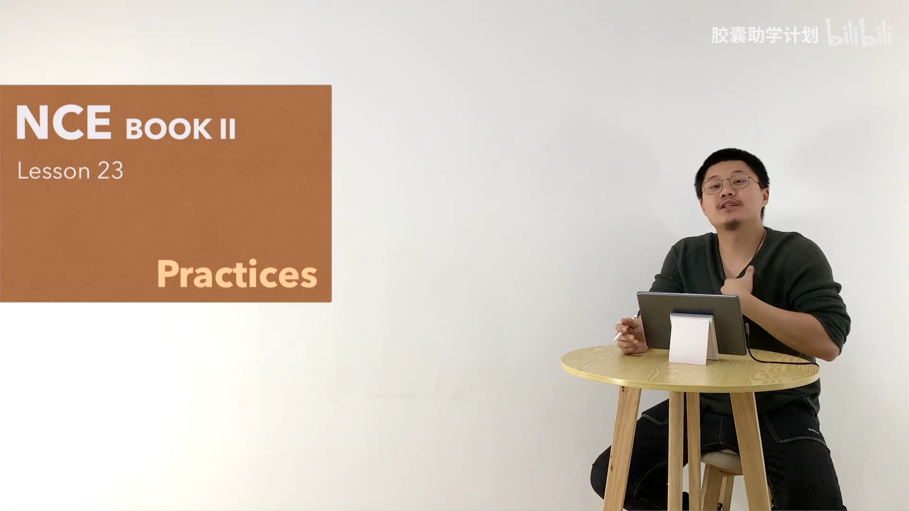

文字识别：胶囊助学计划 / NCE / BOOK "I / Lesson 23 / Practices

### 画面 00:00:05

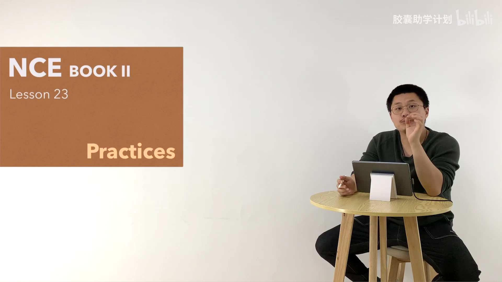

文字识别：胶囊助学计划 / NCE / BOOKⅡI / Lesson 23 / Practices

### 画面 00:00:08

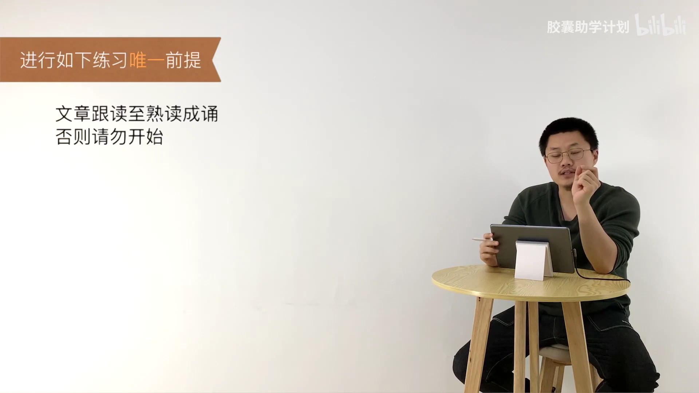

文字识别：胶囊助学计划 / 进行如下练习唯一前提 / 文章跟读至熟读成诵 / 否则请勿开始

### 画面 00:00:10

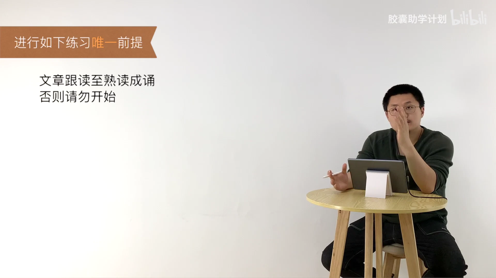

文字识别：Biltbili / 胶囊助学计划 / 进行如下练习唯一前提 / 文章跟读至熟读成诵 / 否则请勿开始

### 画面 00:00:15

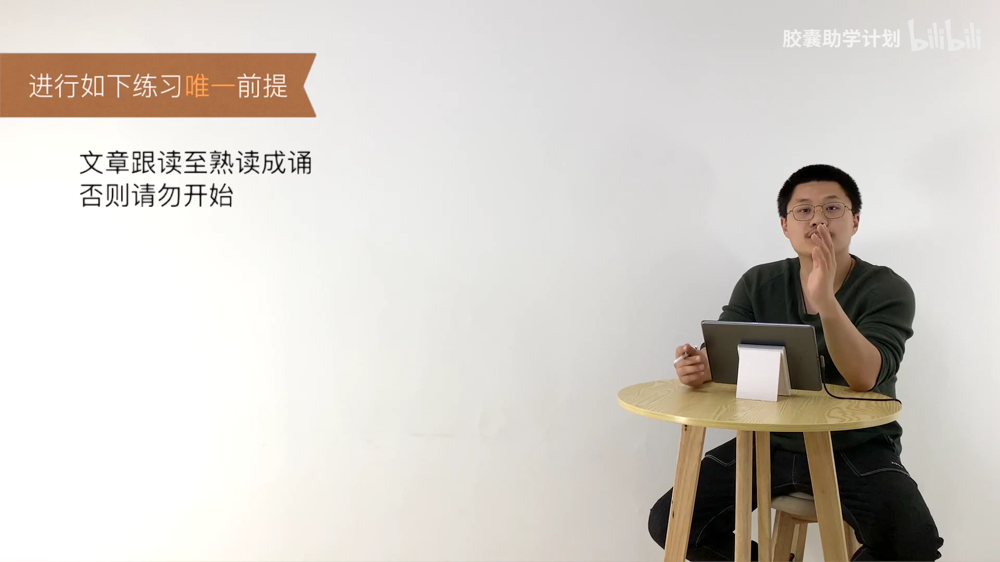

文字识别：胶囊助学计划 / 进行如下练习唯一前提 / 文章跟读至熟读成诵 / 否则请勿开始

### 画面 00:00:18

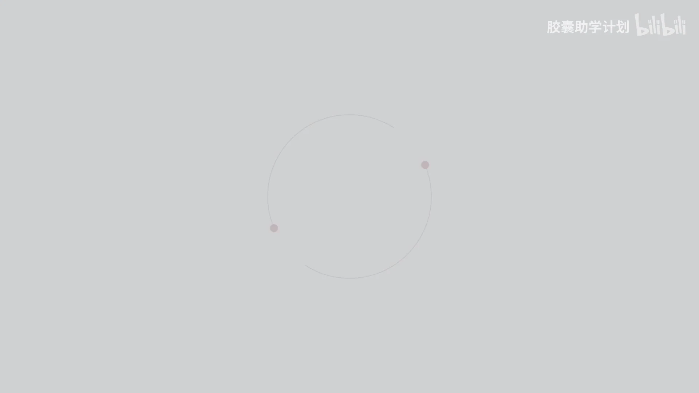

文字识别：胶囊助学计划 bilbl / •

### 画面 00:00:22

### 画面 00:00:24

文字识别：胶囊助学计划 / Comprehension / 训练目标： / 听懂一般疑问句＆特殊疑问句

## 00:00:30–00:01:00

和特殊疑问句。好，那接下来我问您答，尽量不要看着我这里，对吧？您可以看着书，但尽量不要看着我这儿。我们还是进行一些听力上的训练，然后口语回回答我。李迪，You had a letter yesterday, didn't you? Yes, I did. Next one, Who was it from? My sister. Next one, Where does she live?

### 画面 00:00:30

文字识别：Bilibili / 胶囊助学计划 / Comprehension / 训练目标： / 听懂一般疑问句＆特殊疑问句

### 画面 00:00:35

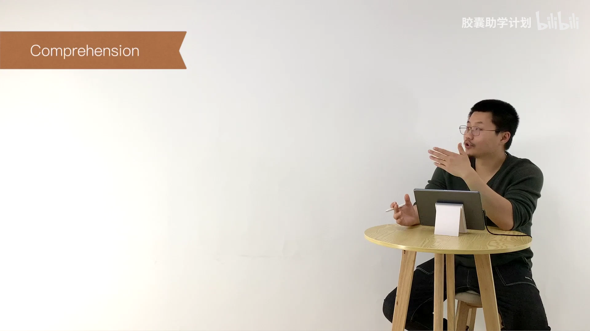

文字识别：胶囊助学计划 / Biibi / Comprehension

### 画面 00:00:38

文字识别：Bilbi / 胶囊助学计划 / Comprehension

### 画面 00:00:40

文字识别：Biltbili / 胶囊助学计划 / Comprehension

### 画面 00:00:49

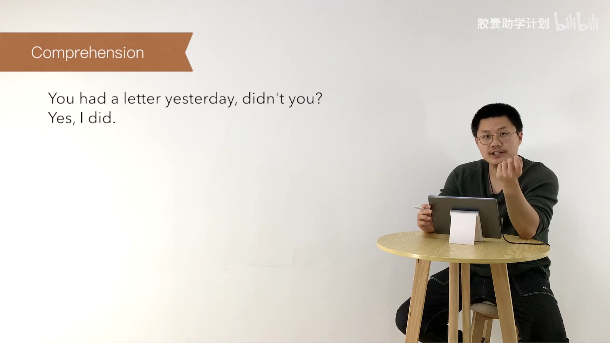

文字识别：胶囊助学计划 / Comprehension / You had a letter yesterday, didn't you? / Yes,l did.

## 00:01:00–00:01:30

in Nigeria. Next one, did she say she would come to England? Yes, she did. Next one, when did she say she would come? Next year. Next one, will she get a surprise if she comes? Yes, she will. Next one, you are living in a beautiful new house, aren't you?

### 画面 00:01:03

文字识别：胶囊助学计划 / Comprehension / Did she say she would come to England?

## 00:01:30–00:02:00

yes, I am. Continue. Is it in that town or the country? In the country. Okay. Continue. When was it completed? Five months ago. There you go. Next one. Had work on it began before your sister left?你看这就是原文的肯定句变一般疑问句了，对吧？所以如果您肯定

### 画面 00:01:31

文字识别：胶囊助学计划 / 出 / Comprehension / You're / living in a beautiful new house, aren't you? / Yes,l am.

### 画面 00:01:35

文字识别：胶囊助学计划 / Comprehension / Is it in the town or the country?

### 画面 00:01:54

文字识别：胶囊助学计划 / Comprehension / Had work on it begun before your sister left?

### 画面 00:01:56

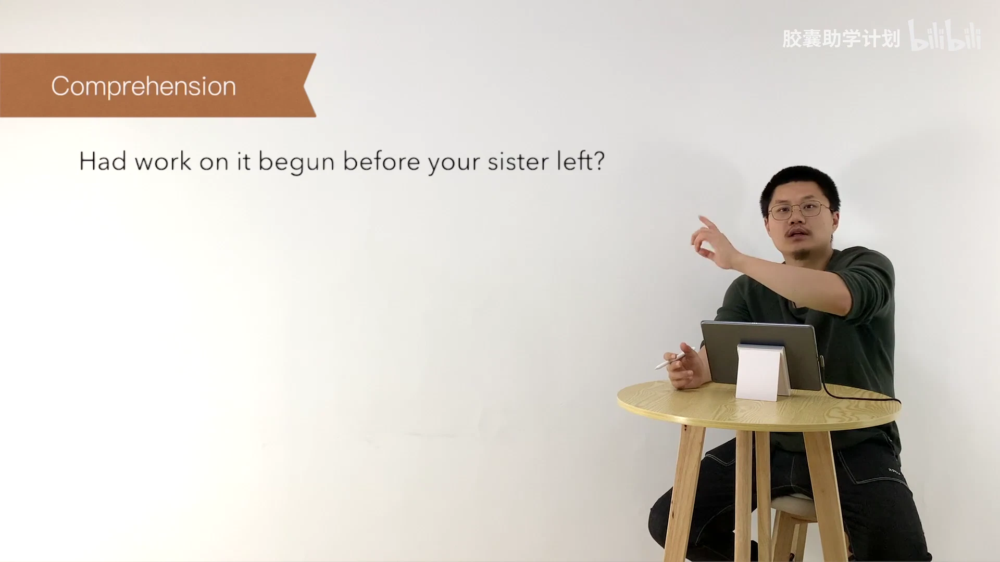

文字识别：胶囊助学计划 / Comprehension / Had work on it begun before your sister left?

## 00:02:00–00:02:30

句读特别熟了，一般疑问句没有理由听不懂啊。Yes, it had. Okay, next one. What did you tell her in your letter that she could stay with us? Okay. Are the rooms large or small? Large. Continue. What kind of garden is there? Lovely garden. Asking

### 画面 00:02:01

文字识别：胶囊助学计划 / Comprehension / Had work on it begun before your sister left?

### 画面 00:02:05

文字识别：胶囊助学计划 / Comprehension / What did you tell her in your letter?

### 画面 00:02:09

文字识别：胶囊助学计划 / Comprehension / What did you tell her in your letter?

### 画面 00:02:13

文字识别：胶囊助学计划 / Comprehension / What did you tell her in your letter? / That she could stay with us.

### 画面 00:02:15

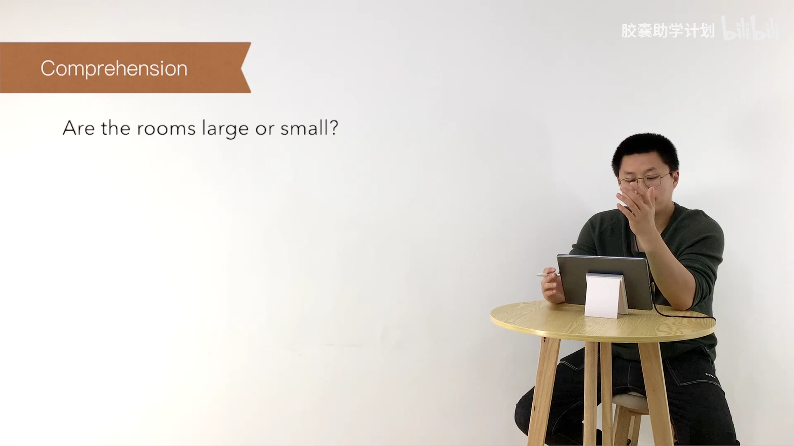

文字识别：胶囊助学计划 / Comprehension / Are the rooms large or small?

### 画面 00:02:25

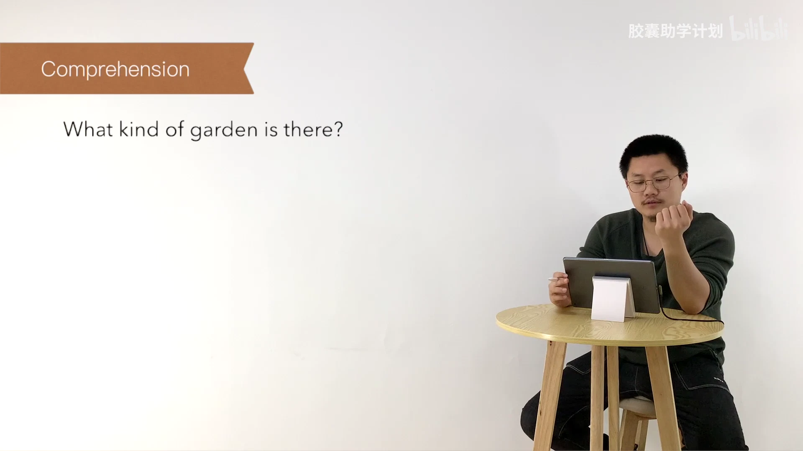

文字识别：胶囊助学计划 / Comprehension / What kind of garden is there?

### 画面 00:02:27

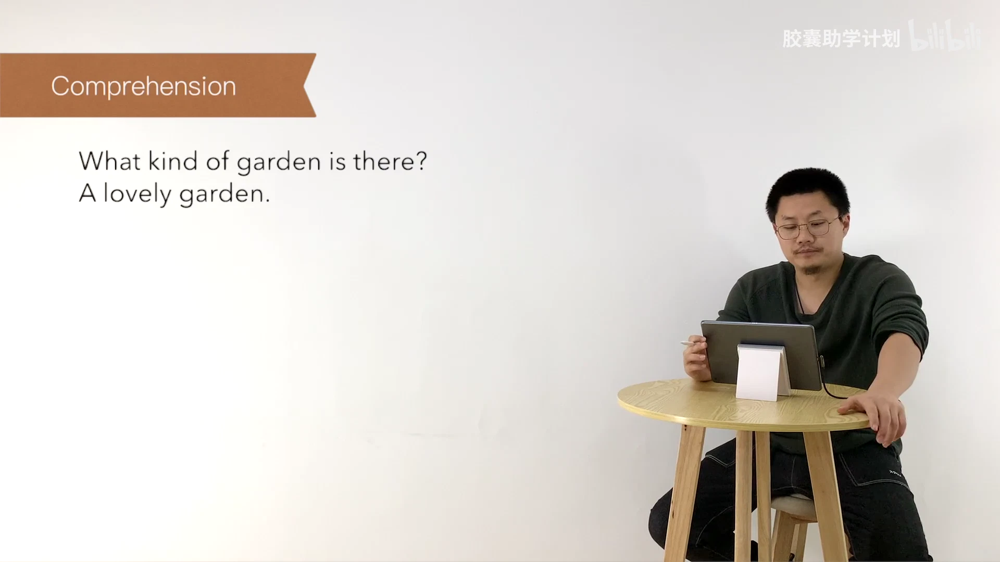

文字识别：胶囊助学计划 / Comprehension / What kind of garden is there? / A lovely garden.

### 画面 00:02:29

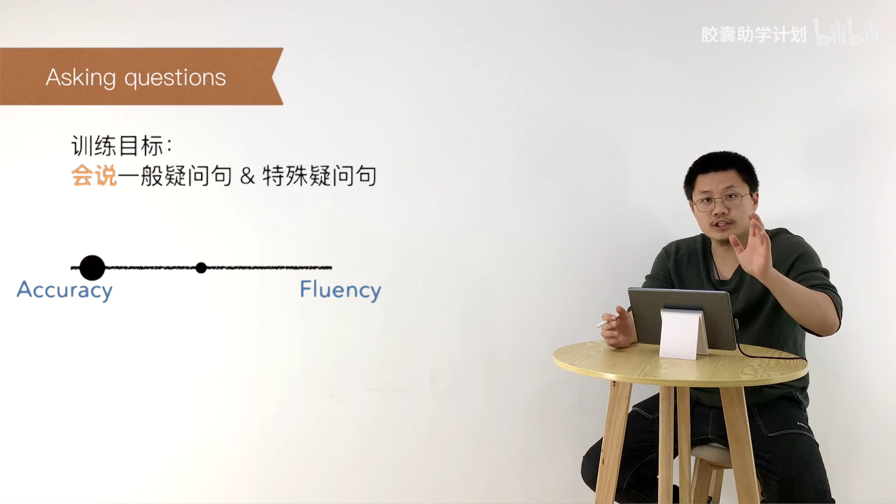

文字识别：胶囊助学计划 / Asking questions / 训练目标： / 会说一般疑问句＆特殊疑问句 / Accuracy / Fluency

## 00:02:30–00:03:00

questions, train大家能说出来问题的能力，对吧？也就是一般疑问句和特殊疑问句。我们先看第一个例子。I had a letter from my sister yesterday.变一般疑问句，Did提前，动词换回原形。When对yesterday提问，去掉，直接加上整个一般疑问句，很简单。好，那我们一个一个来啊。第一个，刚才我们说了When，再说一下What。我们只给大家说思路，具体的要您自己去写。我都说出来答案，你下课

### 画面 00:02:36

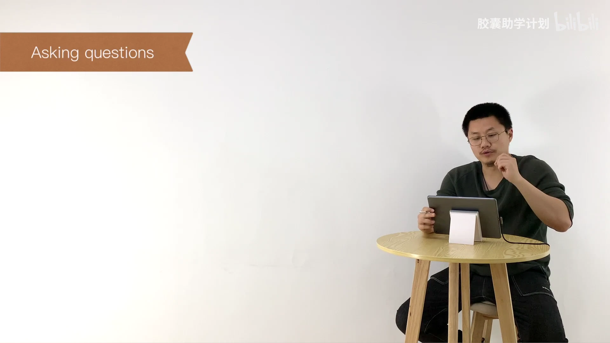

文字识别：胶囊助学计划 / Asking questions

### 画面 00:02:38

文字识别：胶囊助学计划 / Asking questions / T: Ask me if I had a letter from my sister yesterday.

### 画面 00:02:44

文字识别：胶囊助学计划 / Asking questions / T: Ask me if I had a letter from my sister yesterday. / S: Did you have a letter from your sister yesterday? / T: When ...?

### 画面 00:02:46

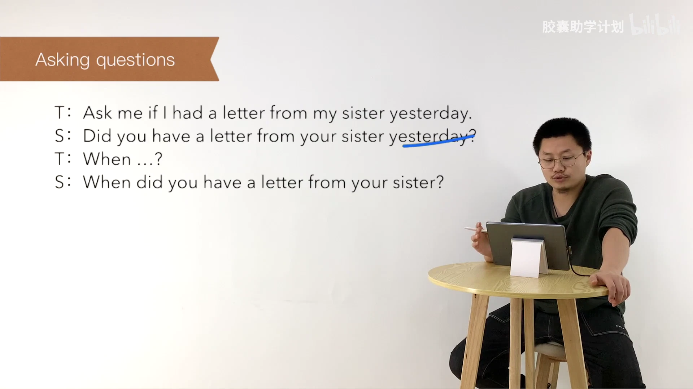

文字识别：胶囊助学计划 / Asking questions / T: Ask me if I had a letter from my sister yesterday. / S: Did you have a letter from your sister yesterday? / T: When ..? / S: When did you have a letter from your sister?

### 画面 00:02:50

文字识别：胶囊助学计划 / Asking questions / 1.I had a letter from my sister yesterday. / (When) (What) (Who …..from)

## 00:03:00–00:03:30

就没事儿干了啊。What对a letter提问，Who from对my sister提问。OK，别忘了变一般疑问句。下一题，一般现在时，Does提前，动词换原形。Where对in Nigeria提问，Who对主语提问，不用变一般疑问句，直接提问。She said she'd come to England next year。好了，注意D的提前啊，不要把后边的Would提前，对吧？宾语从句不

### 画面 00:03:02

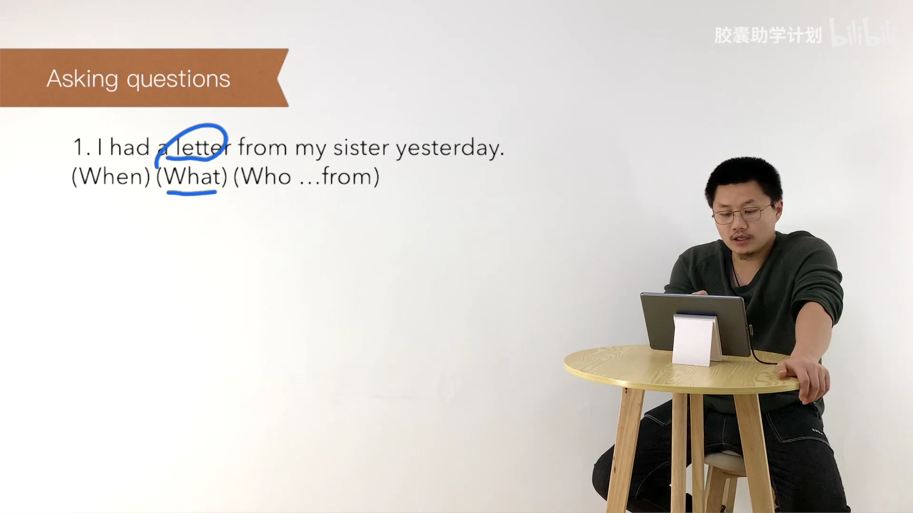

文字识别：胶囊助学计划 / Asking / questions / 1.I hadletter /  from my sister yesterday. / (When) (What) (Who …..from)

### 画面 00:03:05

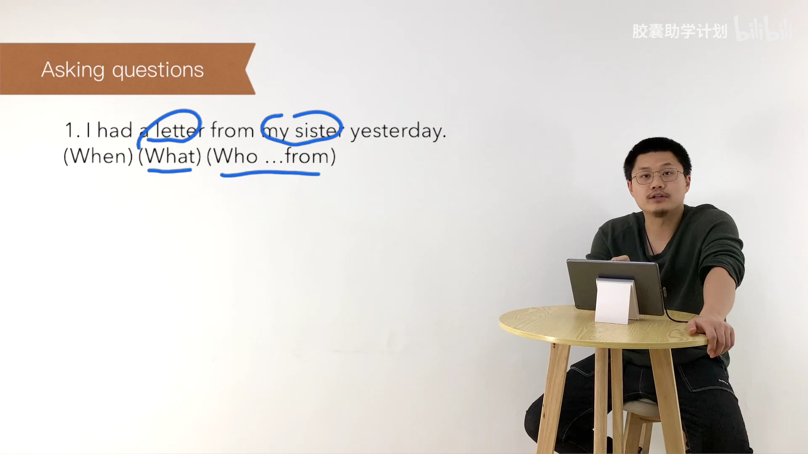

文字识别：胶囊助学计划 / Asking / questions / 1.I hadletter / from6 / ny siste / yesterday. / (When)(What) (Who ...from)

### 画面 00:03:14

文字识别：胶囊助学计划 / Asking / questions / 1.Ihad / dlette / from / my siste / yesterday. / (When)(What) / (Who ...from) / 2.She / lives in Nigeria. (Where) (Who)

### 画面 00:03:17

文字识别：胶囊助学计划 / Asking / questions / 1.lhad / lette / from / my siste / yesterday. / (When)(What) / (Who ...from) / 2Shelives in I /  Nigeria. (Where) (Who)

### 画面 00:03:25

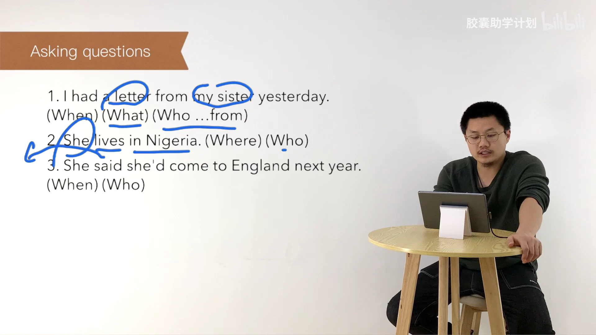

文字识别：胶囊助学计划 / Asking / questions / 1.Ihad / lette / from / my siste / yesterday. / (When) (What) / (Who ...from) / 2/She lives in / Nigeria.(Where)(Who) / She / said / she'd / come to / England / next year. / (When)(Who)

## 00:03:30–00:04:00

提宾语从句的，提前面的主句的那个谓语。OK，问对 next year 提问 who，您直接对主语提问也可以。OK，好，She'll get a surprise if she comes。同理，您不用 comes，用 will 提前，叫 will she get a surprise if she comes？我们永远不用从句当中那个谓语去进行提问啊啊，去进行这个变一般疑问句对吧？就也就是提问啊。

### 画面 00:03:30

文字识别：胶囊助学计划 / Asking / questions / 1.Ihad / lette / from / my siste / yesterday. / (When) (What) / (Who ...from) / 2/Shelives in / Nigeria.(Where)(Who) / She / said / she'd come to / England / next year. / (When)(Who)

### 画面 00:03:37

文字识别：胶囊助学计划 / Asking / questions / 1.Ihad / lette / from / my siste / yesterday. / (When)(What) / (Who ..from) / 2/She / lives in / Nigeria. (Where) (Who) / said / she'd come to / England / next year. / (When)(Who)

### 画面 00:03:44

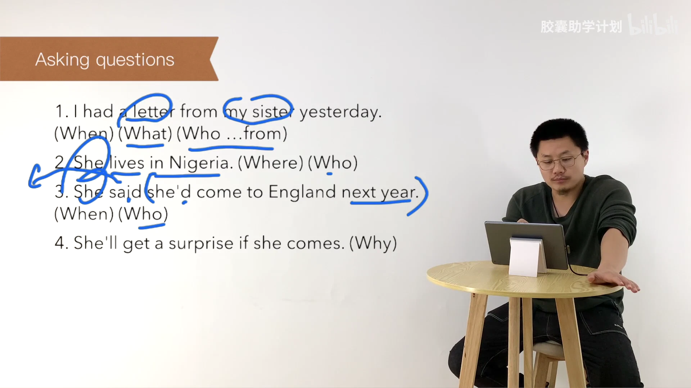

文字识别：胶囊助学计划 / Asking / questions / my siste / 1.I had lette / from / yesterday. / (When)(What) / (Who ...from) / C / 2/She lives in / Nigeria. (Where)(Who) / said / She'd come to E / England r / I next year. / (When)(Who) / 4. She'll get a surprise if she comes. (Why)

### 画面 00:03:49

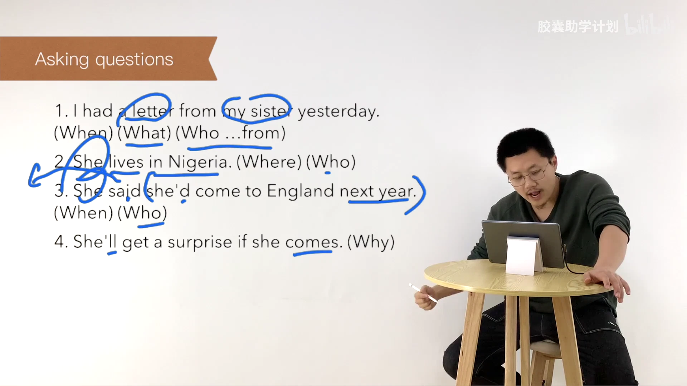

文字识别：胶囊助学计划 / Asking / questions / ny siste / 1.lhad / lette / from / yesterday. / (When)(What) / (Who ...from) / C / 2/Shelives in / Nigeria. (Where) (Who) / said / she'd come to / England / next year. / (When)(Who) / 4.She'll / get a surprise if s / she / comes. (Why)

### 画面 00:03:56

文字识别：胶囊助学计划 / Asking / questions / ny siste / 1.I had lette / from / yesterday. / (When)(What) / (Who ...from) / C / 2/She lives in / Nigeria. (Where)(Who) / said / she'd come to  / England / next year. / (When)(Who) / 4.She'll / get a surprise if s / she comes. (Why)

## 00:04:00–00:04:30

Why？整句就可以了，对吧？啊，为什么他会大吃一惊？如果他来的话呢？下一题，Where now living in the country？二题前非常简单，Where对in the country提问，所以叫做Where are you now living？你们现在住在什么地方？We've got a beautiful new house，那叫Have you got a beautiful new house？哎，What kind of？注意What kind of？我经常说，他要对形容词提问，对吧？叫做beautiful

### 画面 00:04:06

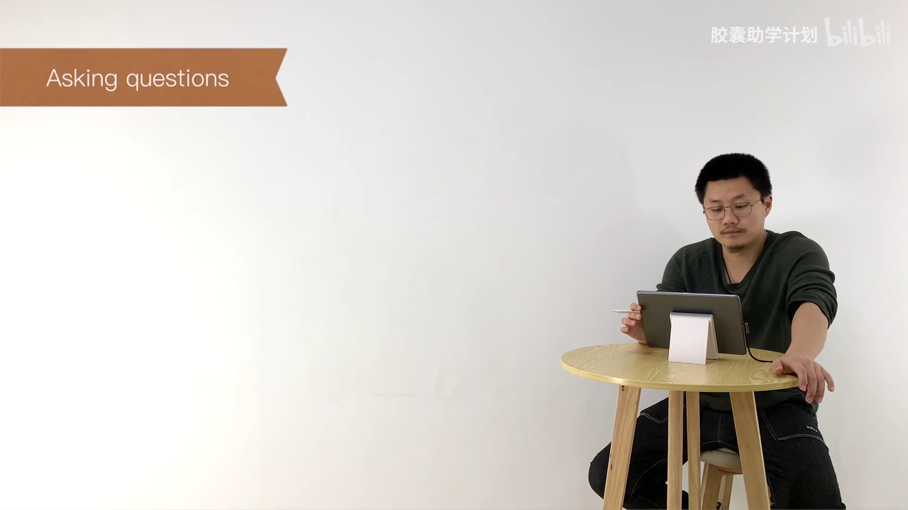

文字识别：胶囊助学计划Libi / Asking questions

### 画面 00:04:10

文字识别：胶囊助学计划 / 出 / Asking / questions / 5. We're now living in the country. (Where)

### 画面 00:04:15

文字识别：胶囊助学计划 / Asking / questions / 5.We're now li / living in the country. (Where)

### 画面 00:04:22

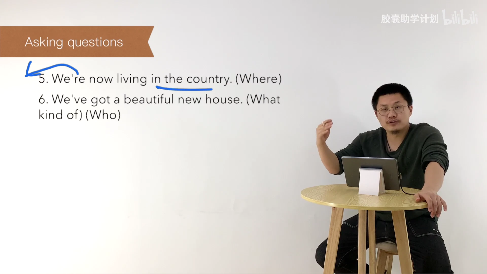

文字识别：胶囊助学计划 / Asking / questions / 5. We're now / living in the country. (Where) / 6. We've got a beautiful new h / house.(What / kind of) (Who)

## 00:04:30–00:05:00

beautiful new，对吧？所以我说一下答案叫 What kind of house have you got? Okay, one, one, one.呃，应该是我们新一七十九课学过 have 加 got 这个语法啊。各位如果忘了，您不妨看一下那个视频，找一下这个语法，简单做一下练习。Who 对主语提问？It was began before my sister left. Was 提前就行了，对吧？然后 When 对 before my sister left，所以答案叫

### 画面 00:04:33

文字识别：胶囊助学计划 / Asking / questions / 5. We're now / living in the country. (Where) / 6. We've got a beautiful new  / house.(What / kind of) (Who)

### 画面 00:04:38

文字识别：胶囊助学计划 / Asking / questions / 5. We're now / living in the country. (Where) / 6. We've got a beautiful new I / house.(What / kind of) (Who)

### 画面 00:04:40

文字识别：胶囊助学计划 / Asking / questions / 5. We're now / living in the country. (Where) / L79 / 6. We've got a beautiful new / house.(What / kind of)(Who)

### 画面 00:04:52

文字识别：胶囊助学计划 / Asking / questions / 5. We're now / living in the country. (Where) / L79 / 6. We've got a beautiful new house. (What / kind of) (Who) / 7. It was / begun before my sister left. (When)

## 00:05:00–00:05:30

when was it began? It was completed five months ago.一般过去时的被动变一般疑问句，was提前。那How long ago对five months ago提问？What对主句对吧？What was completed five months ago?好，下一个I told my sister she could stay with us.不要提could，不提宾语从句当中的

### 画面 00:05:00

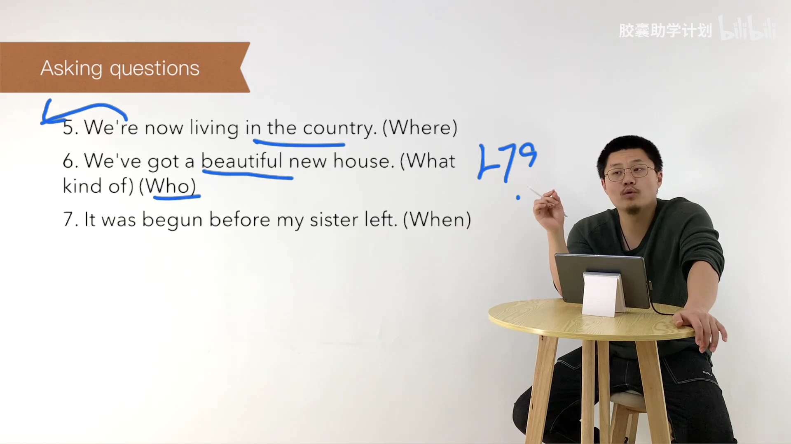

文字识别：胶囊助学计划 / Asking questions / 5.We're now / living in the country. (Where) / L79 / 6. We've got a beautiful new house. (What / kind of) (Who) / 7. It was begun before my sister left. (When)

### 画面 00:05:05

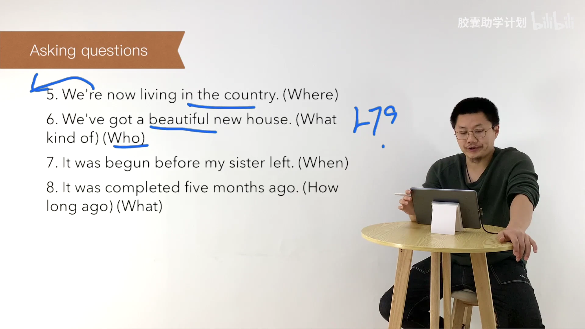

文字识别：胶囊助学计划 / Asking questions / 5. We're now living in the country. (Where) / L79 / 6. We've got a beautiful new house. (What / kind of) (Who) / 7. It was begun before my sister left. (When) / 8. It was completed five months ago.(How / long ago)(What)

### 画面 00:05:13

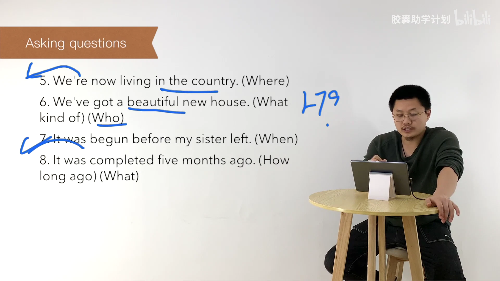

文字识别：胶囊助学计划 / Asking questions / 5. We're now living in the country. (Where) / L79 / 6. We've got a beautiful new house. (What / kind of) (Who) / Zlt was begun before my sister lef. (When) / 8. It was completed five months ago.(How / long ago)(What)

### 画面 00:05:16

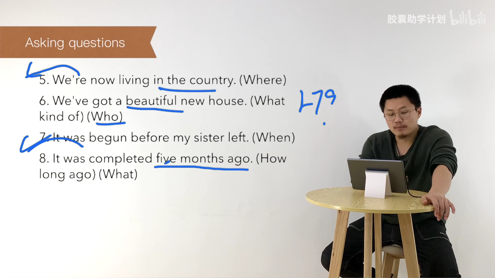

文字识别：胶囊助学计划 / Asking questions / 5. We're now living in the country. (Where) / L79 / 6. We've got a beautiful new house. (What / kind of) (Who) / Zlt was / s begun before my sister left. (When) / 8. It was completed fiye months ago.(How / long ago) (What)

### 画面 00:05:27

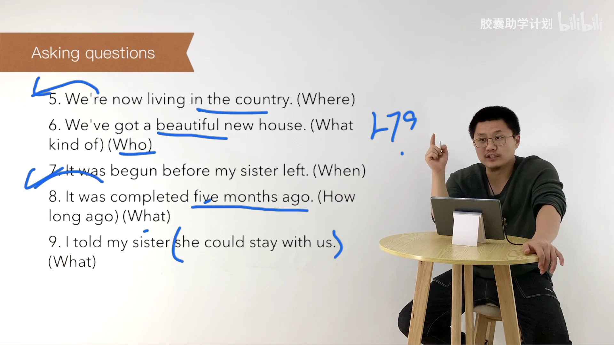

文字识别：胶囊助学计划 / Asking questions / 5. We're now living in the country. (Where) / L79 / 6. We've got a beautiful new house.(What / kind of) (Who) / Zlt was begun before my sister let. (When) / 8. It was completed five months ago.(How / long ago)(What) / 9.I told my sistershe could stay with us. / (What)

### 画面 00:05:29

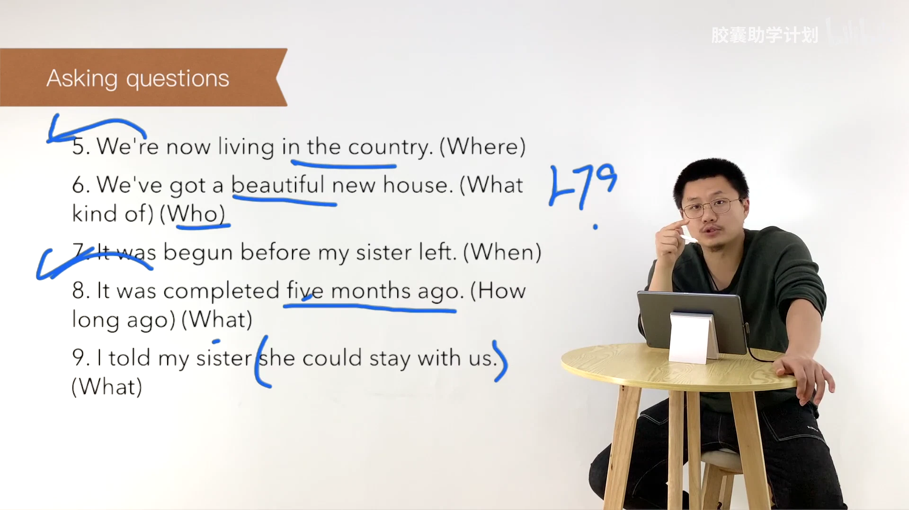

文字识别：胶囊助学计划 / Asking questions / 5. We're now living in the country. (Where) / L79 / 6. We've got a beautiful new house.(What / kind of) (Who) / Zlt was begun before my sister left. (When) / 8. It was completed five months ago.(How / long ago)(What) / 9.Itold my sistershe could stay with us. / (What)

## 00:05:30–00:06:00

谓语，提主句当中的谓语啊，所以是 did 提前，对吧？叫 did your sister did did your sister tell you she 呃 she 呃 she could stay with us 对吧？呃 no no did you 哈 sorry did you tell your sister she could stay with us？ Okay，那 what 对宾语从句提问就行了，叫 what did you tell your sister？ Very good， tell the story 口语复述，

### 画面 00:05:31

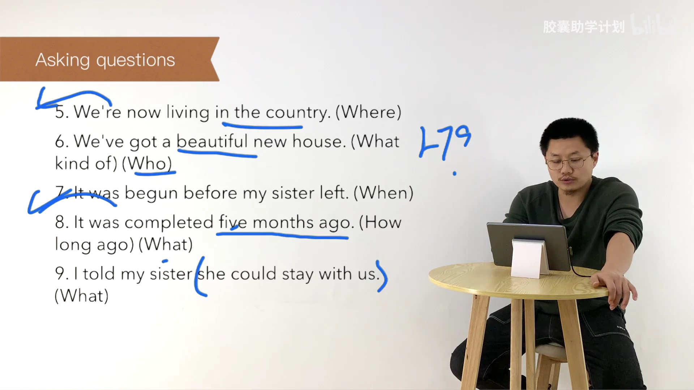

文字识别：胶囊助学计划 / Asking questions / 5. We're now living in the country. (Where) / L79 / 6. We've got a beautiful new house.(What / kind of) (Who) / Zltwas begun before my sister left. (When) / 8. It was completed fiye months ago.(How / long ago) (What) / 9.Itold my sistershe could stay with us. / (What)

### 画面 00:05:56

文字识别：胶囊助学计划 / Tell the story / 训练目标： / 口语复述能力 / Accuracy / Fluency

## 00:06:00–00:06:30

对于各位来说啊，练的是流利性而不是准确性。这个呢，从今天开始我就不一每课都给大家去进行一个复述了。各位看到这些前面二十、二十二课我已经给大家复述过很多遍了。对于各位来说，应该也会了。您一定是文章读懂啊，读读熟读成诵，然后过来去看着这些关键词复述一下就行了。OK，接下来呢，摘要写作summary

### 画面 00:06:01

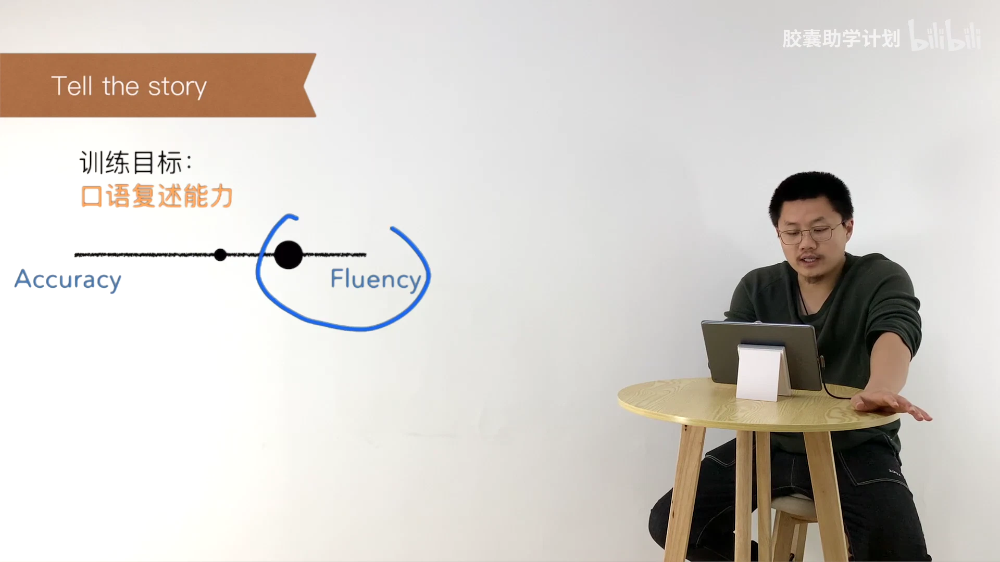

文字识别：胶囊助学计划 / Tell the story / 训练目标： / 口语复述能力 / Accuracy / Fluency

### 画面 00:06:04

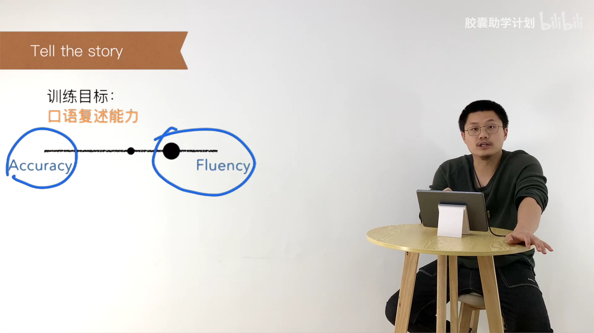

文字识别：胶囊助学计划 / Tell the story / 训练目标： / 口语复述能力 / Accuracy / Fluency

### 画面 00:06:07

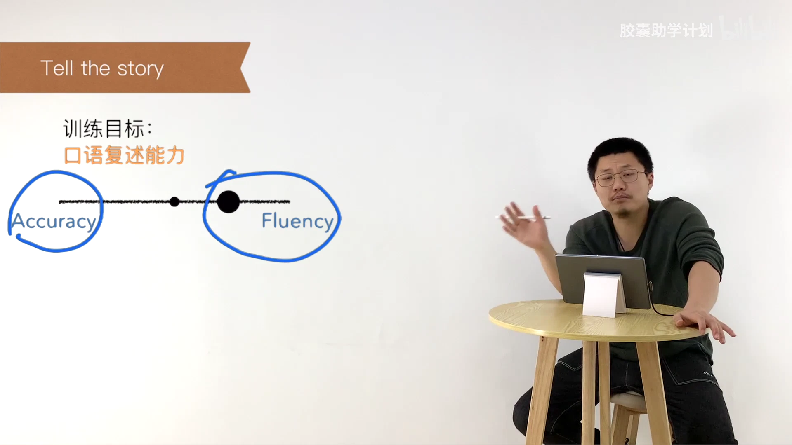

文字识别：胶囊助学计划 / Tell the story / 训练目标： / 口语复述能力 / Accuracy / Fluency

### 画面 00:06:11

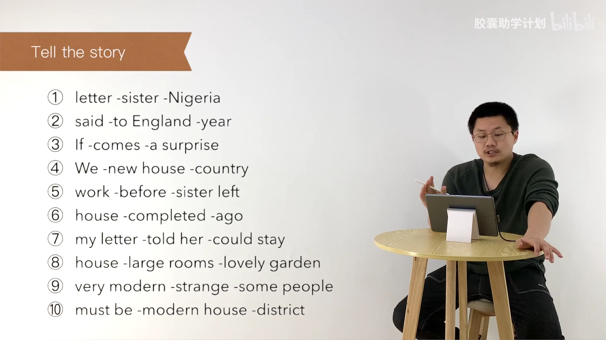

文字识别：胶囊助学计划 / Tell the story / 1 / letter -sister -Nigeria / said -to England -year / If -comes -a surprise / We -new house -country / work -before -sister left / house -completed -ago / my letter -told her -could stay / house -large rooms -lovely garden / 8 / very modern -strange -some people / 9 / ① must be -modern house -district

### 画面 00:06:17

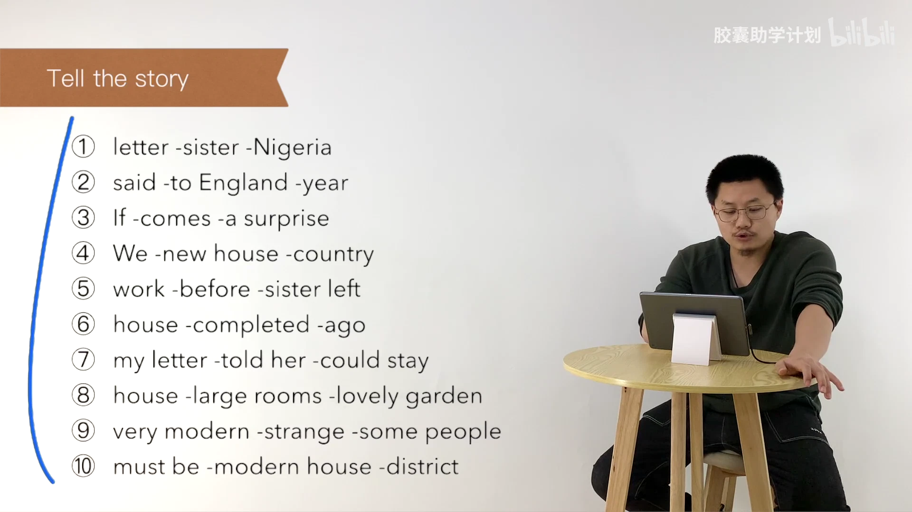

文字识别：胶囊助学计划 / Tell the story / letter -sister -Nigeria / said -to England -year / 2 / If -comes -a surprise / We -new house -country / work -before -sister left / house -completed -ago / my letter -told her -could stay / house -large rooms -lovely garden / 8 / very modern -strange -some people / 9 / ① must be -modern house -district

### 画面 00:06:19

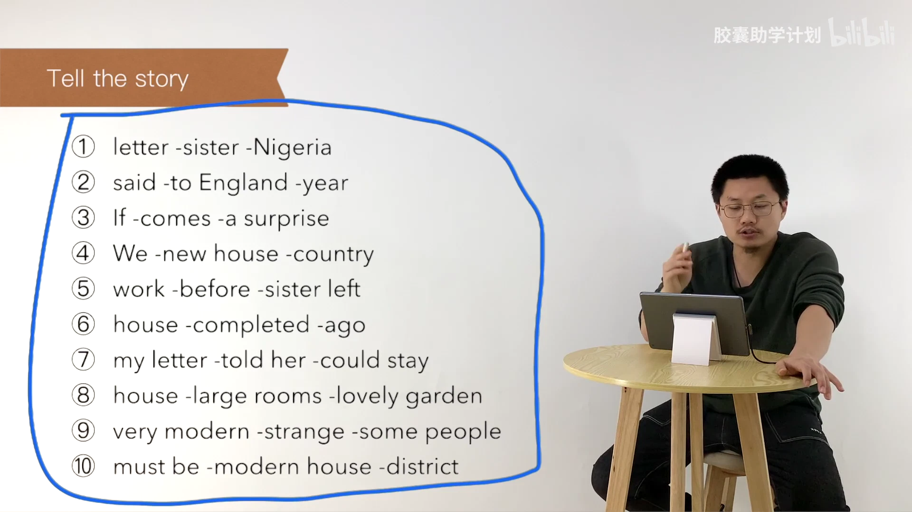

文字识别：胶囊助学计划 / Tell the story / ① / letter -sister -Nigeria / said -to England -year / 2 / If -comes -a surprise / We -new house -country / work -before -sister left / house -completed -ago / my letter -told her -could stay / house -large rooms -lovely garden / very modern -strange -some people / 9 / 10 / must be -modern house -district

### 画面 00:06:24

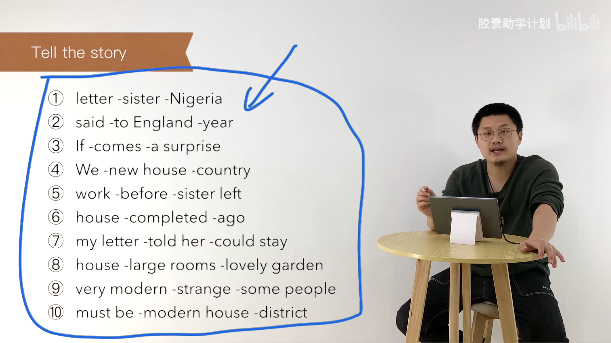

文字识别：胶囊助学计划 / Tell the story / ① / letter -sister -Nigeria / said -to England -year / 2 / If -comes -a surprise / We -new house -country / work -before -sister left / house -completed -ago / my letter -told her -could stay / house -large rooms -lovely garden / 8 / very modern -strange -some people / 9 / 10 / must be -modern house -district

### 画面 00:06:27

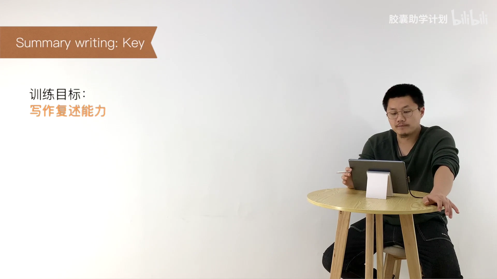

文字识别：胶囊助学计划 / Summary writing: Key / 训练目标： / 写作复述能力 / 2

## 00:06:30–00:07:00

writing）这个对于各位来说，写作的复述能力非常的重要。答案在这里，写完对一下就可以。OK。然后完全自由的对话，我们到目前为止还是只是给大家翻译一下他问的是什么。各位不妨可以试着能说多少说多少，对吧？你会发现，因为目前为止单词、语法和习惯用法掌握的不够多，对吧？您的工具不够多，想解决这个问题，暂时还可能没有办法完全解决。但我们先熟

### 画面 00:06:33

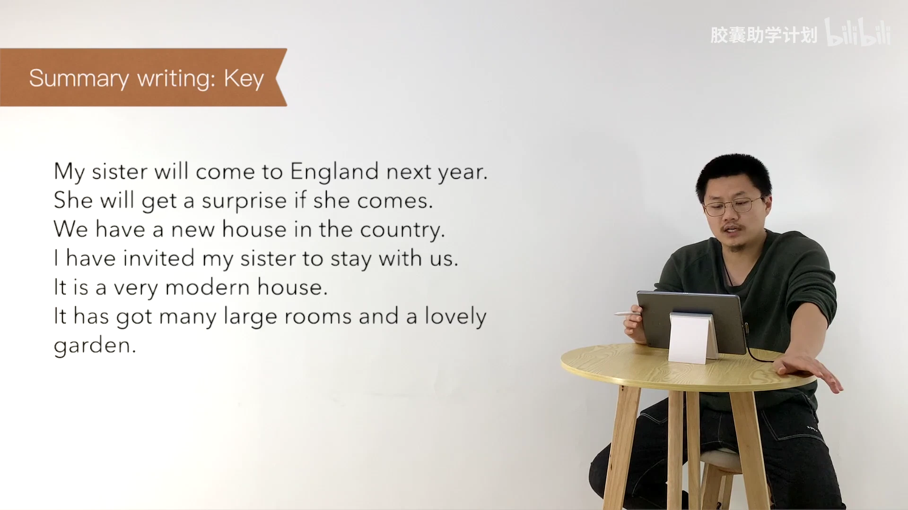

文字识别：胶囊助学计划 / Summary writing: Key / My sister will come to England next year. / She will get a surprise if she comes. / We have a new house in the country. / I have invited my sister to stay with us. / It is a very modern house. / It has got many large rooms and a lovely / garden.

### 画面 00:06:37

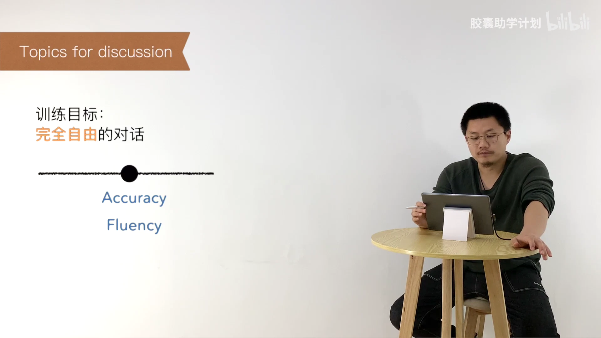

文字识别：胶囊助学计划 / Topics for discussion / 训练目标： / 完全自由的对话 / Accuracy / Fluency

### 画面 00:06:39

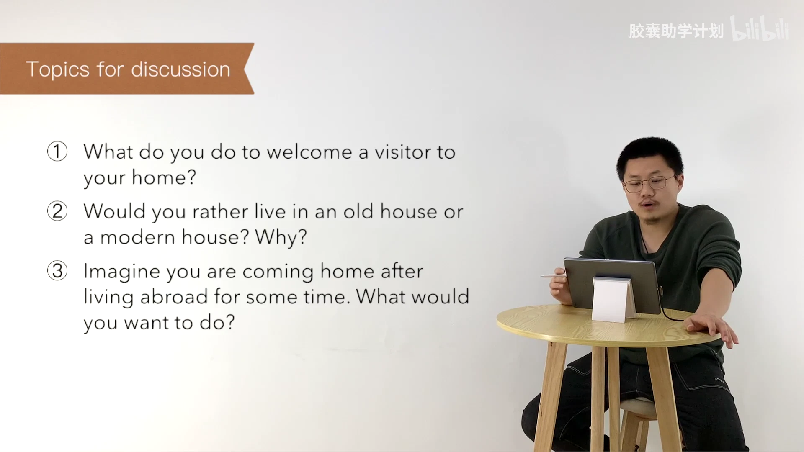

文字识别：胶囊助学计划 / Topics for discussion / What do you do to welcome a visitor to / your home? / Would you rather live in an old house or / a modern house? Why? / Imagine you are coming home after / living abroad for some time. What would / you want to do?

## 00:07:00–00:07:30

悉一下话题。来了，What do you do to welcome a visitor to your home?说你为了欢迎一个来家里面的访客，你会做什么事情啊？比如说打扫一下卫生，做一顿饭，买一些水果等等。Would you rather live in an old house or a modern house? Why?你愿意住在老式的房子里，还是这种特别现代化的房子里呢？为什么？OK，关键是为什

### 画面 00:07:09

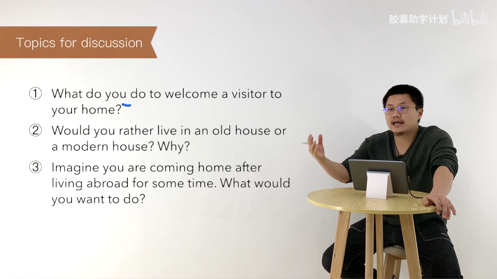

文字识别：胶囊助学计划 / Topics for discussion / What do you do to welcome a visitor to / your home?~ / Would you rather live in an old house or / a modern house? Why? / Imagine you are coming home after / 3 / living abroad for some time. What would / you want to do?

### 画面 00:07:23

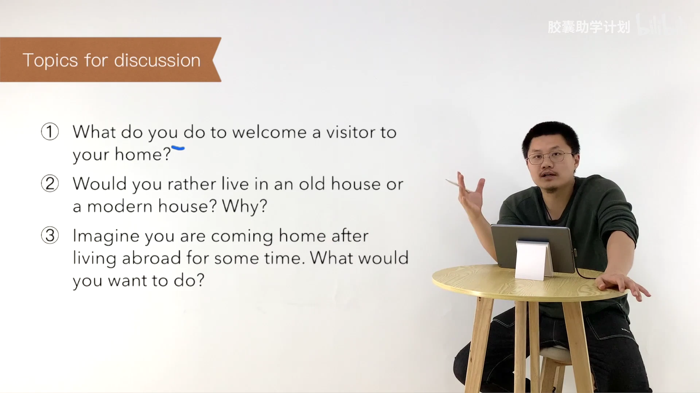

文字识别：胶囊助学计划 / Topics for discussion / What do you do to welcome a visitor to / your home?~ / Would you rather live in an old house or / a modern house? Why? / Imagine you are coming home after / living abroad for some time. What would / you want to do?

## 00:07:30–00:08:00

么啊？你愿意住哪个都行。第三个，Imagine you are coming home after living abroad for some time. What would you want to do? Ah, this is simply too appropriate, right? Suppose you lived abroad for a long time. After returning home, what do you want to do? Ah, eat all kinds of food. Okay, hot pot, barbecue, etc. Okay, good. Let's look at the homework for this lesson. Ask me if. First, read aloud. Old habit. Then write. After writing, come here to check the answers. Tell the

### 画面 00:07:48

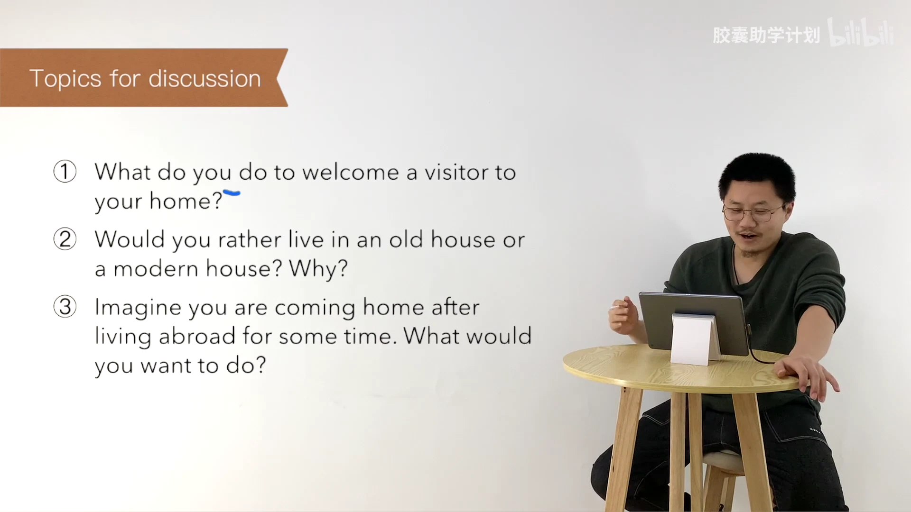

文字识别：胶囊助学计划 / Topics for discussion / What do you do to welcome a visitor to / your home?~ / Would you rather live in an old house or / a modern house? Why? / Imagine you are coming home after / 3 / living abroad for some time. What would / you want to do?

### 画面 00:07:51

文字识别：胶囊助学计划

### 画面 00:07:53

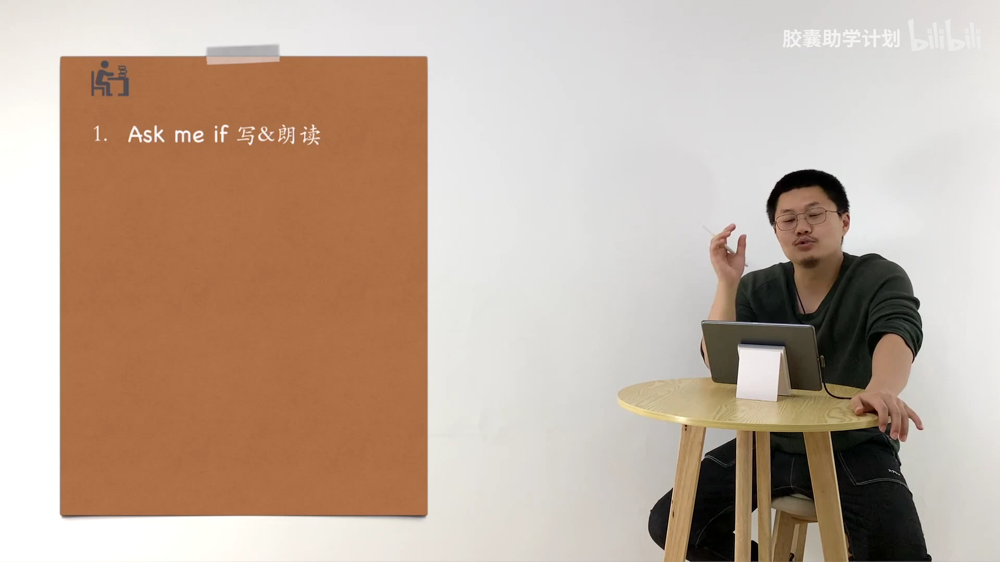

文字识别：胶囊助学计划 / 1.Ask me if写&朗读

### 画面 00:07:55

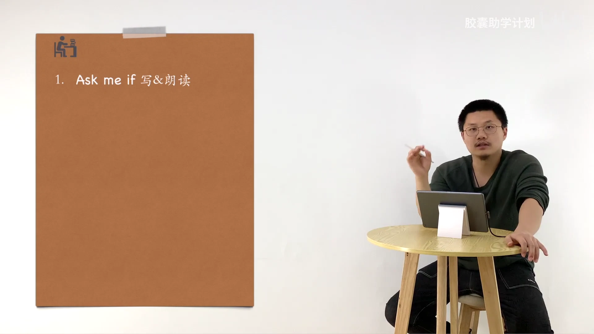

文字识别：胶囊助学计划 / 1. / Ask me if写&朗读

### 画面 00:07:57

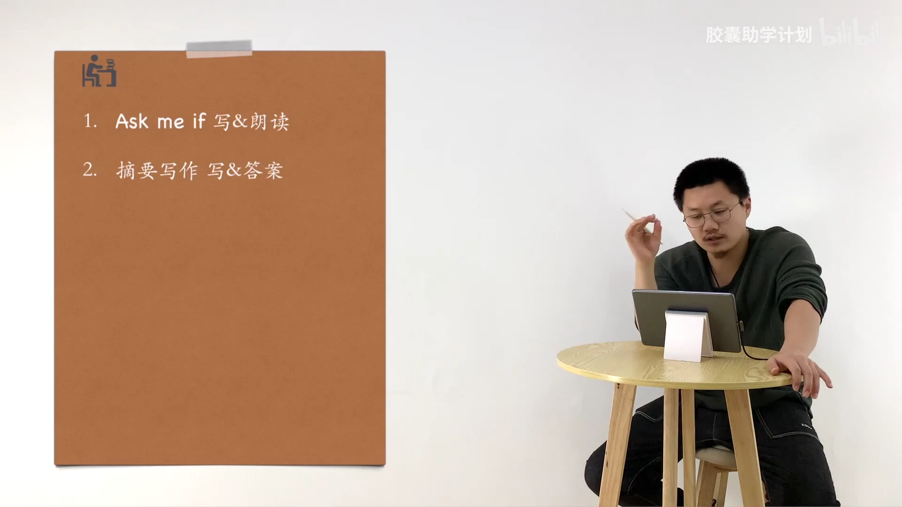

文字识别：胶囊助学计划 / 1.Ask me if写&朗读 / 2. / 摘要写作写&答案

### 画面 00:07:59

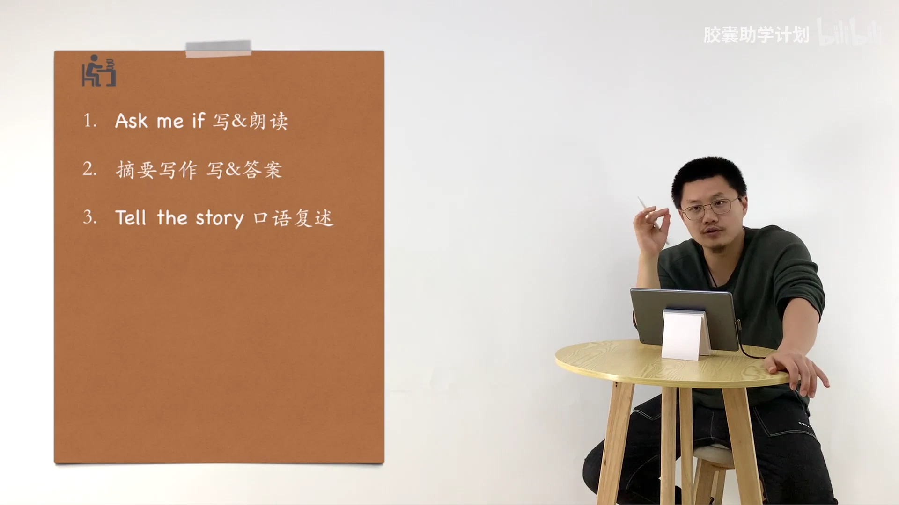

文字识别：胶囊助学计划 / 1.Ask me if写&朗读 / 摘要写作写&答案 / 3.Tell the story 口语复述

## 00:08:00–00:08:25

story进行口语复述，专栏当中可以找得到。如果各位喜欢我们的课程，欢迎大家关注、订阅、一键三连、分享给那些需要的朋友。See you next time.

### 画面 00:08:01

文字识别：胶囊助学计划 / 1.Ask me if写&朗读 / 摘要写作写&答案 / 3.Tell the story 口语复述 / 专栏 / 4.

### 画面 00:08:03

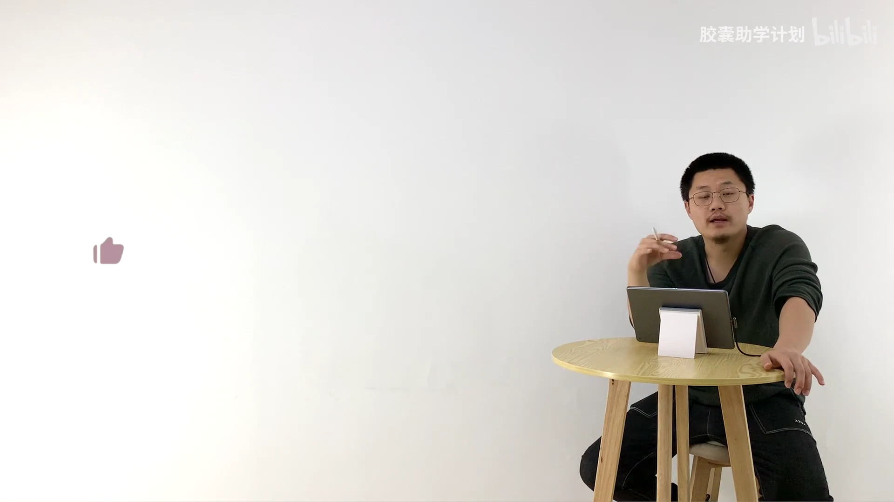

文字识别：胶囊助学计划

### 画面 00:08:07

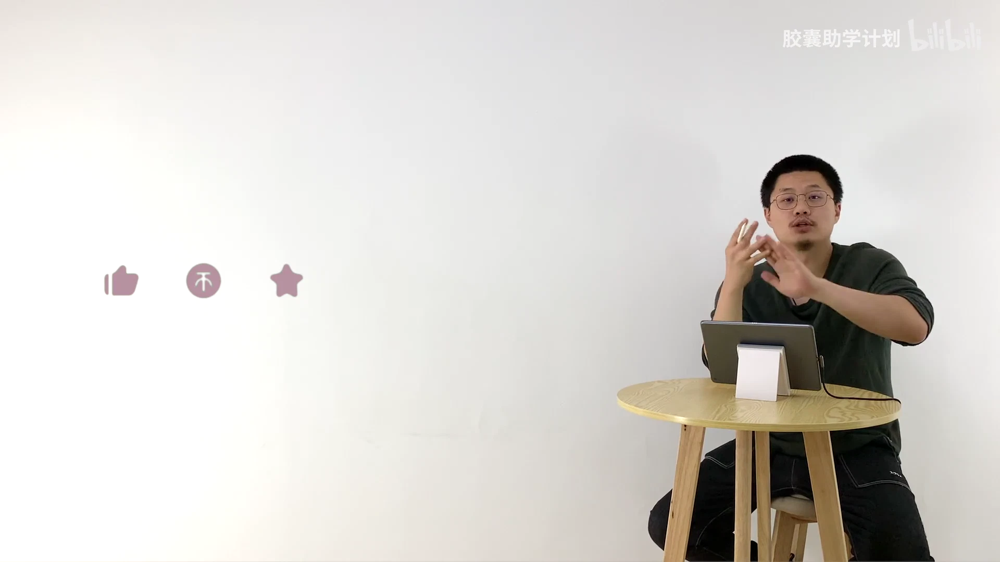

文字识别：胶囊助学计划

### 画面 00:08:12

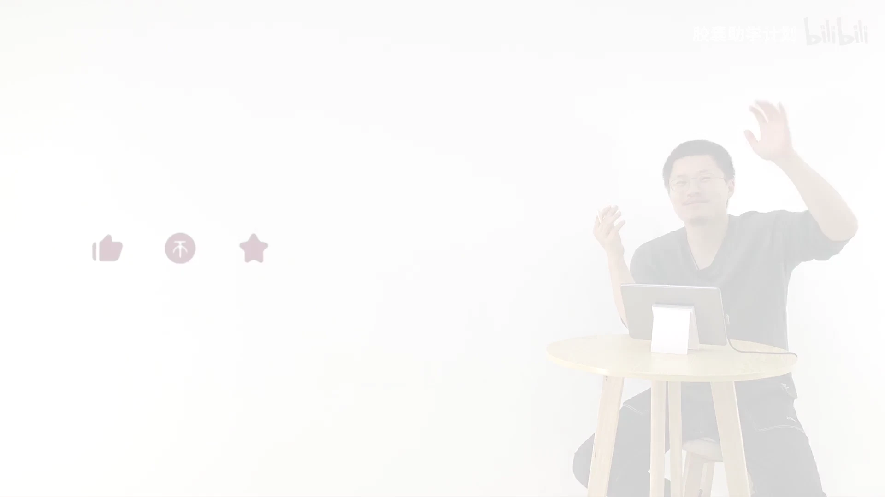

### 画面 00:08:14

文字识别：CAPSULEACADEMY / 胶囊助学计划 / 『 / 小红书 / Lecturer / □ / Leo / OE

### 画面 00:08:17

文字识别：CAPSULEACADEMY / 胶囊助学计划 / 小红书 / OE

### 画面 00:08:20

文字识别：CAPSULEACADEMY / 胶囊助学计划 / 小红书 / Creator / □ / Leo & Berlin / OE

### 画面 00:08:22

文字识别：bilbili / 胶囊助学计划 / CAPSULEACADEMY / 胶囊助学计划 / 小红书 / OE

### 画面 00:08:24

文字识别：bilibili / 胶囊助学计划

