# L024 单词 + 文章

快速机器解析：语音为单模型转写，未进行独立交叉校对或人工复核；画面每秒采样并按变化选帧，短时文字和标记可能遗漏。截图时间约有 1 秒误差。图片有损压缩；遇到疑点请按时间查看 Google Drive 原视频。

## 00:00:00–00:00:30

Hello everyone, welcome to Capsule Academy. This is Leo. Today we're going to learn New Concept English Book Two, Lesson Twenty Four, Story and Words. That old habit. Into formal course before, we first look at a few small questions. That first, how to express the anxiety about something or someone. Next, how to express the complaint. The last question, how to express the beginning of doing something. With these three questions, hope you enjoy.

### 画面 00:00:00

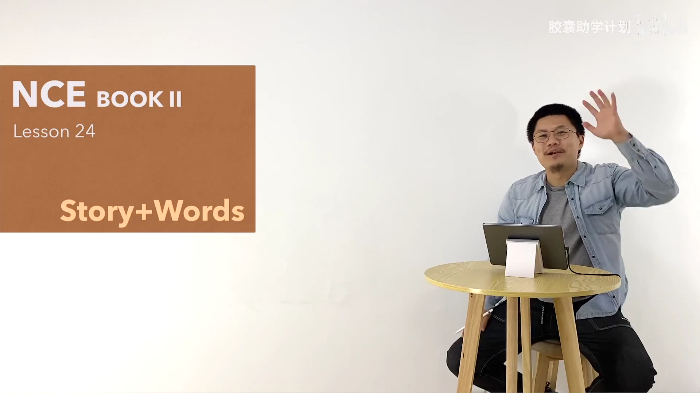

文字识别：胶囊助学计划 / NCE / BOOKII / Lesson 24 / Story+Words

### 画面 00:00:05

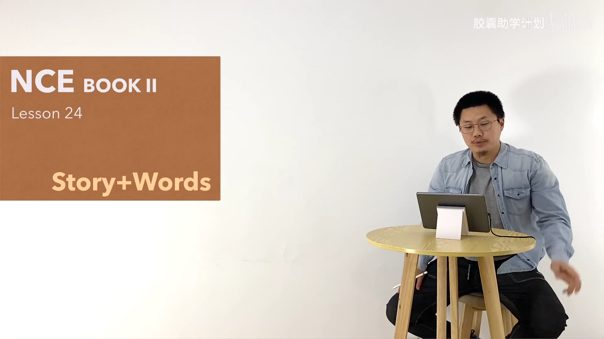

文字识别：胶囊助学计划 / NCE / BOOK II / Lesson 24 / Story+Words

### 画面 00:00:10

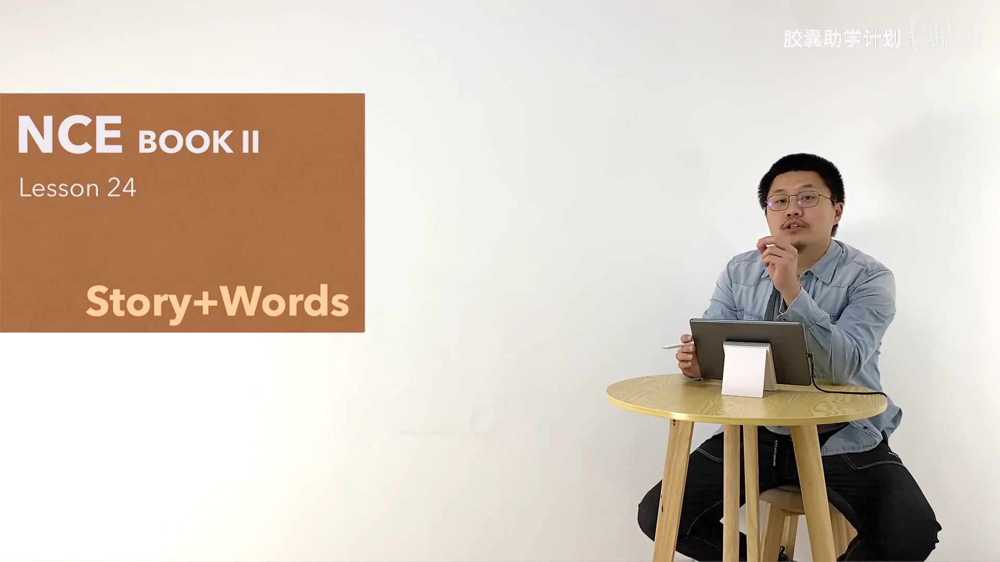

文字识别：胶囊助学计划 / NCE / BOOK II / Lesson 24 / Story+Words

### 画面 00:00:12

文字识别：胶囊助学计划 / 2

### 画面 00:00:14

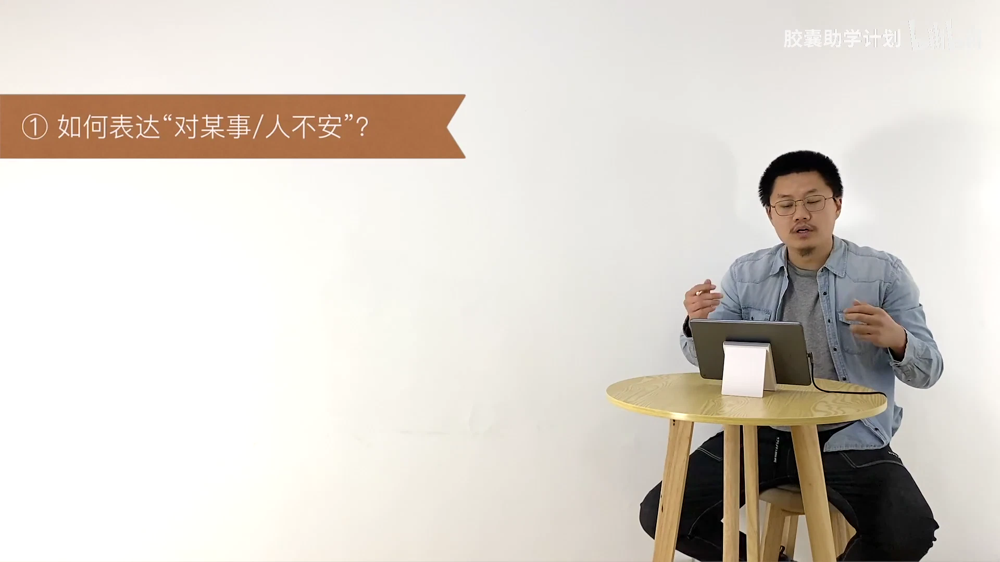

文字识别：胶囊助学计划 / ①如何表达“对某事/人不安”？

### 画面 00:00:18

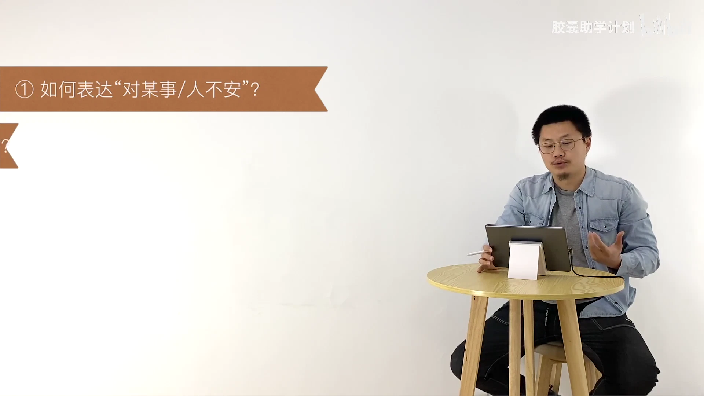

文字识别：胶囊助学计划 / ① 如何表达“对某事/人不安”？

### 画面 00:00:20

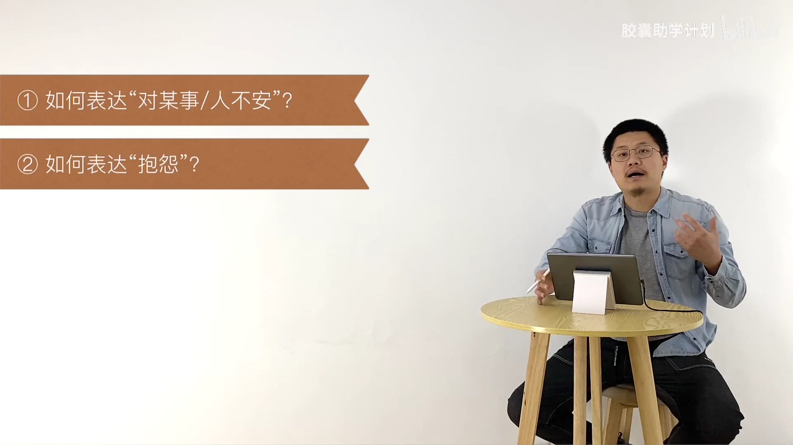

文字识别：胶囊助学计划 / ①如何表达“对某事/人不安”？ / 如何表达“抱怨”?

### 画面 00:00:22

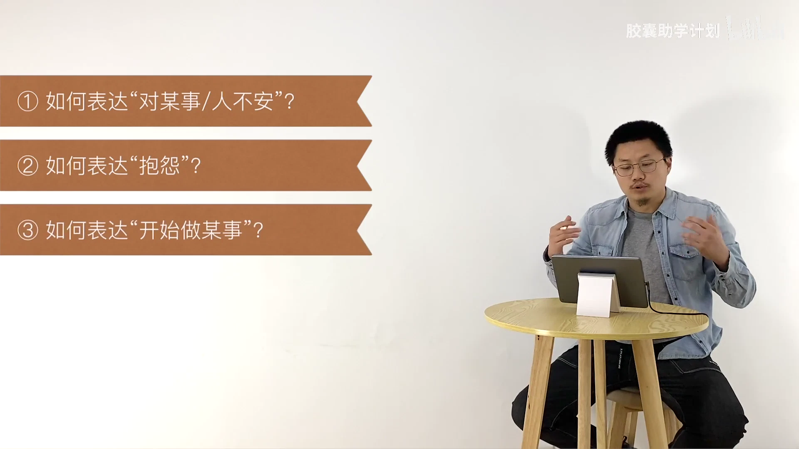

文字识别：胶囊助学计划 / ①如何表达“对某事/人不安”？ / 如何表达“抱怨”? / 如何表达“开始做某事”

### 画面 00:00:25

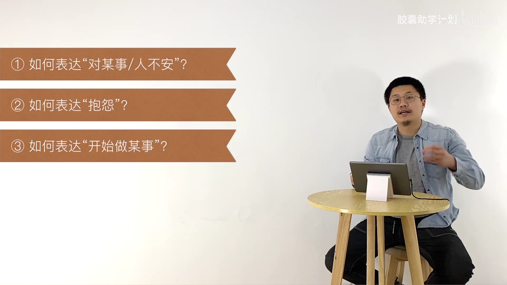

文字识别：胶囊助学计划 / ①如何表达“对某事/人不安”？ / 如何表达“抱怨” / 如何表达“开始做某事”?

### 画面 00:00:28

文字识别：胶囊助学计划 / •

## 00:00:30–00:01:00

好，那我们先看第一个小的单词，看音标，跟我一起读一下啊，来叫做 manager，连起来读 manager manager。那我们就指它是，比如说酒店的经理这个人物，我们管它叫 manager 啊， e 二结尾对吧？做某件事情的人。那其实 manage 它本身就有一个动词的意思，就是管理啊。那管理者呢，就是 manager。 OK，好，那我们尝

### 画面 00:00:32

### 画面 00:00:34

文字识别：单词造句指南 / 网：v.+v.变化 / 胶囊助学计划 / 四句型转换 / 方式/地点/时间 / 结合习惯用法 / 其他单词+词性 / 原文摘抄+变 / 6123456 / /mænid3a/ / manager n.

### 画面 00:00:36

文字识别：单词造句指南 / 网：v.+v.变化 / 胶囊助学计划 / 四句型转换 / 方式/地点/时间 / 结合习惯用法 / 其他单词+词性 / 原文摘抄+变 / 6123456 / /'menid3a/ / manager n.

### 画面 00:00:38

文字识别：单词造句指南 / 网：v.+v.变化 / 胶囊助学计划 / 四句型转换 / 方式/地点/时间 / 结合习惯用法 / 其他单词+词性 / 原文摘抄+变 / 6123456 / /'mænid3a/ / manager n.

### 画面 00:00:40

文字识别：单词造句指南 / 网：v.+v.变化 / 胶囊助学计划 / 四句型转换 / 方式/地点/时间 / 结合习惯用法 / 其他单词+词性 / 原文摘抄+变 / 6123456 / /'mænid3a/ / manager n.

### 画面 00:00:45

文字识别：单词造句指南 / 网：v.+v.变化 / 胶囊助学计划 / 四句型转换 / 方式/地点/时间 / 结合习惯用法 / 其他单词+词性 / 原文摘抄+变 / 6123456 / /'mænrd3a/ / manager n.

### 画面 00:00:50

文字识别：单词造句指南 / 网：v.+v.变化 / 胶囊助学计划 / 四句型转换 / 方式/地点/时间 / 结合习惯用法 / 其他单词+词性 / 原文摘抄+变 / 6123456 / /'mænid3a/ / manager n.

### 画面 00:00:56

文字识别：单词造句指南 / 网：v.+v.变化 / 胶囊助学计划 / 四句型转换 / 方式/地点/时间 / 结合习惯用法 / 其他单词+词性 / 原文摘抄+变 / 6123456 / /'mænid3a/ / manager n.

## 00:01:00–00:01:30

试拿它去造句。那它本身是一个名词，我们尝试结合其之前学过的一些习惯用法来造句。比如说，The manager realized that he know that guy.啊，realize that加一个宾语从句，说意识到了一件事情，他意识到他认识那个人。这是我们第二十课学过的。再来一个二十一课的，叫做That woman is driving our manager mad，是吧？他正在把我们的这个啊管理者逼疯。OK，好，那最后

### 画面 00:01:00

文字识别：单词造句指南 / 网：v.+v.变化 / 胶囊助学计划 / 四句型转换 / 方式/地点/时间 / 结合习惯用法 / 其他单词+词性 / 原文摘抄+变 / 6123456 / /'mænid3a/ / manager n. / へ /  The manager realized that he know that guy. L20

### 画面 00:01:05

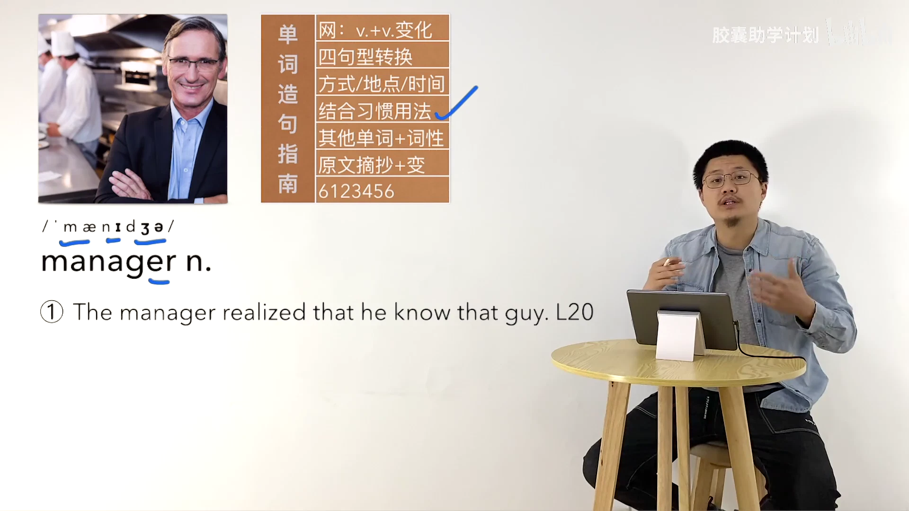

文字识别：单词造句指南 / 网：v.+v.变化 / 胶囊助学计划 / 四句型转换 / 方式/地点/时间 / 结合习惯用法 / 其他单词+词性 / 原文摘抄+变 / 6123456 / /'mænid3a/ / manager n. / ) The manager realized that he know that guy. L20 / 1

### 画面 00:01:16

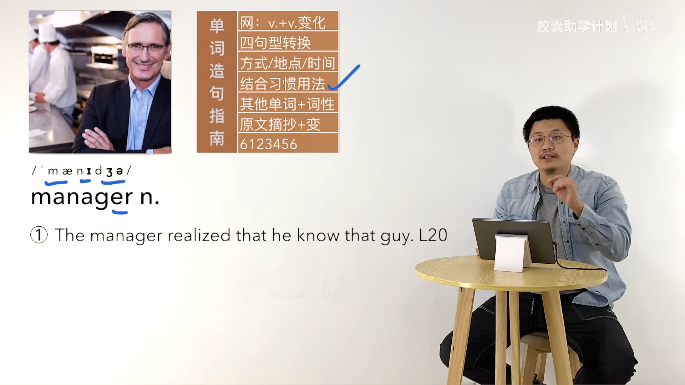

文字识别：单词造句指南 / 网：v.+v.变化 / 胶囊助学计划 / 四句型转换 / 方式/地点/时间 / 结合习惯用法 / 其他单词+词性 / 原文摘抄+变 / 6123456 / /'mænid3a/ / manager n. / ) The manager realized that he know that guy. L20 / 1

### 画面 00:01:20

文字识别：单词造句指南 / 网：v.+v.变化 / 胶囊助学计划 / 四句型转换 / 方式/地点/时间 / 结合习惯用法 / 其他单词+词性 / 原文摘抄+变 / 6123456 / /mænid3a/ / manager n. / The manager realized that he know that guy. L20 / That woman is driving our manager mad. L21

### 画面 00:01:26

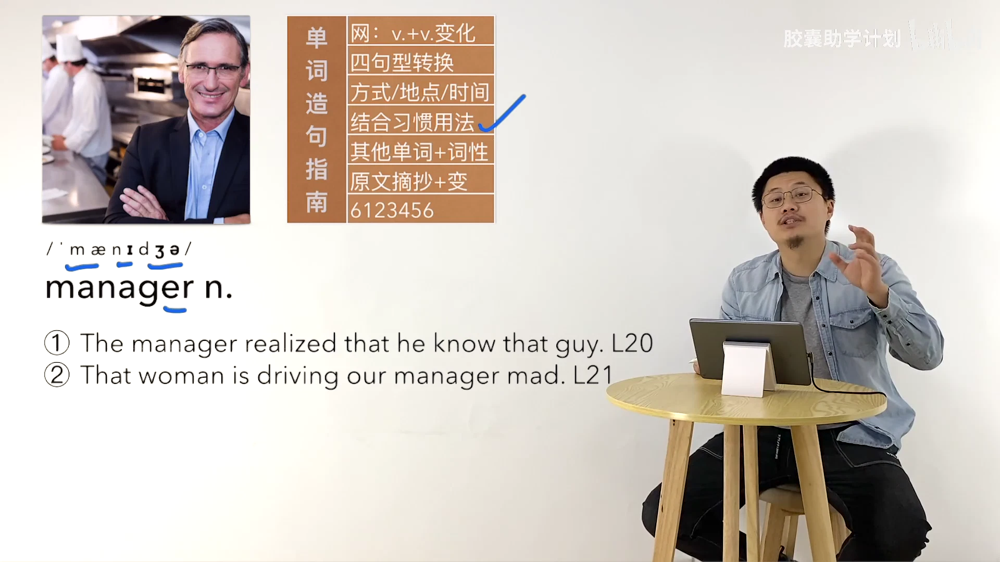

文字识别：单词造句指南 / 网：v.+v.变化 / 胶囊助学计划 / 四句型转换 / 方式/地点/时间 / 结合习惯用法 / 其他单词+词性 / 原文摘抄+变 / 6123456 / /mænid3a/ / manager n. / The manager realized that he know that guy. L20 / That woman is driving our manager mad. L21

## 00:01:30–00:02:00

一个说，I'm sorry. The manager said in a weak voice. OK，用特别微弱的嗓音说道，很抱歉。这是我们第十五课学的。OK，那这个单词不是非常的难，再跟我一起读一遍，manager， very good。好，我们看下一个单词，这个单词表示不安啊，是一种情绪。OK，它是一个形容词，跟我读一下，叫做 upset， upset。OK， very good。好，那我们给大家补充一个非常常用的短语，

### 画面 00:01:30

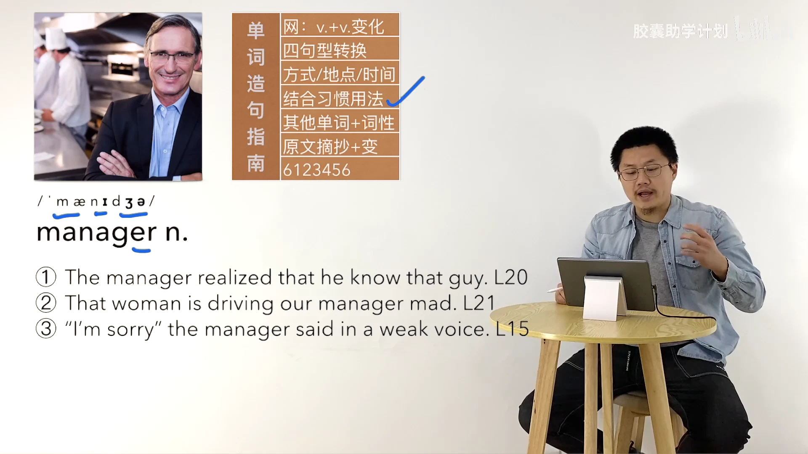

文字识别：单词造句指南 / 网：v.+v.变化 / 胶囊助学计划 / 四句型转换 / 方式/地点/时间 / 结合习惯用法 / 其他单词+词性 / 原文摘抄+变 / 6123456 / /mæn1d3a/ / manager n. / The manager realized that he know that guy. L20 / That woman is driving our manager mad. L21 / "I'm sorry' the manager said in a weak voice. L15 / 人

### 画面 00:01:36

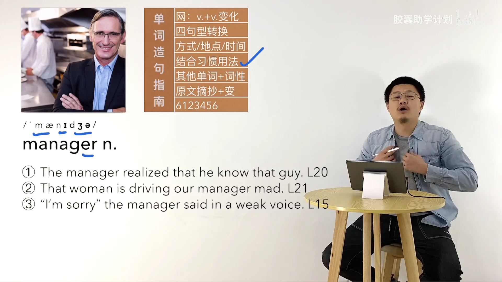

文字识别：单词造句指南 / 网：v.+v.变化 / 胶囊助学计划 / 四句型转换 / 方式/地点/时间 / 结合习惯用法 / 其他单词+词性 / 原文摘抄+变 / 6123456 / /mæn1d3a/ / manager n. / へ / The manager realized that he know that guy. L20 / That woman is driving our manager mad. L21 / "I'm sorry' the manager said in a weak voice. L15 / 3

### 画面 00:01:40

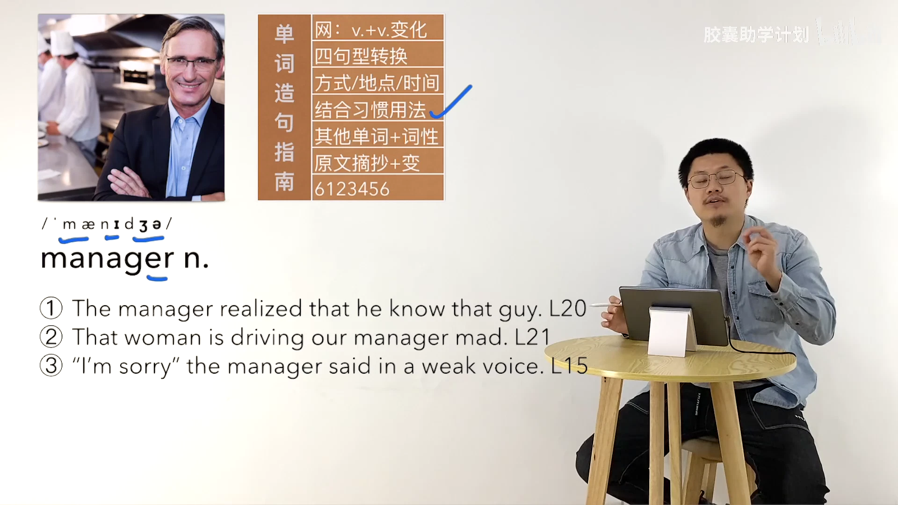

文字识别：单词造句指南 / 网：v.+v.变化 / 胶囊助学计划 / 四句型转换 / 方式/地点/时间 / 结合习惯用法 / 其他单词+词性 / 原文摘抄+变 / 6123456 / /mænd3a/ / manager n. / へ / The manager realized that he know that guy. L20 / That woman is driving our manager mad. L21 / "I'm sorry' the manager said in a weak voice. L15 / 3

### 画面 00:01:44

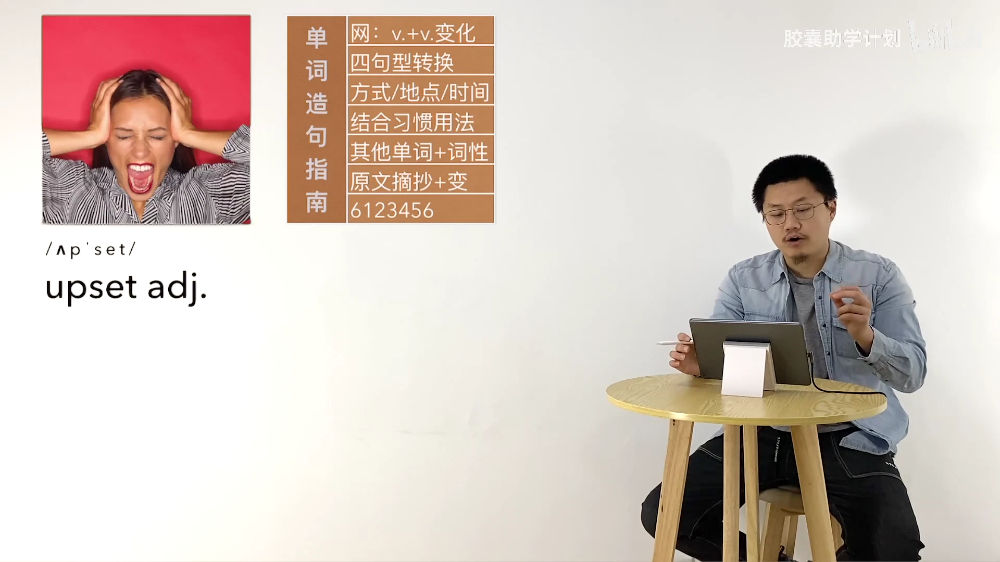

文字识别：单词造句指南 / 网：v.+v.变化 / 胶囊助学计划 / 四句型转换 / 方式/地点/时间 / 结合习惯用法 / 其他单词+词性 / 原文摘抄+变 / 6123456 / /np'set/ / upset adj.

### 画面 00:01:46

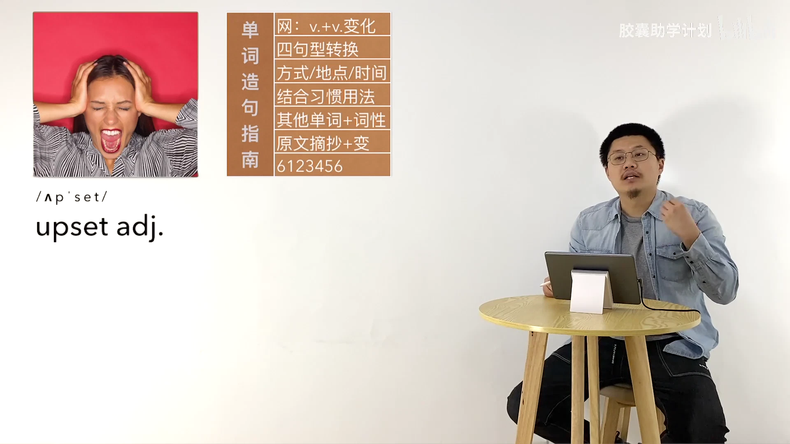

文字识别：单词造句指南 / 网：v.+v.变化 / 胶囊助学计划 / 四句型转换 / 方式/地点/时间 / 结合习惯用法 / 其他单词+词性 / 原文摘抄+变 / 6123456 / /ap'set/ / upset adj.

### 画面 00:01:50

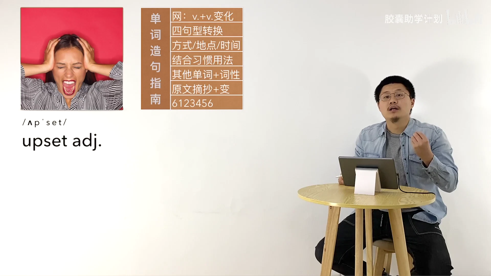

文字识别：单词造句指南 / 网：v.+v.变化 / 胶囊助学计划 / 四句型转换 / 方式/地点/时间 / 结合习惯用法 / 其他单词+词性 / 原文摘抄+变 / 6123456 / /np'set/ / upset adj.

### 画面 00:01:55

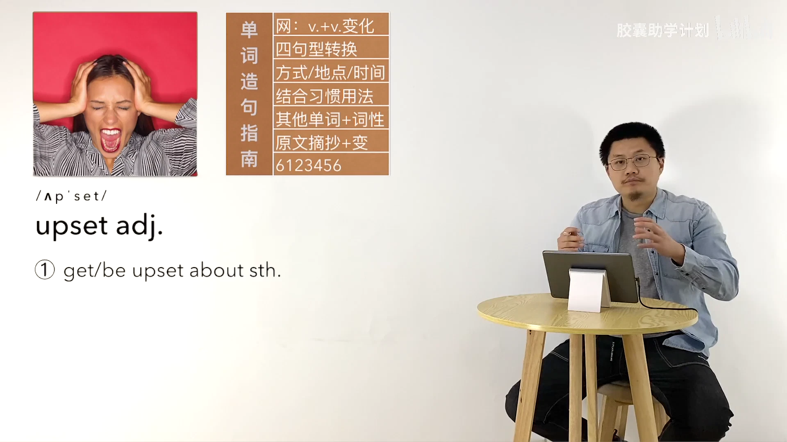

文字识别：单词造句指南 / 网：v.+v.变化 / 胶囊助学计划 / 四句型转换 / 方式/地点/时间 / 结合习惯用法 / 其他单词+词性 / 原文摘抄+变 / 6123456 / /np'set/ / upset adj. / ① get/be upset about sth.

## 00:02:00–00:02:30

叫做 be upset about something，或者是 get upset about something，啊，指的是对某件事情感到非常的不安。当然，您这个 something 也可以完全是 somebody，某人，对吧？那我们造一个句子说， the manager is upset about that girl。好，因为这个姑娘给她弄得非常的不安。 OK，玩一个，再来把它变一般疑问句就很简单，叫做 Is the manager

### 画面 00:02:00

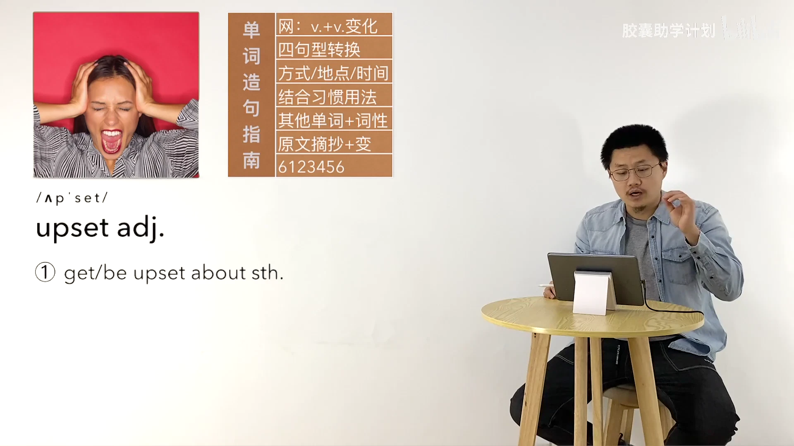

文字识别：单词造句指南 / 网：v.+v.变化 / 胶囊助学计划 / 四句型转换 / 方式/地点/时间 / 结合习惯用法 / 其他单词+词性 / 原文摘抄+变 / 6123456 / /np'set/ / upset adj. / ① get/be upset about sth.

### 画面 00:02:05

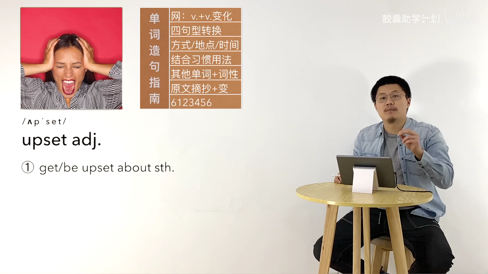

文字识别：单词造句指南 / 网：v.+v.变化 / 胶囊助学计划 / 四句型转换 / 方式/地点/时间 / 结合习惯用法 / 其他单词+词性 / 原文摘抄+变 / 6123456 / /np'set/ / upset adj. / ① get/be upset about sth.

### 画面 00:02:10

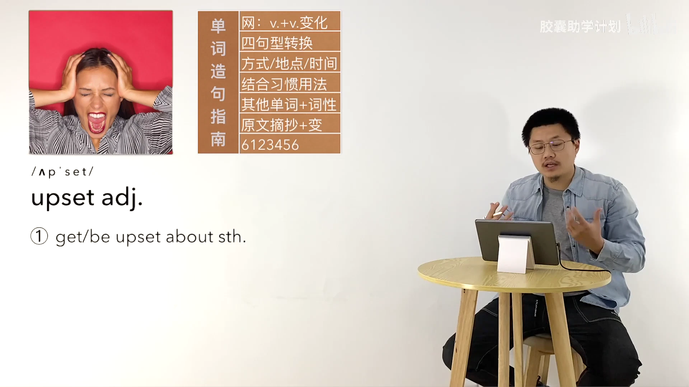

文字识别：单词造句指南 / 网：v.+v.变化 / 胶囊助学计划 / 四句型转换 / 方式/地点/时间 / 结合习惯用法 / 其他单词+词性 / 原文摘抄+变 / 6123456 / /np'set/ / upset adj. / ① get/be upset about sth.

### 画面 00:02:14

文字识别：单词造句指南 / 网：v.+v.变化 / 胶囊助学计划 / 四句型转换 / 方式/地点/时间 / 结合习惯用法 / 其他单词+词性 / 原文摘抄+变 / 6123456 / /np'set/ / upset adj. / /sb / ① get/be upset about sth.

### 画面 00:02:16

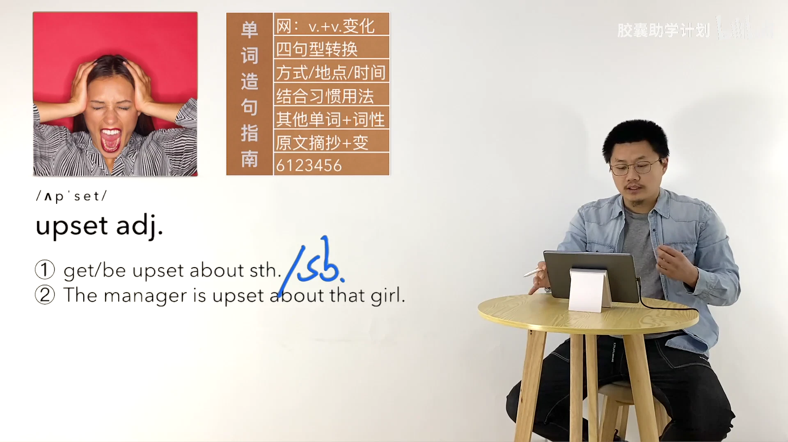

文字识别：单词造句指南 / 网：v.+v.变化 / 胶囊助学计划 / 四句型转换 / 方式/地点/时间 / 结合习惯用法 / 其他单词+词性 / 原文摘抄+变 / 6123456 / /ap'set/ / upset adj. / /s. / get/be upset about sth. / 1 / The manager is upset about that girl.

### 画面 00:02:20

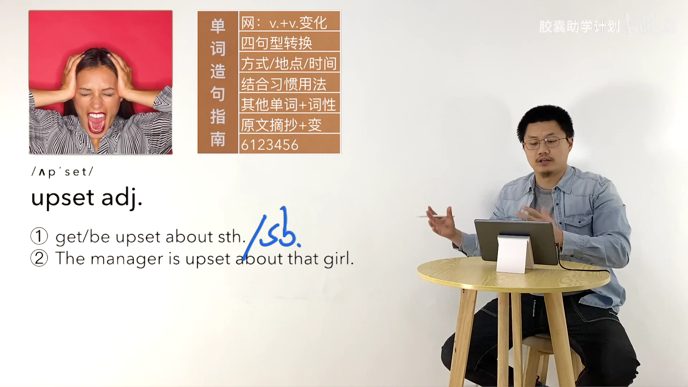

文字识别：单词造句指南 / 网：v.+v.变化 / 胶囊助学计划 / 四句型转换 / 方式/地点/时间 / 结合习惯用法 / 其他单词+词性 / 原文摘抄+变 / 6123456 / /ap'set/ / upset adj. / s5. / get/be upset about sth. / 1 / The manager is upset about that girl.

### 画面 00:02:25

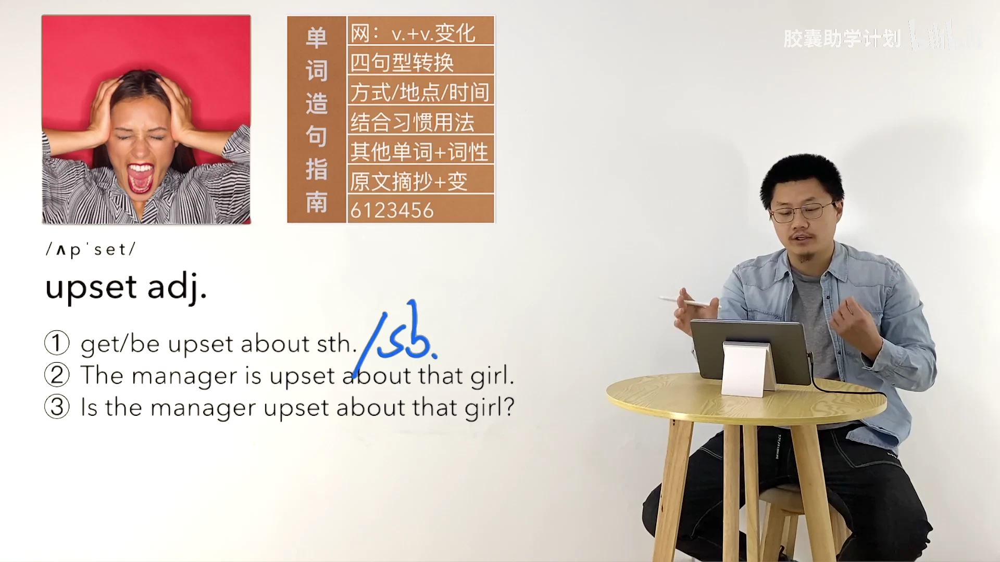

文字识别：单词造句指南 / 网：v.+v.变化 / 胶囊助学计划 / 四句型转换 / 方式/地点/时间 / 结合习惯用法 / 其他单词+词性 / 原文摘抄+变 / 6123456 / /ap'set/ / upset adj. / /sb. / get/be upset about sth. / 1 / The manager is upset about that girl. / 3 Is the manager upset about that girl? / 3

### 画面 00:02:28

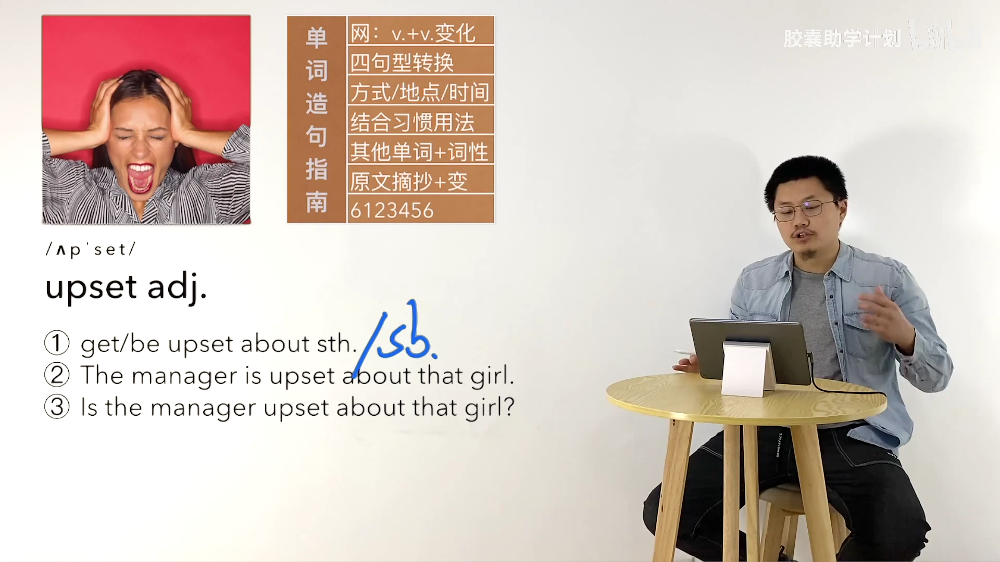

文字识别：单词造句指南 / 网：v.+v.变化 / 胶囊助学计划 / 四句型转换 / 方式/地点/时间 / 结合习惯用法 / 其他单词+词性 / 原文摘抄+变 / 6123456 / /ap'set/ / upset adj. / /s5. / get/be upset about sth. / 1 / The manager is upset about that girl. / 3 Is the manager upset about that girl? / 3

## 00:02:30–00:03:00

upset about that girl? Okay,那再来一个特殊疑问句，这是我们的所谓四句型转化，对吧？英语我们在说话的时候，一定是肯定句、否定句、一般疑问句、特殊疑问句都会使用的。那 Why is the manager upset about that girl? Okay, very good.接下来呢，我们看一个小的电影片段。电影片段最开始就出现了叫做 Be upset about something. 注意力集中来了。 Oh, you upset about the dinner, and that makes sense because we did spend

### 画面 00:02:30

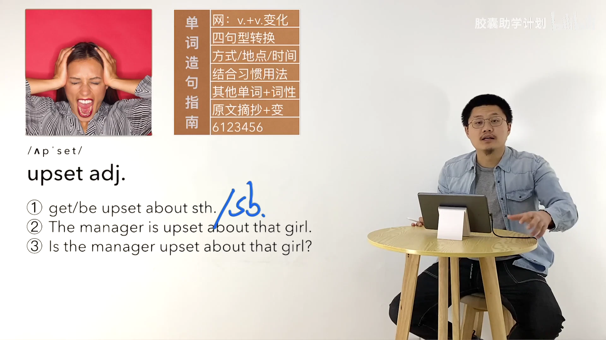

文字识别：单词造句指南 / 网：v.+v.变化 / 胶囊助学计划 / 四句型转换 / 方式/地点/时间 / 结合习惯用法 / 其他单词+词性 / 原文摘抄+变 / 6123456 / /ap'set/ / upset adj. / /sb. / get/be upset about sth. / 1 / The manager is upset about that girl. / 3 Is the manager upset about that girl? / 3）

### 画面 00:02:34

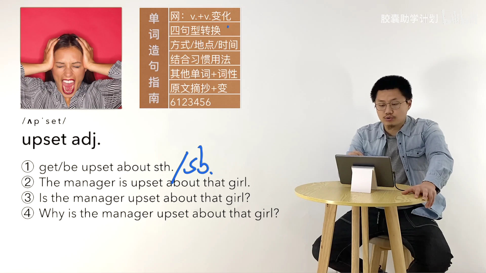

文字识别：单词造句指南 / 网：v.+v.变化 / 胶囊助学计划 / 四句型转换 / 方式/地点/时间 / 结合习惯用法 / 其他单词+词性 / 原文摘抄+变 / 6123456 / /ap'set/ / upset adj. / /sb. / 1 / get/be upset about sth. / The manager is upset about that girl. / 3 Is the manager upset about that girl? / 3 / ④ Why is the manager upset about that girl?

### 画面 00:02:36

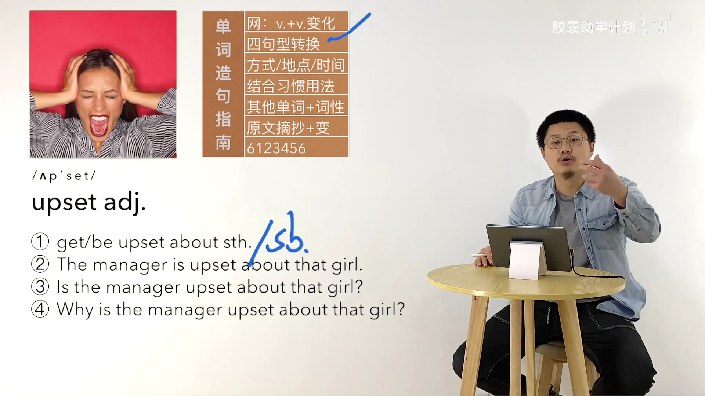

文字识别：单词造句指南 / 网：v.+v.变化 / 胶囊助学计划 / 四句型转换 / 方式/地点/时间 / 结合习惯用法 / 其他单词+词性 / 原文摘抄+变 / 6123456 / /ap'set/ / upset adj. / ./sb. / ① / get/be upset about sth. / The manager is upset about that girl. / 3 Is the manager upset about that girl? / 3 / ④ Why is the manager upset about that girl?

### 画面 00:02:40

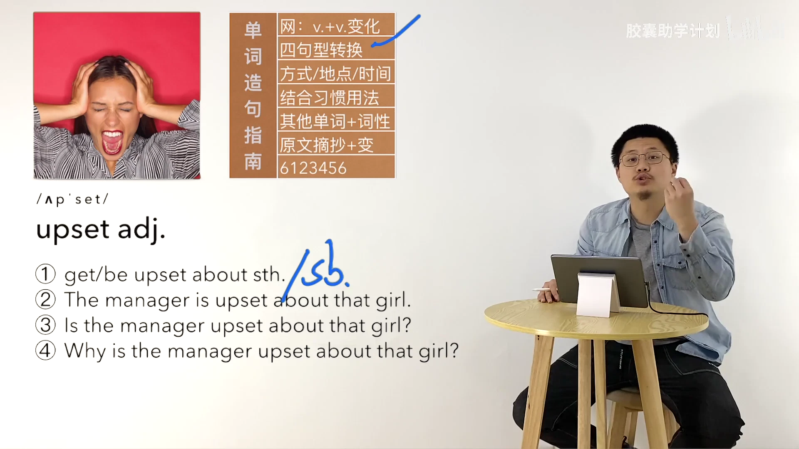

文字识别：单词造句指南 / 网：v.+v.变化 / 胶囊助学计划 / 四句型转换 / 方式/地点/时间 / 结合习惯用法 / 其他单词+词性 / 原文摘抄+变 / 6123456 / /ap'set/ / upset adj. / /sb. / 1 / get/be upset about sth. / The manager is upset about that girl. /  Is the manager upset about that girl? / 3 / ④ Why is the manager upset about that girl?

### 画面 00:02:45

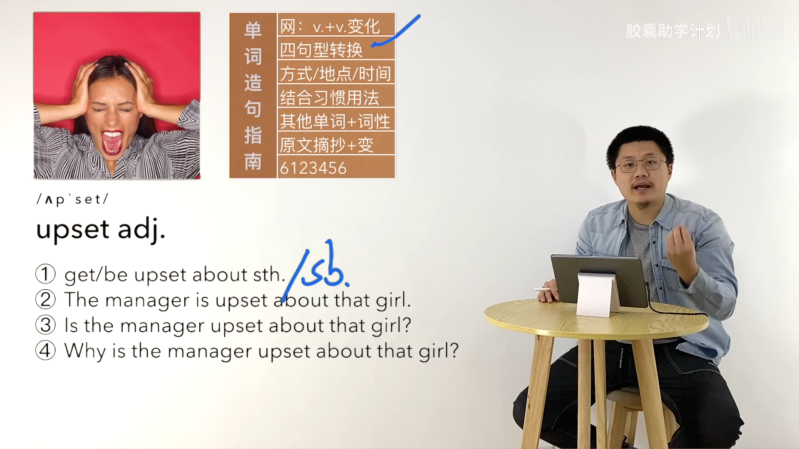

文字识别：单词造句指南 / 网：v.+v.变化 / 胶囊助学计划 / 四句型转换 / 方式/地点/时间 / 结合习惯用法 / 其他单词+词性 / 原文摘抄+变 / 6123456 / /ap'set/ / upset adj. / /sb. / 1 / get/be upset about sth. / The manager is upset about that girl. /  Is the manager upset about that girl? / 3） / ④ Why is the manager upset about that girl?

### 画面 00:02:47

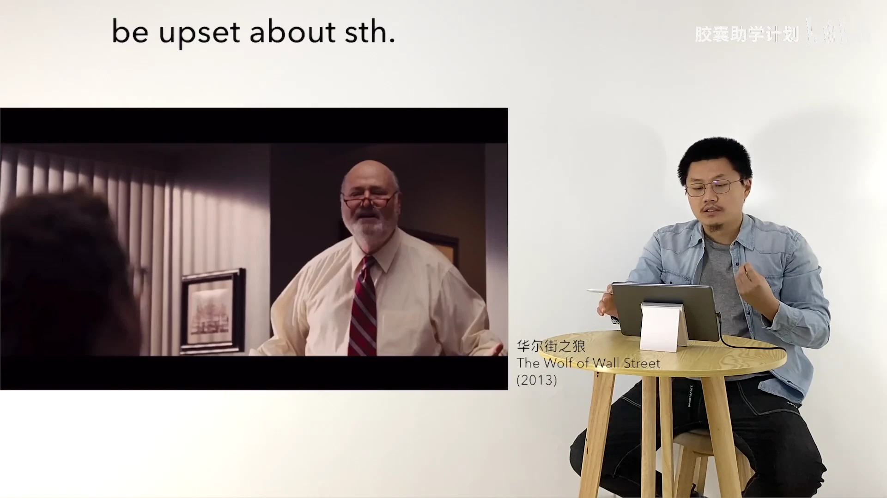

文字识别：be upset about sth. / 胶囊助学计划 / 华尔街之狼 / The Wolf of Wall Street / (2013)

### 画面 00:02:57

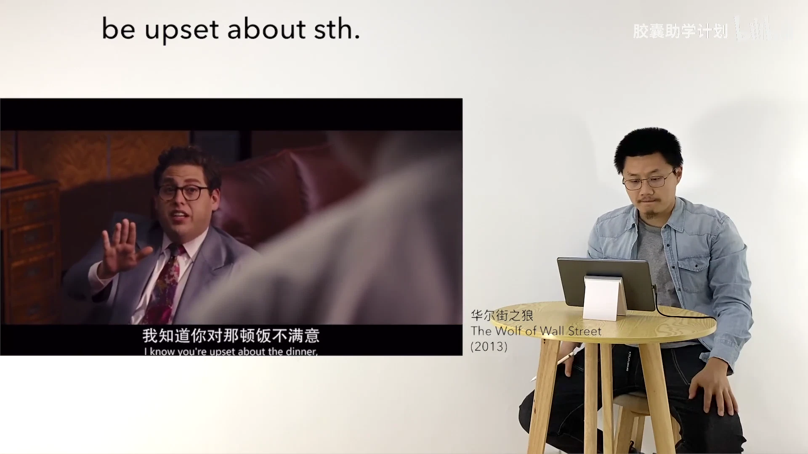

文字识别：be upset about sth. / 胶囊助学计划 / 华尔街之狼 / 我知道你对那顿饭不满意 / The Wolfof Wall Street / (2013) / I know you're upset about the dinner,

### 画面 00:02:59

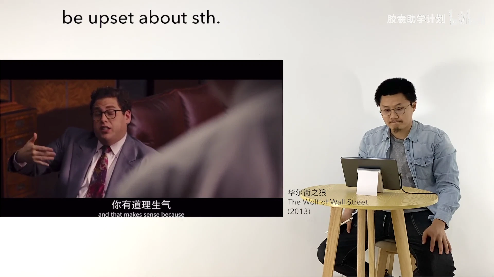

文字识别：be upset about sth. / 胶囊助学计划 / 华尔街之狼 / 你有道理气 / The Wolfof Wall Street / (2013) / and that makes sense because

## 00:03:00–00:03:30

too much money. But I said T. Don't tell me what you said. I heard what you said. He said TNA. He did. He said TNA. Absolutely no question. Yeah, I'm Chinese. Okay, one more. Be upset about something. When对于某件事情或对于某个人感到非常的不安. Next one.哎，这个单词看着比较长，我们看一下每个音节啊。来，sympathetic连起来，sympathetic, sympathetic. Okay, one more.表示富有同情心的，它是一个形容词。呃，我给

### 画面 00:03:01

文字识别：be upset about sth. / 胶囊助学计划 / 华尔街之狼 / The Wolf of Wall Street / 但我说的就是旅行娱乐 / (2013) / But I said T&E.

### 画面 00:03:03

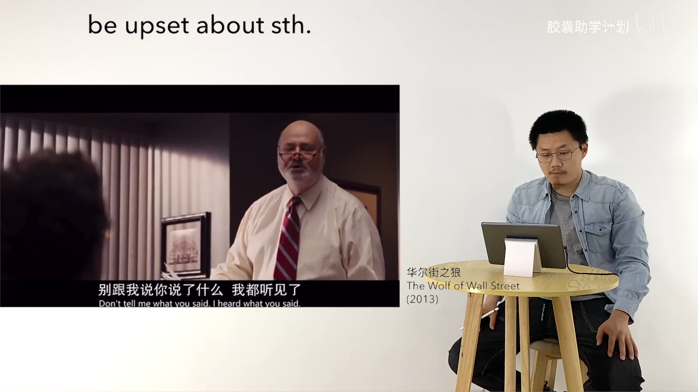

文字识别：be upset about sth. / 胶囊助学计划 / 华尔街之狼 / 别跟我说你说了什么我都听见了 / The Wolf of Wall Street / (2013) / Don't tell me what you said. I heard what you said.

### 画面 00:03:05

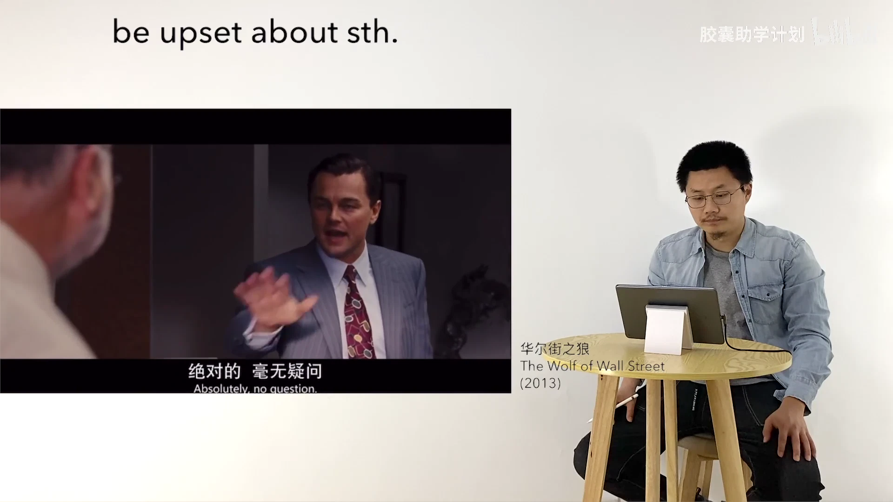

文字识别：be upset about sth. / 胶囊助学计划 / 华尔街之狼 / 绝对的毫无疑问 / The Wolf of Wall Street / (2013) / Absolutelv, no guestion.

### 画面 00:03:07

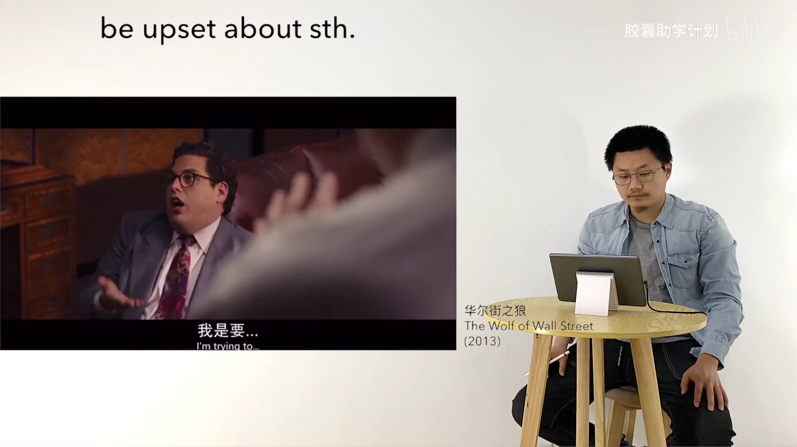

文字识别：be upset about sth. / 胶囊助学计划 / 华尔街之狼 / 我是要. / The Wolfof Wall Street / (2013) / I'm trying to..

### 画面 00:03:09

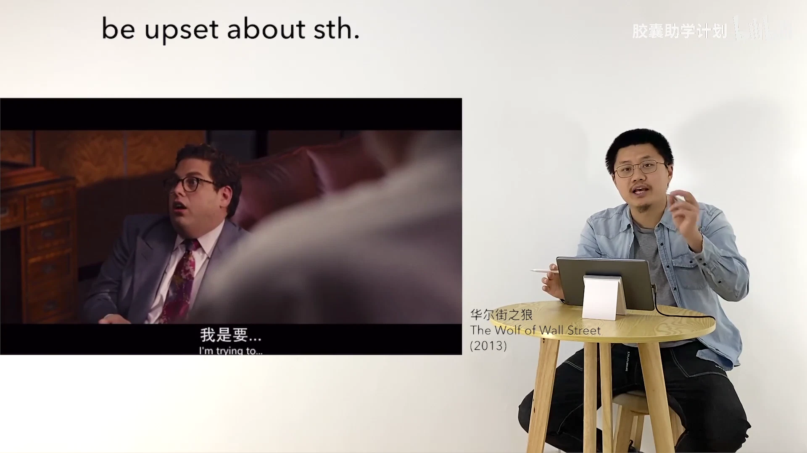

文字识别：be upset about sth. / 胶囊助学计划 / 华尔街之狼 / 我是要. / The Wolfof Wall Street / (2013) / I'm trying to..

### 画面 00:03:14

文字识别：单词造句指南 / 网：v.+v.变化 / 胶囊助学计划 / 四句型转换 / 方式/地点/时间 / 结合习惯用法 / 其他单词+词性 / 原文摘抄+变 / 6123456 / /sImpaθetik/ / sympathetic adj.

### 画面 00:03:16

文字识别：单词造句指南 / 网：v.+v.变化 / 胶囊助学计划 / 四句型转换 / 方式/地点/时间 / 结合习惯用法 / 其他单词+词性 / 原文摘抄+变 / 6123456 / /sImpaθetik/ / sympathetic adj.

### 画面 00:03:20

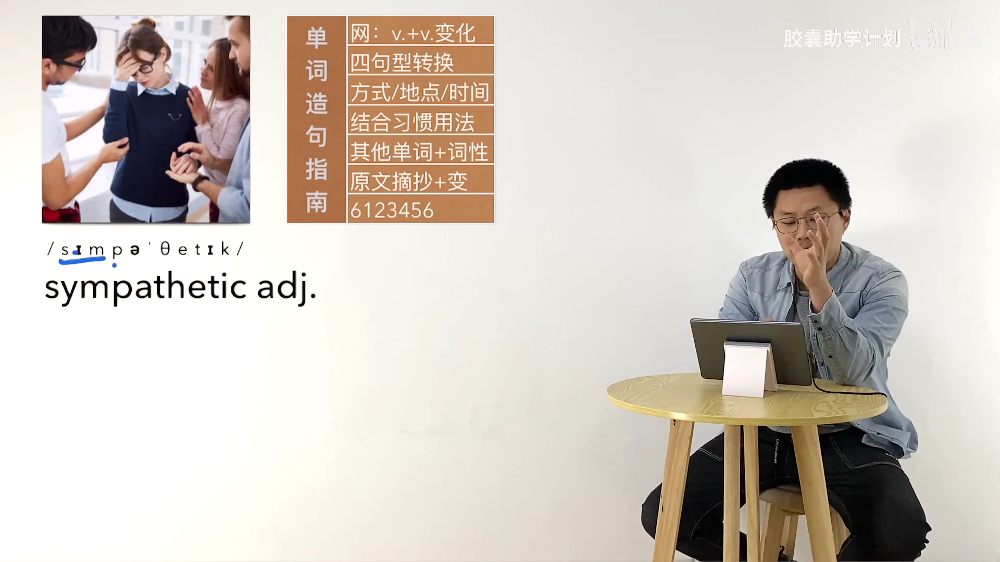

文字识别：单词造句指南 / 网：v.+v.变化 / 胶囊助学计划 / 四句型转换 / 方式/地点/时间 / 结合习惯用法 / 其他单词+词性 / 原文摘抄+变 / 6123456 / /simpa'θetik/ / sympathetic adj.

### 画面 00:03:24

文字识别：单词造句指南 / 网：v.+v.变化 / 胶囊助学计划 / 四句型转换 / 方式/地点/时间 / 结合习惯用法 / 其他单词+词性 / 原文摘抄+变 / 6123456 / /simpa'θetik/ / sympathetic adj.

### 画面 00:03:26

文字识别：单词造句指南 / 网：v.+v.变化 / 胶囊助学计划 / 四句型转换 / 方式/地点/时间 / 结合习惯用法 / 其他单词+词性 / 原文摘抄+变 / 6123456 / /simpa'θetik/ / sympathetic adj.

### 画面 00:03:29

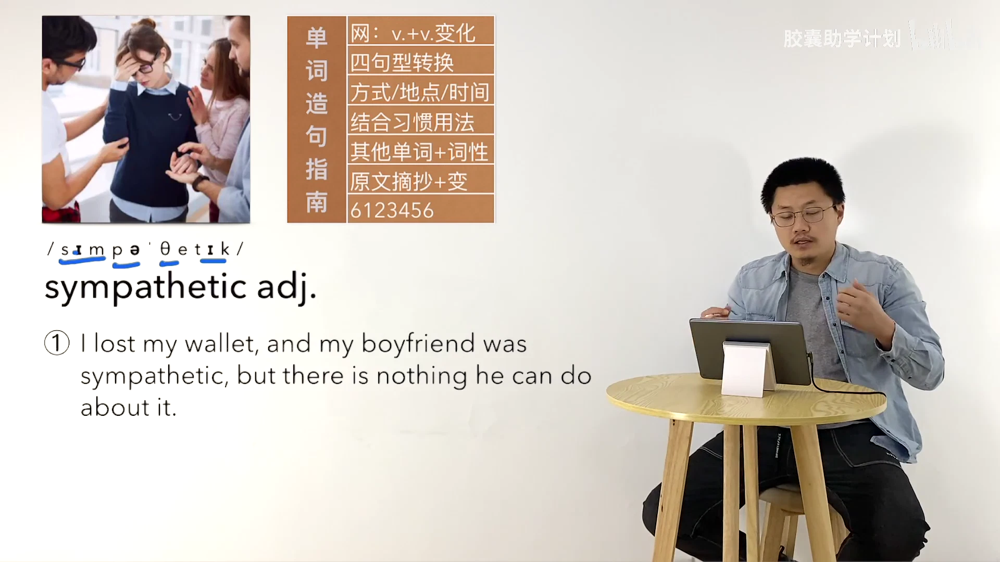

文字识别：单词造句指南 / 网：v.+v.变化 / 胶囊助学计划 / 四句型转换 / 方式/地点/时间 / 结合习惯用法 / 其他单词+词性 / 原文摘抄+变 / 6123456 / /simpaθetik/ / sympathetic adj. / ① I lost my wallet, and my boyfriend was / sympathetic, but there is nothing he can do / about it.

## 00:03:30–00:04:00

大家直接造了一小段话啊，好几个单词，叫做好几个小的句子。I lost my wallet, and my boyfriend was sympathetic, but there is nothing he can do about it. Okay,说我把钱包丢了，然后呢，我男朋友呢还是挺富有同情心的，但是他什么也做不了。Okay，这个地方注意一个小点，其实我们在第一个单元啊，我注意啊，故意在这个我们第一个单元的最后一课稍微超纲了一下，对吧？我们把一个句子，

### 画面 00:03:34

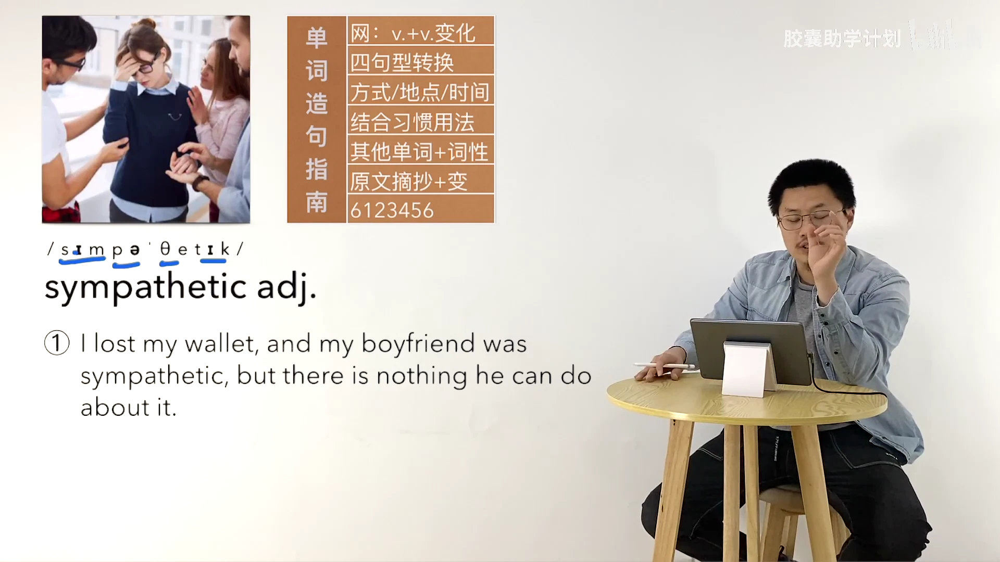

文字识别：单词造句指南 / 网：v.+v.变化 / 胶囊助学计划 / 四句型转换 / 方式/地点/时间 / 结合习惯用法 / 其他单词+词性 / 原文摘抄+变 / 6123456 / /simpa'θetik/ / sympathetic adj. / ① Ilost my wallet, and my boyfriend was / sympathetic, but there is nothing he can do / about it.

### 画面 00:03:36

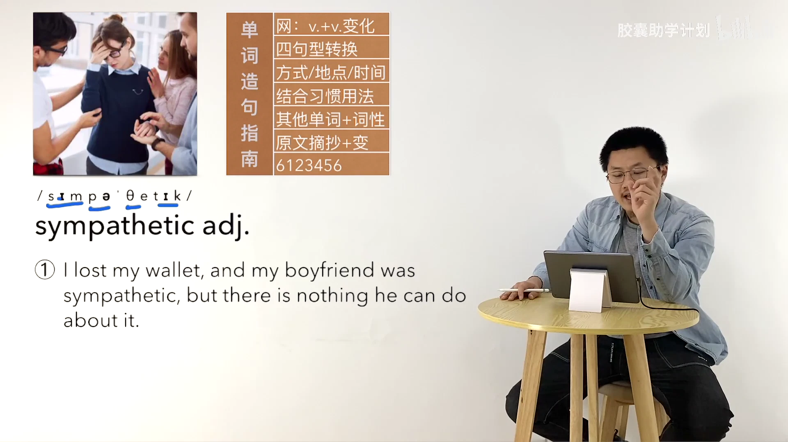

文字识别：单词造句指南 / 网：v.+v.变化 / 胶囊助学计划 / 四句型转换 / 方式/地点/时间 / 结合习惯用法 / 其他单词+词性 / 原文摘抄+变 / 6123456 / /simpa'θetik/ / sympathetic adj. / ① Ilost my wallet, and my boyfriend was / sympathetic, but there is nothing he can do / about it.

### 画面 00:03:41

文字识别：单词造句指南 / 网：v.+v.变化 / 胶囊助学计划 / 四句型转换 / 方式/地点/时间 / 结合习惯用法 / 其他单词+词性 / 原文摘抄+变 / 6123456 / /simpaθetik/ / sympathetic adj. / ① Ilost my wallet, and my boyfriend was / sympathetic, but there is nothing he can do / about it.

### 画面 00:03:46

文字识别：单词造句指南 / 网：v.+v.变化 / 胶囊助学计划 / 四句型转换 / 方式/地点/时间 / 结合习惯用法 / 其他单词+词性 / 原文摘抄+变 / 6123456 / /simpaθetik/ / sympathetic adj. / ① Ilost my wallet, and my boyfriend was / sympathetic, but there is nothing he can do / about it.

### 画面 00:03:50

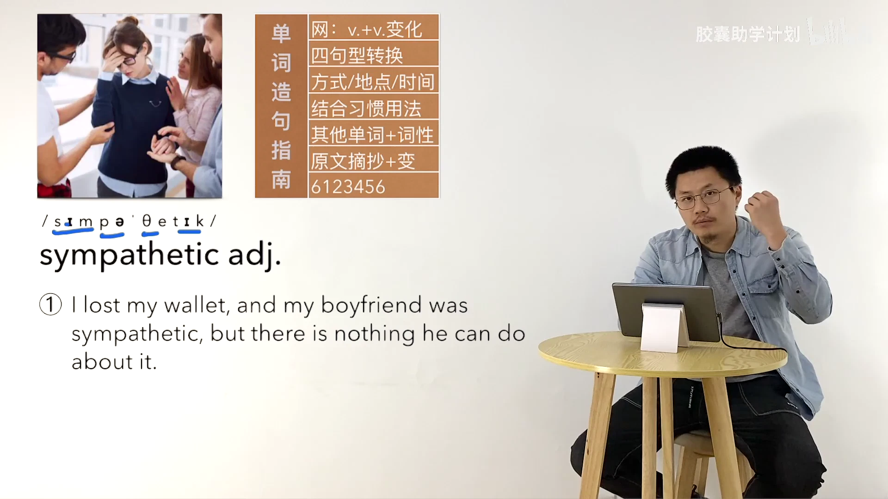

文字识别：单词造句指南 / 网：v.+v.变化 / 胶囊助学计划 / 四句型转换 / 方式/地点/时间 / 结合习惯用法 / 其他单词+词性 / 原文摘抄+变 / 6123456 / /simpa'θetik/ / sympathetic adj. / ① Ilost my wallet, and my boyfriend was / sympathetic, but there is nothing he can do / about it.

### 画面 00:03:57

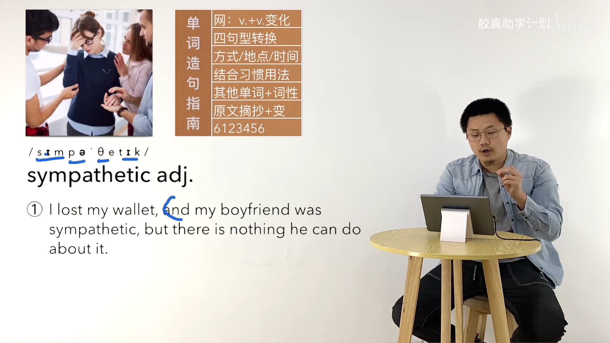

文字识别：单词造句指南 / 网：v.+v.变化 / 胶囊助学计划 / 四句型转换 / 方式/地点/时间 / 结合习惯用法 / 其他单词+词性 / 原文摘抄+变 / 6123456 / /simpaθetik/ / sympathetic adj. / ① Ilost my wallet, End my boyfriend was / sympathetic, but there is nothing he can do / about it.

### 画面 00:03:59

文字识别：单词造句指南 / 网：v.+v.变化 / 胶囊助学计划 / 四句型转换 / 方式/地点/时间 / 结合习惯用法 / 其他单词+词性 / 原文摘抄+变 / 6123456 / /simpaθetik/ / sympathetic adj. / ① Ilost my wallet ndmy boyfriend / dwas / 6ut there is nothing he can do / sympathetic, / about it.

## 00:04:00–00:04:30

哎呃，给它扩展变成了三个小的句子，然后用两个不同的连词给它连起来。这个是我们二十五课立刻就会学的一个非常关键的语法连词。OK，好，那再来一个句子叫做 We can be more sympathetic about this。说关于这件事情我们可以更富有同情心，对吧？OK，那当然我可以问啊，我们能关于这件事情更富有同情心吗？四平转换不多说了。OK，下面一个单词跟我读一下，叫做

### 画面 00:04:01

文字识别：单词造句指南 / 网：v.+v.变化 / 胶囊助学计划 / 四句型转换 / 方式/地点/时间 / 结合习惯用法 / 其他单词+词性 / 原文摘抄+变 / 6123456 / /simpa'θetik/ / sympathetic adj. / ① Ilost my wallet ndmy boyfriendv / dwas / u there is nothing he can do / sympathetic, / about it.

### 画面 00:04:05

文字识别：单词造句指南 / 网：v.+v.变化 / 胶囊助学计划 / 四句型转换 / 方式/地点/时间 / 结合习惯用法 / 其他单词+词性 / 原文摘抄+变 / 6123456 / /simpa'θetik/ / sympathetic adj. / ① Ilost my wallet n my boyfriendv / dwas / Gut there is nothing he can do / sympathetic, / about it.

### 画面 00:04:09

文字识别：单词造句指南 / 网：v.+v.变化 / 胶囊助学计划 / 四句型转换 / 方式/地点/时间 / 结合习惯用法 / 其他单词+词性 / 原文摘抄+变 / 6123456 / /simpa'θetik/ / sympathetic adj. / ① Ilost my wallt, nd my boyfriend / dwas / ut there is nothing he can do / sympathetic, / about it.

### 画面 00:04:11

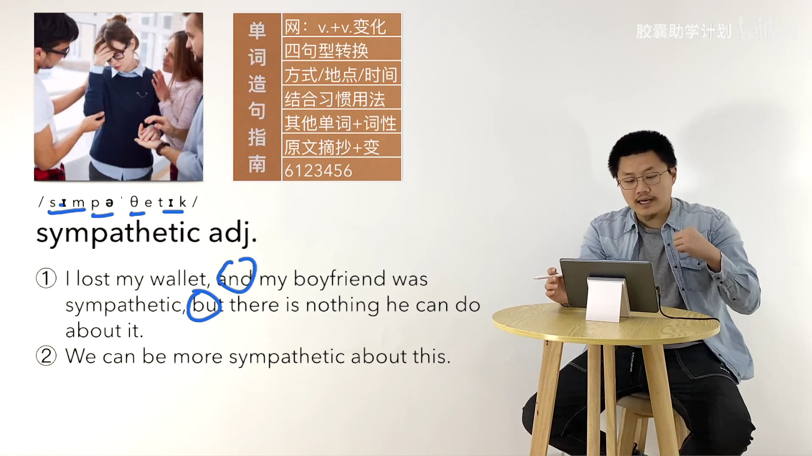

文字识别：单词造句指南 / 网：v.+v.变化 / 胶囊助学计划 / 四句型转换 / 方式/地点/时间 / 结合习惯用法 / 其他单词+词性 / 原文摘抄+变 / 6123456 / /simpaθetik/ / sympathetic adj. / ① Ilost my wallet, inmy boyfriend was / ut there is nothing he can do / sympathetic, / about it. / We can be more sympathetic about this.

### 画面 00:04:15

文字识别：单词造句指南 / 网：v.+v.变化 / 胶囊助学计划 / 四句型转换 / 方式/地点/时间 / 结合习惯用法 / 其他单词+词性 / 原文摘抄+变 / 6123456 / /simpa'θetik/ / sympathetic adj. / ① Ilost my wallet nmy boyfriend was / sympathetic, / ut there is nothing he can do / about it. / We can be more sympathetic about this.

### 画面 00:04:20

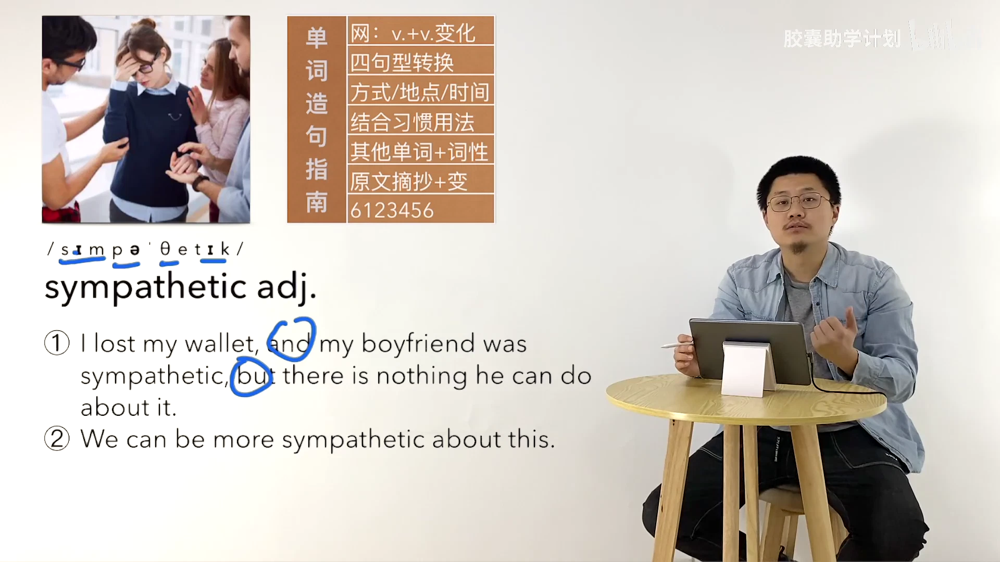

文字识别：单词造句指南 / 网：v.+v.变化 / 胶囊助学计划 / 四句型转换 / 方式/地点/时间 / 结合习惯用法 / 其他单词+词性 / 原文摘抄+变 / 6123456 / /simpaθetik/ / sympathetic adj. / ① Ilost my wallet, nTmy boyfriend was / ut there is nothing he can do / sympathetic, / about it. / We can be more sympathetic about this.

### 画面 00:04:25

文字识别：单词造句指南 / 网：v.+v.变化 / 胶囊助学计划 / 四句型转换 / 方式/地点/时间 / 结合习惯用法 / 其他单词+词性 / 原文摘抄+变 / 6123456 / /simpa'θetik/ / sympathetic adj. / ① Ilost my wallet, Enmy boyfriend was / ut there is nothing he can do / sympathetic, / about it. / We can be more sympathetic about this.

### 画面 00:04:27

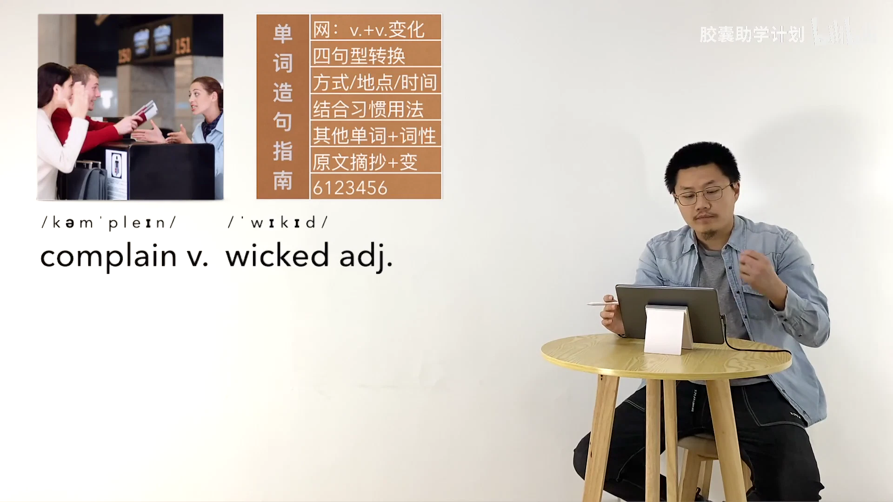

文字识别：单词造句指南 / 网：v.+v.变化 / 胶囊助学计划 / 151 / 四句型转换 / 方式/地点/时间 / 结合习惯用法 / 其他单词+词性 / 原文摘抄+变 / 6123456 / /kam'plein/ / /wIkId / / complain v. wicked adj.

### 画面 00:04:29

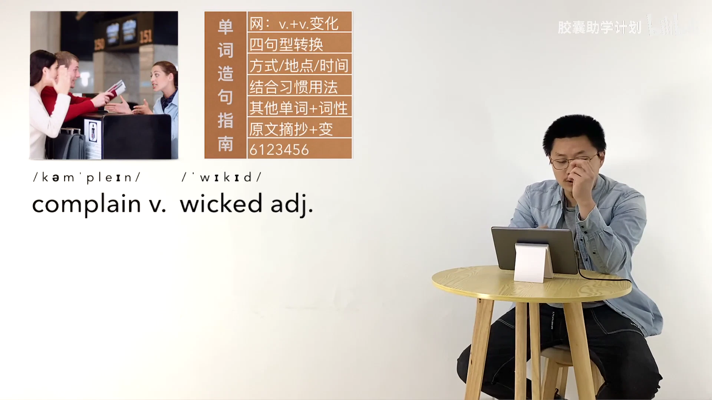

文字识别：单词造句指南 / 网：v.+v.变化 / 胶囊助学计划 / 151 / 四句型转换 / 方式/地点/时间 / 结合习惯用法 / 其他单词+词性 / 原文摘抄+变 / 6123456 / /kam'plein/ / /wIkId / / complain v. wicked adj.

## 00:04:30–00:05:00

complain, complain 叫做抱怨。OK，那下一个单词叫 wicked，我们放到一起去学，叫 wicked，指的是邪恶的。好，complain 这个单词经常用的一个短语叫 complain about something，啊，就是抱怨某件事情。我们造个句子吧，试一下。说 she complains about the weather all the time。你看，我们在这儿注意用了一个动词，动词变化，也就是说，我们用到了叫

### 画面 00:04:31

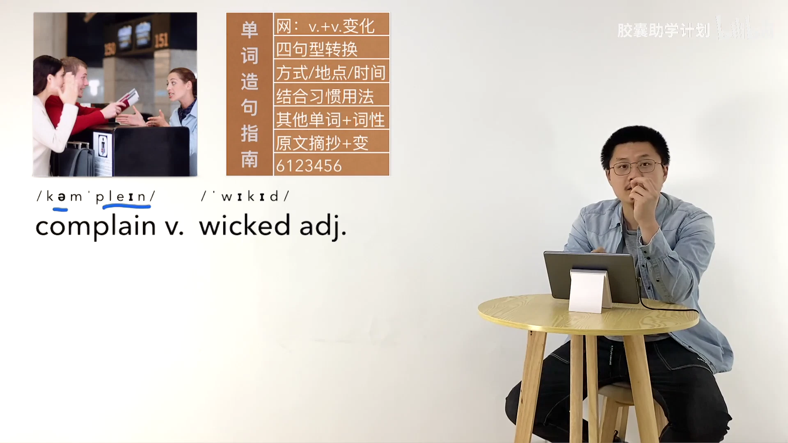

文字识别：单词造句指南 / 网：v.+v.变化 / 胶囊助学计划 / 151 / 四句型转换 / 方式/地点/时间 / 结合习惯用法 / 其他单词+词性 / 原文摘抄+变 / 6123456 / /kam'plein/ / /w I kI d / / complain v. wicked adj.

### 画面 00:04:35

文字识别：单词造句指南 / 网：v.+v.变化 / 胶囊助学计划 / 151 / 四句型转换 / 方式/地点/时间 / 结合习惯用法 / 其他单词+词性 / 原文摘抄+变 / 6123456 / /kam'plein/ / /wIkId/ / complain v. wicked adj.

### 画面 00:04:38

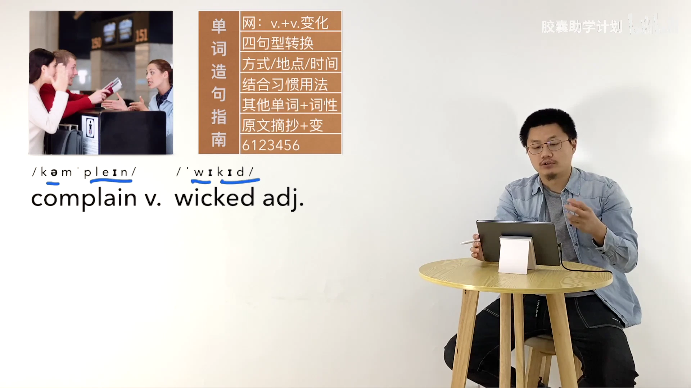

文字识别：单词造句指南 / 网：v.+v.变化 / 胶囊助学计划 / 151 / 四句型转换 / 方式/地点/时间 / 结合习惯用法 / 其他单词+词性 / 原文摘抄+变 / 6123456 / /kam'plein/ / /wIkId/ / complain v. wicked adj.

### 画面 00:04:40

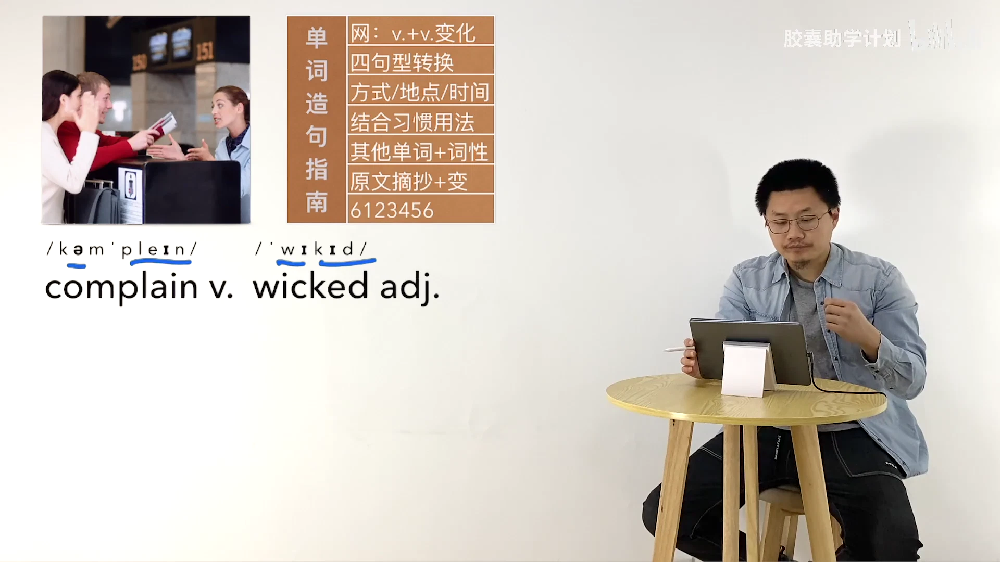

文字识别：单词造句指南 / 网：v.+v.变化 / 胶囊助学计划 / 151 / 四句型转换 / 方式/地点/时间 / 结合习惯用法 / 其他单词+词性 / 原文摘抄+变 / 6123456 / /kam'plein/ / /wIkId/ / complain v. wicked adj.

### 画面 00:04:45

文字识别：单词造句指南 / 网：v.+v.变化 / 胶囊助学计划 / 151 / 四句型转换 / 方式/地点/时间 / 结合习惯用法 / 其他单词+词性 / 原文摘抄+变 / 6123456 / /kam'plein/ / /wIkId/ / complain v. wicked adj. / ① complain about sth.

### 画面 00:04:50

文字识别：单词造句指南 / 网：v.+v.变化 / 胶囊助学计划 / 151 / 四句型转换 / 方式/地点/时间 / 结合习惯用法 / 其他单词+词性 / 原文摘抄+变 / 6123456 / / kam'plein/ / /wIkId/ / complain v. wicked adj. / ① complain about sth. / She complains about the weather all the time.

### 画面 00:04:55

文字识别：单词造句指南 / 网：v.+v.变化 / 胶囊助学计划 / 151 / 四句型转换 / 方式/地点/时间 / 结合习惯用法 / 其他单词+词性 / 原文摘抄+变 / 6123456 / / kam'plein/ / /wIkId/ / complain v. wicked adj. / ① complain about sth. / She complains about the weather all the time.

## 00:05:00–00:05:30

all the time。那这个地方是一直总是这个样子，所以我们用一般现在时陈述客观事实，或者是你可以理解为它是一个习惯，对吧？他的生活习惯就是永远在抱怨天气。OK，好，那把它变成特殊疑问句。Why does she complain about the weather all the time? There you go。那以及 he is complaining about the wicked world。That the自己没错啊，全是社会的责任是吧？这个世界哪

### 画面 00:05:00

文字识别：单词造句指南 / 网：v.+v.变化 / 胶囊助学计划 / 四句型转换 / 方式/地点/时间 / 结合习惯用法 / 其他单词+词性 / 原文摘抄+变 / 6123456 / /kam'plein/ / /wIkId/ / complain v. wicked adj. / ① / complain about sth. / She complains about the weather all the time.

### 画面 00:05:05

文字识别：单词造句指南 / 网：v.+v.变化 / 胶囊助学计划 / 四句型转换 / 方式/地点/时间 / 结合习惯用法 / 其他单词+词性 / 原文摘抄+变 / 6123456 / / kam'plein/ / /wIkId/ / complain v. wicked adj. / ① / complain about sth. / She complains about the weather all the time.

### 画面 00:05:10

文字识别：单词造句指南 / 网：v.+v.变化 / 胶囊助学计划 / 四句型转换 / 方式/地点/时间 / 结合习惯用法 / 其他单词+词性 / 原文摘抄+变 / 6123456 / /kam'plein/ / /wIkId/ / complain v. wicked adj. / ① complain about sth. / She complains about the weather all the time.

### 画面 00:05:15

文字识别：单词造句指南 / 网：v.+v.变化 / 胶囊助学计划 / 四句型转换 / 方式/地点/时间 / 结合习惯用法 / 其他单词+词性 / 原文摘抄+变 / 6123456 / /kam'plein/ / /wIkId/ / complain v. wicked adj. / ① complain about sth. / 2 / She complains about the weather all the time. / ③ Why does she complain about the weather all the time?

### 画面 00:05:20

文字识别：单词造句指南 / 网：v.+v.变化 / 胶囊助学计划 / 151 / 四句型转换 / 方式/地点/时间 / 结合习惯用法 / 其他单词+词性 / 原文摘抄+变 / 6123456 / /kam'plein/ / /wIkId/ / complain v. wicked adj. / ① complain about sth. / 2 / She complains about the weather all the time. / ③ Why does she complain about the weather all the time? /  He is complaining about the wicked world.

### 画面 00:05:25

文字识别：单词造句指南 / 网：v.+v.变化 / 胶囊助学计划 / 151 / 四句型转换 / 方式/地点/时间 / 结合习惯用法 / 其他单词+词性 / 原文摘抄+变 / 6123456 / /kam'plein/ / /wIkId/ / complain v. wicked adj. / ① complain about sth. / 2 / She complains about the weather all the time. / ③ Why does she complain about the weather all the time? / He is complaining about the wicked world.

## 00:05:30–00:06:00

哪儿都不如意啊，叫 complaining about the wicked world. Okay, very good. 接下来呢，下一个单词跟我读一下，叫做 contain. 注意重音在后面，对吧？叫 contain. Very good. 那 what is a container? Contain 后面加了一个 e r 结尾的时候，要么是这个物件，要么是做这个事儿的人。好，我故意卖一个关子，是吧？家庭作业，各位自己去查一

### 画面 00:05:30

文字识别：单词造句指南 / 网：v.+v.变化 / 胶囊助学计划 / 151 / 四句型转换 / 方式/地点/时间 / 结合习惯用法 / 其他单词+词性 / 原文摘抄+变 / 6123456 / /kam'plein/ / /wIkId / / complain v. wicked adj. / ① complain about sth. / 2 / She complains about the weather all the time. / ③ Why does she complain about the weather all the time? / ) He is complaining about the wicked world.

### 画面 00:05:35

文字识别：单词造句指南 / 网：v.+v.变化 / 胶囊助学计划 / 151 / 四句型转换 / 方式/地点/时间 / 结合习惯用法 / 其他单词+词性 / 原文摘抄+变 / 6123456 / /kam'plein/ / /wIkId/ / complain v. wicked adj. / ① complain about sth. / 2 / She complains about the weather all the time. / ③ Why does she complain about the weather all the time? / He is complaining about the wicked world.

### 画面 00:05:37

文字识别：单词造句指南 / 网：v.+v.变化 / 胶囊助学计划 / 四句型转换 / 方式/地点/时间 / 结合习惯用法 / 其他单词+词性 / 原文摘抄+变 / 6123456 / /kan'tein/ / contain v.

### 画面 00:05:40

文字识别：单词造句指南 / 网：v.+v.变化 / 胶囊助学计划 / 四句型转换 / 方式/地点/时间 / 结合习惯用法 / 其他单词+词性 / 原文摘抄+变 / 6123456 / /kan'tein/ / contain v.

### 画面 00:05:45

文字识别：单词造句指南 / 网：v.+v.变化 / 胶囊助学计划 / 四句型转换 / 方式/地点/时间 / 结合习惯用法 / 其他单词+词性 / 原文摘抄+变 / 6123456 / /kan'tein/ / contain v. /  What is a container?

### 画面 00:05:50

文字识别：单词造句指南 / 网：v.+v.变化 / 胶囊助学计划 / 四句型转换 / 方式/地点/时间 / 结合习惯用法 / 其他单词+词性 / 原文摘抄+变 / 6123456 / /kan'tein/ / contain v. /  What is a container?

### 画面 00:05:55

文字识别：单词造句指南 / 网：v.+v.变化 / 胶囊助学计划 / 四句型转换 / 方式/地点/时间 / 结合习惯用法 / 其他单词+词性 / 原文摘抄+变 / 6123456 / /kan'tein/ / contain v. /  What is a container? / 2

## 00:06:00–00:06:30

下 container 这个单词是什么，还是比较常用的一个单词。OK，好，那我们造一个句子，说 it contained fifty pounds or fifty dollars or fifty RMB. OK, whatever.说它包含了，它曾经有五十块钱。那变一般疑问句，你注意，我说的是曾经有，我选择用了一般过去式，没有说陈述客观事实，对吧？那叫做 did it contain fifty dollars or fifty RMB? OK,

### 画面 00:06:00

文字识别：单词造句指南 / 网：v.+v.变化 / 胶囊助学计划 / 四句型转换 / 方式/地点/时间 / 结合习惯用法 / 其他单词+词性 / 原文摘抄+变 / 6123456 / /kan'tein/ / contain v. /  What is a container?

### 画面 00:06:05

文字识别：单词造句指南 / 网：v.+v.变化 / 胶囊助学计划 / 四句型转换 / 方式/地点/时间 / 结合习惯用法 / 其他单词+词性 / 原文摘抄+变 / 6123456 / /kan'tein/ / contain v. / ) What is a container? / 1 / It contained 50.

### 画面 00:06:10

文字识别：单词造句指南 / 网：v.+v.变化 / 胶囊助学计划 / 四句型转换 / 方式/地点/时间 / 结合习惯用法 / 其他单词+词性 / 原文摘抄+变 / 6123456 / /kan'tein/ / contain v. /  What is a container? / 1 / It contained 50.

### 画面 00:06:15

文字识别：单词造句指南 / 网：v.+v.变化 / 胶囊助学计划 / 四句型转换 / 方式/地点/时间 / 结合习惯用法 / 其他单词+词性 / 原文摘抄+变 / 6123456 / /kan'tein/ / contain v. /  What is a container? / It contained 50.

### 画面 00:06:20

文字识别：单词造句指南 / 网：v.+v.变化 / 胶囊助学计划 / 四句型转换 / 方式/地点/时间 / 结合习惯用法 / 其他单词+词性 / 原文摘抄+变 / 6123456 / /kan'tein/ / contain v. /  What is a container? / 1 / It contained 50.

### 画面 00:06:25

文字识别：单词造句指南 / 网：v.+v.变化 / 胶囊助学计划 / 四句型转换 / 方式/地点/时间 / 结合习惯用法 / 其他单词+词性 / 原文摘抄+变 / 6123456 / /kan'tein/ / contain v. / What is a container? / It contained 50. / Did it contain 50?

## 00:06:30–00:07:00

How much did it contain?啊，说它包含多少钱？Okay,那儿一个。接下来下一个单词，看invol honesty连起来，honesty honesty指的是诚实。我没有记错的话，honest这个单词我们学过，honest我们学的是形容词。您看它加了个y变名词了，叫honesty，含义没有区别，还是诚实的意思。那这个单词其实不是特别好

### 画面 00:06:30

文字识别：单词造句指南 / 网：v.+v.变化 / 胶囊助学计划 / 四句型转换 / 方式/地点/时间 / 结合习惯用法 / 其他单词+词性 / 原文摘抄+变 / 6123456 / /kan'tein/ / contain v. / What is a container? / 1 / It contained 50. / Did it contain 50? / How much did it contain?

### 画面 00:06:35

文字识别：单词造句指南 / 网：v.+v.变化 / 胶囊助学计划 / 四句型转换 / 方式/地点/时间 / 结合习惯用法 / 其他单词+词性 / 原文摘抄+变 / 6123456 / /pnIsti/ / honesty n. honest adj.

### 画面 00:06:40

文字识别：单词造句指南 / 网：v.+v.变化 / 胶囊助学计划 / 四句型转换 / 方式/地点/时间 / 结合习惯用法 / 其他单词+词性 / 原文摘抄+变 / 6123456 / /'DnIsti/ / honesty n. honest adj.

### 画面 00:06:46

文字识别：单词造句指南 / 网：v.+v.变化 / 胶囊助学计划 / 四句型转换 / 方式/地点/时间 / 结合习惯用法 / 其他单词+词性 / 原文摘抄+变 / 6123456 / /pnIst i/ / honesty n. honest adj.

### 画面 00:06:52

文字识别：单词造句指南 / 网：v.+v.变化 / 胶囊助学计划 / 四句型转换 / 方式/地点/时间 / 结合习惯用法 / 其他单词+词性 / 原文摘抄+变 / 6123456 / DnIsti/ / honesty n. honest adj.

### 画面 00:06:55

文字识别：单词造句指南 / 网：v.+v.变化 / 胶囊助学计划 / 四句型转换 / 方式/地点/时间 / 结合习惯用法 / 其他单词+词性 / 原文摘抄+变 / 6123456 / /pnIst i/ / honesty n. honest adj.

### 画面 00:06:58

文字识别：单词造句指南 / 网：v.+v.变化 / 胶囊助学计划 / 四句型转换 / 方式/地点/时间 / 结合习惯用法 / 其他单词+词性 / 原文摘抄+变 / 6123456 / /'pnIsti/ / honesty n. honest adj. / ① [Story]: There is still some honesty in this world.

## 00:07:00–00:07:30

造句。我们直接从原文摘一个句子出来，叫做 There is still some honesty in this world，是吧？我们叫原文摘抄再加变，然后给它来个一般疑问句，叫做 Is there any honesty in this world？说这个世界上到底还有没有诚实可言呢？OK，是不是都是骗子呢？玩一个。那接下来呢，我们看一个小的电影片段。这个电影片段当中出现的这句话，生活当中口语

### 画面 00:07:00

文字识别：单词造句指南 / 网：v.+v.变化 / 胶囊助学计划 / 四句型转换 / 方式/地点/时间 / 结合习惯用法 / 其他单词+词性 / 原文摘抄+变 / 6123456 / /pnIs ti/ / honesty n. honest adj. / ① [Story]: There is still some honesty in this world.

### 画面 00:07:05

文字识别：单词造句指南 / 网：v.+v.变化 / 胶囊助学计划 / 四句型转换 / 方式/地点/时间 / 结合习惯用法 / 其他单词+词性 / 原文摘抄+变 / 6123456 / /pnis ti/ / honesty n. honest adj. / ① [Story]: There is still some honesty in this world.

### 画面 00:07:10

文字识别：单词造句指南 / 网：v.+v.变化 / 胶囊助学计划 / 四句型转换 / 方式/地点/时间 / 结合习惯用法 / 其他单词+词性 / 原文摘抄+变 / 6123456 / /'pnIsti/ / honesty n. honest adj. / ① [Story]: There is still some honesty in this world. / ② Is there any honesty in this world?

### 画面 00:07:15

文字识别：单词造句指南 / 网：v.+v.变化 / 胶囊助学计划 / 四句型转换 / 方式/地点/时间 / 结合习惯用法 / 其他单词+词性 / 原文摘抄+变 / 6123456 / /pnisti/ / honesty n. honest adj. / ① [Story]: There is still some honesty in this world. / ② Is there any honesty in this world?

### 画面 00:07:20

文字识别：单词造句指南 / 网：v.+v.变化 / 胶囊助学计划 / 四句型转换 / 方式/地点/时间 / 结合习惯用法 / 其他单词+词性 / 原文摘抄+变 / 6123456 / /'pnIsti/ / honesty n. honest adj. / • / ① [Story]: There is still some honesty in this world. / ② Is there any honesty in this world?

### 画面 00:07:22

文字识别：Thank you for your honesty. / 胶囊助学计划 / 我不认为你是这次行动的最佳人选 / 环太平洋 / I don't think you're the right man for this mission. / Pacific Rim / (2013)

### 画面 00:07:26

文字识别：Thank you for your honesty. / 胶囊助学计划 / 我不认为你是这次行动的最佳人选 / 环太平洋 / I don't think you're the right man for this mission. / Pacific Rim / (2013)

## 00:07:30–00:08:00

当中，我们真的就能用得到，叫 Thank you for your honesty. Thank you for your honesty. OK，说感谢你的诚实。注意力集中，来了。 Thank you, the right man for this mission. Well, thank you for your honesty. You might be right, but one day when you're a pilot, you're gonna see that in combat, you make decisions. 好，

### 画面 00:07:41

文字识别：Thank you for your honesty. / 胶囊助学计划 / 我不认为你是这次行动的最佳人选 / 环太平洋 / I don't think you're the right man for this mission. / Pacific Rim / (2013)

### 画面 00:07:43

文字识别：Thank you for your honesty. / 胶囊助学计划 / 我不认为你是这次行动的最佳人选 / 环太平洋 / I don't think you're the right man for this mission. / Pacific Rim / (2013)

### 画面 00:07:45

文字识别：Thank you for your honesty. / 胶囊助学计划 / 环太平洋 / Pacific Rim / (2013)

### 画面 00:07:47

文字识别：Thank you for your honesty. / 胶囊助学计划 / 环太平洋 / Pacific Rim / (2013)

### 画面 00:07:49

文字识别：Thank you for your honesty. / 胶囊助学计划 / 感谢你的诚实 / 环太平洋 / Thank you for your honesty. / Pacific Rim / (2013)

### 画面 00:07:51

文字识别：Thank you for your honesty. / 胶囊助学计划 / 或许你是对的 / 环太平洋 / You might be right. / Pacific Rim / (2013)

### 画面 00:07:53

文字识别：Thank you for your honesty. / 胶囊助学计划 / 可有一天你若成为驾驶员 / 环太平洋 / But one day, when you're a pilot, / Pacific Rim / (2013)

### 画面 00:07:55

文字识别：Thank you for your honesty. / 胶囊助学计划 / 你亲眼看到了战场你就得下决策 / 环太平洋 / you're gonna see that in combat you make decisions. / Pacific Rim / (2013)

### 画面 00:07:57

文字识别：Thank you for your honesty. / 胶囊助学计划川 / 你亲眼看到了战场你就得下决策 / 环太平洋 / you're gonna see that in combat you make decisions. / Pacific Rim / (2013)

### 画面 00:07:59

文字识别：Thank you for your honesty. / 胶囊助学计划 / 环太平洋 / Pacific Rim / (2013)

## 00:08:00–00:08:30

啊，就我刚才这么乍眼一看，至少有两个东西内容我们之前学过。第一个叫 You might be right，讲一下十九课 might be 加形容词名词表推测，对吧？你可能是对的。You might be right，以及最后那个地方说了一个叫 make decisions，对吧？这没有应该是我们第三课就学过的一个习惯用法，叫 make a big decision，做出了一个重大的决定。OK，我们直接进入文章。

### 画面 00:08:01

文字识别：Thank you for your honesty. / 胶囊助学计划 / 环太平洋 / Pacific Rim / (2013)

### 画面 00:08:05

文字识别：Thank you for your honesty. / 胶囊助学计划 / 环太平洋 / Pacific Rim / (2013)

### 画面 00:08:11

文字识别：Thank you for your honesty. / 胶囊助学计划 / 环太平洋 / Pacific Rim / (2013)

### 画面 00:08:20

文字识别：Thank you for your honesty. / 胶囊助学计划 / 环太平洋 / Pacific Rim / (2013)

### 画面 00:08:25

文字识别：Thank you for your honesty. / 胶囊助学计划 / 环太平洋 / Pacific Rim / (2013)

### 画面 00:08:27

文字识别：美50 / 胶囊助学计划 / I entered the hotel manager's office and sat down. / I had just lost £ 50 and I felt very upset. / 'I left the money in my room,'I said, 'and it's not / there now.' / The manager was sympathetic, but he could do / nothing.

## 00:08:30–00:09:00

本课我们提到了在二十三课的时候，对吧？二十三、二十四是第一个单元结束的最后两课。每个单元最后结束的两课，基本都没有什么语法，都是去复习本单元，对吧？所以我们这这一课呢，大家学起来会轻松一点。我们直接看了，来文章。I entered the hotel manager's office and sat down。一看，一般过去时，sat down，一般过去时，描述过去的一个事儿，对吧？说

### 画面 00:08:48

文字识别：天50 / 胶囊助学计划 / I entered the hotel manager's office and sat down. / I had just lost £ 50 and I felt very upset. / 'I left the money in my room,'I said, 'and it's not / there now.' / The manager was sympathetic, but he could do / nothing.

## 00:09:00–00:09:30

我进入了这个酒店这个经理的这个办公室，然后坐下了。I have just lost fifty pounds.说我刚刚丢了五十磅。Had但过去完成时。I felt very upset.我感到非常的不安。I left the money in my room.我把这个钱啊留在我的房间当中去了。哎，这个left两个常见的意思，对吧？对于各位来说，它的原型叫

### 画面 00:09:18

文字识别：主50 / 胶囊助学计划 / I entered the hotel manager's office and sat down. / I had just lost £ 50 and I felt very upset. / 'Heft the money in my room,'I said, 'and it's not / there now.' / The manager was sympathetic, but he could do / nothing.

## 00:09:30–00:10:00

leave，离开以及留下或者落下。Okay, I said我说到，and is not there now。然后他现在不在那里了。The manager was sympathetic。他实际上特别的富有同情心啊，他能意识到我的情绪，对吧？跟着我一起不安。But关键词来了，he could do nothing。他什么也做不了。你看，he could do anything，

### 画面 00:09:48

文字识别：天50 / 胶囊助学计划 / I entered the hotel manager's office and sat down. / I had just lost £ 50 and I felt very upset. / 'I left the money in my room,'I said, 'and it's not / there now.' / The manager was sympathetic, but he could do / nothing.

## 00:10:00–00:10:30

是吧? I could do anything. Ah, I'm Superman,是吧? 那叫我是超人，我什么都能做。I could do anything.但是如果说的是He could do nothing,就是他什么也做不了。Okay, continue. Everyone's losing money these days.非常棒的一个典型用法is加losing加ing。首先确定了，它叫现在进行时。在第二课的时候，我们提到了现在进行时最基本的有三

### 画面 00:10:14

文字识别：天50 / 胶囊助学计划 / 'Everyone's losing money these days,' he said. / He started to complain about this wicked world / but was interrupted by a knock at the door. / A girl came in and put an envelope on his desk.

## 00:10:30–00:11:00

个用法，一个一个动作现在正在进行，这明显不是。第二个表示的是，呃，这个地方的这个用法，对吧？啊，它表示的是，呃，近阶段我发生的一些事情不一定说话的时候当时正在发生，对吧？他说每个人最近都丢钱的时候，不是说他现在每个人都正在丢钱，指的是近阶段这个事情，现阶段。OK，那第三个用法呢，指的就是表可以表将来，对吧？这个大家如果忘了，可以

### 画面 00:10:44

文字识别：王50 / 胶囊助学计划 / 'Everyone's losing money these days,' he said. / He started to complain about this wicked world / but was interrupted by a knock at the door. / A girl came in and put an envelope on his desk.

## 00:11:00–00:11:30

回去再看一下那课的视频。He said，他说道，He started to complain about this wicked world。他开始去complain about抱怨this wicked world，说这个丑陋对吧？邪恶的世界。但是was interrupted。好，注意一般过去时的被动。被但对吧？被打断了。被什么打断了呢？By a knock at the door。A knock，a knock，

### 画面 00:11:14

文字识别：天50 / 胶囊助学计划 / 'Everyone's losing money these days,' he said. / He started to complain about this wicked world / but was interrupted by a knock at the door. / A girl came in and put an envelope on his desk.

## 00:11:30–00:12:00

knock,对吧？敲门，这个敲啊，a knock叫敲一下。At the door，在门上的这个敲门声被他所打断了。A girl came in，一个姑娘进来，and put an envelope，然后放了一个信封 on his desk，放在他的桌子上。Very good. It contained fifty pounds.它包含了五十磅。I found this outside this gentleman's room.说，

### 画面 00:11:44

文字识别：主50 / 胶囊助学计划 / 'Everyone's losing money these days,' he said. / He started to complain about this wicked world / but was interrupted by a knock at the door. / A girl came in and put an envelope on his desk.

### 画面 00:11:50

文字识别：王50 / 胶囊助学计划 / It contained £ 50. / 'I found this outside this gentleman's room' / she said. / 'Well,' I said to the manager,'there is still / some honesty in this world!'

## 00:12:00–00:12:30

我呀发现了这个信封啊，发现了这么一个东西，在这个gentleman啊，啊，ladies and gentlemen是吧？啊，在这名男士的房间外，she said谁？他说的。Well，好吧。口头禅。Well， well， well。口头禅啊，好吧。I said to the manager，我对谁谁说到，我对这个酒店经理说到。There is still some honesty in this world。讲honesty

### 画面 00:12:20

文字识别：£50 / 胶囊助学计划 / It contained £ 50. / 'I found this outside this gentleman's room' / she said. / 'Well,' I said to the manager,'there is still / some honesty in this world!'

## 00:12:30–00:13:00

的时候，这个单词出现了，是吧？这个世界上依旧啊，保留有一些诚实。Okay, very good.文章不是很难，习惯用法我们就摘出来了一个叫start to do something。其实跟我们早在前二十四课学过一个叫begin to do something，意思是一样的，叫开始做某件事情。那习惯用法我们做的事情很简单，造个句子就行了。比如说，He started to.你看，

### 画面 00:12:38

文字识别：胶囊助学计划 / 习惯用法造句 / start to do sth.

### 画面 00:12:40

文字识别：胶囊助学计划 / 习惯用法造句 / start to do sth.

### 画面 00:12:47

文字识别：胶囊助学计划 / 习惯用法造句 / start to do sth.

### 画面 00:12:50

文字识别：胶囊助学计划 / 习惯用法造句 / start to do sth.

### 画面 00:12:53

文字识别：网：v.+v.变化 / 胶囊助学计划 / 习惯用法造句指南 / 四句型转换 / 方式/地点/时间 / 其他习惯用法 / 其他单词+词性 / 原文摘抄+变 / 6123456 / start to do sth.

### 画面 00:12:55

文字识别：网：v.+v.变化 / 胶囊助学计划 / 习惯用法造句指南 / 四句型转换 / 方式/地点/时间 / 其他习惯用法 / 其他单词+词性 / 原文摘抄+变 / 6123456 / start to do sth.

### 画面 00:12:57

文字识别：网：v.+v.变化 / 胶囊助学计划 / 习惯用法造句指南 / 四句型转换 / 方式/地点/时间 / 其他习惯用法 / 其他单词+词性 / 原文摘抄+变 / 6123456 / start to do sth. / He started to yell at the manager. L19

## 00:13:00–00:13:30

start已经给你了,你无非就是换个时态,对吧?说他正在这样,还是你之前这样,对吧?然后呢,其实这儿的关键词是do something的这个do,所以我们从十九课找来一个叫做yell at,是吧?Yell at啊,冲着某人大喊。比如说, he started to yell at the manager.他开始对这个经理大喊. Continue. They started to play jazz on the street.他们开始在街

### 画面 00:13:00

文字识别：网：v.+v.变化 / 胶囊助学计划 / 习惯用法造句指南 / 四句型转换 / 方式/地点/时间 / 其他习惯用法 / 其他单词+词性 / 原文摘抄+变 / 6123456 / start to do sth. / He started to yell at the manager. L19

### 画面 00:13:05

文字识别：网：v.+v.变化 / 胶囊助学计划 / 习惯用法造句指南 / 四句型转换 / 方式/地点/时间 / 其他习惯用法 / 其他单词+词性 / 原文摘抄+变 / 6123456 / start to do sth. / He started to yell at the manager. L19

### 画面 00:13:10

文字识别：网：v.+v.变化 / 胶囊助学计划 / 习惯用法造句指南 / 四句型转换 / 方式/地点/时间 / 其他习惯用法 / 其他单词+词性 / 原文摘抄+变 / 6123456 / start to do sth. / He started to yell at the manager. L19

### 画面 00:13:15

文字识别：网：v.+v.变化 / 胶囊助学计划 / 习惯用法造句指南 / 四句型转换 / 方式/地点/时间 / 其他习惯用法 / 其他单词+词性 / 原文摘抄+变 / 6123456 / start to do sth. / He started to yell at the manager. L19

### 画面 00:13:20

文字识别：网：v.+v.变化 / 胶囊助学计划 / 习惯用法造句指南 / 四句型转换 / 方式/地点/时间 / 其他习惯用法 / 其他单词+词性 / 原文摘抄+变 / 6123456 / start to do sth. / He started to yell at the manager. L19

### 画面 00:13:25

文字识别：网：v.+v.变化 / 胶囊助学计划 / 习惯用法造句指南 / 四句型转换 / 方式/地点/时间 / 其他习惯用法 / 其他单词+词性 / 原文摘抄+变 / 6123456 / start to do sth. / He started to yell at the manager. L19 / They started to play jazz on the street. L10 / 2

### 画面 00:13:28

文字识别：网：v.+v.变化 / 胶囊助学计划 / 习惯用法造句指南 / 四句型转换 / 方式/地点/时间 / 其他习惯用法 / 其他单词+词性 / 原文摘抄+变 / 6123456 / start to do sth. / He started to yell at the manager. L19 / They started to play jazz on the street. L10

## 00:13:30–00:14:00

头 play jazz，是吧？开始弹奏爵士乐。Start to do something.所以这两句话其实对于各位来说，我们主要第一，你比如说 on the street，我就用了叫做方式、地点、时间，加了个地点。那 play jazz 是我在第十课拉过来的一个习惯用法，对吧？OK。那对于各位来说，你无非把它把我现在已经造的这两句话，首先清楚它怎么来的，学会，对吧？其次呢，您再

### 画面 00:13:30

文字识别：网：v.+v.变化 / 胶囊助学计划 / 习惯用法造句指南 / 四句型转换 / 方式/地点/时间 / 其他习惯用法 / 其他单词+词性 / 原文摘抄+变 / 6123456 / start to do sth. / He started to yell at the manager. L19 / They started to play jazz on the street. L10

### 画面 00:13:35

文字识别：网：v.+v.变化 / 胶囊助学计划 / 习惯用法造句指南 / 四句型转换 / 方式/地点/时间 / 其他习惯用法 / 其他单词+词性 / 原文摘抄+变 / 6123456 / start to do sth. / He started to yell at the manager. L19 / They started to play jazz on the street. L10

### 画面 00:13:40

文字识别：网：v.+v.变化 / 胶囊助学计划 / 习惯用法造句指南 / 四句型转换 / 方式/地点/时间 / 其他习惯用法 / 其他单词+词性 / 原文摘抄+变 / 6123456 / start to do sth. / He started to yell at the manager. L19 / They started to play jazz on the street. L10

### 画面 00:13:45

文字识别：网：v.+v.变化 / 胶囊助学计划 / 习惯用法造句指南 / 四句型转换 / 方式/地点/时间 / 其他习惯用法 / 其他单词+词性 / 原文摘抄+变 / 6123456 / start to do sth. / He started to yell at the manager. L19 / They started to play jazz on the street. L10

### 画面 00:13:50

文字识别：网：v.+v.变化 / 胶囊助学计划 / 习惯用法造句指南 / 四句型转换 / 方式/地点/时间 / 其他习惯用法 / 其他单词+词性 / 原文摘抄+变 / 6123456 / start to do sth. / He started to yell at the manager. L19 / They started to play jazz on the street. L10

### 画面 00:13:53

文字识别：网：v.+v.变化 / 胶囊助学计划 / 习惯用法造句指南 / 四句型转换 / 方式/地点/时间 / 其他习惯用法 / 其他单词+词性 / 原文摘抄+变 / 6123456 / start to do sth. / He started to yell at the manager. L19 / They started to play jazz on the street. L10

### 画面 00:13:55

文字识别：网：v.+v.变化 / 胶囊助学计划 / 习惯用法造句指南 / 四句型转换 / 方式/地点/时间 / 其他习惯用法 / 其他单词+词性 / 原文摘抄+变 / 6123456 / start to do sth. / He started to yell at the manager. L19 / They started to play jazz on the street. L10

## 00:14:00–00:14:30

想一想，说我把这两句话能不能给它变成否定句、一般疑问句、特殊疑问句，对吧？还有各种特殊疑问句，您的家庭作业基本就完成了。Recap本课关键的：be upset about something, complain about something, start to do something。玩一个好家庭作业，单词造句老习惯，习惯用法造句或者对话老习惯，文章跟读制，熟读成诵。等大家这些做完了之后，我们看下一个视频，进行各

### 画面 00:14:00

文字识别：网：v.+v.变化 / 胶囊助学计划 / 习惯用法造句指南 / 四句型转换 / 方式/地点/时间 / 其他习惯用法 / 其他单词+词性 / 原文摘抄+变 / 6123456 / start to do sth. / He started to yell at the manager. L19 / They started to play jazz on the street. L10

### 画面 00:14:05

文字识别：网：v.+v.变化 / 胶囊助学计划 / 习惯用法造句指南 / 四句型转换 / 方式/地点/时间 / 其他习惯用法 / 其他单词+词性 / 原文摘抄+变 / 6123456 / start to do sth. / He started to yell at the manager. L19 / They started to play jazz on the street. L10

### 画面 00:14:09

文字识别：胶囊助学计划 / Recap / get/be upset about sth. / Expression / complain about sth. / start to do sth.

### 画面 00:14:11

文字识别：胶囊助学计划 / Recap / get/be upset about sth. / Expression / complain about sth. / start to do sth.

### 画面 00:14:13

文字识别：胶囊助学计划 / Recap / get/be upset about sth. / Expression / complain about sth. / start to do sth.

### 画面 00:14:15

文字识别：胶囊助学计划 / Recap / get/be upset about sth. / Expression / complain about sth. / start to do sth.

### 画面 00:14:17

文字识别：胶囊助学计划

### 画面 00:14:19

文字识别：胶囊助学计划 / 单词造句/对话 / 【单词造句指南】 / 每个5句 / 习惯用法造句/对话 / 【习惯用法造句指南】 / 每个5句

### 画面 00:14:21

文字识别：胶囊助学计划 / 单词造句/对话 / 1. / 【单词造句指南】 / 每个5句 / 习惯用法造句/对话 / 【习惯用法造句指南】 / 每个5句

### 画面 00:14:23

文字识别：胶囊助学计划 / 单词造句/对话 / 【单词造句指南】 / 每个5句 / 习惯用法造句/对话 / 【习惯用法造句指南】 / 每个5句 / 3.文章跟读至熟读成诵 / 内化单词+语法+习惯用法 / 听力+口语+写作练习

### 画面 00:14:25

文字识别：胶囊助学计划 / 单词造句/对话 / 【单词造句指南】 / 每个5句 / 习惯用法造句/对话 / 【习惯用法造句指南】 / 每个5句 / 3.文章跟读至熟读成诵 / 内化单词+语法+习惯用法 / 听力+口语+写作练习

### 画面 00:14:29

文字识别：胶囊助学计划 / 单词造句/对话 / 【单词造句指南】 / 每个5句 / 习惯用法造句/对话 / 【习惯用法造句指南】 / 每个5句 / 文章跟读至熟读成诵 / 内化单词+语法+习惯用法 / 听力+口语+写作练习

## 00:14:30–00:14:57

种各样的听说读写复述练习。OK，好。那如果大家喜欢我们的课程，欢迎大家关注、订阅、一键三连，分享给那些需要的朋友，来帮助我们快速成长。See you next time.

### 画面 00:14:31

文字识别：胶囊助学计划 / 单词造句/对话 / 【单词造句指南】 / 每个5句 / 习惯用法造句/对话 / 【习惯用法造句指南】 / 每个5句 / 3.文章跟读至熟读成诵 / 内化单词+语法+习惯用法 / 听力+口语+写作练习

### 画面 00:14:34

文字识别：胶囊助学计划

### 画面 00:14:38

文字识别：胶囊助学计划

### 画面 00:14:45

### 画面 00:14:47

文字识别：CAPSULEACADEMY / 胶囊助学计划 / 小红书 / Lecturer / Leo / 0E / 0

### 画面 00:14:49

文字识别：CAPSULEACADEMY / 胶囊助学计划 / 小红书 / Photographer / Berlin

### 画面 00:14:51

文字识别：CAPSULEACADEMY / 胶囊助学计划 / 小红书 / Editor / Berlin / OE

### 画面 00:14:54

文字识别：CAPSULEACADEMY / 胶囊助学计划 / 小红书 / □ / 口

### 画面 00:14:56

文字识别：bilibili / 胶囊助学计划

