# L024 听说读写复述练习

快速机器解析：语音为单模型转写，未进行独立交叉校对或人工复核；画面每秒采样并按变化选帧，短时文字和标记可能遗漏。截图时间约有 1 秒误差。图片有损压缩；遇到疑点请按时间查看 Google Drive 原视频。

## 00:00:00–00:00:30

Hello, everyone. Welcome to Capsule Academy. This is Leo. Today, we're going to learn New Concept English Book Two, Lesson Twenty Four Practices. 那老习惯，各位一定要记住啊！进行如下练习，唯一的前提就是文章跟读至熟读成诵，否则请勿开始。 Hope you guys enjoy it. 那我们先看第一题啊。 Comprehension是锻炼大家能听懂别人问题

### 画面 00:00:00

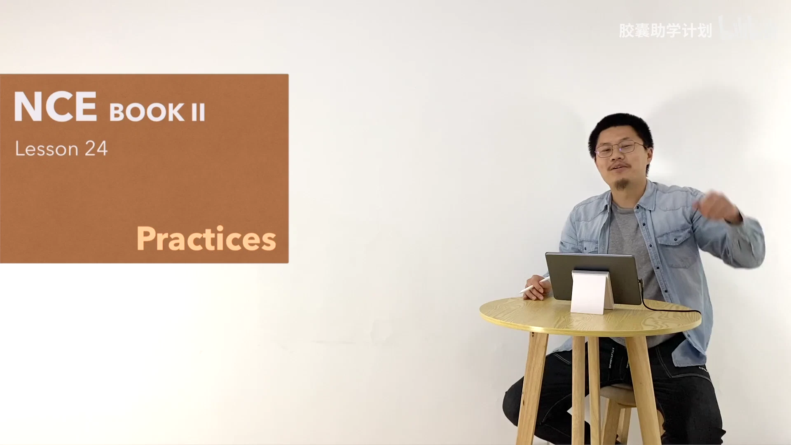

文字识别：胶囊助学计划 / NCE / BOOKⅡI / Lesson 24 / Practices

### 画面 00:00:02

文字识别：胶囊助学计划 / NCE / BOOKII / Lesson 24 / Practices

### 画面 00:00:05

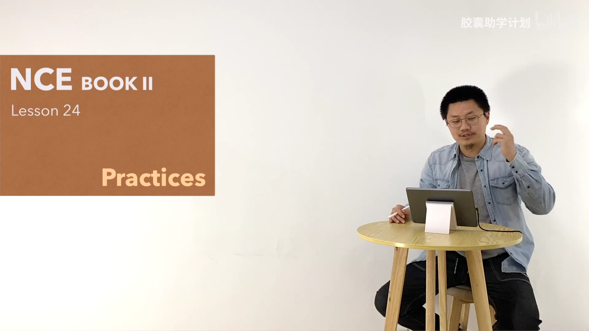

文字识别：胶囊助学计划 / NCE / BOOK"I / Lesson 24 / Practices

### 画面 00:00:08

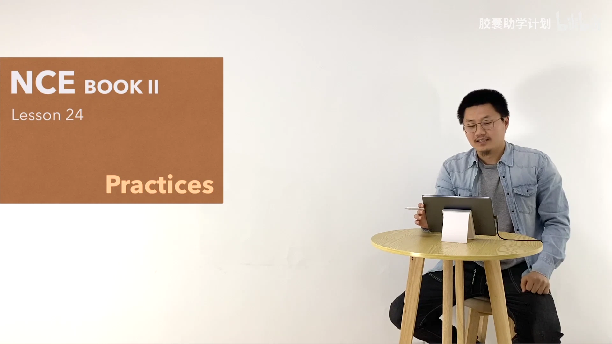

文字识别：胶囊助学计划 / NCE / BOOKI"I / Lesson 24 / Practices

### 画面 00:00:10

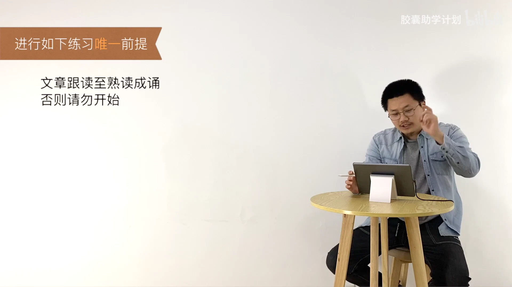

文字识别：胶囊助学计划 / 进行如下练习唯一前提 / 文章跟读至熟读成诵 / 否则请勿开始

### 画面 00:00:19

文字识别：胶囊助学计划bill / •

### 画面 00:00:23

文字识别：胶囊助学计划

### 画面 00:00:25

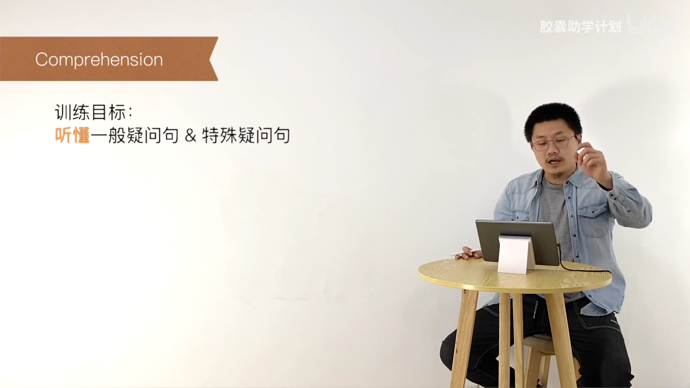

文字识别：胶囊助学计划 / Comprehension / 训练目标： / 听懂一般疑问句＆特殊疑问句

## 00:00:30–00:01:00

一个能力。那这个地方呢，我问您答，尽量不要看着这个板书啊，板书只是起到一个提示的作用。您不妨看着文章，而且文章如果读的非常熟了，那我的问题应该也能听懂，问题不大。来了啊，Whose office did you enter? The hotel manager's office. Next one. Why did you feel upset? I have lost fifty pounds.

### 画面 00:00:31

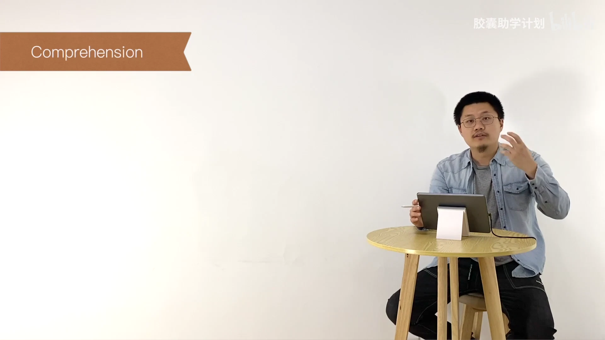

文字识别：胶囊助学计划 / Comprehension

## 00:01:00–00:01:30

Continue. Where had you left money? In my room. Was it still there? No, it wasn't. Who was sympathetic? The manager was. Could he do anything to help you? No, he couldn't.

### 画面 00:01:01

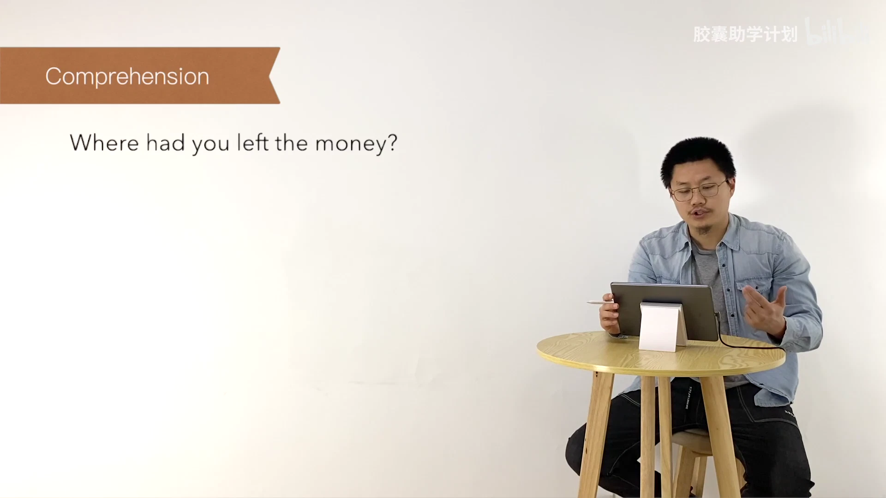

文字识别：胶囊助学计划 / Comprehension / Where had you left the money?

### 画面 00:01:27

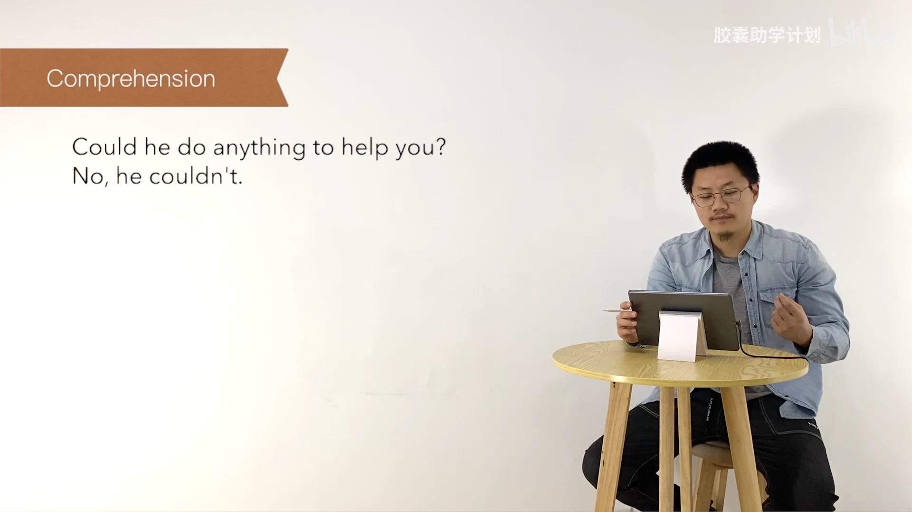

文字识别：胶囊助学计划 / Comprehension / Could he do anything to help you? / No, he couldn't.

## 00:01:30–00:02:00

What did he say to you? Everyone's losing money these days. What did he start to complain about? This wicked world. What was he interrupted by? A knock at the door.

### 画面 00:01:34

文字识别：胶囊助学计划 / Comprehension / What did he say to you? / 'Everyone's losing money these days.'

### 画面 00:01:52

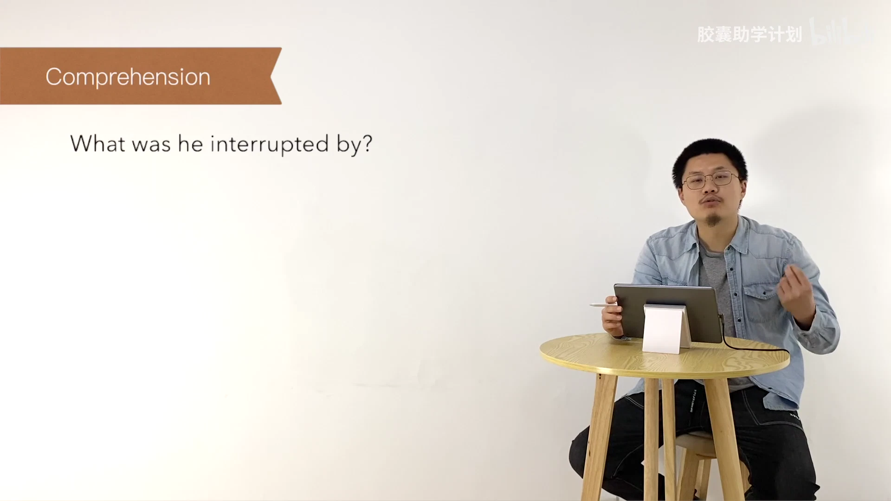

文字识别：胶囊助学计划 / Comprehension / What was he interrupted by?

## 00:02:00–00:02:30

Who was it? A girl. What had she got in her hand? An envelope. Where did she put it? On the manager's desk. What did it contain? Fifty pounds. Where had she found it?

### 画面 00:02:22

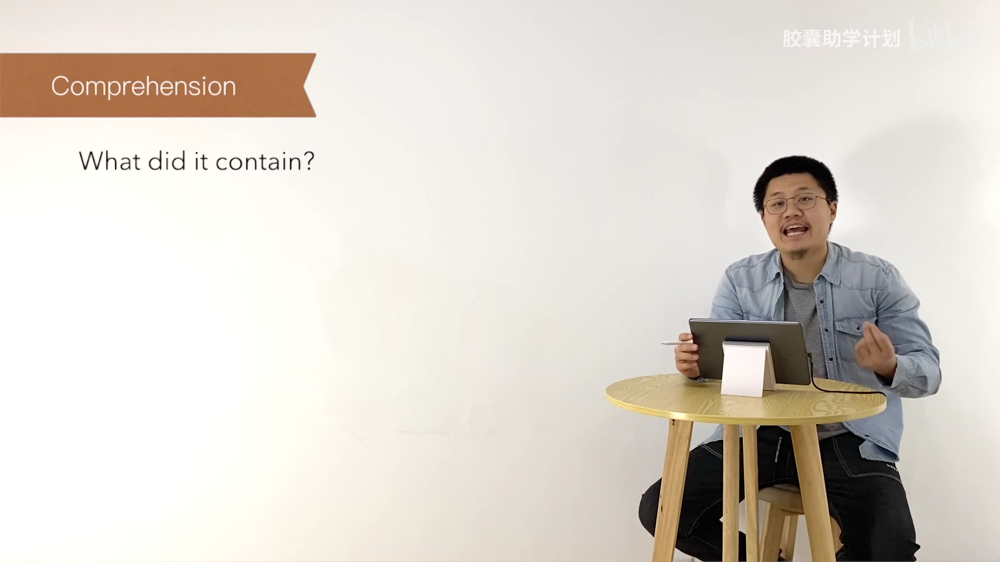

文字识别：胶囊助学计划 / Comprehension / What did it contain?

## 00:02:30–00:03:00

Outside my room. Okay, very good. 下一题 asking questions，锻炼大家能听懂一般疑问句和啊，就能会说啊一般疑问句和特殊疑问句，对吧？也就是发我们发问的能力。 Okay，好，那第一个就是例子。 Ask me if I entered an hotel manager's office. Entered，提醒了你 did 提前，对吧？我们把它变一般疑问句，然后来一个 whose。那

### 画面 00:02:33

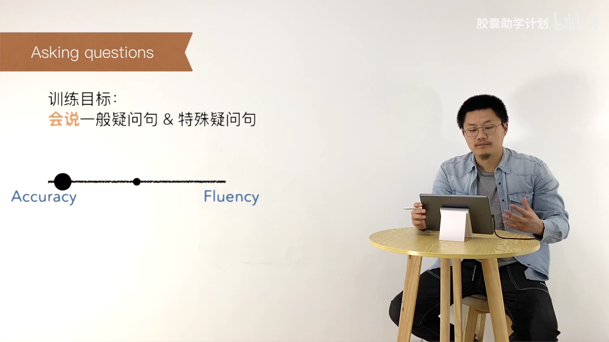

文字识别：胶囊助学计划 / Asking questions / 训练目标： / 会说一般疑问句＆特殊疑问句 / Accuracy / Fluency

### 画面 00:02:46

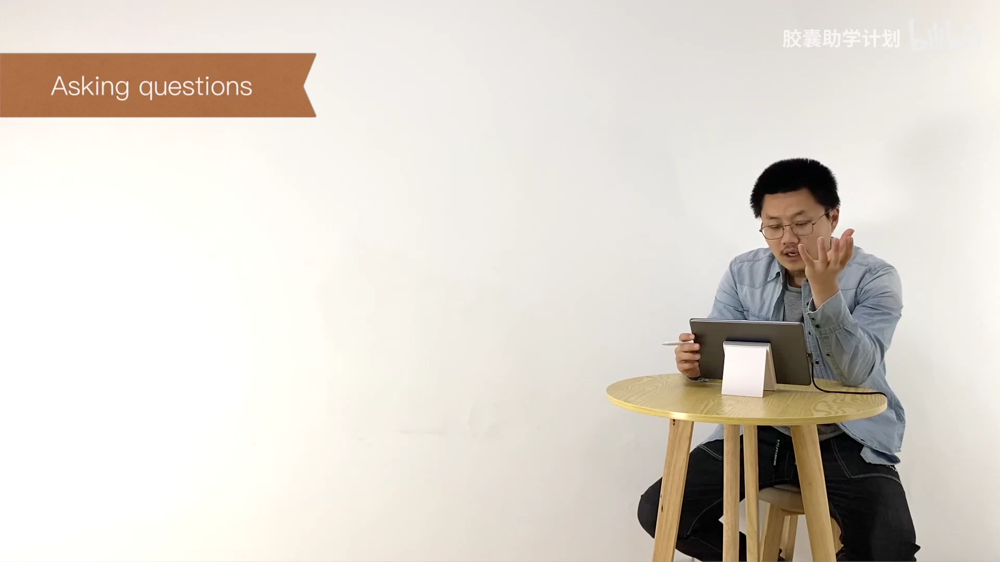

文字识别：胶囊助学计划 / Asking questions

### 画面 00:02:55

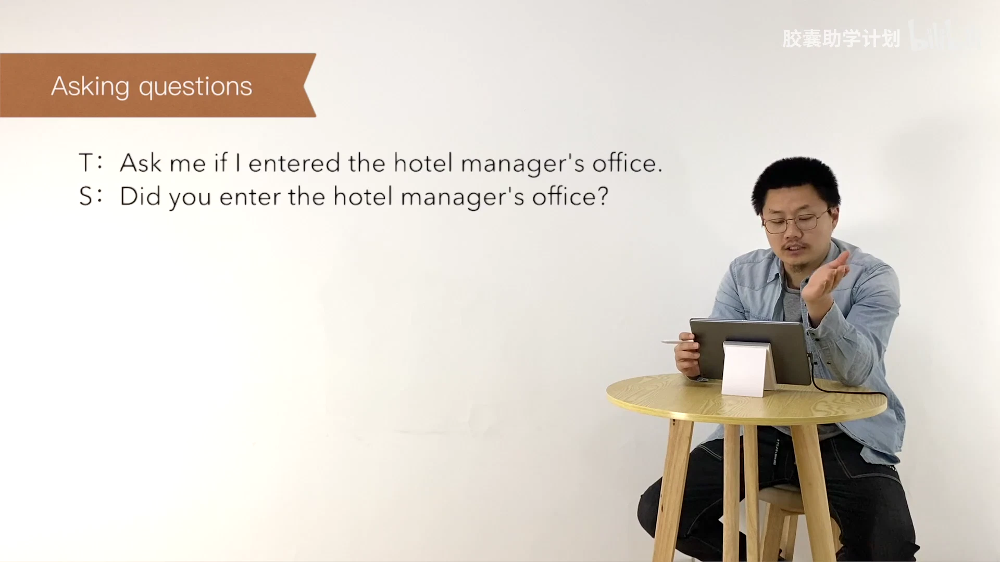

文字识别：胶囊助学计划 / Asking questions / T: Ask me if l entered the hotel manager's ofice. / S: Did you enter the hotel manager's office?

## 00:03:00–00:03:30

那 whose 肯定是对 hotel managers 提问，对吧？那所以肯定是 whose office did you enter？啊，你进的是谁的办公室？接下来呢，我们要做的事情就是给大家讲一下思路啊，各位下课去写出来，然后看着自己写的答案，保证是对的，然后大声朗读来了。第一个 who， who 可以直接对主语提问，不用变一般疑问句，答案就是 who entered the hotel

### 画面 00:03:11

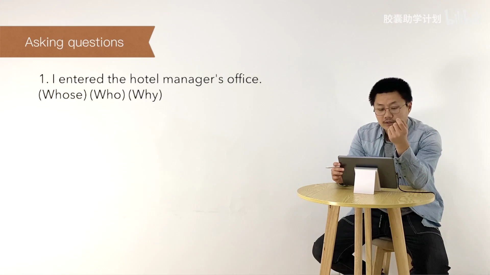

文字识别：胶囊助学计划 / Asking questions / 1.l entered the hotel manager's office. / (Whose) (Who) (Why)

## 00:03:30–00:04:00

manager's office? Why? 那你就变一般疑问句，然后再对整句提问就可以了。OK，很简单。第二题，I sat down. Did 提前 What 点点 do？注意它基本就是标准答案，由时态决定，所以这地方叫 What did you do？OK，那 Who 呢？对主语提问，直接替代，不用变一般疑问句。Who sat down？ I'd just lost fifty pounds. OK，注意撇 D 有两个可能性，Would 和

### 画面 00:03:39

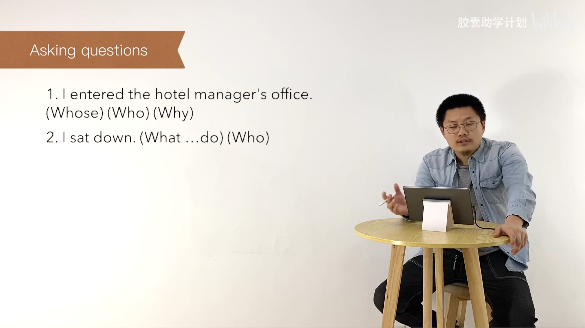

文字识别：胶囊助学计划 / Asking questions / 1.l entered the hotel manager's office. / (Whose)(Who) (Why) / 2.I sat down.(What ...do)(Who)

### 画面 00:03:51

文字识别：胶囊助学计划 / Asking questions / 1.l entered the hotel manager's office. / (Whose) (Who)(Why) / 2.I sat down.(What ...do)(Who)

## 00:04:00–00:04:30

had，由原文外加后面的动词决定。后面动词是 lost，是过去分词，对吧？所以这个撇 D 是 had，had 提前。Had you just lost fifty pounds? What 对 fifty pounds 提问？How much 也对 fifty pounds 提问，是吧？OK 是一样的啊。I felt very upset. D 的提前外加整句。I'd left money in my room. 谁提前？Had

### 画面 00:04:14

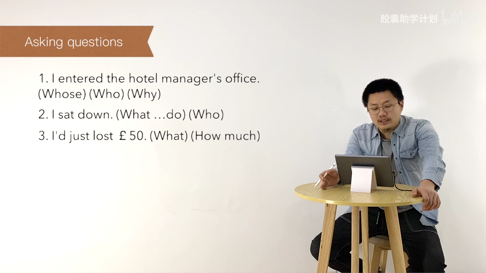

文字识别：胶囊助学计划 / Asking questions / 1.l entered the hotel manager's office. / (Whose)(Who) (Why) / 2.I sat down. (What ...do)(Who) / 3.I'd just lost £ 50.(What) (How much)

### 画面 00:04:23

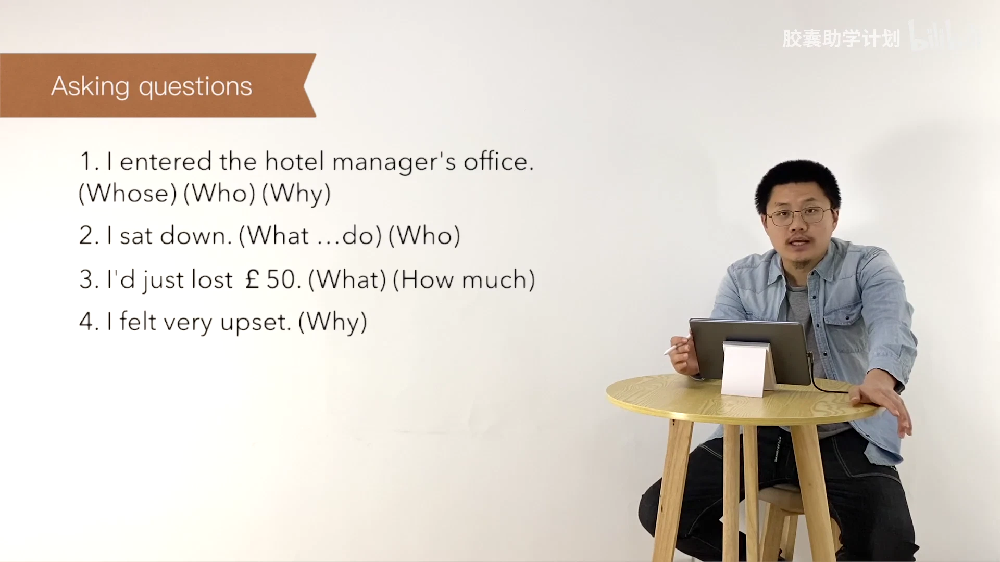

文字识别：胶囊助学计划 / Asking questions / 1.l entered the hotel manager's office. / (Whose)(Who) (Why) / 2.I sat down. (What ...do)(Who) / 3.I'd just lost £ 50.(What) (How much) / 4.I felt very upset. (Why)

## 00:04:30–00:05:00

提前对吧Where对In my room提问Very good.下一题The manager was sympathetic. Was提前who对主语提问He could do nothing.注意啊，这个把它变成一般疑问句，说Could he do nothing?就意思有点不太对。你把它变成叫Could he do anything?他能做任何事情吗？答案是He could do nothing，对吧？那What对Nothing提问了，其实或者Anything提问，所以答案

### 画面 00:04:33

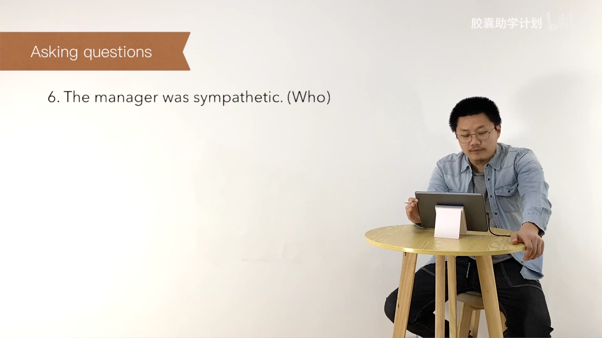

文字识别：胶囊助学计划 / Asking questions / 6. The manager was sympathetic. (Who)

### 画面 00:04:46

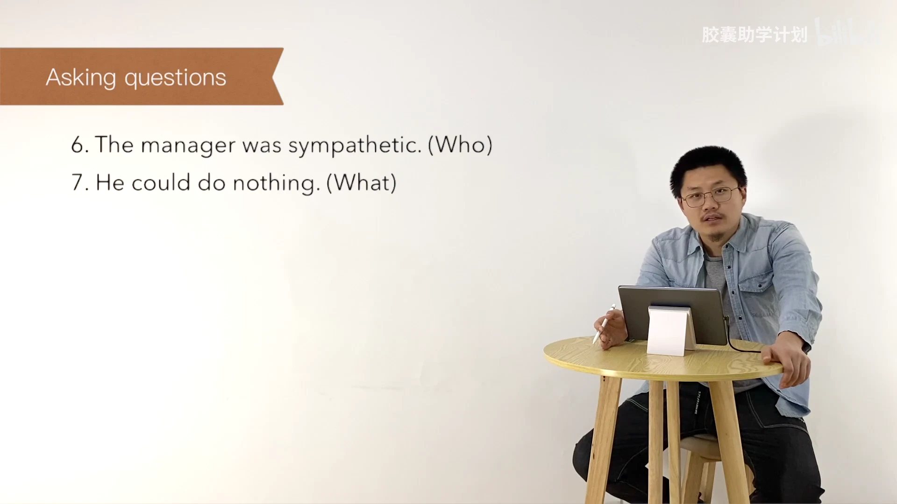

文字识别：胶囊助学计划 / Asking questions / 6. The manager was sympathetic. (Who) / 7. He could do nothing.(What)

## 00:05:00–00:05:30

是 what could he do？他能做什么？ Everyone was losing money. Was 提前，what 对 money 提问。 He started to complain about this wicked world. Did 提前，动词换原形。 What？ 对我直接说答案啊。 What did he start to complain about？ 答案是 this wicked world. Okay. 那 why？直接加整句啊。十 was 提前，

### 画面 00:05:07

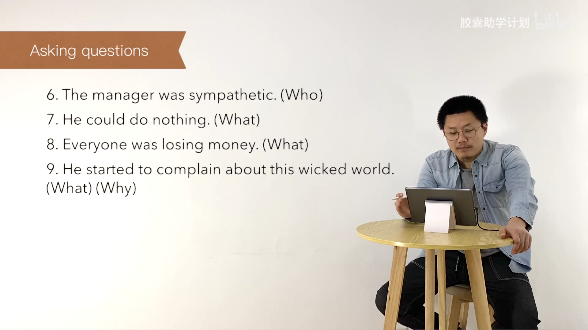

文字识别：胶囊助学计划 / Asking questions / 6. The manager was sympathetic. (Who) / 7. He could do nothing. (What) / 8. Everyone was losing money. (What) / 9. He started to complain about this wicked world. / (What) (Why)

## 00:05:30–00:06:00

what 对什么提问呢？ What was he interrupted by? 也就是 what 对 a knock at the door 提问。 Okay, there you go. 下一个 a girl came in did 提前互对主语提问。 There you go. Tell the story. 我不接下来不一一给大家复述了。各位要做到的事情是参考我前二十二课做的那些事情。各位文章读熟之后来看着这些关

### 画面 00:05:37

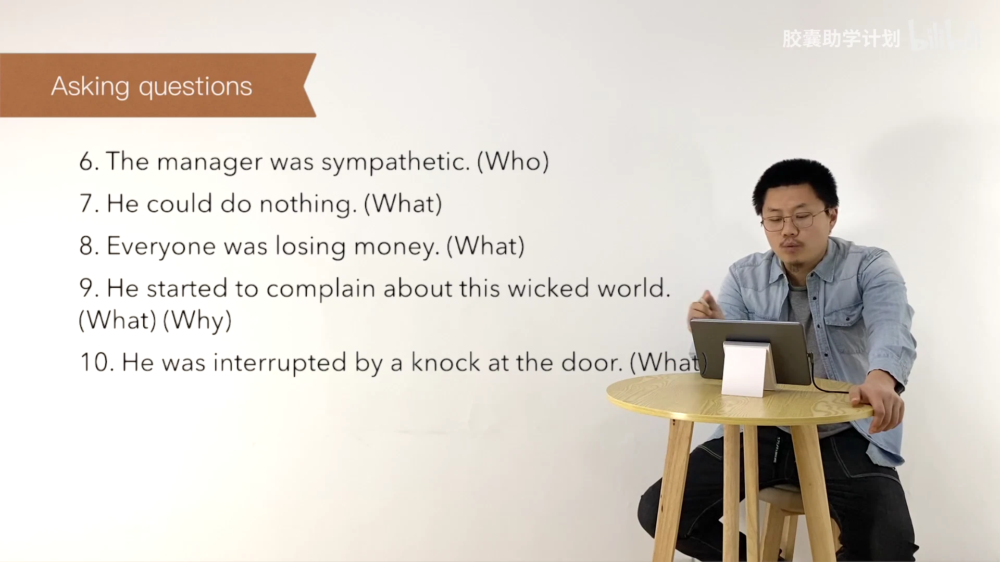

文字识别：胶囊助学计划 / Asking questions / 6. The manager was sympathetic.(Who) / 7. He could do nothing. (What) / 8. Everyone was losing money. (What) / 9. He started to complain about this wicked world. / (What) (Why) / 10. He was interrupted by a knock at the door. (What

### 画面 00:05:47

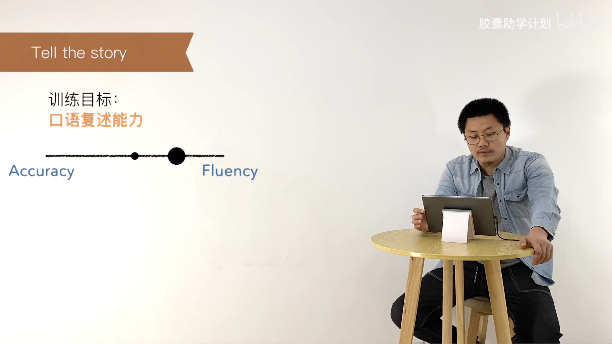

文字识别：胶囊助学计划 / Tell the story / 训练目标： / 口语复述能力 / Accuracy / Fluency

### 画面 00:05:49

文字识别：胶囊助学计划 / Tell the story / 1 / entered -office -sat down / just - £ 50 -very upset / left -my room -not there now / manager -sympathetic -nothing / 'Everyone -money' -said / 6 / complain -world -interrupted -knock / girl -envelope -desk / It-£50 / 'found -outside -room,' -said / 9 / ① I -manager'still honesty -world!'

### 画面 00:05:54

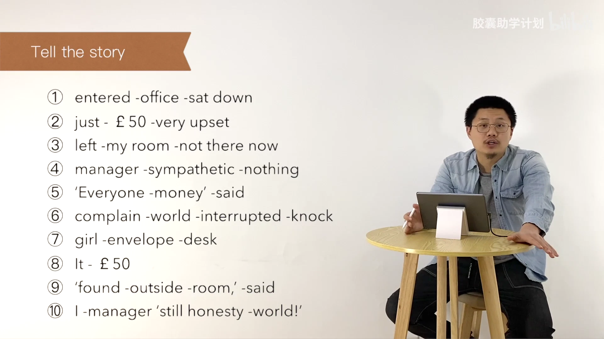

文字识别：胶囊助学计划 / Tell the story / ① / entered -office -sat down / just - £ 50 -very upset / left -my room -not there now / manager -sympathetic -nothing / 'Everyone -money' -said / 6 / complain -world -interrupted -knock / girl -envelope -desk / It-£50 / 'found -outside -room,' -said / 9 / ⑩ I -manager'still honesty -world!'

## 00:06:00–00:06:30

键词去复述，注意不用太关心您有一些小的错误啊。当然前提是你读的非常熟了，但你需要做的事情是比较流利，不能太磕巴。OK，好，那下面 writing 呢，就是我们的 jail 写作练习的是写作复述能力。各位写完来这儿对一下答案就可以了。Topic for discussion，我们给大家翻译一下，看都有什么样的话题。第一个，What sort of complaints do you think a hotel manager has

### 画面 00:06:06

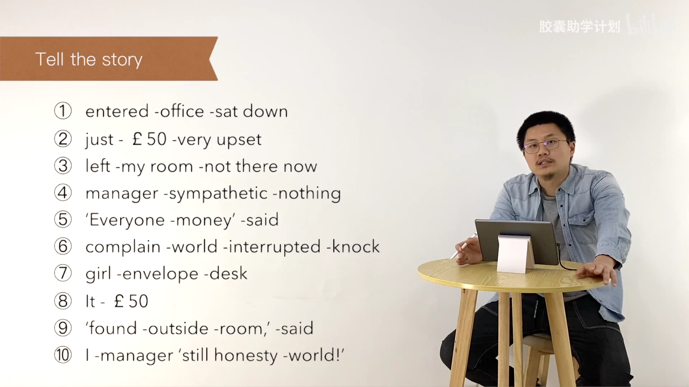

文字识别：胶囊助学计划 / Tell the story / 1 / entered -office -sat down / just - £ 50 -very upset / left -my room -not there now / manager -sympathetic -nothing / 'Everyone -money' -said / 6 / complain -world -interrupted -knock / girl -envelope -desk / It-£50 / 8 / 'found -outside -room,' -said / 9 / ⑩ I -manager'still honesty -world!'

### 画面 00:06:12

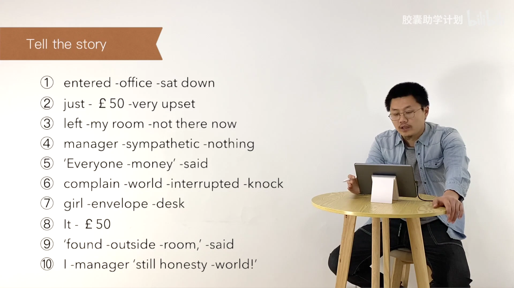

文字识别：胶囊助学计划 / Tell the story / 1 / entered -office -sat down / just - £ 50 -very upset / left -my room -not there now / manager -sympathetic -nothing / 'Everyone -money' -said / 6 / complain -world -interrupted -knock / girl -envelope -desk / It-£50 / 8 / 'found -outside -room,' -said / 9 / ⑩ I -manager'still honesty -world!'

### 画面 00:06:14

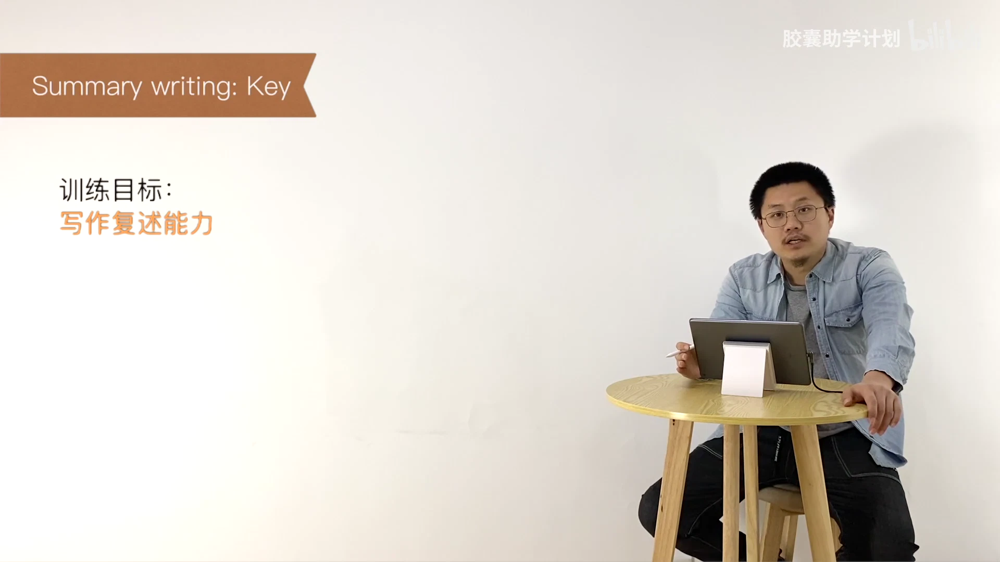

文字识别：胶囊助学计划 / Summary writing: Key / 训练目标： / 写作复述能力

### 画面 00:06:16

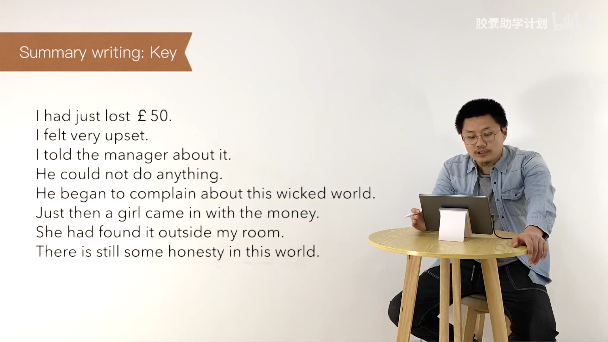

文字识别：胶囊助学计划 / Summary writing: Key / I had just lost £ 50. / I felt very upset. / I told the manager about it. / He could not do anything. / He began to complain about this wicked world. / Just then a girl came in with the money. / She had found it outside my room. / There is still some honesty in this world.

### 画面 00:06:20

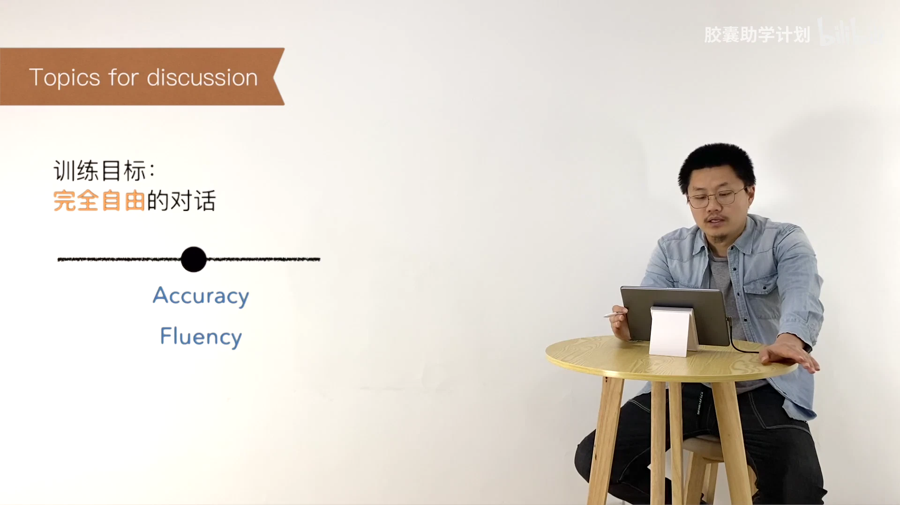

文字识别：胶囊助学计划 / Topics for discussion / 训练目标： / 完全自由的对话 / Accuracy / Fluency

### 画面 00:06:22

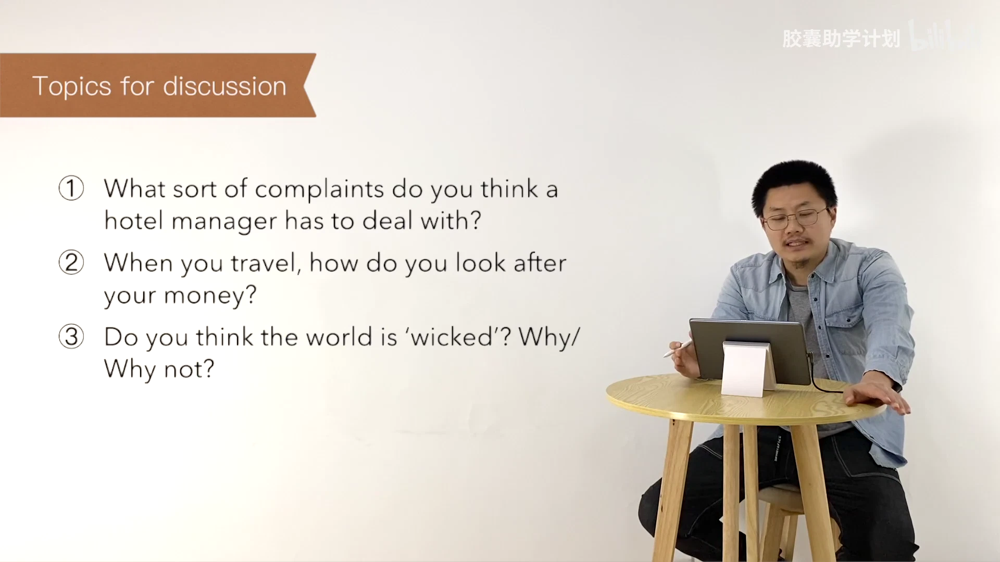

文字识别：胶囊助学计划 / Topics for discussion / What sort of complaints do you think a / hotel manager has to deal with? / When you travel, how do you look after / your money? / Do you think the world is 'wicked'? Why/ / Why not?

## 00:06:30–00:07:00

to deal with?哎，说酒店的经理可能需要处理，注意deal with处理哪些投诉或者抱怨啊？哪种类型的？你认为？下一个，When you travel, how do you look after your money?当你旅行的时候，你如何照顾你自照看好你的钱呢？哎，你注意，你看现在这个社会可能的事情是你都不需要带钱了，你需要照顾好的是你的手机，对吧？那你怎

### 画面 00:06:52

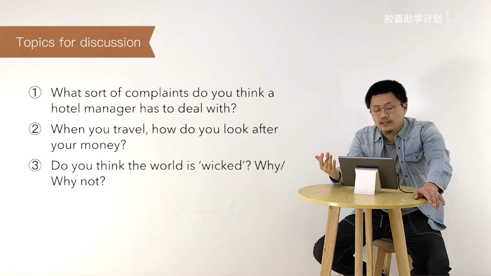

文字识别：胶囊助学计划 / Topics for discussion / What sort of complaints do you think a / hotel manager has to deal with? / When you travel, how do you look after / your money? / Do you think the world is 'wicked'? Why/ / Why not?

## 00:07:00–00:07:30

么照顾好你的手机呢？下一个，Do you think the world is wicked? Why? Why not? 说你认为这个世界是很邪恶的吗？如果认为是，为什么是？对吧？啊，为什么是？如果不是，为什么不是？啊，这是更像是一道政治哲学难题，是吧？下一个，那我们看一下本课家庭作业，Ask me if 写，然后大声朗读，只要写作写，然后对答案，Tell the story 口语复述，最后专栏当中可以找到。

### 画面 00:07:16

文字识别：胶囊助学计划

### 画面 00:07:19

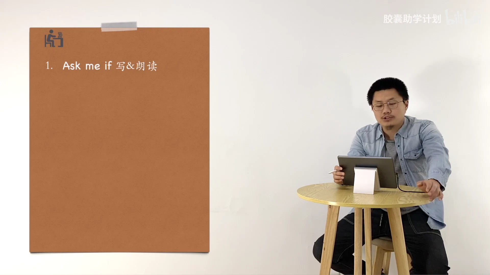

文字识别：胶囊助学计划 / 1.Ask me if写&朗读

### 画面 00:07:21

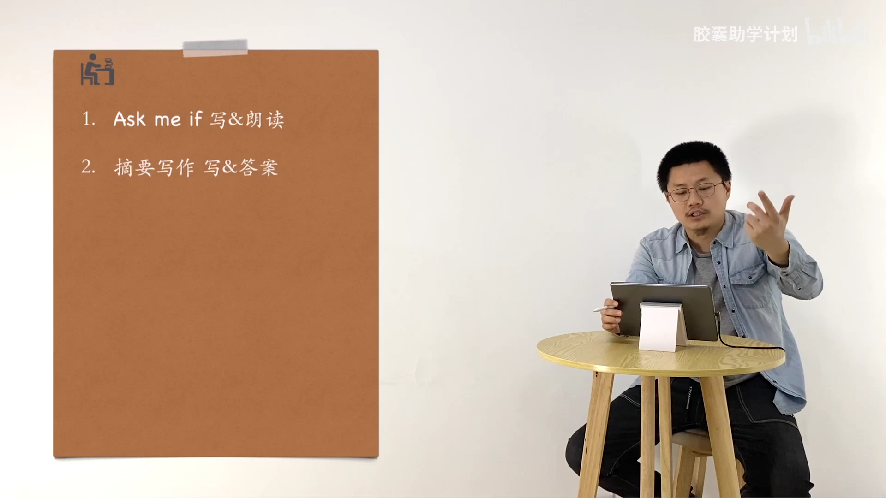

文字识别：胶囊助学计划 / 1. / Ask me if写&朗读 / 摘要写作写&答案

### 画面 00:07:24

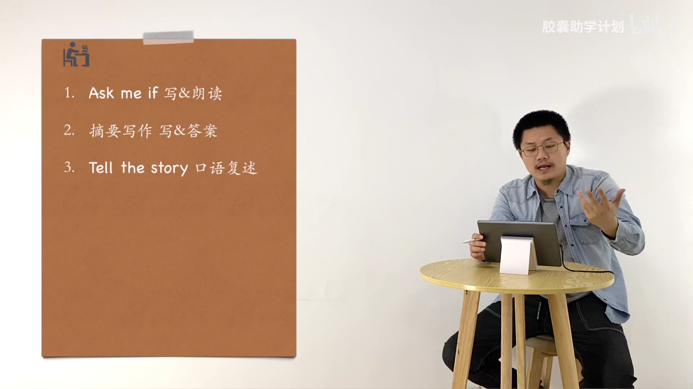

文字识别：胶囊助学计划 / 1.Ask me if写&朗读 / 摘要写作写&答案 / 3.Tell the story 口语复述

### 画面 00:07:26

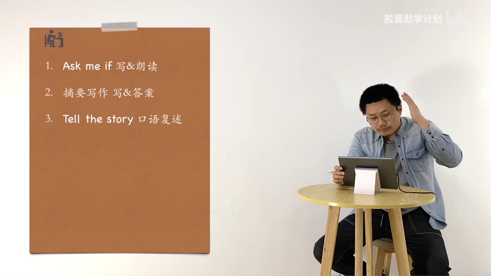

文字识别：胶囊助学计划 / 1.Ask me if写&朗读 / 摘要写作写&答案 / 3.Tell the story 口语复述

### 画面 00:07:28

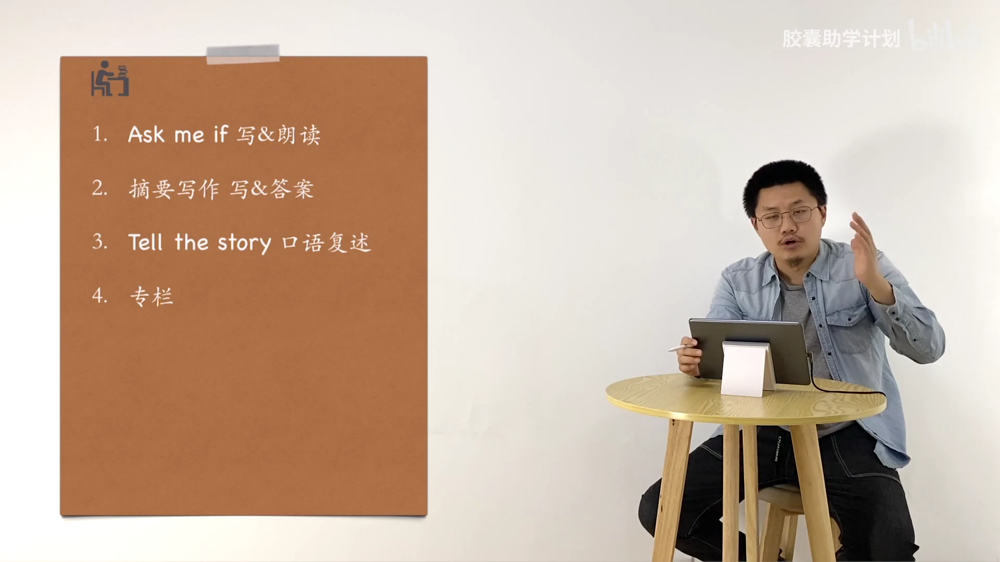

文字识别：胶囊助学计划 / 1.Ask me if写&朗读 / 摘要写作写&答案 / 3.Tell the story 口语复述 / 专栏 / 4.

## 00:07:30–00:07:52

那如果大家喜欢我们的课程，欢迎大家关注、订阅、一键三连、分享给那些需要的朋友，来帮助我们快速成长。See you next time.

### 画面 00:07:30

文字识别：胶囊助学计划

### 画面 00:07:40

### 画面 00:07:42

文字识别：CAPSULEACADEMY / 胶囊助学计划 / 小红书 / Lecturer / Leo / OE

### 画面 00:07:45

文字识别：CAPSULEACADEMY / 胶囊助学计划 / 『 / 小红书 / Editor / OE

### 画面 00:07:48

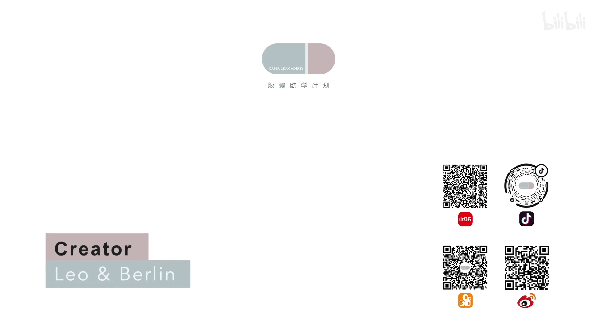

文字识别：CAPSULEACADEMY / 胶囊助学计划 / 『 / 小红书 / Creator / Leo & Berlin / OE

### 画面 00:07:50

文字识别：bilibili / 胶囊助学计划 / 胶囊助学计划 / 小红书 / OE

### 画面 00:07:52

文字识别：bilibili / 胶囊助学计划

