# L025 单词

快速机器解析：语音为单模型转写，未进行独立交叉校对或人工复核；画面每秒采样并按变化选帧，短时文字和标记可能遗漏。截图时间约有 1 秒误差。图片有损压缩；遇到疑点请按时间查看 Google Drive 原视频。

## 00:00:00–00:00:30

Hello everyone, welcome to Capsule Academy. This is Leo. Today we're going to learn New Concept English Book Two, Lesson Twenty Five Words. 那老习惯进入正式课程之前呢，我们先看一个问题。那最基本说如何表达难怪啊，或者说怪不得。OK，那带着这个问题，后边呢， enjoy. 那我们先看第二单元第一课啊，二十五课是第二单元第一课的

### 画面 00:00:00

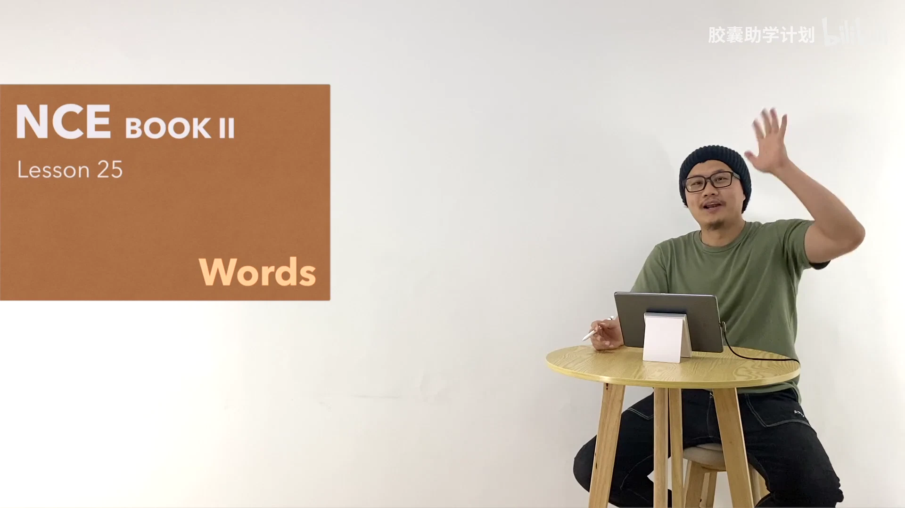

文字识别：胶囊助学计划 / NCE / BOOKII / Lesson 25 / Words

### 画面 00:00:02

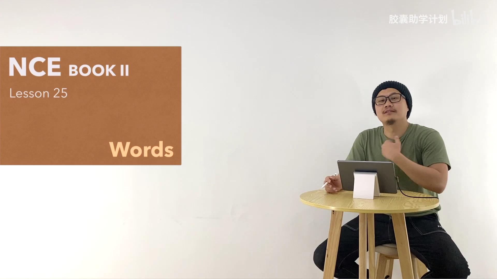

文字识别：胶囊助学计划 / NCE / BOOKII / Lesson 25 / Words

### 画面 00:00:05

文字识别：胶囊助学计划 / NCE / BOOKII / Lesson 25 / Words

### 画面 00:00:10

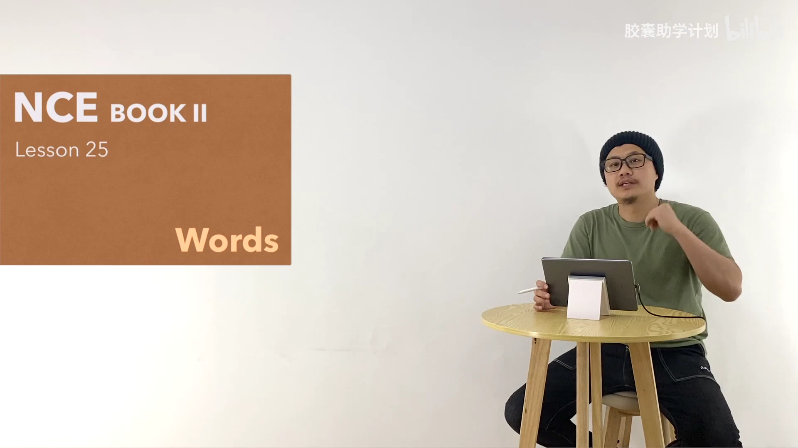

文字识别：胶囊助学计划 / NCE / BOOKII / Lesson 25 / Words

### 画面 00:00:12

文字识别：胶囊助学计划 / ①如何表达“难怪/怪不得”?

### 画面 00:00:15

文字识别：胶囊助学计划 / ①如何表达“难怪/怪不得”？

### 画面 00:00:20

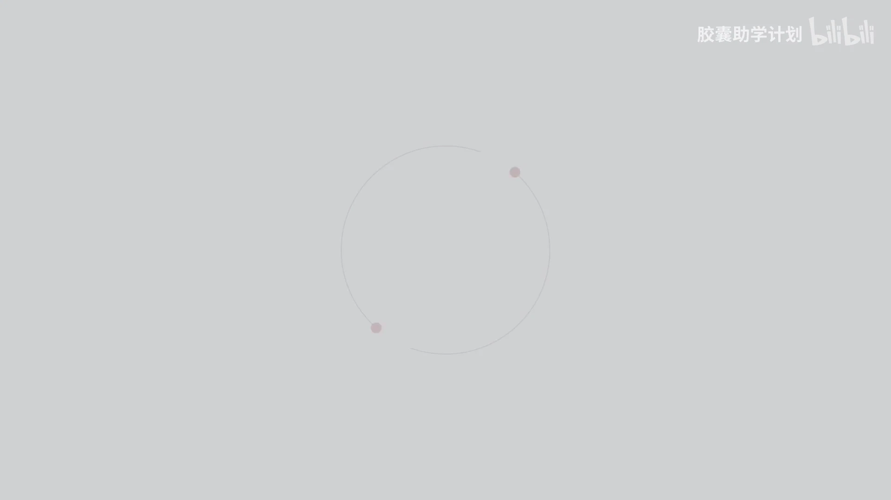

文字识别：胶囊助学计划b出l / •

### 画面 00:00:24

### 画面 00:00:26

文字识别：单词造句指南 / 网：v.+v.变化 / 胶囊助学计划 / 四句型转换 / 方式/地点/时间 / 结合习惯用法 / 其他单词+词性 / 原文摘抄+变 / 6123456 / /'reilwei/ / railway n.

### 画面 00:00:28

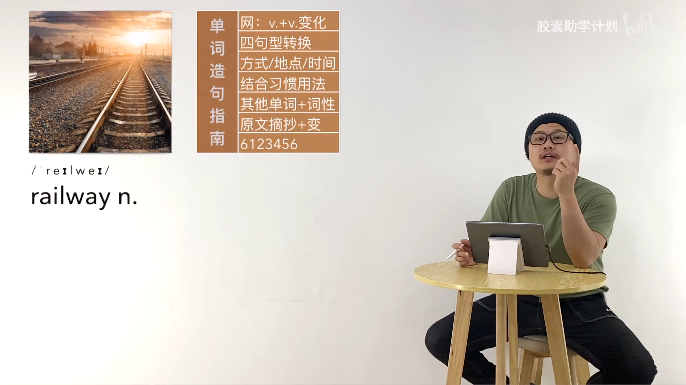

文字识别：单词造句指南 / 网：v.+v.变化 / 胶囊助学计划 / 四句型转换 / 方式/地点/时间 / 结合习惯用法 / 其他单词+词性 / 原文摘抄+变 / 6123456 / /'reilwei/ / railway n.

## 00:00:30–00:01:00

第一个单词，跟我一起读一下。这个单词以前我们很可能是见过的，叫做 railway railway。 OK，那它其实自己本身啊，加上一个 station，叫 railway station，火车站。那你看，这实际上就是一个地点，对不对？那我们单词造句，我们就用 railway station 去造句。给大家提供的思路是六一二三四五六，你要想一下它在这里面可以做句子的哪个地方。比如说，它可以做一，可以做三，明显还可以做五，对不对？我们

### 画面 00:00:30

文字识别：单词造句指南 / 网：v.+v.变化 / 胶囊助学计划 / 四句型转换 / 方式/地点/时间 / 结合习惯用法 / 其他单词+词性 / 原文摘抄+变 / 6123456 / /'reilwei/ / railway n.

### 画面 00:00:33

文字识别：单词造句指南 / 网：v.+v.变化 / 胶囊助学计划 / 四句型转换 / 方式/地点/时间 / 结合习惯用法 / 其他单词+词性 / 原文摘抄+变 / 6123456 / /'reilwei/ / railway n.

### 画面 00:00:35

文字识别：单词造句指南 / 网：v.+v.变化 / 胶囊助学计划 / 四句型转换 / 方式/地点/时间 / 结合习惯用法 / 其他单词+词性 / 原文摘抄+变 / 6123456 / /'reilwei/ / railway n.

### 画面 00:00:37

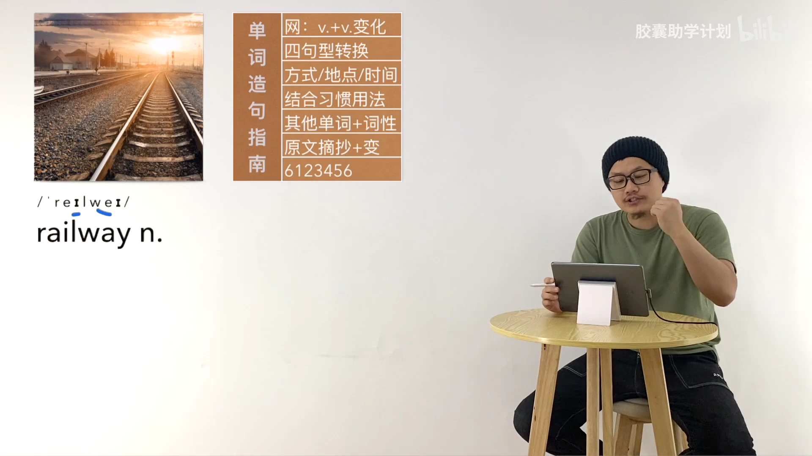

文字识别：单词造句指南 / 网：v.+v.变化 / 胶囊助学计划 / 四句型转换 / 方式/地点/时间 / 结合习惯用法 / 其他单词+词性 / 原文摘抄+变 / 6123456 / /'reilwei/ / railway n.

### 画面 00:00:40

文字识别：单词造句指南 / 网：v.+v.变化 / 胶囊助学计划 / 四句型转换 / 方式/地点/时间 / 结合习惯用法 / 其他单词+词性 / 原文摘抄+变 / 6123456 / /'reilwei/ / railway n. / railway station

### 画面 00:00:45

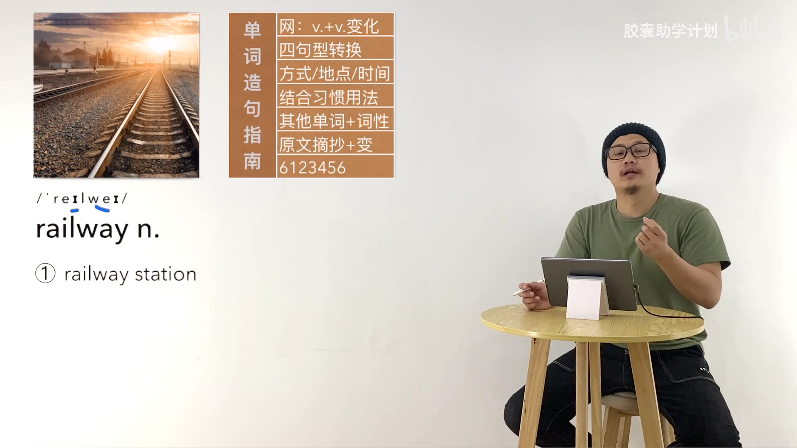

文字识别：单词造句指南 / 网：v.+v.变化 / 胶囊助学计划 / 四句型转换 / 方式/地点/时间 / 结合习惯用法 / 其他单词+词性 / 原文摘抄+变 / 6123456 / /'reilwei/ / railway n. / railway station

### 画面 00:00:47

文字识别：单词造句指南 / 网：v.+v.变化 / 胶囊助学计划 / 四句型转换 / 方式/地点/时间 / 结合习惯用法 / 其他单词+词性 / 原文摘抄+变 / 6123456 / /'reilwei/ / railway n. / railway station

### 画面 00:00:50

文字识别：单词造句指南 / 网：v.+v.变化 / 胶囊助学计划 / 四句型转换 / 方式/地点/时间 / 结合习惯用法 / 其他单词+词性 / 原文摘抄+变 / 6123456 / /'reilwei/ / railway n. / railway station

### 画面 00:00:54

文字识别：单词造句指南 / 网：v.+v.变化 / 胶囊助学计划 / 四句型转换 / 方式/地点/时间 / 结合习惯用法 / 其他单词+词性 / 原文摘抄+变 / 6123456 / /'reilwei/ / railway n. / railway station

### 画面 00:00:56

文字识别：单词造句指南 / 网：v.+v.变化 / 胶囊助学计划 / 四句型转换 / 方式/地点/时间 / 结合习惯用法 / 其他单词+词性 / 原文摘抄+变 / 6123456 / /'reilwei/ / railway n. / railway station

## 00:01:00–00:01:30

在配合之前第一单元第十课没有记错的话，和第二十一课学过的被动，那你看把 railway station 放在一的时候，我们就能造出一些句子来了。比如说 the railway station must have been built years ago. OK，数它一定是当时一定是数年前被建造的。哎，must have been done 这个结构是对于各位来说最容易遗忘的一个点啊，希望各位在这个地方又给它复习一下，在未来的造句当中

### 画面 00:01:00

文字识别：单词造句指南 / 网：v.+v.变化 / 胶囊助学计划 / 四句型转换 / 方式/地点/时间 / 结合习惯用法 / 其他单词+词性 / 原文摘抄+变 / 6123456 / /'reilwei/ / railway n. / railway station

### 画面 00:01:04

文字识别：单词造句指南 / 网：v.+v.变化 / 胶囊助学计划 / 四句型转换 / 方式/地点/时间 / 结合习惯用法 / 其他单词+词性 / 原文摘抄+变 / 6123456 / /'reilwei/ / railway n. / railway station

### 画面 00:01:06

文字识别：单词造句指南 / 网：v.+v.变化 / 胶囊助学计划 / 四句型转换 / 方式/地点/时间 / 结合习惯用法 / 其他单词+词性 / 原文摘抄+变 / 6123456 / /'reilwei/ / railway n. / railway station

### 画面 00:01:10

文字识别：单词造句指南 / 网：v.+v.变化 / 胶囊助学计划 / 四句型转换 / 方式/地点/时间 / 结合习惯用法 / 其他单词+词性 / 原文摘抄+变 / 6123456 / /'reilwei/ / railway n. / railway station / The railway station must have been built / years ago. L21

### 画面 00:01:15

文字识别：单词造句指南 / 网：v.+v.变化 / 胶囊助学计划 / 四句型转换 / 方式/地点/时间 / 结合习惯用法 / 其他单词+词性 / 原文摘抄+变 / 6123456 / /'reilwei/ / railway n. / railway station / The railway station must have been built / years ago. L21

### 画面 00:01:20

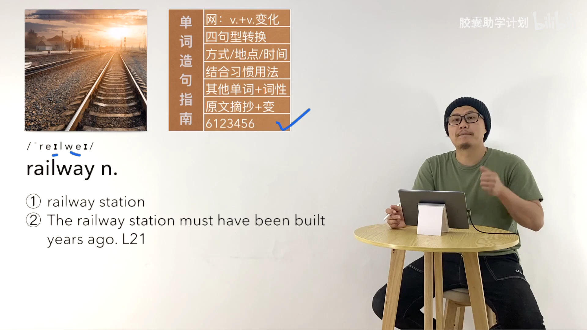

文字识别：单词造句指南 / 网：v.+v.变化 / 胶囊助学计划 / 四句型转换 / 方式/地点/时间 / 结合习惯用法 / 其他单词+词性 / 原文摘抄+变 / 6123456 / /'reilwei/ / railway n. / railway station / The railway station must have been built / years ago. L21

### 画面 00:01:25

文字识别：单词造句指南 / 网：v.+v.变化 / 胶囊助学计划 / 四句型转换 / 方式/地点/时间 / 结合习惯用法 / 其他单词+词性 / 原文摘抄+变 / 6123456 / /'reilwei/ / railway n. / railway station / The railway station must have been built / years ago. L21

## 00:01:30–00:02:00

也尽量多去用 must have been that，叫当时一定是被怎么怎么样了。Next one，说 the railway station was built years ago，这是很简单的一个一般过去时的被动，被动啊，叫做数年前被建造。OK，那再来一个第二十课，说 instead of doing something， instead of doing A， he did B，对吧？大概是这样一个结构，那叫做 instead of going to the railway station， she went home，啊，代替说去这个火车站，比如

### 画面 00:01:30

文字识别：单词造句指南 / 网：v.+v.变化 / 胶囊助学计划 / 四句型转换 / 方式/地点/时间 / 结合习惯用法 / 其他单词+词性 / 原文摘抄+变 / 6123456 / /'reilwei/ / railway n. / railway station / The railway station must have been built / years ago. L21

### 画面 00:01:35

文字识别：单词造句指南 / 网：v.+v.变化 / 胶囊助学计划 / 四句型转换 / 方式/地点/时间 / 结合习惯用法 / 其他单词+词性 / 原文摘抄+变 / 6123456 / /'reilwei/ / railway n. / railway station / The railway station must have been built / years ago. L21 / The railway station was built years ago. L10

### 画面 00:01:37

文字识别：单词造句指南 / 网：v.+v.变化 / 胶囊助学计划 / 四句型转换 / 方式/地点/时间 / 结合习惯用法 / 其他单词+词性 / 原文摘抄+变 / 6123456 / /'reilwei/ / railway n. / railway station / The railway station must have been built / years ago. L21 / The railway station was built years ago. L10

### 画面 00:01:40

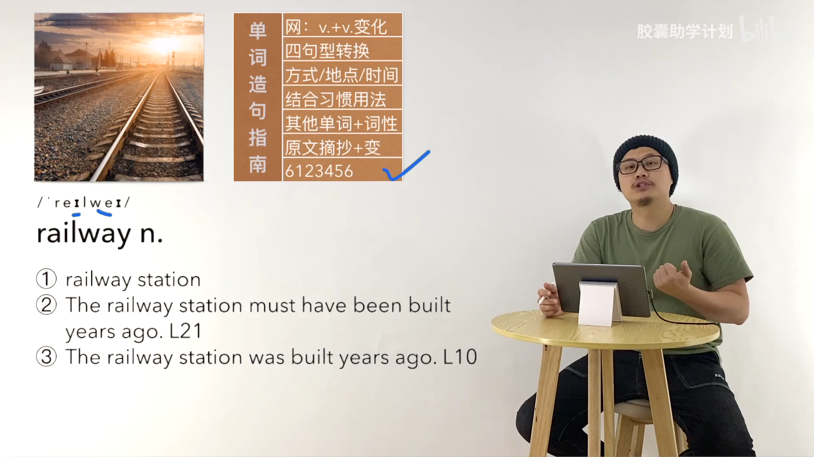

文字识别：单词造句指南 / 网：v.+v.变化 / 胶囊助学计划 / 四句型转换 / 方式/地点/时间 / 结合习惯用法 / 其他单词+词性 / 原文摘抄+变 / 6123456 / /'reilwel/ / railway n. / railway station / The railway station must have been built / years ago. L21 / The railway station was built years ago. L10

### 画面 00:01:44

文字识别：单词造句指南 / 网：v.+v.变化 / 胶囊助学计划 / 四句型转换 / 方式/地点/时间 / 结合习惯用法 / 其他单词+词性 / 原文摘抄+变 / 6123456 / /'reilwei/ / railway n. / railway station / 1 / The railway station must have been built / years ago. L21 / The railway station was built years ago. L10 / Instead of going to the railway station, she / went home. L20

### 画面 00:01:46

文字识别：单词造句指南 / 网：v.+v.变化 / 胶囊助学计划 / 四句型转换 / 方式/地点/时间 / 结合习惯用法 / 其他单词+词性 / 原文摘抄+变 / 6123456 / /'reilwei/ / railway n. / railway station / 1 / The railway station must have been built / years ago. L21 / The railway station was built years ago. L10 / Instead of going to the railway station, she / went home. L20

### 画面 00:01:50

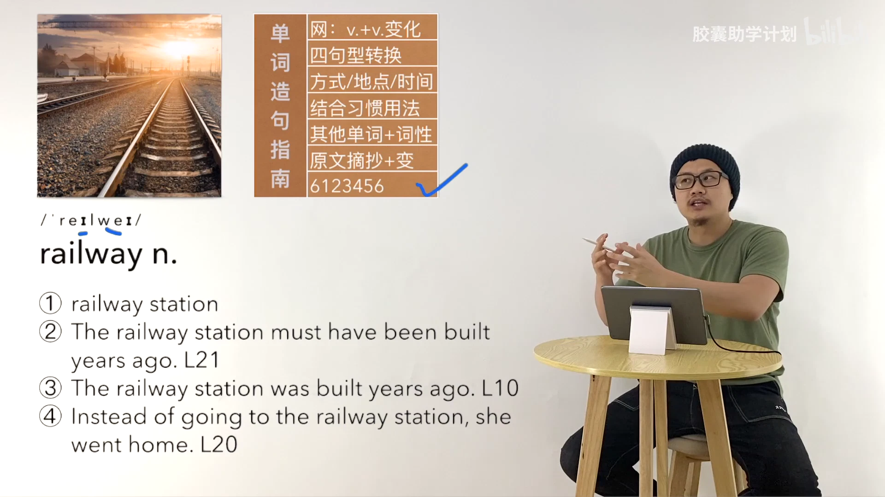

文字识别：单词造句指南 / 网：v.+v.变化 / 胶囊助学计划 / 四句型转换 / 方式/地点/时间 / 结合习惯用法 / 其他单词+词性 / 原文摘抄+变 / 6123456 / /'reilwei/ / railway n. / railway station / 1 / The railway station must have been built / years ago. L21 / The railway station was built years ago. L10 / Instead of going to the railway station, she / went home. L20

### 画面 00:01:53

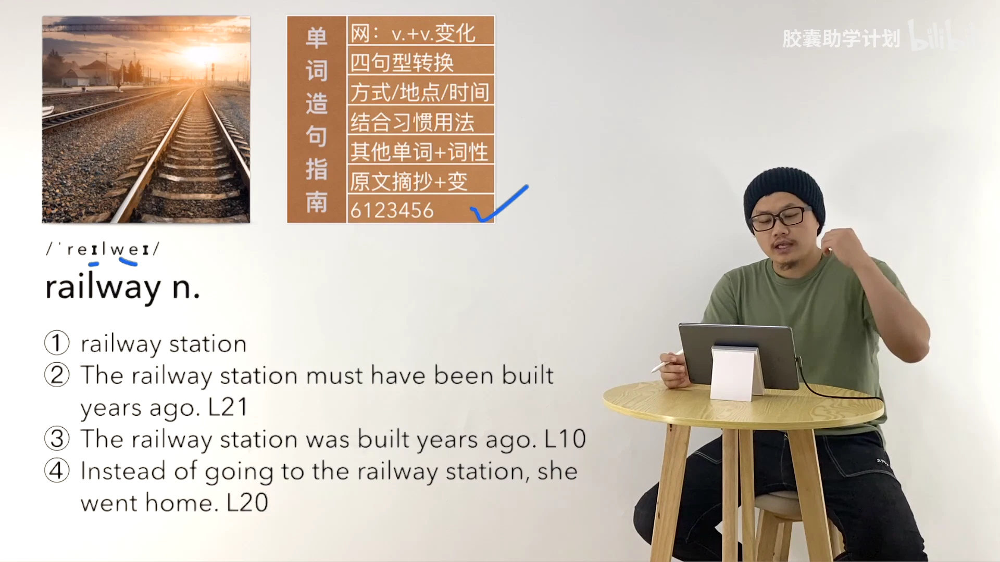

文字识别：单词造句指南 / 网：v.+v.变化 / 胶囊助学计划 / 四句型转换 / 方式/地点/时间 / 结合习惯用法 / 其他单词+词性 / 原文摘抄+变 / 6123456 / /'reilwei/ / railway n. / railway station / 1 / The railway station must have been built / years ago. L21 / The railway station was built years ago. L10 / Instead of going to the railway station, she / went home. L20

### 画面 00:01:55

文字识别：单词造句指南 / 网：v.+v.变化 / 胶囊助学计划 / 四句型转换 / 方式/地点/时间 / 结合习惯用法 / 其他单词+词性 / 原文摘抄+变 / 6123456 / /'reilwei/ / railway n. / railway station / 1 / The railway station must have been built / years ago. L21 / The railway station was built years ago. L10 / Instead of going to the railway station, she / went home. L20

### 画面 00:01:58

文字识别：单词造句指南 / 网：v.+v.变化 / 胶囊助学计划 / 四句型转换 / 方式/地点/时间 / 结合习惯用法 / 其他单词+词性 / 原文摘抄+变 / 6123456 / /'reilwei/ / railway n. / railway station / 1 / The railway station must have been built / years ago. L21 / The railway station was built years ago. L10 / Instead of going to the railway station, she / went home. L20

## 00:02:00–00:02:30

说接人，那他呢？哎，不管怎么样，Anyway， he went home，他回家了。OK，下一个，Next one，说porter和several。OK，这两个单词，首先porter就是我们理解为说这个火车站里边的小红帽，我要是没记错的话，对吧？就是让我们可以提前进站，您花多少钱？二十块钱，比如说，然后把行李提前放到火车上啊，帮助这个搬运工，火车站的这个搬运工，我们管它叫做porter。OK，那后面这个单词

### 画面 00:02:00

文字识别：单词造句指南 / 网：v.+v.变化 / 胶囊助学计划 / 四句型转换 / 方式/地点/时间 / 结合习惯用法 / 其他单词+词性 / 原文摘抄+变 / 6123456 / /'reilwei/ / railway n. / railway station / 1 / The railway station must have been built / years ago. L21 / The railway station was built years ago. L10 / Instead of going to the railway station, she / went home. L20

### 画面 00:02:05

文字识别：单词造句指南 / 网：v.+v.变化 / 胶囊助学计划 / 四句型转换 / 方式/地点/时间 / 结合习惯用法 / 其他单词+词性 / 原文摘抄+变 / 6123456 / /'reilwei/ / railway n. / railway station / 1 / The railway station must have been built / years ago. L21 / The railway station was built years ago. L10 / Instead of going to the railway station, she / went home. L20

### 画面 00:02:07

文字识别：单词造句指南 / 网：v.+v.变化 / 胶囊助学计划 / 四句型转换 / 方式/地点/时间 / 结合习惯用法 / 其他单词+词性 / 原文摘抄+变 / 6123456 / /po:ta/ / /'sevaral/ / porter n. several

### 画面 00:02:10

文字识别：单词造句指南 / 网：v.+v.变化 / 胶囊助学计划 / 四句型转换 / 方式/地点/时间 / 结合习惯用法 / 其他单词+词性 / 原文摘抄+变 / 6123456 / /po:ta/ / /'sevaral/ / porter n. several

### 画面 00:02:15

文字识别：单词造句指南 / 网：v.+v.变化 / 胶囊助学计划 / 四句型转换 / 方式/地点/时间 / 结合习惯用法 / 其他单词+词性 / 原文摘抄+变 / 6123456 / /po:ta/ / /'sevaral/ / porter n. several

### 画面 00:02:20

文字识别：单词造句指南 / 网：v.+v.变化 / 胶囊助学计划 / 四句型转换 / 方式/地点/时间 / 结合习惯用法 / 其他单词+词性 / 原文摘抄+变 / 6123456 / /po:ta/ / /'sevaral/ / porter n. several

### 画面 00:02:25

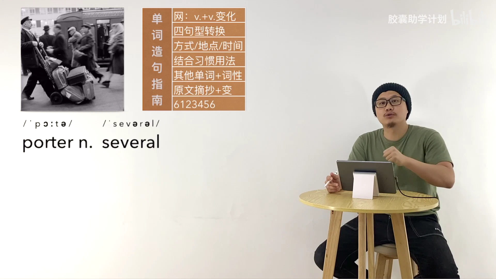

文字识别：单词造句指南 / 网：v.+v.变化 / 胶囊助学计划 / 四句型转换 / 方式/地点/时间 / 结合习惯用法 / 其他单词+词性 / 原文摘抄+变 / 6123456 / /po:ta/ / /'sevaral/ / porter n. several

## 00:02:30–00:03:00

several, okay,它的意思叫做哎几次几个啊，大概是这样一个几的意思。比如说several times叫做几次。Okay,那我们造句子说The porter complained about his job several times yesterday.昨天呢，这个我们说这个搬运工哎抱怨他的工作抱怨了数次啊。我选择了一个时态叫一般过去时。那我们是二十四课对吧？刚刚用到了complain about这个习惯用法，

### 画面 00:02:30

文字识别：单词造句指南 / 网：v.+v.变化 / 胶囊助学计划 / 四句型转换 / 方式/地点/时间 / 结合习惯用法 / 其他单词+词性 / 原文摘抄+变 / 6123456 / /'po:ta/ / /'sevaral/ / porter n. several

### 画面 00:02:35

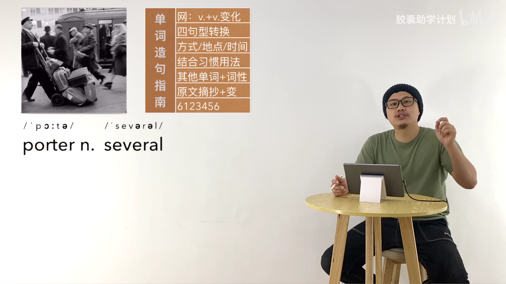

文字识别：单词造句指南 / 网：v.+v.变化 / 胶囊助学计划 / 四句型转换 / 方式/地点/时间 / 结合习惯用法 / 其他单词+词性 / 原文摘抄+变 / 6123456 / /po:ta/ / /'sevaral/ / porter n. several

### 画面 00:02:40

文字识别：单词造句指南 / 网：v.+v.变化 / 胶囊助学计划 / 四句型转换 / 方式/地点/时间 / 结合习惯用法 / 其他单词+词性 / 原文摘抄+变 / 6123456 / /'po:ta/ / /'sevaral/ / porter n. several / ① The porter complained about his job / several times yesterday. L24

### 画面 00:02:43

文字识别：单词造句指南 / 网：v.+v.变化 / 胶囊助学计划 / 四句型转换 / 方式/地点/时间 / 结合习惯用法 / 其他单词+词性 / 原文摘抄+变 / 6123456 / /'po:ta/ / /'sevaral/ / porter n. several / ① The porter complained about his job / several times yesterday. L24

### 画面 00:02:45

文字识别：单词造句指南 / 网：v.+v.变化 / 胶囊助学计划 / 四句型转换 / 方式/地点/时间 / 结合习惯用法 / 其他单词+词性 / 原文摘抄+变 / 6123456 / /'po:ta/ / /'sevaral/ / porter n. several / ① The porter complained about his job / several times yesterday. L24

### 画面 00:02:50

文字识别：单词造句指南 / 网：v.+v.变化 / 胶囊助学计划 / 四句型转换 / 方式/地点/时间 / 结合习惯用法 / 其他单词+词性 / 原文摘抄+变 / 6123456 / /'po:ta/ / /'sevaral/ / porter n. several / ① The porter complained about his job / several times yesterday. L24

### 画面 00:02:55

文字识别：单词造句指南 / 网：v.+v.变化 / 胶囊助学计划 / 四句型转换 / 方式/地点/时间 / 结合习惯用法 / 其他单词+词性 / 原文摘抄+变 / 6123456 / /'po:ta/ / /'sevaral/ / porter n. several / ① The porter complained about his job / several times yesterday. L24

## 00:03:00–00:03:30

one, the porter will be meeting his girlfriend tonight. Will be doing. The thirteenth lesson, the future continuous. I can represent a plan, right? This will be doing, also may be a common structure. We call it a verb, verb change. These structures, you may not use. Try to use it later. Next one, the porter will have a difficult time. A, the porter will have a difficult time.

### 画面 00:03:00

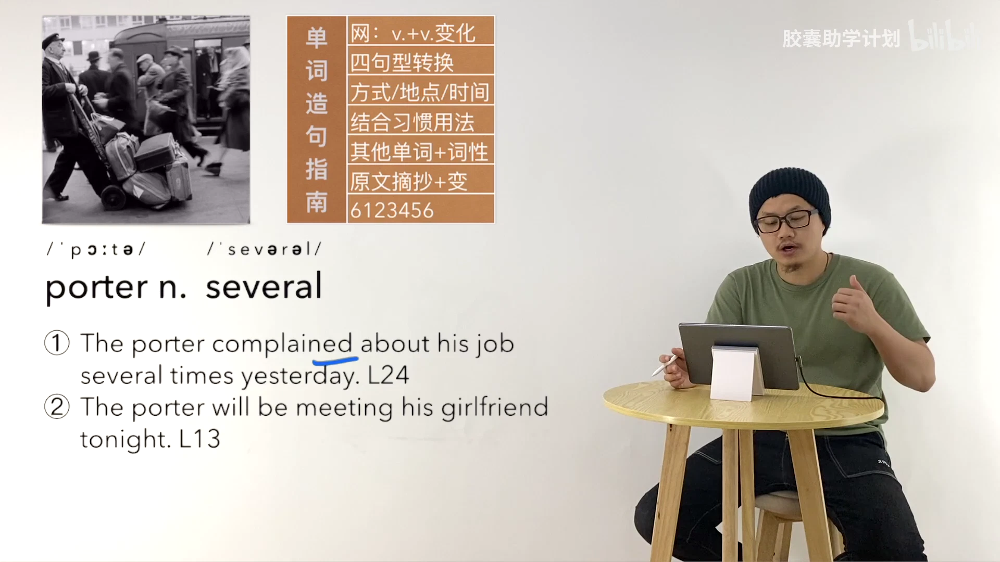

文字识别：单词造句指南 / 网：v.+v.变化 / 胶囊助学计划 / 四句型转换 / 方式/地点/时间 / 结合习惯用法 / 其他单词+词性 / 原文摘抄+变 / 6123456 / /'po:ta/ / /'sevaral/ / porter n. several / ① The porter complained about his job / several times yesterday. L24 / The porter will be meeting his girlfriend / tonight. L13

### 画面 00:03:03

文字识别：单词造句指南 / 网：v.+v.变化 / 胶囊助学计划 / 四句型转换 / 方式/地点/时间 / 结合习惯用法 / 其他单词+词性 / 原文摘抄+变 / 6123456 / /'po:ta/ / /'sevaral/ / porter n. several / ① The porter complained about his job / several times yesterday. L24 / The porter will be meeting his girlfriend / tonight. L13

### 画面 00:03:05

文字识别：单词造句指南 / 网：v.+v.变化 / 胶囊助学计划 / 四句型转换 / 方式/地点/时间 / 结合习惯用法 / 其他单词+词性 / 原文摘抄+变 / 6123456 / /'po:ta/ / /'sevaral/ / porter n. several / ① The porter complained about his job / several times yesterday. L24 / The porter will be meeting his girlfriend / tonight. L13

### 画面 00:03:10

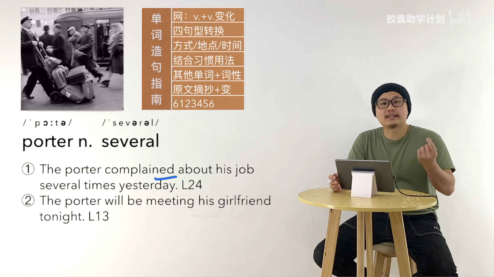

文字识别：单词造句指南 / 网：v.+v.变化 / 胶囊助学计划 / 四句型转换 / 方式/地点/时间 / 结合习惯用法 / 其他单词+词性 / 原文摘抄+变 / 6123456 / /'po:ta/ / /'sevaral/ / porter n. several / ① The porter complained about his job / several times yesterday. L24 / The porter will be meeting his girlfriend / tonight. L13

### 画面 00:03:13

文字识别：单词造句指南 / 网：v.+v.变化 / 胶囊助学计划 / 四句型转换 / 方式/地点/时间 / 结合习惯用法 / 其他单词+词性 / 原文摘抄+变 / 6123456 / /'po:ta/ / /'sevaral/ / porter n. several / ① The porter complained about his job / several times yesterday. L24 / The porter will be meeting his girlfriend / tonight. L13

### 画面 00:03:15

文字识别：单词造句指南 / 网：v.+v.变化 / 胶囊助学计划 / 四句型转换 / 方式/地点/时间 / 结合习惯用法 / 其他单词+词性 / 原文摘抄+变 / 6123456 / /'po:ta/ / /'sevaral/ / porter n. several / ① The porter complained about his job / several times yesterday. L24 / The porter will be meeting his girlfriend / tonight. L13

### 画面 00:03:20

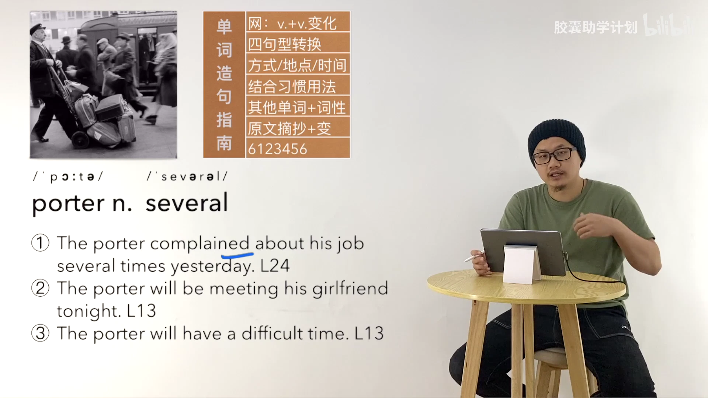

文字识别：单词造句指南 / 网：v.+v.变化 / 胶囊助学计划 / 四句型转换 / 方式/地点/时间 / 结合习惯用法 / 其他单词+词性 / 原文摘抄+变 / 6123456 / /'po:ta/ / /'sevaral/ / porter n. several / ① The porter complained about his job / several times yesterday. L24 / The porter will be meeting his girlfriend / tonight. L13 / The porter will have a difficult time. L13

### 画面 00:03:23

文字识别：单词造句指南 / 网：v.+v.变化 / 胶囊助学计划 / 四句型转换 / 方式/地点/时间 / 结合习惯用法 / 其他单词+词性 / 原文摘抄+变 / 6123456 / /'po:ta/ / /'sevaral/ / porter n. several / ① The porter complained about his job / several times yesterday. L24 / The porter will be meeting his girlfriend / tonight. L13 / The porter will have a difficult time. L13

### 画面 00:03:25

文字识别：单词造句指南 / 网：v.+v.变化 / 胶囊助学计划 / 四句型转换 / 方式/地点/时间 / 结合习惯用法 / 其他单词+词性 / 原文摘抄+变 / 6123456 / /'po:ta/ / /'sevaral/ / porter n. several / ① The porter complained about his job / several times yesterday. L24 / The porter will be meeting his girlfriend / tonight. L13 / The porter will have a difficult time. L13

### 画面 00:03:27

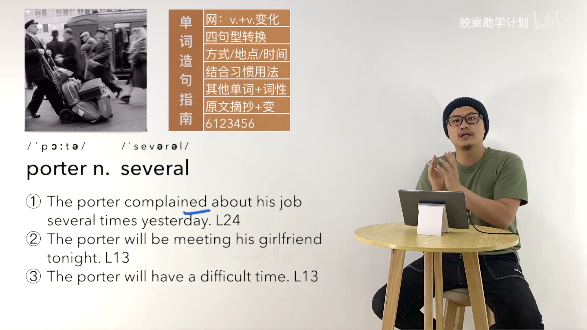

文字识别：单词造句指南 / 网：v.+v.变化 / 胶囊助学计划 / 四句型转换 / 方式/地点/时间 / 结合习惯用法 / 其他单词+词性 / 原文摘抄+变 / 6123456 / /'po:ta/ / /'sevaral/ / porter n. several / ① The porter complained about his job / several times yesterday. L24 / The porter will be meeting his girlfriend / tonight. L13 / The porter will have a difficult time. L13

### 画面 00:03:29

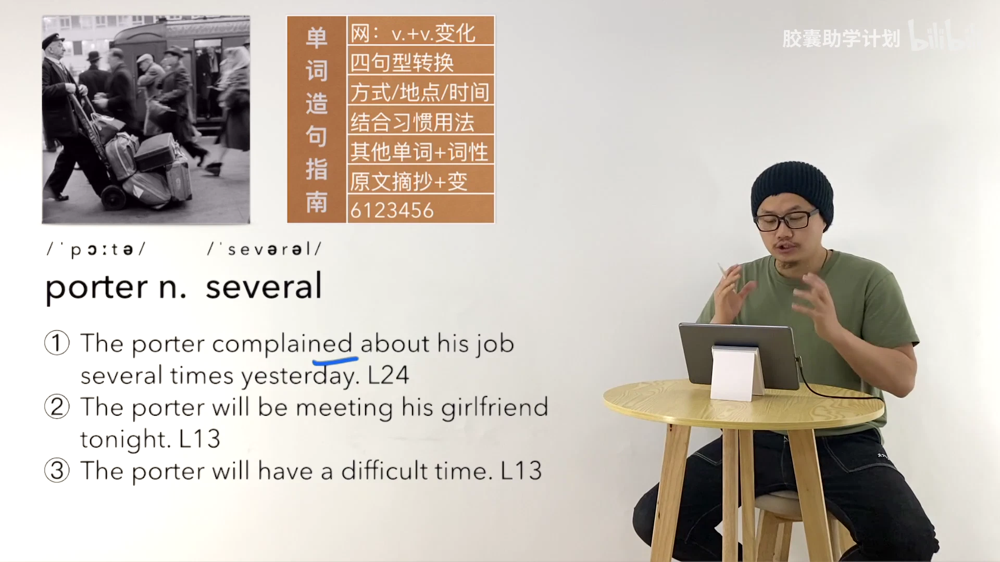

文字识别：单词造句指南 / 网：v.+v.变化 / 胶囊助学计划 / 四句型转换 / 方式/地点/时间 / 结合习惯用法 / 其他单词+词性 / 原文摘抄+变 / 6123456 / /'po:ta/ / /'sevaral/ / porter n. several / ① The porter complained about his job / several times yesterday. L24 / The porter will be meeting his girlfriend / tonight. L13 / The porter will have a difficult time. L13

## 00:03:30–00:04:00

这是我们第十三课学的，叫做 have a difficult time. Okay, very good. 那再跟我一起读一下这两个单词。第一个 order，第二个 several. Very good. Next one. 下一个单词，哎，这是我们直接翻译成汉语叫老外，对吧？ Okay，叫做 foreigner. Okay，老外啊，除了中国人以外，所有的我们一般都管它叫老外。但你会发现，其实老外它的这个用法还是有一些限制的，它内涵和 foreigner 不完全一样。Foreigner 特指的就是除了你本国以外，所有的人全

### 画面 00:03:32

文字识别：单词造句指南 / 网：v.+v.变化 / 胶囊助学计划 / 四句型转换 / 方式/地点/时间 / 结合习惯用法 / 其他单词+词性 / 原文摘抄+变 / 6123456 / /'po:ta/ / /'sevaral/ / porter n. several / ① The porter complained about his job / several times yesterday. L24 / The porter will be meeting his girlfriend / tonight. L13 / The porter will have a difficult time. L13

### 画面 00:03:35

文字识别：单词造句指南 / 网：v.+v.变化 / 胶囊助学计划 / 四句型转换 / 方式/地点/时间 / 结合习惯用法 / 其他单词+词性 / 原文摘抄+变 / 6123456 / /'po:ta/ / /'sevaral/ / porter n. several / ① The porter complained about his job / several times yesterday. L24 / The porter will be meeting his girlfriend / tonight. L13 / The porter will have a difficult time. L13

### 画面 00:03:38

文字识别：单词造句指南 / 网：v.+v.变化 / 胶囊助学计划 / 四句型转换 / 方式/地点/时间 / 结合习惯用法 / 其他单词+词性 / 原文摘抄+变 / 6123456 / /'fprana/ / foreigner n.

### 画面 00:03:40

文字识别：单词造句指南 / 网：v.+v.变化 / 胶囊助学计划 / 四句型转换 / 方式/地点/时间 / 结合习惯用法 / 其他单词+词性 / 原文摘抄+变 / 6123456 / /'fprana/ / foreigner n.

### 画面 00:03:43

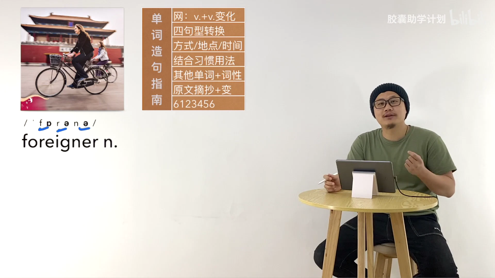

文字识别：单词造句指南 / 网：v.+v.变化 / 胶囊助学计划 / 四句型转换 / 方式/地点/时间 / 结合习惯用法 / 其他单词+词性 / 原文摘抄+变 / 6123456 / fprana/ / foreigner n.

### 画面 00:03:45

文字识别：单词造句指南 / 网：v.+v.变化 / 胶囊助学计划 / 四句型转换 / 方式/地点/时间 / 结合习惯用法 / 其他单词+词性 / 原文摘抄+变 / 6123456 / .fprana/ / foreigner n.

### 画面 00:03:50

文字识别：单词造句指南 / 网：v.+v.变化 / 胶囊助学计划 / 四句型转换 / 方式/地点/时间 / 结合习惯用法 / 其他单词+词性 / 原文摘抄+变 / 6123456 / fprana/ / foreigner n.

### 画面 00:03:52

文字识别：单词造句指南 / 网：v.+v.变化 / 胶囊助学计划 / 四句型转换 / 方式/地点/时间 / 结合习惯用法 / 其他单词+词性 / 原文摘抄+变 / 6123456 / fprana/ / foreigner n.

### 画面 00:03:55

文字识别：单词造句指南 / 网：v.+v.变化 / 胶囊助学计划 / 四句型转换 / 方式/地点/时间 / 结合习惯用法 / 其他单词+词性 / 原文摘抄+变 / 6123456 / fprana/ / foreigner n.

## 00:04:00–00:04:30

叫 foreigner，而汉语当中，尤其是北方话当中，对吧？我们去说老外的时候，那我们这个老外往往指的是呃这个西方发达国家，对吧？你想一下，如果他是一个韩国人，你可能一般不会用老外，日本人你一般不用这个 foreigner 或者老外这个汉字去表达。这是我们说语言和语言之间它并不是完全对等的，这个点要注意一下，好吧？foreigner 外国人。那我们造句子，它你看明显就是一个名词嘛？造句子无非

### 画面 00:04:00

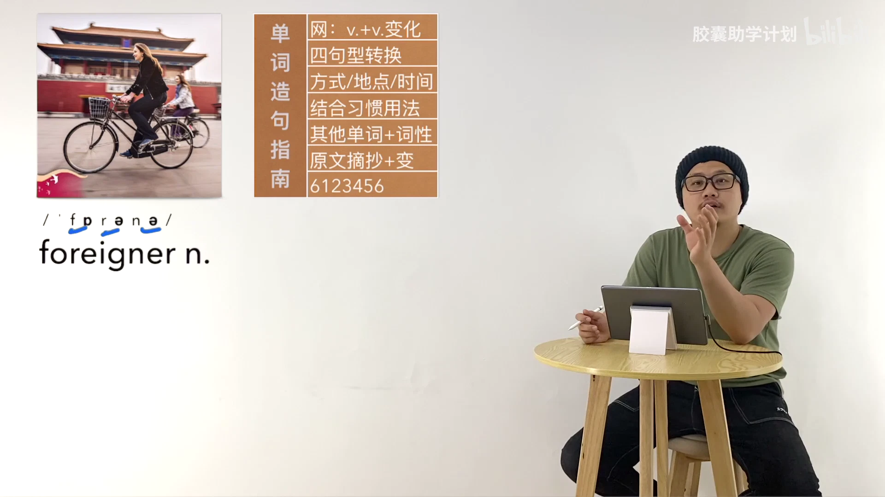

文字识别：单词造句指南 / 网：v.+v.变化 / 胶囊助学计划 / 四句型转换 / 方式/地点/时间 / 结合习惯用法 / 其他单词+词性 / 原文摘抄+变 / 6123456 / fprana/ / foreigner n.

### 画面 00:04:03

文字识别：单词造句指南 / 网：v.+v.变化 / 胶囊助学计划 / 四句型转换 / 方式/地点/时间 / 结合习惯用法 / 其他单词+词性 / 原文摘抄+变 / 6123456 / fprana/ / foreigner n. / 22

### 画面 00:04:05

文字识别：单词造句指南 / 网：v.+v.变化 / 胶囊助学计划 / 四句型转换 / 方式/地点/时间 / 结合习惯用法 / 其他单词+词性 / 原文摘抄+变 / 6123456 / fprana/ / foreigner n.

### 画面 00:04:10

文字识别：单词造句指南 / 网：v.+v.变化 / 胶囊助学计划 / 四句型转换 / 方式/地点/时间 / 结合习惯用法 / 其他单词+词性 / 原文摘抄+变 / 6123456 / fprana/ / foreigner n. / 27

### 画面 00:04:13

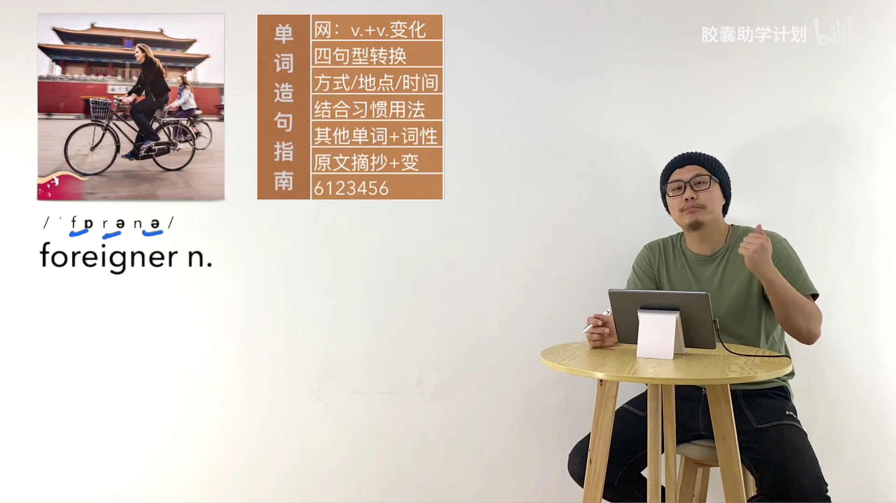

文字识别：单词造句指南 / 网：v.+v.变化 / 胶囊助学计划 / 四句型转换 / 方式/地点/时间 / 结合习惯用法 / 其他单词+词性 / 原文摘抄+变 / 6123456 / .fprana/ / foreigner n. / A

### 画面 00:04:15

文字识别：单词造句指南 / 网：v.+v.变化 / 胶囊助学计划 / 四句型转换 / 方式/地点/时间 / 结合习惯用法 / 其他单词+词性 / 原文摘抄+变 / 6123456 / 'fprana/ / foreigner n.

### 画面 00:04:20

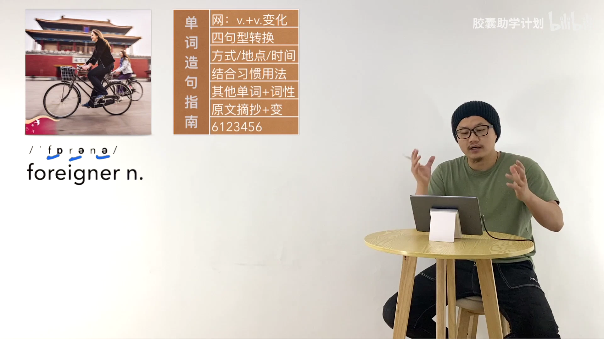

文字识别：单词造句指南 / 网：v.+v.变化 / 胶囊助学计划 / 四句型转换 / 方式/地点/时间 / 结合习惯用法 / 其他单词+词性 / 原文摘抄+变 / 6123456 / fprana/ / foreigner n.

### 画面 00:04:25

文字识别：单词造句指南 / 网：v.+v.变化 / 胶囊助学计划 / 四句型转换 / 方式/地点/时间 / 结合习惯用法 / 其他单词+词性 / 原文摘抄+变 / 6123456 / /f prana/ / foreigner n. / ) There are foreigners from all parts of the / world in Beijing. L13

### 画面 00:04:27

文字识别：单词造句指南 / 网：v.+v.变化 / 胶囊助学计划 / 四句型转换 / 方式/地点/时间 / 结合习惯用法 / 其他单词+词性 / 原文摘抄+变 / 6123456 / /'f prana/ / foreigner n. / ) There are foreigners from all parts of the / world in Beijing. L13

## 00:04:30–00:05:00

就是要么找其他词性动词，要么就是结合其他习惯用法，有动词的习惯用法，然后再去做一些动词动词变化，四句型转换。OK，那我们开始看啊，说There are foreigners from all parts of the world in Beijing。OK，那如果各位在北京生活过，你会发现其实北京尤其二环里，对吧？三里屯啊，然后这个呃团结湖附近啊，你会发现有非常多的外国人啊，这个大使馆也在那边，

### 画面 00:04:30

文字识别：单词造句指南 / 网：v.+v.变化 / 胶囊助学计划 / 四句型转换 / 方式/地点/时间 / 结合习惯用法 / 其他单词+词性 / 原文摘抄+变 / 6123456 / /fprana/ / foreigner n. / There are foreigners from all parts of the / world in Beijing. L13

### 画面 00:04:32

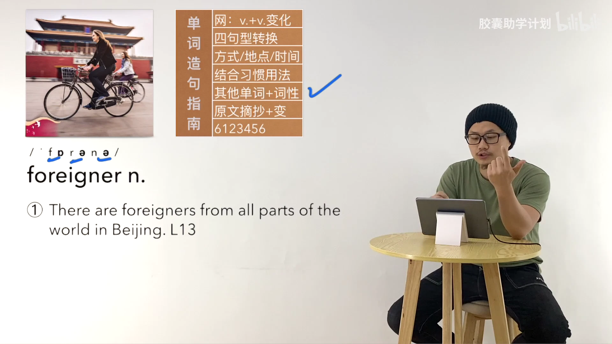

文字识别：单词造句指南 / 网：v.+v.变化 / 胶囊助学计划 / 四句型转换 / 方式/地点/时间 / 结合习惯用法 / 其他单词+词性 / 原文摘抄+变 / 6123456 / /'fprana/ / foreigner n. / ) There are foreigners from all parts of the / world in Beijing. L13

### 画面 00:04:34

文字识别：单词造句指南 / 网：v.+v.变化 / 胶囊助学计划 / 四句型转换 / 方式/地点/时间 / 结合习惯用法 / 其他单词+词性 / 原文摘抄+变 / 6123456 / /fprana/ / foreigner n. / ) There are foreigners from all parts of the / world in Beijing. L13

### 画面 00:04:36

文字识别：单词造句指南 / 网：v.+v.变化 / 胶囊助学计划 / 四句型转换 / 方式/地点/时间 / 结合习惯用法 / 其他单词+词性 / 原文摘抄+变 / 6123456 / f prana/ / foreigner n. / ) There are foreigners from all parts of the / world in Beijing. L13

### 画面 00:04:40

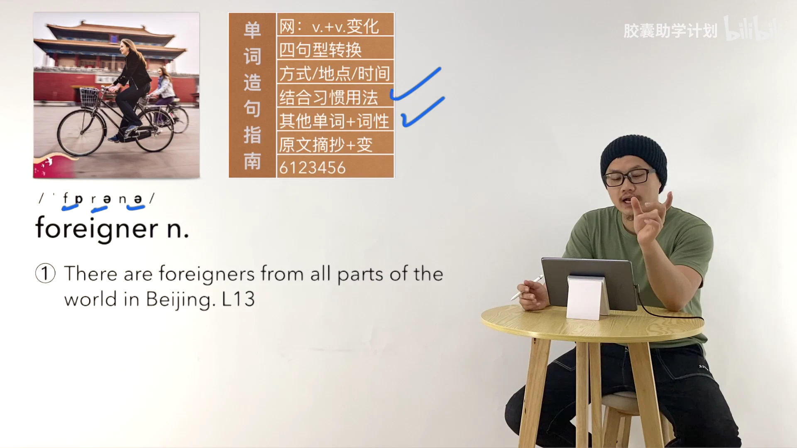

文字识别：单词造句指南 / 网：v.+v.变化 / 胶囊助学计划 / 四句型转换 / 方式/地点/时间 / 结合习惯用法 / 其他单词+词性 / 原文摘抄+变 / 6123456 / /'fprana/ / foreigner n. / ) There are foreigners from all parts of the / world in Beijing. L13

### 画面 00:04:43

文字识别：单词造句指南 / 网：v.+v.变化 / 胶囊助学计划 / 四句型转换 / 方式/地点/时间 / 结合习惯用法 / 其他单词+词性 / 原文摘抄+变 / 6123456 / /'f prana/ / foreigner n. / ) There are foreigners from all parts of the / world in Beijing. L13

### 画面 00:04:45

文字识别：单词造句指南 / 网：v.+v.变化 / 胶囊助学计划 / 四句型转换 / 方式/地点/时间 / 结合习惯用法 / 其他单词+词性 / 原文摘抄+变 / 6123456 / /f prana/ / foreigner n. / ) There are foreigners from all parts of the / world in Beijing. L13

### 画面 00:04:50

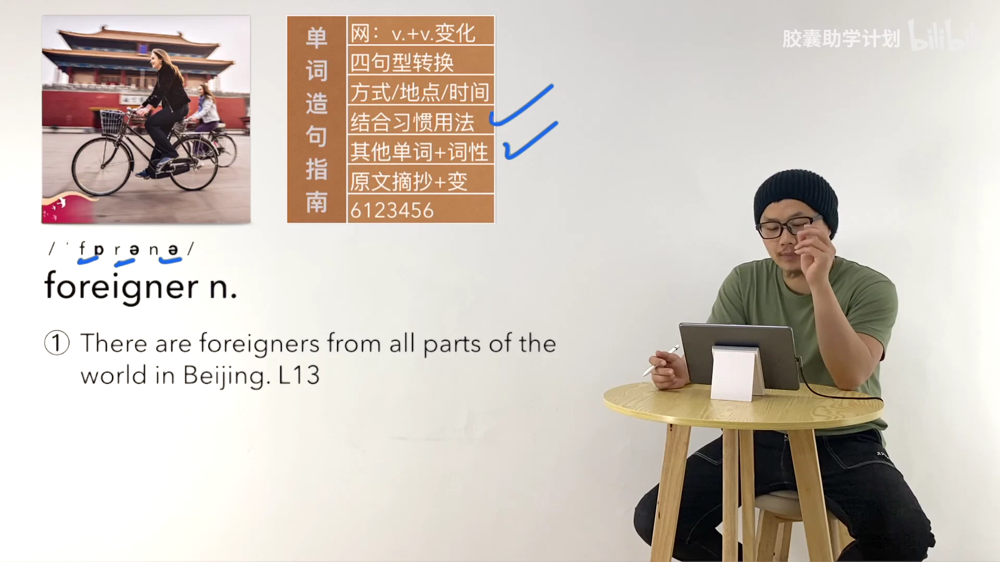

文字识别：单词造句指南 / 网：v.+v.变化 / 胶囊助学计划 / 四句型转换 / 方式/地点/时间 / 结合习惯用法 / 其他单词+词性 / 原文摘抄+变 / 6123456 / /'fprana/ / foreigner n. / ) There are foreigners from all parts of the / world in Beijing. L13

### 画面 00:04:55

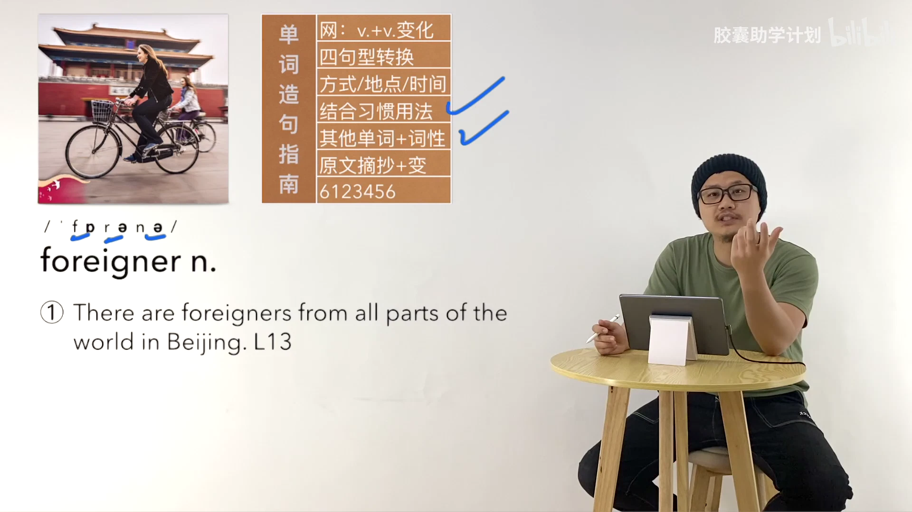

文字识别：单词造句指南 / 网：v.+v.变化 / 胶囊助学计划 / 四句型转换 / 方式/地点/时间 / 结合习惯用法 / 其他单词+词性 / 原文摘抄+变 / 6123456 / /f prana/ / foreigner n. / ) There are foreigners from all parts of the / world in Beijing. L13

### 画面 00:04:58

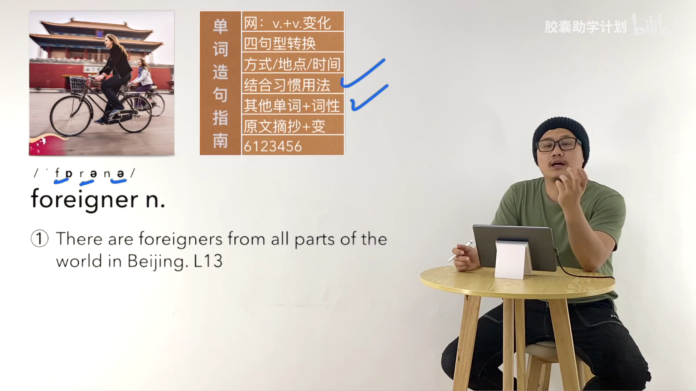

文字识别：单词造句指南 / 网：v.+v.变化 / 胶囊助学计划 / 四句型转换 / 方式/地点/时间 / 结合习惯用法 / 其他单词+词性 / 原文摘抄+变 / 6123456 / /'fprana/ / foreigner n. / ) There are foreigners from all parts of the / world in Beijing. L13

## 00:05:00–00:05:30

然后他会说，我们造了一句子，就是说，在北京啊，有来自于世界各地的外国人。哎，all parts of the world，这是我们第十三课学过的一个习惯用法。然后句型的用的是很简单的 there be 句型，这新一二十五课我们就学过了。 Continue, she had an amusing experience with a foreigner last summer. Okay, have an amusing experience. 第十四课学过的。哎， Continue 说，if you speak French，

### 画面 00:05:00

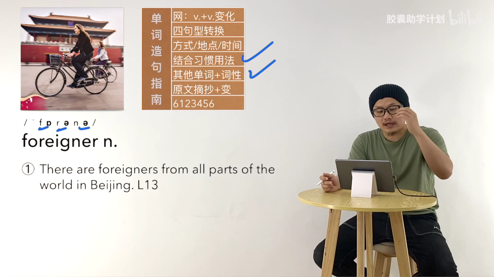

文字识别：单词造句指南 / 网：v.+v.变化 / 胶囊助学计划 / 四句型转换 / 方式/地点/时间 / 结合习惯用法 / 其他单词+词性 / 原文摘抄+变 / 6123456 / /'fprana/ / foreigner n. / ) There are foreigners from all parts of the / world in Beijing. L13

### 画面 00:05:05

文字识别：单词造句指南 / 网：v.+v.变化 / 胶囊助学计划 / 四句型转换 / 方式/地点/时间 / 结合习惯用法 / 其他单词+词性 / 原文摘抄+变 / 6123456 / /'f prana/ / foreigner n. / ) There are foreigners from all parts of the / world in Beijing. L13

### 画面 00:05:10

文字识别：单词造句指南 / 网：v.+v.变化 / 胶囊助学计划 / 四句型转换 / 方式/地点/时间 / 结合习惯用法 / 其他单词+词性 / 原文摘抄+变 / 6123456 / /'fprana/ / foreigner n. / ) There are foreigners from all parts of the / world in Beijing. L13

### 画面 00:05:15

文字识别：单词造句指南 / 网：v.+v.变化 / 胶囊助学计划 / 四句型转换 / 方式/地点/时间 / 结合习惯用法 / 其他单词+词性 / 原文摘抄+变 / 6123456 / /'fprana/ / foreigner n. /  There are foreigners from all parts of the / world in Beijing. L13

### 画面 00:05:17

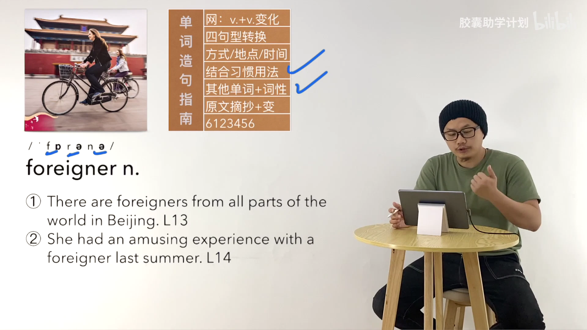

文字识别：单词造句指南 / 网：v.+v.变化 / 胶囊助学计划 / 四句型转换 / 方式/地点/时间 / 结合习惯用法 / 其他单词+词性 / 原文摘抄+变 / 6123456 / /'f prana/ / foreigner n. / ① There are foreigners from all parts of the / world in Beijing. L13 / She had an amusing experience with a / foreigner last summer. L14

### 画面 00:05:19

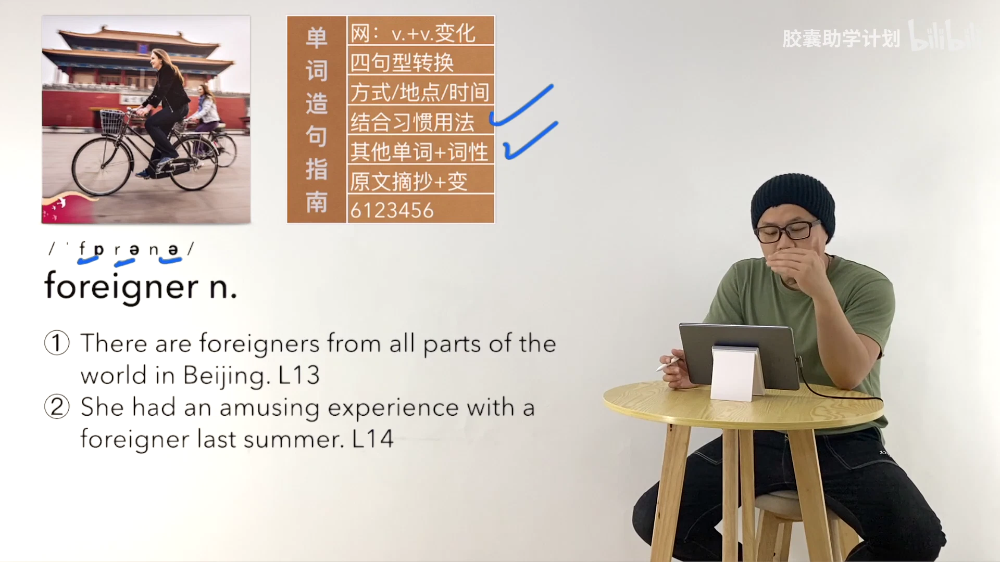

文字识别：单词造句指南 / 网：v.+v.变化 / 胶囊助学计划 / 四句型转换 / 方式/地点/时间 / 结合习惯用法 / 其他单词+词性 / 原文摘抄+变 / 6123456 / /'f prana/ / foreigner n. / ① There are foreigners from all parts of the / world in Beijing. L13 / She had an amusing experience with a / foreigner last summer. L14

### 画面 00:05:21

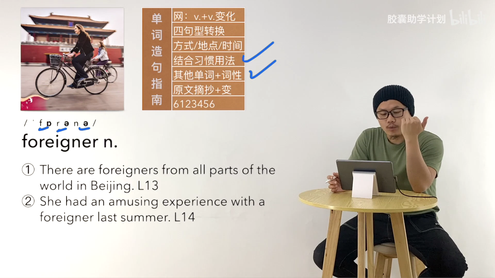

文字识别：单词造句指南 / 网：v.+v.变化 / 胶囊助学计划 / 四句型转换 / 方式/地点/时间 / 结合习惯用法 / 其他单词+词性 / 原文摘抄+变 / 6123456 / /'f prana/ / foreigner n. / ① There are foreigners from all parts of the / world in Beijing. L13 / She had an amusing experience with a / foreigner last summer. L14

### 画面 00:05:24

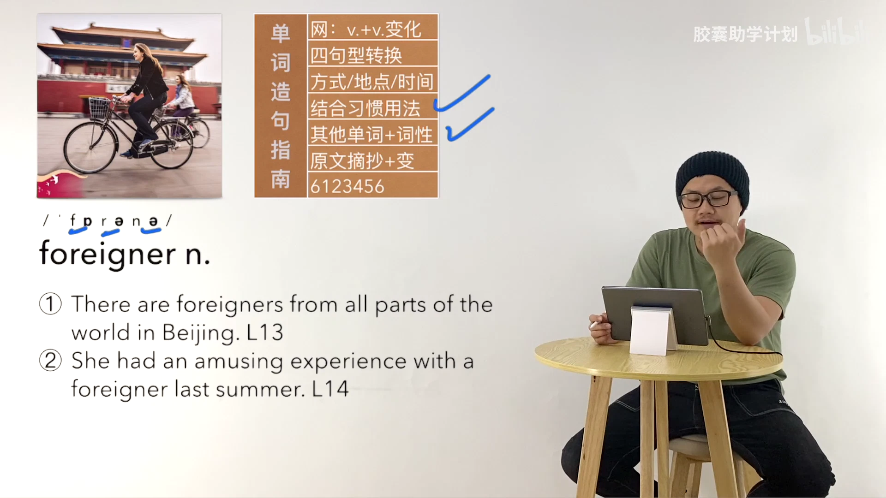

文字识别：单词造句指南 / 网：v.+v.变化 / 胶囊助学计划 / 四句型转换 / 方式/地点/时间 / 结合习惯用法 / 其他单词+词性 / 原文摘抄+变 / 6123456 / /'f prana/ / foreigner n. / ① There are foreigners from all parts of the / world in Beijing. L13 / She had an amusing experience with a / foreigner last summer. L14

### 画面 00:05:26

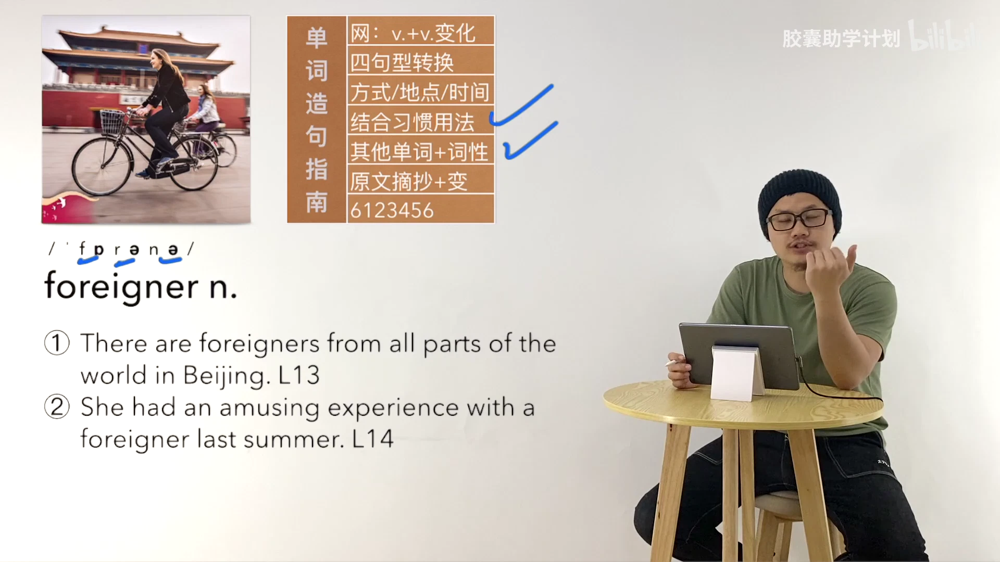

文字识别：单词造句指南 / 网：v.+v.变化 / 胶囊助学计划 / 四句型转换 / 方式/地点/时间 / 结合习惯用法 / 其他单词+词性 / 原文摘抄+变 / 6123456 / /'f prana/ / foreigner n. / ① There are foreigners from all parts of the / world in Beijing. L13 / She had an amusing experience with a / foreigner last summer. L14

### 画面 00:05:29

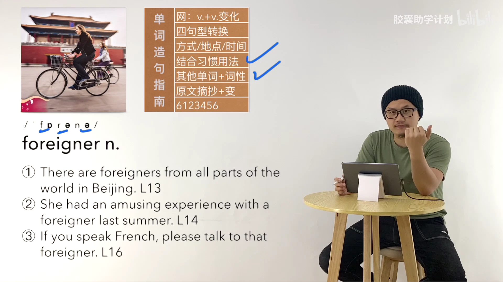

文字识别：单词造句指南 / 网：v.+v.变化 / 胶囊助学计划 / 四句型转换 / 方式/地点/时间 / 结合习惯用法 / 其他单词+词性 / 原文摘抄+变 / 6123456 / /'f pr ana/ / foreigner n. / ① There are foreigners from all parts of the / world in Beijing. L13 /  She had an amusing experience with a / foreigner last summer. L14 / If you speak French, please talk to that / foreigner. L16

## 00:05:30–00:06:00

16th lesson's grammar. If how how how, please talk to that foreigner. If you speak French, please talk to that foreigner for me. Okay, one more. Next one,下一个单词，跟我一起读一下，叫做wonder. Wonder. 它的意思叫感到惊奇，感到好奇，感到奇怪，感到诧异，都是wonder这个单词。那

### 画面 00:05:31

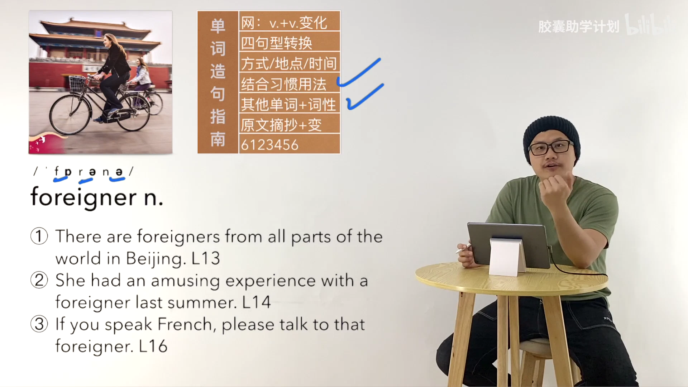

文字识别：单词造句指南 / 网：v.+v.变化 / 胶囊助学计划 / 四句型转换 / 方式/地点/时间 / 结合习惯用法 / 其他单词+词性 / 原文摘抄+变 / 6123456 / /f prana/ / foreigner n. / ① There are foreigners from all parts of the / world in Beijing. L13 / She had an amusing experience with a / foreigner last summer. L14 / If you speak French, please talk to that / 27 / foreigner. L16

### 画面 00:05:34

文字识别：单词造句指南 / 网：v.+v.变化 / 胶囊助学计划 / 四句型转换 / 方式/地点/时间 / 结合习惯用法 / 其他单词+词性 / 原文摘抄+变 / 6123456 / /'f prana/ / foreigner n. / ① There are foreigners from all parts of the / world in Beijing. L13 /  She had an amusing experience with a / foreigner last summer. L14 / If you speak French, please talk to that / foreigner. L16

### 画面 00:05:36

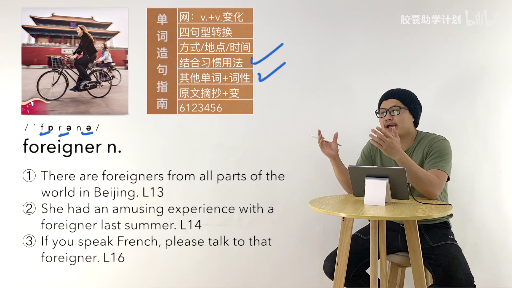

文字识别：单词造句指南 / 网：v.+v.变化 / 胶囊助学计划 / 四句型转换 / 方式/地点/时间 / 结合习惯用法 / 其他单词+词性 / 原文摘抄+变 / 6123456 / /f prana/ / foreigner n. / ① There are foreigners from all parts of the / world in Beijing. L13 /  She had an amusing experience with a / foreigner last summer. L14 / If you speak French, please talk to that / foreigner. L16

### 画面 00:05:40

文字识别：单词造句指南 / 网：v.+v.变化 / 胶囊助学计划 / 四句型转换 / 方式/地点/时间 / 结合习惯用法 / 其他单词+词性 / 原文摘抄+变 / 6123456 / /'f prana/ / foreigner n. / ① There are foreigners from all parts of the / world in Beijing. L13 /  She had an amusing experience with a / foreigner last summer. L14 / If you speak French, please talk to that / foreigner. L16

### 画面 00:05:45

文字识别：单词造句指南 / 网：v.+v.变化 / 胶囊助学计划 / 四句型转换 / 方式/地点/时间 / 结合习惯用法 / 其他单词+词性 / 原文摘抄+变 / 6123456 / /wanda/ / wonder v.

### 画面 00:05:47

文字识别：单词造句指南 / 网：v.+v.变化 / 胶囊助学计划 / 四句型转换 / 方式/地点/时间 / 结合习惯用法 / 其他单词+词性 / 原文摘抄+变 / 6123456 / /wanda/ / wonder v.

### 画面 00:05:50

文字识别：单词造句指南 / 网：v.+v.变化 / 胶囊助学计划 / 四句型转换 / 方式/地点/时间 / 结合习惯用法 / 其他单词+词性 / 原文摘抄+变 / 6123456 / /wAnda/ / wonder v.

### 画面 00:05:52

文字识别：单词造句指南 / 网：v.+v.变化 / 胶囊助学计划 / 四句型转换 / 方式/地点/时间 / 结合习惯用法 / 其他单词+词性 / 原文摘抄+变 / 6123456 / /wAnda/ / wonder v.

### 画面 00:05:55

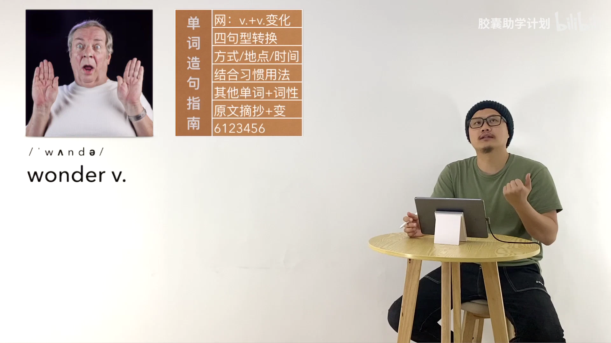

文字识别：单词造句指南 / 网：v.+v.变化 / 胶囊助学计划 / 四句型转换 / 方式/地点/时间 / 结合习惯用法 / 其他单词+词性 / 原文摘抄+变 / 6123456 / /wanda/ / wonder v.

### 画面 00:05:58

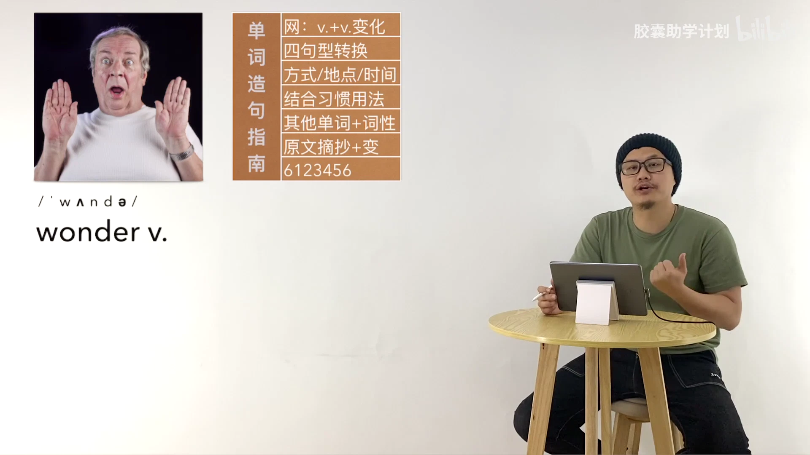

文字识别：单词造句指南 / 网：v.+v.变化 / 胶囊助学计划 / 四句型转换 / 方式/地点/时间 / 结合习惯用法 / 其他单词+词性 / 原文摘抄+变 / 6123456 / /wanda/ / wonder v.

## 00:06:00–00:06:30

它其实比较常见的是No wonder，也就是我们最开始问到的那个问题，叫表示怪不得啊，怪不得如此，叫No wonder。那接下来呢，我们直接看一个小的电影片段，哎，这个片段片段当中的这句台词还挺有意思，叫No wonder。我记得应该是You are extinct，是吧？怪不得你们灭绝了。那一起，我们接下来一起看一下，来了。

### 画面 00:06:00

文字识别：单词造句指南 / 网：v.+v.变化 / 胶囊助学计划 / 四句型转换 / 方式/地点/时间 / 结合习惯用法 / 其他单词+词性 / 原文摘抄+变 / 6123456 / /wAnda/ / wonder v. / 1 / no wonder

### 画面 00:06:03

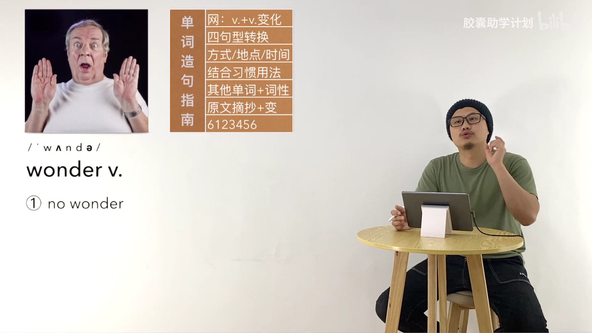

文字识别：单词造句指南 / 网：v.+v.变化 / 胶囊助学计划 / 四句型转换 / 方式/地点/时间 / 结合习惯用法 / 其他单词+词性 / 原文摘抄+变 / 6123456 / /wanda/ / wonder v. / 1 / no wonder

### 画面 00:06:05

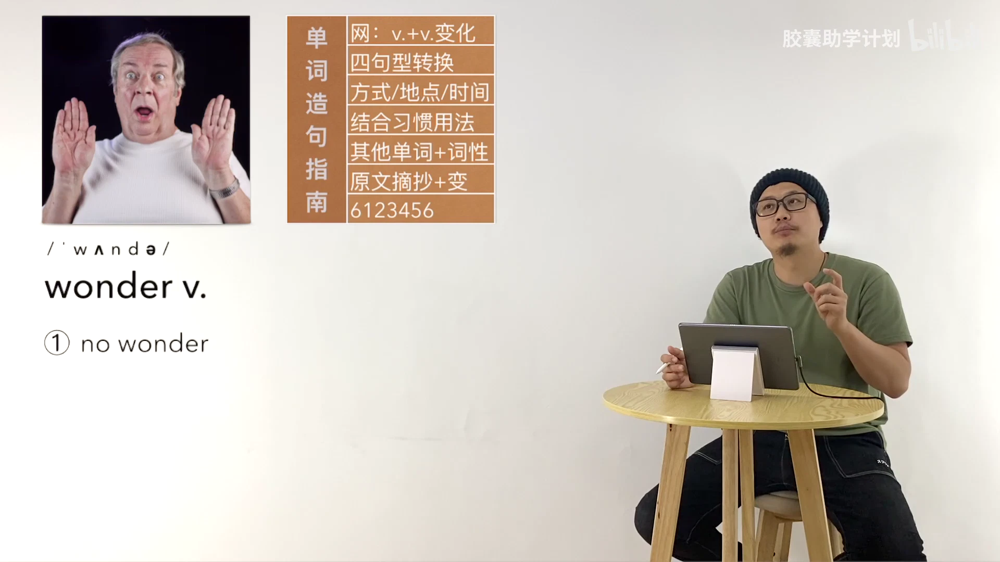

文字识别：单词造句指南 / 网：v.+v.变化 / 胶囊助学计划 / 四句型转换 / 方式/地点/时间 / 结合习惯用法 / 其他单词+词性 / 原文摘抄+变 / 6123456 / /wAnda/ / wonder v. / 1 / no wonder

### 画面 00:06:09

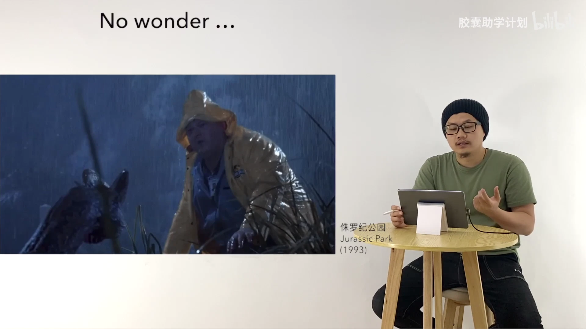

文字识别：No wonder .. / 胶囊助学计划 / 侏罗纪公园 / Jurassic Park / (1993)

### 画面 00:06:25

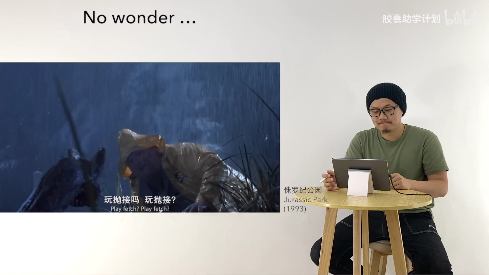

文字识别：No wonder ... / 胶囊助学计划 / 侏罗纪公园 / 玩抛接吗玩抛接？ / Jurassic Park / Play fetch? Play fetch? / (1993)

### 画面 00:06:27

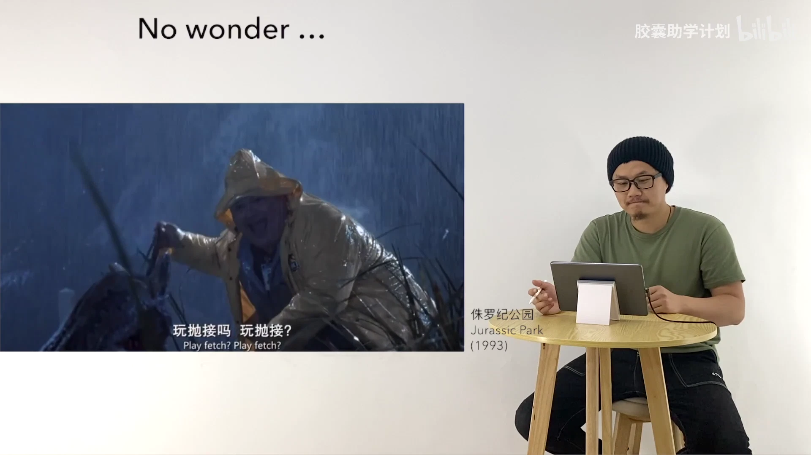

文字识别：No wonder ….. / 胶囊助学计划 / 侏罗纪公园 / 玩抛接吗玩抛接？ / Jurassic Park / Play fetch? Play fetch? / (1993)

### 画面 00:06:29

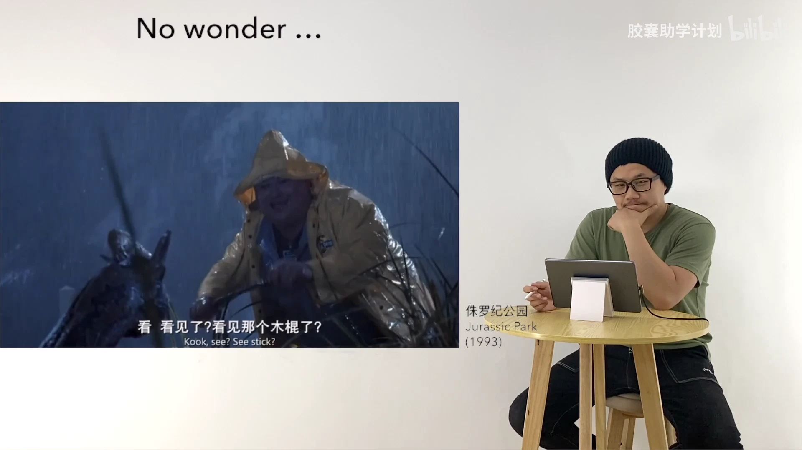

文字识别：No wonder ... / 胶囊助学计划 / 侏罗纪公园 / 看看见了?看见那个木棍了？ / Jurassic Park / Kook, see? See stick? / (1993)

## 00:06:30–00:07:00

### 画面 00:06:31

文字识别：No wonder .. / 胶囊助学计划 / 侏罗纪公园 / 看见木棍了对看木棍 / Jurassic Park / See stick? Yeah, look, stick. / (1993)

### 画面 00:06:33

文字识别：No wonder ... / 胶囊助学计划 / 侏罗纪公园 / 看木棍木棍 傻瓜!去接那个木棍伙计 / Jurassic Park / Kook, stick! Stick, stupid! Fetch the stick, boy! / (1993)

### 画面 00:06:35

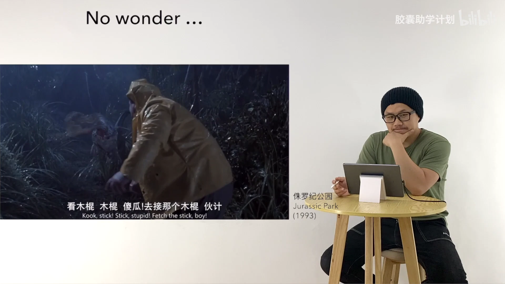

文字识别：No wonder ... / 胶囊助学计划 / 侏罗纪公园 / 看木棍木棍傻瓜!去接那个木棍伙计 / Jurassic Park / Kook, stick! Stick, stupid! Fetch the stick, boy! / (1993)

### 画面 00:06:37

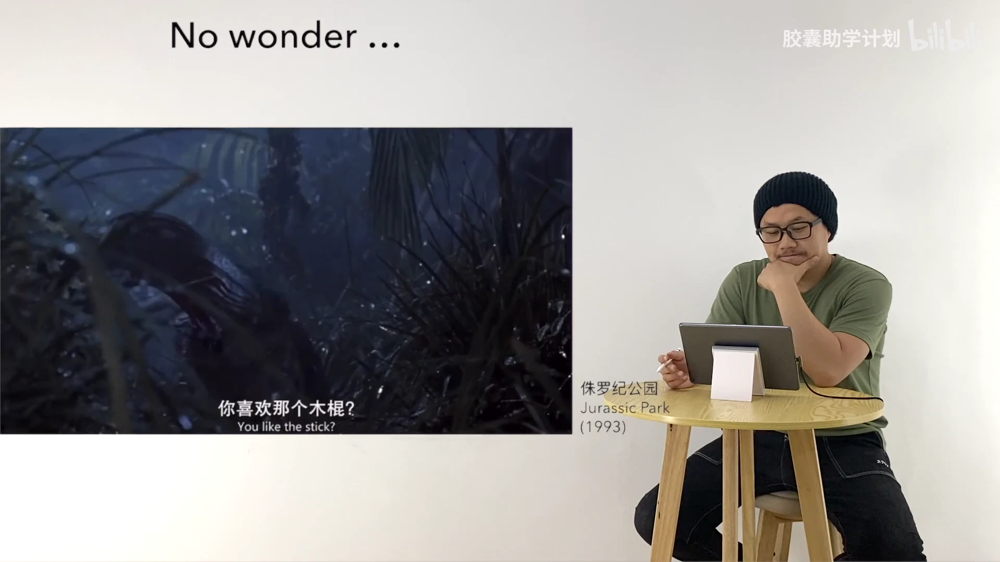

文字识别：No wonder ... / 胶囊助学计划 / 侏罗纪公园 / 你喜欢那个木棍? / Jurassic Park / You like the stick? / (1993)

### 画面 00:06:39

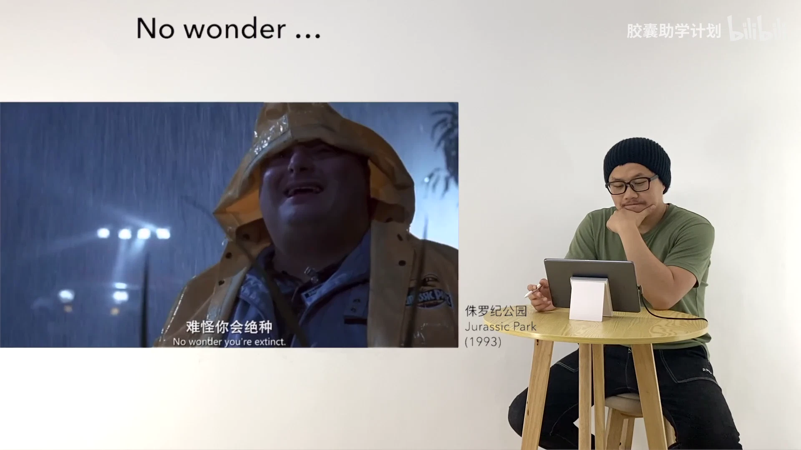

文字识别：No wonder .. / 胶囊助学计划 / 侏罗纪公园 / 难怪你会绝种 / Jurassic Park / No wonter you're extinct. / (1993)

### 画面 00:06:41

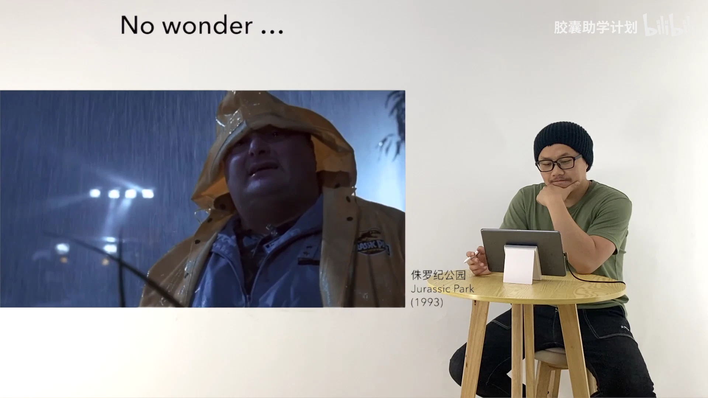

文字识别：No wonder ….. / 胶囊助学计划 / 侏罗纪公园 / Jurassic Park / (1993) / 27

### 画面 00:06:44

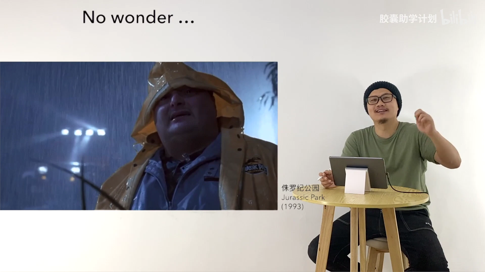

文字识别：No wonder ….. / 胶囊助学计划 / 侏罗纪公园 / Jurassic Park / (1993)

## 00:07:00–00:07:30

然不是因为这个原因啊。但这句台词很有意思，各位把这个表达记下来，叫 No wonder怎么怎么样，对吧？OK。接下来呢，我们再看一个非常朗朗上口的 Lemon Tree啊，一个非常经典的当时的流行歌曲啊。然后它就经它出现了叫 I wonder how, I wonder why啊。我对于 why 这个问题感到很诧异，是吧？或者很惊奇，然后我也会很好奇如何去做这些事情。I wonder why, I wonder how。接下来我们简单一

### 画面 00:07:07

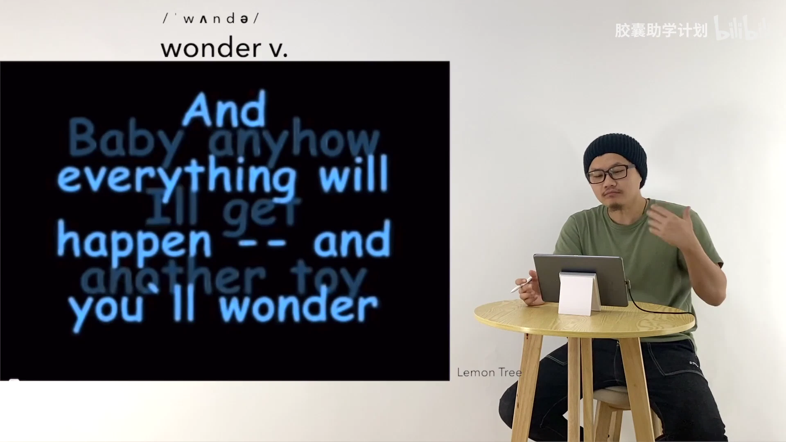

文字识别：W / Λ / n / d / a/ / 胶囊助学计划 / wonder v. / And / BabyAanyhow. / everything / will / ger / happen / and / your theror / Wonder / you / Lemon / Tree

### 画面 00:07:09

文字识别：W / Λ / n / d / a/ / 胶囊助学计划 / wonder v. / And / BabyAanyhow. / everyth / thing / will / ger / happen / and / you thwor / Wonder / you / Lemon / Tree

### 画面 00:07:11

文字识别：W / n / d / a/ / 胶囊助学计划 / wonder v. / And / BabyAanyhow / everything / will / ger / happen / and / Wonder / you thwor / you / Lemon / Tree

### 画面 00:07:15

文字识别：W / Λ / n / d / a/ / 胶囊助学计划 / wonder v. / And / BabyAanyhow / everything / will / ger / happen / and / Wonder / you thwor / you / Lemon / Tree

### 画面 00:07:20

文字识别：W / n / d / a/ / 胶囊助学计划 / wonder v. / And / BabyAanyhow / everyth / thing / will / geT / happen / and / you theor / Wonder / you / Lemon / Tree

### 画面 00:07:25

文字识别：W / Λ / n / d / a/ / 胶囊助学计划 / wonder v. / And / BabyAanyhow / everything / will / ger / happen / and / you thwor / Wonder / you / Lemon / Tree

## 00:07:30–00:08:00

起听一下. Okay, 这儿一个啊, I wonder why, I wonder how. Okay, 那 recap 本课没有过多的呃，比如说这个

### 画面 00:07:30

文字识别：W / Λ / n / d / a/ / 胶囊助学计划 / wonder v. / And / BabyAanyhow / everyth / thing / will / gey / happen / and / your thwor / Wonder / you / Lemon / Tree

### 画面 00:07:32

文字识别：wΛnda/ / 胶囊助学计划 / wonder v. / And / everything / will / happen / and / II / wonder / you / Lemon Tree

### 画面 00:07:34

文字识别：wΛnda/ / 胶囊助学计划 / wonder v. / And / everything / will / happen / and / wonder / you / Lemon Tree

### 画面 00:07:36

文字识别：/'w Λn d a / / 胶囊助学计划 / wonder v. / Lemon Tree

### 画面 00:07:38

文字识别：wΛnda/ / 胶囊助学计划 / wonder v. / I / wonder / how, I / wonder / why / Lemon Tree

### 画面 00:07:40

文字识别：wΛnda/ / 胶囊助学计划 / wonder v. / wonder / I / how. / I / wonder / why / Lemon Tree

### 画面 00:07:42

文字识别：wΛnda/ / 胶囊助学计划 / wonder v. / Yesterday / you / told / bout / me / the / blue / blue / sky / Lemon Tree

### 画面 00:07:44

文字识别：W / n / d / a/ / 胶囊助学计划 / wonder v. / Andt aldthatoI / canlseeeisgust / atlyelldwelemon / tree / Lemon / Tree

### 画面 00:07:46

文字识别：/wΛnd a/ / 胶囊助学计划 / wonder v. / And / all / that / I / is / just / can / see / yellow / lemon / a / tree / Lemon Tree

### 画面 00:07:49

文字识别：/'wΛnd a / / 胶囊助学计划 / wonder v. / And / all / that / I / is / just / can / see / yellow / lemon / a / tree / Lemon Tree

### 画面 00:07:51

文字识别：/'wΛnda l / 胶囊助学计划 / wonder v. / Lemon Tree

### 画面 00:07:54

文字识别：胶囊助学计划 / Recap / railway station / Words / no wonder / Expression

### 画面 00:07:56

文字识别：胶囊助学计划 / Recap / railway station / Words / no wonder / Expression

### 画面 00:07:59

文字识别：胶囊助学计划 / Recap / railway station / Words / no wonder / Expression

## 00:08:00–00:08:30

补充啊，我们其实就是一个 no wonder，怪不得。另外一个 railway station，您很可能是认识的。OK，那我们看一下本科家庭作业。首先，单词造句对话啊，我再重申一下，各位不要自己去凭想象力。您来上课就是学习我的思路，对吧？那您就用我教给各位的这个单词造句指南，至少您先把这学会了啊。就咱们就用这个造句指南去造每个单词五句话。那 wonder 这个单词可

### 画面 00:08:01

文字识别：胶囊助学计划 / Recap / railway station / Words / no wonder / Expression

### 画面 00:08:03

文字识别：胶囊助学计划 / Recap / railway station / Words / no wonder / Expression

### 画面 00:08:05

文字识别：胶囊助学计划 / Recap / railway station / Words / no wonder / Expression

### 画面 00:08:07

文字识别：胶囊助学计划

### 画面 00:08:09

文字识别：胶囊助学计划 / 单词造句/对话 / 【单词造句指南】 / 每个5句

### 画面 00:08:12

文字识别：胶囊助学计划 / 单词造句/对话 / 1. / 【单词造句指南】 / 每个5句

### 画面 00:08:14

文字识别：胶囊助学计划 / 单词造句/对话 / 【单词造句指南】 / 每个5句

### 画面 00:08:18

文字识别：胶囊助学计划 / 单词造句/对话 / 【单词造句指南】 / 每个5句

### 画面 00:08:20

文字识别：胶囊助学计划 / 单词造句/对话 / 【单词造句指南】 / 每个5句

### 画面 00:08:22

文字识别：胶囊助学计划 / 单词造句/对话 / 【单词造句指南 / 每个5句

### 画面 00:08:24

文字识别：胶囊助学计划 / 单词造句/对话 / 1. / 【单词造句指南 / 每个5句

### 画面 00:08:27

文字识别：胶囊助学计划 / 单词造句/对话 / 1. / 【单词造句指南】 / 每个5句

### 画面 00:08:29

文字识别：胶囊助学计划 / 单词造句/对话 / 【单词造句指南 / 每个5句 / 2.反复听电影片段，直到能 / 听出关键短语/句子

## 00:08:30–00:09:00

可能不太好造句。对于各位目前来说，我们今天也没有给大家去扩展它的句子，那可以算了。但是别的能造的，比如像 foreigner，那您就多造几个。反复听电影片段，能听出这个，直到能听出关键的短语或句子。那如果各位喜欢我们的课程，欢迎大家关注、订阅、一键三连，分享给那些需要的朋友，来帮助我们快速成长。 See you next time.

### 画面 00:08:31

文字识别：胶囊助学计划 / 单词造句/对话 / 【单词造句指南 / 每个5句 / 2.反复听电影片段，直到能 / 听出关键短语/句子

### 画面 00:08:33

文字识别：胶囊助学计划 / 单词造句/对话 / 【单词造句指南 / 每个5句 / 2.反复听电影片段，直到能 / 听出关键短语/句子

### 画面 00:08:35

文字识别：胶囊助学计划 / 单词造句/对话 / 【单词造句指南 / 每个5句 / 2.反复听电影片段，直到能 / 听出关键短语/句子

### 画面 00:08:37

文字识别：胶囊助学计划 / 单词造句/对话 / 【单词造句指南 / 每个5句 / 2.反复听电影片段，直到能 / 听出关键短语/句子

### 画面 00:08:39

文字识别：胶囊助学计划 / 单词造句/对话 / 【单词造句指南 / 每个5句 / 2.反复听电影片段，直到能 / 听出关键短语/句子

### 画面 00:08:42

文字识别：胶囊助学计划 / 单词造句/对话 / 【单词造句指南 / 每个5句 / 2.反复听电影片段，直到能 / 听出关键短语/句子

### 画面 00:08:44

文字识别：胶囊助学计划 / 单词造句/对话 / 【单词造句指南 / 每个5句 / 反复听电影片段，直到能 / 听出关键短语/句子

### 画面 00:08:46

文字识别：胶囊助学计划 / 不

### 画面 00:08:55

### 画面 00:08:57

文字识别：CAPSULEACADEMY / 胶囊助学计划 / 小红书 / Lecturer / Leo / OE

## 00:09:00–00:09:07

### 画面 00:09:00

文字识别：CAPSULEACADEMY / 胶囊助学计划 / 『 / 小红书 / Editor / OE

### 画面 00:09:03

文字识别：CAPSULEACADEMY / 胶囊助学计划 / 『 / 小红书 / Creator / □ / Leo & Berlin / OE

### 画面 00:09:05

文字识别：Bilibili / 胶囊助学计划 / 小红书

### 画面 00:09:07

文字识别：bilibili / 胶囊助学计划

