# L025 语法

快速机器解析：语音为单模型转写，未进行独立交叉校对或人工复核；画面每秒采样并按变化选帧，短时文字和标记可能遗漏。截图时间约有 1 秒误差。图片有损压缩；遇到疑点请按时间查看 Google Drive 原视频。

## 00:00:00–00:00:30

Hello everyone, welcome to Capsule Academy. This is Leo. Today we're going to learn the Concept English Book Two Lesson Twenty Five Grammar. 那老习惯进入正式课程之前呢，我们先看两个问题啊。第一个问题有一点怪，叫六一二三四五六加六一二三四五六。不过如果您仔仔细细的学过了第一单元啊，或者说至少是第一单元的第一课，那六一二三四五六这个东西在您这个地方应该不是十分陌生啊。那

### 画面 00:00:00

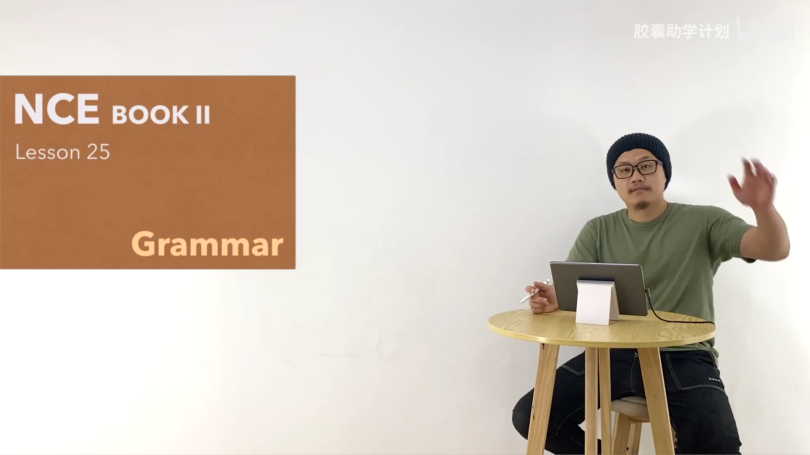

文字识别：胶囊助学计划 / NCE / BOOKⅡI / Lesson 25 / Grammar

### 画面 00:00:02

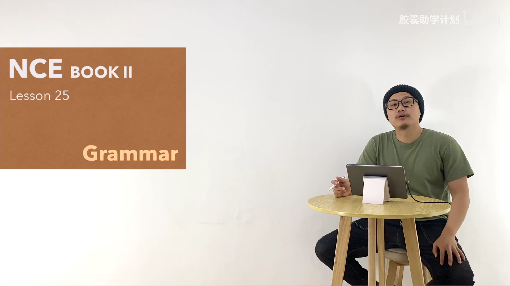

文字识别：胶囊助学计划 / NCE / BOOK"I / Lesson 25 / Grammar

### 画面 00:00:05

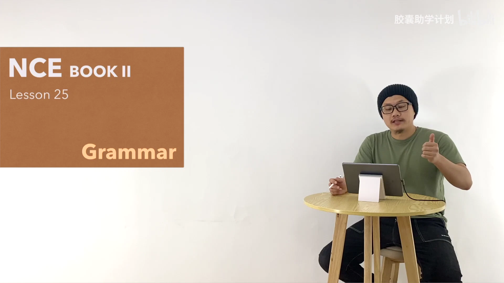

文字识别：胶囊助学计划 / NCE / BOOKII / Lesson 25 / Grammar

### 画面 00:00:10

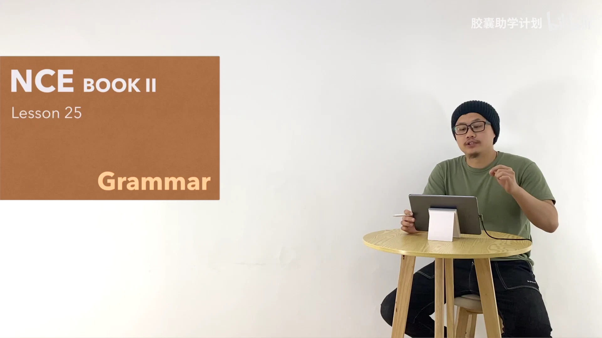

文字识别：胶囊助学计划 / NCE / BOOKII / Lesson 25 / Grammar

### 画面 00:00:12

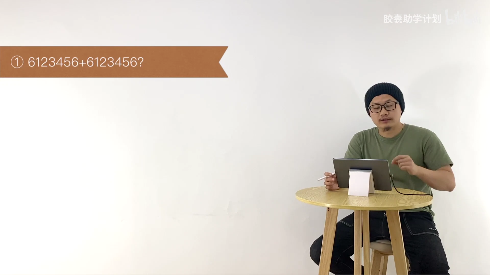

文字识别：胶囊助学计划 / ①6123456+6123456?

### 画面 00:00:16

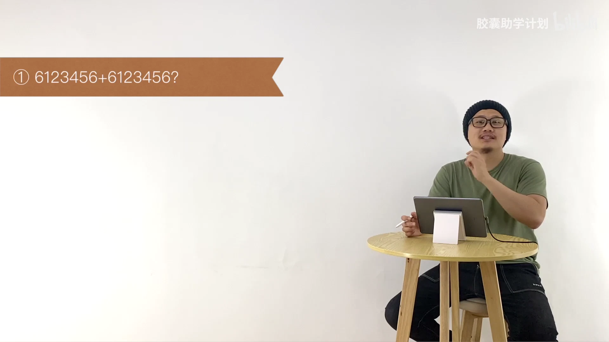

文字识别：胶囊助学计划 / ①6123456+6123456?

### 画面 00:00:25

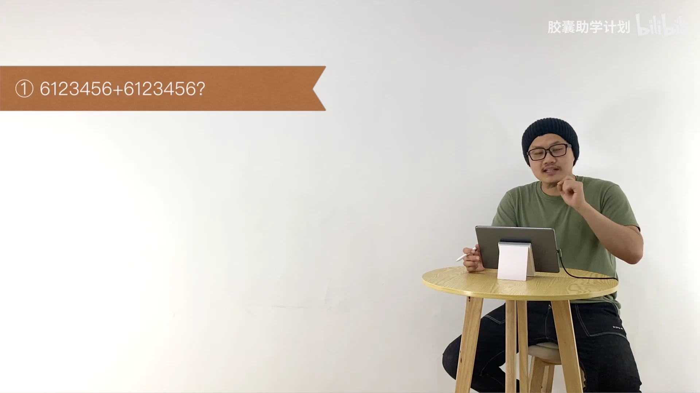

文字识别：胶囊助学计划 / ①6123456+6123456?

## 00:00:30–00:01:00

我们待会儿一起看一下什么叫六一二三四五六加六一二三四五六。接下来呢，如何加得上呢？其实就引出了第二个问题，叫如何使用并列连词。那它的缩写叫 C O N J 点啊，就类似于形容词是 A D J 点，名词是 N 点。 OK，那带着这两个问题，Hope you guys enjoy it。好，那我们上来先看新概念二册第一课，我们学过的六一二三

### 画面 00:00:30

文字识别：胶囊助学计划 / ①6123456+6123456?

### 画面 00:00:34

文字识别：胶囊助学计划 / ①6123456+6123456? / 使用并列连词conj.?

### 画面 00:00:36

文字识别：胶囊助学计划 / ①6123456+6123456? / 如何使用并列连词conj.?

### 画面 00:00:40

文字识别：胶囊助学计划 / ①6123456+6123456? / 如何使用并列连词conj.?

### 画面 00:00:45

文字识别：胶囊助学计划 / ①6123456+6123456? / 如何使用并列连词conj.?

### 画面 00:00:50

文字识别：胶囊助学计划b出l

### 画面 00:00:54

### 画面 00:00:56

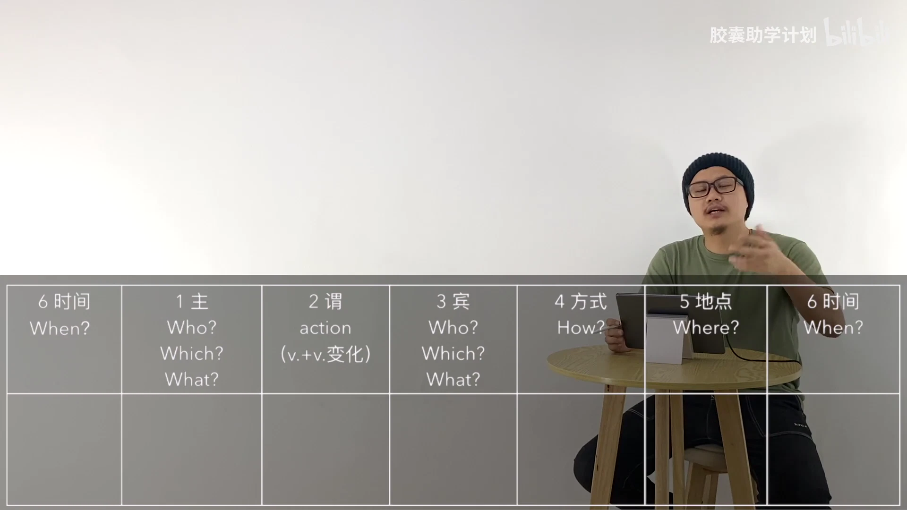

文字识别：胶囊助学计划 / 6时间 / 1主 / 2谓 / 3宾 / 4方式 / 5地点 / 6时间 / When? / Who? / action / Who? / How? / Where? / When? / Which? / (v.+v.变化) / Which? / What? / What?

## 00:01:00–00:01:30

四五六，我以最快的速度带着各位先复习一下。首先六是什么？首先这个六一二三四五六是什么呢？指的是在一个它首先我们先说呃，它是一个在普遍规则状态下英文句子的一个结构啊，它应该是以什么样的一个顺序对吧？你有很多的单词，这些单词在句子当中起到不同的作用，有几个单词是交代这个动作发生的地点，有几个单词是交代动作发生的时间，对吧？那然后还有几

### 画面 00:01:26

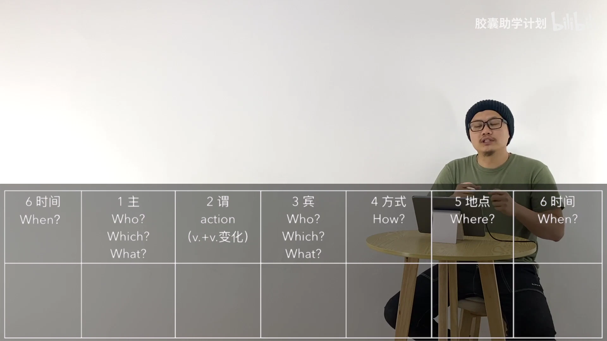

文字识别：胶囊助学计划 / 6时间 / 1主 / 2谓 / 3宾 / 4方式 / 5地点 / 6时间 / When? / Who? / action / Who? / How? / Where? / When? / Which? / (v.+v.变化) / Which? / What? / What?

## 00:01:30–00:02:00

个单词是说谁发出的动作，还有的是说谁接受的这个动作，当然还有动作本身，对吧？那它的排序习惯呢，叫六一二三四五六。我们能看到六可以放在最前，也可以放在最后，也就是时间。五呢放在六的前面，它是地点。四呢指的是方式，不管是方式、地点、时间，都指的是动作发生的方式、动作发生的地点和动作发生的时间。而这个句子最核心的就是一二三，

### 画面 00:01:56

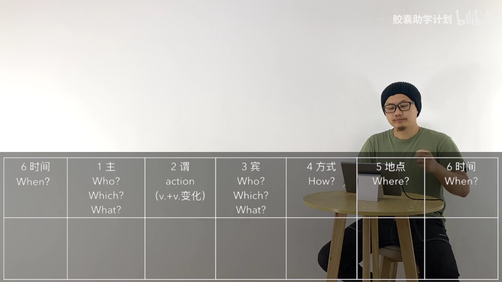

文字识别：胶囊助学计划 / 6时间 / 1主 / 2谓 / 3宾 / 4方式 / 5地点 / 6时间 / When? / Who? / action / Who? / How? / Where? / When? / Which? / (v.+v.变化) / Which? / What? / What?

## 00:02:00–00:02:30

主语谁发出的这个动作，对吧？也可以是一个物，也可以是一个人。第二谓语，对吧？那就所谓动词加动词的变化，直接说谓语。各位可能不不太容易理解，就是动词加动词的变化。动词很容易理解，对吧？Buy动词，那动词的变化呢？就是如果你是正在买，那就是is加buy，对吧？或者am is are加buy。如果要准备去买，就begin to do，对吧？如果是被买了呢？那你还要看一下它的时态。如果是一般

### 画面 00:02:26

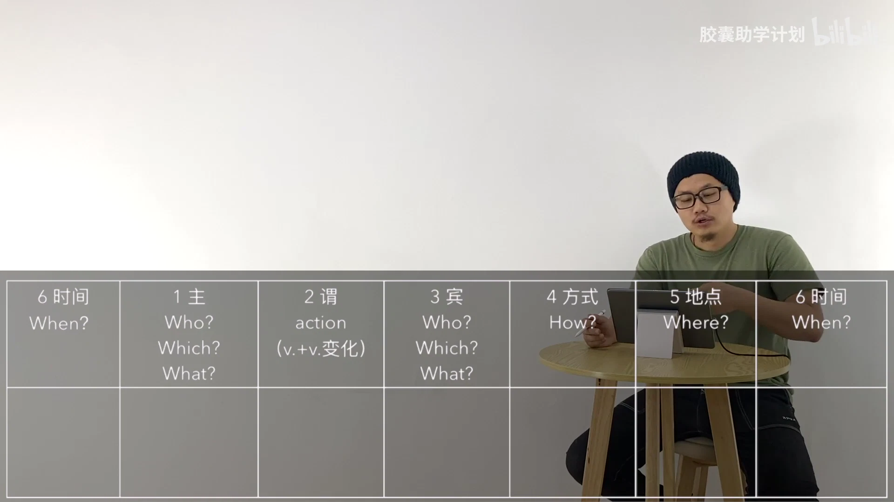

文字识别：胶囊助学计划 / 6时间 / 1主 / 2谓 / 3宾 / 4方式 / 5地点 / 6时间 / When? / Who? / action / Who? / How? / Where? / When? / Which? / (v.+v.变化) / Which? / What? / What?

## 00:02:30–00:03:00

过去时，那它叫做 was were 加 bought，对吧？我们管它叫做动词加动词的变化，这个也是我们英语学习几乎最重要的点之一了啊，或者甚至可以说没有之一。就这个东西，如果您不掌握，那英语就绝对是很难往下学了，学不下去，对吧？第三个呢，就是我们所谓的宾语，就是这个动作施加在了谁的身上？OK，那这个叫六一二三四五六，那什么叫六一二三四五六加六一二三四五六呢？其实我们在第

### 画面 00:02:56

文字识别：胶囊助学计划 / 6时间 / 1主 / 2谓 / 3宾 / 4方式 / 5地点 / 6时间 / When? / Who? / action / Who? / How? / Where? / When? / Which? / (v.+v.变化) / Which? / What? / What?

### 画面 00:02:59

文字识别：胶囊助学计划 / Captain Alison will set out at eight o'clock, so we'll / have plenty of time. L12 / 6时间 / 1主 / 2谓 / 3宾 / 4方式 / 5地点 / 6时间 / When? / Who? / action / Who? / How? / Where? / When? / Which? / (v.+V.变化) / Which? / What? / What?

## 00:03:00–00:03:30

一单元就见过了，比如说第十二课这句话叫 Captain Ellison will set out at eight o'clock, so we'll have plenty of time. 你看前面 Captain Ellison will set out at eight o'clock，它就是一个六一二三四五六啊。我们不挨个去分析，但您知道它是一个句子。So 表示所以，您看前面有一个逗号，对吧？这也就是说前面是一个六一二三四五六，然后用 so 连起来了，后边 we'll have plenty of time 又是一个六一二三四五六，也就是

### 画面 00:03:21

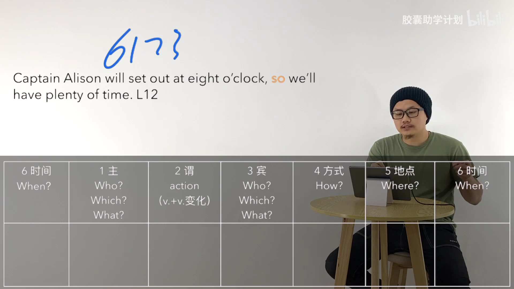

文字识别：胶囊助学计划 / 6173 / Captain Alison will set out at eight o'clock, so we'll / have plenty of time. L12 / 6时间 / 1主 / 2谓 / 3宾 / 4方式 / 5地点 / 6时间 / When? / Who? / action / Who? / How? / Where? / When? / Which? / (v.+v.变化) / Which? / What? / What?

### 画面 00:03:23

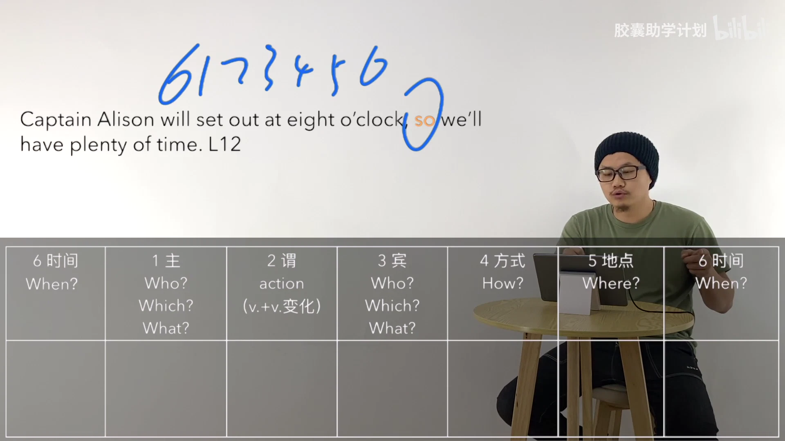

文字识别：胶囊助学计划 / 6173456 / Captain Alison will set out at eight o'clockl so/we'll / have plenty of time. L12 / 6时间 / 1主 / 2谓 / 3宾 / 4方式 / 5地点 / 6时间 / When? / Who? / action / Who? / How? / Where? / When? / Which? / (v.+v.变化) / Which? / What? / What?

### 画面 00:03:26

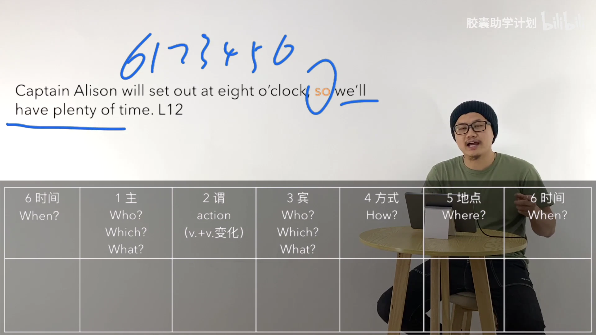

文字识别：胶囊助学计划 / 6173456 / Captain Alison will set out at eight o'clockl so we'll / have plenty of time. L12 / 6时间 / 1主 / 2谓 / 3宾 / 4方式 / 5地点 / 6时间 / When? / Who? / action / Who? / How? / Where? / When? / Which? / (v.+v.变化) / Which? / What? / What?

## 00:03:30–00:04:00

六一二三四五六加六一二三四五六，好理解哈。中间是一个数。接下来下一个句子叫做 The airport was built years ago, but for some reason it could not be used then. 这是我们第二十一课学的。前面 but 前面一个六一二三四五六，也就是一个句子，对吧？我们现在用六一二三四五六来代替句子这个事儿。后面呢又是一个句子，六一二三四五六。 There you go. But 连接了叫但是啊。再然后二十四课咱们又

### 画面 00:03:34

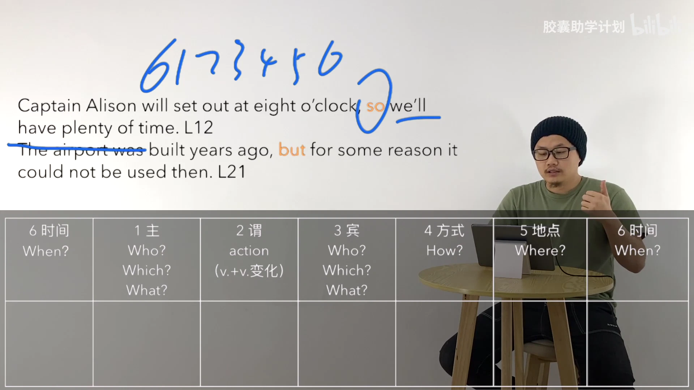

文字识别：胶囊助学计划 / 6173450 / Captain Alison will set out at eight o'clockl so we'll / have plenty of time. L12 / ort was built years ago, but for some reason it / could not be used then. L21 / 6时间 / 1主 / 2谓 / 3宾 / 4方式 / 5地点 / 6时间 / When? / Who? / action / Who? / How? / Where? / When? / Which? / (v.+v.变化) / Which? / What? / What?

## 00:04:00–00:04:30

学了一个叫 I had just lost fifty pound and I felt very upset. 好，and起到了一个你可以理解为类似于因果关系。我因为丢了五十，所以我现在感觉到非常的沮丧和不安，对不对？哎，and连接了两个句子，也就是六二三四五六。当然，这个句子不一定要每一个东西都有，对吧？不一定非得有地点、时间啊、方式，但一定要有的是一和二，这是我们第一课学过的。那各位在这儿能看到，

### 画面 00:04:04

文字识别：胶囊助学计划 / 6173456 / Captain Alison will set out at eight o'clockl so we'll / have plenty of time. L12 / The airport was built years ago, but for some reason it / could not be used / then. L21 / I had just lost 50 and I felt very upset. L24 / 6时间 / 1主 / 2谓 / 3宾 / 4方式 / 5地点 / 6时间 / When? / Who? / action / Who? / How? / Where? / When? / Which? / (v.+v.变化) / Which? / What? / What?

## 00:04:30–00:05:00

首先我们能理解为，我们已经见过了六一二三四五六加六一二三四五六。其次呢，我们知道了这两个句子连到一起需要的是 so but and 这样的一些小的单词。我们管这些单词叫什么呢？叫并列连词。如果对于各位来说啊，你说我不想学习任何这个这个学术术语，并列连词本身是个学术术语啊。您最多啊，我们把并列去掉，您记住它是个连词。连什么叫连词呢？最简单来说，

### 画面 00:04:34

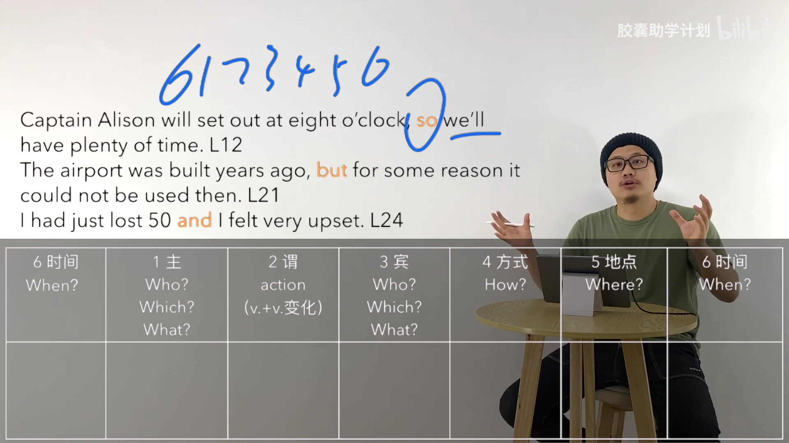

文字识别：胶囊助学计划 / 6173456 / Captain Alison will set out at eight o'clockl sowe'll / have plenty of time. L12 / The airport was built years ago, but for some reason it / could not be used then. L21 / I had just lost 50 and I felt very upset. L24 / 6时间 / 1主 / 2谓 / 3宾 / 4方式 / 5地点 / 6时间 / When? / Who? / action / Who? / How? / Where? / When? / Which? / (v.+v.变化) / Which? / What? / What?

### 画面 00:04:42

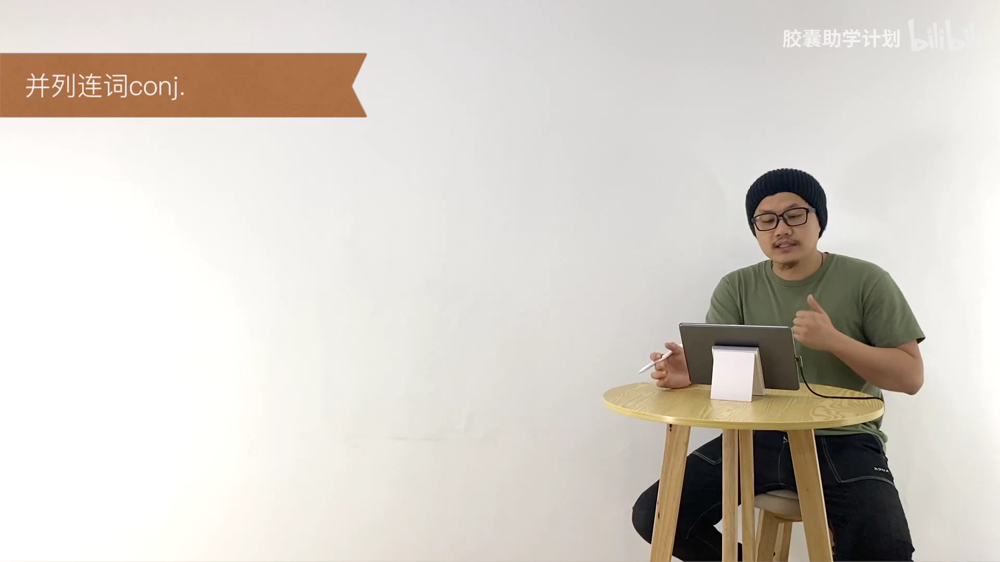

文字识别：胶囊助学计划 / 并列连词conj.

### 画面 00:04:51

文字识别：胶囊助学计划 / 并列连词conj.

## 00:05:00–00:05:30

它至少能连接两个句子啊，我们管它叫并列连词啊，当然也可以连接两个单词，对吧？You and me, OK啊。那我们先看一下我们比较熟悉的第一排，叫做 and, but, or, so，这都是我们见过的，甚至我们在新一就见过了。And 有很多的关系，最基本的意思就是和。But 但是，or 或者，so 所以。第二组呢，是我们今天可能新见到的，但不是说这些单词你以前没见过啊。比如

### 画面 00:05:06

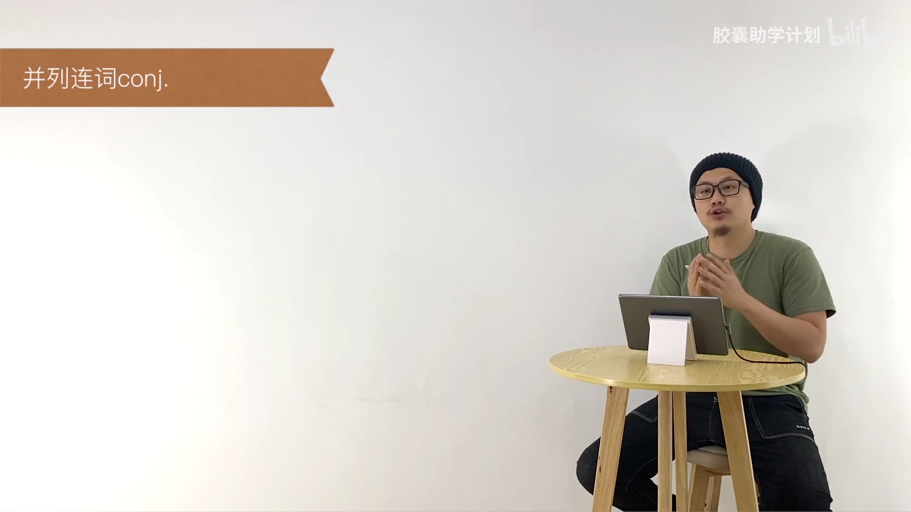

文字识别：胶囊助学计划 / 并列连词conj.

### 画面 00:05:24

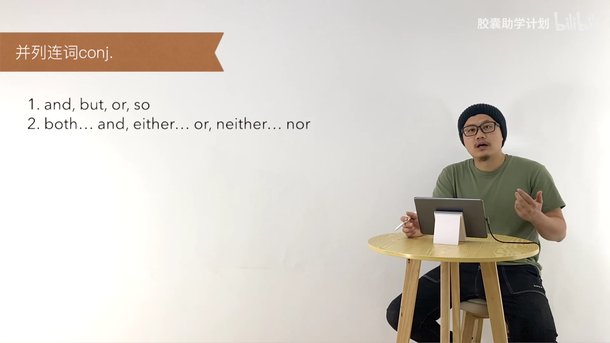

文字识别：胶囊助学计划 / 并列连词conj. / 1.and, but, or, so / 2. both... and, either... or, neither... nor

## 00:05:30–00:06:00

说 both and 啊，一会儿我们再讲它什么意思。Either or 或者 either or， neither nor neither nor 都可以，还有两个发音。最后一个 not only but also 或者 not only but 点点点 as well，这是我们今天要讲的连词。当然不是只有这些啊，但我们今天只讲这些。那我们先看第一组 and but or so 这一组是对于各位来说最熟悉的，所以我们不讲太多，我们只讲一个小的点，叫同一主语情况下，主语它不必重

### 画面 00:05:53

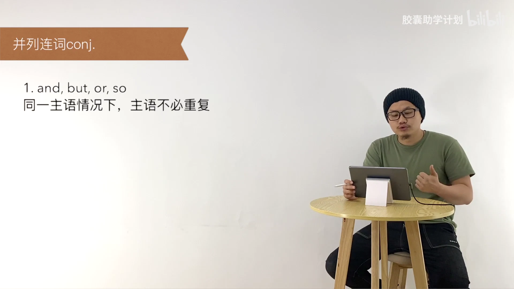

文字识别：胶囊助学计划 / 并列连词conj. / 1.and, but, or, so / 同一主语情况下，主语不必重复

## 00:06:00–00:06:30

复。你看，还是那句话，各位去理解这个东西的时候，千万不要去背它。我非常痛恨大家把这些东西把它背下来，它是不助于你理解的。你要明白它为什么是这样，其实很简单，就是因为人懒啊。我们懒，我们没有必要。我明明告诉你说 he finished lunch，说他吃完了午饭，那接下来我说然后进入了花园，那就没有必要说他吃完了午饭，然后他进入了花园，然后他点了一根烟，然后他喝了杯咖

### 画面 00:06:02

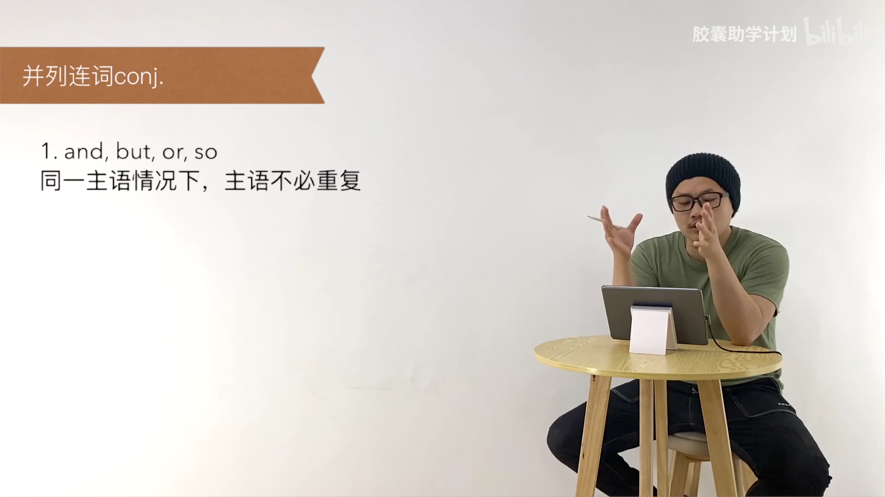

文字识别：胶囊助学计划 / 并列连词conj. / 1.and, but, or, so / 同一主语情况下，主语不必重复

### 画面 00:06:08

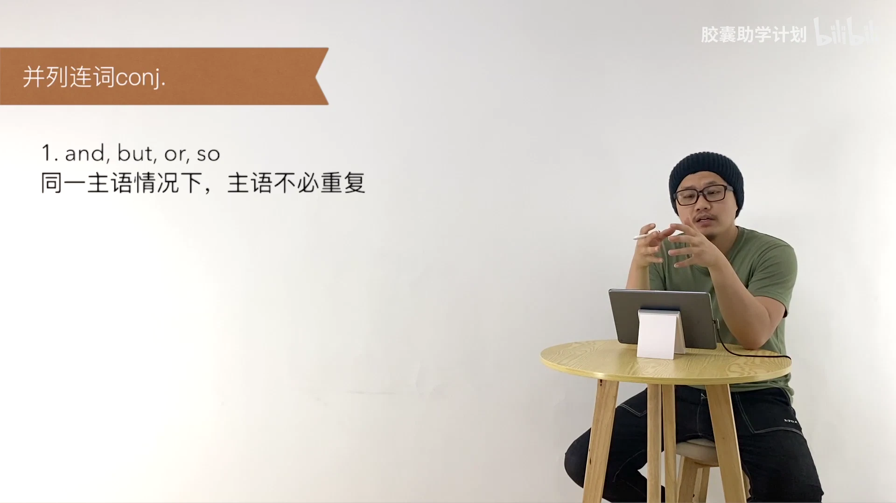

文字识别：胶囊助学计划 / 并列连词conj. / 1.and, but, or, so / 同一主语情况下，主语不必重复

### 画面 00:06:12

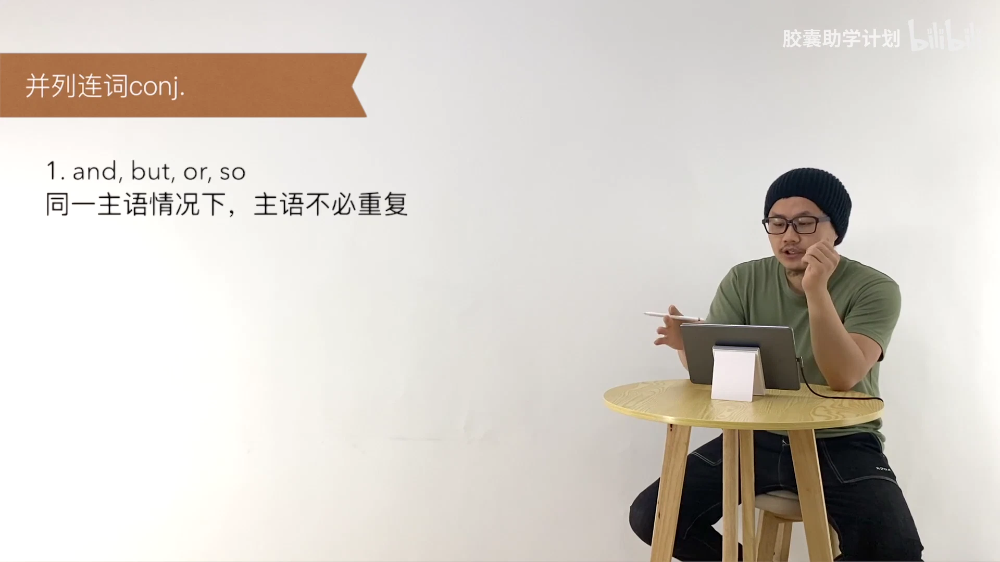

文字识别：胶囊助学计划 / 并列连词conj. / 1.and, but, or, so / 同一主语情况下，主语不必重复

### 画面 00:06:16

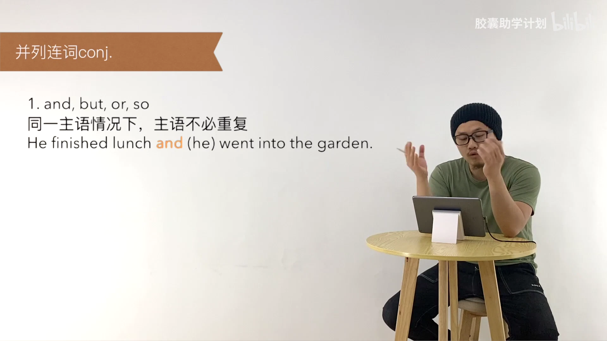

文字识别：胶囊助学计划 / 并列连词conj. / 1.and, but, or, so / 同一主语情况下，主语不必重复 / He finished lunch and (he) went into the garden.

### 画面 00:06:21

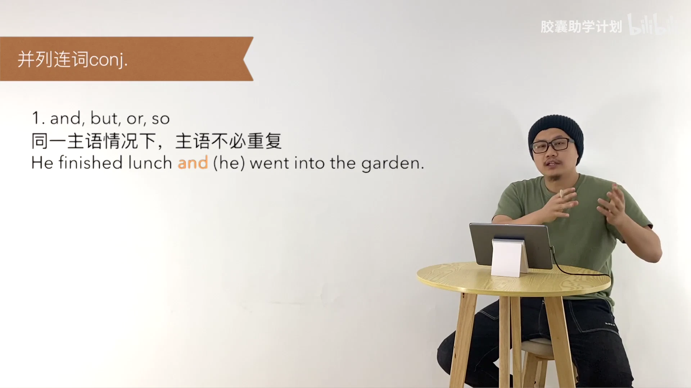

文字识别：胶囊助学计划 / 并列连词conj. / 1.and, but, or, so / 同一主语情况下，主语不必重复 / He finished lunch and (he) went into the garden.

## 00:06:30–00:07:00

啡，就没有必要那么多他，对吧？汉语也是这样的，所以英文在这儿没有任何区别，就是这个 he 您是可以给他省略掉的，这是很容易理解的。那如果不是一个主语，你就不能省略。这个原因也很简单，因为你不知道是谁做的了。你要是给省略，你省略的时候，我默认为是。如果你把 his wife 省略了，比如说 Jim speaks French, but speaks English，你看这

### 画面 00:06:37

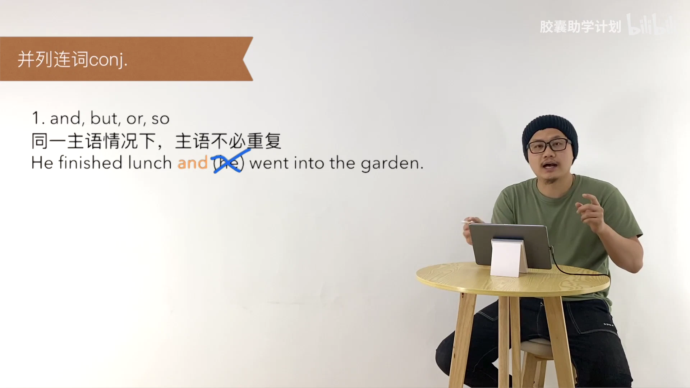

文字识别：胶囊助学计划 / 并列连词conj. / 1.and, but, or, so / 同一主语情况下，主语不必重复 / He finished lunch and De went into the garden.

### 画面 00:06:42

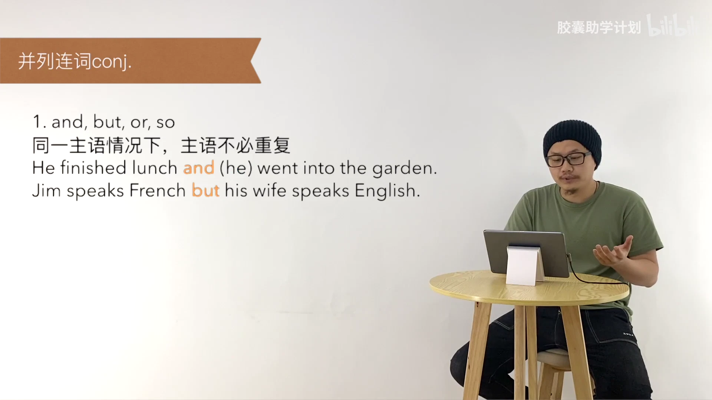

文字识别：胶囊助学计划 / 并列连词conj. / 1.and, but, or, so / 同一主语情况下，主语不必重复 / He finished lunch and (he) went into the garden. / Jim speaks French but his wife speaks English.

### 画面 00:06:49

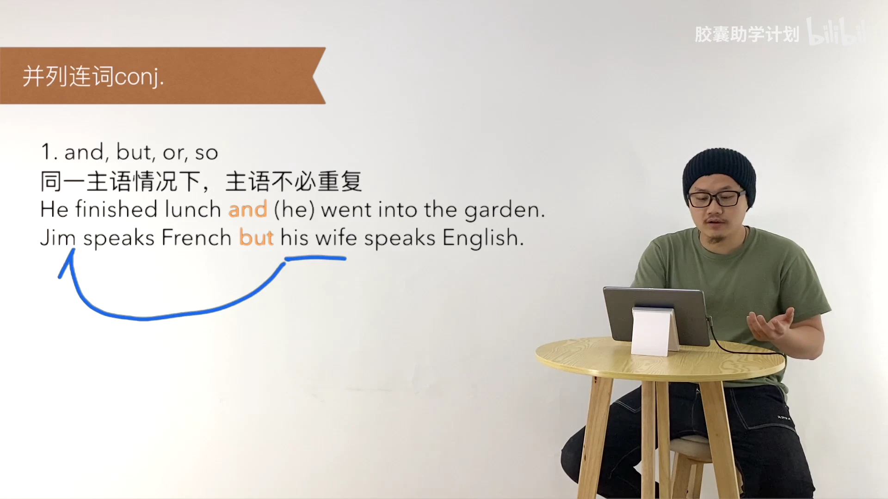

文字识别：胶囊助学计划 / 并列连词conj. / 1.and, but, or, so / 同一主语情况下，主语不必重复 / He finished lunch and (he) went into the garden. / Jim speaks French but his wife speaks English.

### 画面 00:06:51

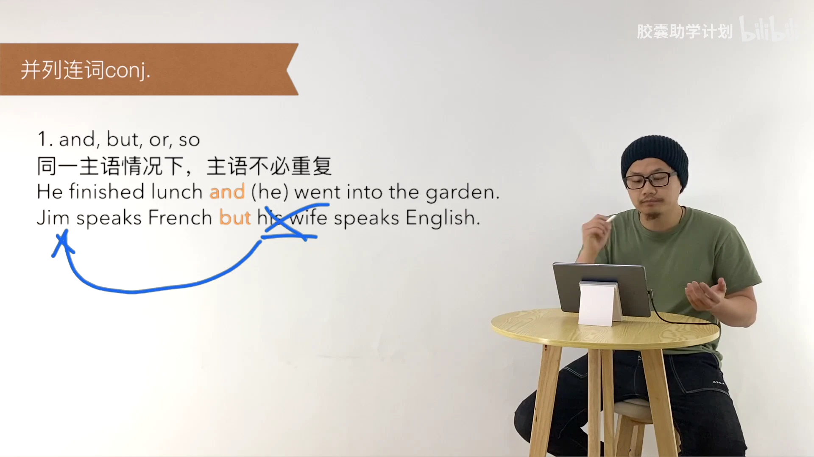

文字识别：胶囊助学计划 / 并列连词conj. / 1.and, but, or, so / 同一主语情况下，主语不必重复 / He finished lunch and (he) went into the garden. / Jim speaks French but h wife speaks English.

### 画面 00:06:54

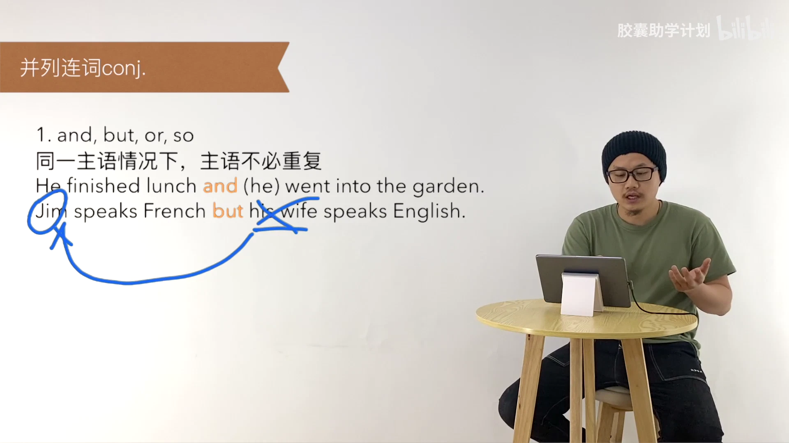

文字识别：胶囊助学计划 / 并列连词conj. / 1.and, but, or, so / 同一主语情况下，主语不必重复 / Hefinished lunch and (he) went into the garden. / speaks French but h) wife speaks English. / Jin

## 00:07:00–00:07:30

句话让人感觉听上去就很怪。说他说Jim啊说法语，后边那句话本来主语应该是his wife，但你现在把his wife省略，别人默认为这里面没出现第三第二个人了，对吧？一定默认为Jim就是主语。所以他说的叫他的对方的理解啊，可能说Jim会说法语，但是他说英语，这个也不构成递进呐。各位能理解这个意思啊？所以该省略主语重复，您就省略；不重复就不省略。这其实是一个人类沟

### 画面 00:07:13

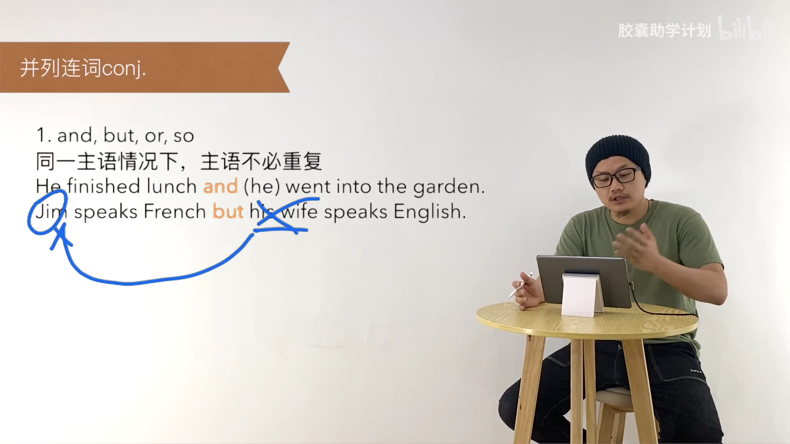

文字识别：胶囊助学计划 / 并列连词conj. / 1.and, but, or, so / 同一主语情况下，主语不必重复 / Hefinished lunch and (he) went into the garden. / Jin / speaks French but h) wife speaks English.

## 00:07:30–00:08:00

通的基本逻辑，这跟英语语言本身是我看来没有本质上太大的影响的啊，太大的关系的，好吧？就汉语也这样啊。好，那接下来我们看第二组，叫 both and either or neither nor。这三组不是特别的难啊，就除了最后一个 neither nor 稍微难一点点啊。那我们先看一下，比如说 both and，我们先讲 both and。Both Leo and his girlfriend说Leo和他的女朋友啊

### 画面 00:07:39

文字识别：胶囊助学计划 / 并列连词conj.

### 画面 00:07:50

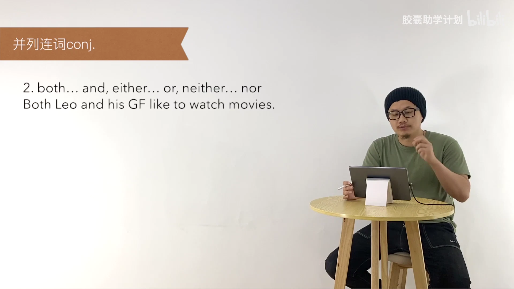

文字识别：胶囊助学计划 / 并列连词conj. / 2. both... and, either... or, neither... nor / Both Leo and his GF like to watch movies.

### 画面 00:07:52

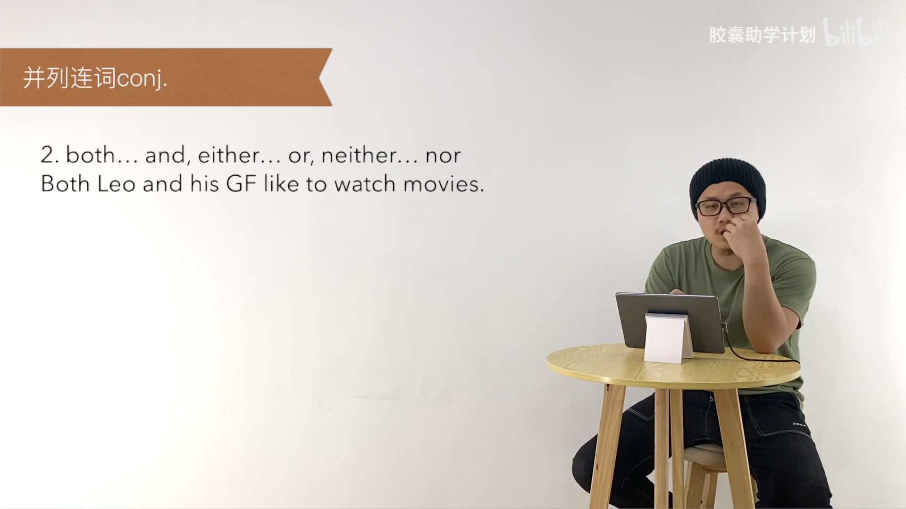

文字识别：胶囊助学计划 / 并列连词conj. / 2. both... and, either... or, neither... nor / Both Leo and his GF like to watch movies.

### 画面 00:07:56

文字识别：胶囊助学计划 / 并列连词conj. / 2. both... and, either... or, neither... nor / Both Leo and his GF like to watch movies.

### 画面 00:07:58

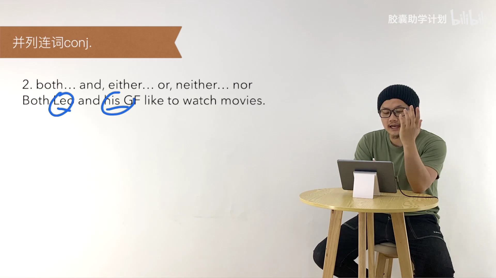

文字识别：胶囊助学计划 / 并列连词conj. / 2. both... and, either... or, neither... nor / Both / andhis GF like to watch movies.

## 00:08:00–00:08:30

like to watch movies，喜欢看电影。然后你各位注意一下，both A and B叫做A和B，所以both各位这个单词我们见过，叫做和或者都，对吧？那both A and B叫A和B都喜欢去怎么怎么样？那我们如果把它拆成两句话，这两句话其实第一句话叫Leo like to watch movies，第二句话叫His girlfriend like to watch movies，

### 画面 00:08:00

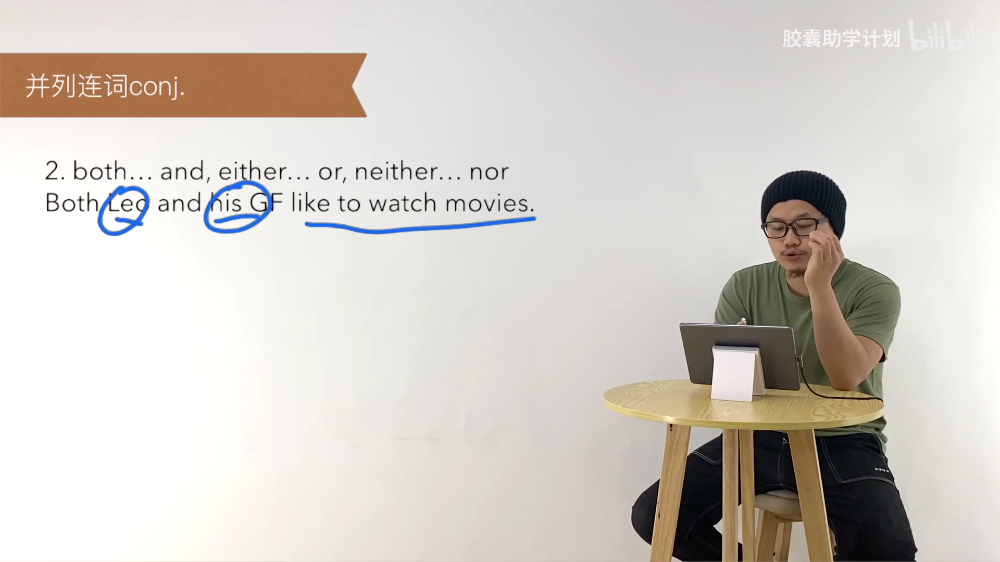

文字识别：胶囊助学计划 / 并列连词conj. / 2. both... and, either... or, neither.. nor / Both / andhis GF like to watch movies.

### 画面 00:08:05

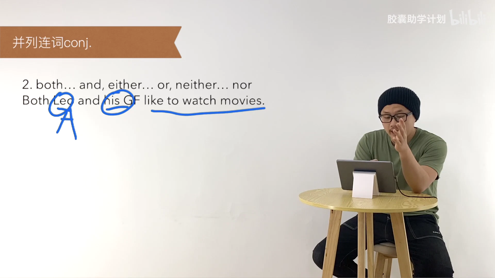

文字识别：胶囊助学计划 / 并列连词conj. / 2. both... and, either... or, neither... nor / Both / Lec / andhis GF like to watch movies.

### 画面 00:08:07

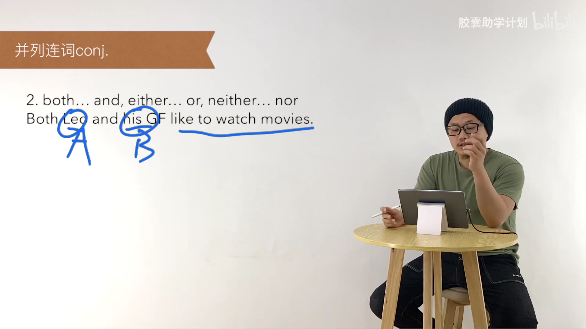

文字识别：胶囊助学计划 / 并列连词conj. / 2. both... and, either... or, neither... nor / BothLeo / andhis GF like to watch movies.

### 画面 00:08:10

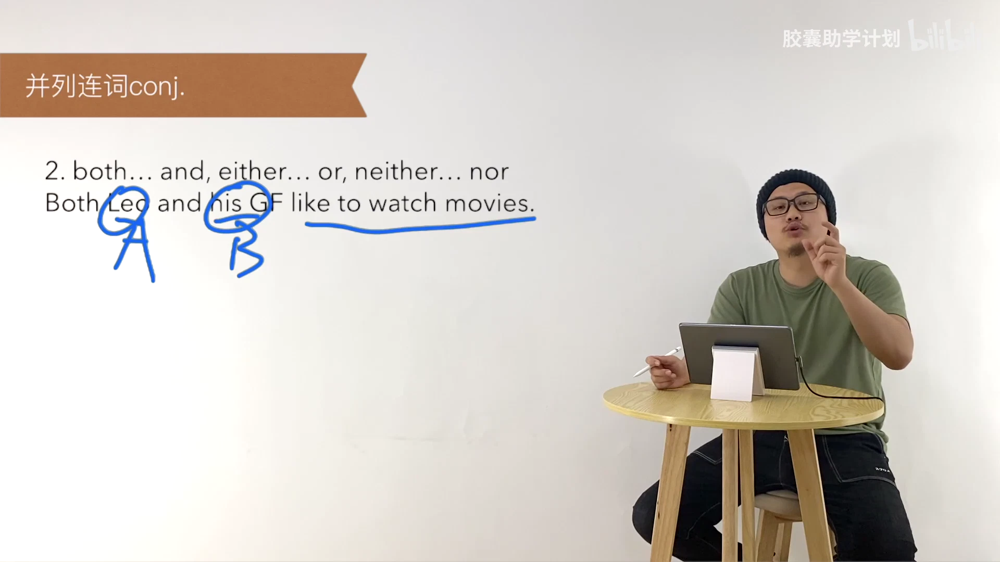

文字识别：胶囊助学计划 / 并列连词conj. / 2. both... and, either... or, neither... nor / BothLeo / andhis GF like to watch movies.

### 画面 00:08:19

文字识别：胶囊助学计划 / 并列连词conj. / 2. both... and, either... or, neither... nor / Both / andhis GF like to watch movies.

### 画面 00:08:21

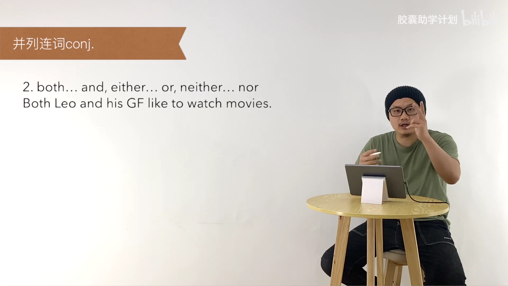

文字识别：胶囊助学计划 / 并列连词conj. / 2. both... and, either... or, neither... nor / Both Leo and his GF like to watch movies.

### 画面 00:08:26

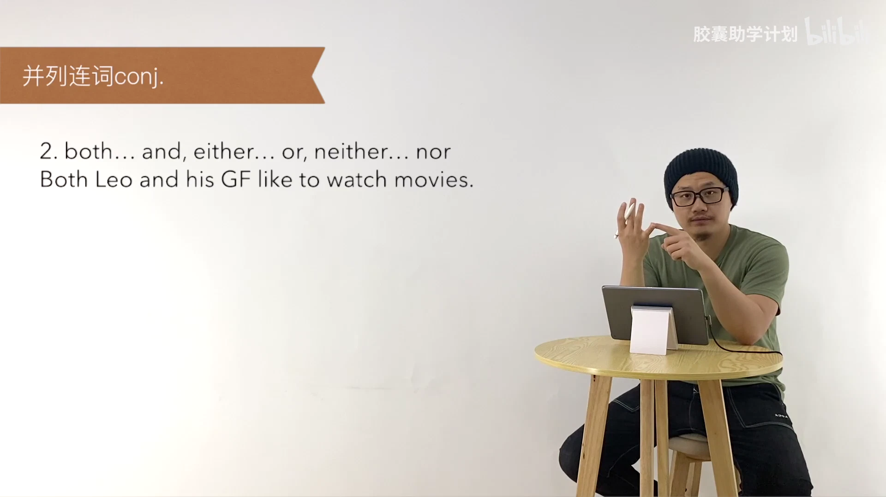

文字识别：胶囊助学计划 / 并列连词conj. / 2. both... and, either... or, neither... nor / Both Leo and his GF like to watch movies.

## 00:08:30–00:09:00

她喜欢看电影。她女朋友喜欢看电影。这明显一听喜欢看电影是一样的，所以我们汉语也会不自觉的把它变成 Lily 和她女朋友喜欢看电影，能理解哈？ Okay, continue. 比如说，Both my wife and I are going to Paris. 说我媳妇儿和我啊，我老婆和我都要去这么一个地方。你看，Are going to. 注意，Both A and B 两个人，所以后边用的是 Are going to Paris. 那在这儿连的六一

### 画面 00:08:47

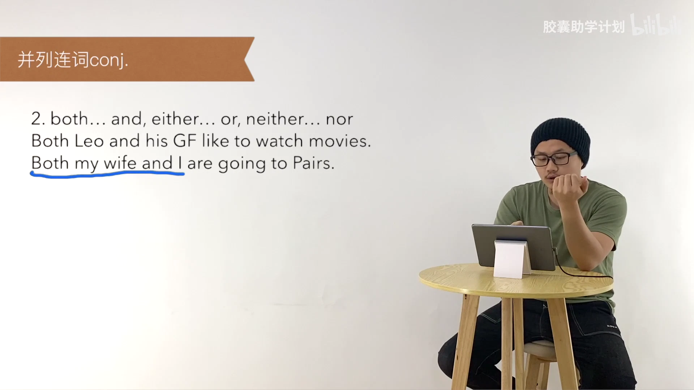

文字识别：胶囊助学计划 / 并列连词conj. / 2. both... and, either... or, neither...nor / Both Leo and his GF like to watch movies. / Both my wife and I are going to Pairs.

### 画面 00:08:49

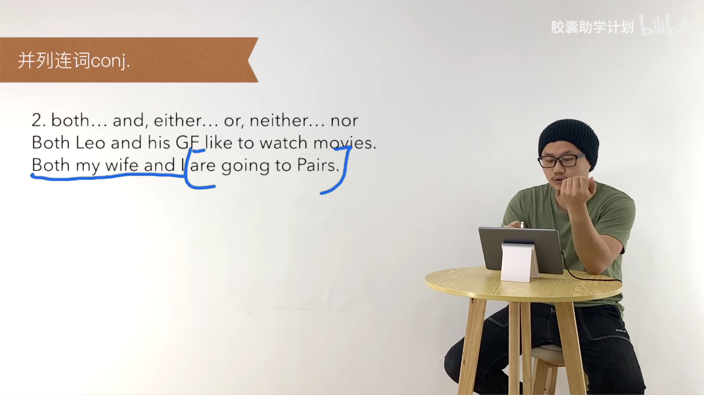

文字识别：胶囊助学计划 / 并列连词conj. / 2. both... and, either... or, neither.. nor / Both Leo and his GElike to watch moyjes. / Both my wife and !are going to Pairs.

## 00:09:00–00:09:30

二三四五六是谁呢？其实各位能理解，他连的就是主语。把两句话除了主语不同，剩下都相同，所以把这两句话并成了一句话，用的是both and，对吧？这是连主语。那看下一句话说，He can both sing and dance。说他能唱，然后跳，对吧？他既能唱又能跳，就是他能唱能跳。这个你看，我们再把它拆回来，两句话叫He can sing句号，He

### 画面 00:09:19

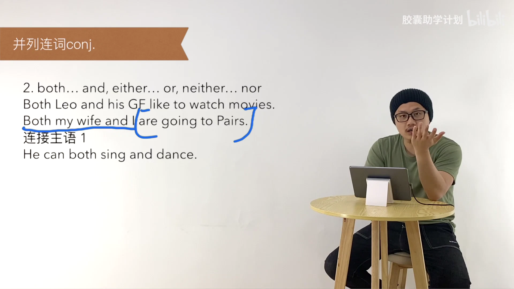

文字识别：胶囊助学计划 / 并列连词conj. / 2. both... and, either... or, neither... nor / Both Leo and his GElike to watch moyies. / Both my wife and !are going to Pairs. / 连接主语1 / He can both sing and dance.

## 00:09:30–00:10:00

can dance,句号.你看 he 和 can 是一样的，我们自然而然就把它能变成叫 he can sing and dance.只不过我们在这多加了个 both嘛，对吧？Both A and B.你说我把 both 去掉，我直接说 he can sing and dance 行不行呢？是可以的，只不过我们现在在不是教你 both A and B，对吧？那在这儿连的是谁呢？连的，你可以理解为就是谓语，就是六二三四五六里边那个二。OK，再来说 I can speak both English and German.啊，我既能说，

### 画面 00:09:40

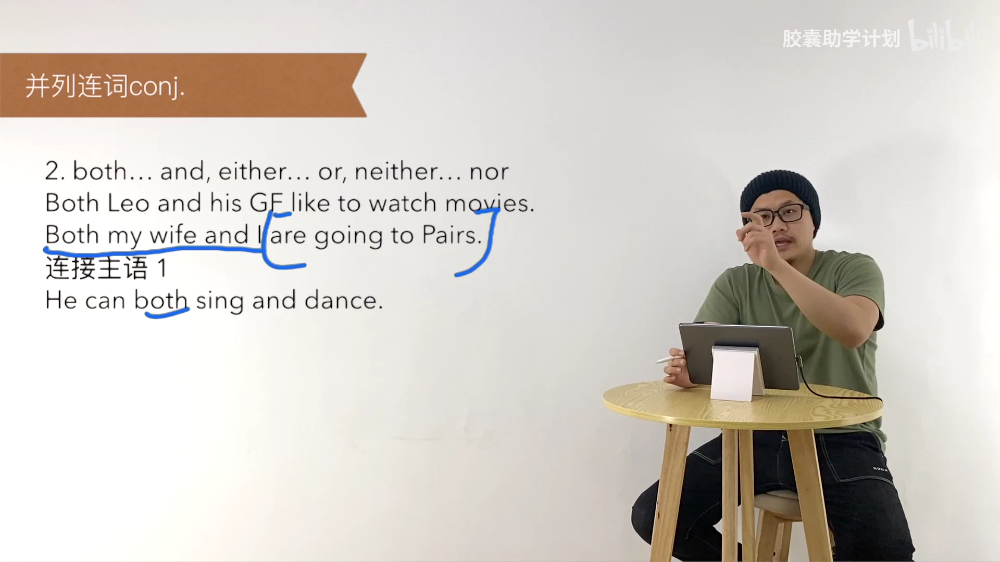

文字识别：胶囊助学计划 / 并列连词conj. / 2. both... and, either... or, neither...nor / Both Leo and his GElike to watch moyies. / Both my wife and !are going to Pairs. / 连接主语1 / He can both sing and dance.

### 画面 00:09:56

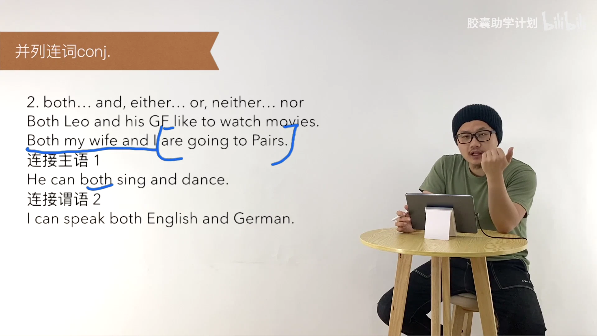

文字识别：胶囊助学计划 / 并列连词conj. / 2. both... and, either... or, neither... nor / Both Leo and his GE like to watch moyjes. / Both my wife and !are going to Pairs. / 连接主语1 / He can both sing and dance. / 连接谓语2 / I can speak both English and German.

## 00:10:00–00:10:30

哎，我能说英文，我也能说啊德语啊，which language是吧？我也能说德语。然后呢，注意这个地方，它就是连接了一个宾语，对吧？你看主语是相同的，哎，谓语 can speak 是一样的，只是宾语里面是 English and German，所以我们用 both and 给它连起来。各位能看到，它不是啊，在这儿我们给大家举的例子是能连接一二三，它不是只能连接一二三，它也能连接四五六啊，只是我们在这儿不用出现

### 画面 00:10:01

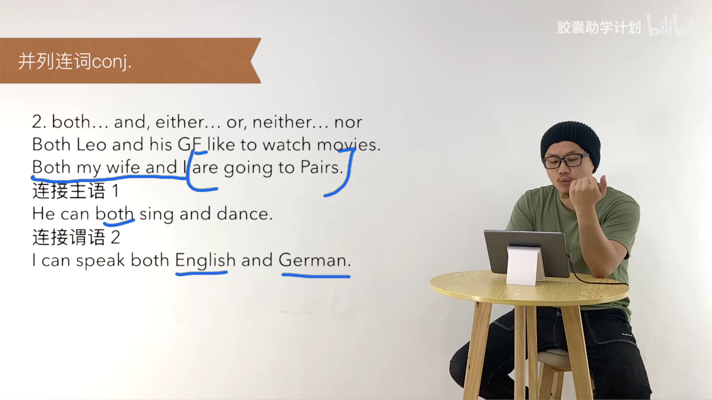

文字识别：胶囊助学计划 / 并列连词conj. / 2. both... and, either... or, neither... nor / Both Leo and his GElike to watch moyjes. / Both my wife and !are going to Pairs. / 连接主语1 / He can both sing and dance. / 连接谓语2 / I can speak both English and German.

### 画面 00:10:05

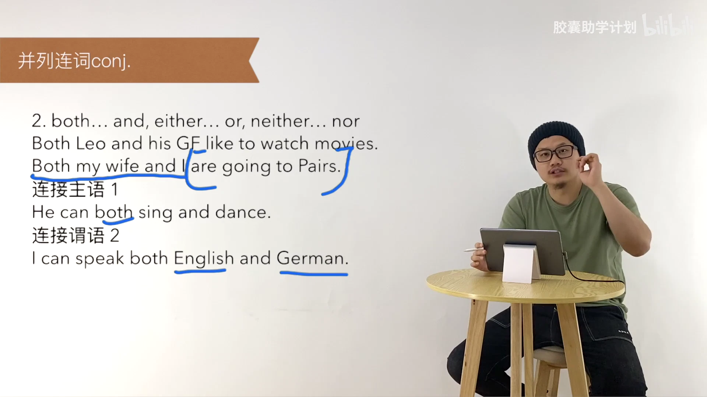

文字识别：胶囊助学计划 / 并列连词conj. / 2. both... and, either... or, neither... nor / Both Leo and his GE like to watch moyies. / Both my wife and Iare going to Pairs. / 连接主语1 / He can both sing and dance. / 连接谓语2 / I can speak both English and German.

## 00:10:30–00:11:00

一二三年会了，四五六触类旁通，怎么也会了，对不对？OK，接下来我们再看下一组，either or这一组就稍有不同了。我们看一下，首先告诉各位，either or的意思，您在笔记本当中记一下，叫要么A，要么B，二选一。要么老师，要么学生，错了。您看这个地方就有一个问题，叫这个地方我M S R应该用谁？M肯定取消

### 画面 00:10:34

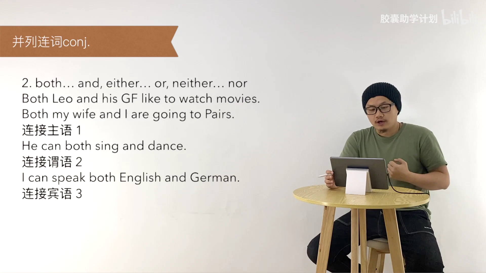

文字识别：胶囊助学计划 / 并列连词conj. / 2. both... and, either... or, neither... nor / Both Leo and his GF like to watch movies. / Both my wife and I are going to Pairs. / 连接主语1 / He can both sing and dance. / 连接谓语2 / I can speak both English and German. / 连接宾语3

### 画面 00:10:36

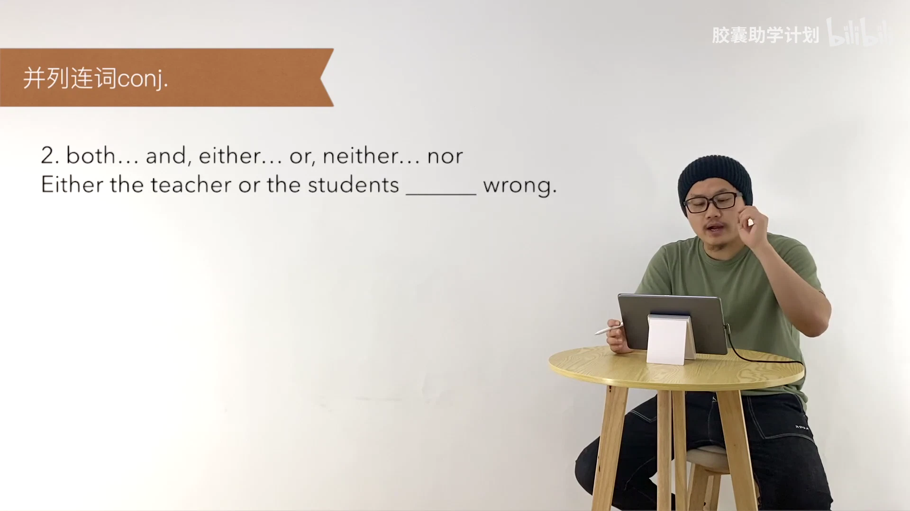

文字识别：胶囊助学计划 / 并列连词conj. / 2. both... and, either... or, neither... nor / Either the teacher or the students / wrong.

### 画面 00:10:39

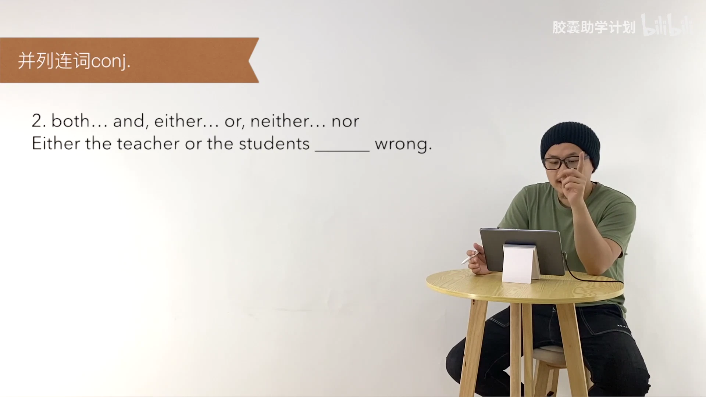

文字识别：胶囊助学计划 / 并列连词conj. / 2. both.. and, either... or, neither...nor / Either the teacher or the students / wrong.

### 画面 00:10:43

文字识别：胶囊助学计划 / 并列连词conj. / 2. both... and, either... or, neither...nor / Either the teacher or the students / wrong.

### 画面 00:10:48

文字识别：胶囊助学计划 / 并列连词conj. / 2. beth... and, either... or, neither...nor / Eitherthe teacher or the students / wrong.

### 画面 00:10:50

文字识别：胶囊助学计划 / 并列连词conj. / 2. bath... and, either.  / or, neither... nor / Eitherthe teacheror the students / wrong.

### 画面 00:10:52

文字识别：胶囊助学计划 / 并列连词conj. / 2. bath... and, either / or, neither... nor / Eitherthe teacheror the students / wrong.

### 画面 00:10:56

文字识别：胶囊助学计划 / 并列连词conj. / 2. bath... and, either / or, neither... nor / Eitherthe teacheror the students / wrong.

## 00:11:00–00:11:30

了，对吧？在这儿我是用单数用复数呢。这个地方英文就有一个比较诡异的啊，或者说人家自己英文习惯是这个样子。当你去连这个主语的时候，你要取决于一个就近原则，就是这个地方是单数还是复数取决于离它最近的那个主语，不取决于离它远的那个主语。离它远的那个主语叫做the teacher，离它近的那个主语叫做the students，对吧？这个地方我注意一下，因

### 画面 00:11:01

文字识别：胶囊助学计划 / 并列连词conj. / 2. bath... and, either / or, neither... nor / Eitherthe teache or the students / wrong.

### 画面 00:11:05

文字识别：胶囊助学计划 / 并列连词conj. / 2. bath... and, either. / or, neither... nor / Eitherthe teacheor the students / wrong. / 连接主语1:v.就达致(are)

### 画面 00:11:07

文字识别：胶囊助学计划 / 并列连词conj. / 2. bath... and, either. / or, neither... nor / Eitherthe teacheror the students / wrong. / 连接主语1:v.就达致(are)

### 画面 00:11:09

文字识别：胶囊助学计划 / 并列连词conj. / 2. both... and, either... or, neither... nor / Either the teacher or the students / wrong. / 连接主语1: v.就近一致(are)

### 画面 00:11:11

文字识别：胶囊助学计划 / 并列连词conj. / 2. both... and, either... or, neither...nor / Either the teacher or the students / wrong. / 连接主语 1: v.就近一致(are)

### 画面 00:11:16

文字识别：胶囊助学计划 / 并列连词conj. / 2. both... and, either... or, neither... nor / Either the teacher or the students / wrong. / 连接主语 1: v.就近一致(are)

### 画面 00:11:19

文字识别：胶囊助学计划 / 并列连词conj. / 2. both... and, either... or, neither... nor / Either the teacher or the students / wrong. / 连接主语1：v.就近一致(are)

### 画面 00:11:21

文字识别：胶囊助学计划 / 并列连词conj. / 2. both... and/either... or, neither... nor / Either the teacher or the students / wrong. / 连接主语1： v.就近一致(are)

### 画面 00:11:23

文字识别：胶囊助学计划 / 并列连词conj. / 2. both... andLeither. or, neither... nor / Either the teacher or the students / wrong. / 连接主语1:v.就近一致(are)

### 画面 00:11:26

文字识别：胶囊助学计划 / 并列连词conj. / 2. both... andeither... or, neither... nor / Either the teacher or the students / wrong. / 连接主语1:v.就近一致(are)

## 00:11:30–00:12:00

为我意识到有很多我们的这个网课的学员啊，你们可能任务是要在学校要参加考试的，所以我提一下，如果你是为了参加考试，那这一定是一个关键的考点，您一定要把它记下来，也非常的简单，就是记住 either A or B 就近原则，这个地方是单数还是复数，看离它近的那个主语就可以了。这是 students，所以后边就是二。如果你不是为了任何的考试，对吧？你就是生活当

### 画面 00:11:31

文字识别：胶囊助学计划 / 并列连词conj. / 2. both... andLeither. or, neither... nor / Either the teacher or the students / wrong. / 连接主语1:v.就近一致(are)

### 画面 00:11:35

文字识别：胶囊助学计划 / 并列连词conj. / 2. both...andLeither. or, neither... nor / Either the teacher or the students / wrong. / 连接主语1:v.就近一致(are)

### 画面 00:11:46

文字识别：胶囊助学计划 / 并列连词conj. / 2.both...and / ither... or, neither... nor / Either the teacher or the students / wrong. / 连接主语1: v.就近一致(are)

### 画面 00:11:48

文字识别：胶囊助学计划 / 并列连词conj. / 2.both...and / ither... or, neither... nor / Either the teacher or the students / wrong. / 连接主语1：v.就近一致(are)

### 画面 00:11:50

文字识别：胶囊助学计划 / 并列连词conj. / 2.both...and / ither... or, neither...nor / Either the teacher or the students / wrong. / 连接主语1： v.就近一致(are)

## 00:12:00–00:12:30

中实际的一个应用。这个地方呢，我个人觉得你倒是不用太过于紧张。这样的小的细节呢，不用太过于紧张。偶尔您犯错了，在大多数情况下可能是无伤大雅的。OK啊，我只是提这样一个思路啊，您自己去想，对吧？接下来说的，When the girl is happy，当她开心的时候，she either sings or dances，是吧？她要么唱，要么跳，跟刚才一样，对吧？这是连的还是谓语？这就不存

### 画面 00:12:15

文字识别：胶囊助学计划 / 并列连词conj. / ither... or, neither...no / 2.both...and / Either the teacher or the students / wrong. / 连接主语1：v.就近一致(are)

### 画面 00:12:18

文字识别：胶囊助学计划 / 并列连词conj. / 2.both...and / either... or, neither...noy / Either the teacher or the students / wrong. / 连接主语1：v.就近一致(are) / When the girl is happy, she either sings or dances.

### 画面 00:12:23

文字识别：胶囊助学计划 / 并列连词conj. / 2.both...and / either.. or, neither...noy / Either the teacher or the students / wrong. / 连接主语1： v.就近一致(are) / When the girl is happy, she either sings or dances.

### 画面 00:12:25

文字识别：胶囊助学计划 / 并列连词conj. / 2.both...and / either... or, neither... noy / Either the teacher or the students / wrong. / 连接主语1：v.就近一致(are) / 个 / When the girl is happy, she either sings or dances.

## 00:12:30–00:13:00

在什么主谓一致啊，不存在就近原则这个概念了。再然后再来一个句子说，I want either this red one or that green one。我要么要这个红的，要么要那个绿的，要么A，要么B，对吧？哎，要么给我这红的，你要么给我那绿的，反正得给我一个，二选其一都可以。这连的绝对就是宾语了。同理，我们在这儿只告诉各位，它能连一二三，也能连四五六。OK，那接下来呢，我们看一个小的电影片段，

### 画面 00:12:35

文字识别：胶囊助学计划 / 并列连词conj. / 2.both...and / Zither... or, neither... noy / Either the teacher or the students / wrong. / 连接主语1：v.就近一致(are) / N / When the girl is happy, she either sings or dances. / 连接谓语2 / I want either this red one or that green one.

### 画面 00:12:37

文字识别：胶囊助学计划 / 并列连词conj. / 2.both...and / Zeither... or, neither... noy / Either the teacher or the students / wrong. / 连接主语1：v.就近一致(are) / When the girl is happy, she either sings or dances. / 连接谓语2 / I want either this red oneo / that green one.

### 画面 00:12:39

文字识别：胶囊助学计划 / 并列连词conj. / 2.both...and / Zither... or, neither... noy / Either the teacher or the students / wrong. / 连接主语1：v.就近一致(are) / When the girl is happy, she either sings or dances. / 连接谓语2 / I want either this red one o / that green one.

### 画面 00:12:57

文字识别：either...or... / 胶囊助学计划 / 蝙蝠侠：黑暗骑士 / The Dark Knight / (2008)

## 00:13:00–00:13:30

这个蝙蝠侠黑暗骑士，对吧？这个电影当中，它就用到了叫做 either A or B，啊，说要么你这个呃成为一个英雄，我记得好像是，要么就是活的足够长，然后堕落成一个坏人啊。那我们先注意力集中，因为他说的确实比较快啊。如果您第一遍没听清，不妨可以再回来看一遍。OK，那注意力集中来了。Appointed the Batman. We did. All of us who stood by and let

### 画面 00:13:00

文字识别：either...or... / 胶囊助学计划 / 蝙蝠侠：黑暗骑士 / The Dark Knight / (2008)

### 画面 00:13:26

文字识别：either...or... / 胶囊助学计划 / 蝙蝠侠：黑暗骑士 / The Dark Knight / 谁给蝙蝠侠的权力？ / (2008) / Who appointed the Batman?

### 画面 00:13:28

文字识别：either...or... / 胶囊助学计划 / 蝙蝠侠：黑暗骑士 / The Dark Knight / 我们给的，我们这些看着恶人肆意横行坐视不管的人 / (2008) / We did. All of us who stood by and let scum take control of our city.

## 00:13:30–00:14:00

scum take control of our city. But this is a democracy, Harvey. When their enemies were at the gates, the Romans would suspend democracy and appoint one man to protect the city. And it wasn't considered an honor; it was considered a public service. Harvey, the last man that they appointed to protect the republic was named Caesar, and he never gave up his power. Okay, fine. You either die a hero, or you live long enough to see yourself become the villain. Okay,啊，那这边我看清了，说You you either die a hero,要么你

### 画面 00:13:30

文字识别：either...or... / 胶囊助学计划 / 蝙蝠侠：黑暗骑士 / The Dark Knight / 我们给的，我们这些看着恶人肆意横行坐视不管的人 / (2008) / We did. Allof us who stood by and let scum take control of our city.

### 画面 00:13:32

文字识别：either...or... / 胶囊助学计划 / 蝙蝠侠：黑暗骑士 / The Dark Knight / 但是我们讲的是民主，哈维 / (2008) / But this isa democracy.Harvey.

### 画面 00:13:34

文字识别：either...or... / 胶囊助学计划 / 蝙蝠侠：黑暗骑士 / The Dark Knight / 当敌军兵临城下的时候 / (2008) / When their enemies were at the gates.

### 画面 00:13:36

文字识别：either...or... / 胶囊助学计划 / 蝙蝠侠：黑暗骑士 / The Dark Knight / 罗马人就不讲什么民主了而是希望有人能力挽狂澜 / (2008) / .the Romans would suspend democracy and appoint one man to protect the city.

### 画面 00:13:38

文字识别：either...or... / 胶囊助学计划 / 蝙蝠侠：黑暗骑士 / The Dark Knight / 罗马人就不讲什么民主了而是希望有人能力挽狂澜 / (2008) / .the Romans would suspend democracy and appoint one man to protect the city.

### 画面 00:13:40

文字识别：either...or... / 胶囊助学计划 / 蝙蝠侠：黑暗骑士 / The Dark Knight / 那绝不是图什么虚名而是救民于水火 / (2008) / It wasn't considered an honor, it was a public service.

### 画面 00:13:42

文字识别：either...or... / 胶囊助学计划 / 蝙蝠侠：黑暗骑士 / The DarkKnight / 哈维，他们保护共和的… / (2008) / Harvey, the last man that they appointed.

### 画面 00:13:44

文字识别：either...or... / 胶囊助学计划 / 蝙蝠侠：黑暗骑士 / The Dark Knight / 最后人选，就是凯撒 / (2008) / .to protect the republic was named Caesar.

### 画面 00:13:46

文字识别：either...or... / 胶囊助学计划 / 蝙蝠侠：黑暗骑士 / The Dark Knight / 结果他变成了独裁家那好 / (2008) / and he never gave up his power.-Okay.fine.

### 画面 00:13:48

文字识别：either...or... / 胶囊助学计划 / 蝙蝠侠：黑暗骑士 / The Dark Knight / 结果他变成了独裁家那好 / (2008) / and he never gave up his power.-Okay.fine.

### 画面 00:13:50

文字识别：either...or... / 胶囊助学计划 / 蝙蝠侠：黑暗骑士 / The Dark Knight / 要么舍生取义… / (2008) / You either die a hero.

### 画面 00:13:52

文字识别：either...or... / 胶囊助学计划 / 蝙蝠侠：黑暗骑士 / The Dark Knight / 要么长生久视坐等与恶人为伍 / (2008) / oryou live long enough to see yourself become the villain.

### 画面 00:13:54

文字识别：either...or... / 胶囊助学计划 / 蝙蝠侠：黑暗骑士 / The Dark Knight / 要么长生久视坐等与恶人为伍 / (2008) / oryou live long enough to see yourself become the villain.

### 画面 00:13:56

文字识别：either...or... / 胶囊助学计划 / 蝙蝠侠：黑暗骑士 / The Dark Knight / (2008)

## 00:14:00–00:14:30

死变成一个英雄啊, or live live long enough to become a villain, something like this啊, 就是你活得足够久, 然后变成一个坏人. Okay, either or, either or, 发音都OK的啊. 接下来我们继续看, 刚才讲完了 both A and B, either A or A or B. 接下来我们要看最后一个叫 neither A nor B, 它的翻译方式叫做既不是A也不是B, 有点像

### 画面 00:14:14

文字识别：胶囊助学计划 / 并列连词conj.

### 画面 00:14:16

文字识别：胶囊助学计划 / 并列连词conj. / 2. both... and, either... Or, neither... nor

### 画面 00:14:21

文字识别：胶囊助学计划 / 并列连词conj. / 2. both... and, either... or,/neither... nor

### 画面 00:14:24

文字识别：胶囊助学计划 / 并列连词conj. / 2. both... and, either... or,/neither...nor

## 00:14:30–00:15:00

both and 的否定，叫 A 和 B 都没怎么怎么样。OK，那接下来我们先看这个啊，叫做 neither dad nor mom，叫做既不是妈妈也不是爸爸啊，就爸爸和妈妈都没有怎么怎么样，都没有怎么样的 at home today，都没有在家。注意这儿就重点来了，你看，按说他们都没有在家，那我这是一个复数，对不对？注意还是那句话，英文的习惯，我们要我们学习的是英文啊，

### 画面 00:14:30

文字识别：胶囊助学计划 / 并列连词conj. / 2. both... and, either... or,/neither...nor

### 画面 00:14:35

文字识别：胶囊助学计划 / 并列连词conj. / 2. both... and, either... or,/hneither...nor / Neither dad nor mum / _Gt home today

### 画面 00:14:37

文字识别：胶囊助学计划 / 并列连词conj. / 2. both... and, either... or, neither.. nor / Neither dad nor mum / _at home today.

### 画面 00:14:41

文字识别：胶囊助学计划 / 并列连词conj. / 2. both... and, either... or, neither... nor / Neither dad nor mum / _at home today.

### 画面 00:14:43

文字识别：胶囊助学计划 / 并列连词conj. / 2. both... and, either... or, neither... nor / Neither dad nor mum / at home today.

### 画面 00:14:47

文字识别：胶囊助学计划 / 并列连词conj. / 2. both... and, either... or, neither... nor / Neither dad nor mum / at home today.

### 画面 00:14:55

文字识别：胶囊助学计划 / 并列连词conj. / 2. both... and, either... or, neither... nor / Neither dad nor mum / at home today.

### 画面 00:14:59

文字识别：胶囊助学计划 / 并列连词conj. / 2. both... and, either... or, neither... nor / Neither dad nor mum / at home today. / 连结主语T：v.就近原则(is)

## 00:15:00–00:15:30

在人家的地盘就要尊重人家的这个规则。他们的规则就是在这儿要用就近原则。有两个主语A和B，就看谁离他近，离他近的是Mom而不是Mouse，对吧？所以在这个地方，您在这儿加的就是Is at home，既不是妈妈也不是爸爸今天在家，就是爸爸和妈妈都没在家。OK，好理解哈。他们连接主语。接下来我们再看说，When the girl is sad, she neither sings nor dances.

### 画面 00:15:01

文字识别：胶囊助学计划 / 并列连词conj. / 2. both... and, either... or, neither... nor / Neither dad nor mum / at home today. / 连结主语1：v.就近原则(is)

### 画面 00:15:07

文字识别：胶囊助学计划 / 并列连词conj. / 2. both... and, either... or, neither... nor / Neither dad nor mum / at home today. / 连结主语1：v.就近原则(is)

### 画面 00:15:09

文字识别：胶囊助学计划 / 并列连词conj. / Neither dad nor mum / at home today. / 连结主语1：v.就近原则(is)

### 画面 00:15:11

文字识别：胶囊助学计划 / 并列连词conj. / B6 / Neither dad nor mum / at home today. / 连结主语1：v.就近原则(is)

### 画面 00:15:23

文字识别：胶囊助学计划 / 并列连词conj. / B6 / Neither dad nor mum / at home today. / 连结主语1：v.就近原则 (is) / When the boy is sad, he neither sings nor dances.

## 00:15:30–00:16:00

他既不唱歌又不跳舞. There you go. 很简单，这是连接谓语，跟刚才 both and either or 就没有结构上的区别，只有含义上的区别。再来说，I want neither this one nor that one. 你看他这句话跟汉语稍有不同。我们如果一个单词一个单词翻译，你会觉得有点怪，叫我想要既不是这个也不是那个。我想要既不是这个也不是那个。哦，你别说了，这么翻译好像再加点字儿也行。就

### 画面 00:15:30

文字识别：胶囊助学计划 / 并列连词conj. / Neither dad nor mum / at home today. / 连结主语1：v.就近原则(is) / When the boy is sad, he neither sings nor dances.

### 画面 00:15:32

文字识别：胶囊助学计划 / 并列连词conj. / Neither dad nor mum / at home today. / 连结主语1：v.就近原则(is) / When the boy is sad, he neither / rsingg / nor / dances.

### 画面 00:15:40

文字识别：胶囊助学计划 / 并列连词conj. / B / Neither dad nor mum / at home today. / 连结主语1：v.就近原则(is) / When the boy is sad, he neither / rsinggnor / dances. / 连接谓语2

### 画面 00:15:52

文字识别：胶囊助学计划 / 并列连词conj. / 3 / Neither dad nor mum / at home today. / 连结主语1：v.就近原则(is) / When the boy is sad, he neithersinggr / nor / dances. / 连接谓语2 / I want neither this one nor that one.

### 画面 00:15:55

文字识别：胶囊助学计划 / 并列连词conj. / Neither dad nor mum / at home today. / 连结主语1：v.就近原则(is) / When the boy is sad, he neithersinggr / nor / dances. / 连接谓语2 / I want neither this one nor that one.

### 画面 00:15:57

文字识别：胶囊助学计划 / 并列连词conj. / Neither dad nor mum / at home today. / 连结主语1：v.就近原则(is) / When the boy is sad, he neither singg nor / dances. / 连接谓语2 / I want neither this one nor that one.

## 00:16:00–00:16:30

我想要的既不是这个，也不是那个，所以它其实正面去表达叫这两个我都不想要，对吧？所以呢，它连接的是宾语，这很容易理解。主语是一啊，I；谓语是二，want；后面就都是三了，对吧？Neither this one nor that one.完一个。接下来呢，我们看一个还是小电影片段，依旧语速稍微有点快。您可以多看几遍，我们正好在实战当中锻炼我们的听力水平，对

### 画面 00:16:19

文字识别：neither... nor... / 胶囊助学计划 / 怪兽电力公司 / Monsters, Inc. / （小孩危机） / (2001)

### 画面 00:16:21

文字识别：neither... nor... / 胶囊助学计划 / 山 / 怪兽电力公司 / Monsters, Inc. / （小孩危机） / (2001)

### 画面 00:16:23

文字识别：neither... nor... / 胶囊助学计划 / 怪兽电力公司 / Monsters, Inc. / （小孩危机） / (2001)

### 画面 00:16:25

文字识别：neither... nor... / 胶囊助学计划 / 怪兽电力公司 / Monsters,Inc. / （小孩危机） / (2001)

### 画面 00:16:28

文字识别：neither... nor... / 胶囊助学计划 / 4 / 怪兽电力公司 / Monsters, Inc. / （小孩危机） / (2001)

## 00:16:30–00:17:00

吧？哎，他就用的是 neither nor 啊，说既不能这样，也不能那样啊。我们既不能 confirm neither confirm nor deny 啊，也不能否认啊，特别逗的一句话。接下来我们看。

### 画面 00:16:30

文字识别：neither... nor... / 胶囊助学计划 / 食 / 怪兽电力公司 / Monsters, Inc. / （小孩危机） / (2001)

### 画面 00:16:33

文字识别：neither... nor... / 胶囊助学计划 / 怪兽电力公司 / Monsters, Inc. / （小孩危机） / (2001)

### 画面 00:16:35

文字识别：neither... nor... / 胶囊助学计划 / 食 / 怪兽电力公司 / Monsters, Inc. / （小孩危机） / (2001)

### 画面 00:16:37

文字识别：neither... nor... / 胶囊助学计划 / 怪兽电力公司 / Monsters, Inc. / （小孩危机） / (2001)

### 画面 00:16:40

文字识别：neither... nor... / 胶囊助学计划 / 怪兽电力公司 / Monsters, Inc. / （小孩危机） / (2001)

### 画面 00:16:42

文字识别：neither... nor... / 胶囊助学计划 / 怪兽电力公司 / Monsters, Inc. / （小孩危机） / (2001)

### 画面 00:16:44

文字识别：neither... nor... / 胶囊助学计划 / 怪兽电力公司 / Monsters, Inc. / （小孩危机） / (2001)

### 画面 00:16:46

文字识别：neither... nor... / 胶囊助学计划 / 怪兽电力公司 / 如果目击证人说的没错 / Monsters,Inc. / If witnesses are to be believed, there has been a child security breach / (2001)

### 画面 00:16:48

文字识别：neither... nor... / 胶囊助学计划 / 怪兽电力公司 / 人类小孩第一次入侵怪兽城市 / Monsters, Inc. / for the first time in monster history. / (2001)

### 画面 00:16:50

文字识别：neither... nor... / 胶囊助学计划 / 怪兽电力公司 / 人类小孩第一次入侵怪兽城市 / Monsters,Inc. / for the first time in monster history. / (2001)

### 画面 00:16:52

文字识别：neither...nor... / 胶囊助学计划 / 00002 / 怪兽电力公司 / 我不承认也不否认有人类小孩 / Monsters,Inc. / We neither confirm nor deny the presence of a human child here. / (2001)

### 画面 00:16:54

文字识别：neither... nor... / 胶囊助学计划 / 怪兽电力公司 / 一个小孩子飞过去用雷射眼炸毁一辆车 / Monsters,Inc. / Well, a kid flew right over me and blasted a car with its laser vision. / (2001)

### 画面 00:16:56

文字识别：neither... nor... / 胶囊助学计划 / 怪兽电力公司 / 一个小孩子飞过去用雷射眼炸毁一辆车 / Monsters,Inc. / Well, a kid flew right over me and blasted a car with its laser vision. / (2001)

### 画面 00:16:58

文字识别：neither... nor... / 胶囊助学计划 / 怪兽电力公司 / 一个小孩子飞过去用雷射眼炸毁一辆车 / Monsters,Inc. / Well, a kid flew right over me and blasted a car with its laser vision. / (2001)

## 00:17:00–00:17:30

it picked me up with its mind powers and shook me like a doll. It's true. I saw the whole thing. It is my professional opinion that now is the time to find it. Okay, so we we can neither uh confirm nor deny the presence of a human child, something like here. Ah, okay, very good. Uh,接下来呢，我们做一些小的听力口语练习。那它包含了both and either or和neither

### 画面 00:17:00

文字识别：neither... nor... / 胶囊助学计划 / 怪兽电力公司 / 没错她用念力把我吊起来乱晃 / Monsters, Inc. / I tried to run, but it picked me up with its mind powers and shook me like a doll. / (2001)

### 画面 00:17:02

文字识别：neither... nor... / 胶囊助学计划 / 怪兽电力公司 / 没错她用念力把我吊起来乱晃 / Monsters,Inc. / I tried to run, but it picked me up with its mind powers and shook me like a doll. / (2001)

### 画面 00:17:04

文字识别：neither... nor... / 胶囊助学计划 / 怪兽电力公司 / 是真的我都看见了 / Monsters, Inc / It's true. I saw the whole thing. / (2001)

### 画面 00:17:06

文字识别：neither... nor... / 胶囊助学计划 / 怪兽电力公司 / 以我的专业素养来看 / Monsters, Inc. / It is my professional opinion / (2001)

### 画面 00:17:08

文字识别：neither... nor... / 胶囊助学计划 / 怪兽电力公司 / 现在最好惊声尖叫 / Monsters, Inc. / that now is the time to panic. / (2001)

### 画面 00:17:10

文字识别：neither... nor... / 胶囊助学计划 / 怪兽电力公司 / Monsters, Inc. / (2001)

### 画面 00:17:12

文字识别：neither... nor... / 胶囊助学计划 / 怪兽电力公司 / Monsters, Inc. / (2001)

### 画面 00:17:14

文字识别：neither... nor... / 胶囊助学计划 / 怪兽电力公司 / Monsters, Inc. / (2001)

### 画面 00:17:21

文字识别：neither... nor... / 胶囊助学计划 / 怪兽电力公司 / Monsters, Inc. / (2001)

### 画面 00:17:23

文字识别：胶囊助学计划 / Repetition drill / 训练目标： / 听力口语 / 练习包含both...and ＆ either...or ＆ neither...nor的句子 / Accuracy / Fluency

### 画面 00:17:25

文字识别：胶囊助学计划 / Repetition drill / 训练目标： / 听力口语 / 练习包含both... and ＆& either...or ＆ neither...nor的句子 / Accuracy / Fluency

### 画面 00:17:28

文字识别：胶囊助学计划 / Repetition drill / 训练目标： / 听力口语 / 练习包含both..and ＆ either...or ＆ neither...nor的句子 / Accuracy / Fluency

## 00:17:30–00:18:00

nor,啊，注意力集中，我们一起来，可以慢啊，这个地方可以慢，但是不能错啊。我们先看两个句子。He teaches English.第二句话叫He teaches French too.他既教英文又教法语。你看汉语，你自然而然就是这样翻译的。你不会把它翻译成他教英文，他也教法语啊。这个听上去太费劲了，是吧？我们就把它连起来，连起来。那你想，你就要去想，我是用both and还是either or还是neither nor。所以第一步一定是先选这个地方。我觉得他用的就不是英

### 画面 00:17:31

文字识别：胶囊助学计划 / Repetition drill / 训练目标： / 听力口语 / 练习包含both..and ＆ either...or ＆ neither...nor的句子 / Accuracy / Fluency

### 画面 00:17:33

文字识别：胶囊助学计划 / Repetition drill

### 画面 00:17:36

文字识别：胶囊助学计划 / Repetition drill / 1T: He teaches English. / He teaches French, too.

### 画面 00:17:40

文字识别：胶囊助学计划 / Repetition drill / 1T: He teaches English. / He teaches French, too.

### 画面 00:17:48

文字识别：胶囊助学计划 / Repetition drill / 1T: He teaches English. / He teaches French, too.

### 画面 00:17:58

文字识别：胶囊助学计划 / Repetition drill / 1T: He teaches English. / He teaches French, too.

## 00:18:00–00:18:30

文知识了，是汉语语感了。汉语语感告诉我，这一定是 both and，对吧？叫做 he teaches both English and French， very good。 Next one，说 he didn't speak 啊 he didn't speak slowly he didn't speak clearly either。他说的不慢，说的也不清楚。那你想这个地方，我们就要用哪个了呢？ Both and 叫 a 和 b 都怎么怎么样？ Either or 叫要么 a 要么 b。 Neither nor 叫做

### 画面 00:18:03

文字识别：胶囊助学计划 / Repetition drill / 1T: He teaches English. / He teaches French, too.

### 画面 00:18:06

文字识别：胶囊助学计划 / Repetition drill / 1T: He teaches English. / He teaches French, too. / S: He teaches both English and French.

### 画面 00:18:09

文字识别：胶囊助学计划 / Repetition drill / 2T: He didn't speak slowly.

### 画面 00:18:18

文字识别：胶囊助学计划 / Repetition drill / 2T: He didn't speak slowly. / He didn't speak clearly, either.

## 00:18:30–00:19:00

既没有这样也没有那样，应该是neither nor是吧？哎，OK，那叫做he spoke，他说了，但是呢，neither slowly nor clearly。你看，这就是连了两个四，对不对？OK，叫方式嘛。他说了，但是呢，既不慢又不清楚。Continuing，说I was in England, he was in England。那就他们都在嘛，both and，对吧？Both he and I were in England。注意I后面竟然没有用am，是吧？你看，所以有一些学员在最

### 画面 00:18:30

文字识别：胶囊助学计划 / Repetition drill / 2T: He didn't speak slowly. / He didn't speak clearly, either.

### 画面 00:18:33

文字识别：胶囊助学计划 / Repetition drill / 2T: He didn't speak slowly. / He didn't speak clearly, either. / S: He spoke neither slowly nor clearly.

### 画面 00:18:36

文字识别：胶囊助学计划 / Repetition drill / 2T: He didn't speak slowly. / He didn't speak clearly, either. / S: He spoke neither slowly nor clearly.

### 画面 00:18:38

文字识别：胶囊助学计划 / Repetition drill / 2T: He didn't speak slowly. / He didn't speak clearly, either. / S: He spoke neither slowly nor clearly.

### 画面 00:18:40

文字识别：胶囊助学计划 / Repetition drill / 2T: He didn't speak slowly. / He didn't speak clearly, either. / S: He spoke neither slowly nor clearly.

### 画面 00:18:46

文字识别：胶囊助学计划 / Repetition drill / 2T: He didn't speak slowly. / He didn't speak clearly, either. / S: He spoke neither slowly nor clearly.

### 画面 00:18:48

文字识别：胶囊助学计划 / Repetition drill / 3T: I was in England. / He was in England, too.

### 画面 00:18:54

文字识别：胶囊助学计划 / Repetition drill / 3T: I was in England. / He was in England, too. / S: Both he and I were in England.

### 画面 00:18:56

文字识别：胶囊助学计划 / Repetition drill / 3T: I was in England. / He was in England, / too. / S: Both he and Iwere in England.

### 画面 00:18:58

文字识别：胶囊助学计划 / Repetition drill / 3T: I was in England. / He was in England / too. / S:Both he and Il / were in England.

## 00:19:00–00:19:30

开始的时候，里边第一节课，哎，我们新概念一册第一节课学了 I 后边加 am，然后问了我一个问题，是吧？终极三问，说 I 后边是不是永远只能用 am？这个问题对于他当时那个水平而言，你可能就只能骗他说是的，直到他学到了这儿，你才能告诉他，其实你看不是，你后边还可以加 were，甚至还可以加 was 啊 was 啊还能加 were 是吧？有的时候还能加 are 啊，你比如说这个地方，你说 both he and I are in England

### 画面 00:19:00

文字识别：胶囊助学计划 / Repetition drill / 3T: I was in England. / He was in England, / too. / S: Both he and I / were in England.

### 画面 00:19:06

文字识别：胶囊助学计划 / Repetition drill / 3T: I was in England. / He was in England, / too. / S: Both he and Iwere in England.

### 画面 00:19:16

文字识别：胶囊助学计划 / Repetition drill / 3T: I was in England. / He was in England, / too. / S: Both he and Iwere in England.

## 00:19:30–00:20:00

### 画面 00:19:30

文字识别：胶囊助学计划 / Repetition drill / 3T: I was in England. / He was in / England, / too. / S:Both he and l / Iwere in England.

### 画面 00:19:32

文字识别：胶囊助学计划 / Repetition drill

### 画面 00:19:35

文字识别：胶囊助学计划 / Repetition drill / 4T: He can't read. / He can't write, either.

### 画面 00:19:51

文字识别：胶囊助学计划 / Repetition drill / 5T: He doesn't speak English. / He doesn't speak French, either. / S: He speaks neither English nor French.

### 画面 00:19:54

文字识别：胶囊助学计划 / Repetition drill / 5T: He doesn't speak English. / He doesn't speak French, either. / S: HeSpeak neither English nor French.

## 00:20:00–00:20:30

既不说英文，也不说法语。Next one, I went on holiday. He went on holiday too. 然后我们接下来, both he and I went on holiday.玩一个. Next one, Mary didn't go to London. John didn't go to London either. 他们都没去，既不是 John，既不也不是 Mary，对吧？两个人都没去，那就是连主语嘛，叫做 Neither Mary nor John went to

### 画面 00:20:02

文字识别：胶囊助学计划 / Repetition drill / 6T: I went on holiday.

### 画面 00:20:23

文字识别：胶囊助学计划 / Repetition drill / 7T: Mary didn't go to London. / John didn't go to London, either. / S: Neither Mary nor John went to London.

### 画面 00:20:27

文字识别：胶囊助学计划 / Repetition drill / 7T: Mary didn't go to London. / John didn't go to London, either. / S: Neither Mary nor John)went to London.

### 画面 00:20:29

文字识别：胶囊助学计划 / Repetition drill / 7T: / Mary / didn't go to London. / John / didn't go te London, either. / S / Neither Mary nor John went to London.

## 00:20:30–00:21:00

London. Ah,既不是Mary也不是John去了伦敦啊。这句话其实对于汉语更舒服的翻译就是Mary和John都没去伦敦啊。Okay, here we go. Next one, Mary went shopping. I went shopping too. Both Mary and I went shopping.我们都去购物了. Next one, he can't find his pen. He can't find his pencil either.连起来, he can't find neither his pen nor his

### 画面 00:20:39

文字识别：胶囊助学计划 / Repetition drill

### 画面 00:20:44

文字识别：胶囊助学计划 / Repetition drill / 8T: Mary went shopping. / Iwent / shopping, too. / S: Both Mary and I went shopping.

### 画面 00:20:49

文字识别：胶囊助学计划 / Repetition drill

### 画面 00:20:55

文字识别：胶囊助学计划 / Repetition drill / 9T: He can't find his pen. / He can't find his pencil, either. / S: He can find neither his pen nor his pencil.

## 00:21:00–00:21:30

pencil. Okay,他能找到的既不是他的笔，也不是他的啊，既不是他的钢笔，也不是他的铅笔，就是他两个都找不到. There you go. 应该是最后一个. The door was locked.门锁了. The window was locked too. Okay,这个窗户也锁了.两者连起来就都锁了嘛.叫做Both the door and the window were locked. There you go.接下来并列连词最后一组叫Not only点点点, but also或者逗括括

### 画面 00:21:02

文字识别：胶囊助学计划 / Repetition drill / 9T: He can't find his pen. / He can't find his pencil, either. / S: He can find neither his pen nor his pencil.

### 画面 00:21:04

文字识别：胶囊助学计划 / Repetition drill / 9T: He can't find his pen. / He can't find his pencil, either. / S: He can find neither his pen no his pencil

### 画面 00:21:08

文字识别：胶囊助学计划 / Repetition drill

### 画面 00:21:11

文字识别：胶囊助学计划 / Repetition drill / 10T: The door was locked.

### 画面 00:21:14

文字识别：胶囊助学计划 / Repetition drill / 10T: The door was locked. / The window was locked, too.

### 画面 00:21:23

文字识别：胶囊助学计划 / 并列连词conj.

### 画面 00:21:26

文字识别：胶囊助学计划 / 并列连词conj. / 3. not only... but also (as well) 不仅...而且….

## 00:21:30–00:22:00

弧as well，它翻译成叫不仅而且不仅A而且B。讲之前我先说一下，同理跟之前我们讲的both and是吧？这个either or neither nor都是一样，它一二三四五六其实都能连，我们只看一二三就行了。比如说，我们先来第一句话，叫Not only the doctor but also the patients.首先我们就不看别的地儿，你这样看一下啊，我们先把这些去掉，

### 画面 00:21:42

文字识别：胶囊助学计划 / 并列连词conj. / 3. not only... but also (as well) 不仅...而且..

### 画面 00:21:48

文字识别：胶囊助学计划 / 并列连词conj. / 3. not only... but also (as well) 不仅...而且. / Not only the doctor but also the patients / know / about it.(do not)

### 画面 00:21:53

文字识别：胶囊助学计划 / 并列连词conj. / 3. not only... but also (as well) 不仅...而且. / Not only the doctor but also the patients / know / about it.(do not)

### 画面 00:21:56

文字识别：胶囊助学计划 / 并列连词conj. / 3. not only... but also (as well) 不仅...而且 / Not only the doctor but also the patients / know / about it.(do not)

### 画面 00:21:58

文字识别：胶囊助学计划 / 并列连词conj. / 3. not only... but also (as well) 不仅...而且 / Nonly the doctor but also the patients / know / about it.(do not)

## 00:22:00–00:22:30

The doctor and the patients know about it,是吧？知道这件事情，或者不知道。我们先不管 do does，我随便先放一个。Don't know about it. Okay,你注意，你看这个地方其实就是一个非常简单的主语两个并列，对吧？主语是不同的，剩下都一样。所以在这个地方，至少我们能知道 not only but also，不仅而且，它连接的是主语。其次，不仅医生，而且病人们。I don't

### 画面 00:22:00

文字识别：胶囊助学计划 / 并列连词conj. / 3. not only... but also (as well) / 不仅..而且 / Noanly / the doctor / buxlso / the patients / know / about it. / .(do not)

### 画面 00:22:16

文字识别：胶囊助学计划 / 并列连词conj. / 3. not only... but also (as well) 不仅...而且. / Not only the doctor but also the patients / know / about it.(do not)

### 画面 00:22:18

文字识别：胶囊助学计划 / 并列连词conj. / 3. not only.. but also (as well) 不仅...而且.. / Not only the doctor but also the patients / know / about it.(do not)

### 画面 00:22:20

文字识别：胶囊助学计划 / 并列连词conj. / 3. not only... but also (as well) 不仅...而且.. / Not ony t / the doctor but also the patients / know / about it.(do not)

## 00:22:30–00:23:00

know. 告诉你在这括弧里边是要加否定。那否定用的是 don't know 还是 doesn't know 呢？跟刚才一样，就近原则。注意谁哪一个主语离它近，就用 I 就。比如说 the patients 复数离它近，那就用复数，就是 don't know about it。那你说我能不能说 not only the patients but also the doctor don't know about it？能不能呢？好，理论上是可以的。那这个地方你就不能用 don't 了，你要 doesn't know

### 画面 00:22:30

文字识别：胶囊助学计划 / 并列连词conj. / 3. not only.. but also (as well) 不仅...而且.. / Not ony / the doctorbut also the / patients / know / about it.(do not)

### 画面 00:22:32

文字识别：胶囊助学计划 / 并列连词conj. / 3. not only... but also (as well) 不仅...而且 / Not ony / the doctorbut also the / patients / Know / about it.(do not)

### 画面 00:22:34

文字识别：胶囊助学计划 / 并列连词conj. / 3. not only... but also (as well) 不仅...而且. / Not only the doctor but also the patients / know / about it.(do not)

### 画面 00:22:39

文字识别：胶囊助学计划 / 并列连词conj. / 3. not only... but also (as well) 不仅...而且. / Not only the doctor but also the patients / know / about it.(do not) / 连结主语1：v.就近原则(don't)

### 画面 00:22:41

文字识别：胶囊助学计划 / 并列连词conj. / 3. not only.. but also (as well) 不仅而且. / Not only the doctor but also the patients / know / about it.(do not) / 连结主语1：v.就近原则(don't)

### 画面 00:22:43

文字识别：胶囊助学计划 / 并列连词conj. / 3. not only.. but also (as well) 不仅而且. / Not only the doctor but also the patients / know / about it.(do not) / 连结主语1：v.就近原则(don't)

### 画面 00:22:46

文字识别：胶囊助学计划 / 并列连词conj. / 3. not only.. but also (as well) 不仪而且. / Not only the doctor but also the patients / know / about it.(do not) / 连结主语1：v.就近原则(don't)

### 画面 00:22:51

文字识别：胶囊助学计划 / 并列连词conj. / 3. not only.. but also (as well) 不仪[而且. / Not only the doctor but also the patients / know / about it.(do not) / 连结主语1：v.就近原则(don't)

### 画面 00:22:59

文字识别：胶囊助学计划 / 并列连词conj. / 3. not only.. but also (as well) 不仅而且. / Not only the doctor but also the patients / know / about it.(do not) / 连结主语1：v.就近原则(don't)

## 00:23:00–00:23:30

about it，对吧？就近原则嘛。但其次你要想，你真正想表达的是什么？你看，不仅医生不知道，而且甚至连病人也不知道。你注意这里边是有个递进的，它不单纯是说他们都不知道，它是有一个递进的。也就是说，从这句话说出来的时候，我们获得的信息是医生不知道，也就则算罢了。但怎么连病人自己都不知道呢？OK，应该是有这样一个含义在里边的。各位要注意啊。

### 画面 00:23:29

文字识别：胶囊助学计划 / 并列连词conj. / 3. not only.. but also (as well) 不仪[/而且. / Not only the doctor but also the patients / know / about it.(do not) / 连结主语1：v.就近原则(don't) / You must not only wash the dishes but sweep the floor as / well. (= but also sweep the floor.)

## 00:23:30–00:24:00

好，那接下来，比如说，再说，You must not, you must not only wash the dishes.你不仅仅需要去做这件事情，but sweep the floor as well.好，还是那句话，你看，你不仅要洗这个盘子，但你还你还要，而且你还要扫这个地啊！还是那句话，你看啊，刚才我们说的是but also，现在变成了but as well。这二者是没有什么区别的，

### 画面 00:23:35

文字识别：胶囊助学计划 / 并列连词conj. / 3. not only.. but also (as well) 不仅(/而且. / Not only the doctor but also the patients / know / about it. (do not) / 连结主语1：v.就近原则(don't) / You must not only wash the dishes but sweep the floor as / well. (= but also sweep the floor.)

### 画面 00:23:37

文字识别：胶囊助学计划 / 并列连词conj. / 3. not only.. but also (as well) 不仪[/而且 / Not only the doctor but also the patients / know / about it. (do not) / 连结主语1：v.就近原则(don't) / You must not only / Wash the dishes but sweep the floor as / well.(= but also sweep the floor.)

### 画面 00:23:40

文字识别：胶囊助学计划 / 并列连词conj. / 3. not only.. but also (as well) 不仪而且. / Not only the doctor but also the patients / know / about it.(do not) / 连结主语1：v.就近原则(don't) / Wash the dishes butsweep the floor as / You must not only / well.(= but also sweep the floor.)

### 画面 00:23:42

文字识别：胶囊助学计划 / 并列连词conj. / 3. not only.. but also (as well) 不仪而且. / Not only the doctor but also the patients / know / about it. (do not) / 连结主语1：v.就近原则(don't) / Vash the dishes Butsweep the floor as / You must not only / well.(= but also sweep the floor.)

### 画面 00:23:58

文字识别：胶囊助学计划 / 并列连词conj. / 3. not only.. but also (as well) 不仪而且 / Not only the doctor but also the patients / know / about it.(do not) / 连结主语 1：v.就近原则(don't) / Vash the dishes butsweep the floor as / You must not only / well.(= but also sweep the floor.)

## 00:24:00–00:24:30

含义相同啊。只不过 but also 两个紧紧挨在一起，而 but 点点点儿 as well as well 是放在最后的啊，所以它等同于 but also wash the 啊啊 sweep the floor，对吧？啊，我们再看一下啊，我把这画一下，but sweep the floor as well 等于 but also sweep the floor. Okay, very good. 那这儿连的就是谓语，对吧？哎，其实是谓加宾啊，一起放。继续

### 画面 00:24:14

文字识别：胶囊助学计划 / 并列连词conj. / 3. not only.. but also (as well) 不仪而且 / Not only the doctor but also the patients / know / about it.(do not) / 连结主语1：v.就近原则(don't) / Wash the dishes Butsweep the floor as / You must not only / well.(= but also sweep the floor.)

### 画面 00:24:16

文字识别：胶囊助学计划 / 并列连词conj. / 3. not only.. but also (as well) 不仅[而且 / Not only the doctor but also the patients / know / about it.(do not) / 连结主语 1：v.就近原则(don't) / You must not only wash the dishes but sweep the floor as / well. (= but also sweep the floor.)

### 画面 00:24:18

文字识别：胶囊助学计划 / 并列连词conj. / 3. not only.. but also (as well) 不仅(/而且. / Not only the doctor but also the patients / know / about it.(do not) / 连结主语1：v.就近原则(don't) / You must not only wash the dishes but sweep the floor as / well.(= but also sweep the floor.)

### 画面 00:24:21

文字识别：胶囊助学计划 / 并列连词conj. / 3. not only. but also (as well) 不仪而且. / Not only the doctor but also the patients / know / about it. (do not) / 连结主语1：v.就近原则(don't) / You must not only wash the dishes but sweep the floor as / well.(= but also sweep the floor)

### 画面 00:24:26

文字识别：胶囊助学计划 / 并列连词conj. / 3. not only. but also (as well) 不仪[而且. / Not only the doctor but also the patients / know / about it. (do not) / 连结主语 1：v.就近原则(don't) / You must not only wash the dishes but sweep the floor as / well.(= but also sweep the floor) / 连接谓语2 / Shakespeare was not only a writer but also an actor.

## 00:24:30–00:25:00

说，Shakespeare was not only a writer but also an actor.这一看就是加了一个宾语嘛，对吧？他不仅仅是一个作家，而且他自己本身确实也是一个话剧演员啊。我没有记错的话，OK，那个时候没有电影，还只有话剧。Mary，那Patent Drill，刚才讲完脑洞里but also了之后，我们接下来看一下Patent Drill包含连词的一些句子。很简单，本课只有两个啊。我们简单翻译一下它的含义就行

### 画面 00:24:32

文字识别：胶囊助学计划 / 并列连词conj. / 3. not only. but also (as well) 不仪[/而且. / Not only the doctor but also the patients / know / about it. (do not) / 连结主语 1：v.就近原则(don't) / You must not only wash the dishes but sweep the floor as / well.(= but also sweep the floor) / 连接谓语2 / Shakespeare was not only a writer but also an actor.

### 画面 00:24:34

文字识别：胶囊助学计划 / 并列连词conj. / 3. not only.. but also (as well) 不仪[而且 / Not only the doctor but also the patients / know / about it. (do not) / 连结主语1：v.就近原则(don't) / You must not only wash the dishes but sweep the floor as / well.(= but also sweep the floor) / 连接谓语2 / Shakespeare was not only / áwrite / but also an actor.

### 画面 00:24:47

文字识别：胶囊助学计划 / Pattern drill / 训练目标： / 写作口语 / 练习包含conj的句子 / Accuracy / Fluency

### 画面 00:24:55

文字识别：胶囊助学计划 / Pattern drill / 1 T: eat the biscuit / S1: Either you or I can eat the biscuit. / S2: Yes, we can't both eat it. / eat the apple/cake / buy the last loaf/cake / use the ticket for the film/concert / win the race/first prize

## 00:25:00–00:25:30

行了。要么是你要么是我哎，either or，刚才我们没练到，在这儿练到了。要么是你要么是我能吃这个饼干，是的，我们不能都吃它，不够是吧？OK，第一个，然后各位要做的是往里去带，先写再大声朗读。第二题，Did either of them go to the film？哎，两个 none，二者任选一啊，他们二人任何一个人有去看这个电影吗？没有，Neither of

### 画面 00:25:09

文字识别：胶囊助学计划 / Pattern drill / 1 T: eat the biscuit / S1: Either you or I can eat the biscuit. / S2: Yes, we can't both / æt it. / eat the apple/cake / buy the last loaf/cake / use the ticket for the film/concert / win the race/first prize

### 画面 00:25:16

文字识别：胶囊助学计划 / Pattern drill / 2T: go to the film / S1: Did either of them go to the film? / S2: No, neither of them went to it. / see the play / write him a letter / have lunch / water the garden / read the book / weep the room / meet the president pass the exam

## 00:25:30–00:26:00

them，两个都没有，对吧？二者都没有 went to it，去看这个电影，把底下带进来黄字部分，先写，大声朗读，OK。Recap，本期视频最重要，我们学了这些连词，在接下来的文章当中，从第二单元、第三单元到第四单元，甚至到第三册到第四册，我们会不停的见到这些连词。您今天没有完全掌握，不用过分的担心啊，去看一看红皮书啊，去

### 画面 00:25:40

文字识别：胶囊助学计划 / Recap / 1. and, but, or, so / Patterns / 2. both... and, either.. or, / ＆ / neither... nor / Grammar / 3. not only.. but also (as well)

### 画面 00:25:42

文字识别：胶囊助学计划 / Recap / 1. and, but, or, so / Patterns / 2. both... and, either.. or, / ＆ / neither... nor / Grammar / 3. not only.. but also (as well)

### 画面 00:25:44

文字识别：Recap / 胶囊助学计划 / 1. and, but, or, so / Patterns / 2. both... and, either... or, / ＆ / neither... nor / Grammar / 3. not only... but also (as well)

### 画面 00:25:48

文字识别：Recap / 胶囊助学计划 / 1. and, but, or, so / Patterns / 2. both... and, either.. or, / ＆ / neither... nor / Grammar / 3. not only.. but also (as well)

### 画面 00:25:50

文字识别：Recap / 胶囊助学计划 / 1. and, but, or, so / Patterns / 2. both... and, either... or, / ＆ / neither... nor / Grammar / 3. not only... but also (as well)

### 画面 00:25:52

文字识别：胶囊助学计划 / Recap / 1. and, but, or, so / Patterns / 2. both... and, either.. or, / ＆ / neither... nor / Grammar / 3. not only... but also (as well)

### 画面 00:25:54

文字识别：胶囊助学计划 / Recap / 1. and, but, or, so / Patterns / 2. both... and, either.. or, / ＆ / neither... nor / Grammar / 3. not only... but also (as well)

### 画面 00:25:59

文字识别：胶囊助学计划 / Recap / 1. and, but, or, so / Patterns / 2. both... and, either.. or, / ＆ / neither... nor / Grammar / 3. not only... but also (as well)

## 00:26:00–00:26:30

听一听接下来的课程，慢慢就可以把它搞定了。OK，那我们看家作业，爱真挚友先写再朗读，回忆给自己讲解今天的核心语法，最后翻红皮书，不管是目录还是索引，您尝试找一下这些连词的位置，试着看能不能去写一写。OK，那以上呢就是本期视频的全部内容了。如果大家喜欢我们的课程呢，欢迎大家关注、订阅、一键三连，分享给那些需要的朋友，来帮

### 画面 00:26:01

文字识别：Recap / 胶囊助学计划 / 1. and, but, or, so / Patterns / 2. both... and, either.. or, / ＆ / neither... nor / Grammar / 3. not only... but also (as well)

### 画面 00:26:04

文字识别：胶囊助学计划 / 1.f / Pattern Drill 写&朗读 / 专栏 / 4×4

### 画面 00:26:06

文字识别：胶囊助学计划 / Pattern Drill写&朗读 / 1. / 专栏 / 4×4 / 尝试回忆并给自己讲解一 / 遍今天的核心语法 / Study-Test / Learning Pyramid

### 画面 00:26:08

文字识别：胶囊助学计划 / Pattern Drill写&朗读 / 1. / 专栏 / 4×4 / 尝试回忆并给自己讲解一 / 遍今天的核心语法 / Study-Test / Learning Pyramid

### 画面 00:26:10

文字识别：胶囊助学计划 / Pattern Drill写&朗读 / 1. f / 专栏 / 4×4 / 尝试回忆并给自己讲解一 / 遍今天的核心语法 / Study-Test / Learning Pyramid / 尝试翻阅红皮书（中级） / 通过目录或索引(Index) / 查找到本课语法

### 画面 00:26:12

文字识别：胶囊助学计划 / 1. f / Pattern Drill写&朗读 / 专栏 / 4×4 / 尝试回忆并给自己讲解一 / 遍今天的核心语法 / Study-Test / Learning Pyramid / 尝试翻阅红皮书（中级） / 通过目录或索引(Index) / 查找到本课语法

### 画面 00:26:14

文字识别：胶囊助学计划 / Pattern Drill写&朗读 / 1. f / 专栏 / 4×4 / 尝试回忆并给自己讲解一 / 遍今天的核心语法 / Study-Test / Learning Pyramid / 尝试翻阅红皮书（中级） / 通过目录或索引(Index) / 查找到本课语法

### 画面 00:26:16

文字识别：胶囊助学计划 / Pattern Drill写&朗读 / 1. f / 专栏 / 4×4 / 尝试回忆并给自己讲解一 / 遍今天的核心语法 / Study-Test / Learning Pyramid / 尝试翻阅红皮书（中级） / 通过目录或索引(Index) / 查找到本课语法

### 画面 00:26:19

文字识别：胶囊助学计划 / 1. f / Pattern Drill写&朗读 / 专栏 / 4×4 / 尝试回忆并给自己讲解一 / 遍今天的核心语法 / Study-Test / Learning Pyramid / 尝试翻阅红皮书（中级） / 通过目录或索引(Index) / 查找到本课语法

### 画面 00:26:21

文字识别：胶囊助学计划

## 00:26:30–00:26:44

我们快速成长。See you next time.

### 画面 00:26:32

文字识别：4

### 画面 00:26:34

文字识别：CAPSULEACADEMY / 胶囊助学计划 / 小红书 / Lecturer / Leo / OE

### 画面 00:26:37

文字识别：CAPSULEACADEMY / 胶囊助学计划 / 小红书 / Fdi-

### 画面 00:26:40

文字识别：CAPSULEACADEMY / 胶囊助学计划 / 『 / 小红书 / Creator / □ / Leo & Berlin / OE

### 画面 00:26:42

文字识别：bilibili / 胶囊助学计划 / CAPSULEACADEMY / 胶囊助学计划 / 小红书 / OE

### 画面 00:26:44

文字识别：bilibili / 胶囊助学计划

