# L025 听说读写复述练习

快速机器解析：语音为单模型转写，未进行独立交叉校对或人工复核；画面每秒采样并按变化选帧，短时文字和标记可能遗漏。截图时间约有 1 秒误差。图片有损压缩；遇到疑点请按时间查看 Google Drive 原视频。

## 00:00:00–00:00:30

Hello everyone, welcome to Capsule Academy. This is Leo. Today we're going to learn New Concept English Book Two, Lesson Twenty Five Practices. 那老习惯，各位要注意进行如下练习，唯一的前提就是文章跟读至熟读成诵，否则请勿开始。 Hope you gonna enjoy it. 那我们看第一题，Comprehension，听懂一般疑问句和特殊疑问句。您文章一定要读到非常非常

### 画面 00:00:00

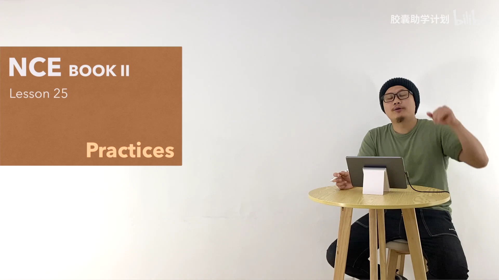

文字识别：胶囊助学计划 / NCE / BOOKI"I / Lesson 25 / Practices

### 画面 00:00:02

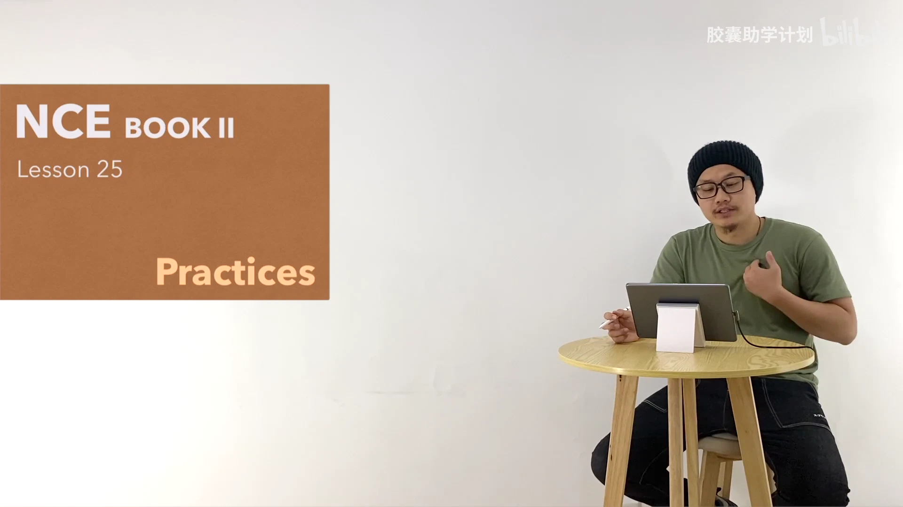

文字识别：胶囊助学计划 / NCE / BOOKII / Lesson 25 / Practices

### 画面 00:00:05

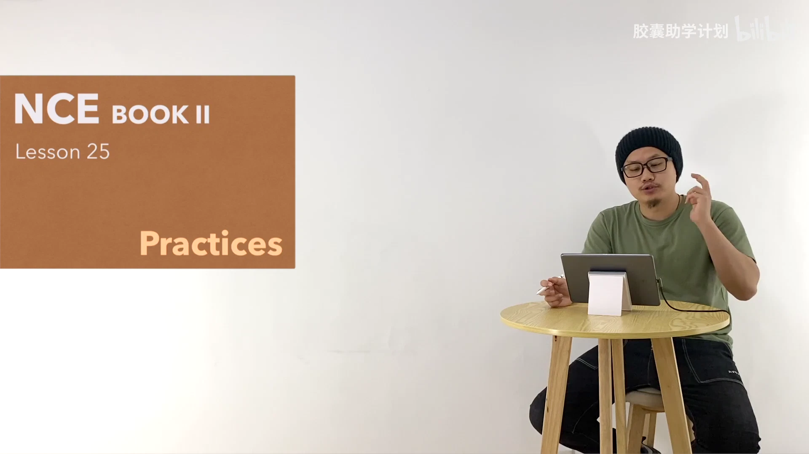

文字识别：胶囊助学计划 / NCE / BOOKII / Lesson 25 / Practices

### 画面 00:00:07

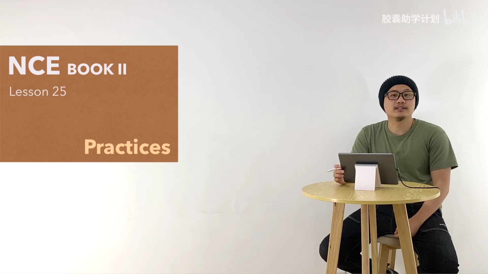

文字识别：胶囊助学计划 / NCE / BOOKII / Lesson 25 / Practices

### 画面 00:00:09

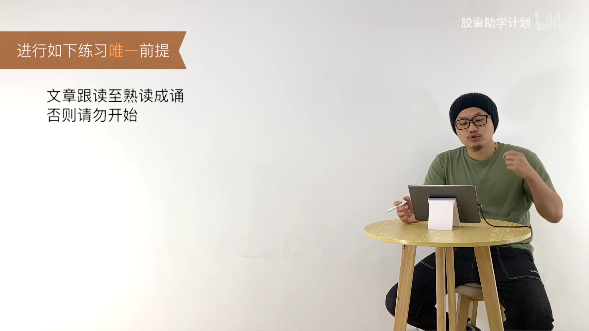

文字识别：胶囊助学计划 / 进行如下练习唯一前提 / 文章跟读至熟读成诵 / 否则请勿开始

### 画面 00:00:12

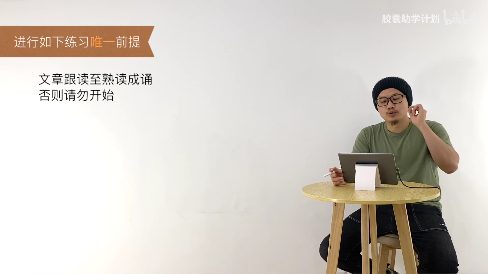

文字识别：胶囊助学计划 / 进行如下练习唯一前提 / 文章跟读至熟读成诵 / 否则请勿开始

### 画面 00:00:16

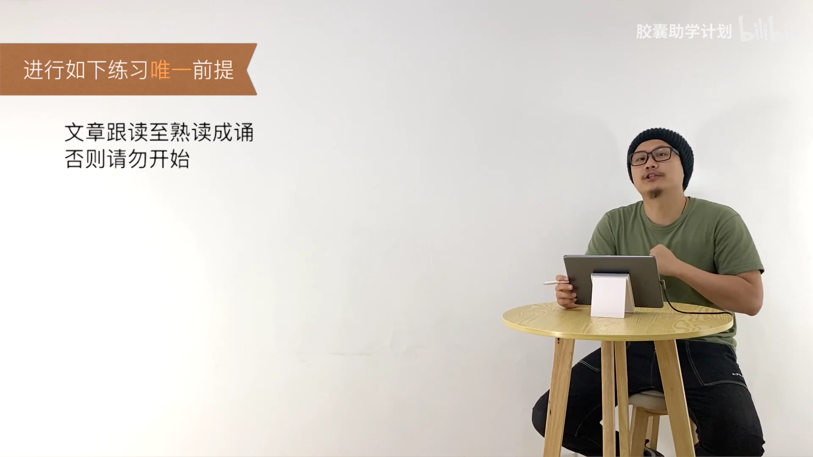

文字识别：胶囊助学计划 / 进行如下练习唯一前提 / 文章跟读至熟读成诵 / 否则请勿开始

### 画面 00:00:19

文字识别：胶囊助学计划bll / • / •

### 画面 00:00:22

文字识别：胶囊助学计划 / 胶囊助学计划

### 画面 00:00:24

文字识别：胶囊助学计划 / Comprehension / 训练目标： / 听懂一般疑问句＆特殊疑问句

### 画面 00:00:26

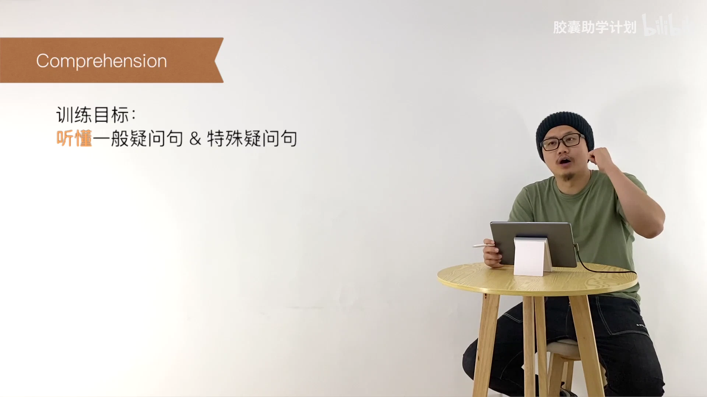

文字识别：胶囊助学计划 / Comprehension / 训练目标： / 听懂一般疑问句＆特殊疑问句

## 00:00:30–00:01:00

熟才行啊！我们进行听力口语练习，您听，然后用口语回答我，不用要求答案跟我完全一致。来了，First one, did you arrive in London or Portsmouth? 答案 London. Next one, what was the railway station like? 三个形容词, big, black, and dark. Next one, did you know your way to your hotel? No, I didn't. Next one, did you ask a porter the way?

### 画面 00:00:31

文字识别：胶囊助学计划 / Comprehension / 训练目标： / 听懂一般疑问句＆特殊疑问句

### 画面 00:00:37

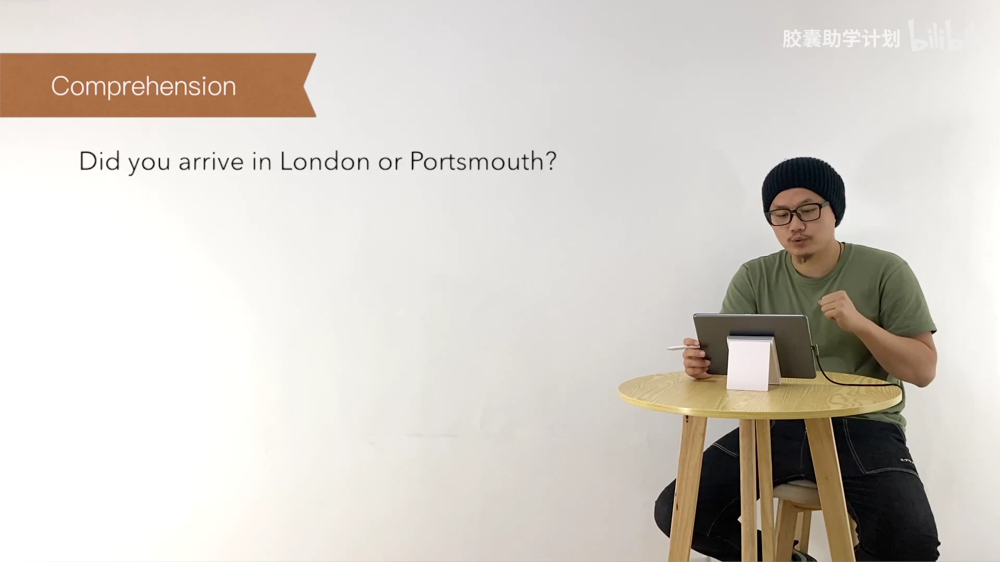

文字识别：胶囊助学计划 / Comprehension / Did you arrive in London or Portsmouth?

### 画面 00:00:42

文字识别：胶囊助学计划 / Comprehension / Did you arrive in London or Portsmouth?

### 画面 00:00:45

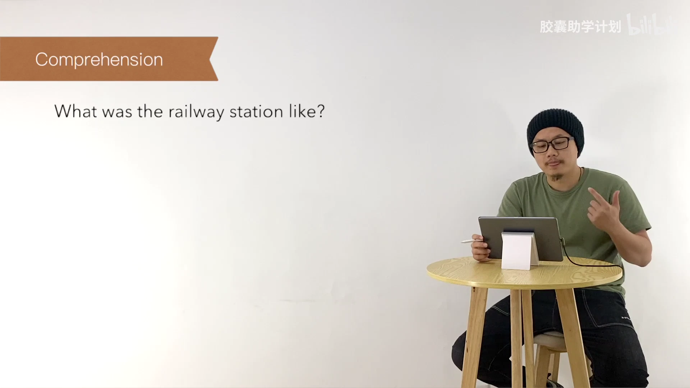

文字识别：胶囊助学计划 / Comprehension / What was the railway station like?

## 00:01:00–00:01:30

Yes, I did. Next one. What language did you speak to him in? English. Next one. How did you speak? Very carefully and clearly. Next one. Could the porter understand you? No, he couldn't. Next one. Did you repeat your question? Yes, I did. Next one. Did he answer

### 画面 00:01:01

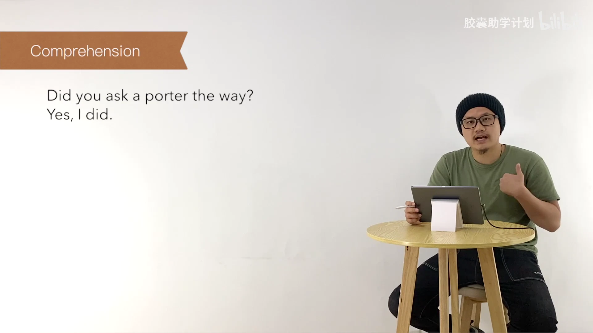

文字识别：胶囊助学计划 / Comprehension / Did you ask a porter the way? / Yes,I did.

## 00:01:30–00:02:00

you? Yes, he did. Next one, did he speak quickly at first? Yes, he did. Next one, what did you tell him? I'm a foreigner. Next one, why couldn't you understand him? My my teacher never spoke English like that. Okay, very good. Next one, what did you and the porter do then? We looked at at each other and

### 画面 00:01:31

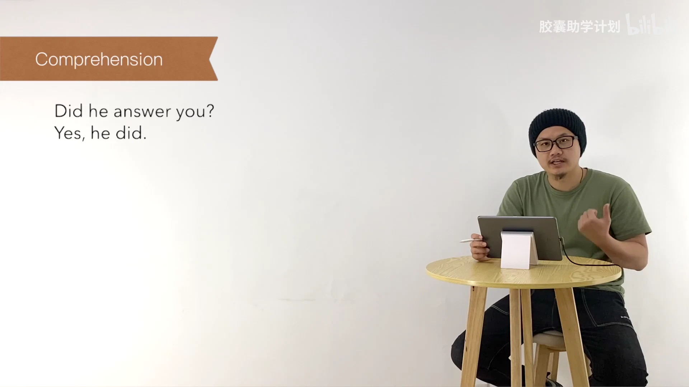

文字识别：胶囊助学计划 / Comprehension / Did he answer you? / Yes, he did.

### 画面 00:01:48

文字识别：胶囊助学计划 / Comprehension / Why couldn't you understand him? / My teacher never spoke English like that.

### 画面 00:01:51

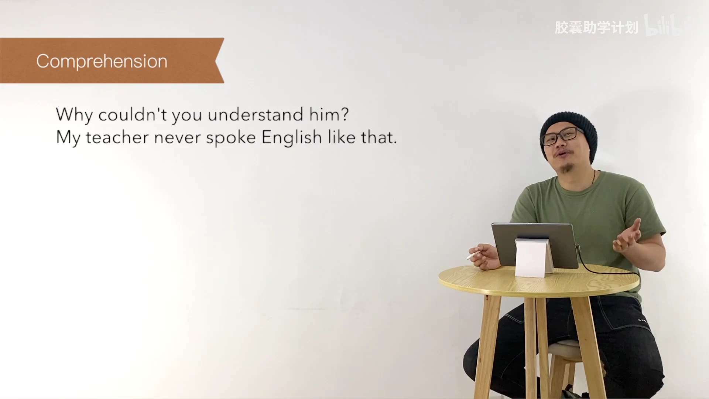

文字识别：胶囊助学计划 / Comprehension / Why couldn't you understand him? / My teacher never spoke English like that.

### 画面 00:01:53

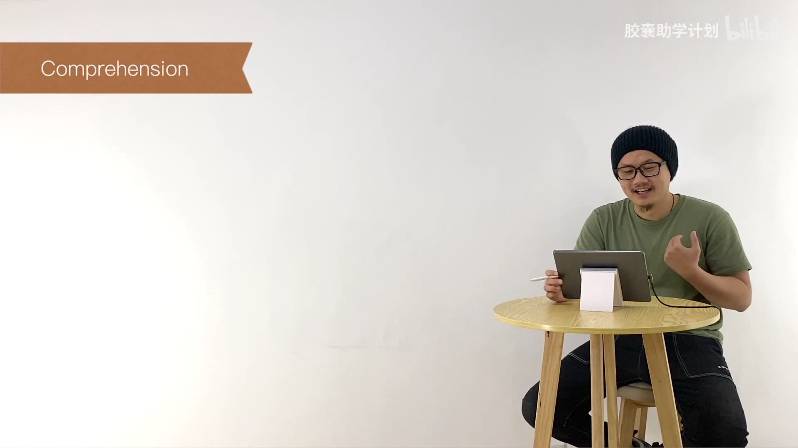

文字识别：胶囊助学计划 / Comprehension

### 画面 00:01:57

文字识别：胶囊助学计划 / Comprehension / What did you and the porter do then? / We looked at each other and smiled.

## 00:02:00–00:02:30

smiled. Ah, okay. That asking questions, right? Ah, that咱们这个训练的目标就是呢会说出来一般疑问句和特殊疑问句. Okay,那接下来我们看例题啊，做一个示范.说Ask me if it took me a long time to reach London.花了我很长的时间去到达伦敦.一般疑问句, did提前, did it take you a long time to reach London? How long?多长时间?那a long time嘛,对吧?所以How long did it take you to reach

### 画面 00:02:01

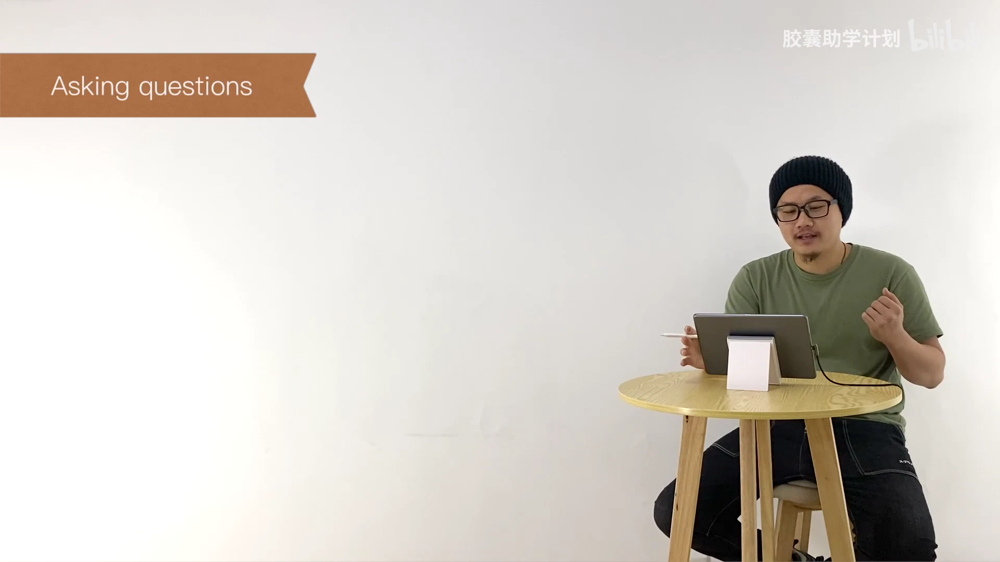

文字识别：胶囊助学计划 / Asking questions

### 画面 00:02:06

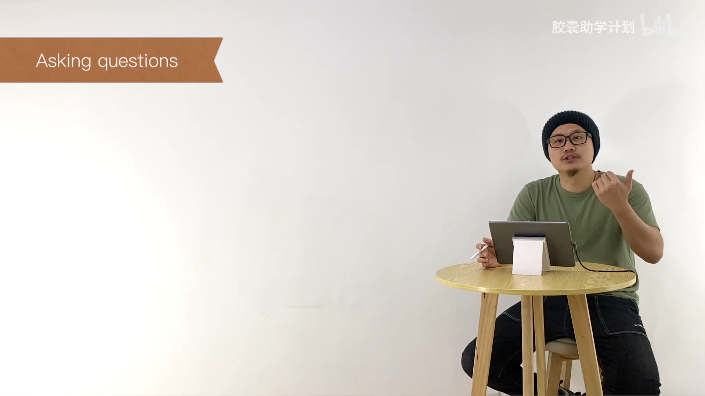

文字识别：胶囊助学计划 / Asking questions

### 画面 00:02:13

文字识别：胶囊助学计划 / Asking questions / T: Ask me if it took me a long time to reach London.

### 画面 00:02:25

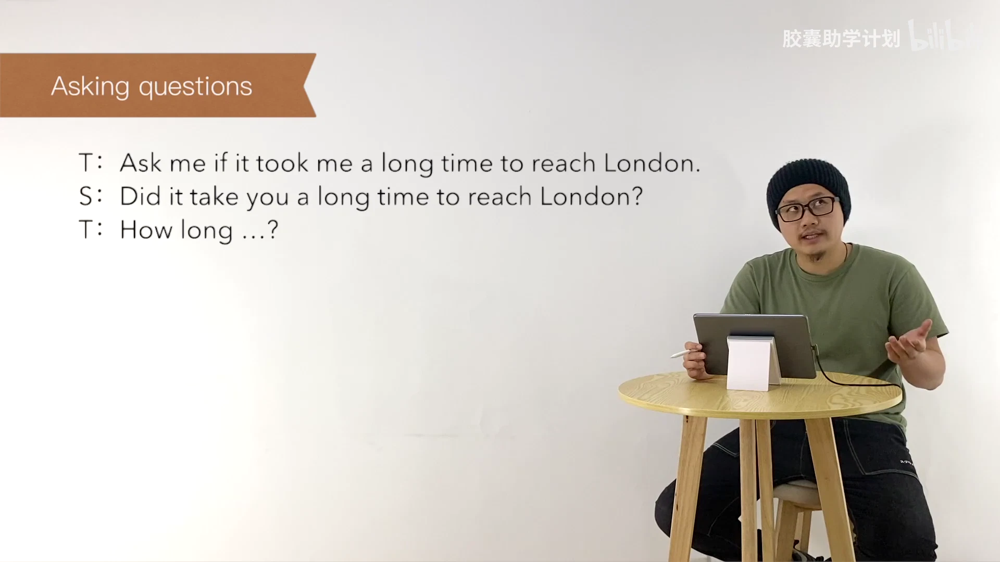

文字识别：胶囊助学计划 / Asking questions / T: Ask me if it took me a long time to reach London. / S: Did it take you a long time to reach London? / T: How long ...?

## 00:02:30–00:03:00

London?到达伦敦花了你多长时间？Okay,那接下来呢，我们看一些具体的练习。我们老习惯啊，呃，不完全提供答案，提供思路，您自己下课去写，写完了大声朗读出来。Arrived, did提前动词换原形。How对by train提问，Who对主语提问，不变一般疑问句，直接答案就是Who arrived by train? Very good. Next one, railway station was.好was出来了，was提前，What

### 画面 00:02:33

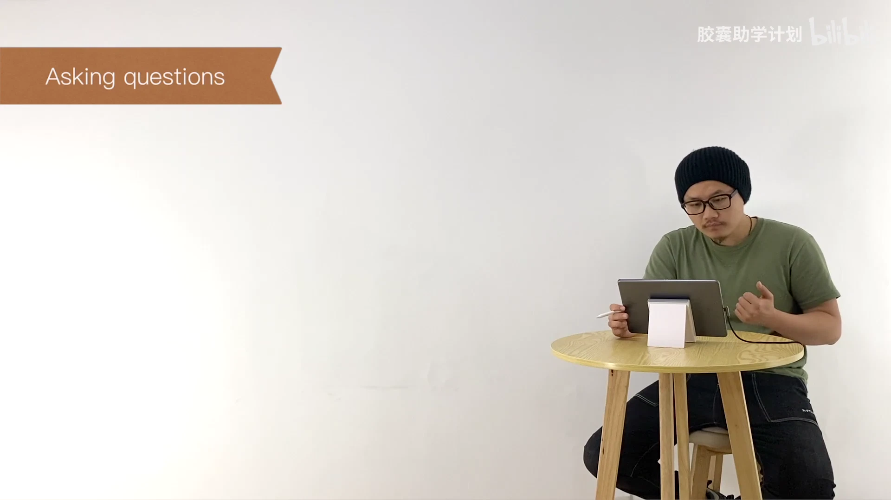

文字识别：胶囊助学计划 / Asking questions

### 画面 00:02:37

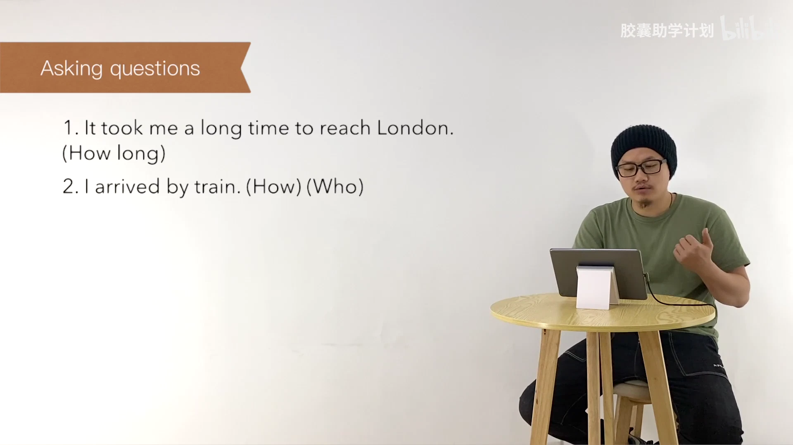

文字识别：胶囊助学计划 / Asking questions / 1. It took me a long time to reach London. / (How long) / 2.l arrived by train.(How) (Who)

### 画面 00:02:54

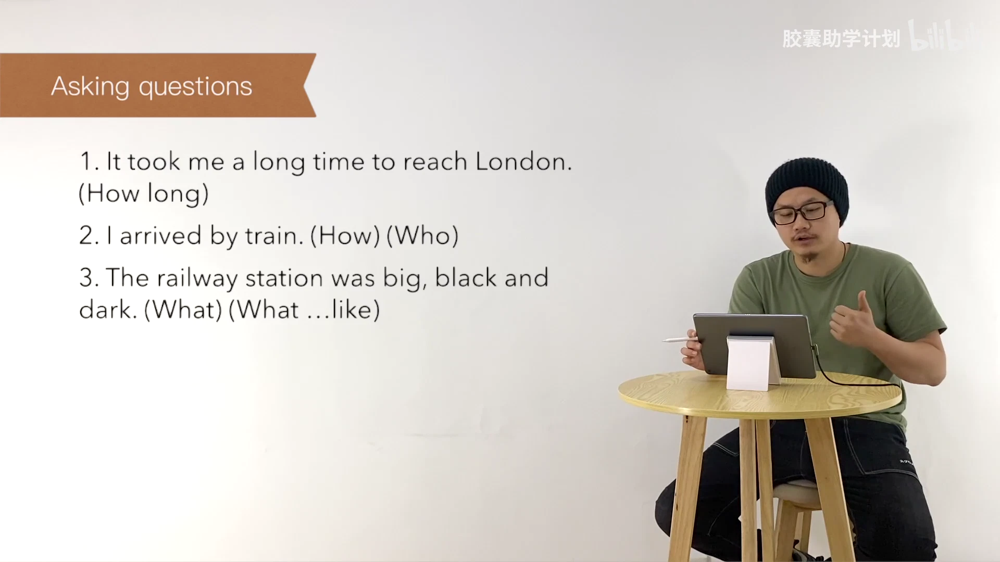

文字识别：胶囊助学计划 / Asking questions / 1. Ilt took me a long time to reach London. / (How long) / 2.l arrived by train.(How) (Who) / 3. The railway station was big, black and / dark. (What) (What ..like)

### 画面 00:02:59

文字识别：胶囊助学计划 / Asking questions / 1. Ilt took me a long time to reach London. / (How long) / 2.l arrived by train.(How) (Who) / 3. The railway station was big, black and / dark.(What) (What ...like)

## 00:03:00–00:03:30

对主语提问，What点点点like对big, black and dark提问，所以What点点like其实就是What's the weather like？您把weather换成the railway station就可以了，对吧？Okay, next one. I spoke to a porter. Did提前，Who可以对I提问，可以对a porter提问。Why加整个一般疑问句，When加整个一般疑问句。第五，I asked him the way to my hotel. Did提前，What就是What did you

### 画面 00:03:21

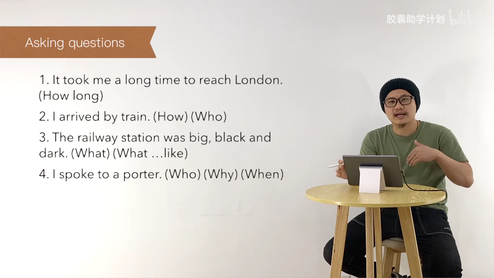

文字识别：胶囊助学计划 / Asking questions / 1. Ilt took me a long time to reach London. / (How long) / 2.l arrived by train.(How) (Who) / 3. The railway station was big, black and / dark. (What) (What ...like) / 4.I spoke to a porter.(Who) (Why) (When)

## 00:03:30–00:04:00

ask him? 你问他什么问题了? The way to my hotel. Next one, I spoke very carefully. Did提前, how对very carefully提问, 对吧? 然后I repeated my question several times. Did提前, how many times对several times提问, what对my question, 对吧? 就答案我直接说一下啊, 叫What did you repeat several times? 第八题, He understood at last.

### 画面 00:03:34

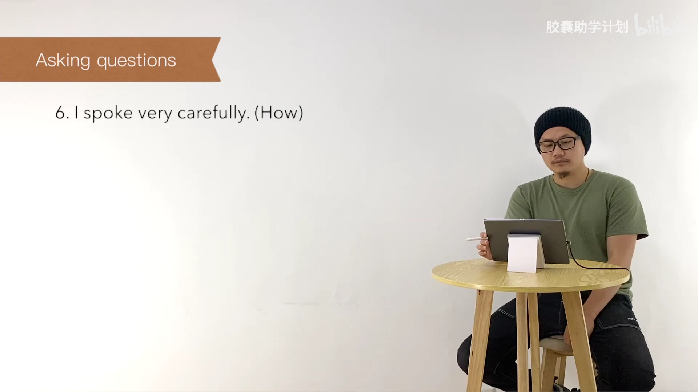

文字识别：胶囊助学计划 / Asking questions / 6.I spoke very carefully. (How)

### 画面 00:03:42

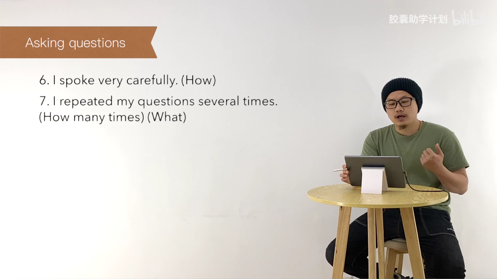

文字识别：胶囊助学计划 / Asking questions / 6.I spoke very carefully.(How) / 7.I repeated my questions several times. / (How many times) (What)

## 00:04:00–00:04:30

Did提前动词换回原形. When对at last提问是吧？他什么时候懂的？He spoke to me very quickly. Did提前动词换原形. How对very quickly提问，也就是六一二三四五六里边的四，对吧？How did he speak to you?他怎么跟你说的？Rudely, politely, friendly, or quickly? We looked at each other. Did提前互对主语提问，直接就行了，对吧？或者您对呃each other也可

### 画面 00:04:00

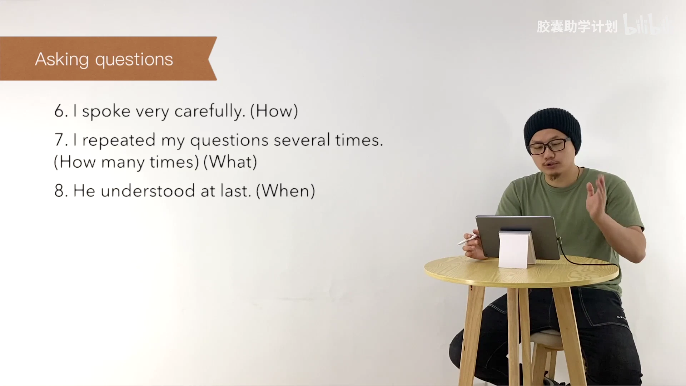

文字识别：胶囊助学计划 / Asking questions / 6.I spoke very carefully.(How) / 7.I repeated my questions several times. / (How many times)(What) / 8. He understood at last. (When)

### 画面 00:04:03

文字识别：胶囊助学计划 / Asking questions / 6.I spoke very carefully. (How) / 7.I repeated my questions several times. / (How many times)(What) / 8. He understood at last. (When)

### 画面 00:04:06

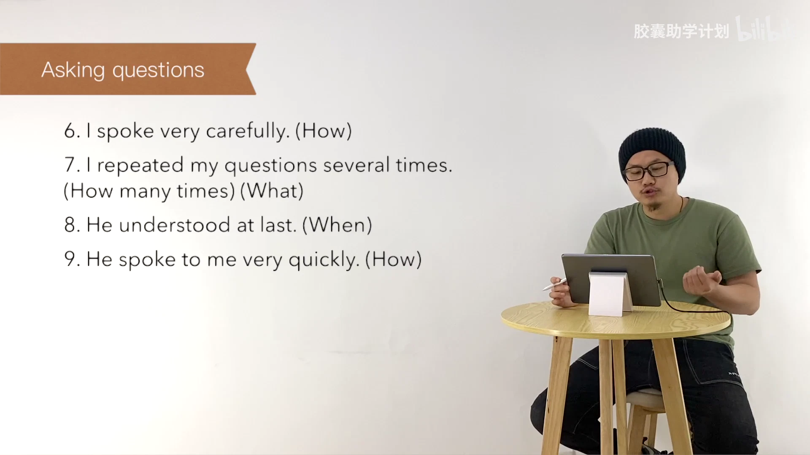

文字识别：胶囊助学计划 / Asking questions / 6.I spoke very carefully.(How) / 7.I repeated my questions several times. / (How many times) (What) / 8. He understood at last.(When) / 9. He spoke to me very quickly. (How)

### 画面 00:04:27

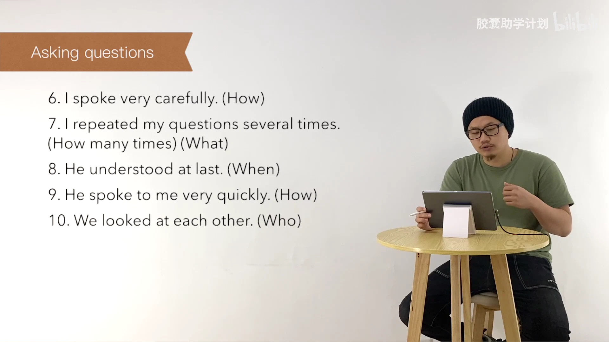

文字识别：胶囊助学计划 / Asking questions / 6.I spoke very carefully. (How) / 7.I repeated my questions several times. / (How many times) (What) / 8. He understood at last. (When) / 9. He spoke to me very quickly. (How) / 10. We looked at each other. (Who)

## 00:04:30–00:05:00

以，对吧？Who did you look at?你们看了谁啊？看了彼此。Okay，最后一个，We smile. 在的，提前What点点do？标准答案What did you do?你们做了什么？Okay，Very good. Tell the story.各位，我第一个单元已经做了很多示范了，接下来不一一做这些示范了。各位要做的事情就是可以错，不能不流利，对吧？所以文章读熟非常的重要。Okay，那在这个地方，各位可以暂停屏幕，

### 画面 00:04:43

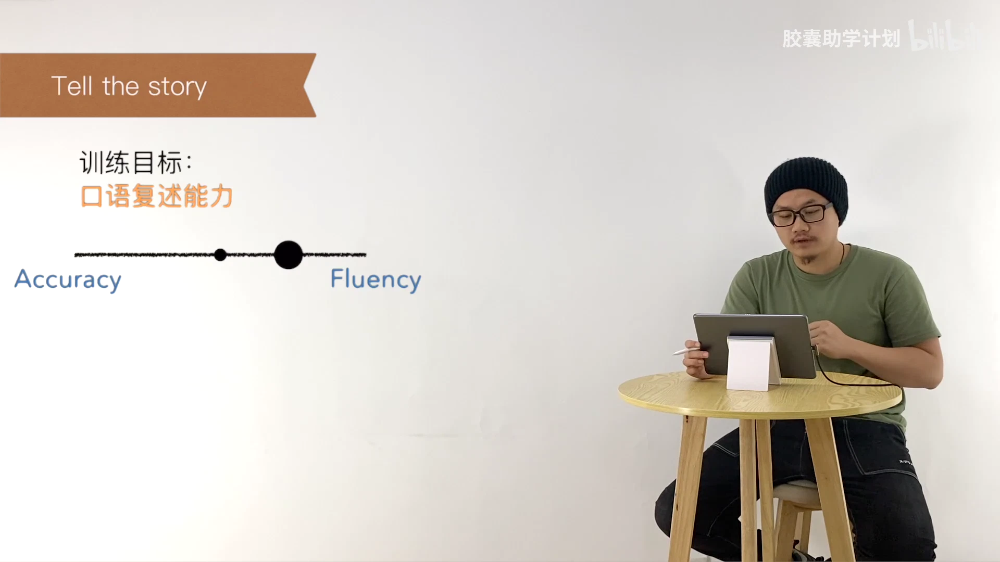

文字识别：胶囊助学计划 / Tell the story / 训练目标： / 口语复述能力 / Accuracy / Fluency

### 画面 00:04:46

文字识别：胶囊助学计划 / Tell the story / 训练目标： / 口语复述能力 / Accuracy / Fluency

### 画面 00:04:55

文字识别：胶囊助学计划 / Tell the story / 训练目标： / 口语复述能力 / Accuracy / Fluency

### 画面 00:04:57

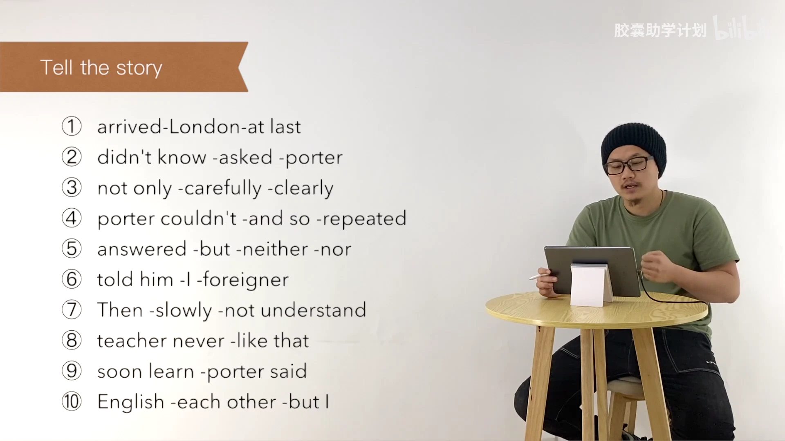

文字识别：胶囊助学计划 / Tell the story / ① / arrived-London-at last / didn't know -asked -porter / not only -carefully -clearly / porter couldn't -and so -repeated / answered -but -neither -nor / told him -I -foreigner / Then -slowly -not understand / teacher never -like that / ) soon learn -porter said / 9 / 1⑩ English -each other -but I

## 00:05:00–00:05:30

看着这些练习自己做一下口语复述。再然后呢，summary writing，摘要写作，这是我们写作复述能力。各位写完来这儿对答案就可以了。最后一个 topic for discussion，这是我们所有练习的终极目标。我们每一课都简单的看一下。第一题说，A foreigner ask you the way from the啊，the way from the station to your school. Explain it to him. 一个外国人问你从车站到你学校怎么走啊？这外

### 画面 00:05:03

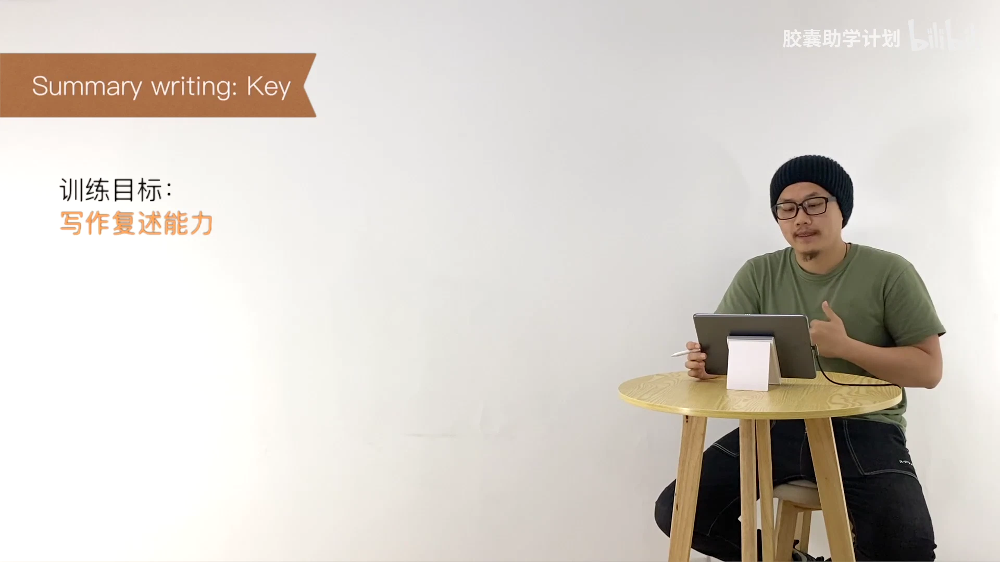

文字识别：胶囊助学计划 / Summary writing: Key / 训练目标： / 写作复述能力

### 画面 00:05:06

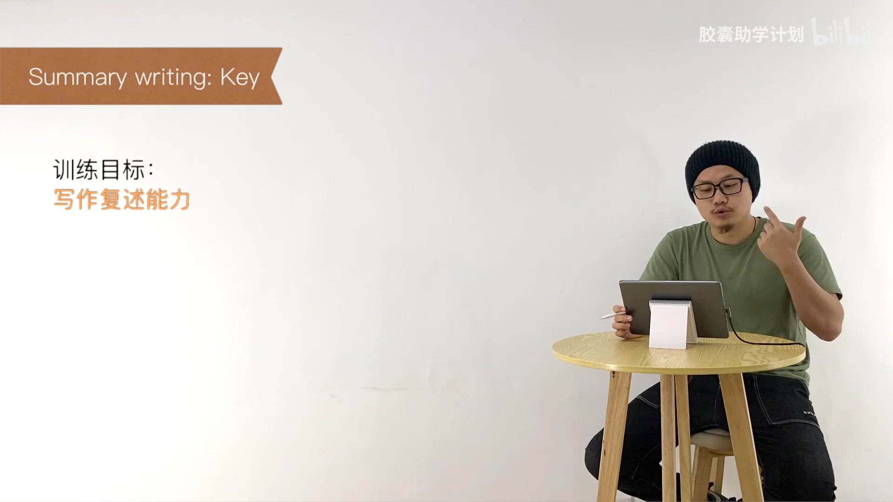

文字识别：胶囊助学计划 / Summary writing: Key / 训练目标： / 写作复述能力

### 画面 00:05:08

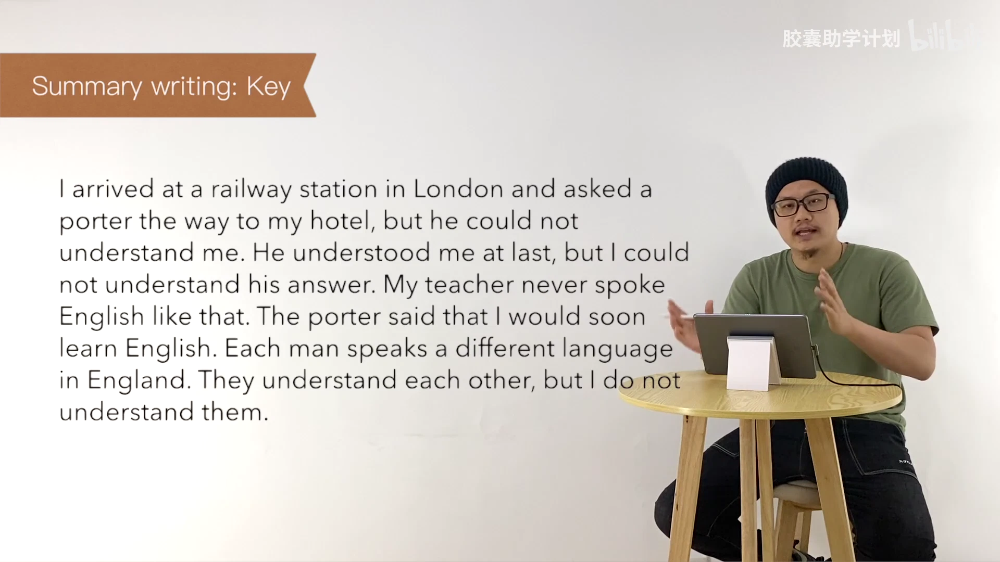

文字识别：胶囊助学计划 / Summary writing: Key / I arrived at a railway station in London and asked a / porter the way to my hotel, but he could not / understand me. He understood me at last, but I could / not understand his answer. My teacher never spoke / English like that. The porter said that I would soon / learn English. Each man speaks a different language / in England. They understand each other, but I do not / understand them.

### 画面 00:05:10

文字识别：胶囊助学计划 / Topics for discussion / 训练目标： / 完全自由的对话 / Accuracy / Fluency

### 画面 00:05:15

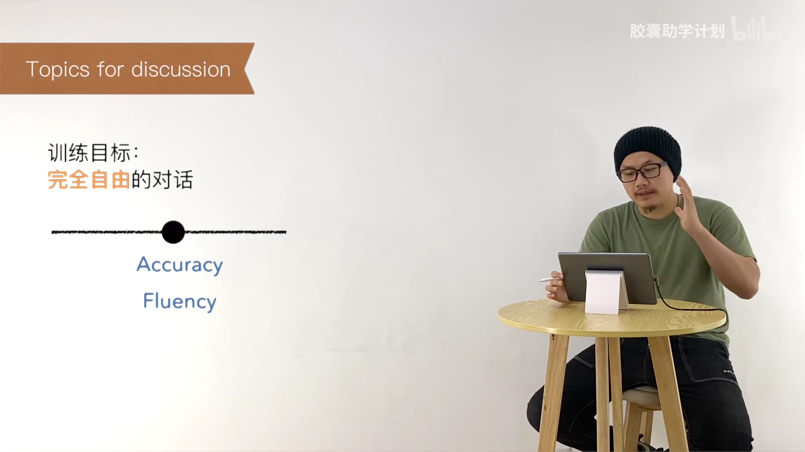

文字识别：胶囊助学计划 / Topics for discussion / 训练目标： / 完全自由的对话 / Accuracy / Fluency

### 画面 00:05:17

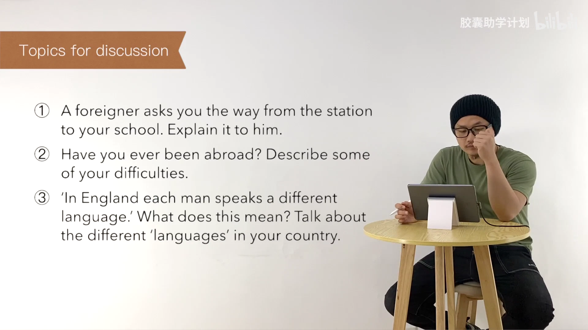

文字识别：胶囊助学计划 / Topics for discussion / A foreigner asks you the way from the station / to your school. Explain it to him. / Have you ever been abroad? Describe some / of your difficulties. / 3 / 'In England each man speaks a different / language.' What does this mean? Talk about / the diferent'languages' in your country.

### 画面 00:05:19

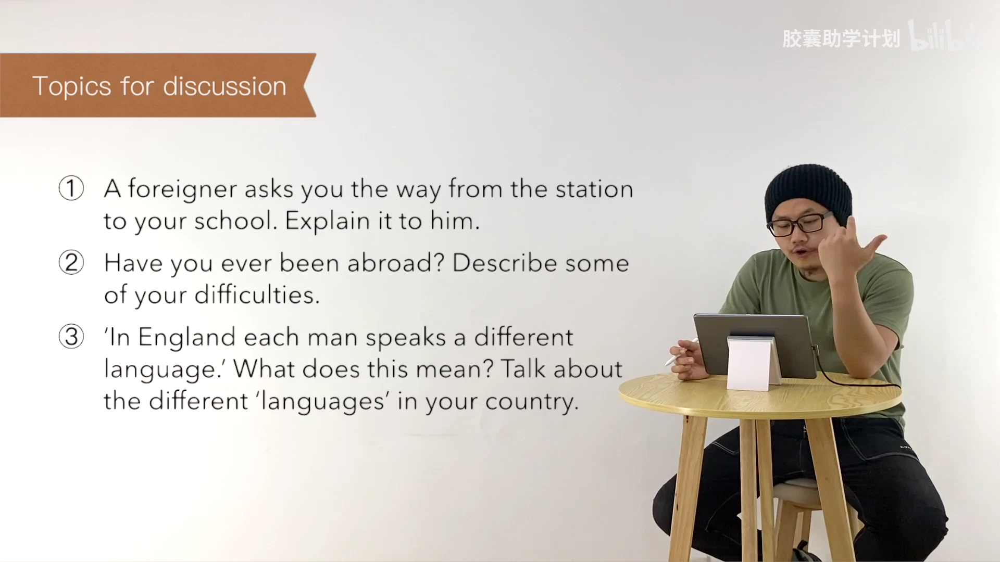

文字识别：胶囊助学计划 / Topics for discussion / A foreigner asks you the way from the station / to your school. Explain it to him. / Have you ever been abroad? Describe some / of your difficulties. / 'In England each man speaks a different / 3 / language.' What does this mean? Talk about / the different'languages' in your country.

### 画面 00:05:22

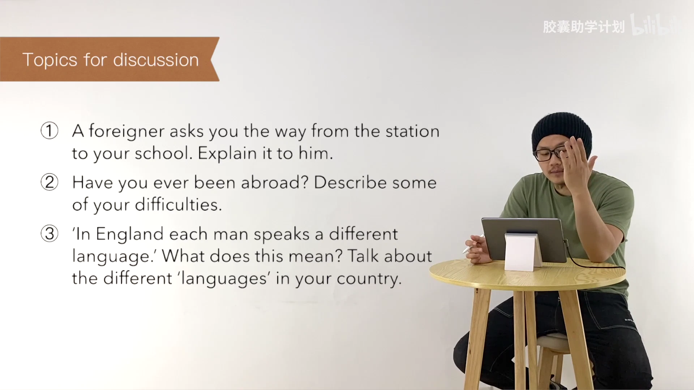

文字识别：胶囊助学计划 / Topics for discussion / A foreigner asks you the way from the station / to your school. Explain it to him. / Have you ever been abroad? Describe some / of your difficulties. / 3 / 'In England each man speaks a different / language.' What does this mean? Talk about / the diferent'languages' in your country.

### 画面 00:05:26

文字识别：胶囊助学计划 / Topics for discussion / A foreigner asks you the way from the station / to your school. Explain it to him. / Have you ever been abroad? Describe some / of your difficulties. / 'In England each man speaks a different / 3 / language.' What does this mean? Talk about / the diferent'languages' in your country.

## 00:05:30–00:06:00

国人也挺巧是吧？恰好要去你学校，你给他解释一下，其实就是指个路，对吧？您可以试着指指一下啊。第二题说 Have you been abroad? 你去过国外吗？Describe some of your difficulties. 尝试描述一些你的困难。如果你没去过，你尝试想象一下。第三题说 In England, each person speaks a different language. What does this mean? 就这这这句话什么意思啊？Talk about the different language in your country. 聊一聊不同的语言。你注意它是带引号的啊，

### 画面 00:05:38

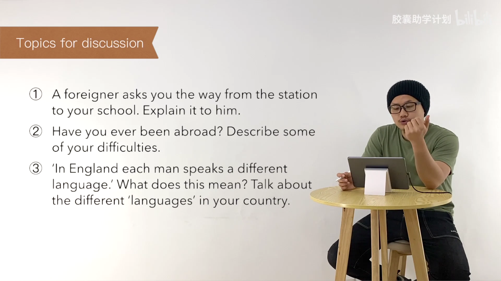

文字识别：胶囊助学计划 / Topics for discussion / A foreigner asks you the way from the station / to your school. Explain it to him. / Have you ever been abroad? Describe some / of your difficulties. / 'In England each man speaks a different / 3 / language.' What does this mean? Talk about / the diferent'languages' in your country.

### 画面 00:05:47

文字识别：胶囊助学计划 / Topics for discussion / A foreigner asks you the way from the station / to your school. Explain it to him. / Have you ever been abroad? Describe some / of your difficulties. / 3 / 'In England each man speaks a different / language.' What does this mean? Talk about / the different'languages' in your country.

### 画面 00:05:50

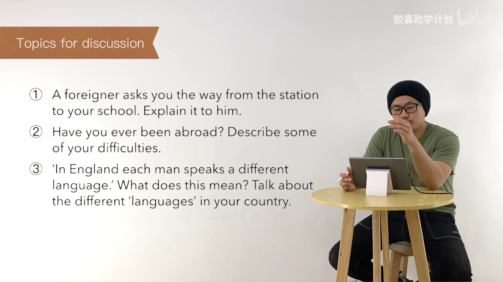

文字识别：胶囊助学计划 / Topics for discussion / A foreigner asks you the way from the station / to your school. Explain it to him. / Have you ever been abroad? Describe some / of your difficulties. / 3 / 'In England each man speaks a different / language.' What does this mean? Talk about / the different'languages' in your country.

### 画面 00:05:56

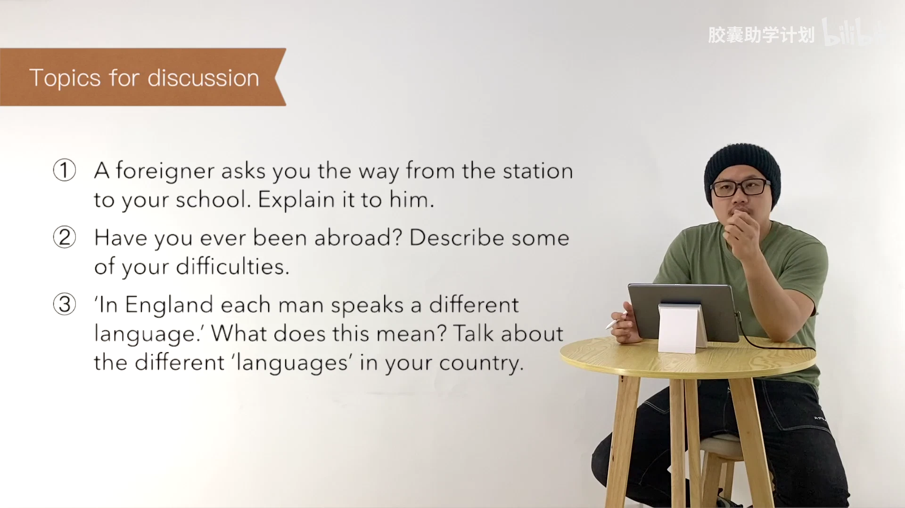

文字识别：胶囊助学计划 / Topics for discussion / A foreigner asks you the way from the station / to your school. Explain it to him. / Have you ever been abroad? Describe some / of your difficulties. / 'In England each man speaks a different / 3 / language.' What does this mean? Talk about / the diferent'languages' in your country.

## 00:06:00–00:06:30

也就是说，大多数情况下我们聊粤语可能是不合适的。粤语在某些判断语言判断当中，认为真的它就是另一门语言。那他说的这个 different language，我们在这儿理解为可能是方言，对吧？比如说大同话啊，比如说这个呃济南话啊，可能是这些方言。我们去聊一聊这些方言。OK，家庭作业 ask me，先写再朗读。摘要写作先写，然后对答案。Tell the story 口语复述，但是前提是文章要

### 画面 00:06:00

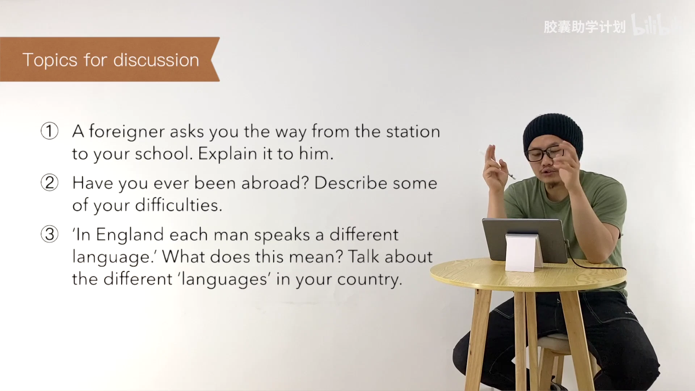

文字识别：胶囊助学计划 / Topics for discussion / A foreigner asks you the way from the station / to your school. Explain it to him. / Have you ever been abroad? Describe some / of your difficulties. / 3 / 'In England each man speaks a different / language.' What does this mean? Talk about / the different'languages' in your country.

### 画面 00:06:07

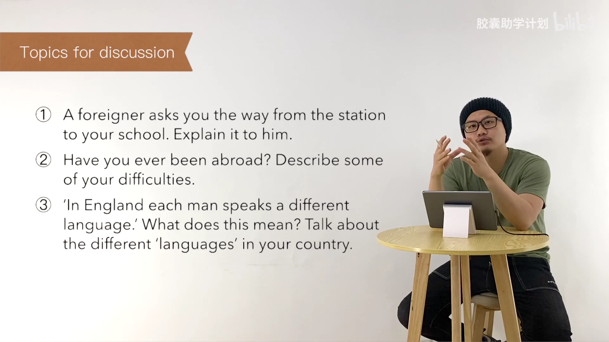

文字识别：胶囊助学计划 / Topics for discussion / A foreigner asks you the way from the station / to your school. Explain it to him. / Have you ever been abroad? Describe some / of your difficulties. / 3 / 'In England each man speaks a different / language.' What does this mean? Talk about / the different'languages' in your country.

### 画面 00:06:20

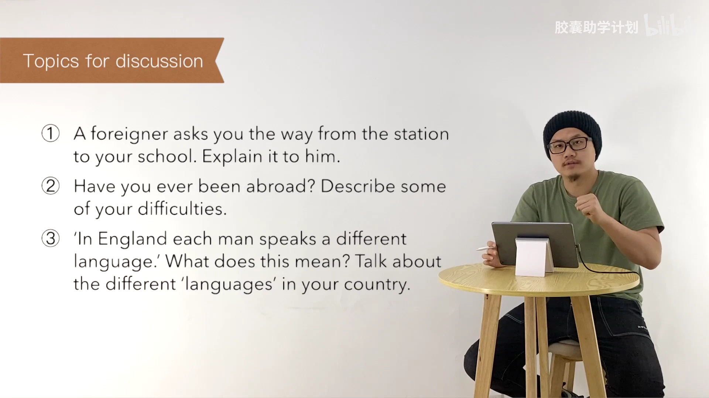

文字识别：胶囊助学计划 / Topics for discussion / A foreigner asks you the way from the station / to your school. Explain it to him. / Have you ever been abroad? Describe some / of your difficulties. / 'In England each man speaks a different / 3 / language.' What does this mean? Talk about / the diferent'languages' in your country.

### 画面 00:06:22

文字识别：胶囊助学计划 / 1.Ask me if写&朗读

### 画面 00:06:24

文字识别：胶囊助学计划 / 1.Ask me if 写&朗读 / 摘要写作写&答案

### 画面 00:06:26

文字识别：胶囊助学计划 / 1.Ask me if写&朗读 / 摘要写作写&答案 / 3.Tell the story 口语复述

### 画面 00:06:29

文字识别：胶囊助学计划 / 1.Askme if写&朗读 / 摘要写作写&答案 / 3.Tell the story 口语复述

## 00:06:30–00:06:58

熟读成诵。最后专栏当中可以找得到。那以上呢就是本期视频的全部内容了。如果大家喜欢我们的课程呢，欢迎大家关注、订阅、一键三连，分享给那些需要的朋友，来帮助我们快速成长。See you next time.

### 画面 00:06:31

文字识别：胶囊助学计划 / 1.Ask me if写&朗读 / 摘要写作写&答案 / 3.Tell the story 口语复述 / 专栏 / 4.

### 画面 00:06:33

文字识别：胶囊助学计划

### 画面 00:06:36

文字识别：胶囊助学计划

### 画面 00:06:44

文字识别：胶囊助学计划 / 不

### 画面 00:06:46

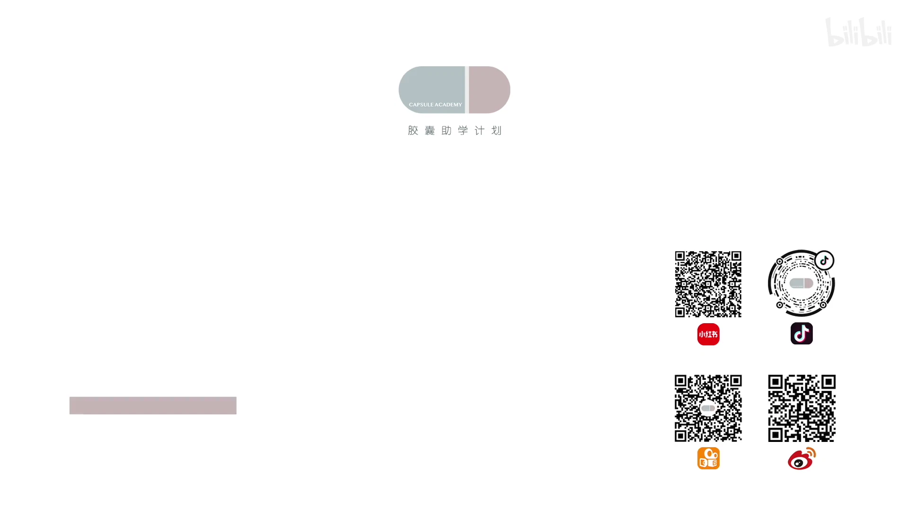

文字识别：CAPSULEACADEMY / 胶囊助学计划 / 小红书 / 证 / 品 / OE

### 画面 00:06:48

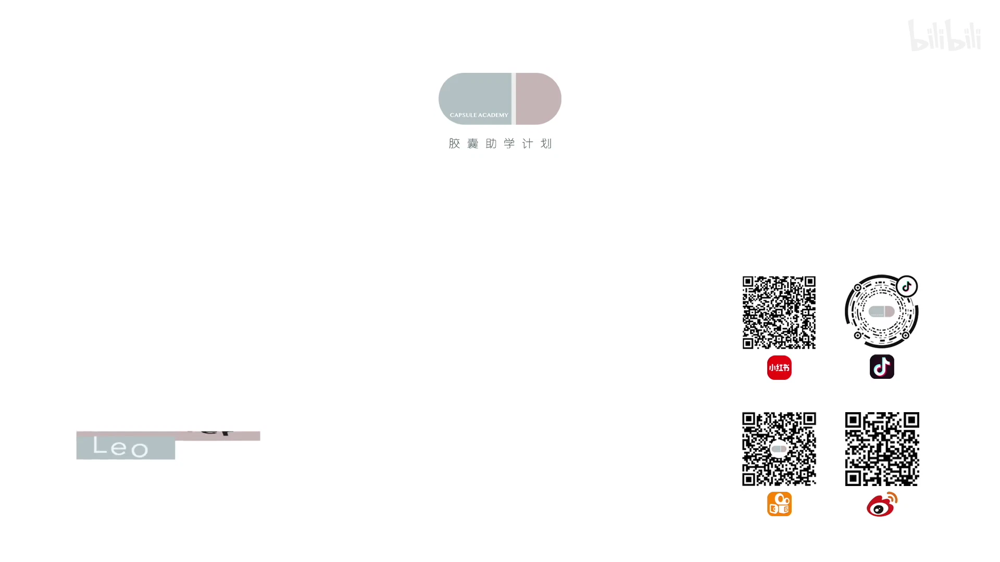

文字识别：CAPSULEACADEMY / 胶囊助学计划 / 小红书 / Leo / OE

### 画面 00:06:54

文字识别：CAPSULEACADEMY / 胶囊助学计划 / 小红书 / Creator / Leo & Berlin / OE

### 画面 00:06:56

文字识别：bilibili / 胶囊助学计划

### 画面 00:06:57

文字识别：bilibili / 胶囊助学计划

