# L026 单词

快速机器解析：语音为单模型转写，未进行独立交叉校对或人工复核；画面每秒采样并按变化选帧，短时文字和标记可能遗漏。截图时间约有 1 秒误差。图片有损压缩；遇到疑点请按时间查看 Google Drive 原视频。

## 00:00:00–00:00:30

Hello everyone, welcome to Capsule Academy. This is Leo. Today we are going to learn New Concept English Book Two, Lesson Twenty Six, Words. 那老习惯进入正式课程之前呢，我们先看几个问题。首先，如何用英文去表达某人假装做某件事情？接下来呢，如何去表达非常感激？那带着这两个问题，Hope you guys enjoy. 好，那我们先看第一

### 画面 00:00:00

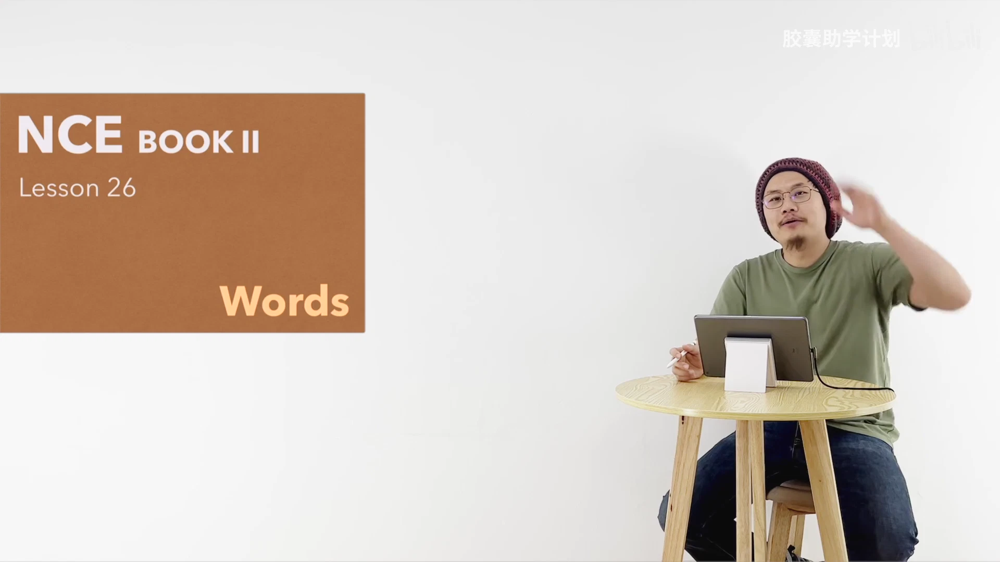

文字识别：NCE / BOOKⅡI / Lesson 26 / Words

### 画面 00:00:05

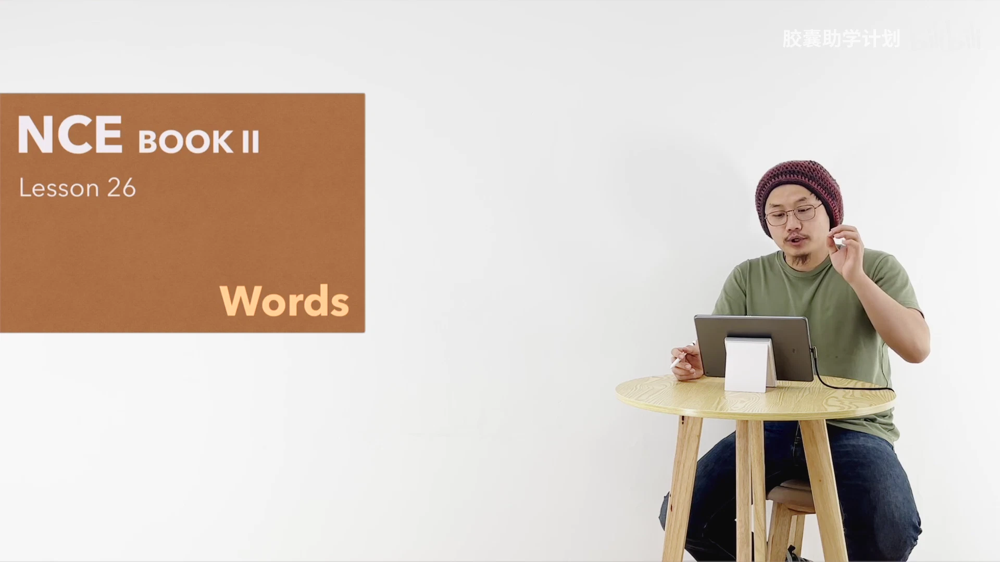

文字识别：NCE / BOOK I"I / Lesson 26 / Words

### 画面 00:00:08

### 画面 00:00:11

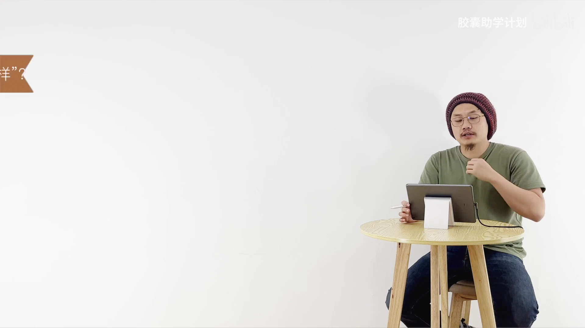

文字识别：9008

### 画面 00:00:13

文字识别：①如何表达“某人假装怎样”?

### 画面 00:00:17

文字识别：① 如何表达“某人假装怎样”? / 表达“非常感激”

### 画面 00:00:19

文字识别：① 如何表达“某人假装怎样”？ / 如何表达“非常感激

### 画面 00:00:24

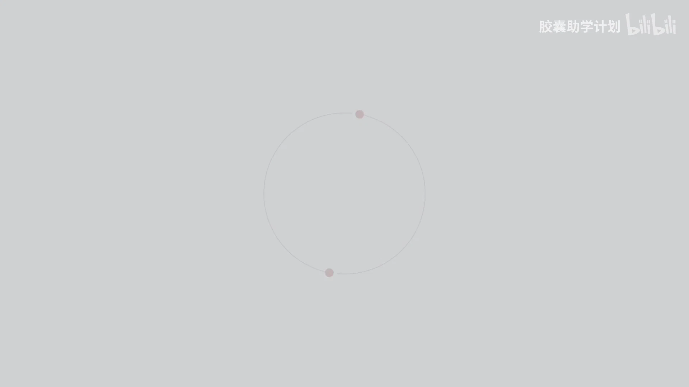

文字识别：胶囊助学计划bill / •

### 画面 00:00:27

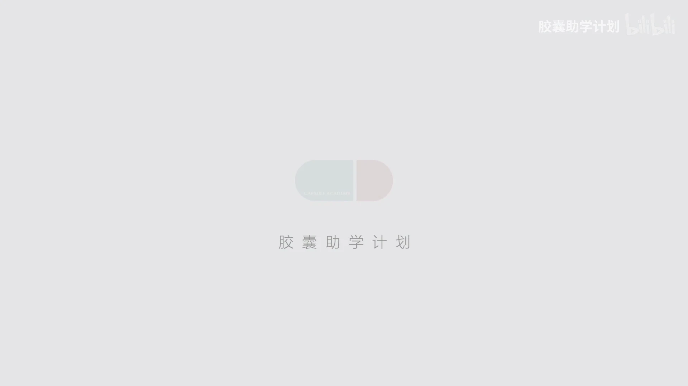

文字识别：胶囊助学计划 / 胶囊助学计划

### 画面 00:00:29

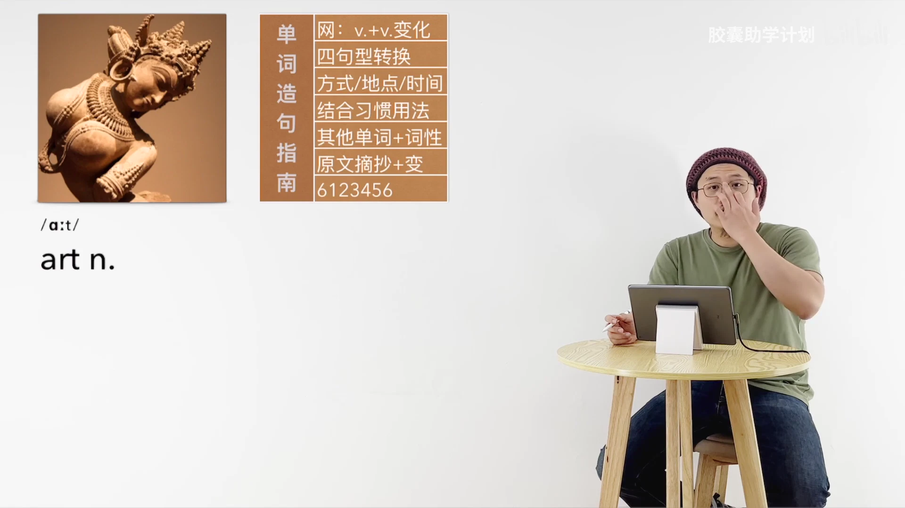

文字识别：单词造句指南 / 网：v.+v.变化 / 四句型转换 / 方式/地点/时间 / 结合习惯用法 / 其他单词+词性 / 原文摘抄+变 / 6123456 / /a:t/ / art n.

## 00:00:30–00:01:00

个单词啊，跟我先一起读一下，来，art，art，OK，那它在本课的意思指的是艺术品或者艺术，对吧？这样一个抽象的单词。好，那接下来呢，我们拿它去做一些简单的例造句，非常的简单。我们先来一句话，叫Do you like art？那你喜欢艺术吗？好，那你说我不喜欢艺术，那就是I don't like art，OK。那art实际上在教各位一个小的单词造句的思路啊，就是词性，

### 画面 00:00:31

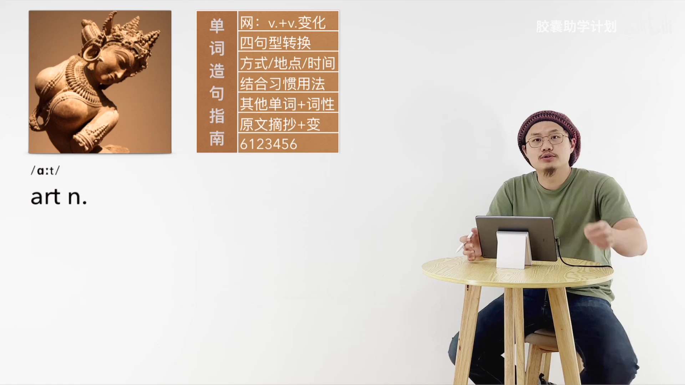

文字识别：单词造句指南 / 网：v.+v.变化 / 四句型转换 / 方式/地点/时间 / 结合习惯用法 / 其他单词+词性 / 原文摘抄+变 / 6123456 / /a:t/ / art n.

### 画面 00:00:35

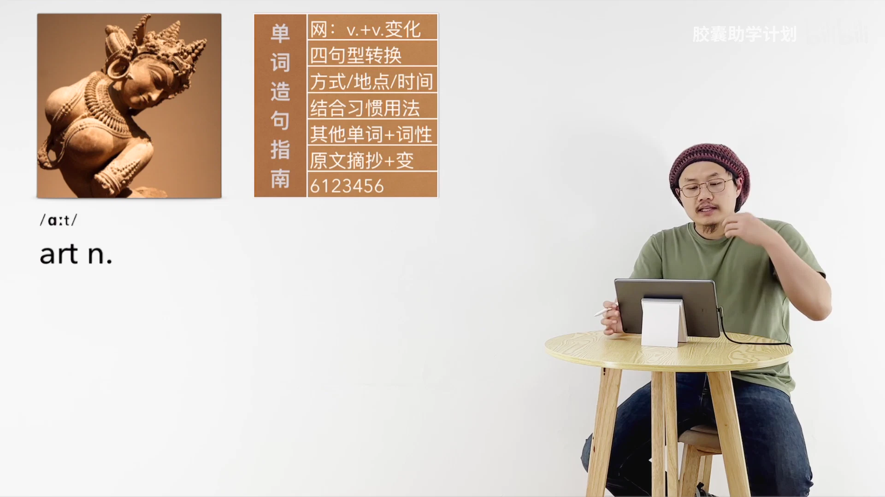

文字识别：单词造句指南 / 网：v.+v.变化 / 四句型转换 / 方式/地点/时间 / 结合习惯用法 / 其他单词+词性 / 原文摘抄+变 / 6123456 / /a:t/ / art n.

### 画面 00:00:40

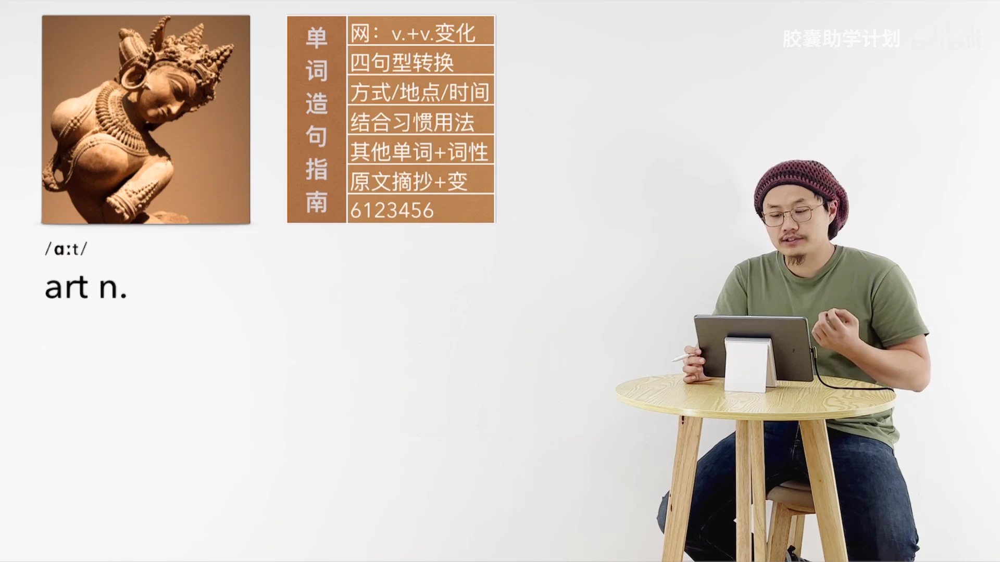

文字识别：单词造句指南 / 网：v.+v.变化 / 四句型转换 / 方式/地点/时间 / 结合习惯用法 / 其他单词+词性 / 原文摘抄+变 / 6123456 / /a:t/ / art n.

### 画面 00:00:45

文字识别：单词造句指南 / 网：v.+v.变化 / 四句型转换 / 方式/地点/时间 / 结合习惯用法 / 其他单词+词性 / 原文摘抄+变 / 6123456 / /a:t/ / art n. / ① Do you like art?

### 画面 00:00:50

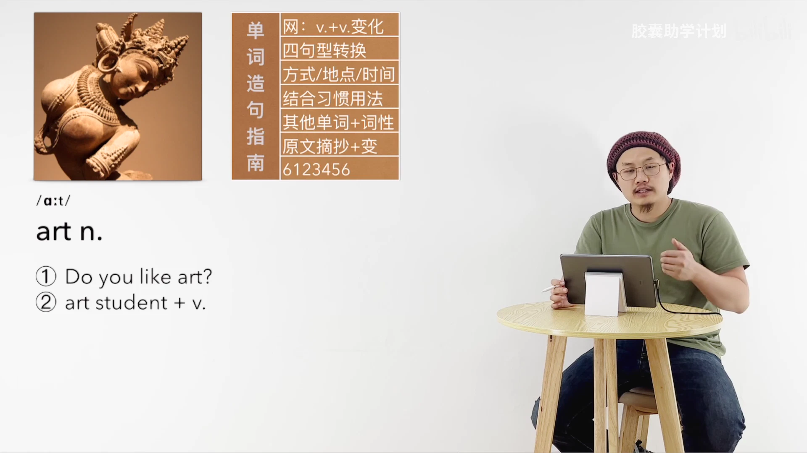

文字识别：单词造句指南 / 网：v.+v.变化 / 四句型转换 / 方式/地点/时间 / 结合习惯用法 / 其他单词+词性 / 原文摘抄+变 / 6123456 / /a:t/ / art n. / ① Do you like art? / art student + v.

### 画面 00:00:55

文字识别：单词造句指南 / 网：v.+v.变化 / 四句型转换 / 方式/地点/时间 / 结合习惯用法 / 其他单词+词性 / 原文摘抄+变 / 6123456 / /a:t/ / art n. / ① Do you like art? / art student + v.

### 画面 00:00:59

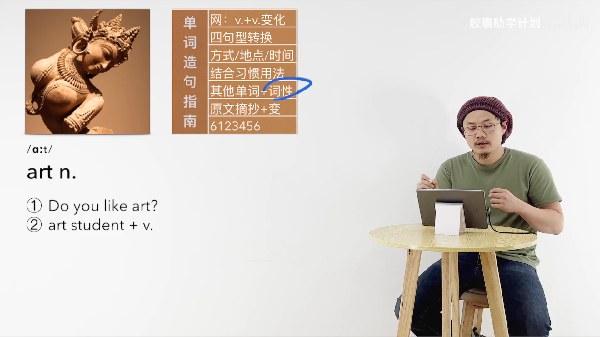

文字识别：单词造句指南 / 网：v.+v.变化 / 四句型转换 / 方式/地点/时间 / 结合习惯用法 / 其他单词-词性 / 原文摘抄+变 / 6123456 / /a:t/ / art n. / ① Do you like art? / art student + v.

## 00:01:00–00:01:30

art自己本身虽然是个名词，但是它可以加上另一个名词去修饰，比如说art student，你看它叫做艺术生，对吧？然后呢，我们再加上一些动词，那这个地方我们在找动词的时候就要以这个student为主了。比如说，我们造一句话，我们用我们二十五课刚刚学过的，叫做Neither my sister nor my brother is an art student。OK，然后一个，接下来那art museum，你看museum是我们第三课学的一个单词，你

### 画面 00:01:01

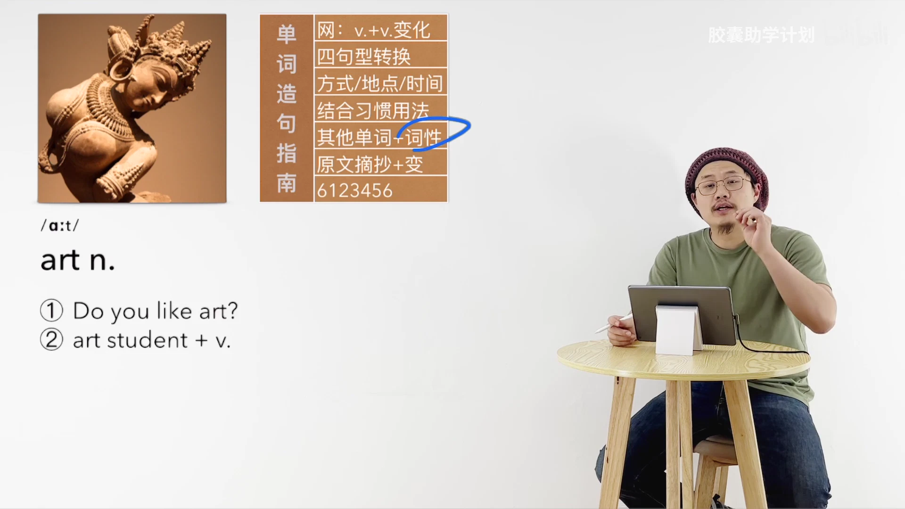

文字识别：单词造句指南 / 网：v.+v.变化 / 四句型转换 / 方式/地点/时间 / 结合习惯用法 / 其他单词-词性 / 原文摘抄+变 / 6123456 / /a:t/ / art n. / ① Do you like art? / art student + v.

### 画面 00:01:05

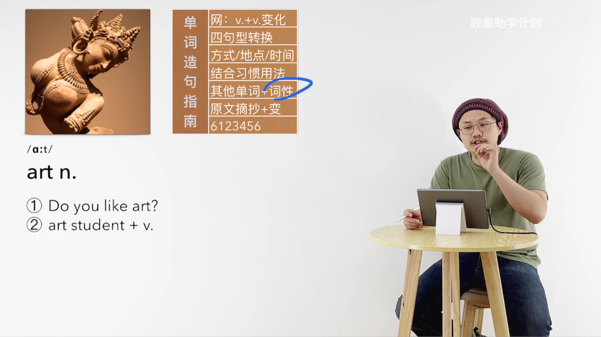

文字识别：单词造句指南 / 网：v.+v.变化 / 四句型转换 / 方式/地点/时间 / 结合习惯用法 / 其他单词+词性 / 原文摘抄+变 / 6123456 / /a:t/ / art n. / ① Do you like art? / art student + v.

### 画面 00:01:10

文字识别：单词造句指南 / 网：v.+v.变化 / 四句型转换 / 方式/地点/时间 / 结合习惯用法 / 其他单词+词性 / 原文摘抄+变 / 6123456 / /a:t/ / art n. / ① Do you like art? / art student + v.

### 画面 00:01:16

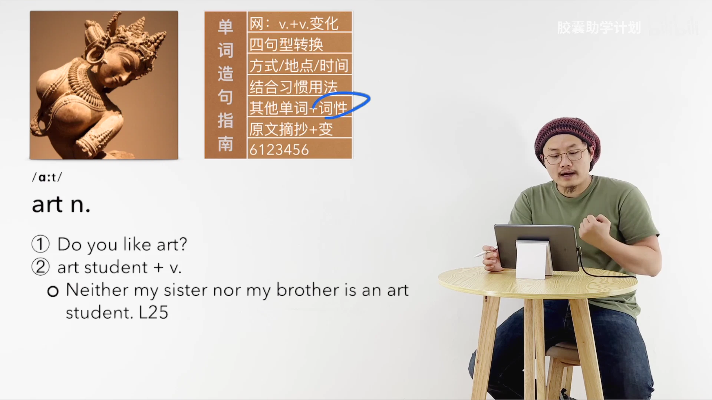

文字识别：单词造句指南 / 网：v.+v.变化 / 四句型转换 / 方式/地点/时间 / 结合习惯用法 / 其他单词+词性 / 原文摘抄+变 / 6123456 / /a:t/ / art n. / ① Do you like art? / ) art student + v. / o Neither my sister nor my brother is an art / student. L25

### 画面 00:01:20

文字识别：单词造句指南 / 网：v.+v.变化 / 四句型转换 / 方式/地点/时间 / 结合习惯用法 / 其他单词+词性 / 原文摘抄+变 / 6123456 / /a:t/ / art n. / ① Do you like art? /  art student + v. / o Neither my sister nor my brother is an art / student. L25

### 画面 00:01:25

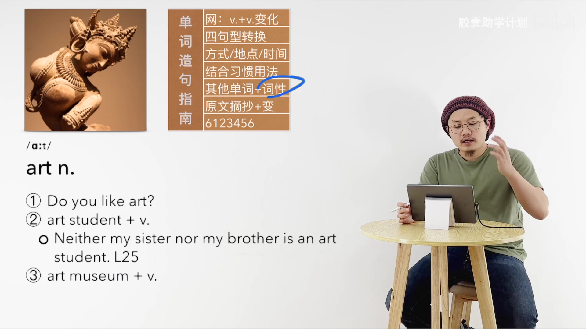

文字识别：单词造句指南 / 网：v.+v.变化 / 四句型转换 / 方式/地点/时间 / 结合习惯用法 / 其他单词+词性 / 原文摘抄+变 / 6123456 / /a:t/ / art n. / ①Do you like art? /  art student + v. / o Neither my sister nor my brother is an art / student. L25 / art museum + v.

## 00:01:30–00:02:00

把 art 加 museum 放到一起，艺术博物馆，对吧？然后我们找动词，那肯定是围绕着 museum 去找啊，包括习惯用法也是围绕着它。那我们造一句话说， I don't know the way to the art museum。这是第二十五课我们学过的呃习惯用法，在文章当中摘出来的，对吧？OK，接下来两个单词我们放到一起去学。各位能看到这两个单词长得非常的像，含义也非常的像。第一个名词叫 critic，看一下

### 画面 00:01:35

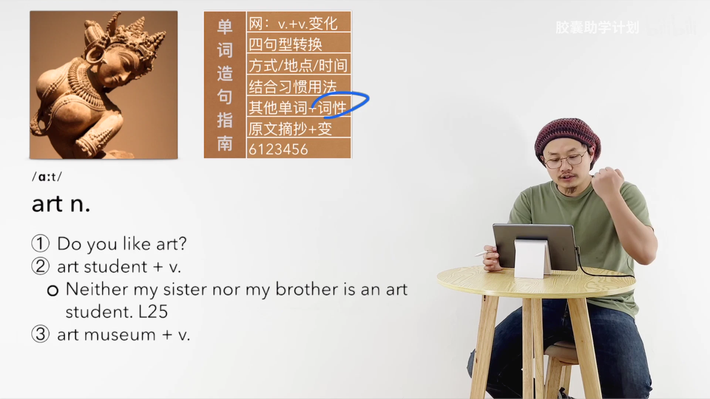

文字识别：单词造句指南 / 网：v.+v.变化 / 四句型转换 / 方式/地点/时间 / 结合习惯用法 / 其他单词+词性 / 原文摘抄+变 / 6123456 / /a:t/ / art n. / ① Do you like art? /  art student + v. / o Neither my sister nor my brother is an art / student. L25 / art museum + v.

### 画面 00:01:40

文字识别：单词造句指南 / 网：v.+v.变化 / 四句型转换 / 方式/地点/时间 / 结合习惯用法 / 其他单词+词性 / 原文摘抄+变 / 6123456 / /a:t/ / art n. / ① Do you like art? / ② art student + v. / o Neither my sister nor my brother is an art / student. L25 / art museum + v. / o I don't know the way to the art museum. L25

### 画面 00:01:45

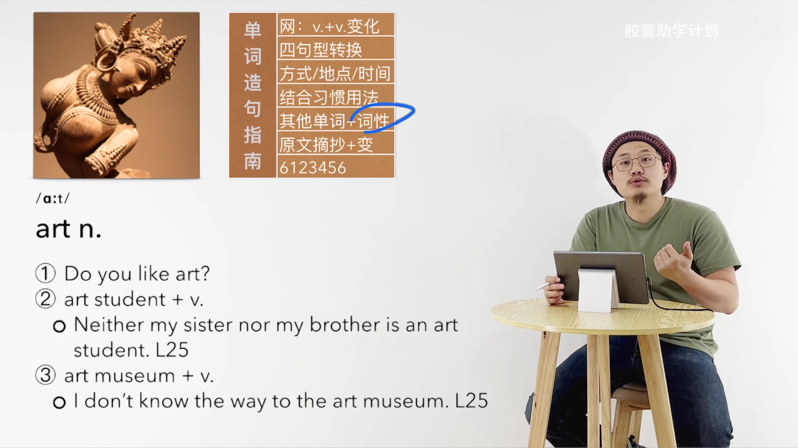

文字识别：单词造句指南 / 网：v.+v.变化 / 四句型转换 / 方式/地点/时间 / 结合习惯用法 / 其他单词+词性 / 原文摘抄+变 / 6123456 / /a:t/ / art n. / ① Do you like art? / ② art student + v. / o Neither my sister nor my brother is an art / student. L25 / art museum + v. / o I don't know the way to the art museum. L25

### 画面 00:01:49

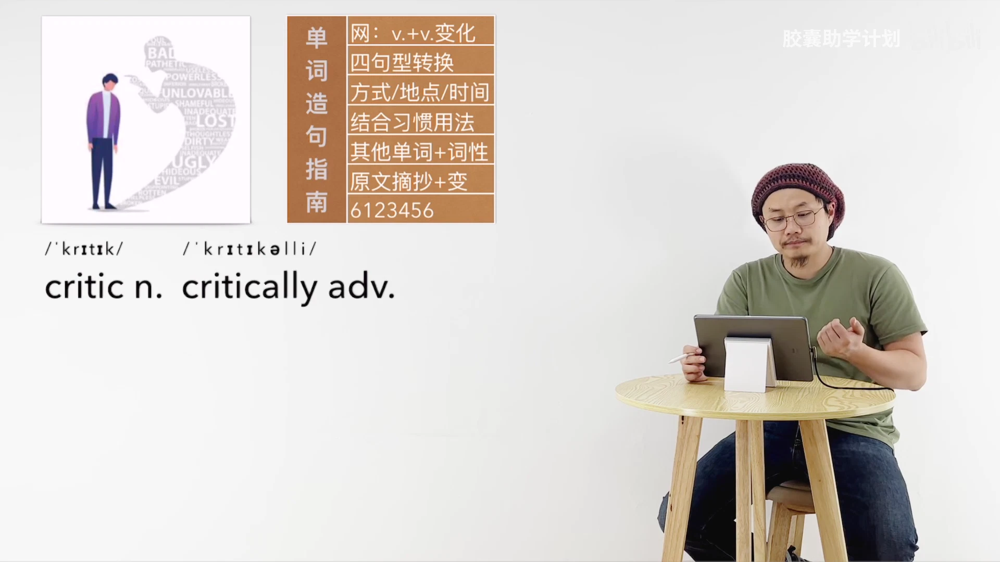

文字识别：单词造句指南 / 网：v.+v.变化 / 四句型转换 / UNLOVABL / 方式/地点/时间 / LOS1 / 结合习惯用法 / 其他单词+词性 / 原文摘抄+变 / 6123456 / /'kritik/ / /'kritikalli/ / critic n. critically adv.

### 画面 00:01:51

文字识别：单词造句指南 / 网：v.+v.变化 / BAD / 四句型转换 / 方式/地点/时间 / UNLOVABL / LOS / 结合习惯用法 / 其他单词+词性 / 原文摘抄+变 / 6123456 / /'kritik/ / /'kritikalli/ / critic n. critically adv.

### 画面 00:01:55

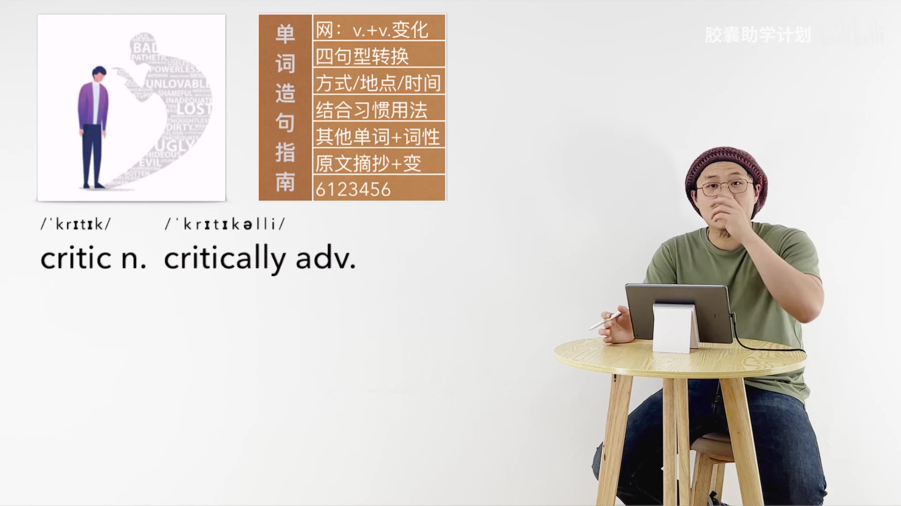

文字识别：单词造句指南 / 网：v.+v.变化 / BAD / 四句型转换 / 方式/地点/时间 / UNLOVABL / LOST / 结合习惯用法 / 其他单词+词性 / 原文摘抄+变 / 6123456 / /'kritik/ / /'kritikalli/ / critic n. critically adv.

## 00:02:00–00:02:30

音标啊，critic，OK，critic，OK，那副词呢叫做critically，critically，critically，OK，它叫做批判性的，OK，好或者批评性的，very good。那critic我们可以把它理解为叫做评论员，OK，比如说the film critic complained about the movie，OK，那film critic指的就是电影评论员，对吧？写

### 画面 00:02:00

文字识别：单词造句指南 / 网：v.+v.变化 / BAD / 四句型转换 / 方式/地点/时间 / UNLOVABL / LOST / 结合习惯用法 / 其他单词+词性 / 原文摘抄+变 / 6123456 / /'kritik/ / /'kritikalli/ / critic n. critically adv.

### 画面 00:02:05

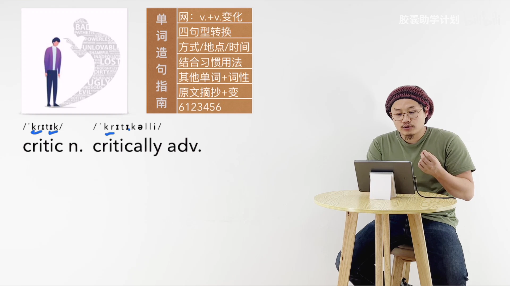

文字识别：单词造句指南 / 网：v.+v.变化 / BAL / 四句型转换 / UNLOVABL / 方式/地点/时间 / LOs / 结合习惯用法 / 其他单词+词性 / 原文摘抄+变 / 6123456 / /'kritik/ / /'kritrkalli/ / critic n. critically adv.

### 画面 00:02:10

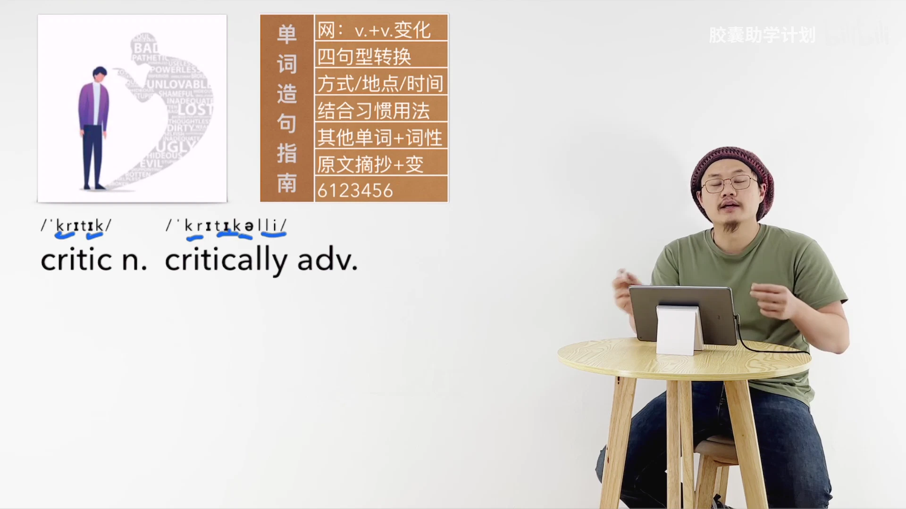

文字识别：单词造句指南 / 网：v.+v.变化 / BAL / 四句型转换 / 方式/地点/时间 / UNLOVABL / LOST / 结合习惯用法 / 其他单词+词性 / 原文摘抄+变 / 6123456 / /'kritik/ / /'kritikalli/ / critic n. critically adv.

### 画面 00:02:15

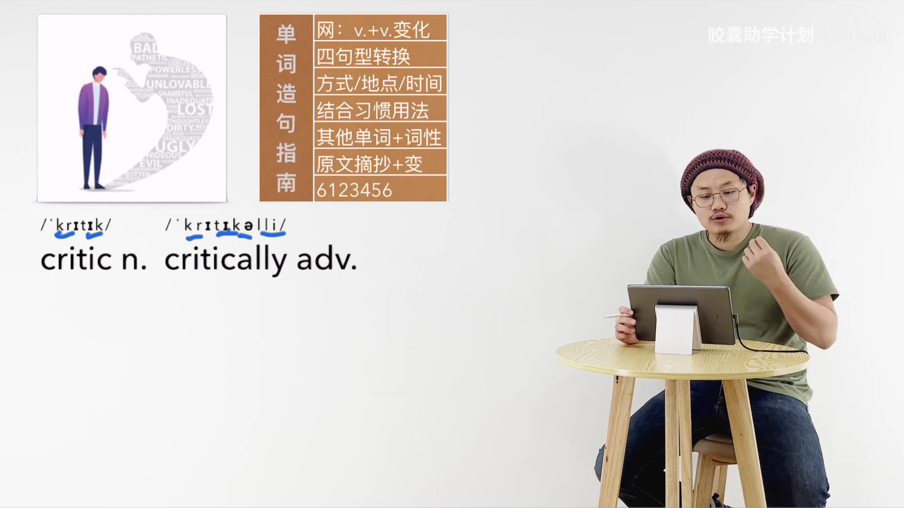

文字识别：单词造句指南 / 网：v.+v.变化 / BAD / 四句型转换 / UNLOVABL / 方式/地点/时间 / LOST / 结合习惯用法 / 其他单词+词性 / 原文摘抄+变 / 6123456 / /'kritik/ / /'kritikalli/ / critic n. critically adv.

### 画面 00:02:20

文字识别：单词造句指南 / 网：v.+v.变化 / BAD / 四句型转换 / UNLOVABL / 方式/地点/时间 / LOS1 / 结合习惯用法 / 其他单词+词性 / 原文摘抄+变 / 6123456 / /'kritik/ / /'kritikalli/ / critic n. critically adv.

### 画面 00:02:25

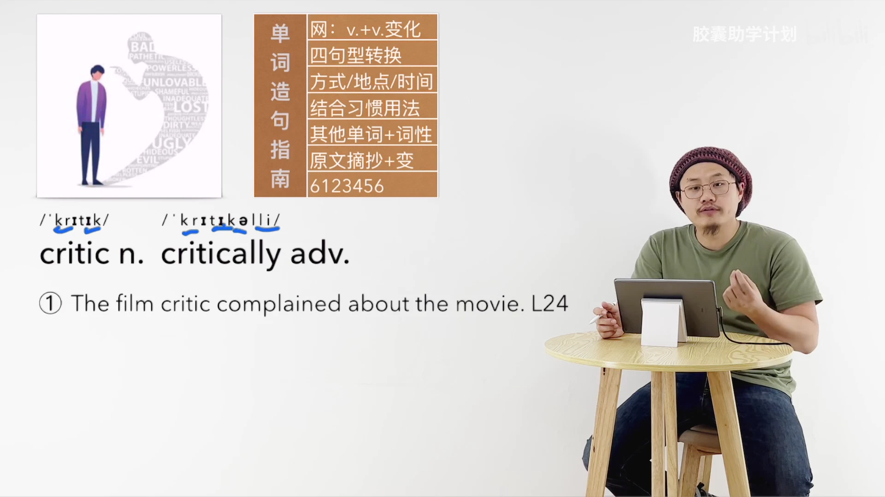

文字识别：单词造句指南 / 网：v.+v.变化 / BAD / 四句型转换 / 方式/地点/时间 / UNLOVABL / LOS1 / 结合习惯用法 / 其他单词+词性 / 原文摘抄+变 / 6123456 / /'kritik/ / /'kritikalli/ / critic n. critically adv. / ① The film critic complained about the movie. L24

## 00:02:30–00:03:00

这个，比如说关于这个电影好与坏，好好在什么地方，坏坏在什么地方。OK，那说他不停的他在抱怨这个电影，没有说他不停的，就只是说他抱怨了这个电影。这是我们二十四课学的一个习惯用法。接下来二十三课习惯用法 had a letter from。那你看在这个地方其实加进去就很容易了，叫 she had a letter from a film critic。那既然可以是 film critic，我们也可以说，比如说 music critic，对

### 画面 00:02:40

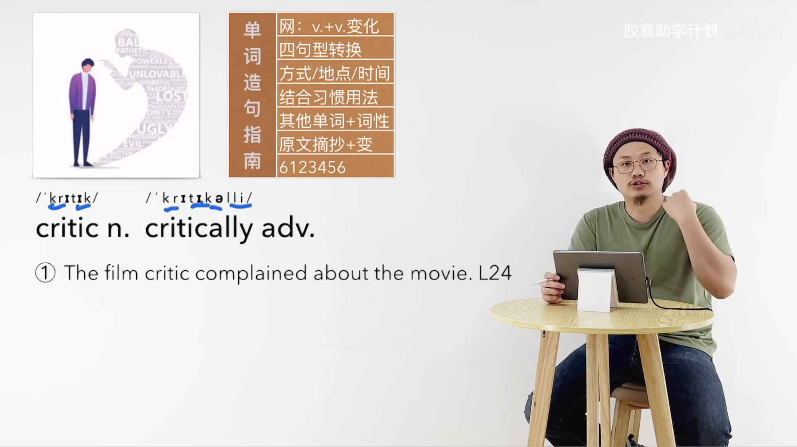

文字识别：单词造句指南 / 网：v.+v.变化 / BAU / 四句型转换 / 方式/地点/时间 / UNLOVABL / 结合习惯用法 / LOS / 其他单词+词性 / 原文摘抄+变 / 6123456 / /'kritik/ / /'kritikalli/ / critic n. critically adv. / ① The film critic complained about the movie. L24

### 画面 00:02:46

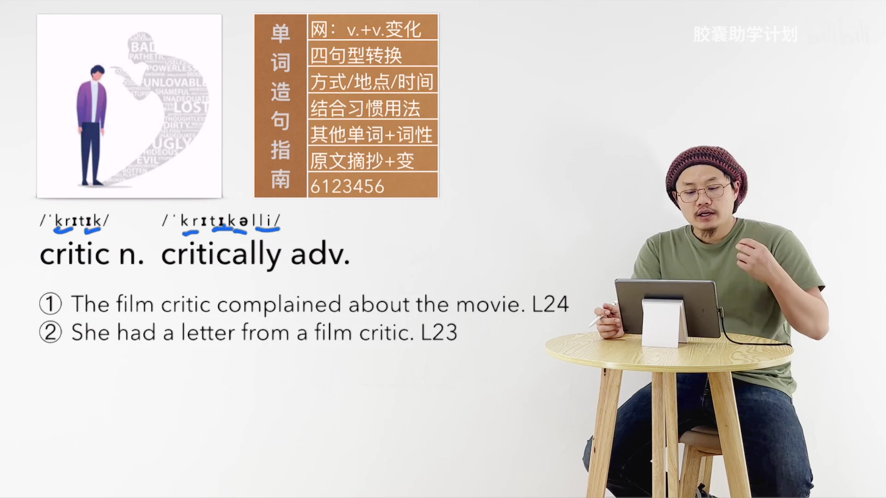

文字识别：单词造句指南 / 网：v.+v.变化 / BAL / 四句型转换 / 方式/地点/时间 / UNLOVABL / LOST / 结合习惯用法 / 其他单词+词性 / 原文摘抄+变 / 6123456 / /'kritik/ / /'kritikalli/ / critic n. critically adv. / ① The film critic complained about the movie. L24 / ) She had a letter from a film critic. L23

## 00:03:00–00:03:30

吧？好，比如说 you remind me of that music critic. Okay，你这个说话的方式和长相啊，让我想起了那个 music critic，那个音乐评论人。Very good，这是我们第十六课学的，对吧？Remind me of somebody or something. Very good. 接下来，文章当中给了一句话，叫 she looked at it critically for a moment. 她批判性的看了他一会儿。Very good. 肯定句给咱们了，各位能意识到这个副

### 画面 00:03:01

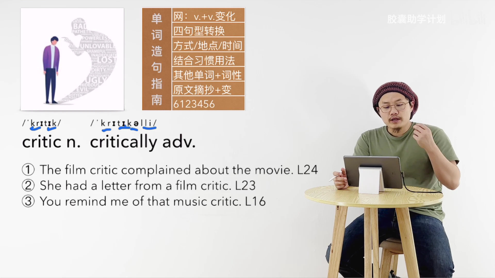

文字识别：单词造句指南 / 网：v.+v.变化 / BAD / 四句型转换 / 方式/地点/时间 / UNLOVABL / 结合习惯用法 / 其他单词+词性 / 原文摘抄+变 / 6123456 / /'kritik/ / /'kritikalli/ / critic n. critically adv. / ① The film critic complained about the movie. L24 /  She had a letter from a film critic. L23 / 2 /  You remind me of that music critic. L16 / 3

### 画面 00:03:05

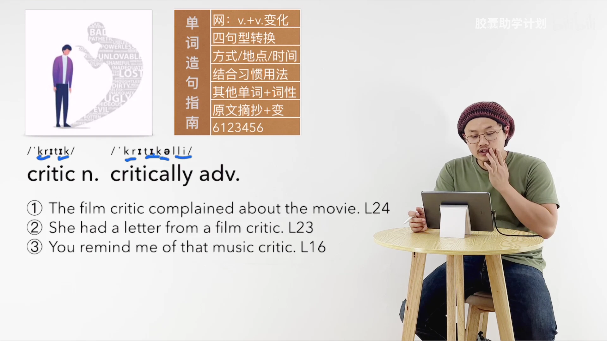

文字识别：单词造句指南 / 网：v.+v.变化 / BAL / 四句型转换 / 方式/地点/时间 / UNLOVABL / 结合习惯用法 / 其他单词+词性 / 原文摘抄+变 / 6123456 / /'kritik/ / /'kritikalli/ / critic n. critically adv. / ① The film critic complained about the movie. L24 / She had a letter from a film critic. L23 / 2） /  You remind me of that music critic. L16 / 3

### 画面 00:03:15

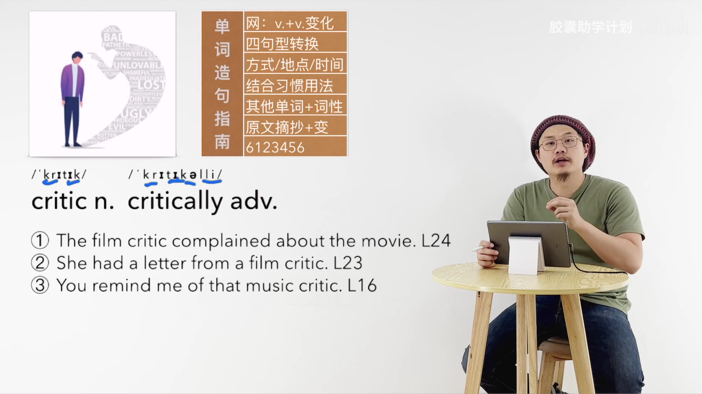

文字识别：单词造句指南 / 网：v.+v.变化 / BAU / 四句型转换 / 方式/地点/时间 / UNLOVABL / LOST / 结合习惯用法 / 其他单词+词性 / 原文摘抄+变 / 6123456 / /'kritik/ / /'kritikalli/ / critic n. critically adv. / ① The film critic complained about the movie. L24 /  She had a letter from a film critic. L23 / 2 /  You remind me of that music critic. L16 / 3

### 画面 00:03:20

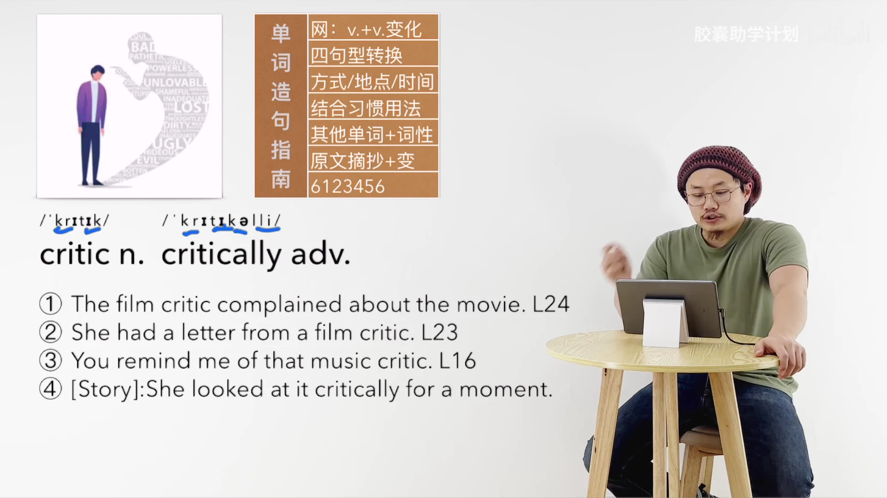

文字识别：单词造句指南 / 网：v.+v.变化 / BAD / 四句型转换 / 方式/地点/时间 / UNLOVABL / LOST / 结合习惯用法 / 其他单词+词性 / 原文摘抄+变 / 6123456 / /'kritik/ / /'kritikalli/ / critic n. critically adv. / ① The film critic complained about the movie. L24 /  She had a letter from a film critic. L23 / 2） /  You remind me of that music critic. L16 / 3 / [Story]:She looked at it critically for a moment.

### 画面 00:03:25

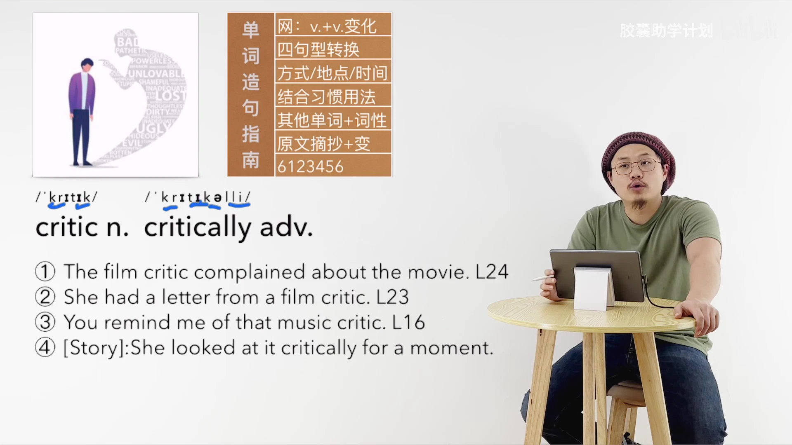

文字识别：单词造句指南 / 网：v.+v.变化 / BAL / 四句型转换 / 方式/地点/时间 / UNLOVABL / ELosT / 结合习惯用法 / 其他单词+词性 / 原文摘抄+变 / 6123456 / /'kritik/ / /'kritikalli/ / critic n. critically adv. / ① The film critic complained about the movie. L24 /  She had a letter from a film critic. L23 / 2 /  You remind me of that music critic. L16 / 3 / [Story]:She looked at it critically for a moment. / 4

## 00:03:30–00:04:00

词实际上是在修饰这里面的 look at 啊，以什么样的方式去看，是有这种批评性的、评判性的眼光去在看这个东西，对吧？肯定句给各位了，接下来各位可以在这地方暂停屏幕，口语直接把它变一般疑问句和我给各位的各种特殊疑问词，当然您也可以自己去想一些。OK，玩一个下一个单词，跟我读一下。其实新一就学过了，跟我读一下，叫做 paint paint。OK，

### 画面 00:03:30

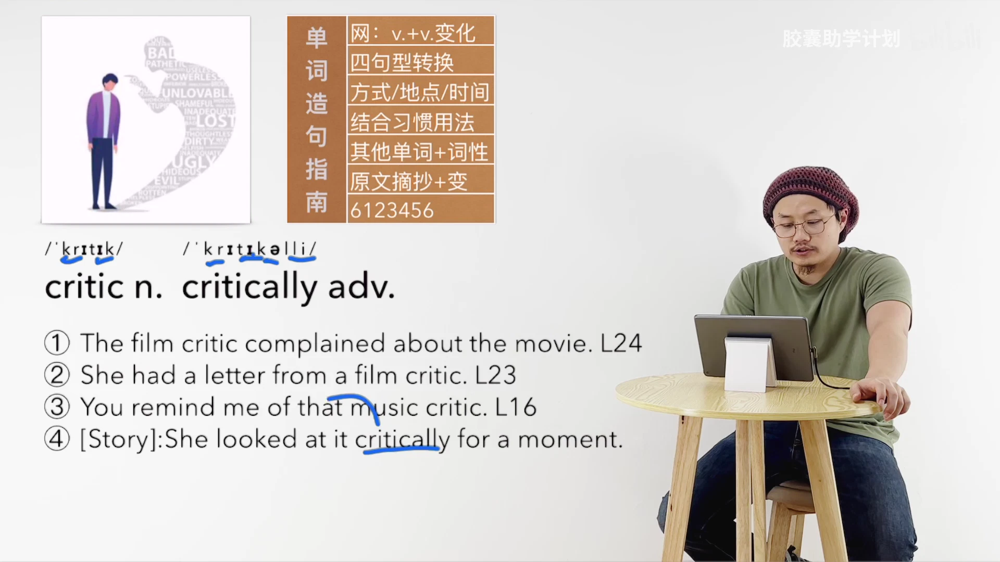

文字识别：单词造句指南 / 网：v.+v.变化 / BAD / 四句型转换 / UNLOVABL / 方式/地点/时间 / 结合习惯用法 / 其他单词+词性 / 原文摘抄+变 / 6123456 / /'kritik/ / /'kritikalli/ / critic n. critically adv. / ① The film critic complained about the movie. L24 / ) She had a letter from a film critic. L23 / 2 / You remind me of that music critic. L16 / [Story]:She looked at it critically for a moment.

### 画面 00:03:35

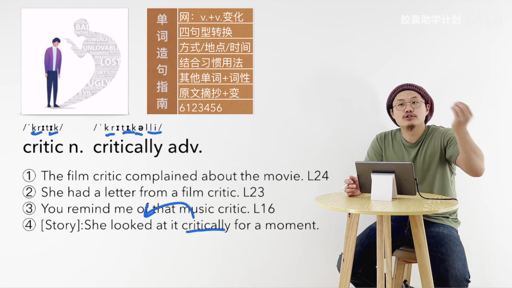

文字识别：单词造句指南 / 网：v.+v.变化 / BAD / 四句型转换 / 方式/地点/时间 / UNLOVABL / LoST / 结合习惯用法 / 其他单词+词性 / 原文摘抄+变 / 6123456 / /'kritik/ / /'kritikalli/ / critic n. critically adv. / ① The film critic complained about the movie. L24 / She had a letter from a film critic. L23 / You remind me oLthat music critic. L16 / [Story]:She looked at it critically for a moment.

### 画面 00:03:45

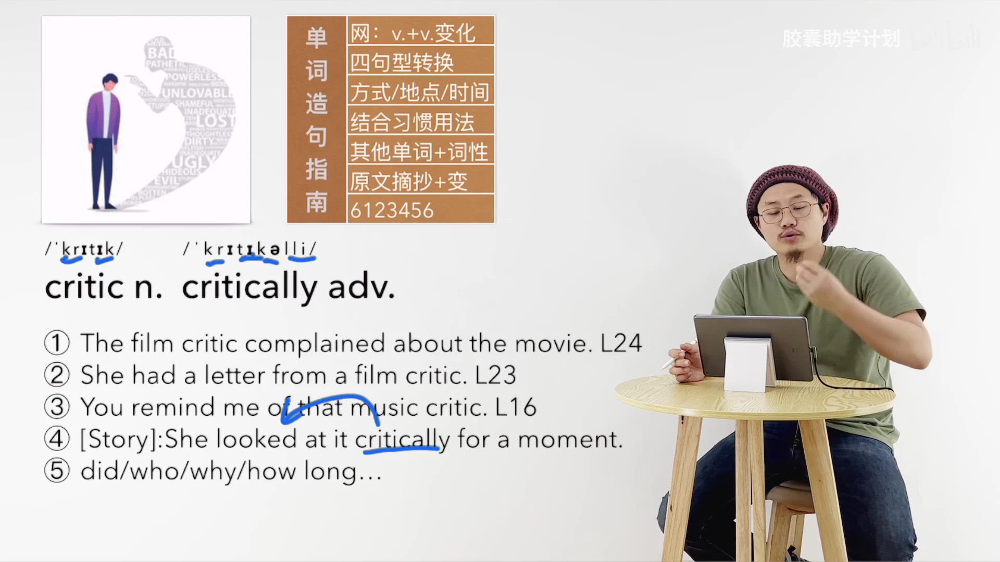

文字识别：单词造句指南 / 网：v.+v.变化 / BAU / 四句型转换 / 方式/地点/时间 / UNLOVABL / ELOST / 结合习惯用法 / 其他单词+词性 / 原文摘抄+变 / 6123456 / /'kritik/ / /'kritikalli/ / critic n. critically adv. / ① The film critic complained about the movie. L24 / She had a letter from a film critic. L23 / 2 / You remind me olLthat music critic. L16 / [Story]:She looked at it critically for a moment. / did/who/why/how long...

### 画面 00:03:51

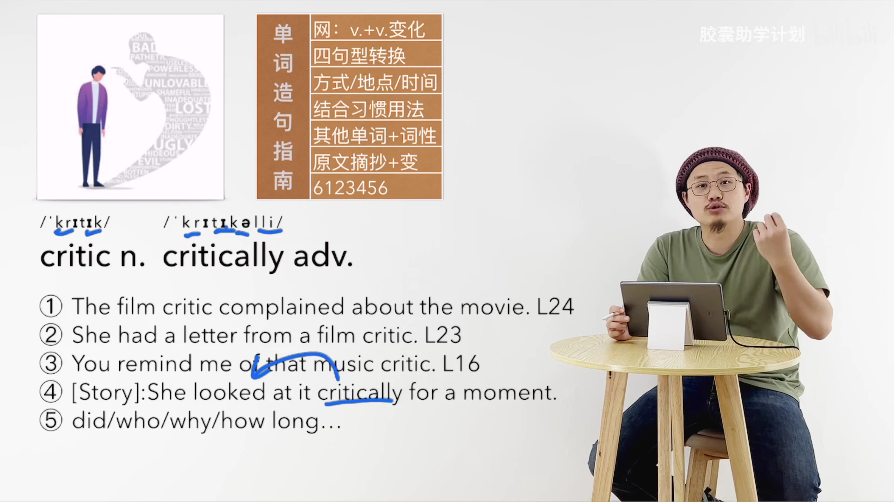

文字识别：单词造句指南 / 网：v.+v.变化 / BAL / 四句型转换 / 方式/地点/时间 / UNLOVABL / ELOS1 / 结合习惯用法 / 其他单词+词性 / 原文摘抄+变 / 6123456 / /'kritik/ / /'kritikalli/ / critic n. critically adv. / ① The film critic complained about the movie. L24 / ) She had a letter from a film critic. L23 / 2） / You remind me olthat music critic. L16 / [Story]:She looked at it critically for a moment. / did/who/why/how long...

### 画面 00:03:53

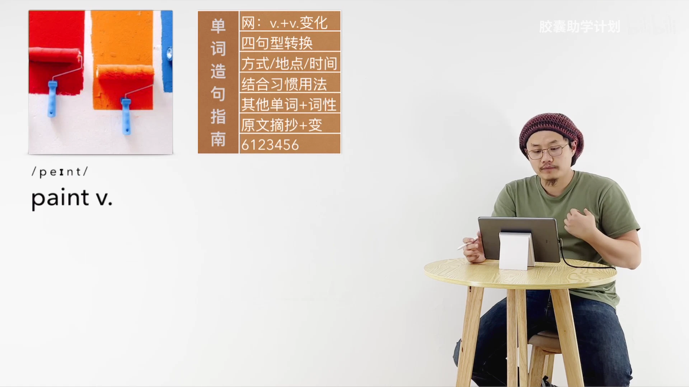

文字识别：单词造句指南 / 网：v.+v.变化 / 四句型转换 / 方式/地点/时间 / 结合习惯用法 / 其他单词+词性 / 原文摘抄+变 / 6123456 / /peint/ / paint v.

### 画面 00:03:55

文字识别：单词造句指南 / 网：v.+v.变化 / 四句型转换 / 方式/地点/时间 / 结合习惯用法 / 其他单词+词性 / 原文摘抄+变 / 6123456 / /peint/ / paint v.

## 00:04:00–00:04:30

就我们刷漆这个动作，刷这个动作就可以管它叫paint. There you go.比如说, the wall will be painted next week.这是我们的二十一课学过的, will be that叫将被怎么怎么样. There you go. Continue.说the house must be painted,必须要被刷一下漆. There you go. Continue.再来二十课, instead of doing something,说instead of painting the whole room,它本该啊把整

### 画面 00:04:00

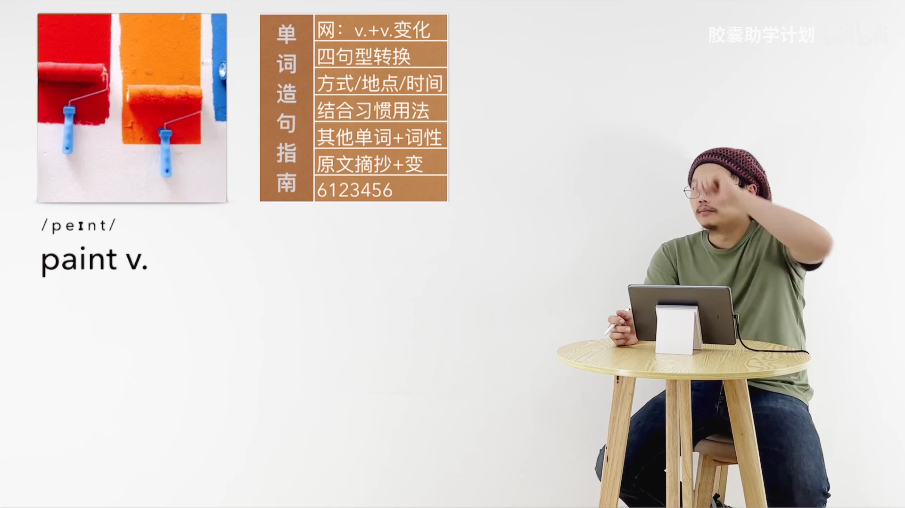

文字识别：单词造句指南 / 网：v.+v.变化 / 四句型转换 / 方式/地点/时间 / 结合习惯用法 / 其他单词+词性 / 原文摘抄+变 / 6123456 / /peint/ / paint v.

### 画面 00:04:06

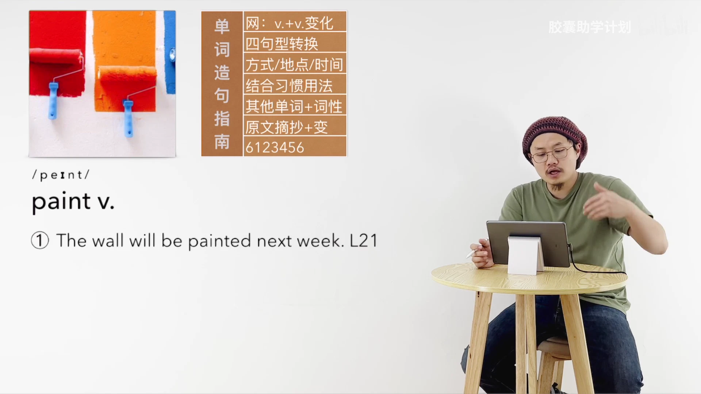

文字识别：单词造句指南 / 网：v.+v.变化 / 四句型转换 / 方式/地点/时间 / 结合习惯用法 / 其他单词+词性 / 原文摘抄+变 / 6123456 / /peint/ / paint v. / ① The wall will be painted next week. L21

### 画面 00:04:10

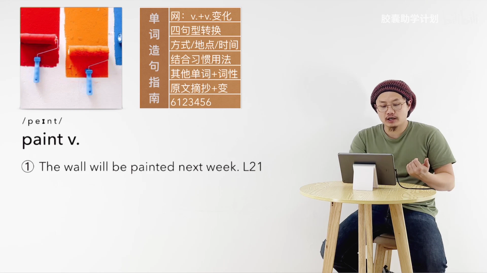

文字识别：单词造句指南 / 网：v.+v.变化 / 四句型转换 / 方式/地点/时间 / 结合习惯用法 / 其他单词+词性 / 原文摘抄+变 / 6123456 / /peint/ / paint v. / ① The wall will be painted next week. L21

### 画面 00:04:15

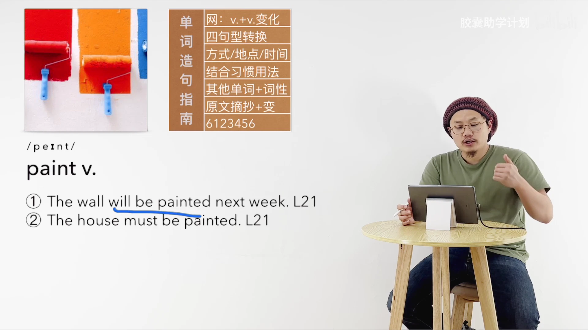

文字识别：单词造句指南 / 网：v.+v.变化 / 四句型转换 / 方式/地点/时间 / 结合习惯用法 / 其他单词+词性 / 原文摘抄+变 / 6123456 / /peint/ / paint v. / ① The wall will be painted next week. L21 / The house must be painted. L21

### 画面 00:04:22

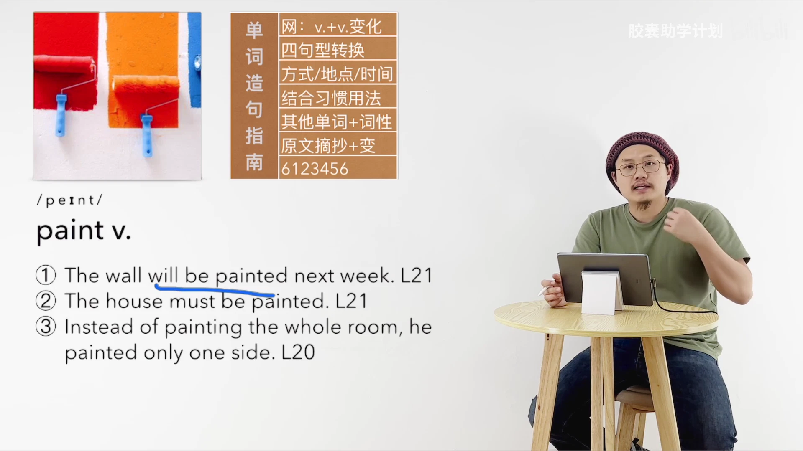

文字识别：单词造句指南 / 网：v.+v.变化 / 四句型转换 / 方式/地点/时间 / 结合习惯用法 / 其他单词+词性 / 原文摘抄+变 / 6123456 / /peint/ / paint v. / ① The wall will be painted next week. L21 / The house must be painted. L21 / Instead of painting the whole room, he / painted only one side. L20

### 画面 00:04:25

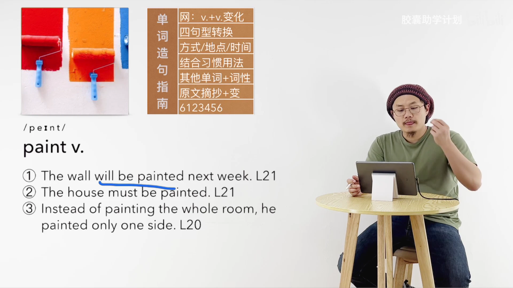

文字识别：单词造句指南 / 网：v.+v.变化 / 四句型转换 / 方式/地点/时间 / 结合习惯用法 / 其他单词+词性 / 原文摘抄+变 / 6123456 / /peint/ / paint v. / ① The wall will be painted next week. L21 / The house must be painted. L21 / Instead of painting the whole room, he / painted only one side. L20

## 00:04:30–00:05:00

个房间都给喷，都给刷上漆，对吧？他没有去做这件事情，代替做这件事情，他做的是什么事呢？He painted only one side.他只去涂了一面墙。Okay, very good.接下来下一个单词，我们管它叫，恭喜读一下，注意重音在后面。恭喜读叫pretend, pretend. Okay,叫假装。Okay,好。然后呢，我们可以造一，哎，这它其实pretend有一个常用的小的句型

### 画面 00:04:43

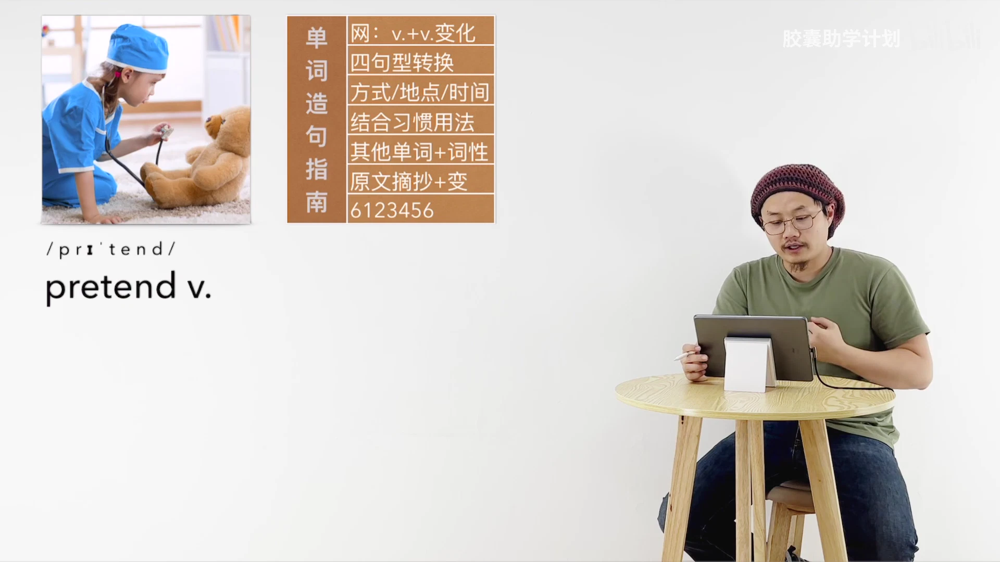

文字识别：单词造句指南 / 网：v.+v.变化 / 四句型转换 / 方式/地点/时间 / 结合习惯用法 / 其他单词+词性 / 原文摘抄+变 / 6123456 / /prl'tend/ / pretend v.

### 画面 00:04:45

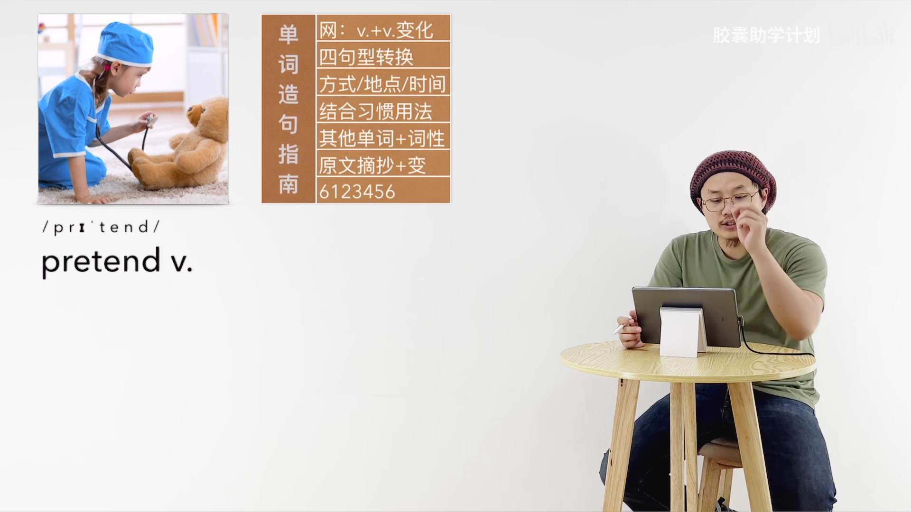

文字识别：单词造句指南 / 网：v.+v.变化 / 四句型转换 / 方式/地点/时间 / 结合习惯用法 / 其他单词+词性 / 原文摘抄+变 / 6123456 / /prl'tend/ / pretend v.

### 画面 00:04:50

文字识别：单词造句指南 / 网：v.+v.变化 / 四句型转换 / 方式/地点/时间 / 结合习惯用法 / 其他单词+词性 / 原文摘抄+变 / 6123456 / /pri'tend/ / pretend v.

### 画面 00:04:55

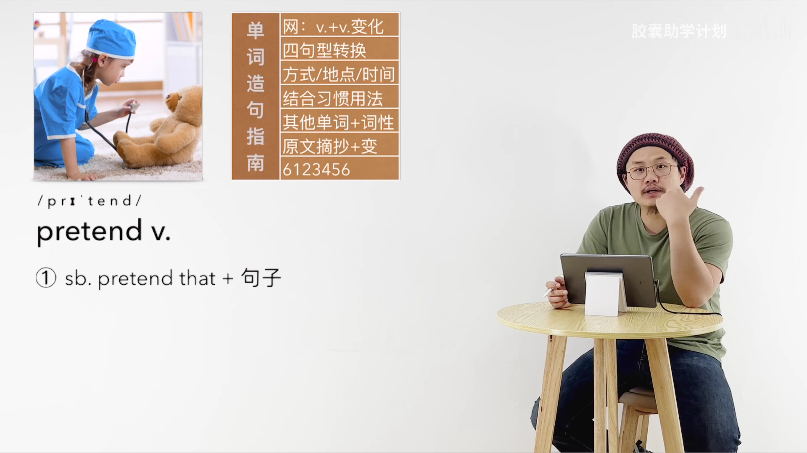

文字识别：单词造句指南 / 网：v.+v.变化 / 四句型转换 / 方式/地点/时间 / 结合习惯用法 / 其他单词+词性 / 原文摘抄+变 / 6123456 / /pri'tend/ / pretend v. / ① sb. pretend that + 句子

## 00:05:00–00:05:30

叫 somebody某人 pretend that，再加上一句话，这句话很明显了，它就是一个宾语从句。那我们由它尝试去造一些句子出来。来了啊，说 she pretended that she was interested in fishing。啊，她假装了，她对钓鱼这件事情很感兴趣。Ready go，再来，说 you always pretend that you a you pay attention to my words。啊，可能是情侣

### 画面 00:05:00

文字识别：单词造句指南 / 网：v.+v.变化 / 四句型转换 / 方式/地点/时间 / 结合习惯用法 / 其他单词+词性 / 原文摘抄+变 / 6123456 / /pri'tend/ / pretend v. / ① sb. pretend that + 句子

### 画面 00:05:03

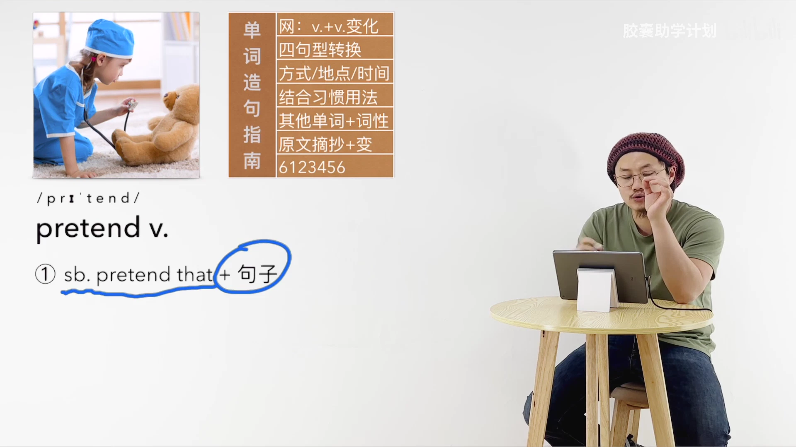

文字识别：单词造句指南 / 网：v.+v.变化 / 四句型转换 / 方式/地点/时间 / 结合习惯用法 / 其他单词+词性 / 原文摘抄+变 / 6123456 / /prI'tend/ / pretend v. / sb. pretend that+句子

### 画面 00:05:05

文字识别：单词造句指南 / 网：v.+v.变化 / 四句型转换 / 方式/地点/时间 / 结合习惯用法 / 其他单词+词性 / 原文摘抄+变 / 6123456 / /pri'tend/ / pretend v. / 1 / sb. pretend that+句子

### 画面 00:05:10

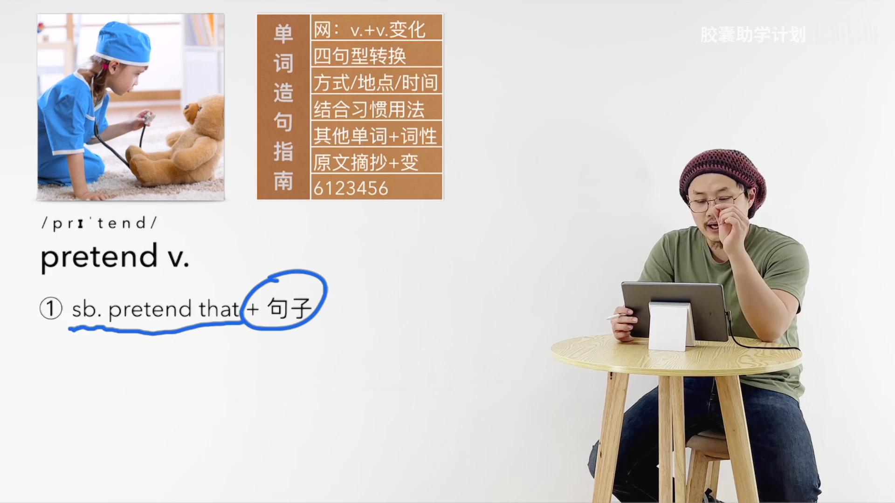

文字识别：单词造句指南 / 网：v.+v.变化 / 四句型转换 / 方式/地点/时间 / 结合习惯用法 / 其他单词+词性 / 原文摘抄+变 / 6123456 / /pri'tend/ / pretend v. / sb. pretend that+句子

### 画面 00:05:15

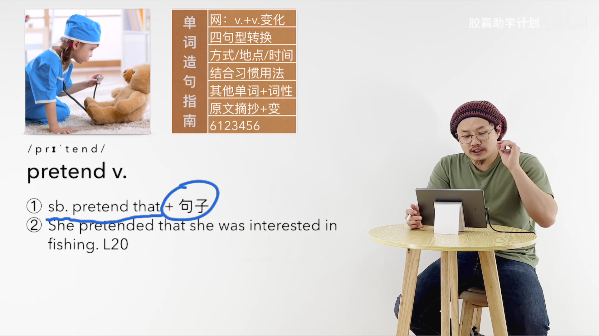

文字识别：单词造句指南 / 网：v.+v.变化 / 四句型转换 / 方式/地点/时间 / 结合习惯用法 / 其他单词+词性 / 原文摘抄+变 / 6123456 / /prl'tend/ / pretend v. / sb. pretend that+句子 / 1 / She pretended that she was interested in / fishing. L20

### 画面 00:05:20

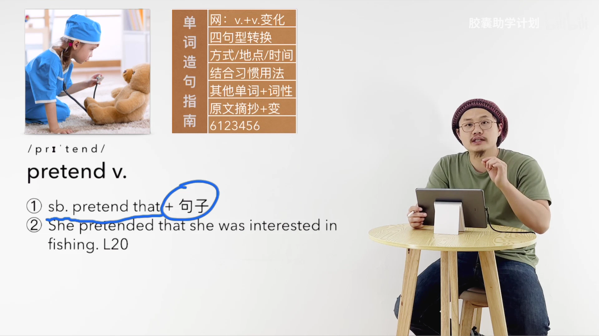

文字识别：单词造句指南 / 网：v.+v.变化 / 四句型转换 / 方式/地点/时间 / 结合习惯用法 / 其他单词+词性 / 原文摘抄+变 / 6123456 / /pri'tend/ / pretend v. / sb. pretend that+句子 / She pretended that she was interested in / fishing. L20

### 画面 00:05:25

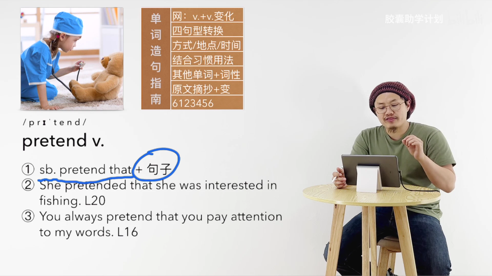

文字识别：单词造句指南 / 网：v.+v.变化 / 四句型转换 / 方式/地点/时间 / 结合习惯用法 / 其他单词+词性 / 原文摘抄+变 / 6123456 / /prr'tend/ / pretend v. / sb. pretend that+句子 / 1 / She pretended that she was interested in / fishing. L20 / You always pretend that you pay attention / to my words. L16

## 00:05:30–00:06:00

之间吵架，说你总是假装你对我说的话是非常注意的啊。But in fact, ah, or, ah, in reality, you don't, you don't really interested,对吧？但实际上你并不是很感兴趣，你只是假装这样去做。Continue, pattern, pattern这个单词它的意思指的是，比如说我们看到的一些美丽的图案啊，比如说它这个图案可以是我们说这

### 画面 00:05:30

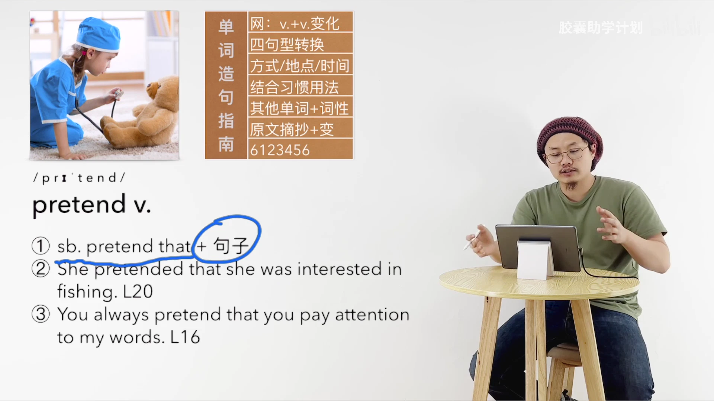

文字识别：单词造句指南 / 网：v.+v.变化 / 四句型转换 / 方式/地点/时间 / 结合习惯用法 / 其他单词+词性 / 原文摘抄+变 / 6123456 / /prr'tend/ / pretend v. / sb. pretend that+ 句子 / She pretended that she was interested in / fishing. L20 / You always pretend that you pay attention / to my words. L16

### 画面 00:05:40

文字识别：单词造句指南 / 网：v.+v.变化 / 四句型转换 / 方式/地点/时间 / 结合习惯用法 / 其他单词+词性 / 原文摘抄+变 / 6123456 / /prr'tend/ / pretend v. / sb. pretend that+句子 / 1 / She pretended that she was interested in / fishing. L20 / You always pretend that you pay attention / to my words. L16

### 画面 00:05:46

文字识别：单词造句指南 / 网：v.+v.变化 / 四句型转换 / 方式/地点/时间 / 结合习惯用法 / 其他单词+词性 / 原文摘抄+变 / 6123456 / /prr'tend/ / pretend v. / sb. pretend that+句子 / 1 / She pretended that she was interested in / fishing. L20 / You always pretend that you pay attention / to my words. L16

### 画面 00:05:48

文字识别：单词造句指南 / 网：v.+v.变化 / 四句型转换 / 方式/地点/时间 / 结合习惯用法 / 其他单词+词性 / 原文摘抄+变 / 6123456 / / 'pætan/ / pattern n.

### 画面 00:05:50

文字识别：单词造句指南 / 网：v.+v.变化 / 四句型转换 / 方式/地点/时间 / 结合习惯用法 / 其他单词+词性 / 原文摘抄+变 / 6123456 / / 'pæt an/ / pattern n. / ① pretty pattern n.+ v.

## 00:06:00–00:06:30

个地板砖，可以是墙面啊，可以是窗帘儿。总之，它的意思就是这样一种图案。跟我一起读一下，叫做 pattern variation。那 pattern 它本身是个名词，我们再来一个，比如说 pretty pattern。我们加的形容词啊，复习一下之前学过的单词。然后我们肯定是要找动词的。接下来十九课 may do，对吧？可能怎么怎么样？说 she may like this pretty pattern。她可能喜欢这个特别美丽的图

### 画面 00:06:05

文字识别：单词造句指南 / 网：v.+v.变化 / 四句型转换 / 方式/地点/时间 / 结合习惯用法 / 其他单词+词性 / 原文摘抄+变 / 6123456 / / 'pætan/ / pattern n. / ① pretty pattern n.+ v.

### 画面 00:06:10

文字识别：单词造句指南 / 网：v.+v.变化 / 四句型转换 / 方式/地点/时间 / 结合习惯用法 / 其他单词+词性 / 原文摘抄+变 / 6123456 / / 'pætan/ / pattern n. / ① pretty pattern n.+ v.

### 画面 00:06:20

文字识别：单词造句指南 / 网：v.+v.变化 / 四句型转换 / 方式/地点/时间 / 结合习惯用法 / 其他单词+词性 / 原文摘抄+变 / 6123456 / / 'pætan / / pattern n. / ① pretty pattern n.+ v. / ② She may like this pretty pattern. L19

### 画面 00:06:28

文字识别：单词造句指南 / 网：v.+v.变化 / 四句型转换 / 方式/地点/时间 / 结合习惯用法 / 其他单词+词性 / 原文摘抄+变 / 6123456 / / 'pætan/ / pattern n. / ① pretty pattern n.+ v. / ② She may like this pretty pattern. L19

## 00:06:30–00:07:00

案，但也可能不喜欢。 We don't really know. Okay, 我并不是真的知道。 Next one, 第十四课说, as soon as she saw the wall, 她一看到这墙, she liked the pretty patterns on it. Okay, 她一看到墙，她就喜欢这个上面美丽的图案。比如说莫高窟，对吧？上面那些美丽的图案。 Very good. Next one, we'll be seeing some pretty patterns tonight. 啊，今

### 画面 00:06:34

文字识别：单词造句指南 / 网：v.+v.变化 / 四句型转换 / 方式/地点/时间 / 结合习惯用法 / 其他单词+词性 / 原文摘抄+变 / 6123456 / / 'pætan/ / pattern n. / ① pretty pattern n.+ v. / ② She may like this pretty pattern. L19 / ) As soon as she saw the wall, she liked the / 3 / pretty patterns on it. L14

### 画面 00:06:36

文字识别：单词造句指南 / 网：v.+v.变化 / 四句型转换 / 方式/地点/时间 / 结合习惯用法 / 其他单词+词性 / 原文摘抄+变 / 6123456 / / 'pætan/ / pattern n. / ① pretty pattern n.+ v. / ② She may like this pretty pattern. L19 / ) As soon as she saw the wall, she liked the / 3 / pretty patterns on it. L14

### 画面 00:06:42

文字识别：单词造句指南 / 网：v.+v.变化 / 四句型转换 / 方式/地点/时间 / 结合习惯用法 / 其他单词+词性 / 原文摘抄+变 / 6123456 / / 'pætan/ / pattern n. / ① pretty pattern n.+ v. / ② She may like this pretty pattern. L19 / ) As soon as she saw the wall, she liked the / 3 / pretty patterns on it. L14

### 画面 00:06:45

文字识别：单词造句指南 / 网：v.+v.变化 / 四句型转换 / 方式/地点/时间 / 结合习惯用法 / 其他单词+词性 / 原文摘抄+变 / 6123456 / / 'pætan/ / pattern n. / ① pretty pattern n.+ v. / ② She may like this pretty pattern. L19 / ) As soon as she saw the wall, she liked the / 3 / pretty patterns on it. L14

### 画面 00:06:55

文字识别：单词造句指南 / 网：v.+v.变化 / 四句型转换 / 方式/地点/时间 / 结合习惯用法 / 其他单词+词性 / 原文摘抄+变 / 6123456 / / 'pætan/ / pattern n. / ① pretty pattern n.+ v. / ② She may like this pretty pattern. L19 / 3 / ) As soon as she saw the wall, she liked the / pretty patterns on it. L14 / We will be seeing some pretty patterns / tonight. L13

## 00:07:00–00:07:30

晚上我要带你去一个好地上好地方。我们将看到一些特别美丽的图案。第十三课咱们学过的叫We'll be doing。那在这个地方还是在反复提醒各位，怎么把前面的东西学扎实呢？您一定要养成一个习惯，把它总结起来，然后在单词造句的时候不停的往前翻，去看前面咱们学过的东西。OK，玩一个next one，跟我一起读，叫做curtain curtain。

### 画面 00:07:00

文字识别：单词造句指南 / 网：v.+v.变化 / 四句型转换 / 方式/地点/时间 / 结合习惯用法 / 其他单词+词性 / 原文摘抄+变 / 6123456 / / 'pætan/ / pattern n. / ① pretty pattern n.+ v. / ② She may like this pretty pattern. L19 / 3 / ) As soon as she saw the wall, she liked the / pretty patterns on it. L14 / We will be seeing some pretty patterns / tonight. L13

### 画面 00:07:07

文字识别：单词造句指南 / 网：v.+v.变化 / 四句型转换 / 方式/地点/时间 / 结合习惯用法 / 其他单词+词性 / 原文摘抄+变 / 6123456 / / 'pætan/ / pattern n. / ① pretty pattern n.+ v. / ② She may like this pretty pattern. L19 / 3 / ) As soon as she saw the wall, she liked the / pretty patterns on it. L14 / We will be seeing some pretty patterns / tonight. L13

### 画面 00:07:10

文字识别：单词造句指南 / 网：v.+v.变化 / 四句型转换 / 方式/地点/时间 / 结合习惯用法 / 其他单词+词性 / 原文摘抄+变 / 6123456 / / 'pætan/ / pattern n. / ① pretty pattern n.+ v. / ② She may like this pretty pattern. L19 / 3 / ) As soon as she saw the wall, she liked the / pretty patterns on it. L14 / We will be seeing some pretty patterns / tonight. L13

### 画面 00:07:24

文字识别：单词造句指南 / 网：v.+v.变化 / 四句型转换 / 方式/地点/时间 / 结合习惯用法 / 其他单词+词性 / 原文摘抄+变 / 6123456 / / 'pætan/ / pattern n. / ① pretty pattern n.+ v. / ② She may like this pretty pattern. L19 / 3 / ) As soon as she saw the wall, she liked the / pretty patterns on it. L14 / We will be seeing some pretty patterns / tonight. L13

### 画面 00:07:26

文字识别：单词造句指南 / 网：v.+v.变化 / 四句型转换 / 方式/地点/时间 / 结合习惯用法 / 其他单词+词性 / 原文摘抄+变 / 6123456 / /'k3:tan/ / curtain n.

## 00:07:30–00:08:00

好，curtain的意思，我们管它叫窗帘啊。我们家里面这个窗帘，那我们拿它去造句，它很简单，是一个名词。我们只要找到动词，比如说like, buy等等一系列这样的一些动词。然后呢，当然您也可以找其他的一些习惯用法啊。我们之前学过的，也让各位尝试去总结了。那我们造句，比如说Can we afford to pay this curtain?那这个窗帘这么贵，十万块钱，对吧？

### 画面 00:07:30

文字识别：单词造句指南 / 网：v.+v.变化 / 四句型转换 / 方式/地点/时间 / 结合习惯用法 / 其他单词+词性 / 原文摘抄+变 / 6123456 / /'k3:tan/ / curtain n.

### 画面 00:07:35

文字识别：单词造句指南 / 网：v.+v.变化 / 四句型转换 / 方式/地点/时间 / 结合习惯用法 / 其他单词+词性 / 原文摘抄+变 / 6123456 / / k3:tan/ / curtain n. / ① Can we afford to pay this curtain? L15

### 画面 00:07:40

文字识别：单词造句指南 / 网：v.+v.变化 / 四句型转换 / 方式/地点/时间 / 结合习惯用法 / 其他单词+词性 / 原文摘抄+变 / 6123456 / / 'k3:tan/ / curtain n. / ① Can we afford to pay this curtain? L15

### 画面 00:07:45

文字识别：单词造句指南 / 网：v.+v.变化 / 四句型转换 / 方式/地点/时间 / 结合习惯用法 / 其他单词+词性 / 原文摘抄+变 / 6123456 / / 'k3:tan/ / curtain n. / ① Can we afford to pay this curtain? L15

### 画面 00:07:50

文字识别：单词造句指南 / 网：v.+v.变化 / 四句型转换 / 方式/地点/时间 / 结合习惯用法 / 其他单词+词性 / 原文摘抄+变 / 6123456 / / 'k3:tan/ / curtain n. / ① Can we afford to pay this curtain? L15

### 画面 00:07:56

文字识别：单词造句指南 / 网：v.+v.变化 / 四句型转换 / 方式/地点/时间 / 结合习惯用法 / 其他单词+词性 / 原文摘抄+变 / 6123456 / / 'k3:tan/ / curtain n. / ① Can we afford to pay this curtain? L15

## 00:08:00–00:08:30

我们能支付得起吗？Very good. Continue. Say this is the most beautiful curtain I've ever seen.这是我见过最美丽的窗帘。第八课咱们学的。再来. While my husband was still sleeping,当他还依旧正睡睡觉的时候呢，I got the curtain.我已经拿到了这个窗帘。OK. Very good. Next one.下一个小的单词，跟我一起读一下，看音标叫material.

### 画面 00:08:00

文字识别：单词造句指南 / 网：v.+v.变化 / 四句型转换 / 方式/地点/时间 / 结合习惯用法 / 其他单词+词性 / 原文摘抄+变 / 6123456 / / 'k3:tan/ / curtain n. / ① Can we afford to pay this curtain? L15

### 画面 00:08:05

文字识别：单词造句指南 / 网：v.+v.变化 / 四句型转换 / 方式/地点/时间 / 结合习惯用法 / 其他单词+词性 / 原文摘抄+变 / 6123456 / / 'k3itan/ / curtain n. / ① Can we afford to pay this curtain? L15 / This is the most beautiful curtain I've ever / seen.L8

### 画面 00:08:12

文字识别：单词造句指南 / 网：v.+v.变化 / 四句型转换 / 方式/地点/时间 / 结合习惯用法 / 其他单词+词性 / 原文摘抄+变 / 6123456 / / 'k3:tan/ / curtain n. / ① Can we afford to pay this curtain? L15 / This is the most beautiful curtain I've ever / seen.L8 / While my husband was still sleeping, I got / the curtain. L7

### 画面 00:08:15

文字识别：单词造句指南 / 网：v.+v.变化 / 四句型转换 / 方式/地点/时间 / 结合习惯用法 / 其他单词+词性 / 原文摘抄+变 / 6123456 / / 'k3:tan/ / curtain n. / ① Can we afford to pay this curtain? L15 / This is the most beautiful curtain l've ever / seen.L8 / While my husband was still sleeping, I got / the curtain. L7

### 画面 00:08:23

文字识别：单词造句指南 / 网：v.+v.变化 / 四句型转换 / 方式/地点/时间 / 结合习惯用法 / 其他单词+词性 / 原文摘抄+变 / 6123456 / /ma'trarial/ / material n.

### 画面 00:08:25

文字识别：单词造句指南 / 网：v.+v.变化 / 四句型转换 / 方式/地点/时间 / 结合习惯用法 / 其他单词+词性 / 原文摘抄+变 / 6123456 / /ma'tiarial/ / material n.

## 00:08:30–00:09:00

material.好，我们管它叫做一种东西的材料。比如说这个是木头做的，那它的材料就是木头，对吧？好，我们这说金属啊，这是做这个东西的材料，我们管它叫材料。那比如说 listening material，我们给它稍微拓展了一下，叫做听力材料，好吧？比如说英文的听力材料。那我们造句子，比如说 this listening material is harder than that one.哎，这个

### 画面 00:08:30

文字识别：单词造句指南 / 网：v.+v.变化 / 四句型转换 / 方式/地点/时间 / 结合习惯用法 / 其他单词+词性 / 原文摘抄+变 / 6123456 / /ma'tiarial/ / material n.

### 画面 00:08:35

文字识别：单词造句指南 / 网：v.+v.变化 / 四句型转换 / 方式/地点/时间 / 结合习惯用法 / 其他单词+词性 / 原文摘抄+变 / 6123456 / /ma'tiarial/ / material n.

### 画面 00:08:50

文字识别：单词造句指南 / 网：v.+v.变化 / 四句型转换 / 方式/地点/时间 / 结合习惯用法 / 其他单词+词性 / 原文摘抄+变 / 6123456 / /ma'tiarial/ / material n. / listening material + v.

### 画面 00:08:55

文字识别：单词造句指南 / 网：v.+v.变化 / 四句型转换 / 方式/地点/时间 / 结合习惯用法 / 其他单词+词性 / 原文摘抄+变 / 6123456 / /ma'tiarial/ / material n. / listening material + v. / This listening material is harder than that / one.L8

## 00:09:00–00:09:30

个听力材料比那个要更难看啊。Is harder than something.第八课咱们学过的形容词比较级和最高级那个地方学到的. Continue,说What material is this dress?好，这个裙子是什么材质的呀？是什么材？是羊毛的吗？啊，还还是尼龙的呀？等等，对吧？OK，好，还是涤纶的呀？第二个，下一个单词，我们一起读一下，叫

### 画面 00:09:15

文字识别：单词造句指南 / 网：v.+v.变化 / 四句型转换 / 方式/地点/时间 / 结合习惯用法 / 其他单词+词性 / 原文摘抄+变 / 6123456 / /ma'tiarial/ / material n. / listening material + v. / This listening material is harder than that / one.L8 / What material is this dress?

### 画面 00:09:26

文字识别：单词造句指南 / 网：v.+v.变化 / 四句型转换 / 方式/地点/时间 / 结合习惯用法 / 其他单词+词性 / 原文摘抄+变 / 6123456 / /a'pri: Jieit/ / appreciate 欣赏 感激v.

## 00:09:30–00:10:00

做 appreciate。好，稍微有点长，我们再来一遍 appreciate，连起来 appreciate appreciate。好，我们原文给的意思叫鉴赏，是吧？我们其实尝试我给各位扩展两个更常见的意思，它包含了鉴赏这个能力。在我看来啊，一个叫欣赏，一个叫感激。好，比如说我们在这儿就说感激的意思吧。比如说 I really

### 画面 00:09:30

文字识别：单词造句指南 / 网：v.+v.变化 / 四句型转换 / 方式/地点/时间 / 结合习惯用法 / 其他单词+词性 / 原文摘抄+变 / 6123456 / /a'pri: ∫ieit/ / appreciate 欣赏感激 / V.

### 画面 00:09:35

文字识别：单词造句指南 / 网：v.+v.变化 / 四句型转换 / 方式/地点/时间 / 结合习惯用法 / 其他单词+词性 / 原文摘抄+变 / 6123456 / /a'pri:fieit/ / appreciate 欣赏感激 / V.

### 画面 00:09:45

文字识别：单词造句指南 / 网：v.+v.变化 / 四句型转换 / 方式/地点/时间 / 结合习惯用法 / 其他单词+词性 / 原文摘抄+变 / 6123456 / /a'pri:fieit/ / appreciate 欣赏感激 / V.

### 画面 00:09:56

文字识别：单词造句指南 / 网：v.+v.变化 / 四句型转换 / 方式/地点/时间 / 结合习惯用法 / 其他单词+词性 / 原文摘抄+变 / 6123456 / /a'pri:∫ieit/ / appreciate 欣赏 感激 v. / ① I really appreciate your help.

## 00:10:00–00:10:30

appreciate your help. 各位把这句话不妨，这不是单词造句了，我是直接告诉各位一句英文当中非常常用的口语，叫我非常感谢你的帮忙。 I really appreciate your help. OK, 玩一个, continue. 那我们看一个电影片段当中出现了叫 I really appreciate that. 我非常感谢你做的这件事情来了. Excuse

### 画面 00:10:00

文字识别：单词造句指南 / 网：v.+v.变化 / 四句型转换 / 方式/地点/时间 / 结合习惯用法 / 其他单词+词性 / 原文摘抄+变 / 6123456 / /a'pri:∫ieit / / appreciate 欣赏 感激 v. / ① I really appreciate your help.

### 画面 00:10:05

文字识别：单词造句指南 / 网：v.+v.变化 / 四句型转换 / 方式/地点/时间 / 结合习惯用法 / 其他单词+词性 / 原文摘抄+变 / 6123456 / /a'pri:∫ieit / / appreciate 欣赏感激 v. / ① I really appreciate your help.

### 画面 00:10:10

文字识别：单词造句指南 / 网：v.+v.变化 / 四句型转换 / 方式/地点/时间 / 结合习惯用法 / 其他单词+词性 / 原文摘抄+变 / 6123456 / /a'pri:∫ieit / / appreciate 欣赏感激v. / ① I really appreciate your help.

### 画面 00:10:16

文字识别：单词造句指南 / 网：v.+v.变化 / 四句型转换 / 方式/地点/时间 / 结合习惯用法 / 其他单词+词性 / 原文摘抄+变 / 6123456 / /a'pri:∫ieit / / appreciate 欣赏 感激 v. / ① I really appreciate your help.

### 画面 00:10:18

文字识别：I really appreciate that. / 空中营救 / Non-Stop / (2014)

### 画面 00:10:29

文字识别：I really appreciate that. / 空中营救 / 打扰一下打扰一下先生 / Non-Stop / Excuse me. Excuse me. Sir? / (2014)

## 00:10:30–00:11:00

me, excuse me, sir. Hi, I'm right here. I'm in three B, and I was just wondering if maybe you would prefer the aisle, or if you don't care, if you would switch with me for the window seat. A lot of people sleep anyway, so I was wondering if. Sure, why not? Oh, thank you so much. I really appreciate that. Okay, thank you. I really appreciate that.是吧？感谢，

### 画面 00:10:31

文字识别：I really appreciate ' / that. / 空中营救 / 打扰一下 打扰一下 先生 / Non-Stop / Excuse me. Excuse me. Sir? / (2014)

### 画面 00:10:33

文字识别：I really appreciate that. / 空中营救 / 我坐在这3B这 / Non-Stop / Hi. I'm rightc herem, I'mc int 3B / (2014)

### 画面 00:10:35

文字识别：I really appreciate that. / 空中营救 / 我想问下你喜不喜欢坐靠过道的位置 / Non-Stop / and I was just wondering if maybe you would prefer the aisle, / (2014)

### 画面 00:10:37

文字识别：I really appreciate that. / 空中营救 / Non-Stop / (2014)

### 画面 00:10:39

文字识别：I really appreciate that. / 空中营救 / 或者你不介意 / Non-Stop / or if you don't care, if you would / (2014)

### 画面 00:10:41

文字识别：I really appreciate that. / 空中营救 / 很多人一上来就直接睡觉所以我想 / Non-Stop / A lot of people just sleep anyway, so I was wondering if. / (2014)

### 画面 00:10:43

文字识别：I really appreciate that. / 空中营救 / 很多人一上来就直接睡觉所以我想 / Non-Stop / A lot of people just sleep anyway, so I was wondering if. / (2014)

### 画面 00:10:45

文字识别：I really appreciate that. / 空中营救 / Non-Stop / (2014)

### 画面 00:10:47

文字识别：I really appreciate that. / 空中营救 / Non-Stop / (2014)

### 画面 00:10:49

文字识别：I really appreciate that. / In / 空中营救 / Non-Stop / (2014)

### 画面 00:10:51

文字识别：I really appreciate that. / 空中营救 / 可以为什么不行 / Non-Stop / Sure. Why not? / (2014)

### 画面 00:10:53

文字识别：I really appreciate that. / 空中营救 / 非常感谢真的很谢谢你 / Non-Stop / Thank you so much. I really appreciate that. / (2014)

### 画面 00:10:55

文字识别：I really appreciate that. / 空中营救 / Non-Stop / (2014)

## 00:11:00–00:11:30

我非常感谢你，感激你做的这件事情。Okay, continue. 下一个单词跟我一起读一下，叫做 notice. Notice. 好，notice. 它自己在这一刻，动词是注意的意思。那它其实还有一个名词，也类似于是注意啊，就是我们说这样的一个小的提示啊，或者说各位要注意了，看一下这个小的东西。好，比如说原文给了一句话叫 they notice more. 他们注意到更

### 画面 00:11:03

文字识别：NOTICE / 单词造句指南 / 网：v.+v.变化 / 四句型转换 / The following information will be collected since / food and drink are served at this establishment: / 方式/地点/时间 / The name(s) and contact information for your party / Date, check in and check out times / 结合习惯用法 / the premises) / Location of seating (e.g. table number or location on / 其他单词+词性 / If,in the opinion of the Medical Oficer of Health, COVD-19 contact / tracing or other public health purposes are required, this Customer / 原文摘抄+变 / Information shal be disclosed to the Medical Officer of Health or a / public health inspector for these purposes. The Customer Information / must be securely stored for 30 days and then destroyed by the / premises operator, if it is not used for the purposes outlined above. / 6123456 / If you have questions about the collection of this / /'nautis/ / notice v. n.

### 画面 00:11:05

文字识别：NOTICE / 单词造句指南 / 网：v.+v.变化 / 四句型转换 / The following information will be collected since / food and drink are served at this establishment: / 方式/地点/时间 / The name(s) and contact information for your party / Date, check in and check out times / 结合习惯用法 / the premises) / Location of seating (e.g. table number or location on / 其他单词+词性 / If, in the opinion of the Medical Officerof Health, COVID-19contact / tracing or other public health purposes are required, this Customer / 原文摘抄+变 / Information shall be disclosed to the Medical Officer of Health or a / public health inspector for these purposes. The Customer Information / must be securely stored for 30 days and then destroyed by the / prermises operatoe,if it is not used for the purposes outlined above. / 6123456 / If you have questions about the collection of this / /'nautis/ / notice v. n.

### 画面 00:11:10

文字识别：NOTICE / 单词造句指南 / 网：v.+v.变化 / 四句型转换 / The following information will be collected since / food and drink are served at this establishment: / 方式/地点/时间 / The name(s) and contact information for your party / Date, check in and check out times / 结合习惯用法 / the premises) / Location of seating (e-g. table number or location on / 其他单词+词性 / If, in the opinion of the Medical Officer of Health, COVID-19contact / tracing or other public health purposes are required, this Custorner / 原文摘抄+变 / Information shal be disclosed to the Medical Officer of Health or a / public health inspector for these purposes. The Customer Information / must be securely stored for 30 days and then destroyed by the / prermises operatoe,if it is not used for the purposes outlined above. / 6123456 / If you have questions about the collection of this / /'nautis/ / notice v. n.

### 画面 00:11:25

文字识别：NOTICE / 单词造句指南 / 网：v.+v.变化 / 四句型转换 / The following information will be collected since / food and drink are served at this establishment: / 方式/地点/时间 / The name(s) and contact information for your party / Date, check in and check out times / 结合习惯用法 / the premises) / Location of seating(e.g.tablenumber or locationon / 其他单词+词性 / If, in the opinion of the Medical Officerof Health, COVID-19contact / tracing or other public health purposes are required, this Customer / 原文摘抄+变 / Information shal be disclosed to the Medical Officer of Health or a / public health inspector for these purposes. The Customer Information / must be securely stored for 30 days and then destroyed by the / premises operator,if it is not used for the purposes outlined above. / 6123456 / If you have questions about the collection of this / /'nautis/ / notice v. n. / ① [Story]:They notice more.

## 00:11:30–00:12:00

Okay,那我们把它尝试去做非常简单的四句型转换，也就是我们现在做的事情叫做原文摘抄再加变，变的就是四句型，叫 Do they notice more? 好，他们注意到更多吗？然后再给了各位各种各样的特殊疑问词，各位比如说我们说 Why, 对吧？那一句话我读，各位听，看能不能听懂，叫 Why do they notice more? Okay,玩一个，剩下的呢，各位暂停屏幕，做

### 画面 00:11:35

文字识别：NOTICE / 单词造句指南 / 网：v.+v.变化 / 四句型转换 / The following information will be collected since / food and drink are served at this establishment: / 方式/地点/时间 / The name(s) and contact information for your party / Date, check in and check out times / 结合习惯用法 / (the premises) / Location of seating (e.g. table number or location on / 其他单词+词性 / Ifin the opinion of theMedical Oficer of Health,COVID-19 contact / tracing or other public health purposes are required, this Custormer / 原文摘抄+变 / Information shall be disclosed to the Medical Officer of Health or a / public health inspector for these purposes. The Customer Information / must be securely stored for 30 days and then destroyed by the / premises operator,if it is not used for the purposes outlined above. / 6123456 / If you have questions about the collection of this / /'nautis/ / notice v. n. / ① [Story]:They notice more. / Do they notice more?

### 画面 00:11:38

文字识别：NOTICE / 单词造句指南 / 网：v.+v.变化 / 四句型转换 / The following information will be collected since / food and drink are served at this establishment: / 方式/地点/时间 / O / The name(s) and contact information for your party / Date, check in and check out times / 结合习惯用法 / (the premises) / Locationof seating(eg.tablenumberorlocationon / 其他单词+词性 / I, in the opinion of the Medical Officerof Health,COVID-19contact / tracing or other public health purposes are required, this Custormer / 原文摘抄+变 / Information shall be disclosed to the Medical Officer of Health or a / public health inspector for these purposes. The Customer Information / must be securely stored for 30 days and then destroyed by the / premises operator,if it is not used for the purposes outlined above. / 6123456 / If you have questions about the collection of this / /'nautis/ / notice v. n. / ① [Story]:They notice more. / Do they notice more?

### 画面 00:11:40

文字识别：NOTICE / 单词造句指南 / 网：v.+v.变化 / 四句型转换 / The following information will be collected since / food and drink are served at this establishment: / 方式/地点/时间 / The name(s) and contact information for your party / Date, check in and check out times / 结合习惯用法 / fthe premises) / Location of seating (e.g. table number or location on / 其他单词+词性 / If, in the opinion of theMedical Oficer of Health,COVD-19 contact / tracing or other public health purposes are required, this Custormer / 原文摘抄+变 / Information shall be disclosed to the Medical Officer of Health or a / public health inspector for these purposes. The Customer Information / must be securely stored for 30 days and then destroyed by the / premises operator, if it is not used for the purposes outlined above. / 6123456 / If you have questions about the collection of this / /'nautis/ / notice v. n. / ① [Story]:They notice more. / Do they notice more?

### 画面 00:11:50

文字识别：NOTICE / 单词造句指南 / 网：v.+v.变化 / 四句型转换 / The following information will be collected since / food and drink are served at this establishment: / 方式/地点/时间 / The name(s) and contact information for your party / Date, check in and check out times / 结合习惯用法 / (the premises) / Location of seating (e.g. table number or location on / 其他单词+词性 / If in the opinion of the Medical Oficer of Health,COVID-19 contact / tracing or other public health purposes are required, this Custormer / 原文摘抄+变 / Information shal be disclosed to the Medical Officer of Health or a / public health inspector for these purposes. The Customer Information / must be securely stored for 30 days and then destroyed by the / premises operator, ifit is not used for the purposes outlined above. / 6123456 / If you have questions about the collection of this / /'nautis/ / notice v. n. / ① [Story]:They notice more. / Do they notice more? / why/who/how/what...

## 00:12:00–00:12:30

一些小的口语练习，OK。那再来，比如说，both my parents and I，How both A and B，二十五课学的，didn't see that notice，没有看到那个提示，对吧？叫做 notice，玩一个。比如说这里禁止呃遛狗，我们举个例子，对吧？除了导盲犬这样的 notice，OK。好，下一个单词我们今天不讲，但实际上我们在新一当中是见过的，这个实际上是一个语法

### 画面 00:12:05

文字识别：NOTICE / 单词造句指南 / 网：v.+v.变化 / 四句型转换 / The following information will be collected since / food and drink are served at this establishment: / 方式/地点/时间 / The name(s) and contact information for your party / Date, check in and check out times / 结合习惯用法 / the premises) / Location of seating (e-g. table number or location on / 其他单词+词性 / If,in the opinion of the Medical Oficer of Health,COVID-19 contact / tracing or other public health purposes are required, this Custormer / 原文摘抄+变 / Information shal be disclosed to the Medical Officer of Health or a / public health inspector for these purposes. The Customer Information / must be securely stored for 30 days and then destroyed by the / premises operator, ifit is not used for the purposes outlined above. / 6123456 / If you have questions about the collection of this / /'nautis/ / notice v. n. / ① [Story]:They notice more. / Do they notice more? / why/who/how/what.. / Both my parents and I didn't see that notice. / L25

### 画面 00:12:10

文字识别：NOTICE / 单词造句指南 / 网：v.+v.变化 / 四句型转换 / The following information will be collected since / food and drink are served at this establishment: / 方式/地点/时间 / The name(s) and contact information for your party / Date, check in and check out times / 结合习惯用法 / the premises) / Location of seating (e-g. table number or location on / 其他单词+词性 / If in the opinion of theMedical Oficer of Health,COVID-19 contact / tracing or other public health purposes are required, this Custormer / 原文摘抄+变 / Information shal be disclosed to the Medical Officer of Health or a / public health inspector for these purposes. The Customer information / must be securely stored for 30 days and then destroyed by the / premises operator, ifit is not used for the purposes outlined above. / 6123456 / If you have questions about the collection of this / /'nautis/ / notice v. n. / ①[ / [Story]:They notice more. / Do they notice more? / why/who/how/what... / Both my parents and Ldidn't see that notice. / L25

### 画面 00:12:15

文字识别：NOTICE / 单词造句指南 / 网：v.+v.变化 / 四句型转换 / The following information will be collected since / food and drink are served at this establishment: / 方式/地点/时间 / The name(s) and contact information for your party / Date, check in and check out times / 结合习惯用法 / (the premises) / Locaton of seating (e-g. table number or location on / 其他单词+词性 / If in the opinion of the Medical Oficer of Health,COVID-19 contact / tracing or other public health purposes are required, this Customer / 原文摘抄+变 / Information shal be disclosed to the Medical Officer of Health or a / public health inspector for these purposes. The Customer Information / must be securely stored for 30 days and then destroyed by the / premises operator, ifit is not used for the purposes outlined above. / 6123456 / If you have questions about the collection of this / /'nautis/ / notice v. n. / ①[ / [Story]:They notice more. / Do they notice more? / why/who/how/what... / Both my parents and Ldidn't see that notice. / L25

### 画面 00:12:22

文字识别：单词造句指南 / 网：v.+v.变化 / 四句型转换 / 方式/地点/时间 / 结合习惯用法 / 其他单词+词性 / 原文摘抄+变 / 6123456 / /'weǒar/ / whether conj.

### 画面 00:12:25

文字识别：单词造句指南 / 网：v.+v.变化 / 四句型转换 / 方式/地点/时间 / 结合习惯用法 / 其他单词+词性 / 原文摘抄+变 / 6123456 / /weǒarl / whether conj.

## 00:12:30–00:13:00

单词啊，它类似于 if 表示是否的时候，它是一个宾语从句。这个我们讲到宾语从句的时候，咱们再提。今天只要知道它的含义啊，以及它的这个发音就可以了。来跟我读一下，叫做 whether whether。 OK，好，我们就不管它了。接下来看一下啊，原型 hang。 OK，过去式、过去分词发音一样， hung。 OK，very good。那它指的是挂啊，

### 画面 00:12:44

文字识别：单词造句指南 / 网：v.+v.变化 / 四句型转换 / 方式/地点/时间 / 结合习惯用法 / 其他单词+词性 / 原文摘抄+变 / 6123456 / /'weǒar/ / whether conj.

### 画面 00:12:48

文字识别：单词造句指南 / 网：v.+v.变化 / 四句型转换 / 方式/地点/时间 / 结合习惯用法 / 其他单词+词性 / 原文摘抄+变 / 6123456 / /hæn//hΛn/ / hang hung hung v.

### 画面 00:12:50

文字识别：单词造句指南 / 网：v.+v.变化 / 四句型转换 / 方式/地点/时间 / 结合习惯用法 / 其他单词+词性 / 原文摘抄+变 / 6123456 / /hæn//han/ / hang hung hung v.

### 画面 00:12:55

文字识别：单词造句指南 / 网：v.+v.变化 / 四句型转换 / 方式/地点/时间 / 结合习惯用法 / 其他单词+词性 / 原文摘抄+变 / 6123456 / /hæn//han/ / hang / g hung / hung v.

## 00:13:00–00:13:30

这是一个动词。那动词我们就连上名词挂起来，把东西挂到墙上就行了。My mom hung my picture on the wall. 哎，我妈妈把我的这个照片放到了挂到了墙上。Again，接下来各种各样的又是非常简单的造句啊，各位不要小瞧这个，是吧？你就感觉没意思，是吧？每次都是这个啊，时不时就来一回。各位，这个要练到各位变成第二天性，通过反复

### 画面 00:13:00

文字识别：单词造句指南 / 网：v.+v.变化 / 四句型转换 / 方式/地点/时间 / 结合习惯用法 / 其他单词+词性 / 原文摘抄+变 / 6123456 / /hæn//han/ / hang hung hung v.

### 画面 00:13:05

文字识别：单词造句指南 / 网：v.+v.变化 / 四句型转换 / 方式/地点/时间 / 结合习惯用法 / 其他单词+词性 / 原文摘抄+变 / 6123456 / /hæn//hΛn/ / hang hung hung v. / ① My mom hung my picture on the wall.

### 画面 00:13:10

文字识别：单词造句指南 / 网：v.+v.变化 / 四句型转换 / 方式/地点/时间 / 结合习惯用法 / 其他单词+词性 / 原文摘抄+变 / 6123456 / /hæn//hΛn/ / hang hung hung v. / ① My mom hung my picture on the wall.

### 画面 00:13:15

文字识别：单词造句指南 / 网：v.+v.变化 / 四句型转换 / 方式/地点/时间 / 结合习惯用法 / 其他单词+词性 / 原文摘抄+变 / 6123456 / /hæn / /hΛn/ / hang hung hung v. / ① My mom hung my picture on the wall. / did/who/why/where/when...

### 画面 00:13:20

文字识别：单词造句指南 / 网：v.+v.变化 / 四句型转换 / 方式/地点/时间 / 结合习惯用法 / 其他单词+词性 / 原文摘抄+变 / 6123456 / /hæn/ /hΛn/ / hang hung hung v. / ① My mom hung my picture on the wall. / did/who/why/where/when...

### 画面 00:13:27

文字识别：单词造句指南 / 网：v.+v.变化 / 四句型转换 / 方式/地点/时间 / 结合习惯用法 / 其他单词+词性 / 原文摘抄+变 / 6123456 / /hæn/ /hΛn/ / hang hung hung v. / ① My mom hung my picture on the wall. / did/who/why/where/when...

## 00:13:30–00:14:00

练习，练到下意识张嘴你就来。比如说我看到这句话，我说一般疑问句，那叫 Did your mom hang your picture on the wall？哎，你看我看到 where，我立刻就能反应过来说 Where did your mom hang your picture？ OK，各位要练到这种状态，我们没有别的好的办法，就是或者说现在就是最好的办法，好吧？就是一遍一遍的练。再来，我们换个时态，叫做动词加动词变化啊。 She is hanging the picture on the wall。她正在把

### 画面 00:13:40

文字识别：单词造句指南 / 网：v.+v.变化 / 四句型转换 / 方式/地点/时间 / 结合习惯用法 / 其他单词+词性 / 原文摘抄+变 / 6123456 / /hæn / /hΛn/ / hang hung hung v. / ① My mom hung my picture on the wall. / did/who/why/where/when...

### 画面 00:13:46

文字识别：单词造句指南 / 网：v.+v.变化 / 四句型转换 / 方式/地点/时间 / 结合习惯用法 / 其他单词+词性 / 原文摘抄+变 / 6123456 / /hæn/ /hΛn/ / hang hung hung v. / ① My mom hung my picture on the wall. / did/who/why/where/when...

### 画面 00:13:51

文字识别：单词造句指南 / 网：v.+v.变化 / 四句型转换 / 方式/地点/时间 / 结合习惯用法 / 其他单词+词性 / 原文摘抄+变 / 6123456 / /hæn/ /hΛn/ / hang hung hung v. / ① My mom hung my picture on the wall / did/who/why/where/when... / She is hanging the picture on the wall.

### 画面 00:13:55

文字识别：单词造句指南 / 网：v.+v.变化 / 四句型转换 / 方式/地点/时间 / 结合习惯用法 / 其他单词+词性 / 原文摘抄+变 / 6123456 / /hæn/ /han/ / hang hung hung v. / ① My mom hung my picture on the wall. / did/who/why/where/when... / She is hanging the picture on the wall.

### 画面 00:13:59

文字识别：单词造句指南 / 网：v.+v.变化 / 四句型转换 / 方式/地点/时间 / 结合习惯用法 / 其他单词+词性 / 原文摘抄+变 / 6123456 / /hæn/ /han/ / hang hung hung v. / ① My mom hung my picture on the wall. / did/who/why/where/when... / She is hanging the picture on the wall.

## 00:14:00–00:14:30

Okay, one more. Next, we look at a small phrase. We use a movie clip to explain it. And this movie clip has a picture, so it is easy to understand. Upside down means upside down. Okay, here we go. Which way, Alexander? This way.

### 画面 00:14:02

文字识别：upside down / 惊爆银河系 / Galaxy Quest / (1999)

### 画面 00:14:04

文字识别：upside down / 惊爆银河系 / Galaxy Quest / (1999)

### 画面 00:14:07

文字识别：upside down / 惊爆银河系 / Galaxy Quest / (1999)

### 画面 00:14:09

文字识别：upside down / 惊爆银河系 / Galaxy Quest / (1999)

### 画面 00:14:14

文字识别：upside down / 惊爆银河系 / Galaxy Quest / (1999)

### 画面 00:14:19

文字识别：upside down / 惊爆银河系 / 哪边亚历山大 / Galaxy Quest / Which way, Alexander? / (1999)

### 画面 00:14:21

文字识别：upside down / 惊爆银河系 / Galaxy Quest / (1999)

### 画面 00:14:23

文字识别：upside down / 惊爆银河系 / Galaxy Quest / (1999)

### 画面 00:14:25

文字识别：upside down / 惊爆银河系 / Galaxy Quest / (1999)

### 画面 00:14:27

文字识别：upside down / 惊爆银河系 / 这边 / Galaxy Quest / This way! / (1999)

### 画面 00:14:29

文字识别：upside down / 惊爆银河系 / Galaxy Quest / (1999)

## 00:14:30–00:15:00

Wait, man. That way. You were holding it upside down. Recap. Okay, you were holding it upside down.你看 hold 就是拿，对吧？你之前拿着它是反着的吧？Okay, very good.好，那 recap 本课非常重要，给大家除了本课的单词都很重要，对吧？给大家拓展了两个小东西，一个在原文我们可以见到

### 画面 00:14:31

文字识别：upside down / 惊爆银河系 / 等等不 / Galaxy Quest / Wait. No. / (1999)

### 画面 00:14:33

文字识别：upside down / 惊爆银河系 / Galaxy Quest / (1999)

### 画面 00:14:35

文字识别：upside down / 惊爆银河系 / Galaxy Quest / (1999)

### 画面 00:14:37

文字识别：upside down / 惊爆银河系 / 那边 / Galaxy Quest / That way. / (1999)

### 画面 00:14:39

文字识别：upside down / 惊爆银河系 / -你拿倒转了-闭嘴 / Galaxy Quest / -You were holding it upside down. -Shut up. / (1999)

### 画面 00:14:41

文字识别：upside down / 惊爆银河系 / Galaxy Quest / (1999)

### 画面 00:14:43

文字识别：upside down / 惊爆银河系 / Galaxy Quest / (1999)

### 画面 00:14:45

文字识别：upside down / 惊爆银河系 / Galaxy Quest / (1999)

### 画面 00:14:49

文字识别：upside down / 惊爆银河系 / Galaxy Quest / (1999)

### 画面 00:14:51

文字识别：Recap / Words / sb. pretend that +句子 / Expression / I really appreciate that.

### 画面 00:14:53

文字识别：Recap / Words / sb. pretend that +句子 / Expression / I really appreciate that.

### 画面 00:14:55

文字识别：Recap / Words / sb. pretend that + 句子 / Expression / I really / appreciate that.

### 画面 00:14:57

文字识别：Recap / Words / sb. pretend that +句子 / Expression / I really appreciate that.

### 画面 00:14:59

文字识别：Recap / Words / sb. pretend that +句子 / Expression / I really appreciate that.

## 00:15:00–00:15:30

叫 somebody pretend that 假句子。第二个原文当中各位见不到啊，口语当中经常用得到叫 I really appreciate that 我非常感谢您做的这件事情。Very good，加上作业、单词、造句，外加对话，老习惯，对吧？然后反复听电影片段。OK，那以上呢就是本期视频的全部内容了。如果各位喜欢我们的课程，欢迎各位关注、订阅、一键三连，分享给那些需要的朋友来帮

### 画面 00:15:04

文字识别：Recap / Words / sb. pretend that +句子 / Expression / I really appreciate that.

### 画面 00:15:08

文字识别：Recap / Words / sb. pretend that +句子 / Expression / I really / appreciate that.

### 画面 00:15:10

文字识别：Recap / Words / sb. pretend that +句子 / Expression / I really / appreciate that.

### 画面 00:15:12

文字识别：1. / 单词造句/对话 / 【单词造句指南】 / 每个5句

### 画面 00:15:14

文字识别：1. / 单词造句/对话 / 【单词造句指南】 / 每个5句

### 画面 00:15:16

文字识别：单词造句/对话 / 1. / 【单词造句指南】 / 每个5句 / 反复听电影片段，直到能 / 听出关键短语/句子

### 画面 00:15:19

文字识别：👍 / -

## 00:15:30–00:15:45

助我们快速成长。See you next time.

### 画面 00:15:33

文字识别：CAPSULEACADEMY / 胶囊助学计划 / 小红书 / 证 / OE

### 画面 00:15:35

文字识别：CAPSULEACADEMY / 胶囊助学计划 / 『 / 小红书

### 画面 00:15:41

文字识别：CAPSULEACADEMY / 胶囊助学计划 / 小红书 / Creator / Leo & Berlin / OE

### 画面 00:15:43

文字识别：bilibili / 胶囊助学计划

### 画面 00:15:44

文字识别：bilibili / 胶囊助学计划

