# L026 听说读写复述练习

快速机器解析：语音为单模型转写，未进行独立交叉校对或人工复核；画面每秒采样并按变化选帧，短时文字和标记可能遗漏。截图时间约有 1 秒误差。图片有损压缩；遇到疑点请按时间查看 Google Drive 原视频。

## 00:00:00–00:00:30

Hello everyone, welcome to Capsule Academy. This is Liu. Today we're going to learn New Concept English Book Two, Lesson Twenty Six Practices. 那各位一定要注意，进行如下所有练习的前提就是文章一定要分读至熟读成诵，否则请勿开始。 Hope you gonna enjoy it. 好，那我们先看第一题 Comprehension，对吧？它的训练目标是能让各位听懂一般疑

### 画面 00:00:00

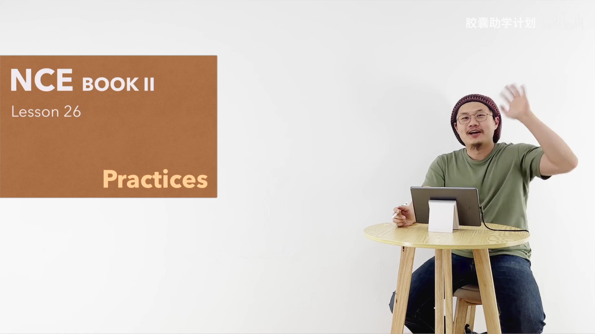

文字识别：NCE / BOOKII / Lesson 26 / Practices

### 画面 00:00:02

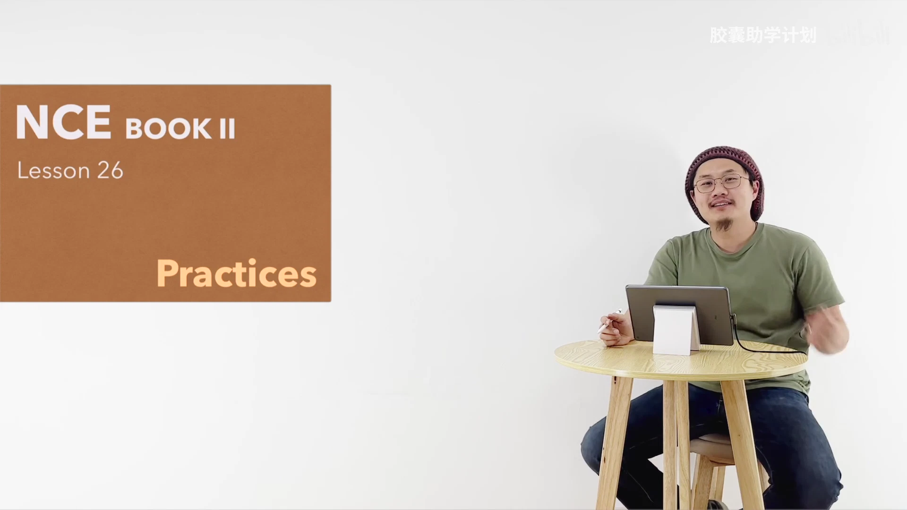

文字识别：NCE / BOOKII / Lesson 26 / Practices

### 画面 00:00:05

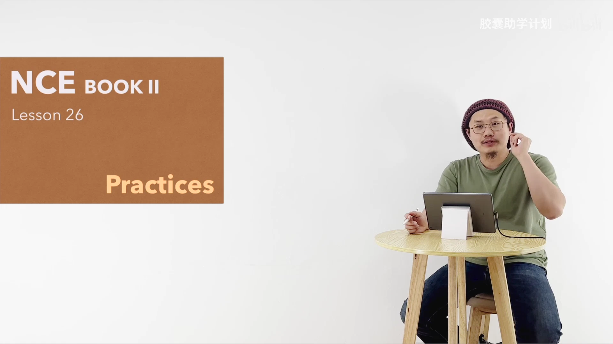

文字识别：NCE / BOOKI"I / Lesson 26 / Practices

### 画面 00:00:09

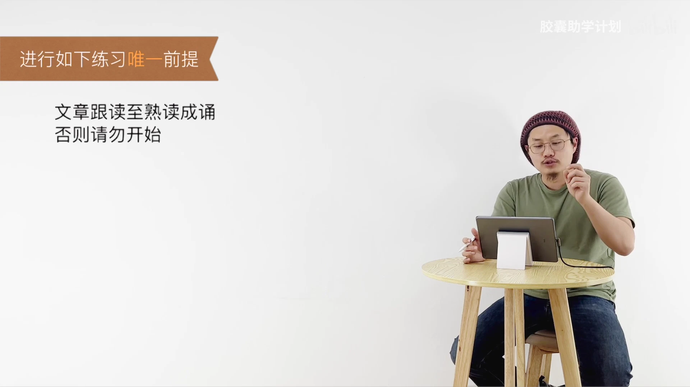

文字识别：进行如下练习唯一前提 / 文章跟读至熟读成诵 / 否则请勿开始

### 画面 00:00:18

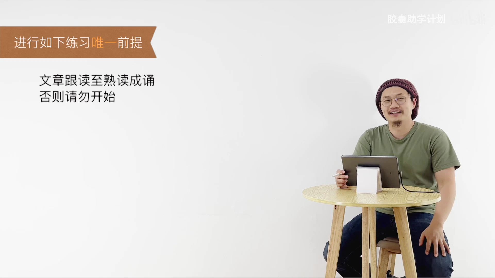

文字识别：进行如下练习唯一前提 / 文章跟读至熟读成诵 / 否则请勿开始

### 画面 00:00:20

文字识别：胶囊助学计划 bilbl

### 画面 00:00:23

文字识别：胶囊助学计划

### 画面 00:00:25

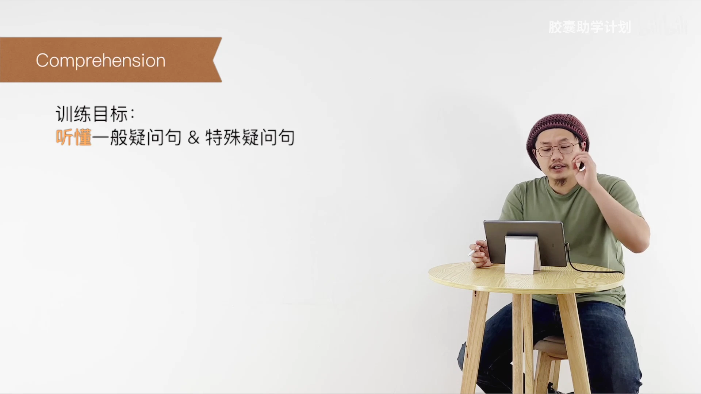

文字识别：Comprehension / 训练目标： / 听懂一般疑问句＆特殊疑问句

## 00:00:30–00:01:00

问句和特殊疑问句。OK，那直接我问您答，一定是基于文章读到非常非常熟，甚至都快能背下来了。啊，第一个叫 What do you do？啊，或者 What do you do for a living？或者 What's your job？OK， the same。答案 I'm an art student。Next one。Do you paint many pictures？Yes， I do。Next one。What do many people pretend to understand？

### 画面 00:00:32

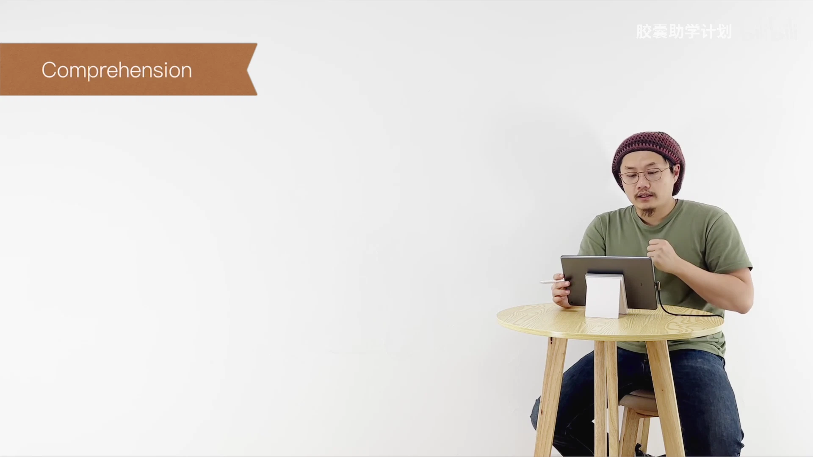

文字识别：Comprehension / 福

### 画面 00:00:39

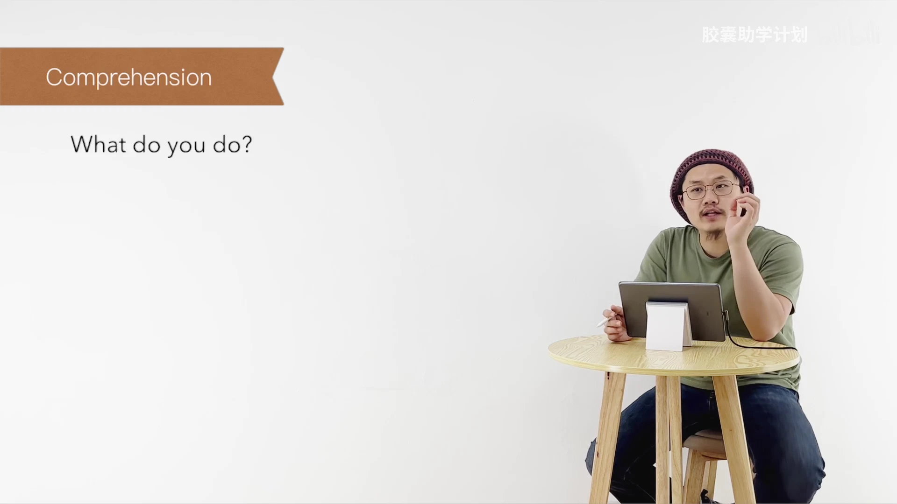

文字识别：Comprehension / What do you do?

### 画面 00:00:54

文字识别：Comprehension / Do you paint many pictures? / Yes, l do.

## 00:01:00–00:01:30

modern art. Next one, what do they always tell you? What a picture is about. Next one, are all pictures about something? No, they aren't. Next one, what are many pictures? Just pretty patterns. Next one, do you think young children

### 画面 00:01:02

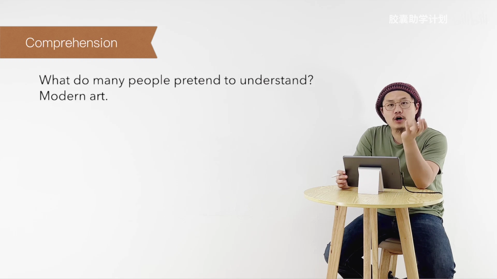

文字识别：Comprehension / What do many people pretend to understand? / Modern art.

### 画面 00:01:17

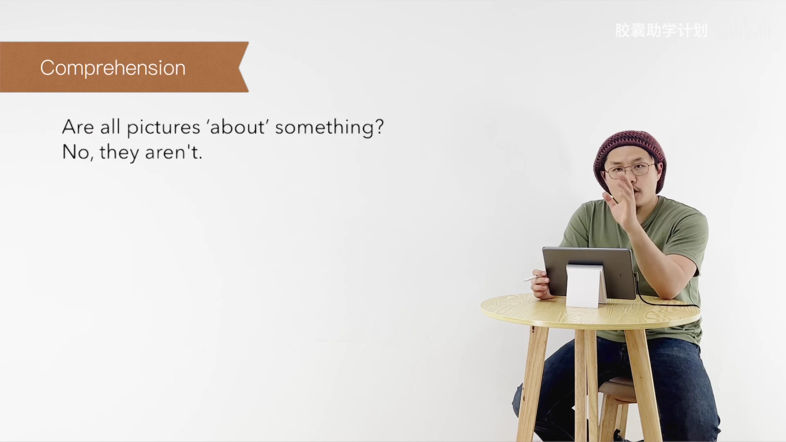

文字识别：Comprehension / Are all pictures 'about' something? / No, they aren't.

### 画面 00:01:27

文字识别：Comprehension / Do you think young / children / appreciate / modern pictures more / than grown-ups / s do?

## 00:01:30–00:02:00

appreciate modern pictures more than grown-ups do. Ah, grown-up, 18课咱们学的，呃，17课咱们学的，对吧？ Next one, yes, they do. Why do they? They notice more. Next one, how old is your sister? Seven. Next one, what does she always tell you? Whether my pictures

### 画面 00:01:42

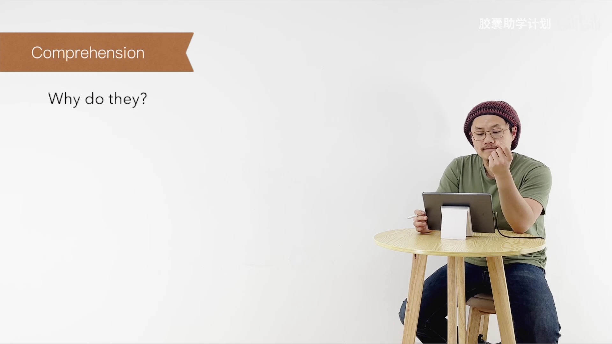

文字识别：Comprehension / Why do they?

### 画面 00:01:56

文字识别：Comprehension / What does she always tell you?

## 00:02:00–00:02:30

are good or not. Next one. When did she come into your room? Yesterday. Next one. What were you doing? Hanging a picture on the wall. Okay. Asking questions, old习惯对吧？哎，我给肯定句，Ask me if I'm an art student. 各位把它变成一般疑问句，然后给特殊疑问词，各位把它变特殊疑问句。Okay.

### 画面 00:02:07

文字识别：Comprehension / When did she come into your room? / Yesterday.

### 画面 00:02:12

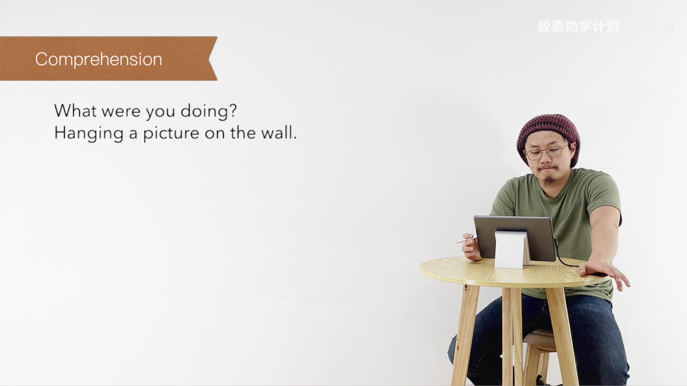

文字识别：Comprehension / What were you doing? / Hanging a picture on the wall

### 画面 00:02:16

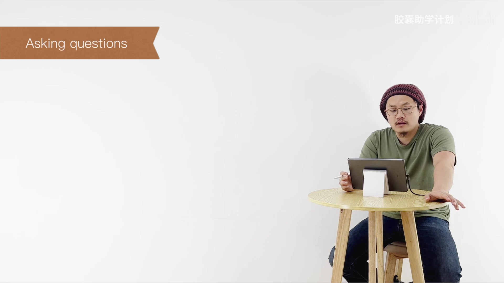

文字识别：Asking questions / 3

### 画面 00:02:19

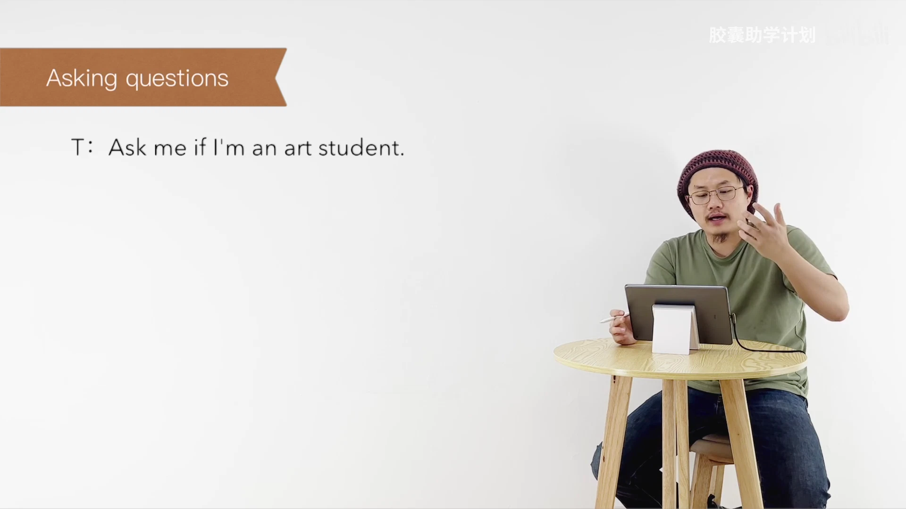

文字识别：Asking questions / T: Ask me if I'm an art student.

### 画面 00:02:27

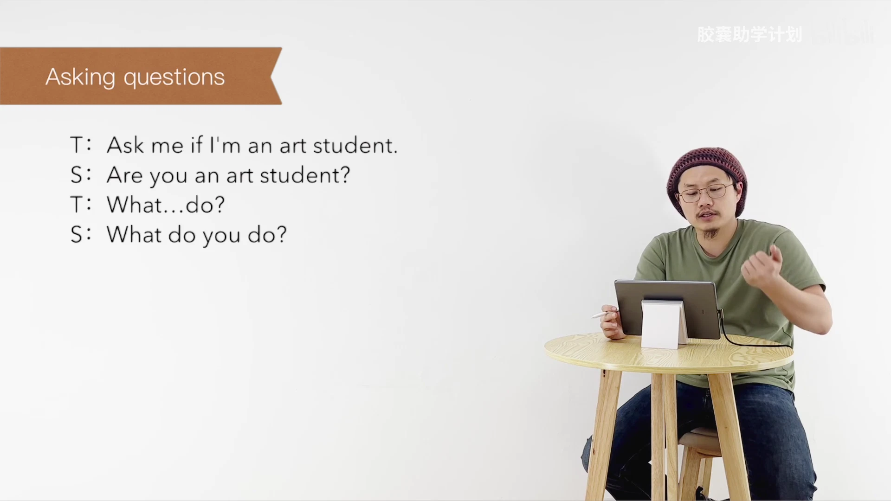

文字识别：Asking questions / T: Ask me if I'm an art student. / S: Are you an art student? / T: What...do? / S: What do you do?

### 画面 00:02:29

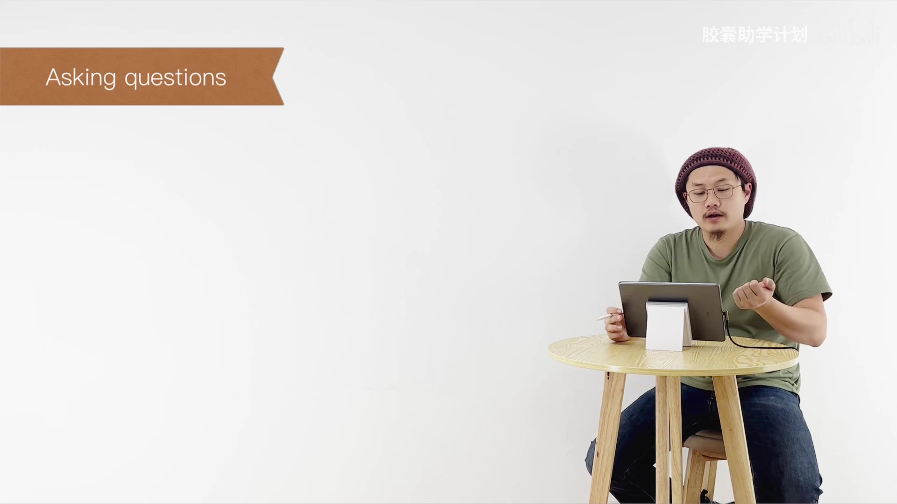

文字识别：Asking questions

## 00:02:30–00:03:00

好，我们在这儿呢。从第二题开始啊，我们只提思路啊，我们只提思路，不全对答案。I paint a lot of pictures.你看，典型的一个一般现在时，do提前就可以了。What加点do，这个是标准答案，叫What do you do，是吧？呃，How many？How many直接对a lot of提问是可以的，所以是How many pictures do you paint，对吧？Why加整个一般疑问句。

### 画面 00:02:31

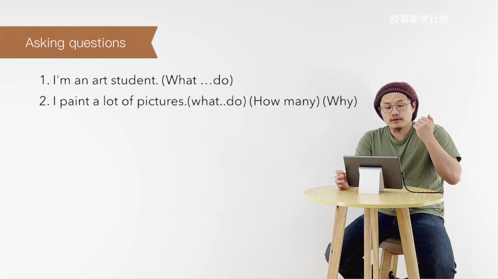

文字识别：Asking questions / 1.I'm an art student. (What ...do) / 2.I paint a lot of pictures.(what..do) (How many) (Why)

### 画面 00:02:35

文字识别：Asking questions / 1.I'm an art student. (What ...do) / 2.I paint a lot of pictures.(what..do) (How many) (Why)

### 画面 00:02:58

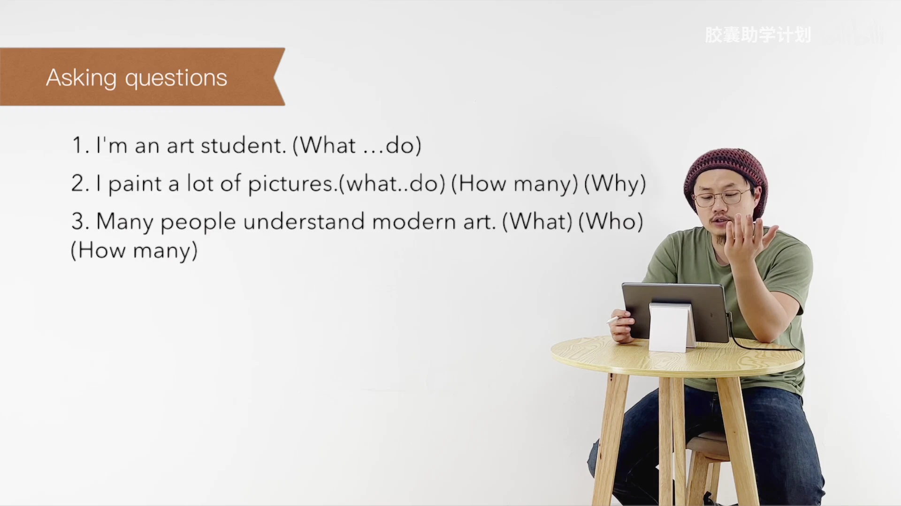

文字识别：Asking questions / 1.I'm an art student. (What ...do) / 2.I paint a lot of pictures.(what..do) (How many) (Why) / 3. Many people understand modern art. (What) (Who) / (How many)

## 00:03:00–00:03:30

三，Many people understand modern art. 这是先判断时态，对吧？一般现在时，所以 do 提前。然后 what 对 modern art 提问，或对主语提问，不用变一般疑问句了。所以在这个地方，答案我简单说一下，叫 who understand modern art，以及 how many。你想，谁能回答 how many？ How many 就对谁提问，这个毛逻辑没问题，对吧？那肯定 how many 就是对 many 提问。

### 画面 00:03:28

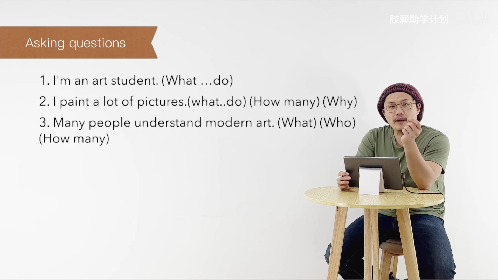

文字识别：Asking questions / 1.I'm an art student. (What ...do) / 2.I paint a lot of pictures.(what..do) (How many) (Why) / 3. Many people understand modern art. (What) (Who) / (How many)

## 00:03:30–00:04:00

OK，好。然后四 they tell you what a picture is about，那 do 提前就行了。 Do they tell you what a picture is about？ What？注意哎，很有意思。 What 是对 what a picture is about 提问，所以答案叫 What do they tell you？他们告诉你什么了？告诉的是什么呢？叫做这个图是关于什么的？ OK。然后 who 对主语提问或者对 you 提问，您挨个都试一下。 Why 整

### 画面 00:03:40

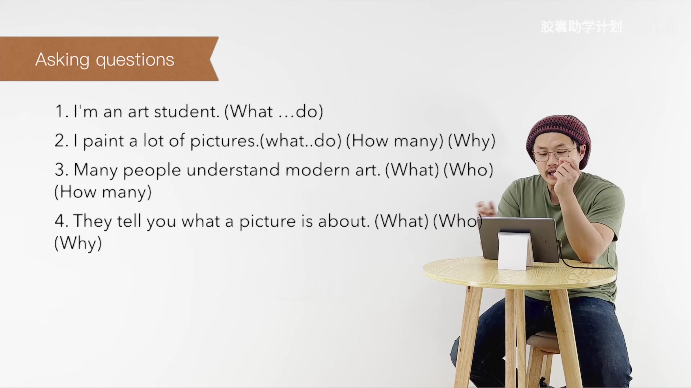

文字识别：Asking questions / 1.I'm an art student. (What ...do) / 2.I paint a lot of pictures.(what..do) (How many) (Why) / 3. Many people understand modern art. (What) (Who) / (How many) / 4. They tell you what a picture is about. (What) (Whoj / (Why)

### 画面 00:03:50

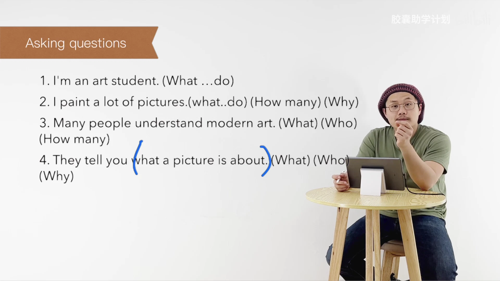

文字识别：Asking questions / 1.I'm an art student. (What ...do) / 2.I paint a lot of pictures.(what..do) (How many) (Why) / 3. Many people understand modern art. (What) (Who) / (How many) / 4. They tell you What a picture is about.,(What) (Who) / (Why)

## 00:04:00–00:04:30

句话？五，There are just pretty patterns.二提前就可以了。What对pretty patterns提问。下一题，Young children often appreciate modern art better than adults. Do提前互对主语提问，对吧？然后，当然互，我觉得你可以试试对adults提问。那What肯定是modern art，对吧？They notice more.哎，这个单词部分我们已经做过了，是吧？各位自己去再试一

### 画面 00:04:03

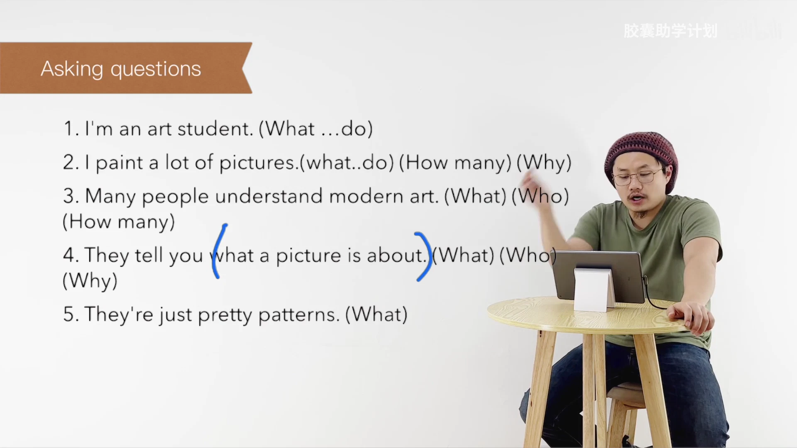

文字识别：Asking questions / 1.I'm an art student. (What ...do) / 2.I paint a lot of pictures.(what..do) (How many) (Why) / 3. Many people understand modern art. (What) (Who) / (How many) / 4. They tell you What a picture is about.,(What) (Who) / (Why) / 5. They're just pretty patterns. (What)

### 画面 00:04:07

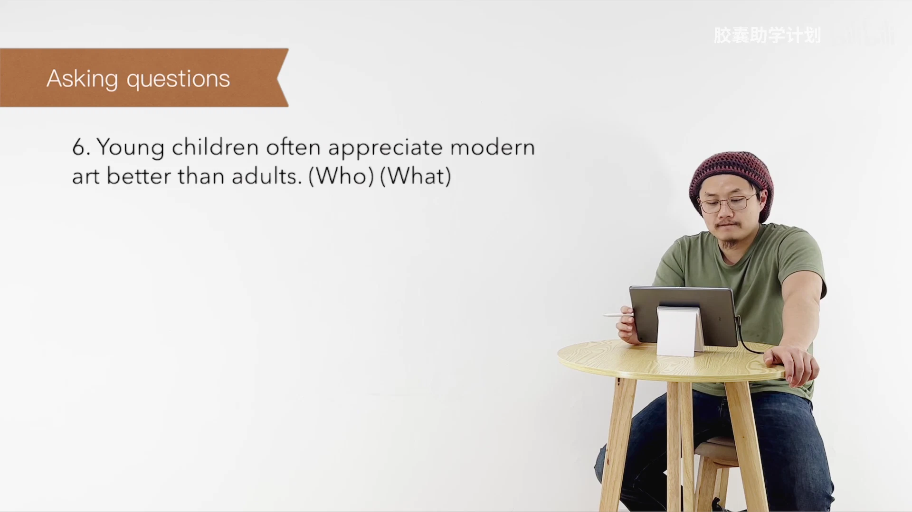

文字识别：Asking questions / 6. Young children often appreciate modern / art better than adults. (Who) (What)

## 00:04:30–00:05:00

下好了。My sister is seven. Is提前，How old对seven提问。She came into my room yesterday. Came注意一般过去时did提前，动词换回原形，这个点不要忘。然后When是对yesterday提问，Where you go十。She looked at at my new painting. Did提前，对吧？那What对my new painting提问，Where you go好。Tell the story在这儿还是我们老习惯，

### 画面 00:04:30

文字识别：Asking questions / 6. Young children often appreciate modern / art better than adults. (Who) (What) / 7.They notice more. (What) (Who) / 8. My sister is seven. (How old)

### 画面 00:04:38

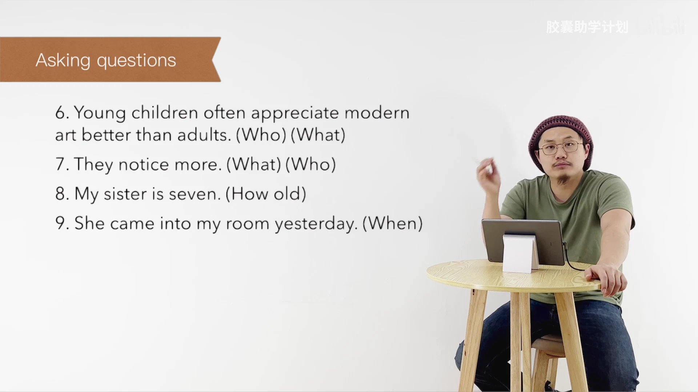

文字识别：Asking questions / 6. Young children often appreciate modern / art better than adults. (Who) (What) / 7.They notice more.(What) (Who) / 8. My sister is seven.(How old) / 9. She came into my room yesterday. (When)

### 画面 00:04:46

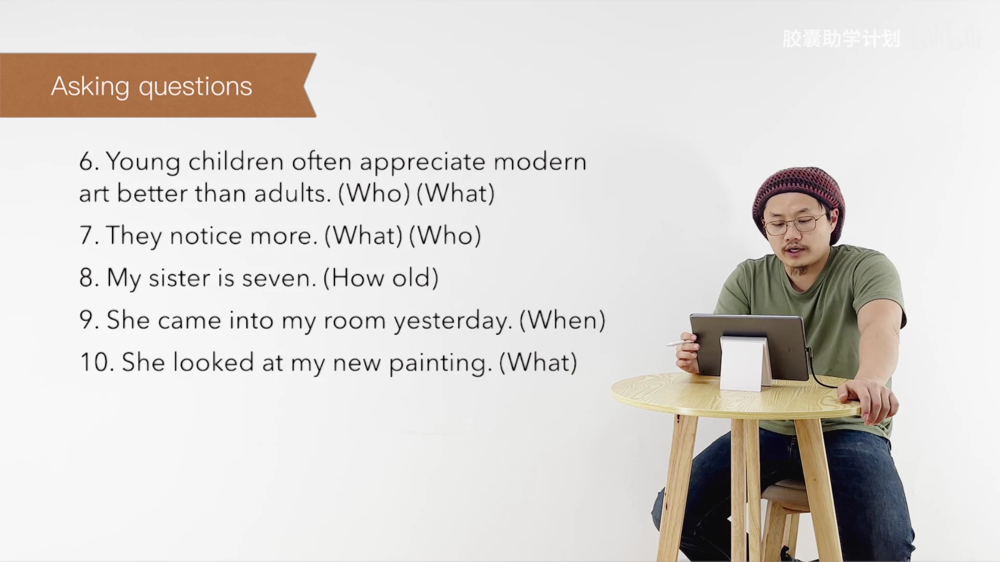

文字识别：Asking questions / 6. Young children often appreciate modern / art better than adults. (Who) (What) / 7.They notice more. (What) (Who) / 8. My sister is seven.(How old) / 9. She came into my room yesterday. (When) / 10. She looked at my new painting. (What)

### 画面 00:04:55

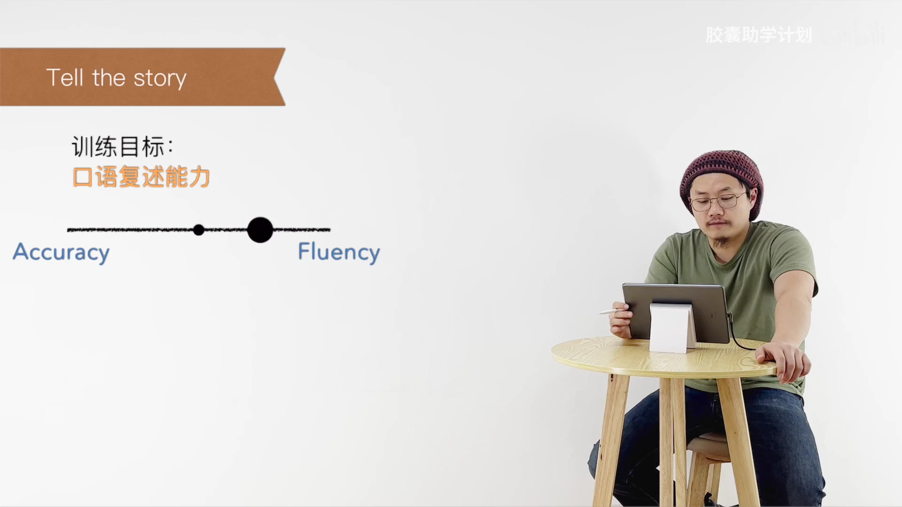

文字识别：Tell the story / 训练目标： / 口语复述能力 / Accuracy / Fluency

## 00:05:00–00:05:30

第一单元已经给各位做了很多的示范了，在这儿我们就不一一做示范，但是要再次强调一下，它练的是 fluency，不是 accuracy，对吧？所以可以，甚至是有错误的，但不能太慢。OK，好，这些呢是关键词，各位看着这些关键词，尝试去把文章复述一遍。OK，就是这个时候你其实脑海当中想的不是语法，想的是，哎，我应该说哪句话，然后怎么把

### 画面 00:05:07

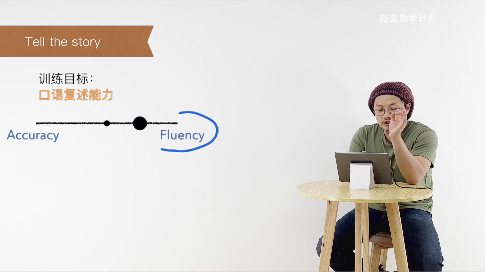

文字识别：Tell the story / 训练目标： / 口语复述能力 / Accuracy / Fluency

### 画面 00:05:09

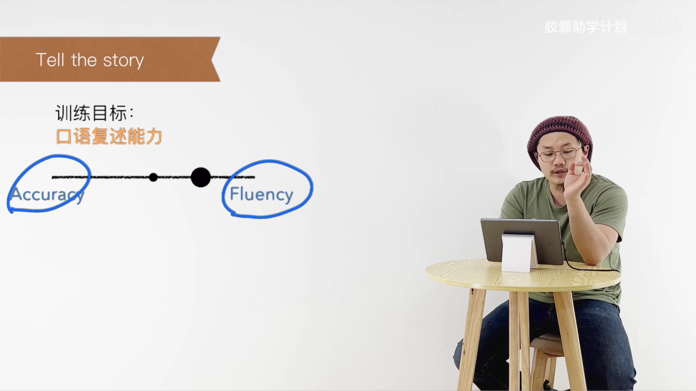

文字识别：Tell the story / 训练目标： / 口语复述能力 / Fluency / Accuray

### 画面 00:05:11

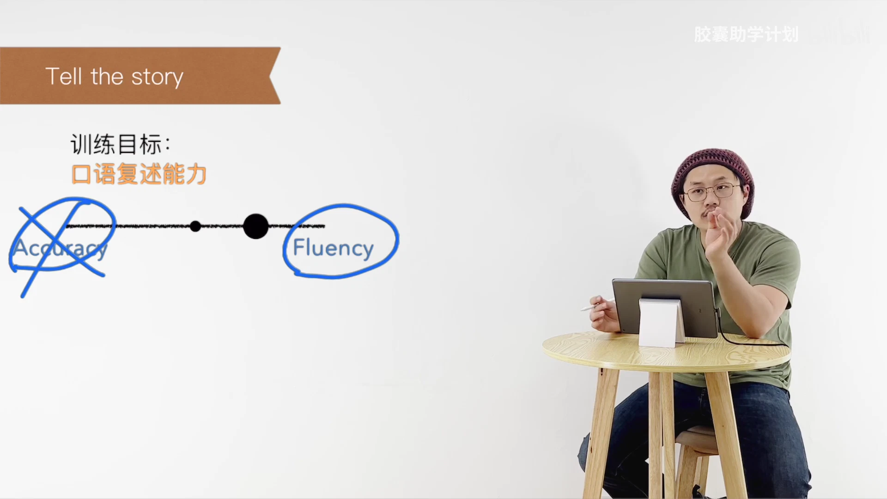

文字识别：Tell the story / 训练目标： / 口语复述能力 / Acdorasy / Fluency

### 画面 00:05:17

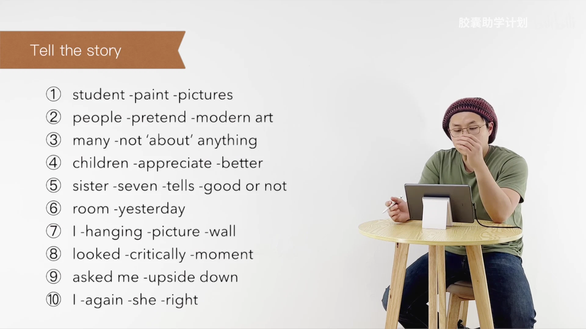

文字识别：Tell the story / ① / student -paint -pictures / people -pretend -modern art / many -not'about' anything / children -appreciate -better / sister -seven -tells -good or not / room -yesterday / 6 / ⑦ I -hanging -picture -wall / looked -critically -moment / 8 / asked me -upside down / 9 / ① I -again -she -right

## 00:05:30–00:06:00

这句话给说出来？OK， one by one.接下来，summer writing只要写作，各位先写，写完来这儿对一下答案就可以了。最后一道题，topic for discussion，完全自由的一个对话，既练 accuracy 又练 fluency。OK，好，我们直接看一下题。第一题，How is your room at home decorated? 啊，你的房间是如何装饰？What do you have on your walls? 对吧？你在墙上有什么东

### 画面 00:05:32

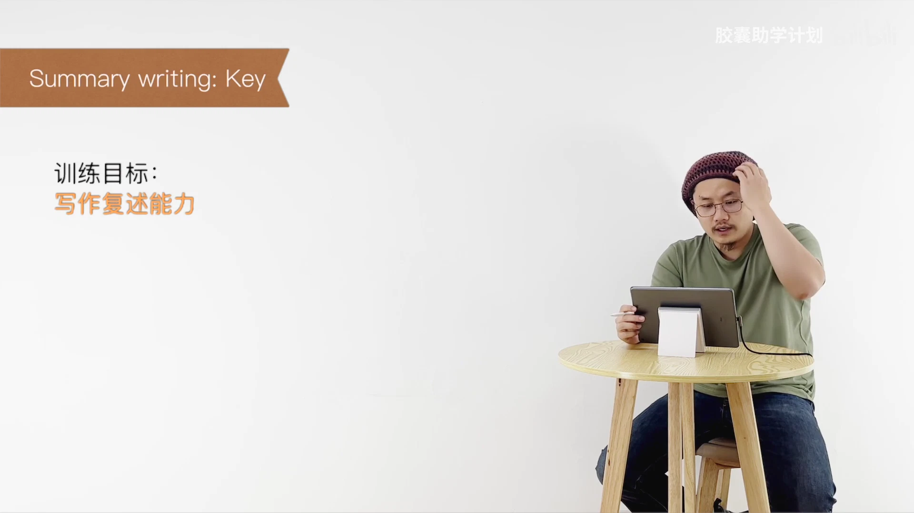

文字识别：Summary writing: Key / 训练目标： / 写作复述能力

### 画面 00:05:35

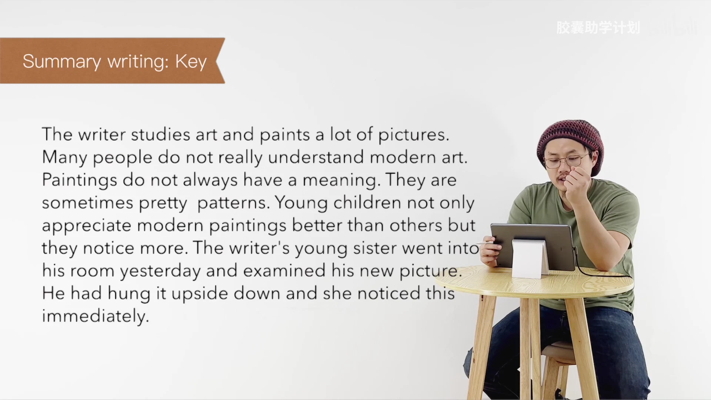

文字识别：Summary writing: Key / The writer studies art and paints a lot of pictures. / Many people do not really understand modern art. / Paintings do not always have a meaning. They are / sometimes pretty patterns. Young children not only / appreciate modern paintings better than others but / they notice more. The writer's young sister went into / his room yesterday and examined his new picture. / He had hung it upside down and she noticed this / immediately.

### 画面 00:05:38

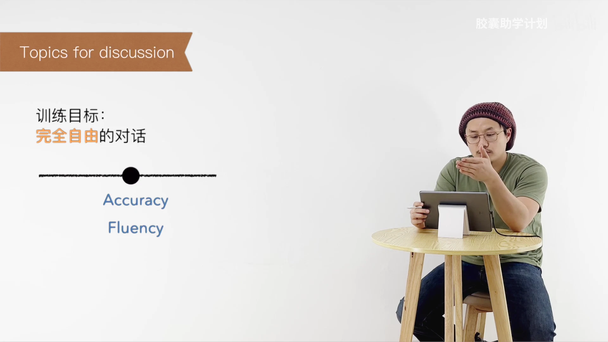

文字识别：Topics for discussion / 训练目标： / 完全自由的对话 / Accuracy / Fluency

### 画面 00:05:47

文字识别：Topics for discussion / How is your room at home decorated? / What do you have on your walls? / Name some 'modern'painters. Explain / why you like or dislike their work. / Do you think artists should try to 'please' / 3 / other people? Why/Why not?

## 00:06:00–00:06:30

西啊？文字学，啊，第二个 name some modern painters，哎，说出来一些，注意这地方的 name 是让你说出来一些，罗列出来一些啊，呃， modern painters，说这个现代艺术家的名字。 Explain why you like or dislike their work，对吧？你为什么喜欢或不喜欢他们的这些作品？第三题，Do you think artists should try to please other people? Why or why not？说你认为艺术家应该尝试着去

### 画面 00:06:17

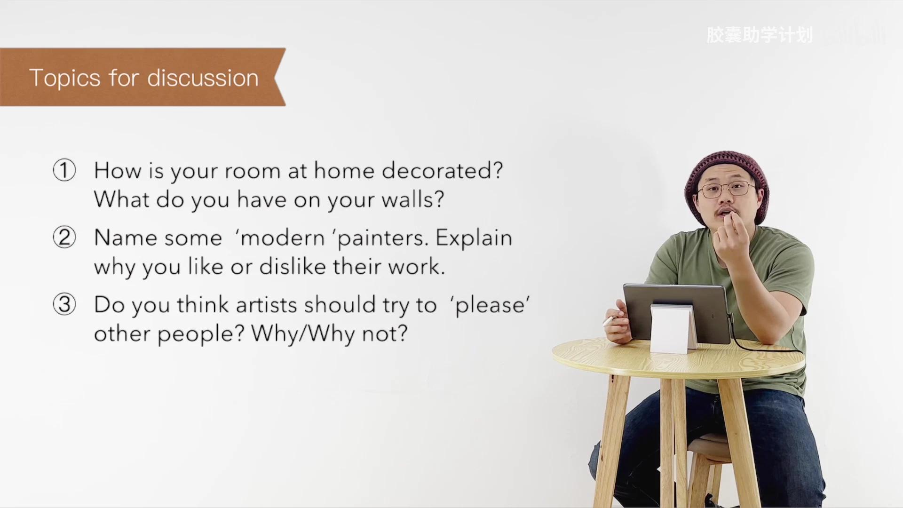

文字识别：Topics for discussion / How is your room at home decorated? / What do you have on your walls? / Name some 'modern'painters. Explain / why you like or dislike their work. / Do you think artists should try to 'please' / 3 / other people? Why/Why not?

## 00:06:30–00:07:00

please 啊，我也直接加个引号叫谄媚啊，献媚大众吗？哎，如果是为什么是？如果不是为什么不是？OK，好，家庭作业 ask me，先写再朗读，摘要写作先写对答案， tell the story 口语复述老习惯专栏，各位可以找得到。以上呢就是本期视频的全部内容了。如果大家喜欢我们的课程呢，欢迎大家关注订阅，一键三连，分享给那些需要的朋友。 See you next

### 画面 00:06:30

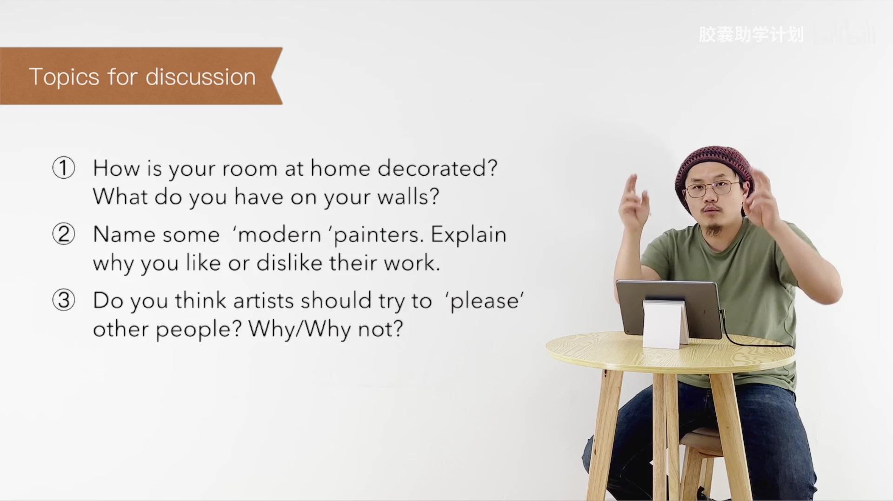

文字识别：Topics for discussion / How is your room at home decorated? / What do you have on your walls? / Name some 'modern'painters. Explain / why you like or dislike their work. / Do you think artists should try to 'please' / 3 / other people? Why/Why not?

### 画面 00:06:39

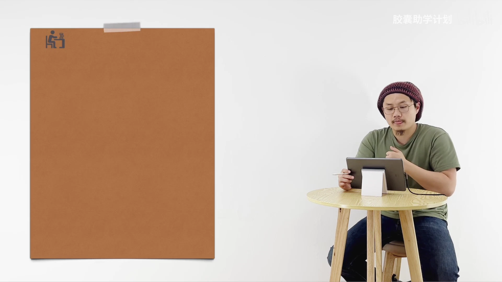

### 画面 00:06:42

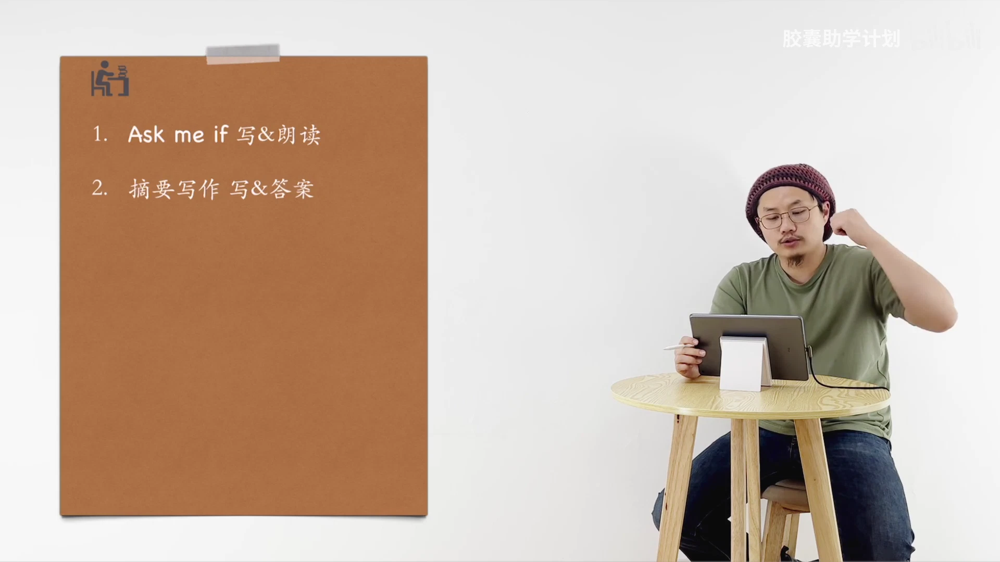

文字识别：1.Ask me if写&朗读 / 2.摘要写作写&答案

### 画面 00:06:44

文字识别：1.Ask me if写&朗读 / 摘要写作写&答案 / 3.Tell the story 口语复述

### 画面 00:06:46

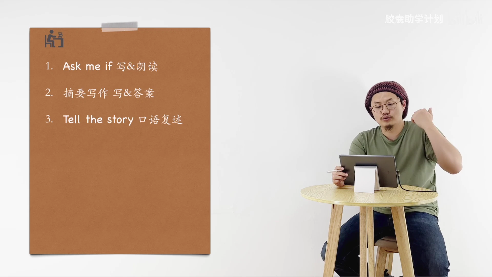

文字识别：1.Ask me if写&朗读 / 摘要写作写&答案 / 3.Tell the story 口语复述

### 画面 00:06:48

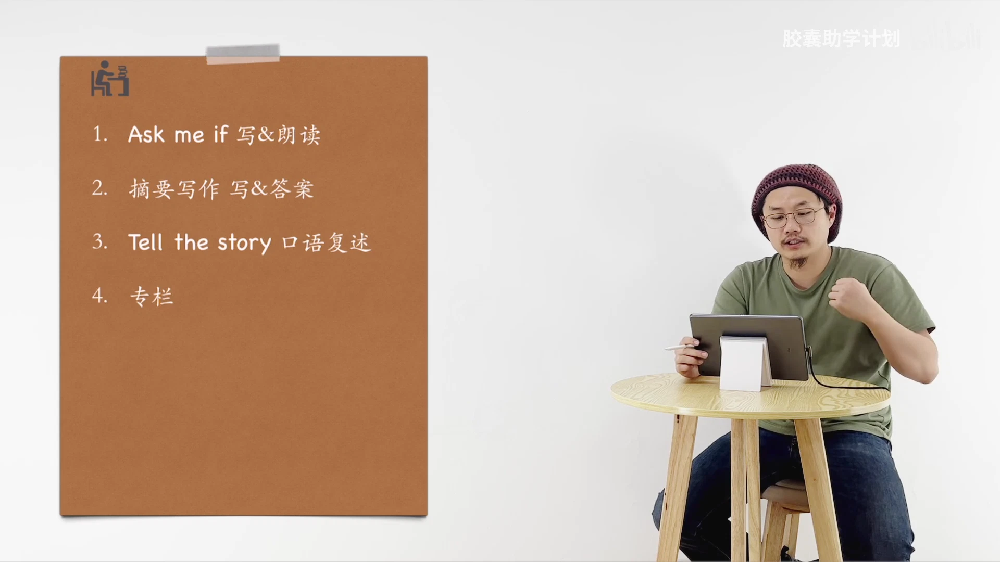

文字识别：1.Ask me if写&朗读 / 摘要写作写&答案 / 3.Tell the story 口语复述 / 专栏 / 4.

### 画面 00:06:50

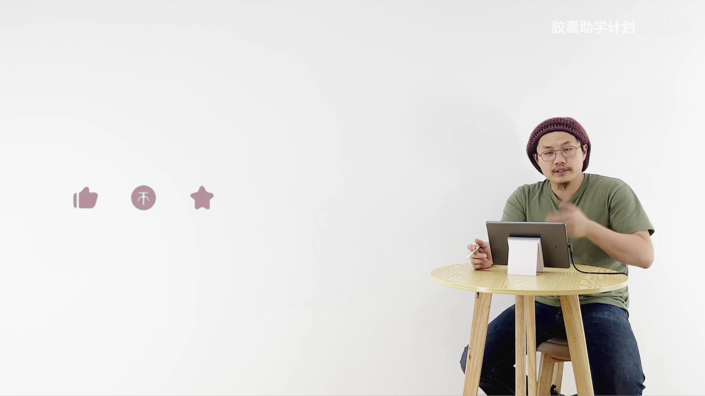

### 画面 00:06:54

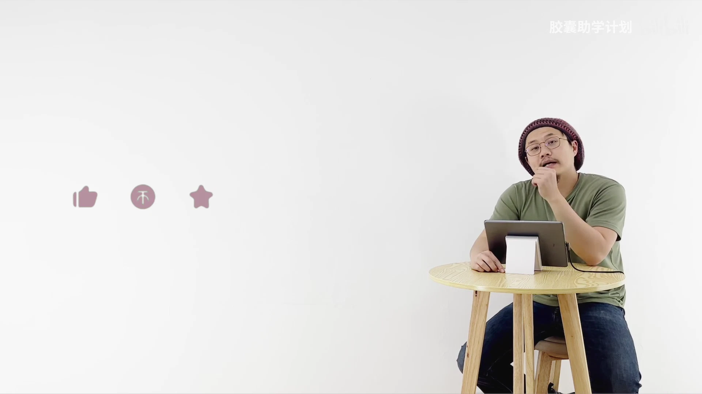

文字识别：🌟

## 00:07:00–00:07:13

time.

### 画面 00:07:00

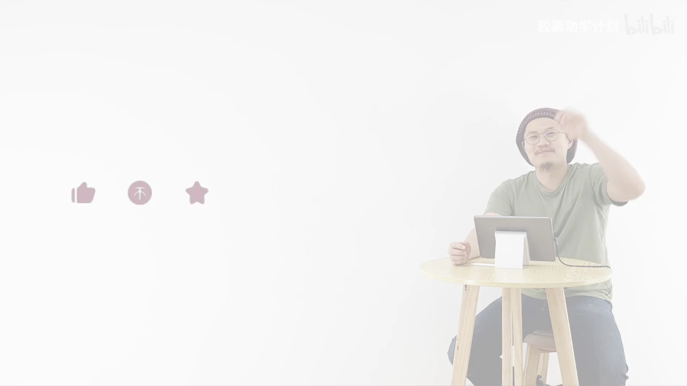

文字识别：￥

### 画面 00:07:02

文字识别：CAPSULEACADEMY / 胶囊助学计划 / 小红书 / Lecturer / Leo / OE

### 画面 00:07:05

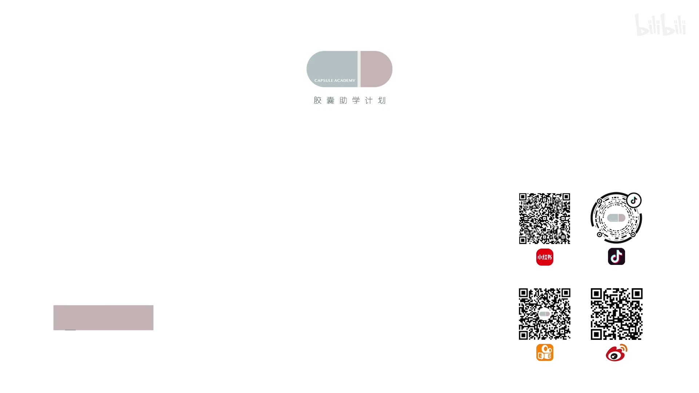

文字识别：CAPSULEACADEMY / 胶囊助学计划 / 『 / 小红书

### 画面 00:07:08

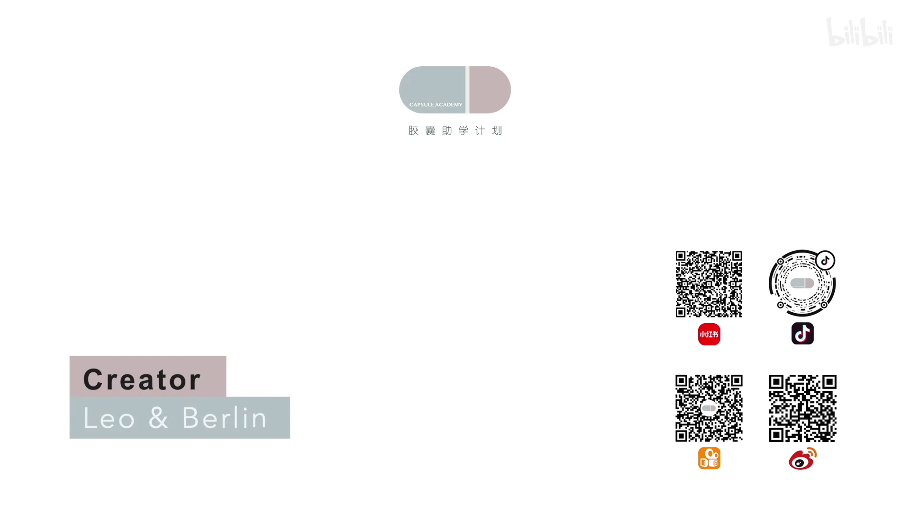

文字识别：CAPSULEACADEMY / 胶囊助学计划 / 小红书 / Creator / □ / Leo & Berlin

### 画面 00:07:10

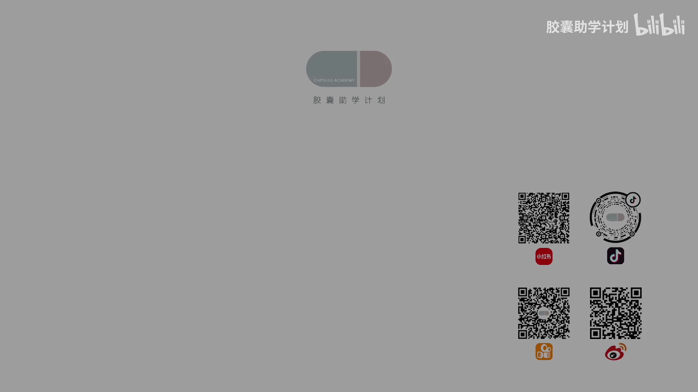

文字识别：bilbili / 胶囊助学计划 / CAPSULEACADEMY / 胶囊助学计划 / 小红书 / 品 / OE / • / 0

### 画面 00:07:12

文字识别：bilibili / 胶囊助学计划

