# L027 单词

快速机器解析：语音为单模型转写，未进行独立交叉校对或人工复核；画面每秒采样并按变化选帧，短时文字和标记可能遗漏。截图时间约有 1 秒误差。图片有损压缩；遇到疑点请按时间查看 Google Drive 原视频。

## 00:00:00–00:00:30

Hello everyone, welcome to Capsule Academy. This is Leo. Today we're going to learn New Concept English Book Two, Lesson Twenty Seven Words. Hope you gonna enjoy.好，那我们看第一个单词，跟我一起读一下啊。来，tent, tent. 它的意思是帐篷的意思，它本身是一个名词。我们这样的单词一出来的时候呢，最常见的两个方式啊，单词造句的思

### 画面 00:00:00

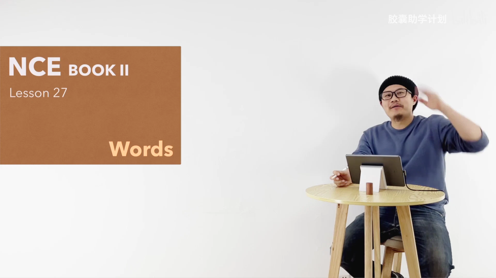

文字识别：NCE / BOOKII / Lesson 27 / Words

### 画面 00:00:02

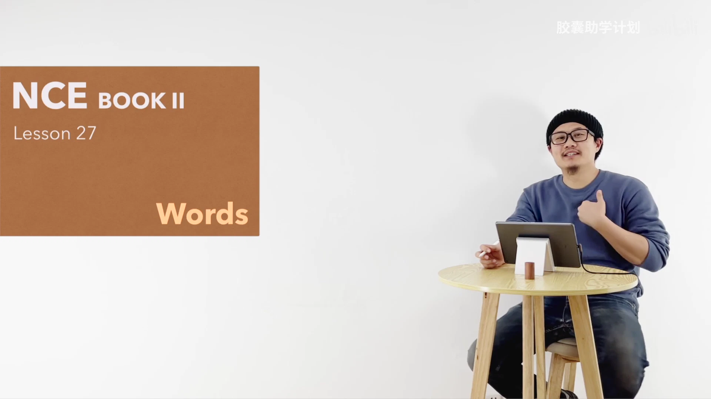

文字识别：NCE / BOOKII / Lesson 27 / Words

### 画面 00:00:05

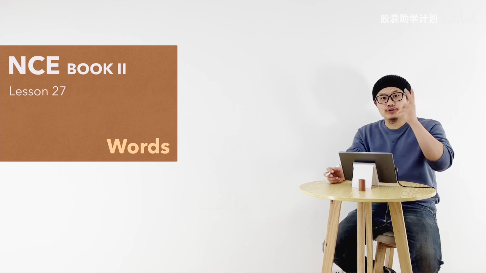

文字识别：NCE / BOOKI"I / Lesson 27 / Words

### 画面 00:00:09

文字识别：胶囊助学计划 bilbl / •

### 画面 00:00:13

文字识别：胶囊助学计划

### 画面 00:00:15

文字识别：单词造句指南 / 网：v.+v.变化 / 四句型转换 / 方式/地点/时间 / 结合习惯用法 / 其他单词+词性 / 原文摘抄+变 / 6123456 / /tent/ / tent n.

### 画面 00:00:27

文字识别：单词造句指南 / 网：v.+v.变化 / 四句型转换 / 方式/地点/时间 / 结合习惯用法 / 其他单词+词性 / 原文摘抄+变 / 6123456 / /tent/ / tent n.

## 00:00:30–00:01:00

路，各位一定要立刻想到，第一个叫立刻找动词，第二叫找其他的习惯用法，这些习惯用法当中包含了动词，对吧？OK，那我们造一句话啊，说Neither Leo nor Jerry has a tent。首先这里面的动词我们选择的是拥有，had a tent，非常简单的一个词，但是呢，我们又结合了二十五课咱们学过的这个连词Neither A nor B，是吧？Leo和Jerry啊都没有

### 画面 00:00:30

文字识别：单词造句指南 / 网：v.+v.变化 / 四句型转换 / 方式/地点/时间 / 结合习惯用法 / 其他单词+词性 / 原文摘抄+变 / 6123456 / /tent/ / tent n.

### 画面 00:00:40

文字识别：单词造句指南 / 网：v.+v.变化 / 四句型转换 / 方式/地点/时间 / 结合习惯用法 / 其他单词+词性 / 原文摘抄+变 / 6123456 / /tent/ / tent n. / ① Neither Leo nor Jerry has a tent. L25

### 画面 00:00:45

文字识别：单词造句指南 / 网：v.+v.变化 / 四句型转换 / 方式/地点/时间 / 结合习惯用法 / 其他单词+词性 / 原文摘抄+变 / 6123456 / /tent/ / tent n. / ① Neither Leo nor Jerry has a tent. L25

### 画面 00:00:50

文字识别：单词造句指南 / 网：v.+v.变化 / 四句型转换 / 方式/地点/时间 / 结合习惯用法 / 其他单词+词性 / 原文摘抄+变 / 6123456 / /tent/ / tent n. / ① Neither Leo nor Jerry has a tent. L25

## 00:01:00–00:01:30

帐篷. Next one,说this tent must be clean today.好，我们选择的动词是clean，打扫清洁。但是我们选择的二，所谓叫动词的变化，是二十一课叫must be done啊，情态动词must这个单词的被动啊，叫必须被打扫，必须被清理。Next one,说she can't have bought that tent ten years ago.这是我们十七课学过的，也是各位最容易忘的。我们经常

### 画面 00:01:00

文字识别：单词造句指南 / 网：v.+v.变化 / 四句型转换 / 方式/地点/时间 / 结合习惯用法 / 其他单词+词性 / 原文摘抄+变 / 6123456 / /tent/ / tent n. / ① Neither Leo nor Jerry has a tent. L25

### 画面 00:01:06

文字识别：单词造句指南 / 网：v.+v.变化 / 四句型转换 / 方式/地点/时间 / 结合习惯用法 / 其他单词+词性 / 原文摘抄+变 / 6123456 / /tent/ / tent n. / ① Neither Leo nor Jerry has a tent. L25 / This tent must be cleaned today. L21

### 画面 00:01:11

文字识别：单词造句指南 / 网：v.+v.变化 / 四句型转换 / 方式/地点/时间 / 结合习惯用法 / 其他单词+词性 / 原文摘抄+变 / 6123456 / /tent/ / tent n. / ① Neither Leo nor Jerry has a tent. L25 / This tent must be cleaned today. L21

### 画面 00:01:15

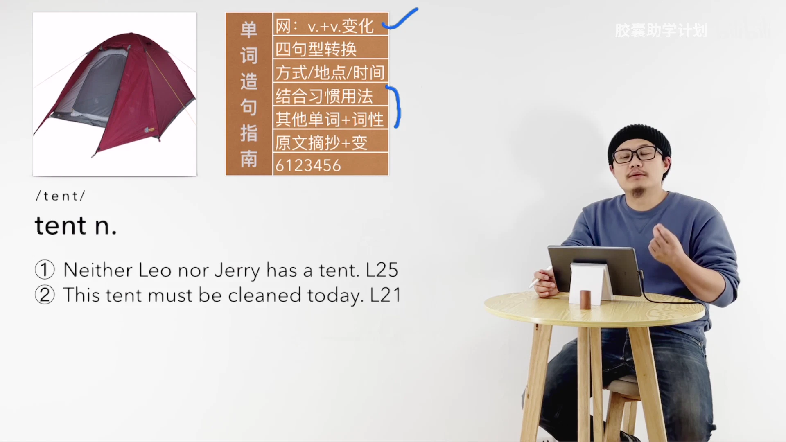

文字识别：单词造句指南 / 网：v.+v.变化 / 四句型转换 / 方式/地点/时间 / 结合习惯用法 / 其他单词+词性 / 原文摘抄+变 / 6123456 / /tent/ / tent n. / ① Neither Leo nor Jerry has a tent. L25 / This tent must be cleaned today. L21

### 画面 00:01:21

文字识别：单词造句指南 / 网：v.+v.变化 / 四句型转换 / 方式/地点/时间 / 结合习惯用法 / 其他单词+词性 / 原文摘抄+变 / 6123456 / /tent/ / tent n. / ① Neither Leo nor Jerry has a tent. L25 / This tent must be cleaned today. L21 / ) She can't have bought that tent 10 years ago. L17 / 3

### 画面 00:01:23

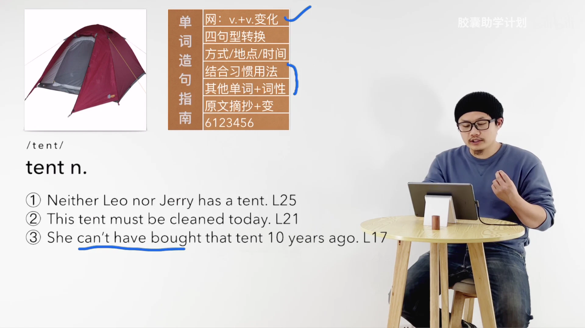

文字识别：单词造句指南 / 网：v.+v.变化 / 四句型转换 / 方式/地点/时间 / 结合习惯用法 / 其他单词+词性 / 原文摘抄+变 / 6123456 / /tent/ / tent n. / ① Neither Leo nor Jerry has a tent. L25 / This tent must be cleaned today. L21 / ) She can't have bought that tent 10 years ago. L17 / 3

## 00:01:30–00:02:00

会拿出来带着各位去反复的学啊练习一下，叫 can't have bought，它一定不可能是十年前买的那个帐篷，怎么会保护的这么好呢？ Okay, there you go. Next one，下一个单词，跟我一起读一下，叫做 field field，还有 next one 叫做 air field air field. Okay，那 field air field，实际上我没记错，我们第七课就学过，它表示飞机场的那个起跑道，对吧？那 field 就是把 air 加 field

### 画面 00:01:35

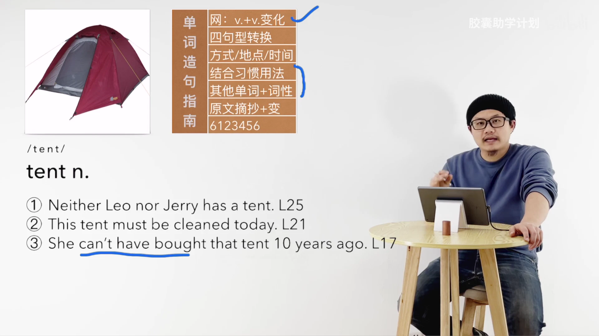

文字识别：单词造句指南 / 网：v.+v.变化 / 四句型转换 / 方式/地点/时间 / 结合习惯用法 / 其他单词+词性 / 原文摘抄+变 / 6123456 / /tent/ / tent n. / ① Neither Leo nor Jerry has a tent. L25 / This tent must be cleaned today. L21 / ) She can't have bought that tent 10 years ago. L17 / 3

### 画面 00:01:42

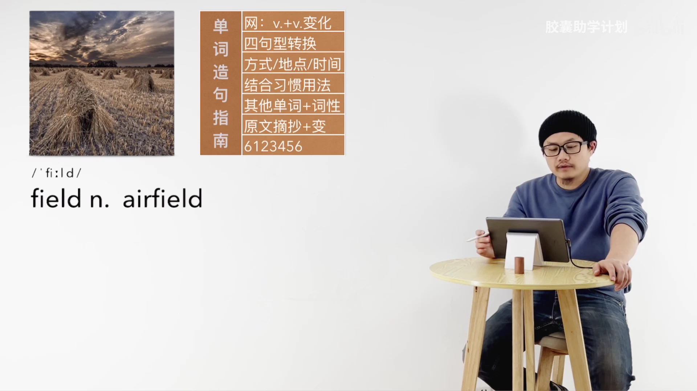

文字识别：单词造句指南 / 网：v.+v.变化 / 四句型转换 / 方式/地点/时间 / 结合习惯用法 / 其他单词+词性 / 原文摘抄+变 / 6123456 / / 'fi :ld/ / field n. airfield

### 画面 00:01:45

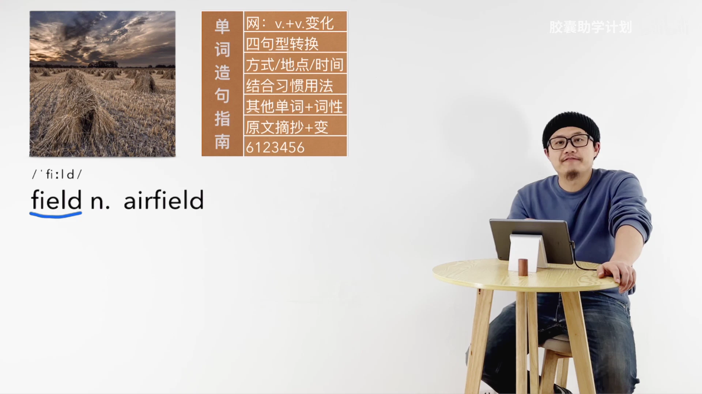

文字识别：单词造句指南 / 网：v.+v.变化 / 四句型转换 / 方式/地点/时间 / 结合习惯用法 / 其他单词+词性 / 原文摘抄+变 / 6123456 / / 'fi :ld/ / field n. airfield

### 画面 00:01:50

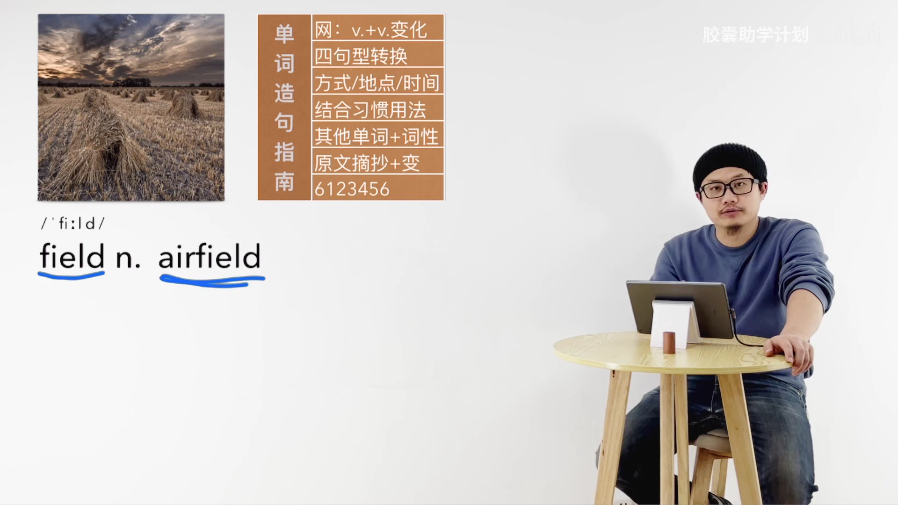

文字识别：单词造句指南 / 网：v.+v.变化 / 四句型转换 / 方式/地点/时间 / 结合习惯用法 / 其他单词+词性 / 原文摘抄+变 / 6123456 / / 'fi :ld/ / field n. airfield

### 画面 00:01:55

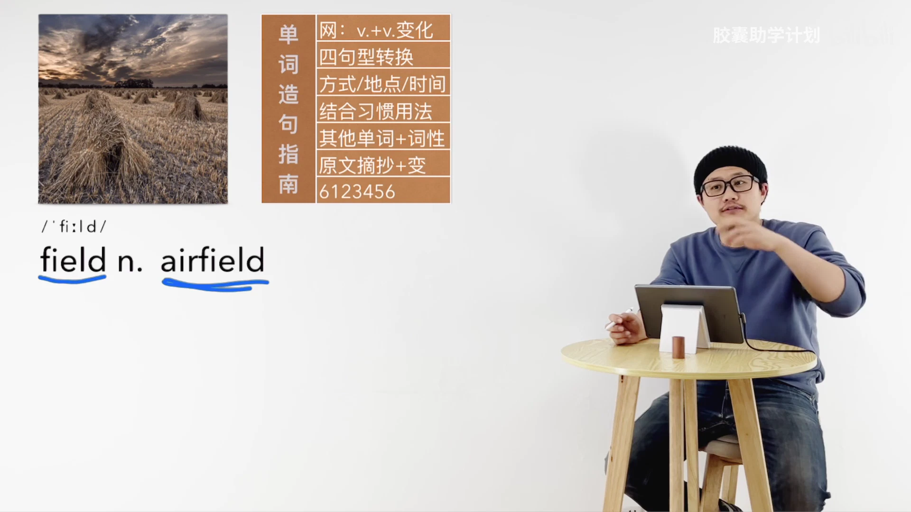

文字识别：单词造句指南 / 网：v.+v.变化 / 四句型转换 / 方式/地点/时间 / 结合习惯用法 / 其他单词+词性 / 原文摘抄+变 / 6123456 / / 'fi :ld/ / field n. airfield

## 00:02:00–00:02:30

连起来是吧？啊，把这个拆出来，field这个单词指的是田野，还是一个名词。那我们造一个句话，说There are a lot of farmers in the field.啊，在这个田地上啊，有非常多的农民。OK，注意in the field在田地上，在田野上。Next one，说She started to complain about the worms in the field.她开始去抱怨这个地上啊有非常多

### 画面 00:02:07

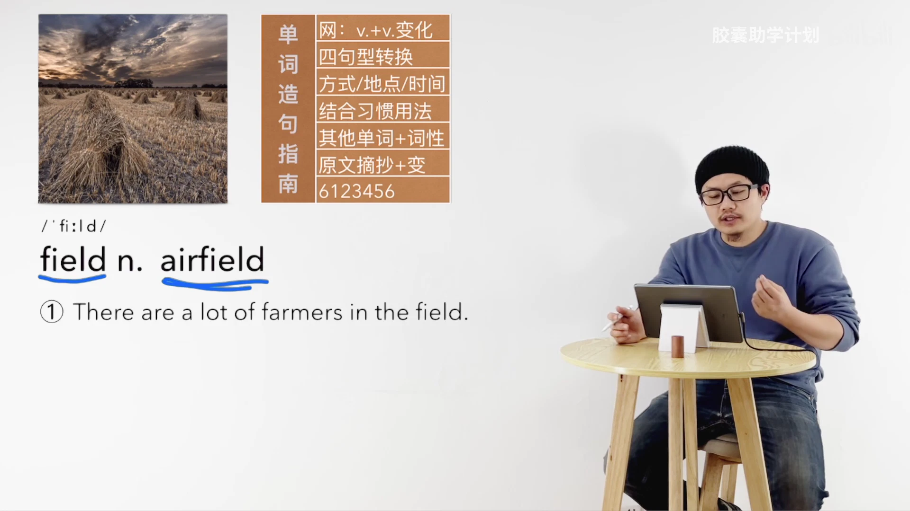

文字识别：单词造句指南 / 网：v.+v.变化 / 四句型转换 / 方式/地点/时间 / 结合习惯用法 / 其他单词+词性 / 原文摘抄+变 / 6123456 / / 'fi :ld/ / field n. airfield / There are a lot of farmers in the field.

### 画面 00:02:15

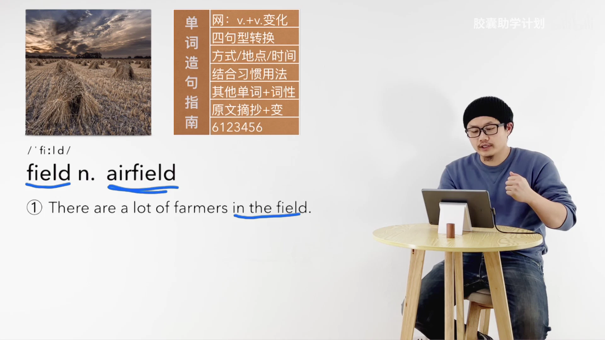

文字识别：单词造句指南 / 网：v.+v.变化 / 四句型转换 / 方式/地点/时间 / 结合习惯用法 / 其他单词+词性 / 原文摘抄+变 / 6123456 / / 'fi :ld/ / field n. airfield / There are a lot of farmers in the field.

### 画面 00:02:21

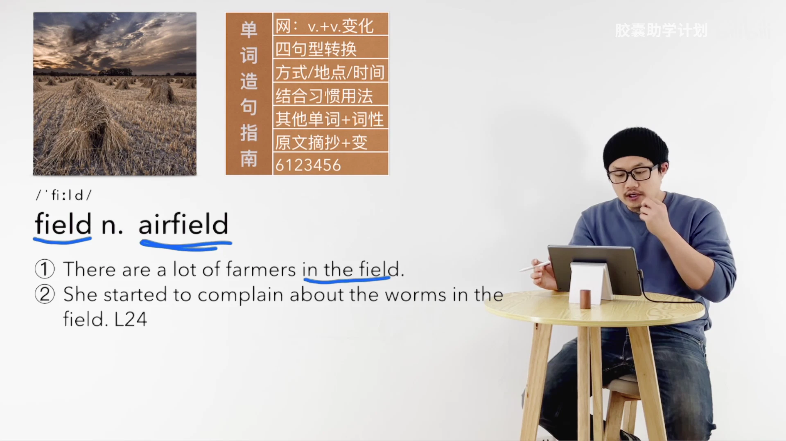

文字识别：单词造句指南 / 网：v.+v.变化 / 四句型转换 / 方式/地点/时间 / 结合习惯用法 / 其他单词+词性 / 原文摘抄+变 / 6123456 / / 'fi :ld/ / field n. airfield /  There are a lot of farmers in the field. / She started to complain about the worms in the / field. L24

## 00:02:30–00:03:00

的虫子，OK start to do something，这是第一个，第二个二十四课咱们学叫 complain about something，OK very good next one，说 let's pretend that we are now in the field，好让我们现在来假设啊我们现在在地里面田野里面，哎这是第二十六课 somebody pretend that 加一个小的宾语从句，OK next one 下一个单词这是我们新一就见过单词，我们一起读一下叫做 smell smell，OK

### 画面 00:02:31

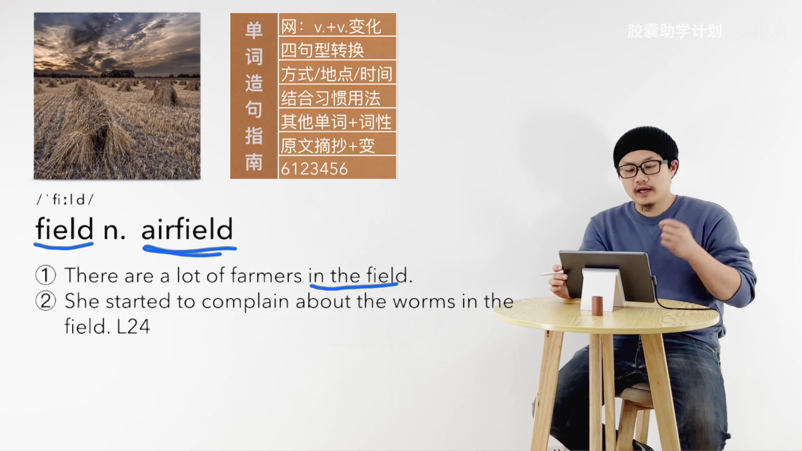

文字识别：单词造句指南 / 网：v.+v.变化 / 四句型转换 / 方式/地点/时间 / 结合习惯用法 / 其他单词+词性 / 原文摘抄+变 / 6123456 / / 'fi:ld/ / field n. airfield / 1 / ) There are a lot of farmers in the field. / She started to complain about the worms in the / field. L24

### 画面 00:02:38

文字识别：单词造句指南 / 网：v.+v.变化 / 四句型转换 / 方式/地点/时间 / 结合习惯用法 / 其他单词+词性 / 原文摘抄+变 / 6123456 / / 'fi :ld/ / field n. airfield / ① There are a lot of farmers in the field. / ) She started to complain about the worms in the / 2 / field. L24 / ) Let's pretend that we are now in the field. L26

### 画面 00:02:53

文字识别：单词造句指南 / 网：v.+v.变化 / 四句型转换 / 方式/地点/时间 / 结合习惯用法 / 其他单词+词性 / 原文摘抄+变 / 6123456 / / smel/ / smell - smelled - smelt v.

### 画面 00:02:55

文字识别：单词造句指南 / 网：v.+v.变化 / 四句型转换 / 方式/地点/时间 / 结合习惯用法 / 其他单词+词性 / 原文摘抄+变 / 6123456 / / smel/ / smell - smelled - smelt v.

## 00:03:00–00:03:30

Okay,它的过去式和过去分词有两套，各位一个是直接加ed，一套是不规则的。您用哪一个都可以啊。好，那我们造句说It must be terrible to smell that every day.说哎每天都去闻这个东西啊，一定是特别糟糕的。第十七课学过的习惯用法。Next one,说My parents asked me to smell that tree last night.说我父母啊，哎昨天晚上可能出

### 画面 00:03:00

文字识别：单词造句指南 / 网：v.+v.变化 / 四句型转换 / 方式/地点/时间 / 结合习惯用法 / 其他单词+词性 / 原文摘抄+变 / 6123456 / / smel/ / smell - smelled - smelt v.

### 画面 00:03:05

文字识别：单词造句指南 / 网：v.+v.变化 / 四句型转换 / 方式/地点/时间 / 结合习惯用法 / 其他单词+词性 / 原文摘抄+变 / 6123456 / / s mel/ / smell - smelled - smelt v.

### 画面 00:03:10

文字识别：单词造句指南 / 网：v.+v.变化 / 四句型转换 / 方式/地点/时间 / 结合习惯用法 / 其他单词+词性 / 原文摘抄+变 / 6123456 / / sme l/ / smell - smelled - smelt v. / ① It must be terrible to smell that everyday. L17

### 画面 00:03:15

文字识别：单词造句指南 / 网：v.+v.变化 / 四句型转换 / 方式/地点/时间 / 结合习惯用法 / 其他单词+词性 / 原文摘抄+变 / 6123456 / / smel/ / smell - smelled - smelt v. / ① It must be terrible to smell that everyday. L17

### 画面 00:03:20

文字识别：单词造句指南 / 网：v.+v.变化 / 四句型转换 / 方式/地点/时间 / 结合习惯用法 / 其他单词+词性 / 原文摘抄+变 / 6123456 / / sme l/ / smell - smelled - smelt v. / ① It must be terrible to smell that everyday. L17

### 画面 00:03:25

文字识别：单词造句指南 / 网：v.+v.变化 / 四句型转换 / 方式/地点/时间 / 结合习惯用法 / 其他单词+词性 / 原文摘抄+变 / 6123456 / / smel/ / smell - smelled - smelt v. / ① It must be terrible to smell that everyday. L17 / My parents asked me to smell that tree last / night. L11

## 00:03:30–00:04:00

去带我，比如说露营，哎，他要我去闻一闻那个书。昨天晚上啊，可能有一种特别好闻的味道。Next one, say he refuse to smell that, refuse to do something.他拒绝去闻那个东西。那后面我们这个 L 十一、L 九和 L 十七分别指的是这个语法或者这个习惯用法是在这一课出现的。各位如果忘了呢，就翻回去再看一下，好吧。Next one, 下一个单

### 画面 00:03:42

文字识别：单词造句指南 / 网：v.+v.变化 / 四句型转换 / 方式/地点/时间 / 结合习惯用法 / 其他单词+词性 / 原文摘抄+变 / 6123456 / / smel/ / smell - smelled - smelt v. / ① It must be terrible to smell that everyday. L17 / My parents asked me to smell that tree last / 2） / night. L11 / He refused to smell that. L9

### 画面 00:03:45

文字识别：单词造句指南 / 网：v.+v.变化 / 四句型转换 / 方式/地点/时间 / 结合习惯用法 / 其他单词+词性 / 原文摘抄+变 / 6123456 / / smel/ / smell - smelled - smelt v. / ① It must be terrible to smell that everyday. L17 / My parents asked me to smell that tree last / night. L11 / He refused to smell that. L9

### 画面 00:03:50

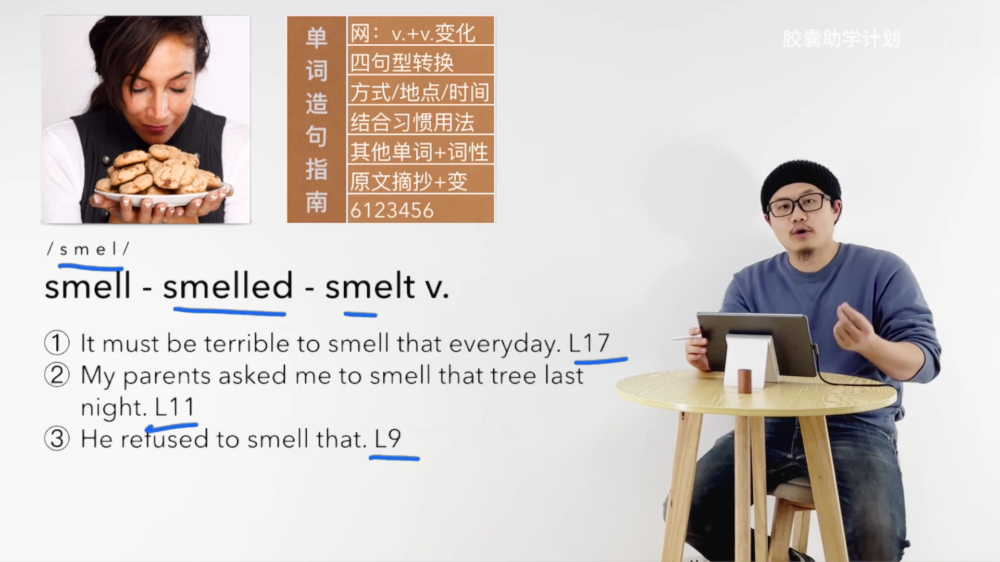

文字识别：单词造句指南 / 网：v.+v.变化 / 四句型转换 / 方式/地点/时间 / 结合习惯用法 / 其他单词+词性 / 原文摘抄+变 / 6123456 / / smel/ / smell - smelled - smelt v. / ① It must be terrible to smell that everyday. L17 / My parents asked me to smell that tree last / night. L11 / He refused to smell that. L9

### 画面 00:03:57

文字识别：单词造句指南 / 网：v.+v.变化 / 四句型转换 / 方式/地点/时间 / 结合习惯用法 / 其他单词+词性 / 原文摘抄+变 / 6123456 / /'wΛndafal/ / wonderful adj.

## 00:04:00–00:04:30

其实非常的简单，我们不拿它造句了，给各位稍微拓展几个，跟我一起读一下，叫做wonderful. Wonderful就是特别棒，比如做了一件别人做了一件事儿，你说这事儿太好了，就叫wonderful.那和它同意的，我们可以说great啊，这个单词我们会对吧？Excellent也是可以的。再来outstanding没有问题，brilliant也可以。最后一个fantastic.好，我提一个小点，各位，我们这里虽然

### 画面 00:04:00

文字识别：单词造句指南 / 网：v.+v.变化 / 四句型转换 / 方式/地点/时间 / 结合习惯用法 / 其他单词+词性 / 原文摘抄+变 / 6123456 / /'wandafal/ / wonderful adj.

### 画面 00:04:05

文字识别：单词造句指南 / 网：v.+v.变化 / 四句型转换 / 方式/地点/时间 / 结合习惯用法 / 其他单词+词性 / 原文摘抄+变 / 6123456 / wAndafal/ / wonderful adj.

### 画面 00:04:10

文字识别：单词造句指南 / 网：v.+v.变化 / 四句型转换 / 方式/地点/时间 / 结合习惯用法 / 其他单词+词性 / 原文摘抄+变 / 6123456 / wΛndafal/ / wonderful adj.

### 画面 00:04:15

文字识别：单词造句指南 / 网：v.+v.变化 / 四句型转换 / 方式/地点/时间 / 结合习惯用法 / 其他单词+词性 / 原文摘抄+变 / 6123456 / wAndafal/ / wonderful adj. / 1 / Great!

### 画面 00:04:20

文字识别：单词造句指南 / 网：v.+v.变化 / 四句型转换 / 方式/地点/时间 / 结合习惯用法 / 其他单词+词性 / 原文摘抄+变 / 6123456 / / 'w Λndafal/ / wonderful adj. / 1 / Great! / Excellent! / Outstanding!

### 画面 00:04:25

文字识别：单词造句指南 / 网：v.+v.变化 / 四句型转换 / 方式/地点/时间 / 结合习惯用法 / 其他单词+词性 / 原文摘抄+变 / 6123456 / /'w Λndafal/ / wonderful adj. / 1 / Great! / Excellent! / Outstanding! / Brilliant! / Fantastic!

### 画面 00:04:29

文字识别：单词造句指南 / 网：v.+v.变化 / 四句型转换 / 方式/地点/时间 / 结合习惯用法 / 其他单词+词性 / 原文摘抄+变 / 6123456 / wandafal/ / wonderful adj. / Great! / Excellent! / Outstanding! / Brilliant! / Fantastic!

## 00:04:30–00:05:00

貌似好像拓展了一下，但是注意要求不一样。这些单词的意思都是类似的，都是表示极好的、特别好、非常好、太棒了，都是完全相同的意思。基本上啊，在表示好的时候，所以在这里呢，各位能记住一到两个就可以了，您不需要都记住。OK，我说清楚了哈。对于各位口语上的应用，你会great，会wonderful就可以了。但是

### 画面 00:04:31

文字识别：单词造句指南 / 网：v.+v.变化 / 四句型转换 / 方式/地点/时间 / 结合习惯用法 / 其他单词+词性 / 原文摘抄+变 / 6123456 / wAndafal/ / wonderful adj. / ① / Great! / Excellent! / Outstanding! / Brilliant! / Fantastic!

### 画面 00:04:35

文字识别：单词造句指南 / 网：v.+v.变化 / 四句型转换 / 方式/地点/时间 / 结合习惯用法 / 其他单词+词性 / 原文摘抄+变 / 6123456 / wΛndafal/ / wonderful adj. / ① / Great! / Excellent! / Outstanding! / Brilliant! / Fantastic!

### 画面 00:04:40

文字识别：单词造句指南 / 网：v.+v.变化 / 四句型转换 / 方式/地点/时间 / 结合习惯用法 / 其他单词+词性 / 原文摘抄+变 / 6123456 / wΛndafal/ / wonderful adj. / ① / Great! / Excellent! / Outstanding! / Brilliant! / Fantastic!

### 画面 00:04:47

文字识别：单词造句指南 / 网：v.+v.变化 / 四句型转换 / 方式/地点/时间 / 结合习惯用法 / 其他单词+词性 / 原文摘抄+变 / 6123456 / wAndafal/ / wonderful adj. / ① / Great! / Excellent! / Outstanding! / Brilliant! / Fantastic!

### 画面 00:04:50

文字识别：单词造句指南 / 网：v.+v.变化 / 四句型转换 / 方式/地点/时间 / 结合习惯用法 / 其他单词+词性 / 原文摘抄+变 / 6123456 / wAndafal/ / wonderful adj. / 1 / Great! / Excellent! / Outstanding! / Brilliant! / Fantastic!

### 画面 00:04:55

文字识别：单词造句指南 / 网：v.+v.变化 / 四句型转换 / 方式/地点/时间 / 结合习惯用法 / 其他单词+词性 / 原文摘抄+变 / 6123456 / wAndafal/ / wonderful adj. / 1 / Great! / Excellent! / Outstanding! / Brilliant! / Fantastic!

## 00:05:00–00:05:30

区别在于可能在听力上的应用。别人说了 brilliant，别人说了 fantastic，你不知道别人是在骂你，还是在讽刺你，还是在夸你，这个就稍微有一点尴尬，对吧？OK，其次呢，这种单词我的个人建议是，您不用一遍一遍背它。其实各位去看一看 Friends，看一看呃这个美剧啊，各种美剧和以英语为母语的这个英呃电影，各位这些单词是最常出现的，好吧？

### 画面 00:05:01

文字识别：单词造句指南 / 网：v.+v.变化 / 四句型转换 / 方式/地点/时间 / 结合习惯用法 / 其他单词+词性 / 原文摘抄+变 / 6123456 / wAndafal/ / wonderful adj. / ① / Great! / Excellent! / Outstanding! / Brilliant! / Fantastic!

### 画面 00:05:03

文字识别：单词造句指南 / 网：v.+v.变化 / 四句型转换 / 方式/地点/时间 / 结合习惯用法 / 其他单词+词性 / 原文摘抄+变 / 6123456 / wAndafal/ / wonderful adj. / ① / Great! / Excellent! / Outstanding! / Brilliant! / Fantastic!

### 画面 00:05:05

文字识别：单词造句指南 / 网：v.+v.变化 / 四句型转换 / 方式/地点/时间 / 结合习惯用法 / 其他单词+词性 / 原文摘抄+变 / 6123456 / wAndafal/ / wonderful adj. / 1 / Great! / Excellent! / Outstanding! / Brilliant! / Fantastic!

### 画面 00:05:10

文字识别：单词造句指南 / 网：v.+v.变化 / 四句型转换 / 方式/地点/时间 / 结合习惯用法 / 其他单词+词性 / 原文摘抄+变 / 6123456 / wΛndafal/ / wonderful adj. / ① / Great! / Excellent! / Outstanding! / Brilliant! / Fantastic!

### 画面 00:05:17

文字识别：单词造句指南 / 网：v.+v.变化 / 四句型转换 / 方式/地点/时间 / 结合习惯用法 / 其他单词+词性 / 原文摘抄+变 / 6123456 / wAndafal/ / wonderful adj. / ① / Great! / Excellent! / Outstanding! / Brilliant! / Fantastic!

### 画面 00:05:21

文字识别：单词造句指南 / 网：v.+v.变化 / 四句型转换 / 方式/地点/时间 / 结合习惯用法 / 其他单词+词性 / 原文摘抄+变 / 6123456 / wΛndafal/ / wonderful adj. / ① / Great! / Excellent! / Outstanding! / Brilliant! / Fantastic!

### 画面 00:05:26

文字识别：单词造句指南 / 网：v.+v.变化 / 四句型转换 / 方式/地点/时间 / 结合习惯用法 / 其他单词+词性 / 原文摘抄+变 / 6123456 / wΛndafal/ / wonderful adj. / ① / Great! / Excellent! / Outstanding! / Brilliant! / Fantastic!

## 00:05:30–00:06:00

Next one，下一个单词跟我读一下，叫做 campfire。OK，各位非常清楚能看到 campfire，它指的是实际上是我们露营的时候的那个篝火啊。它是两个单词组成的，一个 camp 营地啊，我们露营的那个营地就叫 camp。那 fire 呢就是火，非常的简单。campfire 露营的那个篝火。OK，名词我们拿它造句，比如说 he hurried to the campfire。他匆忙赶到了这个 campfire 地方。Next

### 画面 00:05:30

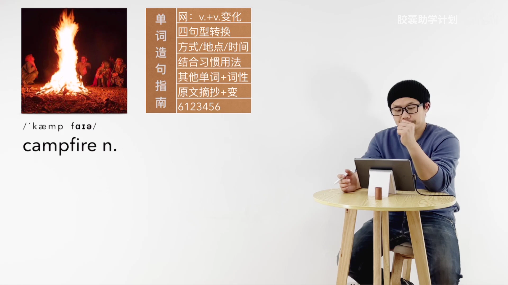

文字识别：单词造句指南 / 网：v.+v.变化 / 四句型转换 / 方式/地点/时间 / 结合习惯用法 / 其他单词+词性 / 原文摘抄+变 / 6123456 / /'kæmp / faia/ / campfire n.

### 画面 00:05:35

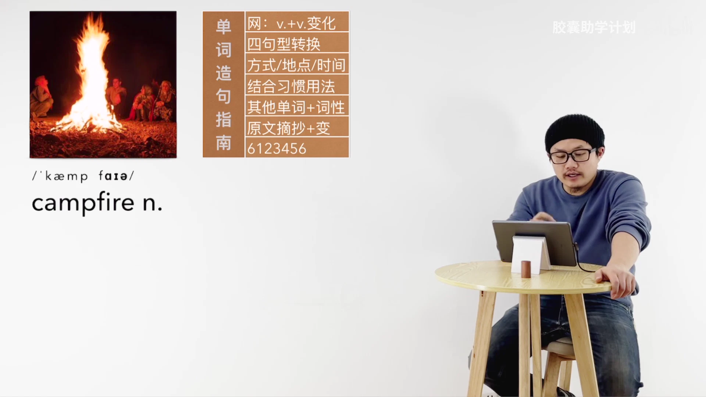

文字识别：单词造句指南 / 网：v.+v.变化 / 四句型转换 / 方式/地点/时间 / 结合习惯用法 / 其他单词+词性 / 原文摘抄+变 / 6123456 / /'kæmp / faia/ / campfire n.

### 画面 00:05:40

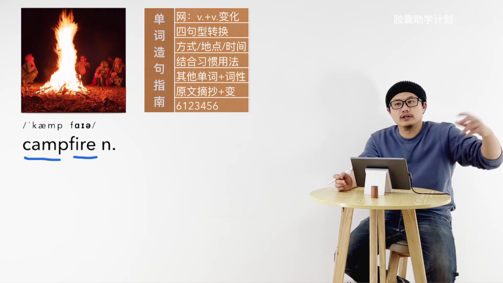

文字识别：单词造句指南 / 网：v.+v.变化 / 四句型转换 / 方式/地点/时间 / 结合习惯用法 / 其他单词+词性 / 原文摘抄+变 / 6123456 / /'kæmp / faia/ / campfire n.

### 画面 00:05:50

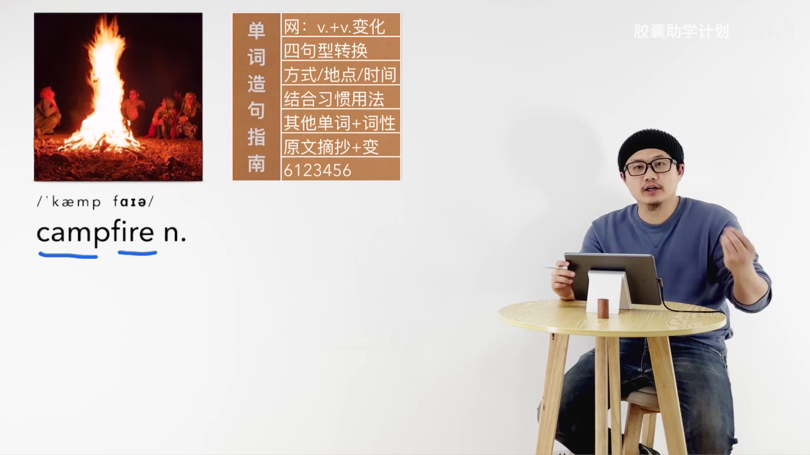

文字识别：单词造句指南 / 网：v.+v.变化 / 四句型转换 / 方式/地点/时间 / 结合习惯用法 / 其他单词+词性 / 原文摘抄+变 / 6123456 / /'kæmp / faia/ / campfire n.

### 画面 00:05:55

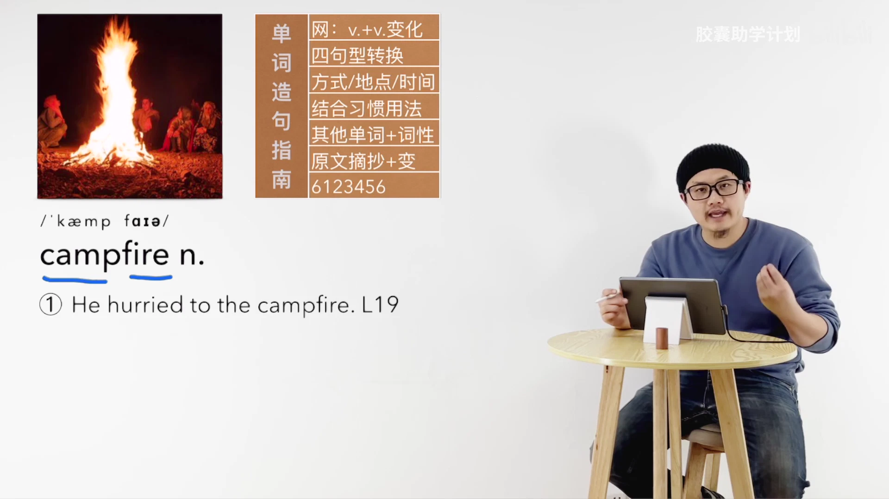

文字识别：单词造句指南 / 网：v.+v.变化 / 四句型转换 / 方式/地点/时间 / 结合习惯用法 / 其他单词+词性 / 原文摘抄+变 / 6123456 / /'kæmp / faia/ / campfire n. /  He hurried to the campfire. L19

## 00:06:00–00:06:30

one, 那我们可以把这句话变成一般疑问句和各种特殊疑问句. 这个地方就留给各位课下去完成了. 或者您现在暂停屏幕，口语直接去做一个表达. Next one, 说 we didn't know the way to our campfire. 说我们不知道去这个我们自己这个营地篝火的路怎么去走. 二十五课咱们学的. OK, 好. Next one, 下一个小单词 creep. 那它的过去式、过去分词

### 画面 00:06:00

文字识别：单词造句指南 / 网：v.+v.变化 / 四句型转换 / 方式/地点/时间 / 结合习惯用法 / 其他单词+词性 / 原文摘抄+变 / 6123456 / /'kæmp / faia/ / campfire n. / ) He hurried to the campfire. L19 / o did/why/who...

### 画面 00:06:06

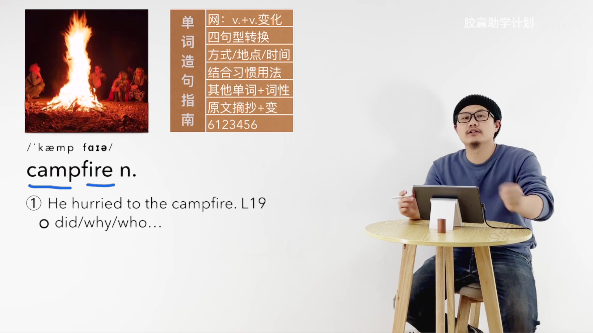

文字识别：单词造句指南 / 网：v.+v.变化 / 四句型转换 / 方式/地点/时间 / 结合习惯用法 / 其他单词+词性 / 原文摘抄+变 / 6123456 / /'kæmp / faia/ / campfire n. / ) He hurried to the campfire. L19 / o did/why/who...

### 画面 00:06:10

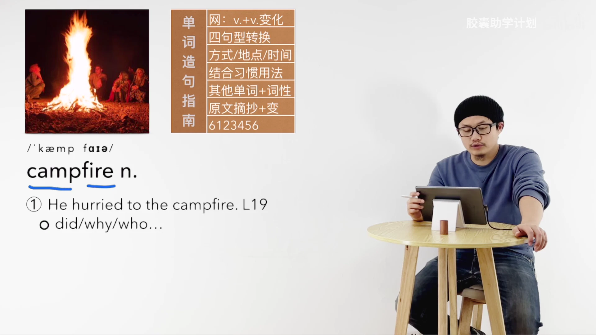

文字识别：单词造句指南 / 网：v.+v.变化 / 四句型转换 / 方式/地点/时间 / 结合习惯用法 / 其他单词+词性 / 原文摘抄+变 / 6123456 / /'kæmp / faia/ / campfire n. / ) He hurried to the campfire. L19 / o did/why/who...

### 画面 00:06:15

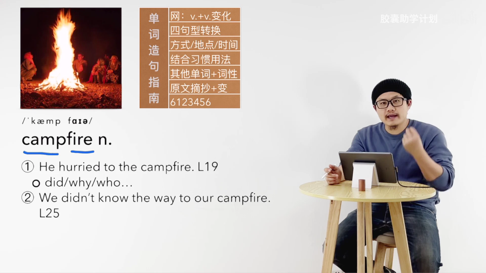

文字识别：单词造句指南 / 网：v.+v.变化 / 四句型转换 / 方式/地点/时间 / 结合习惯用法 / 其他单词+词性 / 原文摘抄+变 / 6123456 / /'kæmp / faia/ / campfire n. /  He hurried to the campfire. L19 / o did/why/who... / We didn't know the way to our campfire. / L25

### 画面 00:06:21

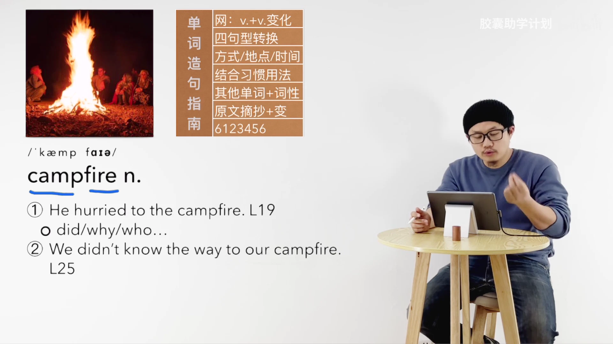

文字识别：单词造句指南 / 网：v.+v.变化 / 四句型转换 / 方式/地点/时间 / 结合习惯用法 / 其他单词+词性 / 原文摘抄+变 / 6123456 / /'kæmp / faia/ / campfire n. /  He hurried to the campfire. L19 / o did/why/who... / We didn't know the way to our campfire. / L25

### 画面 00:06:24

文字识别：单词造句指南 / 网：v.+v.变化 / 四句型转换 / 方式/地点/时间 / 结合习惯用法 / 其他单词+词性 / 原文摘抄+变 / 6123456 / /kri:p/ /krept/ / creep crept v.

### 画面 00:06:26

文字识别：单词造句指南 / 网：v.+v.变化 / 四句型转换 / 方式/地点/时间 / 结合习惯用法 / 其他单词+词性 / 原文摘抄+变 / 6123456 / /kri:p/ /krept/ / creep crept v.

## 00:06:30–00:07:00

叫crept. Okay, crept. Creep是爬的意思。我们原来还学过一个单词，在新一当中三十一课就见过，叫climb，对吧？这两个爬有一点点区别。Climb一般指的是往上爬，比如说爬树、爬墙、爬楼，对吧？那creep一般指的是在平地上匍匐前进。Okay, creep往前爬。那我们造句说My cat always creeps into my tent in the garden.好，

### 画面 00:06:30

文字识别：单词造句指南 / 网：v.+v.变化 / 四句型转换 / 方式/地点/时间 / 结合习惯用法 / 其他单词+词性 / 原文摘抄+变 / 6123456 / /kri:p/ /krept/ / creep / crept v.

### 画面 00:06:35

文字识别：单词造句指南 / 网：v.+v.变化 / 四句型转换 / 方式/地点/时间 / 结合习惯用法 / 其他单词+词性 / 原文摘抄+变 / 6123456 / /kri:p/ /krept/ / creep / crept v.

### 画面 00:06:51

文字识别：单词造句指南 / 网：v.+v.变化 / 四句型转换 / 方式/地点/时间 / 结合习惯用法 / 其他单词+词性 / 原文摘抄+变 / 6123456 / /kri:p/ /krept/ / creep / crept v.

### 画面 00:06:55

文字识别：单词造句指南 / 网：v.+v.变化 / 四句型转换 / 方式/地点/时间 / 结合习惯用法 / 其他单词+词性 / 原文摘抄+变 / 6123456 / / kri:p/ /krept/ / creep / crept v. / ① My cat always creeps into my tent in the garden.

## 00:07:00–00:07:30

我的猫啊总是爬进我的帐篷里面。我这个帐篷在哪儿呢？In the garden，在我们自己家花园里面。好，注意creeps into。我选择用的一个时态是一般现在时，陈述一个客观事实。依旧肯定句给您了，各种句型您自己去变，对吧？四句型转换各位，这个地方永远是造句的一个神器，好吧？Next one,说You crept on the carpet a lot when you

### 画面 00:07:01

文字识别：单词造句指南 / 网：v.+v.变化 / 四句型转换 / 方式/地点/时间 / 结合习惯用法 / 其他单词+词性 / 原文摘抄+变 / 6123456 / / kri:p / /krept/ / creep / crept v. / ① My cat always creeps into my tent in the garden.

### 画面 00:07:03

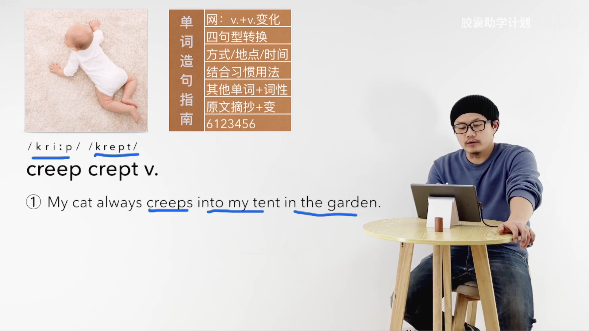

文字识别：单词造句指南 / 网：v.+v.变化 / 四句型转换 / 方式/地点/时间 / 结合习惯用法 / 其他单词+词性 / 原文摘抄+变 / 6123456 / / kri:p/ /krept/ / creep / crept v. / ① My cat always creeps into my tent in the garden.

### 画面 00:07:20

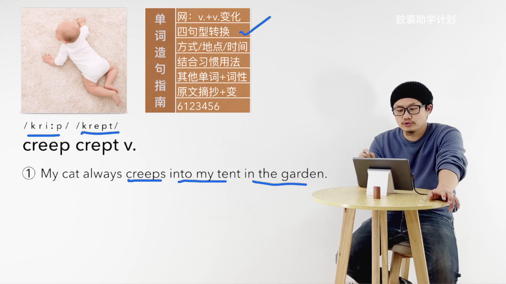

文字识别：单词造句指南 / 网：v.+v.变化 / 四句型转换 / 方式/地点/时间 / 结合习惯用法 / 其他单词+词性 / 原文摘抄+变 / 6123456 / / kri:p/ /krept/ / creep / crept v. / ① My cat always creeps into my tent in the garden.

### 画面 00:07:25

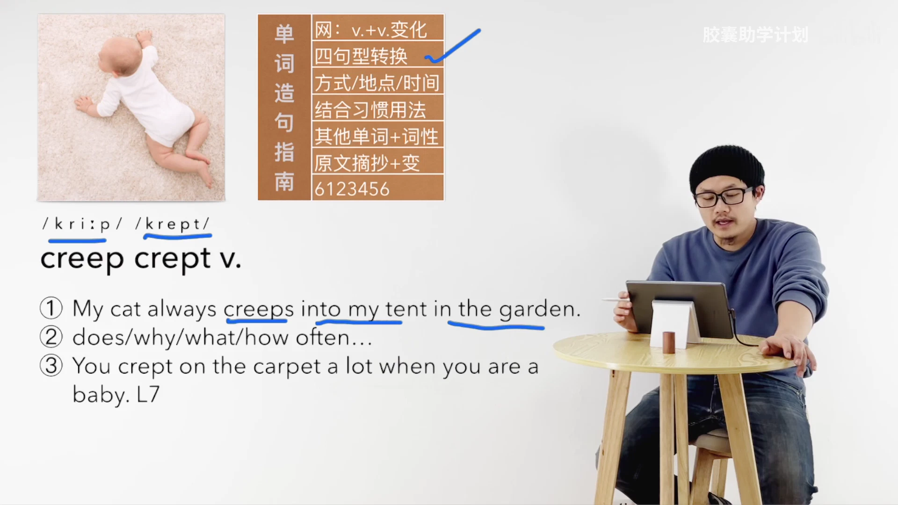

文字识别：单词造句指南 / 网：v.+v.变化 / 四句型转换 / 方式/地点/时间 / 结合习惯用法 / 其他单词+词性 / 原文摘抄+变 / 6123456 / / kri:p / /krept/ / creep crept v. / ① My cat always creeps into my tent in the garden. / does/why/what/how often... / 2 / You crept on the carpet a lot when you are a / 3 / baby. L7

## 00:07:30–00:08:00

are a baby. Ah, this,比如说可以是，呃，爸爸妈妈跟这孩子说说啊，你小的时候啊，哎，特别爱动，是吧？总在这个地板上爬来爬去。You crept on the carpet. Ah,总在这个地上爬来爬去。When you are a baby,当你还是一个小孩子的时候，第七课咱们学的when，对吧？当什么什么时候，这典型是一个过去的时间。OK，所以这个地方呢，我们可以把它给换成were，那我们会感觉

### 画面 00:07:30

文字识别：单词造句指南 / 网：v.+v.变化 / 四句型转换 / 方式/地点/时间 / 结合习惯用法 / 其他单词+词性 / 原文摘抄+变 / 6123456 / / kri:p / /krept/ / creep crept v. / ① My cat always creeps into my tent in the garden. / does/why/what/how often... / 2 / You crept on the carpet a lot when you are a / 3 / baby. L7

### 画面 00:07:40

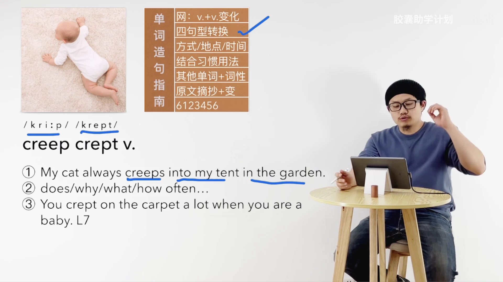

文字识别：单词造句指南 / 网：v.+v.变化 / 四句型转换 / 方式/地点/时间 / 结合习惯用法 / 其他单词+词性 / 原文摘抄+变 / 6123456 / / kri:p / /krept/ / creep crept v. / ① My cat always creeps into my tent in the garden. / does/why/what/how often... / 2 / You crept on the carpet a lot when you are a / 3 / baby. L7

### 画面 00:07:47

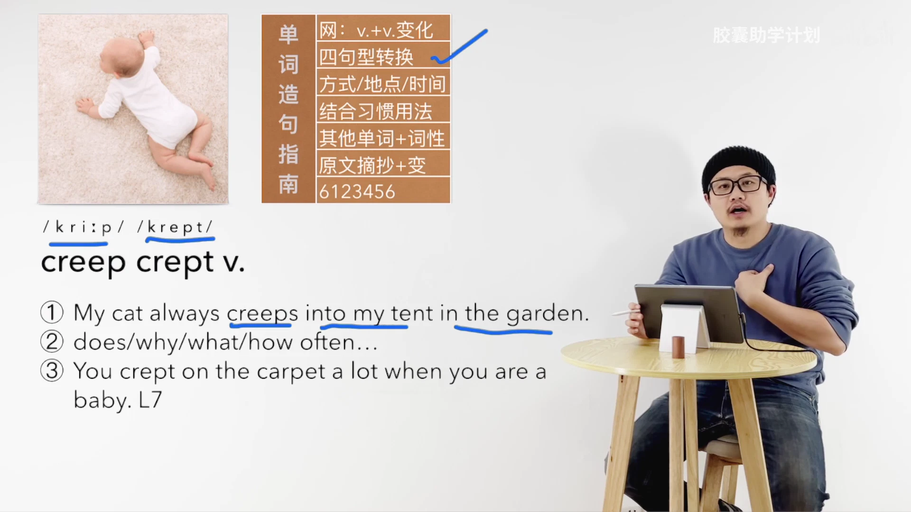

文字识别：单词造句指南 / 网：v.+v.变化 / 四句型转换 / 方式/地点/时间 / 结合习惯用法 / 其他单词+词性 / 原文摘抄+变 / 6123456 / / kri:p / /krept/ / creep crept v. / ① My cat always creeps into my tent in the garden. / does/why/what/how often... / 2 / You crept on the carpet a lot when you are a / 3 / baby. L7

### 画面 00:07:55

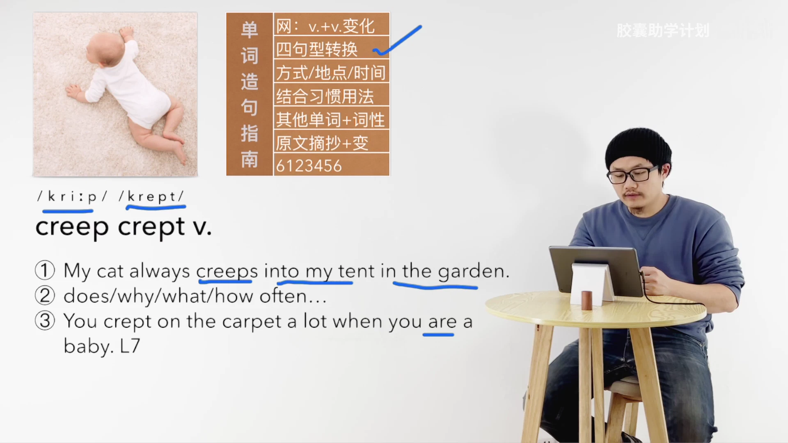

文字识别：单词造句指南 / 网：v.+v.变化 / 四句型转换 / 方式/地点/时间 / 结合习惯用法 / 其他单词+词性 / 原文摘抄+变 / 6123456 / / kri:p/ /krept/ / creep crept v. / ① My cat always creeps into my tent in the garden. / does/why/what/how often... / 2 / You crept on the carpet a lot when you are a / 3 / baby. L7

### 画面 00:07:58

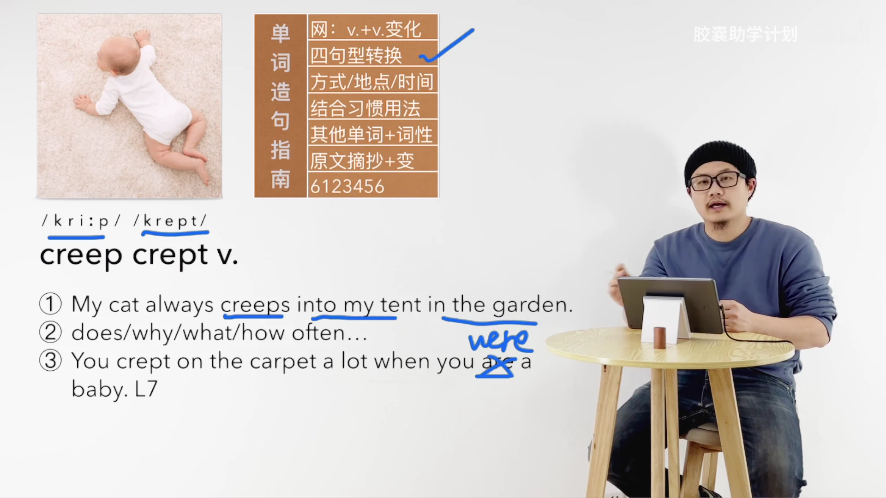

文字识别：单词造句指南 / 网：v.+v.变化 / 四句型转换 / 方式/地点/时间 / 结合习惯用法 / 其他单词+词性 / 原文摘抄+变 / 6123456 / / kri:p/ /krept/ / creep ( / crept v. / ① My cat always creeps into my tent in the garden. / does/why/what/how often... / 2 / were / You crept on the carpet a lot when you ② / 3 / a / baby. L7

## 00:08:00–00:08:30

起来更舒服一点，OK。好，Next one，跟我一起读一下。首先第一个单词叫 sleeping bag。各位如果去露营过的话，哇，我们这个睡袋指的就是 sleeping bag。OK。那下一个单词我们新就见过了，带着各位再读一遍，叫 comfortable，对吧？不舒服叫 uncomfortable。OK。好，那 sleeping bag 本身是一个名词，咱们依旧是找它的动词或其他这个习惯用法，

### 画面 00:08:00

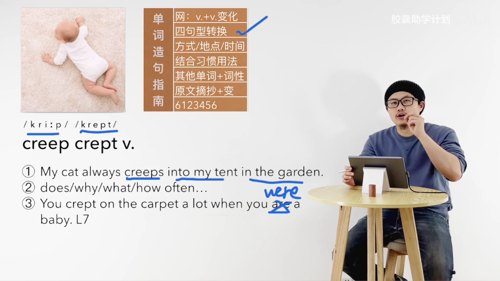

文字识别：单词造句指南 / 网：v.+v.变化 / 四句型转换 / 方式/地点/时间 / 结合习惯用法 / 其他单词+词性 / 原文摘抄+变 / 6123456 / / kri:p/ /krept/ / creep crept v. / ① My cat always creeps into my tent in the garden. / does/why/what/how often... / 2 / were / You crept on the carpet a lot when you② / 3 / a / baby. L7

### 画面 00:08:02

文字识别：单词造句指南 / 网：v.+v.变化 / 四句型转换 / 方式/地点/时间 / 结合习惯用法 / 其他单词+词性 / 原文摘抄+变 / 6123456 / / · k Λ m f tab l / / sleeping bag n. comfortable adj.

### 画面 00:08:04

文字识别：单词造句指南 / 网：v.+v.变化 / 四句型转换 / 方式/地点/时间 / 结合习惯用法 / 其他单词+词性 / 原文摘抄+变 / 6123456 / / · k Λ m f tab l / / sleeping bag n. comfortable adj.

### 画面 00:08:06

文字识别：单词造句指南 / 网：v.+v.变化 / 四句型转换 / 方式/地点/时间 / 结合习惯用法 / 其他单词+词性 / 原文摘抄+变 / 6123456 / / 'k Λm f tab l / / sleeping bag n. comfortable adj.

### 画面 00:08:10

文字识别：单词造句指南 / 网：v.+v.变化 / 四句型转换 / 方式/地点/时间 / 结合习惯用法 / 其他单词+词性 / 原文摘抄+变 / 6123456 / 4 / / · k Λ m f ta b l / / sleeping bag n. comfortable adj.

### 画面 00:08:14

文字识别：单词造句指南 / 网：v.+v.变化 / 四句型转换 / 方式/地点/时间 / 结合习惯用法 / 其他单词+词性 / 原文摘抄+变 / 6123456 / / ·kΛm f ta b l / / sleeping bag n. comfortable adj.

## 00:08:30–00:09:00

包含动词的习惯用法。那我们造句子说，She is keen on buying new sleeping bags. 这是第二十课咱们学过的，说她非常热衷于买新的睡袋啊。这个资深驴友啊，这个非常喜欢各种装备啊。This sleeping bag has to be cleaned. 二十一课咱们学的 has to be done, have to be done, 跟 must be done 基本含义是一样的，叫必须被打扫。Next one, 说

### 画面 00:08:33

文字识别：单词造句指南 / 网：v.+v.变化 / 四句型转换 / 方式/地点/时间 / 结合习惯用法 / 其他单词+词性 / 原文摘抄+变 / 6123456 / / ' k Λ m f t a b l / / sleeping bag n. comfortable adj. / ① She is keen on buying new sleeping bags. L20

### 画面 00:08:35

文字识别：单词造句指南 / 网：v.+v.变化 / 四句型转换 / 方式/地点/时间 / 结合习惯用法 / 其他单词+词性 / 原文摘抄+变 / 6123456 / / · k Λ m f t a b l / / sleeping bag n. comfortable adj. / D She is keen on buying new sleeping bags. L20

### 画面 00:08:39

文字识别：单词造句指南 / 网：v.+v.变化 / 四句型转换 / 方式/地点/时间 / 结合习惯用法 / 其他单词+词性 / 原文摘抄+变 / 6123456 / / ·kΛm f tab l / / sleeping bag n. comfortable adj. /  She is keen on / buying new sleeping bags/L20

### 画面 00:08:44

文字识别：单词造句指南 / 网：v.+v.变化 / 四句型转换 / 方式/地点/时间 / 结合习惯用法 / 其他单词+词性 / 原文摘抄+变 / 6123456 / / ·kΛmftab l / / sleeping bag n. comfortable adj. / She is keen on buying new sleeping bags. L20 / 1 / This sleeping /  bag has to be cleaned. L21

### 画面 00:08:49

文字识别：单词造句指南 / 网：v.+v.变化 / 四句型转换 / 方式/地点/时间 / 结合习惯用法 / 其他单词+词性 / 原文摘抄+变 / 6123456 / / ·kΛm ft a b l / / sleeping bag n. comfortable adj. / She is keen on buying new sleeping bags. L20 / 1 / This sleeping bag has to be cleaned. L21

### 画面 00:08:52

文字识别：单词造句指南 / 网：v.+v.变化 / 四句型转换 / 方式/地点/时间 / 结合习惯用法 / 其他单词+词性 / 原文摘抄+变 / 6123456 / / · kΛm ft a b l / / sleeping bag n. comfortable adj. / She is keen on buying new sleeping bags. L20 / 1 / This sleeping bag has to be cleaned. L21

### 画面 00:08:54

文字识别：单词造句指南 / 网：v.+v.变化 / 四句型转换 / 方式/地点/时间 / 结合习惯用法 / 其他单词+词性 / 原文摘抄+变 / 6123456 / / 'kΛmfta b l / / sleeping bag n. comfortable adj. / She is keen on buying new sleeping bags. L20 / 1 / This sleeping bag has to be cleaned. L21

### 画面 00:08:59

文字识别：单词造句指南 / 网：v.+v.变化 / 四句型转换 / 方式/地点/时间 / 结合习惯用法 / 其他单词+词性 / 原文摘抄+变 / 6123456 / / ·kΛm ftab l / / sleeping bag n. comfortable adj. /  She is keen on buying new sleeping bags. L20 / 1 / This sleeping bag has to be cleaned. L21 / This sleeping bag is the most comfortable one / I've ever used. L8

## 00:09:00–00:09:30

this sleeping bag is the most comfortable one I've ever used. Okay, say this sleeping bag is the most comfortable one I've ever used. Okay, say this sleeping bag is the most comfortable one I've ever used. Okay, say this sleeping bag is the most comfortable one I've ever used. Okay, say this sleeping bag is the most comfortable one I've ever used. Okay, say this sleeping bag is the most comfortable one I've ever used. Okay, say this sleeping bag is the most comfortable one I've ever used. Okay, say this sleeping bag is the most comfortable one I've ever used. Okay, say this sleeping bag is the most comfortable one I've ever used. Okay, say this sleeping bag is the most comfortable

### 画面 00:09:15

文字识别：单词造句指南 / 网：v.+v.变化 / 四句型转换 / 方式/地点/时间 / 结合习惯用法 / 其他单词+词性 / 原文摘抄+变 / 6123456 / / ·kΛmftab l / / sleeping bag n. comfortable adj. / She is keen on buying new sleeping bags. L20 / ① / This sleeping bag has to be cleaned. L21 / This sleeping bag is the most comfortable one / I've ever used. L8

### 画面 00:09:20

文字识别：单词造句指南 / 网：v.+v.变化 / 四句型转换 / 方式/地点/时间 / 结合习惯用法 / 其他单词+词性 / 原文摘抄+变 / 6123456 / /'saund li/ / soundly adv.

### 画面 00:09:23

文字识别：单词造句指南 / 网：v.+v.变化 / 四句型转换 / 方式/地点/时间 / 结合习惯用法 / 其他单词+词性 / 原文摘抄+变 / 6123456 / /'saundli/ / soundly adv.

### 画面 00:09:29

文字识别：单词造句指南 / 网：v.+v.变化 / 四句型转换 / 方式/地点/时间 / 结合习惯用法 / 其他单词+词性 / 原文摘抄+变 / 6123456 / /'saund li/ / soundyadv.

## 00:09:30–00:10:00

sound。sound这个单词其实咱们是会的，表示听起来，对吧？那soundly跟听起来关系就不大了，它指的是经常跟sleep这个单词连用，指的是睡的非常的甜美啊，睡得很香。我们汉语啊叫睡得很香，那英语叫sleep soundly。动词给您了，您是不是找点动词加动词变化以及四句型转换？然后您课下再试试加点什么？你看方式现在给

### 画面 00:09:31

文字识别：单词造句指南 / 网：v.+v.变化 / 四句型转换 / 方式/地点/时间 / 结合习惯用法 / 其他单词+词性 / 原文摘抄+变 / 6123456 / /'saundli/ / adv. / sound

### 画面 00:09:35

文字识别：单词造句指南 / 网：v.+v.变化 / 四句型转换 / 方式/地点/时间 / 结合习惯用法 / 其他单词+词性 / 原文摘抄+变 / 6123456 / / 'saund li/ / soundly adv.

### 画面 00:09:39

文字识别：单词造句指南 / 网：v.+v.变化 / 四句型转换 / 方式/地点/时间 / 结合习惯用法 / 其他单词+词性 / 原文摘抄+变 / 6123456 / /'saundli/ / soundly adv. / sleep soundly / 1

### 画面 00:09:44

文字识别：单词造句指南 / 网：v.+v.变化 / 四句型转换 / 方式/地点/时间 / 结合习惯用法 / 其他单词+词性 / 原文摘抄+变 / 6123456 / /'saundli/ / soundly adv. / sleep soundly / 1

### 画面 00:09:52

文字识别：单词造句指南 / 网：v.+v.变化 / 四句型转换 / 方式/地点/时间 / 结合习惯用法 / 其他单词+词性 / 原文摘抄+变 / 6123456 / /'saundli/ / soundly adv. / sleep soundly / 1

### 画面 00:09:56

文字识别：单词造句指南 / 网：v.+v.变化 / 四句型转换 / 方式/地点/时间 / 结合习惯用法 / 其他单词+词性 / 原文摘抄+变 / 6123456 / /'saund li/ / soundly adv. / sleep soundly / 1

## 00:10:00–00:10:30

了，对吧？你加点地点，加点时间。比如说时间是 last night，或者说 yesterday afternoon。 OK，好，那我们造一个句子，说 that little boy is a little girl is sleeping soundly in the bedroom now。我加了一个时间是 now，加的地点是 in the bedroom。 OK，好，再来一个叫 I slept soundly last night。我换了一个时态，对不对？然后各位这两句话都

### 画面 00:10:09

文字识别：单词造句指南 / 网：v.+v.变化 / 四句型转换 / 方式/地点/时间 / 结合习惯用法 / 其他单词+词性 / 原文摘抄+变 / 6123456 / / 'saund li / / soundly adv. / sleep soundly / That little girl is sleeping soundly in the / bedroom now.

### 画面 00:10:18

文字识别：单词造句指南 / 网：v.+v.变化 / 四句型转换 / 方式/地点/时间 / 结合习惯用法 / 其他单词+词性 / 原文摘抄+变 / 6123456 / /'saund li / / soundly adv. / sleep soundly / That little girl is sleeping soundly in the / bedroom now.

### 画面 00:10:20

文字识别：单词造句指南 / 网：v.+v.变化 / 四句型转换 / 方式/地点/时间 / 结合习惯用法 / 其他单词+词性 / 原文摘抄+变 / 6123456 / /'saund li / / soundly adv. / sleep soundly / That little girl is sleeping soundly in the / bedroom now.

### 画面 00:10:24

文字识别：单词造句指南 / 网：v.+v.变化 / 四句型转换 / 方式/地点/时间 / 结合习惯用法 / 其他单词+词性 / 原文摘抄+变 / 6123456 / / 'saund li / / soundly adv. / sleep soundly / That little girl is sleeping soundly in the / bedroom now. / I slept soundly last night.

## 00:10:30–00:11:00

是肯定句。您今天家庭作业做个四句型转换，家庭作业就完成了。这是一个比较偷懒的方式。不偷懒的方式呢，您自己换一个时态，你用 sleep soundly 试一下，或者别的情态动词，甚至被动，你试试能不能用，对吧？OK，好，哎，did when who 四句型转换，我们不多说了。接下来我们看一个小的电影片段，这个电影片段当中就出现了 sleep soundly。OK，来了。I'm sorry, I didn't mean to

### 画面 00:10:39

文字识别：单词造句指南 / 网：v.+v.变化 / 四句型转换 / 方式/地点/时间 / 结合习惯用法 / 其他单词+词性 / 原文摘抄+变 / 6123456 / / 'saund li/ / soundly adv. / sleep soundly / That little girl is sleeping soundly in the / bedroom now. / I slept soundly last night.

### 画面 00:10:50

文字识别：sleep soundly... / 蜘蛛侠2 / Spider-Man 2! / (2004)

### 画面 00:10:59

文字识别：sleep soundly.. / 蜘蛛侠2 / 对不起，我不该质疑你 / Spider-Man 2! / I'm sorry. I didn't mean to question you. / (2004)

## 00:11:00–00:11:30

question you, Rosie. Our new friend thinks I'm gonna blow up the city. You can sleep soundly tonight. Otto's done his homework. Come to the demonstration tomorrow, and you'll see for yourself. You need to sleep soundly tonight, Otto. Did Edison sleep before he turned on the light? Did Marconi sleep before he turned on the radio? Did Beethoven sleep before he wrote the fifth? Okay, sleep soundly. Okay, you can sleep soundly tonight. On tonight, we can sleep well. Very

### 画面 00:11:01

文字识别：sleep soundly.. / 蜘蛛侠2 / 这位小朋友认为，我会把纽约炸掉 / Spider-Man 2! / Osie, our new friend thinks I'm gonna blow up the city. / (2004)

### 画面 00:11:03

文字识别：sleep soundly... / 蜘蛛侠2 / 这位小朋友认为，我会把纽约炸掉 / Spider-Man 2! / Osie, our new friend thinks I'm gonna blow up the city. / (2004)

### 画面 00:11:05

文字识别：sleep soundly... / 蜘蛛侠2 / 你今晚可以高枕无忧 / Spider-Man 2! / You can sleep soundly tonight. / (2004)

### 画面 00:11:07

文字识别：sleep soundly... / 蜘蛛侠2 / 他的研究无懈可击 / Spider-Man 2! / Otto's done his homework. / (2004)

### 画面 00:11:09

文字识别：sleep soundly... / 蜘蛛侠2 / 明天来看测试，你就知道 / Spider-Man 2! / Ome to the demonstration tomorrow, and you'll see for yourself. / (2004)

### 画面 00:11:11

文字识别：sleep soundly.. / 蜘蛛侠2 / 明天来看测试，你就知道 / Spider-Man 2! / Ome to the demonstration tomorrow, and you'll see for yourself. / (2004)

### 画面 00:11:13

文字识别：sleep soundly... / 蜘蛛侠2 / 你倒是要好好睡一觉 / Spider-Man 2! / And you need to sleep soundly tonight, Otto. / (2004)

### 画面 00:11:15

文字识别：sleep soundly... / 蜘蛛侠2 / 爱迪生发明电灯前有睡吗？ / Spider-Man 2! / Did Edison sleep before he turned on the light? / (2004)

### 画面 00:11:17

文字识别：sleep soundly... / 蜘蛛侠2 / 马可尼发明无线电前有睡吗？ / Spider-Man 2! / Did Marconi sleep before he turned on the radio? / (2004)

### 画面 00:11:19

文字识别：sleep soundly... / 蜘蛛侠2 / Spider-Man 2! / (2004)

### 画面 00:11:21

文字识别：sleep soundly... / 蜘蛛侠2 / 贝多芬写第五交响曲前有睡吗？ / Spider-Man 2! / Did Beethoven sleep before he wrote the 5th? / (2004)

### 画面 00:11:23

文字识别：sleep soundly….. / ait / 蜘蛛侠2 / Spider-Man 2! / (2004)

### 画面 00:11:29

文字识别：单词造句指南 / 网：v.+v.变化 / 四句型转换 / 方式/地点/时间 / 结合习惯用法 / 其他单词+词性 / 原文摘抄+变 / 6123456 / /li:p/ / leap - leapt - leapt v.

## 00:11:30–00:12:00

again? Next one,下一个单词，我们一起读一下，叫做 leap leap。哦，指的是跳跃啊，大步的跳跃。那我们造句子，原文直接给了一句话，叫 they all they all leapt out of their sleeping bag。他们都从他们睡袋当中跳出来了。你看原文给的是一个一般过去时的肯定句，那我们要做的事情就是把它变成各种句型就可以了。然后我提醒了各位要把 date 提前，

### 画面 00:11:32

文字识别：单词造句指南 / 网：v.+v.变化 / 四句型转换 / 方式/地点/时间 / 结合习惯用法 / 其他单词+词性 / 原文摘抄+变 / 6123456 / /li:p/ / leap - leapt - leapt v.

### 画面 00:11:35

文字识别：单词造句指南 / 网：v.+v.变化 / 四句型转换 / 方式/地点/时间 / 结合习惯用法 / 其他单词+词性 / 原文摘抄+变 / 6123456 / /li:p/ / leap - leapt - leapt v.

### 画面 00:11:40

文字识别：单词造句指南 / 网：v.+v.变化 / 四句型转换 / 方式/地点/时间 / 结合习惯用法 / 其他单词+词性 / 原文摘抄+变 / 6123456 / /li:p/ / leap - leapt - leapt v. / ① [Story]: They all leapt out of their sleeping bags.

### 画面 00:11:54

文字识别：单词造句指南 / 网：v.+v.变化 / 四句型转换 / 方式/地点/时间 / 结合习惯用法 / 其他单词+词性 / 原文摘抄+变 / 6123456 / /li:p/ / leap - leapt - leapt v. / [Story]: They all leapt out of their sleeping bags. / 1[ / did/who/why/where...

## 00:12:00–00:12:30

动词，并且换回原形，这就是您的小的家作业，好吧？OK，下一个单词跟我读一下，叫heavily。好，heavily这个单词一看是个副词，它的形容词长相其实我们是认得的，叫做heavy，叫做沉的，对吧？那heavily是不是沉地呢？它往往不是，它往往跟rain跟snow连用起来，叫做rain heavily，snow heavily，rain heavily，呃，就是指雨

### 画面 00:12:04

文字识别：单词造句指南 / 网：v.+v.变化 / 四句型转换 / 方式/地点/时间 / 结合习惯用法 / 其他单词+词性 / 原文摘抄+变 / 6123456 / /'hevili/ / heavily adv.

### 画面 00:12:09

文字识别：单词造句指南 / 网：v.+v.变化 / 四句型转换 / 方式/地点/时间 / 结合习惯用法 / 其他单词+词性 / 原文摘抄+变 / 6123456 / /'hevili/ / heavily adv.

### 画面 00:12:14

文字识别：单词造句指南 / 网：v.+v.变化 / 四句型转换 / 方式/地点/时间 / 结合习惯用法 / 其他单词+词性 / 原文摘抄+变 / 6123456 / /'hevili/ / heavily adv.

### 画面 00:12:20

文字识别：单词造句指南 / 网：v.+v.变化 / 四句型转换 / 方式/地点/时间 / 结合习惯用法 / 其他单词+词性 / 原文摘抄+变 / 6123456 / /'hevi li/ / heavily adv. / rain/snow heavily

### 画面 00:12:29

文字识别：单词造句指南 / 网：v.+v.变化 / 四句型转换 / 方式/地点/时间 / 结合习惯用法 / 其他单词+词性 / 原文摘抄+变 / 6123456 / /'hevrli/ / heavily adv. / rain/snow heavily

## 00:12:30–00:13:00

下的很大。那snow heavily就是雪下的很大。这个大不用bigly是吧？或者不用big。OK，注意一下，这是英文的习惯。比如说，我们造一句话说It's raining heavily outside，说现在外面正在下瓢泼大雨，raining heavily。我选了一个时态。比如说，我们再换一个时态，叫做It snowed heavily last night。昨晚下了大雪，snowed heavily。OK，very good。那我们再来一个结合十七课，说

### 画面 00:12:34

文字识别：单词造句指南 / 网：v.+v.变化 / 四句型转换 / 方式/地点/时间 / 结合习惯用法 / 其他单词+词性 / 原文摘抄+变 / 6123456 / /'hevi li/ / heavily adv. / rain/snow heavily

### 画面 00:12:39

文字识别：单词造句指南 / 网：v.+v.变化 / 四句型转换 / 方式/地点/时间 / 结合习惯用法 / 其他单词+词性 / 原文摘抄+变 / 6123456 / /'hevrli/ / heavily adv. / rain/snow heavily / It's raining heavily.

### 画面 00:12:44

文字识别：单词造句指南 / 网：v.+v.变化 / 四句型转换 / 方式/地点/时间 / 结合习惯用法 / 其他单词+词性 / 原文摘抄+变 / 6123456 / /'hevili/ / heavily adv. / rain/snow heavily / It's raining heavily.

### 画面 00:12:49

文字识别：单词造句指南 / 网：v.+v.变化 / 四句型转换 / 方式/地点/时间 / 结合习惯用法 / 其他单词+词性 / 原文摘抄+变 / 6123456 / /'hevr li/ / heavily adv. / rain/snow heavily / It's raining heavily. / It snowed heavily last night.

### 画面 00:12:59

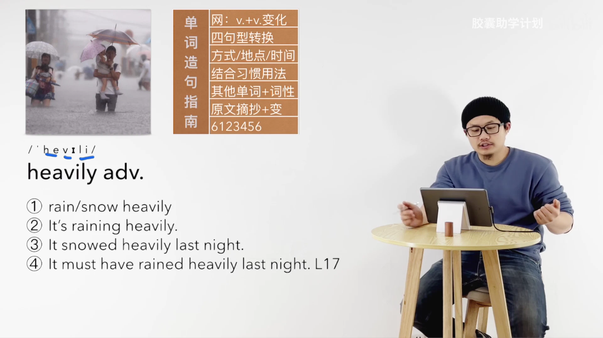

文字识别：单词造句指南 / 网：v.+v.变化 / 四句型转换 / 方式/地点/时间 / 结合习惯用法 / 其他单词+词性 / 原文摘抄+变 / 6123456 / /'hevili/ / heavily adv. / rain/snow heavily / It's raining heavily. / It snowed heavily last night. / It must have rained heavily last night. L17

## 00:13:00–00:13:30

It must have rained heavily last night. 说要不怎么地上这么多的积水呢？ Must have done 表示对过去的肯定推测。 OK，好。 Next one，接下来我们两个单词放在一起。第一个浊化，注意读一下，叫 stream，stream。 OK， next one，它是一个名词，叫溪水啊，小溪。 Next one 叫 form，form，叫做

### 画面 00:13:03

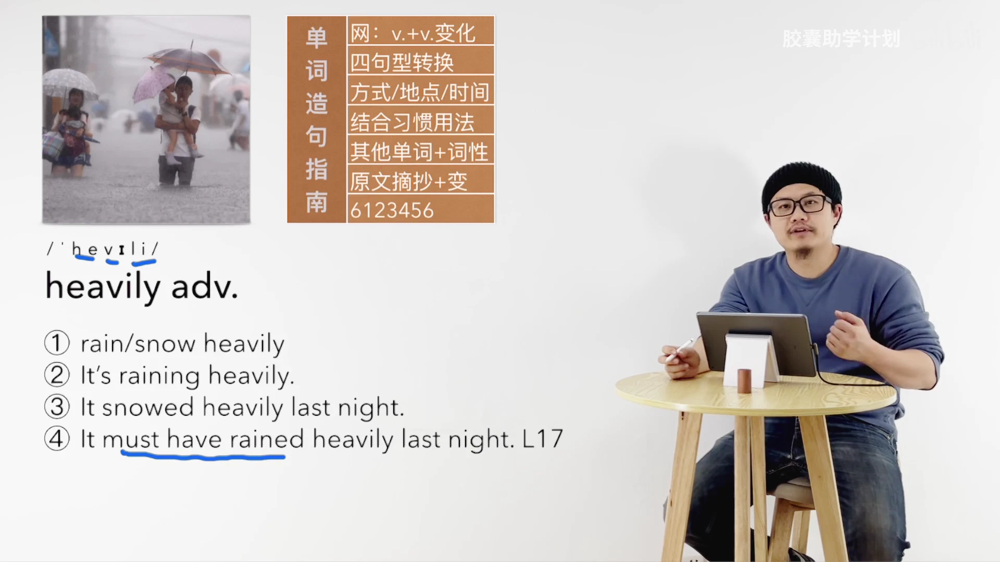

文字识别：单词造句指南 / 网：v.+v.变化 / 四句型转换 / 方式/地点/时间 / 结合习惯用法 / 其他单词+词性 / 原文摘抄+变 / 6123456 / /'hevili/ / heavily adv. / rain/snow heavily / It's raining heavily. / It snowed heavily last night. / It must have rained heavily last night. L17

### 画面 00:13:14

文字识别：单词造句指南 / 网：v.+v.变化 / 四句型转换 / 方式/地点/时间 / 结合习惯用法 / 其他单词+词性 / 原文摘抄+变 / 6123456 / / stri :m / / /fo:m/ / stream n. form v.

### 画面 00:13:19

文字识别：单词造句指南 / 网：v.+v.变化 / 四句型转换 / 方式/地点/时间 / 结合习惯用法 / 其他单词+词性 / 原文摘抄+变 / 6123456 / / stri:m / / /fo:m/ / . form v. / stream n.

### 画面 00:13:24

文字识别：单词造句指南 / 网：v.+v.变化 / 四句型转换 / 方式/地点/时间 / 结合习惯用法 / 其他单词+词性 / 原文摘抄+变 / 6123456 / / stri:m/ / 1fo:m/ / form v. / stream n.

### 画面 00:13:29

文字识别：单词造句指南 / 网：v.+v.变化 / 四句型转换 / 方式/地点/时间 / 结合习惯用法 / 其他单词+词性 / 原文摘抄+变 / 6123456 / /stri:m/ / 1fo:m/ / stream n. / form v.

## 00:13:30–00:14:00

形成啊，它是一个动词。比如说，我们先拿stream造一个造一个句子，说Instead of drinking water in the kettle, she drank water from the stream.说替代喝瓶子当中的水啊，她冒险啊，是吧？直接从小溪当中喝的水啊，这个是很危险的一件事情。在野外露营的时候，对吧？一定要烧开喝啊。Next one,说If you don't boil the stream water,

### 画面 00:13:31

文字识别：单词造句指南 / 网：v.+v.变化 / 四句型转换 / 方式/地点/时间 / 结合习惯用法 / 其他单词+词性 / 原文摘抄+变 / 6123456 / / s tri :m / / /fo:m/ / 1.form v. / stream n. / ① Instead of drinking water in the bottle, she / drank water from the stream. L20

### 画面 00:13:34

文字识别：单词造句指南 / 网：v.+v.变化 / 四句型转换 / 方式/地点/时间 / 结合习惯用法 / 其他单词+词性 / 原文摘抄+变 / 6123456 / / s tri :m / / 1fo:m/ / . form v. / stream n. / ① Instead of drinking water in the bottle, she / drank water from the stream. L20

### 画面 00:13:44

文字识别：单词造句指南 / 网：v.+v.变化 / 四句型转换 / 方式/地点/时间 / 结合习惯用法 / 其他单词+词性 / 原文摘抄+变 / 6123456 / / s tri :m/ / 1fo:m/ / form v. / stream n. / ① Instead of drinking water in the bottle, she / drank water from the stream. L20

### 画面 00:13:48

文字识别：单词造句指南 / 网：v.+v.变化 / 四句型转换 / 方式/地点/时间 / 结合习惯用法 / 其他单词+词性 / 原文摘抄+变 / 6123456 / / s tri :m/ / 1fo:m/ / form v. / stream n. / ① Instead of drinking water in the bottle, she / drank water from the stream. L20

### 画面 00:13:50

文字识别：单词造句指南 / 网：v.+v.变化 / 四句型转换 / 方式/地点/时间 / 结合习惯用法 / 其他单词+词性 / 原文摘抄+变 / 6123456 / / s tri:m/ / /fo:m/ / form v. / stream n. / ① Instead of drinking water in the bottle, she / drank water from the stream. L20

### 画面 00:13:52

文字识别：单词造句指南 / 网：v.+v.变化 / 四句型转换 / 方式/地点/时间 / 结合习惯用法 / 其他单词+词性 / 原文摘抄+变 / 6123456 / / s tri :m / / /fo:m/ / form v. / stream n. / ① Instead of drinking water in the bottle, she / drank water from the stream. L20

### 画面 00:13:59

文字识别：单词造句指南 / 网：v.+v.变化 / 四句型转换 / 方式/地点/时间 / 结合习惯用法 / 其他单词+词性 / 原文摘抄+变 / 6123456 / / s tri :m / / /fo:m/ / form v. / stream n. / ① Instead of drinking water in the bottle, she / drank water from the stream. L20 / ) If you don't boil the stream water, / something bad may happen. L16

## 00:14:00–00:14:30

something bad may happen. Ah,首先我们用了一个 if, 对吧？说如果你不去把这个小溪的水给它煮开，有一些坏的事情可能会发生，比如说你可能会拉肚子等等，对吧？OK, ah, next one,说 it rained heavily last night, 昨天晚上下大雨了, and然后呢, a stream had formed in the field,说一条小溪已经形成

### 画面 00:14:02

文字识别：单词造句指南 / 网：v.+v.变化 / 四句型转换 / 方式/地点/时间 / 结合习惯用法 / 其他单词+词性 / 原文摘抄+变 / 6123456 / / s tri :m / / /fo:m/ / 1. form v. / stream n. / ① Instead of drinking water in the bottle, she / drank water from the stream. L20 /  If you don't boil the stream water, / something bad may happen. L16

### 画面 00:14:04

文字识别：单词造句指南 / 网：v.+v.变化 / 四句型转换 / 方式/地点/时间 / 结合习惯用法 / 其他单词+词性 / 原文摘抄+变 / 6123456 / / s tri :m/ / /fo:m/ / 1. form v. / stream n. / ① Instead of drinking water in the bottle, she / drank water from the stream. L20 /  If you don't boil the stream water, / something bad may happen. L16

### 画面 00:14:14

文字识别：单词造句指南 / 网：v.+v.变化 / 四句型转换 / 方式/地点/时间 / 结合习惯用法 / 其他单词+词性 / 原文摘抄+变 / 6123456 / / s tr i : m / / 1fo:m/ / stream n. form v. / ① Instead of drinking water in the bottle, she / drank water from the stream. L20 / ② If you don't boil the stream water, / something bad may happen. L16

### 画面 00:14:16

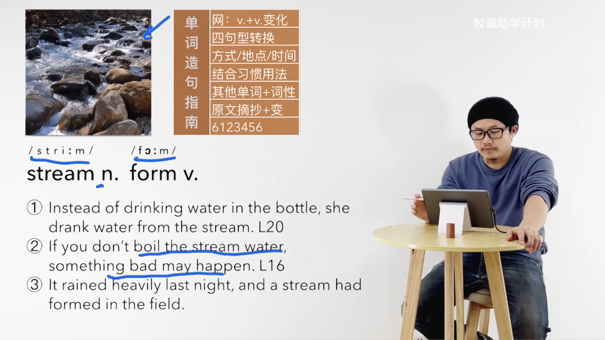

文字识别：单词造句指南 / 网：v.+v.变化 / 四句型转换 / 方式/地点/时间 / 结合习惯用法 / 其他单词+词性 / 原文摘抄+变 / 6123456 / / s tri :m / / /fo:m/ / stream n. form v. / ① Instead of drinking water in the bottle, she / drank water from the stream. L20 / ② If you don't boil the stream water, / something bad may happen. L16 / It rained heavily last night, and a stream had / formed in the field.

### 画面 00:14:23

文字识别：单词造句指南 / 网：v.+v.变化 / 四句型转换 / 方式/地点/时间 / 结合习惯用法 / 其他单词+词性 / 原文摘抄+变 / 6123456 / / s tri :m / / /fo:m/ / form v. / stream n. / ① Instead of drinking water in the bottle, she / drank water from the stream. L20 / ② If you don't boil the stream water, / something bad may happen. L16 / It rained heavily last night, and a stream had / formed in the field.

## 00:14:30–00:15:00

了，在这个田野当中。OK，Very good，并不是特别的难。下一个单词，跟我一起读一下，叫做wind，wind。好，next one，它的过去式、过去分词叫做wound，wound。OK，Very good。那这个单词对于各位来说比较熟悉的意思是什么呢？是风啊，刮风是吧？是这样一个意思。那在这儿呢，我们学会了它的新的一个意思，叫蜿蜒的。比如说，我们直接从原文

### 画面 00:14:34

文字识别：单词造句指南 / 网：v.+v.变化 / 四句型转换 / 方式/地点/时间 / 结合习惯用法 / 其他单词+词性 / 原文摘抄+变 / 6123456 / /wInd/ / /waund / / wind - wound - wound v.

### 画面 00:14:41

文字识别：单词造句指南 / 网：v.+v.变化 / 四句型转换 / 方式/地点/时间 / 结合习惯用法 / 其他单词+词性 / 原文摘抄+变 / 6123456 / /wInd/ / /waund / wind - wound - wound v.

### 画面 00:14:44

文字识别：单词造句指南 / 网：v.+v.变化 / 四句型转换 / 方式/地点/时间 / 结合习惯用法 / 其他单词+词性 / 原文摘抄+变 / 6123456 / /wInd/ / /waund / wind - wound - wound v.

### 画面 00:14:59

文字识别：单词造句指南 / 网：v.+v.变化 / 四句型转换 / 方式/地点/时间 / 结合习惯用法 / 其他单词+词性 / 原文摘抄+变 / 6123456 / /wInd/ / /waund / wind - wound - wound v. / ① [Story]: The stream wound its way across / the field.

## 00:15:00–00:15:30

拿出一个句子来，这个句子就已经很好了，叫做 The stream wound its way across the field。说这个小溪啊，蜿蜒着它自己，留着它自己的这样一条路，穿过了这个田野啊，留着穿过了这个田野。OK， very good。那肯定句给各位了，各种哎，这个四句型转换，各位就可以直接去做了啊，不用非要进入文章再去做。OK，

### 画面 00:15:09

文字识别：单词造句指南 / 网：v.+v.变化 / 四句型转换 / 方式/地点/时间 / 结合习惯用法 / 其他单词+词性 / 原文摘抄+变 / 6123456 / /wInd/ / /waund / wind - wound - wound v. / ① [Story]: The stream wound its way across / the field.

### 画面 00:15:14

文字识别：单词造句指南 / 网：v.+v.变化 / 四句型转换 / 方式/地点/时间 / 结合习惯用法 / 其他单词+词性 / 原文摘抄+变 / 6123456 / /wInd/ / /waund / wind - wound - wound v. / ① [Story]: The stream wound its way across / the field

### 画面 00:15:19

文字识别：单词造句指南 / 网：v.+v.变化 / 四句型转换 / 方式/地点/时间 / 结合习惯用法 / 其他单词+词性 / 原文摘抄+变 / 6123456 / /wInd/ / /waund / wind - wound - wound v. / ① [Story]: The stream wound its way across / the field

### 画面 00:15:24

文字识别：单词造句指南 / 网：v.+v.变化 / 四句型转换 / 方式/地点/时间 / 结合习惯用法 / 其他单词+词性 / 原文摘抄+变 / 6123456 / /wInd/ / /waund / wind - wound - wound v. / ① [Story]: The stream wound its way across / the field / did/how/where...

### 画面 00:15:29

文字识别：单词造句指南 / 网：v.+v.变化 / 四句型转换 / 方式/地点/时间 / 结合习惯用法 / 其他单词+词性 / 原文摘抄+变 / 6123456 / /rait/ / right adv.

## 00:15:30–00:16:00

最后一个小单词跟我读一下，叫做right，叫做恰恰恰好。像这样的单词，对于各位来说，您不用专门拿它去造句啊，只是把文章跟读熟读成诵，您知道它的意思其实就可以了。叫做恰好刚好，比如说The toilet is right in front of you。你问别人，你说Excuse me, where is the toilet? Oh man, open up, open your eyes. The toilet is right in front of you。说这个卫生间

### 画面 00:15:34

文字识别：单词造句指南 / 网：v.+v.变化 / 四句型转换 / 方式/地点/时间 / 结合习惯用法 / 其他单词+词性 / 原文摘抄+变 / 6123456 / /rait/ / right adv.

### 画面 00:15:39

文字识别：单词造句指南 / 网：v.+v.变化 / 四句型转换 / 方式/地点/时间 / 结合习惯用法 / 其他单词+词性 / 原文摘抄+变 / 6123456 / /rait/ / right adv.

### 画面 00:15:49

文字识别：单词造句指南 / 网：v.+v.变化 / 四句型转换 / 方式/地点/时间 / 结合习惯用法 / 其他单词+词性 / 原文摘抄+变 / 6123456 / /rait/ / right adv. / ① The toilet is right in front of you.

## 00:16:00–00:16:30

就在你正面前嘛，是吧？在你正前方嘛，对吧？恰好刚刚好就在你前面。OK, very good. 那本课呢，我们没有太多的 expression，我们只是本课的单词非常的重要，我就不在这儿一一列举了。那家庭作业老习惯，单词造句或者是对话都可以，然后反复听这个电影片段，直到能听出关键的短语或者句子。OK，好，那以上呢就是本期

### 画面 00:16:00

文字识别：单词造句指南 / 网：v.+v.变化 / 四句型转换 / 方式/地点/时间 / 结合习惯用法 / 其他单词+词性 / 原文摘抄+变 / 6123456 / /rait/ / right adv. / D The toilet is right in front of you.

### 画面 00:16:07

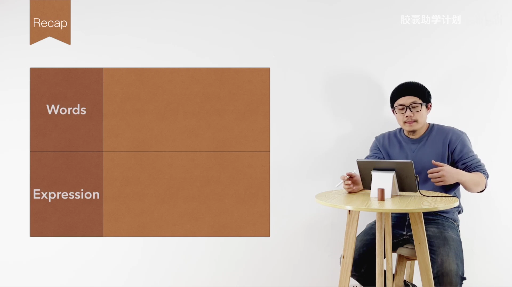

文字识别：Recap / Words / Expression

### 画面 00:16:09

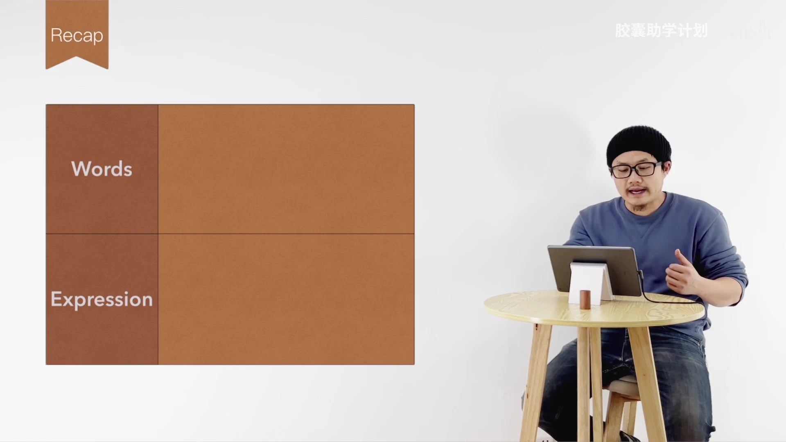

文字识别：Recap / Words / Expression

### 画面 00:16:12

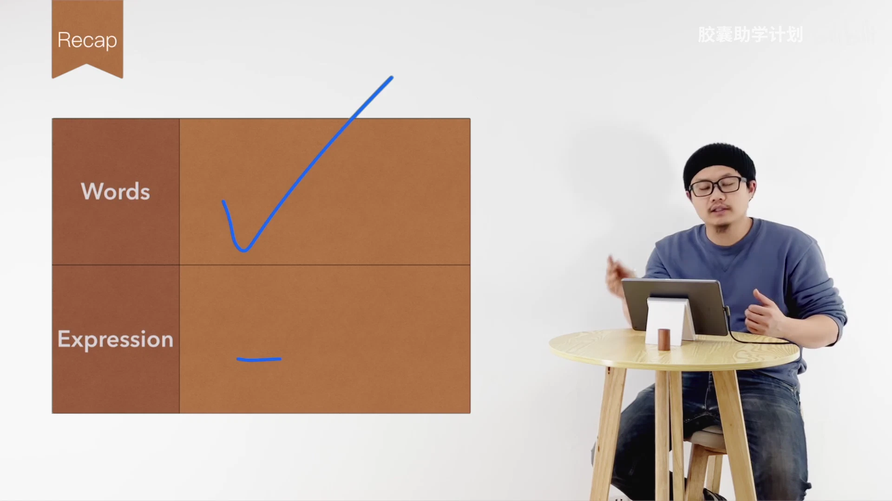

文字识别：Recap / Words / Expression

### 画面 00:16:14

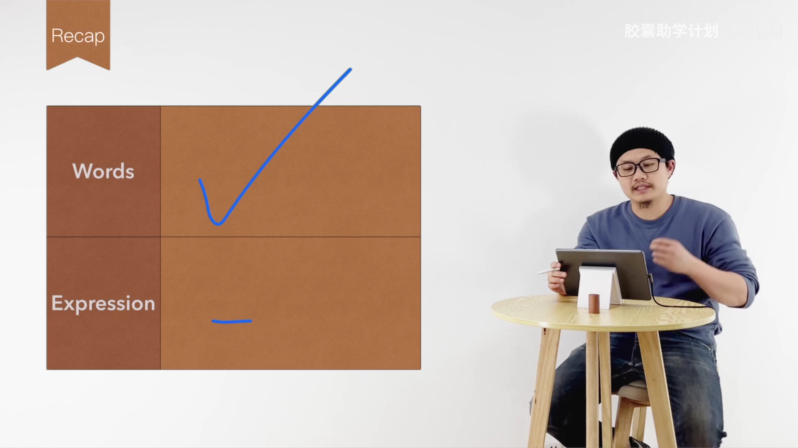

文字识别：Recap / Words / Expression

### 画面 00:16:17

文字识别：单词造句/对话 / 1. / 【单词造句指南】 / 每个5句

### 画面 00:16:19

文字识别：1. / 单词造句/对话 / 【单词造句指南】 / 每个5句

### 画面 00:16:21

文字识别：单词造句/对话 / 【单词造句指南】 / 每个5句 / 反复听电影片段，直到能 / 听出关键短语/句子

### 画面 00:16:24

文字识别：单词造句/对话 / 【单词造句指南】 / 每个5句 / 2. / 反复听电影片段，直到能 / 听出关键短语/句子

### 画面 00:16:28

## 00:16:30–00:16:52

视频的全部内容了。如果大家喜欢我们的课程呢，欢迎大家关注、订阅、一键三连，分享给那些需要的朋友。See you next time.

### 画面 00:16:40

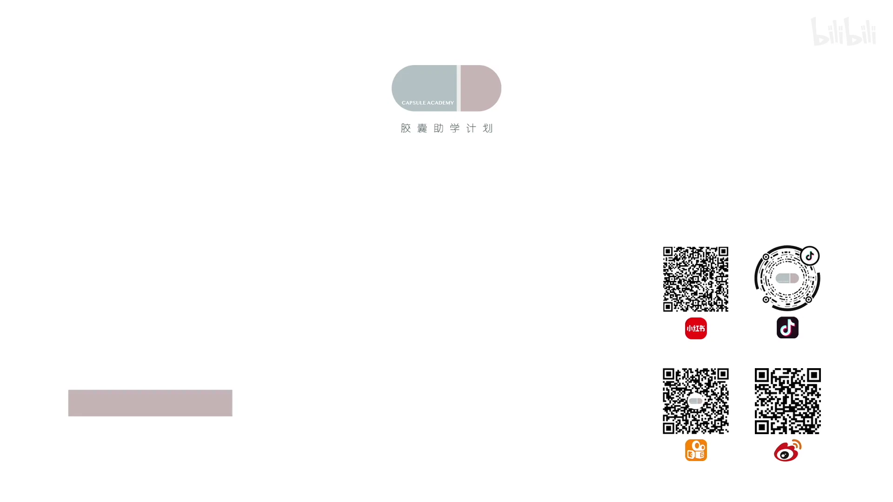

文字识别：CAPSULEACADEMY / 胶囊助学计划 / 小红书 / OE

### 画面 00:16:42

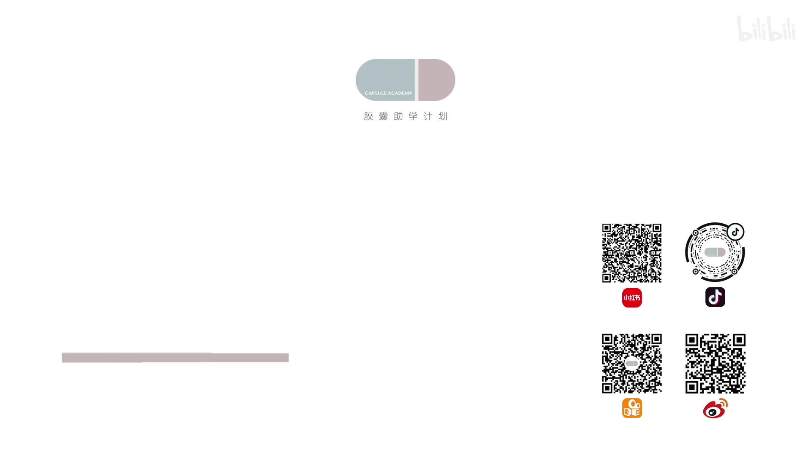

文字识别：CAPSULEACADEMY / 胶囊助学计划 / 小红书 / OE

### 画面 00:16:48

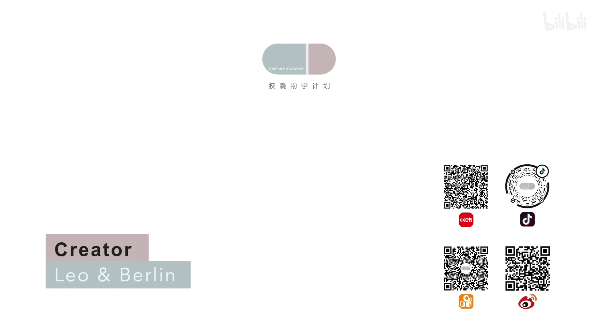

文字识别：CAPSULEACADEMY / 胶囊助学计划 / 小红书 / Creator / □ / Leo & Berlin / OE

### 画面 00:16:50

文字识别：bilibili / 胶囊助学计划

### 画面 00:16:51

文字识别：bilibili / 胶囊助学计划

