# L027 文章

快速机器解析：语音为单模型转写，未进行独立交叉校对或人工复核；画面每秒采样并按变化选帧，短时文字和标记可能遗漏。截图时间约有 1 秒误差。图片有损压缩；遇到疑点请按时间查看 Google Drive 原视频。

## 00:00:00–00:00:30

Hello everyone, welcome to Capsule Academy. This is Leo. Today we're going to learn in Concept English Book Two, Lesson Twenty Seven, Story. Hope you gonna enjoy it.好，那我们直接进入文章啊。来说 late in the afternoon. 好，in the afternoon 叫下午，那 late in the afternoon 叫做在下午晚些时候，比如说五点、五点半。OK，好，这提供了一个时

### 画面 00:00:00

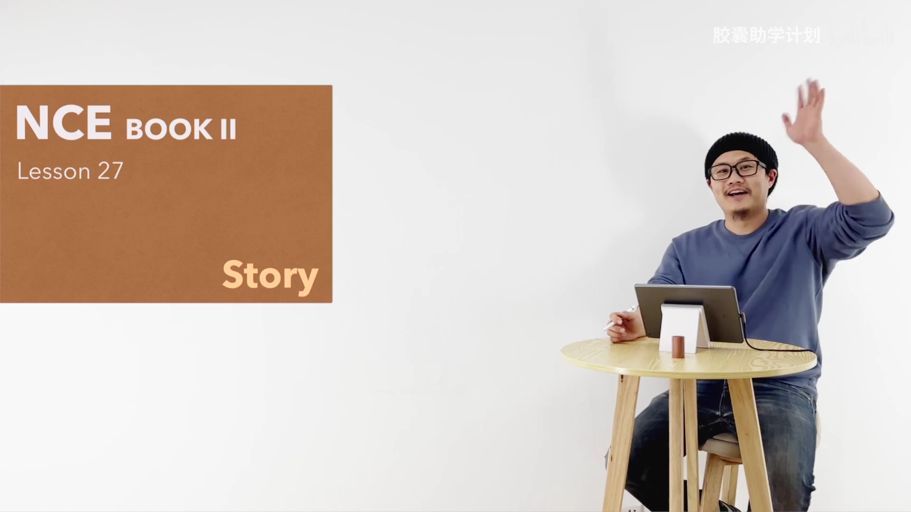

文字识别：NCE / BOOK"I / Lesson 27 / Story

### 画面 00:00:02

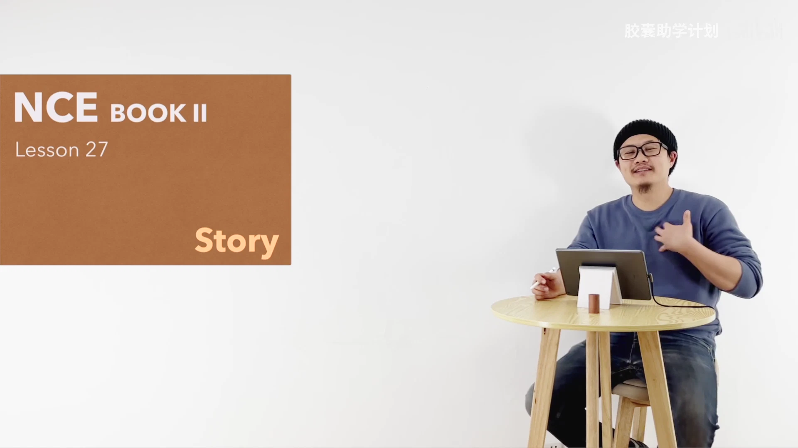

文字识别：NCE / BOOK"I / Lesson 27 / Story

### 画面 00:00:05

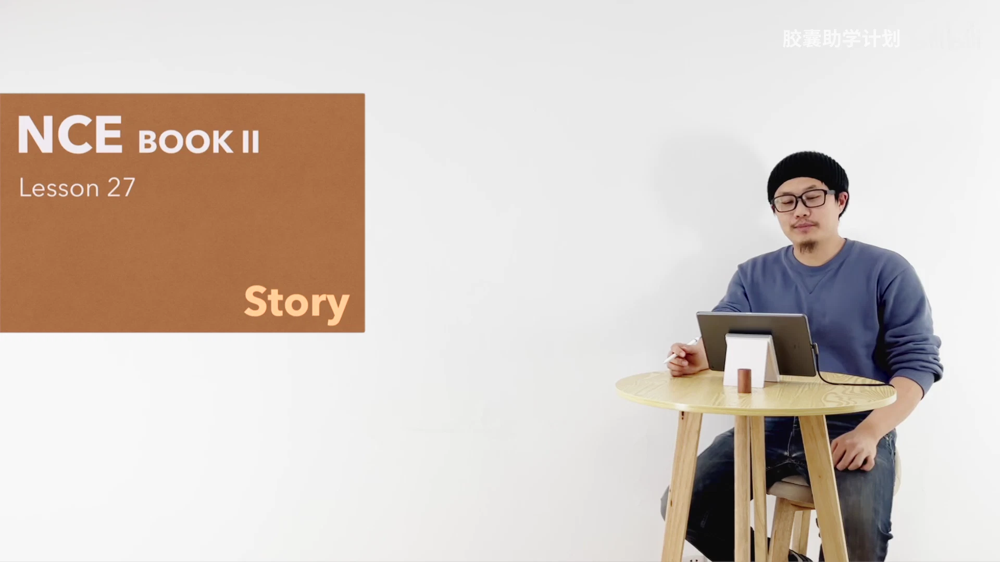

文字识别：NCE / BOOKII / Lesson 27 / Story

### 画面 00:00:10

文字识别：胶囊助学计划bill / •

### 画面 00:00:14

### 画面 00:00:16

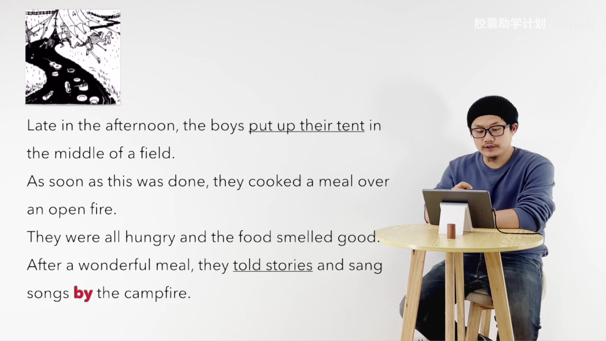

文字识别：Late in the afternoon, the boys put up their tent in / the middle of a field. / As soon as this was done, they cooked a meal over / an open fire. / They were all hungry and the food smelled good. / After a wonderful meal, they told stories and sang / songs by the campfire.

## 00:00:30–00:01:00

间，对吧？在六二三四五六当中，the boys，孩子们呢，这帮男孩们，put up their tent in the middle of a field.好，put up，我们在这儿不知道什么意思，先不管它，叫他们的帐篷。In the middle of a field，在一片田野的中间，把他们的帐篷put up了。这个地方就涉及到了一个问题，就是如果这句话当中除了put

### 画面 00:00:46

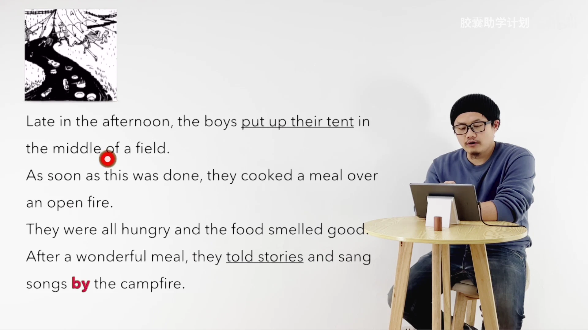

文字识别：Late in the afternoon, the boys put up their tent in / the middle of a field. / As soon as this was done, they cooked a meal over / an open fire. / They were all hungry and the food smelled good. / After a wonderful meal, they told stories and sang / songs by the campfire.

## 00:01:00–00:01:30

up 这个短语您不会，但其余的都读懂了。接下来其实靠的就可以是猜了，我们不一定非要去查，对吧？结合我们自己，比如说，如果您露营过，那你一定明白，在下午，对吧？你真去露营，比如说你去徒步的时候，一般下午四五点钟就到达目的地了，是赶早不赶晚的，尤其在山里，对吧？我们不走夜路，一般啊。那 put up there ten late in the afternoon，这个时

### 画面 00:01:16

文字识别：Late in the afternoon, the boys put up their tent in / the middle of a field. / As soon as this was done, they cooked a meal over / an open fire. / They were all hungry and the food smelled good. / After a wonderful meal, they told stories and sang / songs by the campfire.

## 00:01:30–00:02:00

间已经提醒了你。如果你有这种经验，put up你已经能猜出来是什么意思了，对吧？所以这地方是可以靠猜的啊。Okay,那put up their tent是一个小的习惯用法，叫搭了他们的帐篷。Okay，好，把帐篷给支起来了。As soon as一怎么怎么样就怎么怎么样，this was done这件事情被完成，叫这件事情一被完成，they cooked a meal他们做了一顿饭。Over在什么什么的上方，在

### 画面 00:01:46

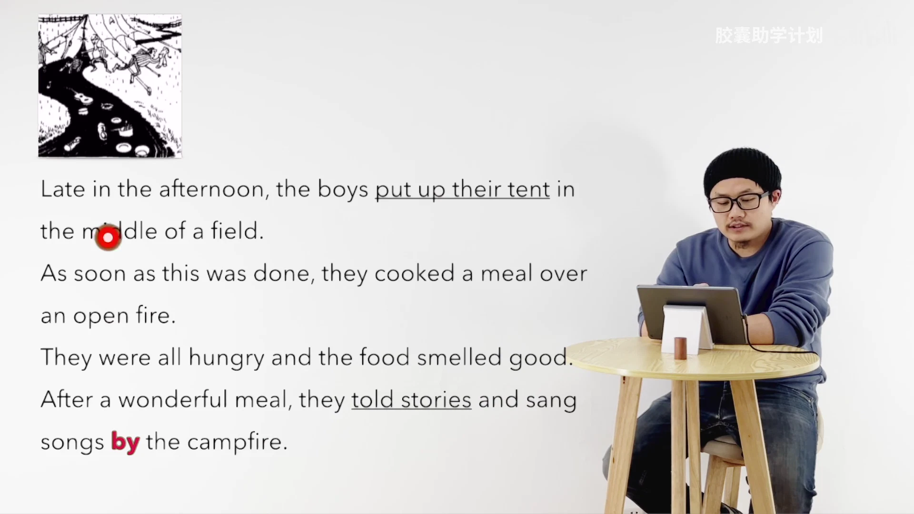

文字识别：Late in the afternoon, the boys put up their tent in / the modle of a field. / As soon as this was done, they cooked a meal over / an open fire. / They were all hungry and the food smelled good. / After a wonderful meal, they told stories and sang / songs by the campfire.

## 00:02:00–00:02:30

什么上方呢？An open fire，在一个开着的火。这个开着的火，从字面意思上就不是特别好理解。但是我个人认为啊，还是那句话，如果您把前两句话都读懂了，你知道他们实际上是在露营。那open fire，你脑海当中想，大概也能想明白，它其实就类似于一个篝火呀，或者营地上生一团火呀，大概是这样一种感觉，

### 画面 00:02:16

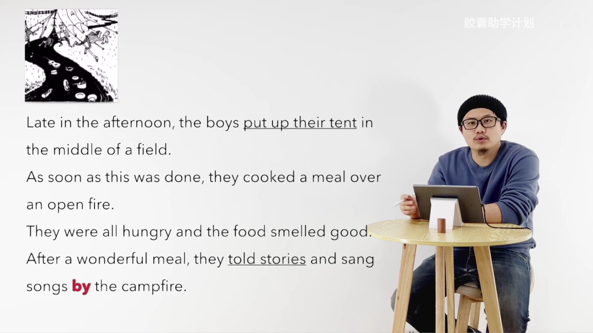

文字识别：Late in the afternoon, the boys put up their tent in / the middle of a field. / As soon as this was done, they cooked a meal over / an open fire. / They were all hungry and the food smelled good. / After a wonderful meal, they told stories and sang / songs by the campfire.

## 00:02:30–00:03:00

对吧？那 open fire 除了在这个地方，你要结合上下文，对吧？我们在这里它表示的就是篝火、营火啊。那如果是在家里面，open fire 是什么呢？就是西方有一些国家啊，现在还有它在客厅当中会有专门这么一个小的，呃，你可以往里放柴火，然后去取暖的这样的一个东西啊。这个在我们国内并不是特别的常见，在西方目前的原来非常的常见

### 画面 00:02:46

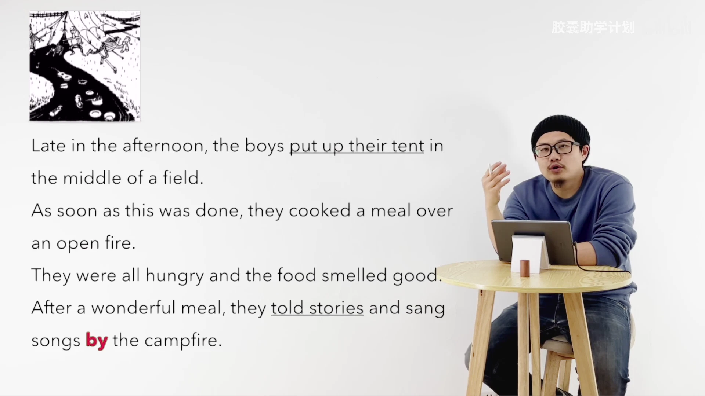

文字识别：Late in the afternoon, the boys put up their tent in / the middle of a field. / As soon as this was done, they cooked a meal over / an open fire. / They were all hungry and the food smelled good. / After a wonderful meal, they told stories and sang / songs by the campfire.

## 00:03:00–00:03:30

啊，到现在依旧还有的一个东西，我们管它叫 open fire. Okay,好啊，这个壁炉上的那种火啊. They were all hungry.他们都特别的饿，and the food smelled good.然后这个食物呢，闻起来也特别的棒。你看本课其实啊，我画几个小的关键单词，put up their tent, could was were smelled.啊，本课没有新的语法，本课的语法就

### 画面 00:03:16

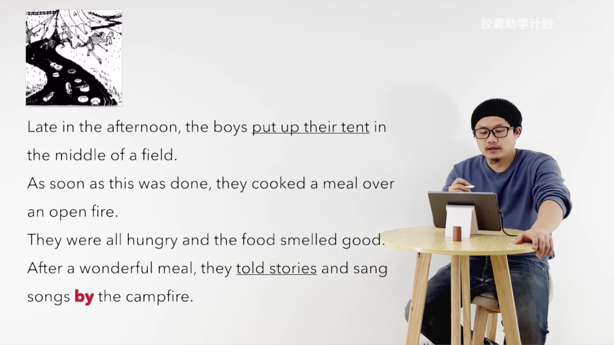

文字识别：Late in the afternoon, the boys put up their tent in / the middle of a field. / As soon as this was done, they cooked a meal over / an open fire. / They were all hungry and the food smelled good. / After a wonderful meal, they told stories and sang / songs by the campfire.

### 画面 00:03:21

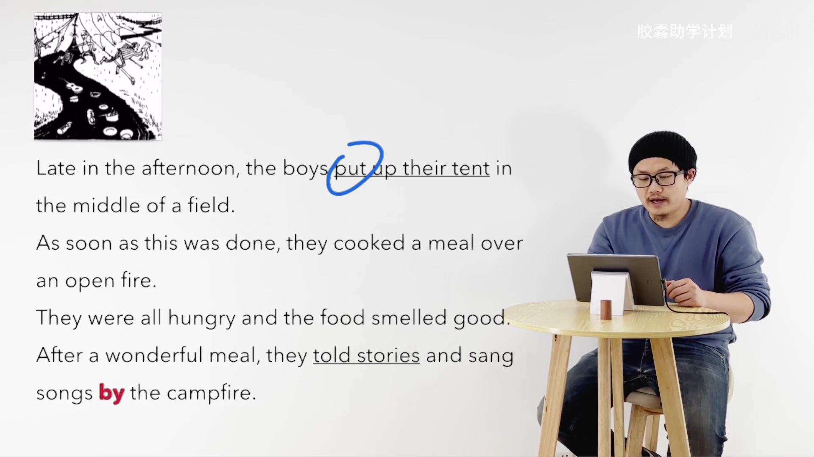

文字识别：Late in the afternoon, the boys6ut Ap their tent in / the middle of a field. / As soon as this was done, they cooked a meal over / an open fire. / They were all hungry and the food smelled good. / After a wonderful meal, they told stories and sang / songs by the campfire.

### 画面 00:03:23

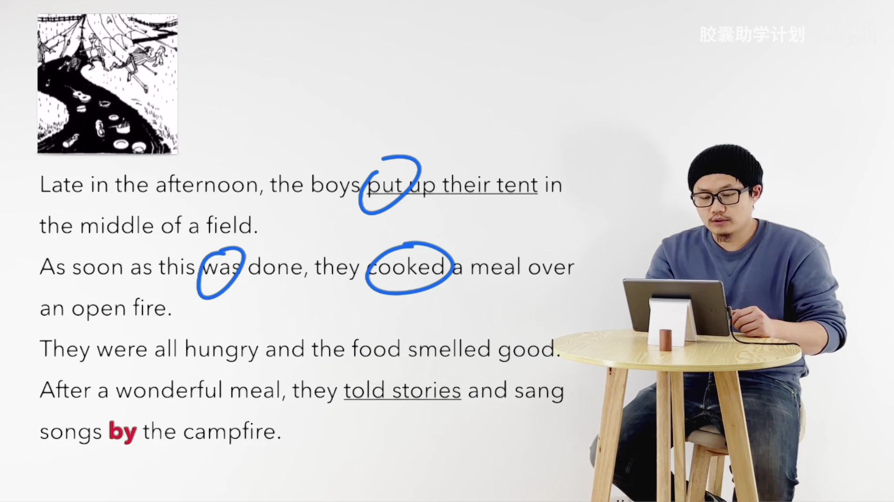

文字识别：Late in the afternoon, the boysput Ap their tent in / the middle of a field. / As soon as this / wag / done, they cooked a meal over / an open fire. / They were all hungry and the food smelled good. / After a wonderful meal, they told stories and sang / songs by the campfire.

### 画面 00:03:25

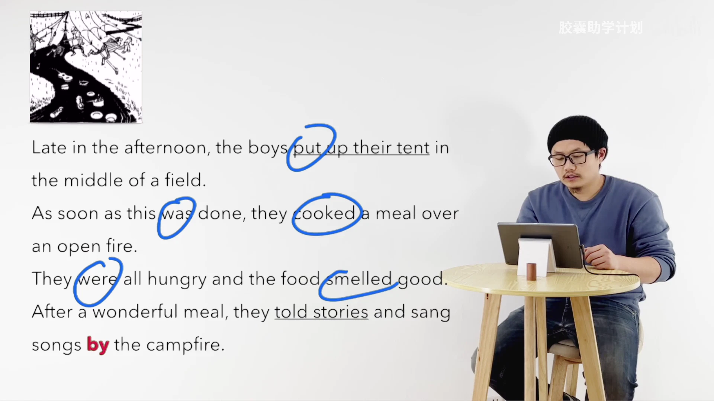

文字识别：Late in the afternoon, the boysput Ap their tent in / the middle of a field. / As soon as this / wag / done, they / cookeda meal over / an open fire. / They were all hungry and the food smelled good. / After a Wonderful meal, they told stories and sang / songs by the campfire.

## 00:03:30–00:04:00

是带着各位复习一下一般过去时，非常的简单。再来，After a wonderful meal，在吃完一顿特别棒的晚饭之后啊，一顿饭之后，你看这个 wonderful 就可以用 great， fantastic， brilliant 等等，是吧？这取决于到底有多么的夸张，去进行形容这个 meal 啊啊！别人做一顿饭，你说哦 fantastic，是吧？太

### 画面 00:03:55

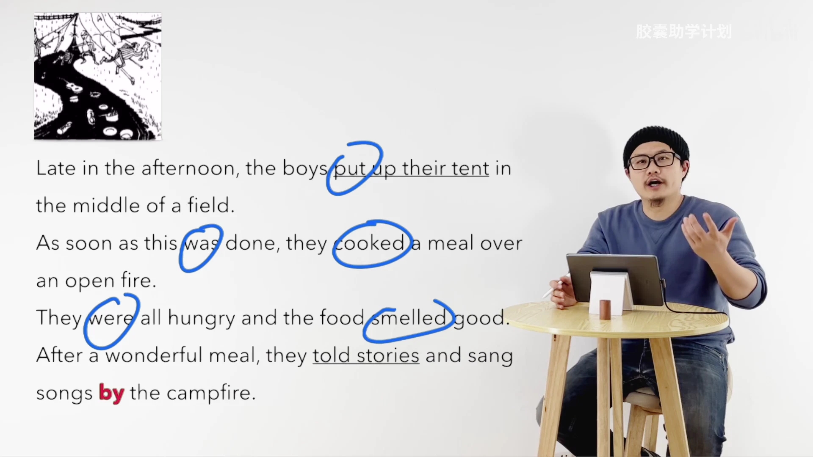

文字识别：Late in the afternoon, the boys6ut Ap their tent in / the middle of a field. / As soon as this / wag / done, they / ookeda meal over / an open fire. / They were all hungry and the food smelled good. / After a wonderful meal, they told stories and sang / songs by the campfire.

## 00:04:00–00:04:30

棒了啊！Great，perfect，都可以，outstanding，都可以啊。They told stories，哎，一个小的习惯用法叫他们开始讲故事，还是一般过去时？And sang songs，好，开始唱歌。By the campfire，好，这个地方的by我给大家加红了一下，提醒各位它是一个非常特殊的用法。在这个地方的by the campfire，依旧是啊，我还是这样认为。如果这句话当中所有单

### 画面 00:04:09

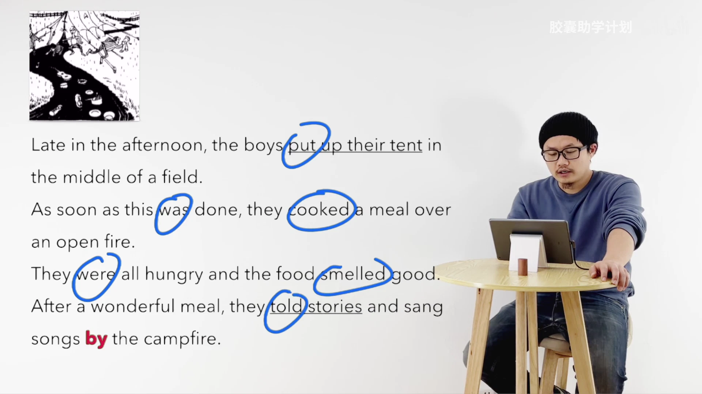

文字识别：Late in the afternoon, the boysPut Ap their tent in / the middle of a field. / As soon as this / wag / done, they /  cookeda meal over / an open fire. / They were all hungry and the food melled good. / After a wonderful meal, theytold stories and sang / songs by the campfire.

### 画面 00:04:13

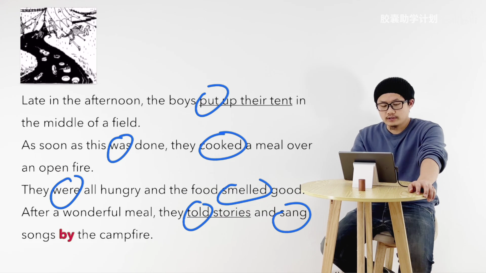

文字识别：Late in the afternoon, the boysPut Ap their tent in / the middle of a field. / As soon as this / wag / done, they / cookeda meal over / an open fire. / They were all hungry and the food smelled good. / After a wonderful meal, they told stories and sang / songs by the campfire.

### 画面 00:04:20

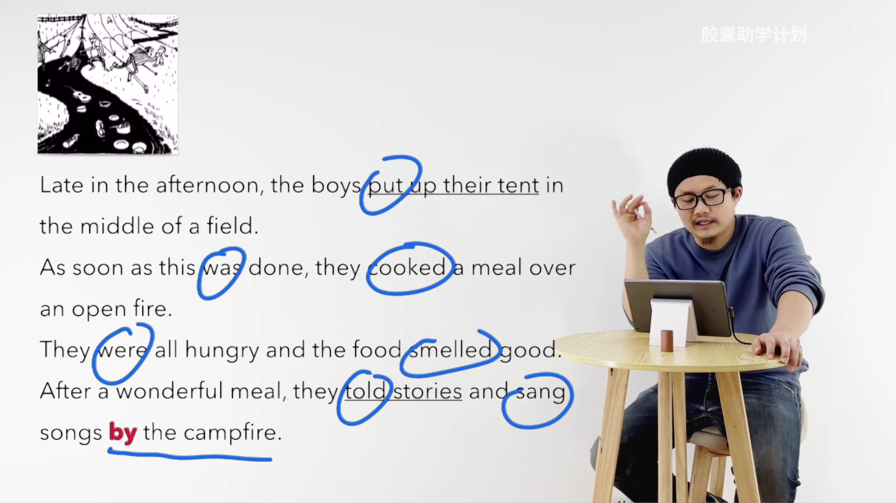

文字识别：Late in the afternoon, the boysPut Ap their tent in / the middle of a field. / As soon as this / wag / done, they / cookeda meal over / an open fire. / They were all hungry and the food smelled good. / After a wonderful meal, theytold stories and sang / songs byt /  the campfire.

## 00:04:30–00:05:00

词您都读懂了，只是 by 不了解，我觉得结合上下文场景以及您自己的个人经验，用汉语能猜出来这个 by 的意思。应首先它是个介词，对吧？它表示方向，它一定不是指的是在这个萤火的下方或上方，对吧？它最多指的是左方或右方啊。那这个地方的 by 呢，跟我们新概念一册三十五课学那个 beside 是一样的，叫在它的旁边。OK，好，

### 画面 00:04:50

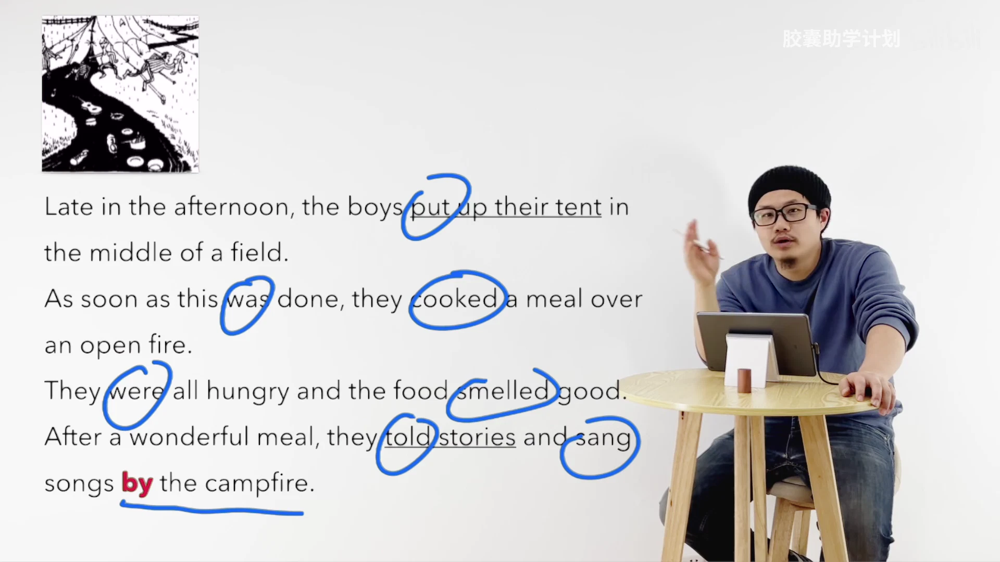

文字识别：Late in the afternoon, the boysput Ap their tent in / the middle of a field. / As soon as this / wag / done, they / cookeda meal over / an open fire. / They were all hungry and the food smelled good. / After a wonderful meal, theytold stories and sang / songs by the campfire.

## 00:05:00–00:05:30

continue，说，but some time later，一些时间之后，some time later又是时间，it began to rain，开始下雨了。我们很早之前就学过了，叫begin to do something，在本课我们就不提出来，叫开始怎么怎么样。The boys felt tired.好，他感觉到非常的累，so they put out the fire and crept into their tent.好，首先so二十五课咱

### 画面 00:05:00

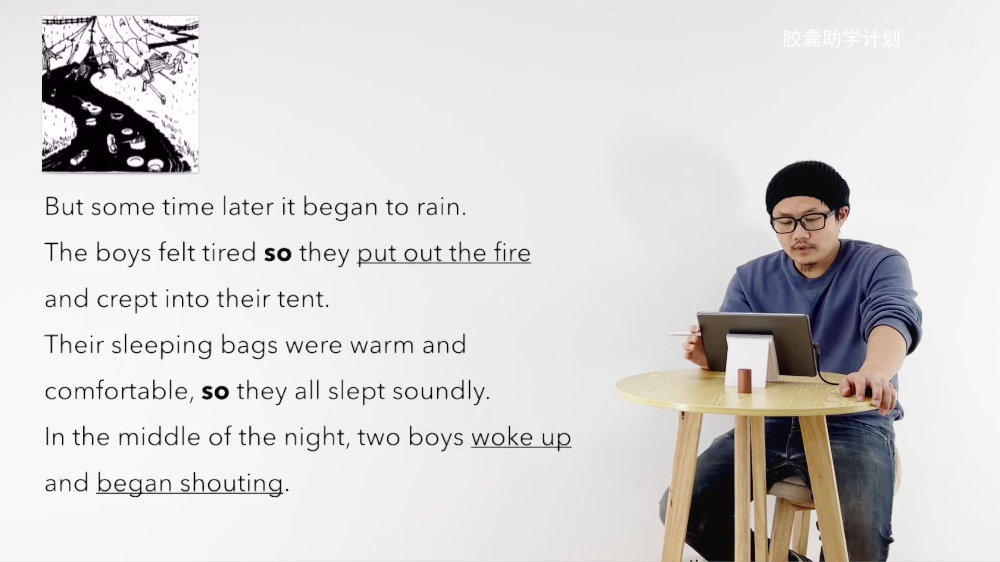

文字识别：But some time later it began to rain. / The boys felt tired so they put out the fire / and crept into their tent. / Their sleeping bags were warm and / comfortable, so they all slept soundly. / In the middle of the night, two boys woke up / and began shouting.

### 画面 00:05:21

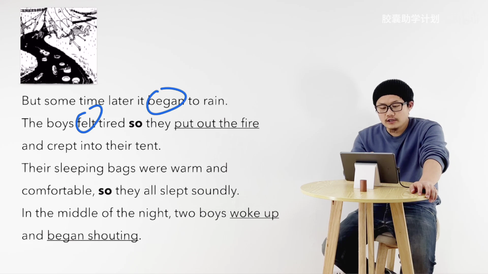

文字识别：But some time later itbegaDto rain. / sfeltired so they put out the fire / The boys / and crept into their tent. / Their sleeping bags were warm and / comfortable, so they allslept soundly. / In the middle of the night, two boys woke up / and began shouting.

### 画面 00:05:24

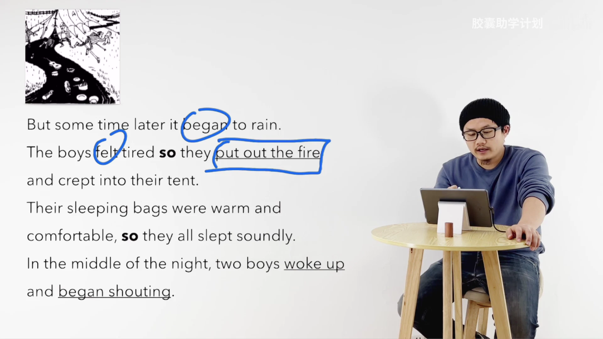

文字识别：But some time later itbegapto rain. / The boys / sfeltired so they out out the fire / and crept into their tent. / Their sleeping bags were warm and / comfortable, so they all slept soundly. / In the middle of the night, two boys woke up / and began shouting.

### 画面 00:05:28

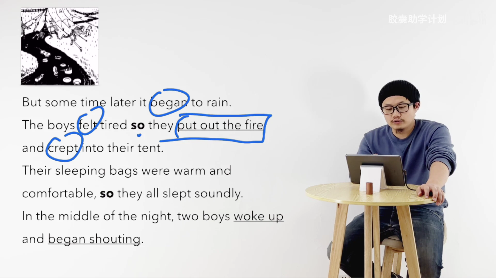

文字识别：But some time later itbegapto rain. / The boys fel tired so they put out the fire / andcreptinto their tent. / Their sleeping bags were warm and / comfortable, so they all slept soundly. / In the middle of the night, two boys woke up / and began shouting.

## 00:05:30–00:06:00

学的一个小的连词叫所以，他们put out了这个火，然后爬进了他们的帐篷，来了又出现put out了啊，这不是又啊，就是又出现了一个新的put加out。我们如果还是不懂它什么意思，结合上下文语境，结合您自己的实际经验，你一定明白，孩子们在进帐篷之前，如果你真的去弄了篝火，你一定要做的事情就是保

### 画面 00:05:58

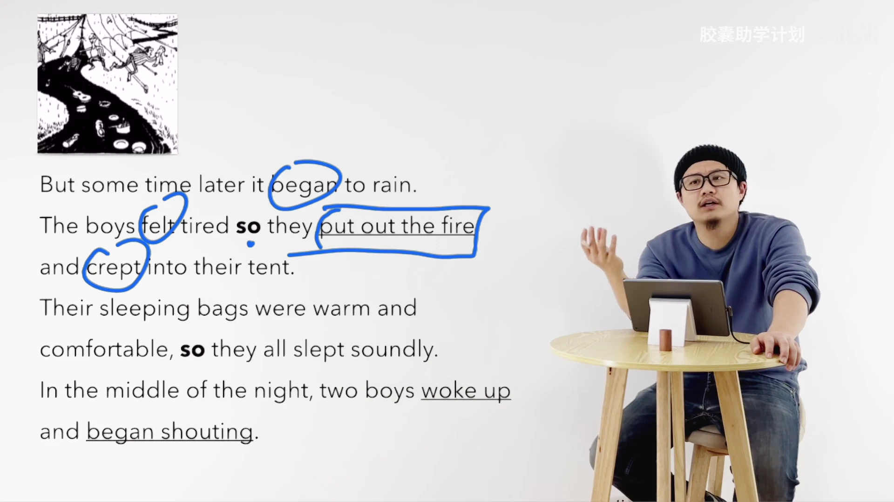

文字识别：But some time later itbegapto rain. / The boys fel tired so they put out the fire / andcreptinto their tent. / Their sleeping bags were warm and / comfortable, so they all slept soundly. / In the middle of the night, two boys woke up / and began shouting.

## 00:06:00–00:06:30

证这个火连火星都没有了，要不是容易引起失火这个状态的，对吧？所以呢，put out the fire的意思，我猜，我相信各位能猜出来，叫扑灭这个火，对不对？这是实际上将来我们去呃阅读原著的时候一个非常重要的能力，有一部分我们是要靠猜到，而不是全去查的啊。学习的时候我们要全去查啊。Their sleeping bags were warm and comfortable,是

### 画面 00:06:28

文字识别：But some time later itbegap to rain. / The boys feltired so they but out the fire / andcreptinto their tent. / Their sleeping bags vere Warm and / comfortable, so they all slept soundly. / In the middle of the night, two boys woke up / and began shouting.

## 00:06:30–00:07:00

吧？好，他们的这个睡袋呀，非常的温暖，然后并且非常的舒服。So，所以 they all slept soundly，啊，他们睡的都非常的香甜。继续，in the middle of the night。好，我们之前学过了一个叫，刚刚见过了一个叫 in the middle of the field，对吧？现在那刚才指的是地点，那 in the middle of the night，在午夜时间，是吧？在这一夜的中间的时间，就

### 画面 00:06:39

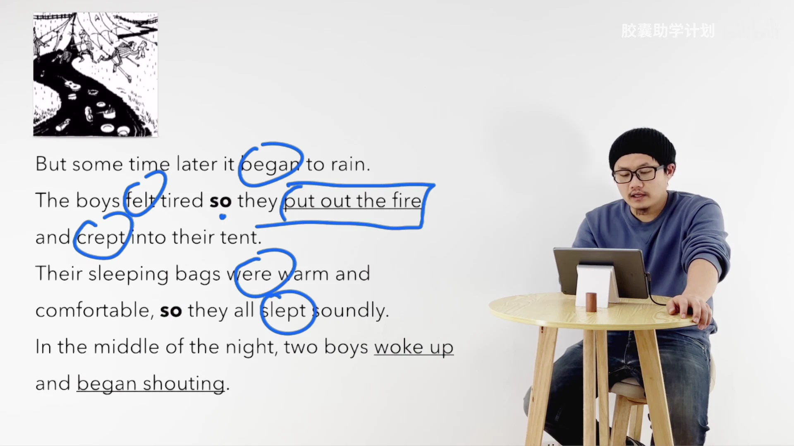

文字识别：But some time later itbegapto rain. / The boys fel tired so they put out the fire / and / creptinto their tent. / Their sleeping bags vere yarm and / comfortable, so they all lept oundly. / In the middle of the night, two boys woke up / and began shouting.

## 00:07:00–00:07:30

半夜，对吧？他们汉语都这样说，叫半夜的时间怎么样了呢？Two boys woke up.两个孩子，两个男孩醒了，and began shouting.然后开始大声喊叫。好，这个地方你看，我们在第一行见过了，叫begin to do something，在最后一行见到了begin doing something。二者有何异同呢？我们往下去听，好吧？Okay, continue.说The tent was full

### 画面 00:07:09

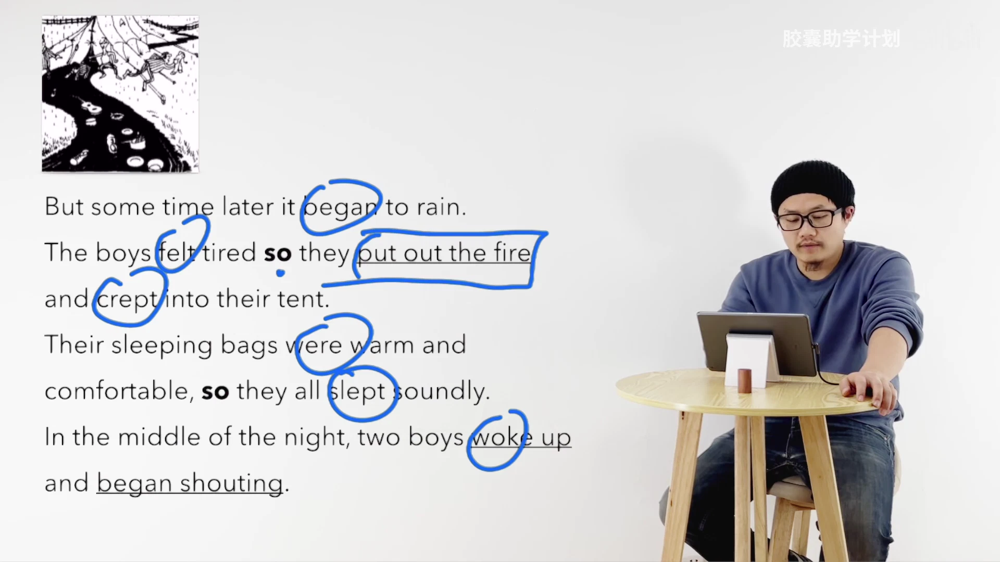

文字识别：But some time later itbegapto rain. / The boys fel tired so they put out the fire / and / creptinto their tent. / Their sleeping bags vlere Warm and / comfortable, so they all lept joundly. / In the middle of the night, two boys wok up / and began shouting.

### 画面 00:07:13

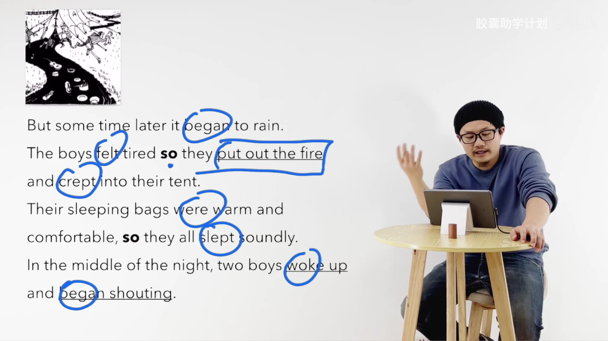

文字识别：But some time later itbegapto rain. / The boys feltired so they / yput out the fire / and / creptinto their tent. / Their sleeping bags vere Warm and / comfortable, so they all lept joundly. / In the middle of the night, two boysWok up / and / began shouting.

### 画面 00:07:17

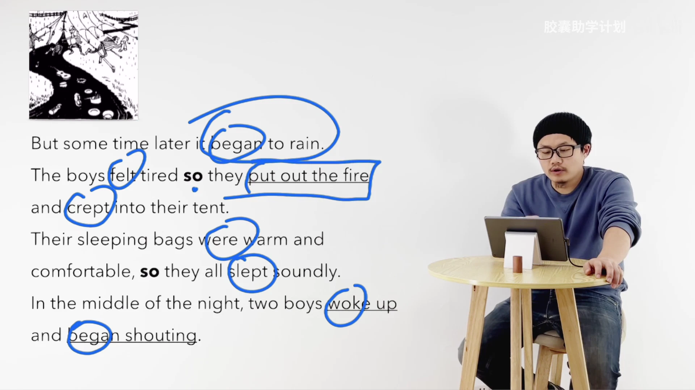

文字识别：But some time later ibegaDto rain. / The boys feltired so they / put out the fire / and / creptinto their tent. / Their sleeping bags vere yarm and / comfortable, so they all lept oundly. / In the middle of the night, two boys Wok up / and / began shouting.

### 画面 00:07:19

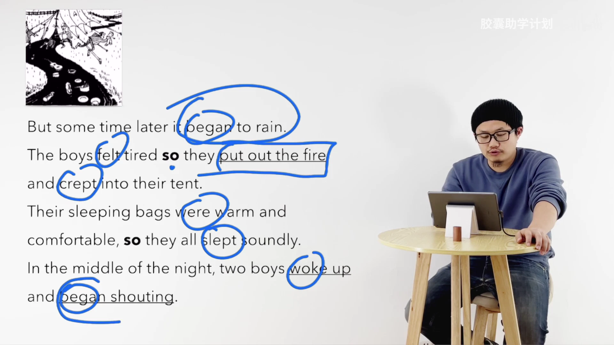

文字识别：But some time later ibegaDto rain. / The boys fel tired so they / put out the fire / and / creptinto their tent. / Their sleeping bags vere Warm and / comfortable, so they allSlept oundly. / In the middle of the night, two boys Wok up / andbegan shouting.

### 画面 00:07:21

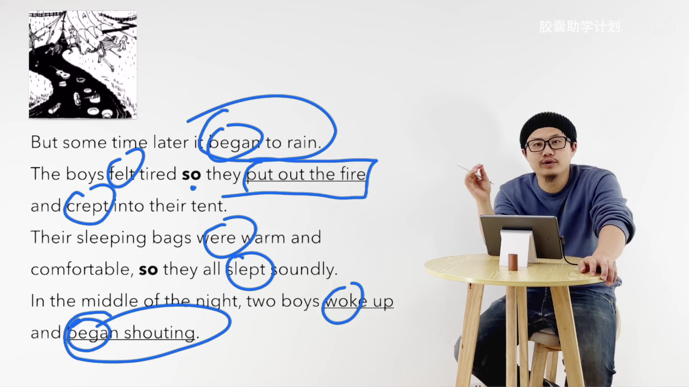

文字识别：But some time later ilbegaDto rain. / The boys feltired so they / put out the fire / and / Creptinto their tent. / Their sleeping bags vlere Warm and / comfortable, so they all [lept oundly. / In the middle of the night, two boys woke up / andbegan shouting.

### 画面 00:07:26

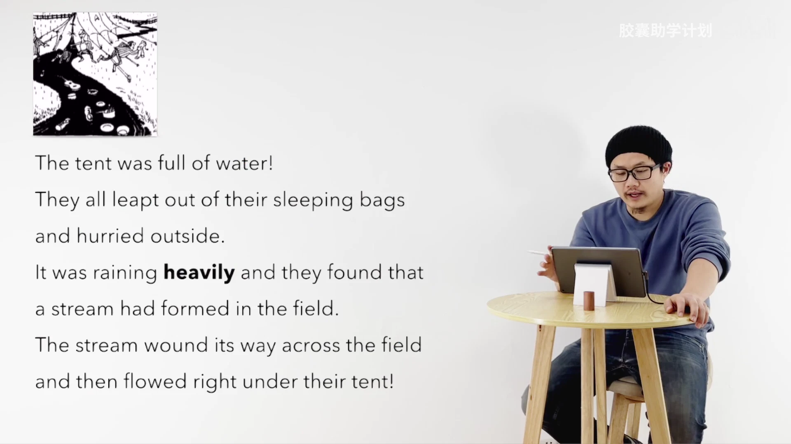

文字识别：The tent was full of water! / They all leapt out of their sleeping bags / and hurried outside. / It was raining heavily and they found that / a stream had formed in the field. / The stream wound its way across the field / and then flowed right under their tent!

## 00:07:30–00:08:00

of water. 说这个帐篷啊充满了水。之前咱们学过这个习惯用法，不多说了。A be full of B, 对吧？A充满了B. They all leapt out of their sleeping bags. 好，他们都 leapt out of 跳出了他们的 sleeping bags, 睡袋, and hurried outside. 然后匆忙的跑了出来.

### 画面 00:07:56

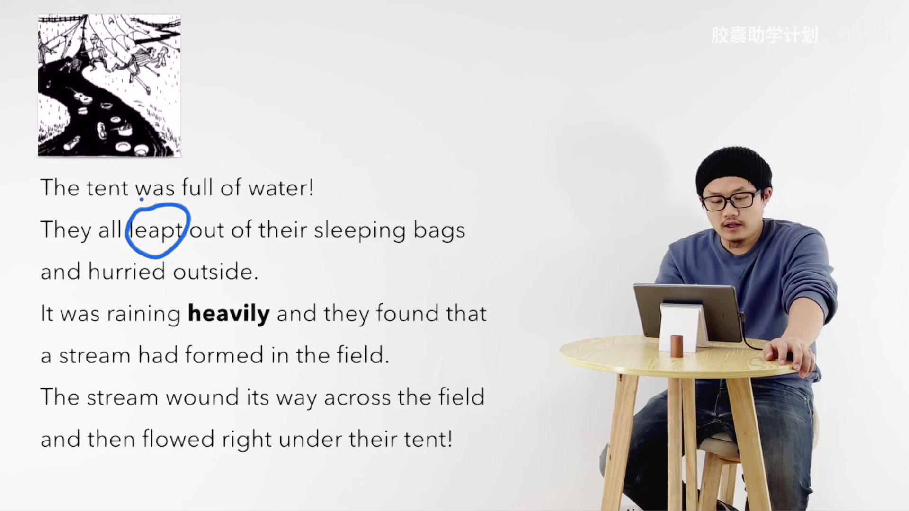

文字识别：The tent was full of water! / They all / Teaptout of their sleeping bags / and hurried outside. / It was raining heavily and they found that / a stream had formed in the field. / The stream wound its way across the field / and then flowed right under their tent!

### 画面 00:07:58

文字识别：The tent was full of water! / They all / leaptout of their sleeping bags / and yurriedoutside. / It was raining heavily and they found that / a stream had formed in the field. / The stream wound its way across the field / and then flowed right under their tent!

## 00:08:00–00:08:30

very good，hurried，匆忙的，对吧？跑出了这个帐篷和睡袋。It was raining heavily，说当时这个雨啊下的非常的大，heavily。注意说的是raining这两个小单词，各位要放到一起去学，好吧？And they found，然后他们发现了一件事情，这件事情是that引导的一个小的宾语从句。A stream had formed in the field，说一个小溪啊已

### 画面 00:08:12

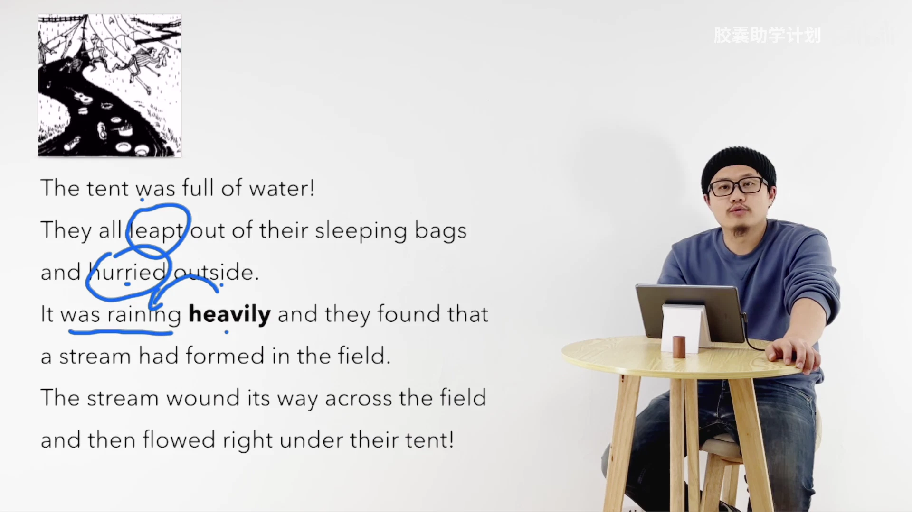

文字识别：The tent was full of water! / They all / eaptout of their sleeping bags / and hurriedoutside. / It was rainmg / heavily and they found that / a stream had formed in the field. / The stream wound its way across the field / and then flowed right under their tent!

### 画面 00:08:29

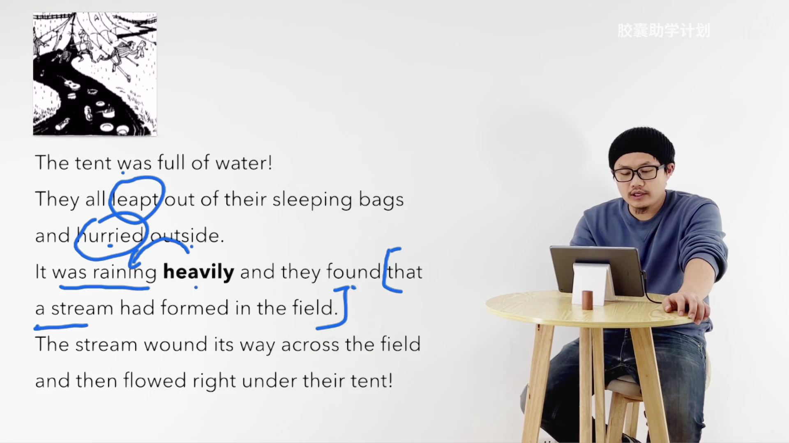

文字识别：The tent was full of water! / They all / leaptout of their sleeping bags / and yurriedoutside. / It was rainñg / heavily and they foundlthat / a stream had formed in the field. / The stream wound its way across the field / and then flowed right under their tent!

## 00:08:30–00:09:00

经形成了，在这个田野当中啊，非常简单，不多说，继续说。The stream这条小溪呢，wound its way蜿蜒着它自己啊，蜿蜒着走着它自己的路across the field穿过了啊这片田野。And then然后呢，flowed right under their tent巧说巧不巧，flow流恰

### 画面 00:08:34

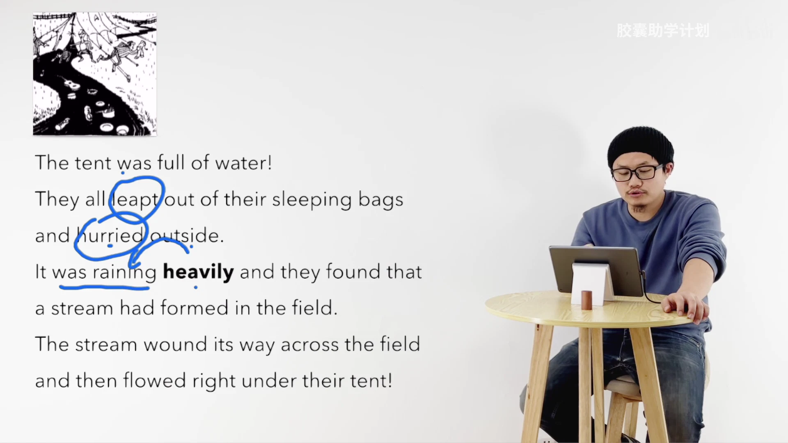

文字识别：The tent was full of water! / They all / leaptout of their sleeping bags / and yurriedoutside. / It was rainmg / heavily and they found that / a stream had formed in the field. / The stream wound its way across the field / and then flowed right under their tent!

### 画面 00:08:53

文字识别：The tent was full of water! / They all / eaptout of their sleeping bags / and yurriedoutside. / It was rainimg / heavily and they found that / a stream had formed in the field. / The stream wound its way across the field / and thenlowed / right under their tent!

## 00:09:00–00:09:30

好就 under their tent，恰好就在他们这个帐篷的下方流了过去，是吧？OK，好，那文章呢，我们到此讲完了。从文章当中，我们摘出来了如下一些非常常用的表达和习惯用法，我们尝试用它们去造句来了。第一个，put up the tent。那我们现在知道它指的是搭帐篷，对吧？好，来，比如说，they have already put up the

### 画面 00:09:09

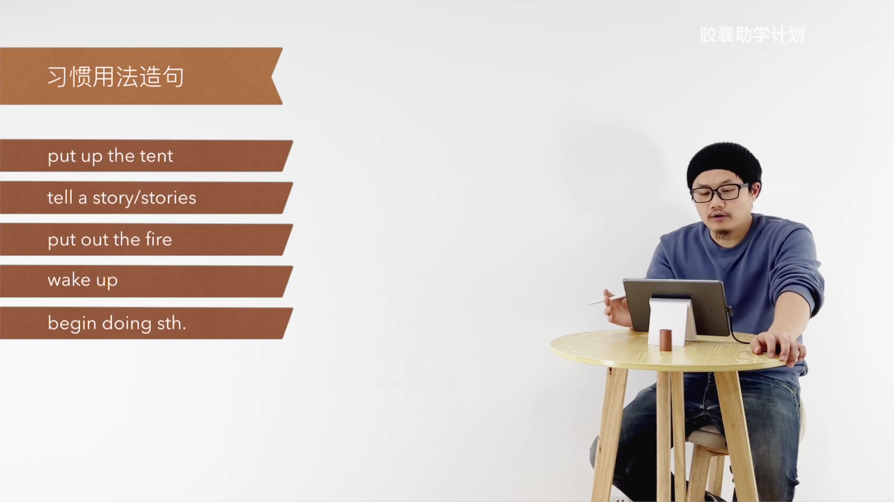

文字识别：习惯用法造句 / put up the tent / tell a story/stories / put out the / fire / wake up / begin doing sth.

### 画面 00:09:11

文字识别：习惯用法造句 / put up the tent / tell a story/stories / put out the / fire / wake up / begin doing sth.

### 画面 00:09:15

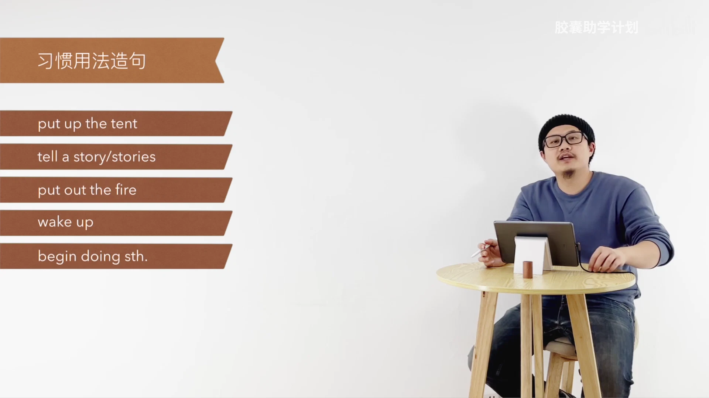

文字识别：习惯用法造句 / put up the tent / tell a story/stories / put out the fire / wake up / begin doing sth.

### 画面 00:09:19

文字识别：习惯用法造句 / put up the tent / tell a story/stories / put out the fire / wake up / begin doing sth.

### 画面 00:09:21

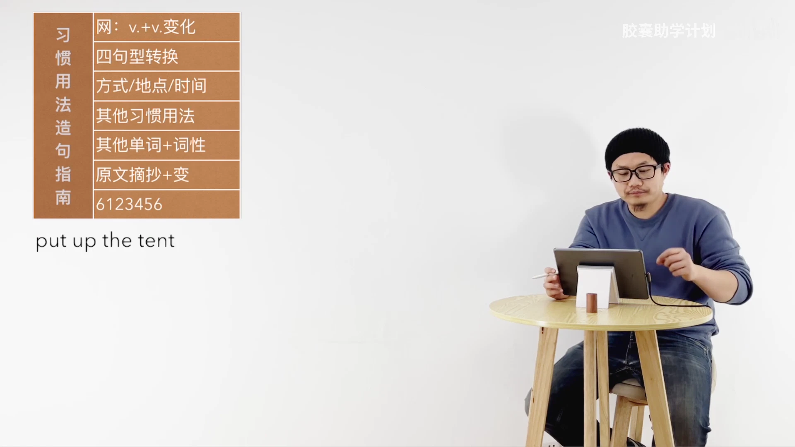

文字识别：网：v.+v.变化 / 习惯用法造句指南 / 四句型转换 / 方式/地点/时间 / 其他习惯用法 / 其他单词+词性 / 原文摘抄+变 / 6123456 / put up the tent

### 画面 00:09:25

文字识别：网：v.+v.变化 / 习惯用法造句指南 / 四句型转换 / 方式/地点/时间 / 其他习惯用法 / 其他单词+词性 / 原文摘抄+变 / 6123456 / put up the tent / -

## 00:09:30–00:10:00

tent. 哎，我选择了用一个现在完成时，说他们已经搭起了这个帐篷。 Next one, say the tent must have been put up by them. Must have been done. 这个结构是我们说动词动词变化当中各位非常容易忘，甚至是最容易忘的其中一个，叫当时一定是被，是吧？当时一定是被他们给支起来了。 OK, one more. Next one, say instead of putting up the tent, say

### 画面 00:09:30

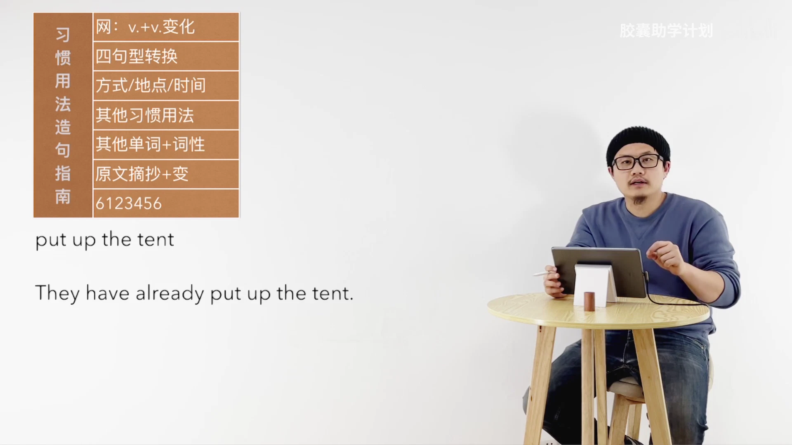

文字识别：网：v.+v.变化 / 习惯用法造句指南 / 四句型转换 / 方式/地点/时间 / 其他习惯用法 / 其他单词+词性 / 原文摘抄+变 / 6123456 / put up the tent / They have already put up the tent.

### 画面 00:09:35

文字识别：网：v.+v.变化 / 习惯用法造句指南 / 四句型转换 / 方式/地点/时间 / 其他习惯用法 / 其他单词+词性 / 原文摘抄+变 / 6123456 / put up the tent / They have already put up the tent. / The tent must have been put up by them. L21

### 画面 00:09:40

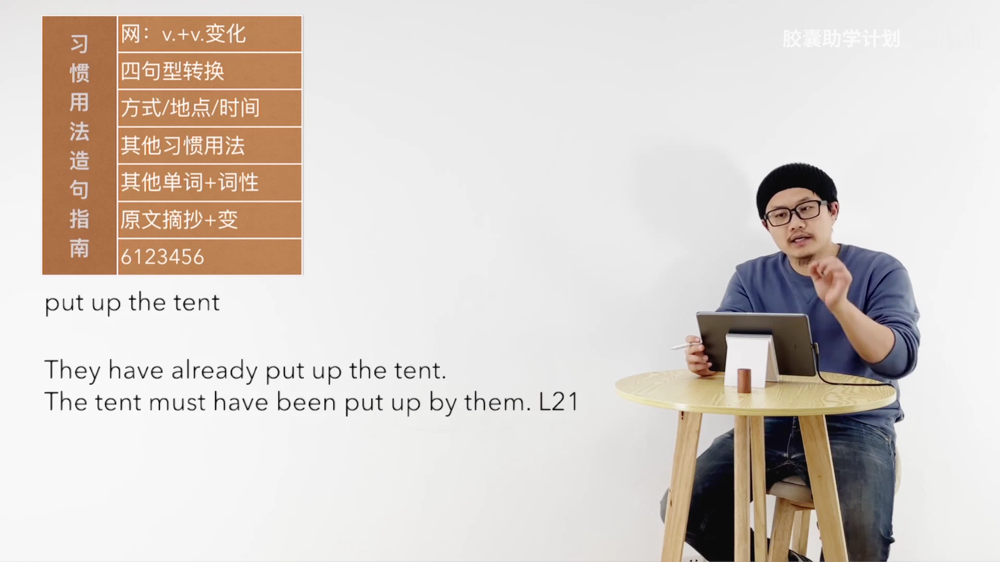

文字识别：网：v.+v.变化 / 习惯用法造句指南 / 四句型转换 / 方式/地点/时间 / 其他习惯用法 / 其他单词+词性 / 原文摘抄+变 / 6123456 / put up the tent / They have already put up the tent. / The tent must have been put up by them. L21

### 画面 00:09:45

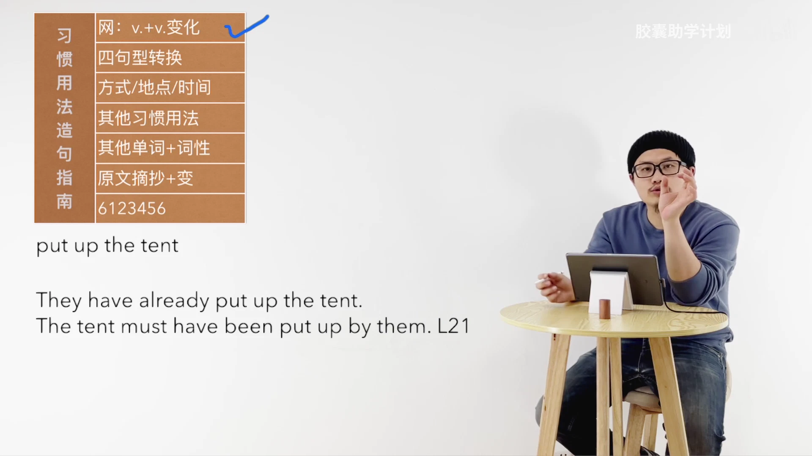

文字识别：网：v.+v.变化 / 习惯用法造句指南 / 四句型转换 / 方式/地点/时间 / 其他习惯用法 / 其他单词+词性 / 原文摘抄+变 / 6123456 / put up the tent / They have already put up the tent. / The tent must have been put up by them. L21

### 画面 00:09:50

文字识别：网：v.+v.变化 / 习惯用法造句指南 / 四句型转换 / 方式/地点/时间 / 其他习惯用法 / 其他单词+词性 / 原文摘抄+变 / 6123456 / put up the tent / They have already put up the tent. / The tent must have been put up by them. L21

### 画面 00:09:55

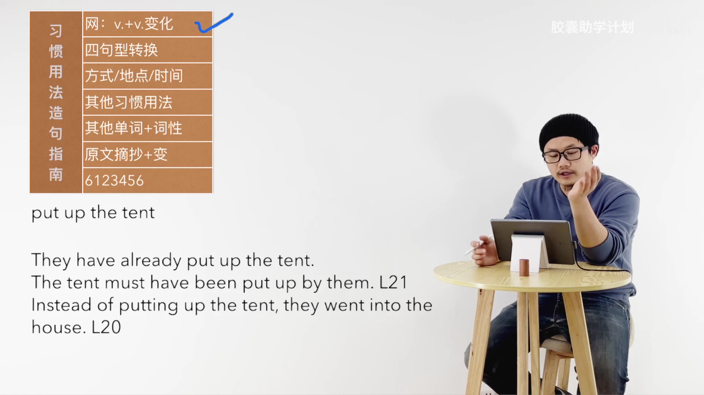

文字识别：网：v.+v.变化 / 习惯用法造句指南 / 四句型转换 / 方式/地点/时间 / 其他习惯用法 / 其他单词+词性 / 原文摘抄+变 / 6123456 / put up the tent / They have already put up the tent. / The tent must have been put up by them. L21 / Instead of putting up the tent, they went into the / house.L20

## 00:10:00–00:10:30

代替搭这个帐篷的事情是怎么？然后呢？They went into the house.他们没有搭帐篷，他们直接就进这个屋子里面去了。Okay, one next one.那tell stories讲好几个故事，tell a story讲一个故事，很容易理解，对吧？好，那包括甚至比如说，我再多加一个单词叫tell me a story，叫给我讲一个故事。Okay,好，那我们造句子说She gave up telling stories for you.啊，说

### 画面 00:10:00

文字识别：网：v.+v.变化 / 习惯用法造句指南 / 四句型转换 / 方式/地点/时间 / 其他习惯用法 / 其他单词+词性 / 原文摘抄+变 / 6123456 / put up the tent / They have already put up the tent. / The tent must have been put up by them. L21 / Instead of putting up the tent, they went into the / house.L20

### 画面 00:10:08

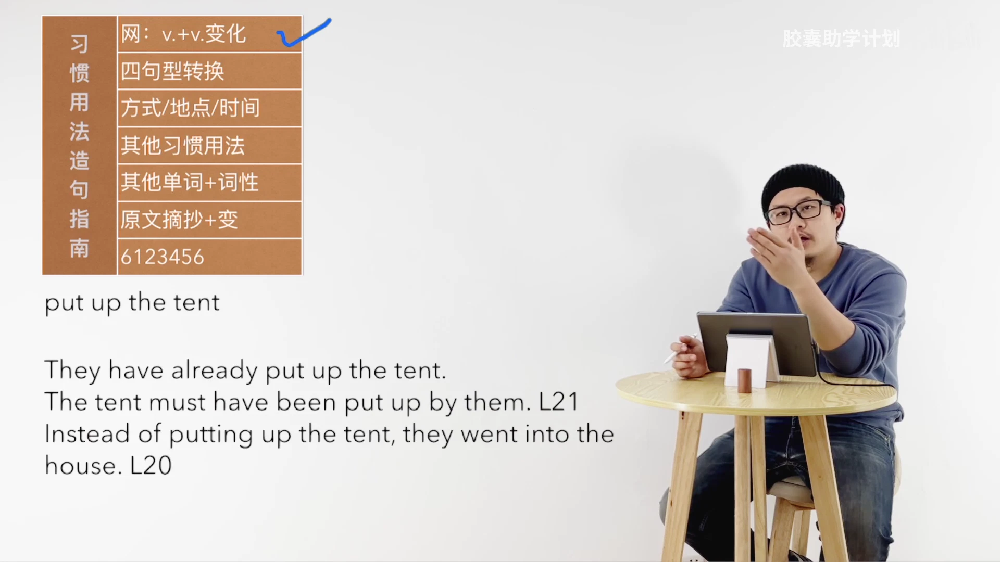

文字识别：网：v.+v.变化 / 习惯用法造句指南 / 四句型转换 / 方式/地点/时间 / 其他习惯用法 / 其他单词+词性 / 原文摘抄+变 / 6123456 / put up the tent / They have already put up the tent. / The tent must have been put up by them. L21 / Instead of putting up the tent, they went into the / house.L20

### 画面 00:10:10

文字识别：网：v.+v.变化 / 习惯用法造句指南 / 四句型转换 / 方式/地点/时间 / 其他习惯用法 / 其他单词+词性 / 原文摘抄+变 / 6123456 / put up the tent / They have already put up the tent. / The tent must have been put up by them. L21 / Instead of putting up the tent, they went into the / house. L20

### 画面 00:10:12

文字识别：网：v.+v.变化 / 习惯用法造句指南 / 四句型转换 / 方式/地点/时间 / 其他习惯用法 / 其他单词+词性 / 原文摘抄+变 / 6123456 / tell a story/stories

### 画面 00:10:15

文字识别：网：v.+v.变化 / 习惯用法造句指南 / 四句型转换 / 方式/地点/时间 / 其他习惯用法 / 其他单词+词性 / 原文摘抄+变 / 6123456 / tell a story/stories

### 画面 00:10:21

文字识别：网：v.+v.变化 / 习惯用法造句指南 / 四句型转换 / 方式/地点/时间 / 其他习惯用法 / 其他单词+词性 / 原文摘抄+变 / 6123456 / tell a story/stories

### 画面 00:10:25

文字识别：网：v.+v.变化 / 习惯用法造句指南 / 四句型转换 / 方式/地点/时间 / 其他习惯用法 / 其他单词+词性 / 原文摘抄+变 / 6123456 / tell a story/stories / She gave up telling stories for you. L20

### 画面 00:10:27

文字识别：网：v.+v.变化 / 习惯用法造句指南 / 四句型转换 / 方式/地点/时间 / 其他习惯用法 / 其他单词+词性 / 原文摘抄+变 / 6123456 / tell a story/stories / She gave up telling stories for you. L20

## 00:10:30–00:11:00

他放弃给你讲故了，讲故事了。二十课 give up doing something. Next one, 说 both my parents, 我的父母都怎么样呢? Are keen on telling stories. 啊, when I was young, 可以是吧？说我这个我父母啊，都特别的热衷于讲故事啊，给我听啊。再来说, can you tell a story now? 说你现在能讲一个故事吗？Okay, very good. Next one, put out

### 画面 00:10:30

文字识别：网：v.+v.变化 / 习惯用法造句指南 / 四句型转换 / 方式/地点/时间 / 其他习惯用法 / 其他单词+词性 / 原文摘抄+变 / 6123456 / tell a story/stories / She gave up telling stories for you. L20

### 画面 00:10:35

文字识别：网：v.+v.变化 / 习惯用法造句指南 / 四句型转换 / 方式/地点/时间 / 其他习惯用法 / 其他单词+词性 / 原文摘抄+变 / 6123456 / tell a story/stories / She gave up telling stories for you. L20 / Both my parents are keen on telling stories. L20

### 画面 00:10:40

文字识别：网：v.+v.变化 / 习惯用法造句指南 / 四句型转换 / 方式/地点/时间 / 其他习惯用法 / 其他单词+词性 / 原文摘抄+变 / 6123456 / tell a story/stories / She gave up telling stories for you. L20 / Both my parents are keen on telling stories. L20

### 画面 00:10:45

文字识别：网：v.+v.变化 / 习惯用法造句指南 / 四句型转换 / 方式/地点/时间 / 其他习惯用法 / 其他单词+词性 / 原文摘抄+变 / 6123456 / tell a story/stories / She gave up telling stories for you. L20 / Both my parents are keen on telling stories. L20

### 画面 00:10:50

文字识别：网：v.+v.变化 / 习惯用法造句指南 / 四句型转换 / 方式/地点/时间 / 其他习惯用法 / 其他单词+词性 / 原文摘抄+变 / 6123456 / tell a story/stories / She gave up telling stories for you. L20 / Both my parents are keen on telling stories. L20

### 画面 00:10:55

文字识别：网：v.+v.变化 / 习惯用法造句指南 / 四句型转换 / 方式/地点/时间 / 其他习惯用法 / 其他单词+词性 / 原文摘抄+变 / 6123456 / tell a story/stories / She gave up telling stories for you. L20 / Both my parents are keen on telling stories. L20 / Can you tella story now?

### 画面 00:10:57

文字识别：网：v.+v.变化 / 习惯用法造句指南 / 四句型转换 / 方式/地点/时间 / 其他习惯用法 / 其他单词+词性 / 原文摘抄+变 / 6123456 / put out the fire

## 00:11:00–00:11:30

the fire叫灭火，对不对？非常简单。比如说，Don't worry, the fire will be put out.好，will be的二十一课咱们学的情态动词的被动，will这个单词的被动，对吧？Next one,说as soon as they put out the fire, they crept into the tent.他们一灭了火，他们就爬进了这个帐篷。这实际上第十四课咱们学的as soon as，对吧？Next one, I believe that.好，I

### 画面 00:11:00

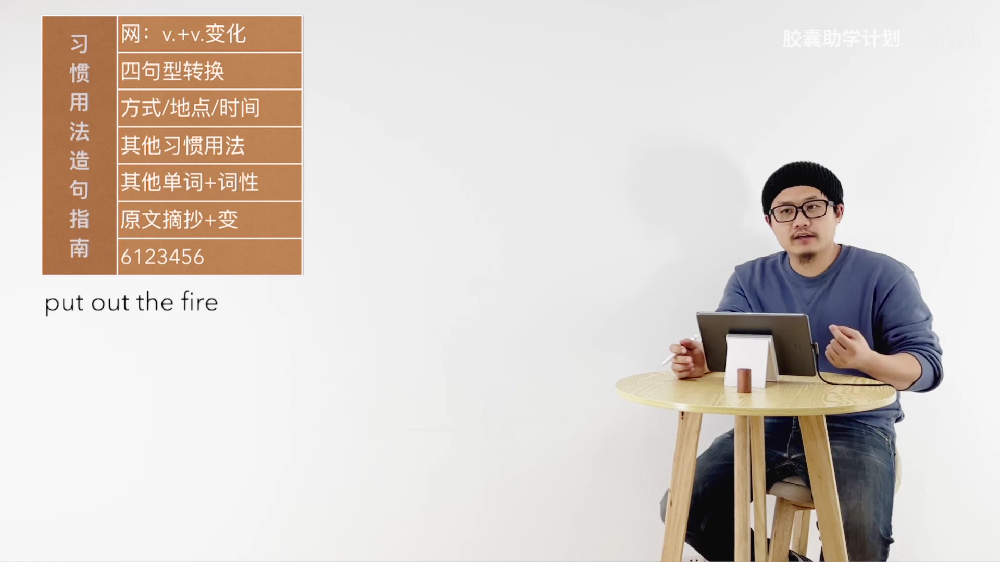

文字识别：网：v.+v.变化 / 习惯用法造句指南 / 四句型转换 / 方式/地点/时间 / 其他习惯用法 / 其他单词+词性 / 原文摘抄+变 / 6123456 / put out the fire

### 画面 00:11:03

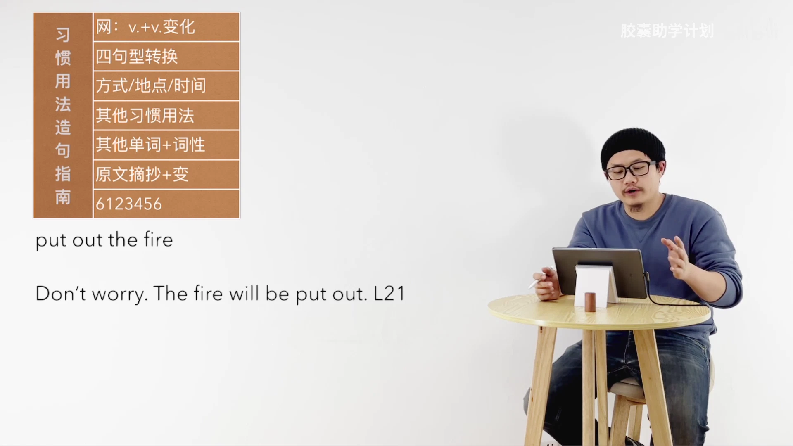

文字识别：网：v.+v.变化 / 习惯用法造句指南 / 四句型转换 / 方式/地点/时间 / 其他习惯用法 / 其他单词+词性 / 原文摘抄+变 / 6123456 / put out the fire / Don't worry. The fire will be put out. L21

### 画面 00:11:05

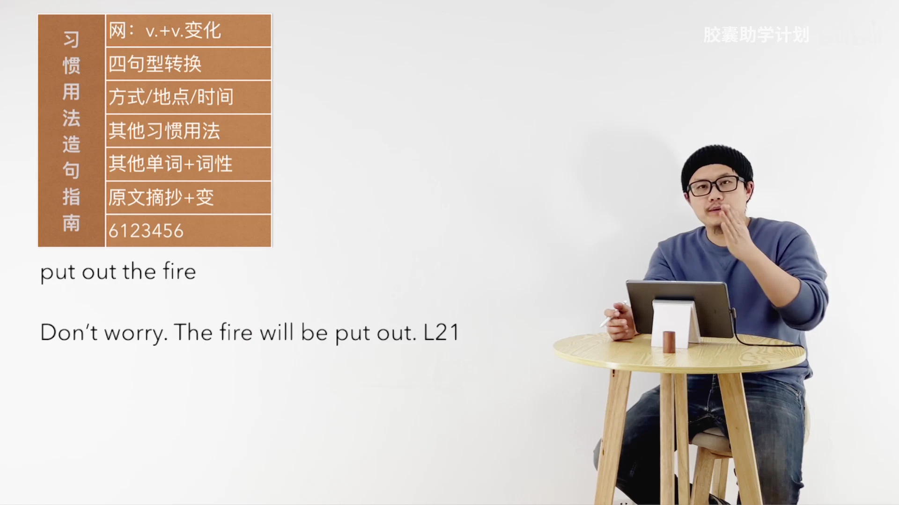

文字识别：网：v.+v.变化 / 习惯用法造句指南 / 四句型转换 / 方式/地点/时间 / 其他习惯用法 / 其他单词+词性 / 原文摘抄+变 / 6123456 / put out the fire / Don't worry. The fire will be put out. L21

### 画面 00:11:10

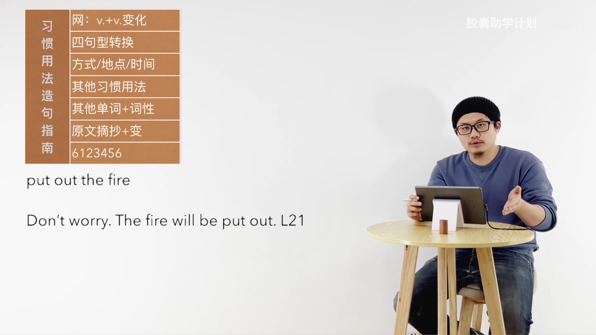

文字识别：网：v.+v.变化 / 习惯用法造句指南 / 四句型转换 / 方式/地点/时间 / 其他习惯用法 / 其他单词+词性 / 原文摘抄+变 / 6123456 / put out the fire / Don't worry. The fire will be put out. L21

### 画面 00:11:13

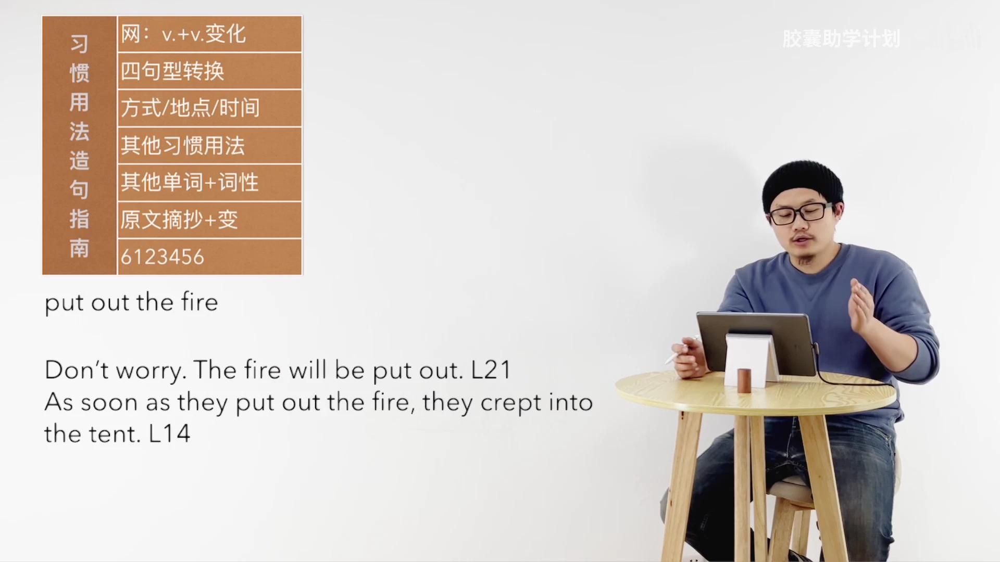

文字识别：网：v.+v.变化 / 习惯用法造句指南 / 四句型转换 / 方式/地点/时间 / 其他习惯用法 / 其他单词+词性 / 原文摘抄+变 / 6123456 / put out the fire / Don't worry. The fire wil be put out. L21 / As soon as they put out the fire, they crept into / the tent. L14

### 画面 00:11:15

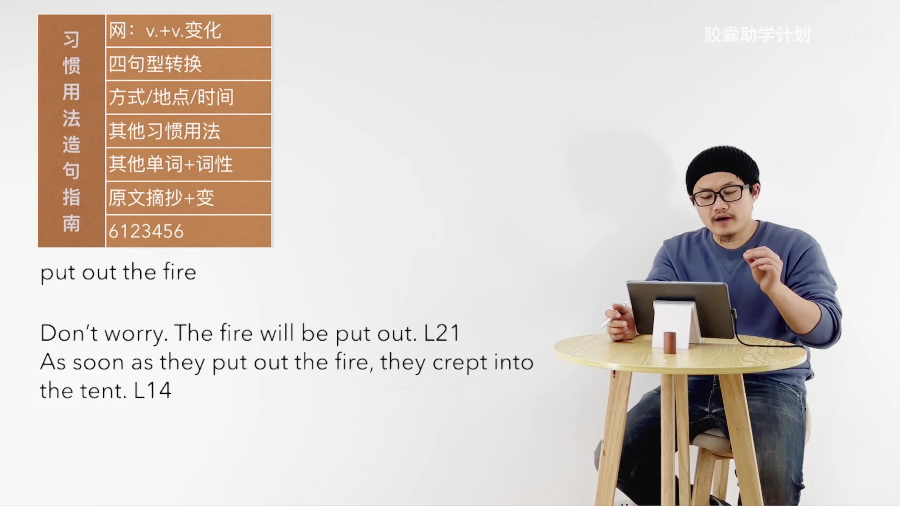

文字识别：网：v.+v.变化 / 习惯用法造句指南 / 四句型转换 / 方式/地点/时间 / 其他习惯用法 / 其他单词+词性 / 原文摘抄+变 / 6123456 / put out the fire / Don't worry. The fire wil be put out. L21 / As soon as they put out the fire, they crept into / the tent. L14

### 画面 00:11:20

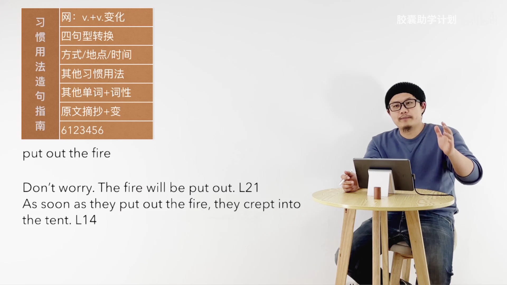

文字识别：网：v.+v.变化 / 习惯用法造句指南 / 四句型转换 / 方式/地点/时间 / 其他习惯用法 / 其他单词+词性 / 原文摘抄+变 / 6123456 / put out the fire / Don't worry. The fire will be put out. L21 / As soon as they put out the fire, they crept into / the tent. L14

### 画面 00:11:25

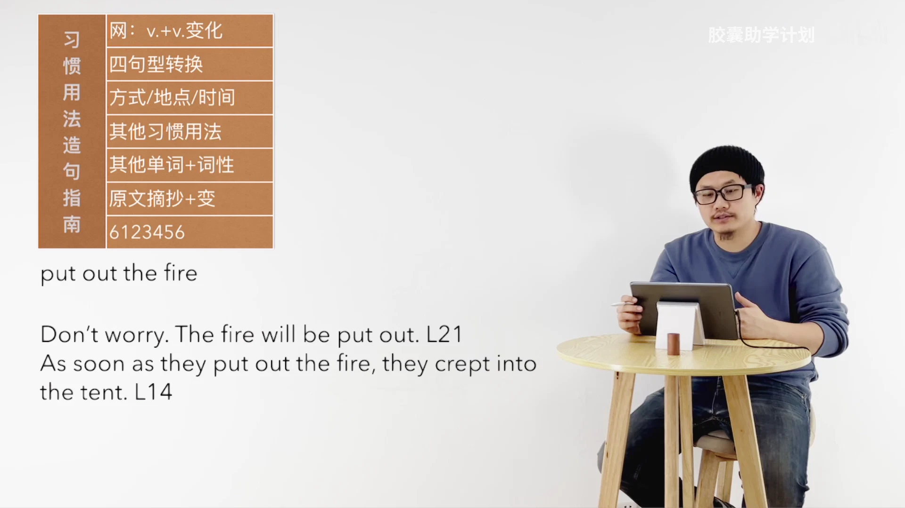

文字识别：网：v.+v.变化 / 习惯用法造句指南 / 四句型转换 / 方式/地点/时间 / 其他习惯用法 / 其他单词+词性 / 原文摘抄+变 / 6123456 / put out the fire / Don't worry. The fire wil be put out. L21 / As soon as they put out the fire, they crept into / the tent. L14

### 画面 00:11:28

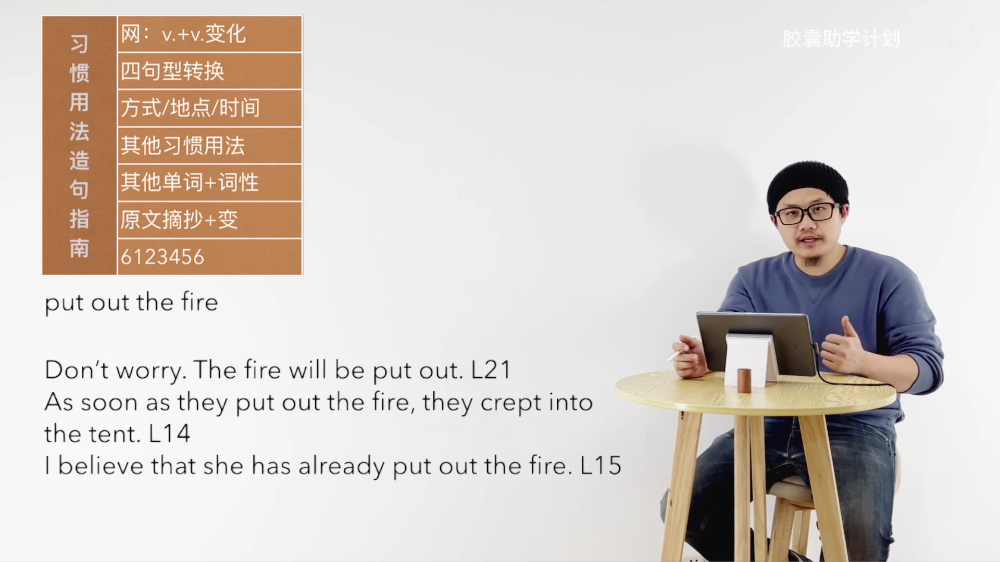

文字识别：网：v.+v.变化 / 习惯用法造句指南 / 四句型转换 / 方式/地点/时间 / 其他习惯用法 / 其他单词+词性 / 原文摘抄+变 / 6123456 / put out the fire / Don't worry. The fire wil be put out. L21 / As soon as they put out the fire, they crept into / the tent. L14 / I believe that she has already put out the fire. L15

## 00:11:30–00:12:00

believe后边儿一家that一个非常典型的宾语从句就出来了。这我们在新一新二都见过。She has already put out the fire.我相信呢，他已经把这个火给扑灭了。这是我们第十五课学的。OK, very good.那接下来呢，我们看一个小的电影片段。片段当中就出现了，就非常短。它出现了put out an apartment fire.那apartment什么意思呢？公寓啊，要扑灭公寓的

### 画面 00:11:30

文字识别：网：v.+v.变化 / 习惯用法造句指南 / 四句型转换 / 方式/地点/时间 / 其他习惯用法 / 其他单词+词性 / 原文摘抄+变 / 6123456 / put out the fire / Don't worry. The fire will be put out. L21 / As soon as they put out the fire, they crept into / the tent. L14 / I believe that she has already put out the fire. L15

### 画面 00:11:33

文字识别：网：v.+v.变化 / 习惯用法造句指南 / 四句型转换 / 方式/地点/时间 / 其他习惯用法 / 其他单词+词性 / 原文摘抄+变 / 6123456 / put out the fire / Don't worry. The fire will be put out. L21 / As soon as they put out the fire, they crept into / the tent. L14 / I believe(that she has already put out the fire L15

### 画面 00:11:35

文字识别：网：v.+v.变化 / 习惯用法造句指南 / 四句型转换 / 方式/地点/时间 / 其他习惯用法 / 其他单词+词性 / 原文摘抄+变 / 6123456 / put out the fire / Don't worry. The fire will be put out. L21 / As soon as they put out the fire, they crept into / the tent. L14 / I believe(that she has already put out the fire L15

### 画面 00:11:40

文字识别：网：v.+v.变化 / 习惯用法造句指南 / 四句型转换 / 方式/地点/时间 / 其他习惯用法 / 其他单词+词性 / 原文摘抄+变 / 6123456 / put out the fire / Don't worry. The fire wil be put out. L21 / As soon as they put out the fire, they crept into / the tent. L14 / I believe(that she has already put out the fire) L15

### 画面 00:11:45

文字识别：网：v.+v.变化 / 习惯用法造句指南 / 四句型转换 / 方式/地点/时间 / 其他习惯用法 / 其他单词+词性 / 原文摘抄+变 / 6123456 / put out the fire / Don't worry. The fire will be put out. L21 / As soon as they put out the fire, they crept into / the tent. L14 / I believe(that she has already put out the fire L15

### 画面 00:11:47

文字识别：put out an apartment fire / 全民超人汉考克 / Hancock / (2008)

## 00:12:00–00:12:30

一场大火来了。Ever put out an apartment fire ray? No, I haven't done that. I'm in PR. My ass was hot. Okay, put out an apartment fire. Okay, more again. 下一个小的习惯用法，跟我们一起读一下，叫 wake up，叫醒来。那很简单，它是个动词，我们直接把它放到句子当中就可以了。说 I wake up at eight o'clock every morning. 每天早晨八点钟

### 画面 00:12:03

文字识别：put out an apartment fire / 全民超人汉考克 / 瑞你救过公寓大火吗？ / Hancock / You ever put out an apartment fire, Ray? / (2008)

### 画面 00:12:05

文字识别：put out an apartment fire / 全民超人汉考克 / 瑞你救过公寓大火吗？ / Hancock / You ever put out an apartment fire, Ray? / (2008)

### 画面 00:12:07

文字识别：put out an apartment fire / 全民超人汉考克 / 一没有我是干公关的-把我屁股都烤着了 / Hancock / - No, I haven't done that. I'm in P.R. - No. My ass was hot. / (2008)

### 画面 00:12:09

文字识别：put out an apartment fire / 全民超人汉考克 / Hancock / (2008)

### 画面 00:12:14

文字识别：网：v.+v.变化 / 习惯用法造句指南 / 四句型转换 / 方式/地点/时间 / 其他习惯用法 / 其他单词+词性 / 原文摘抄+变 / 6123456 / wake up

### 画面 00:12:16

文字识别：网：v.+v.变化 / 习惯用法造句指南 / 四句型转换 / 方式/地点/时间 / 其他习惯用法 / 其他单词+词性 / 原文摘抄+变 / 6123456 / wake up

### 画面 00:12:20

文字识别：网：v.+v.变化 / 习惯用法造句指南 / 四句型转换 / 方式/地点/时间 / 其他习惯用法 / 其他单词+词性 / 原文摘抄+变 / 6123456 / wake up / I wake up at 8:00 every morning.

### 画面 00:12:25

文字识别：网：v.+v.变化 / 习惯用法造句指南 / 四句型转换 / 方式/地点/时间 / 其他习惯用法 / 其他单词+词性 / 原文摘抄+变 / 6123456 / wake up / I wake up at 8:00 every morning.

## 00:12:30–00:13:00

我起床。一般现在时，肯定去给您了。四句型转化，您一造，各自己的句子就来了。再来，Do you wake up at eight o'clock every morning? 以及各种特殊疑问词，这就是您的家庭作业，好吧？ Next one, begin doing something. 它和 begin to do something 含义完全相同。各位如果感兴趣的话，不妨拿我们的红皮书啊。各位现在应该有两本红皮书了，初级和中级，您都直接去查

### 画面 00:12:30

文字识别：网：v.+v.变化 / 习惯用法造句指南 / 四句型转换 / 方式/地点/时间 / 其他习惯用法 / 其他单词+词性 / 原文摘抄+变 / 6123456 / wake up / I wake up at 8:00 every morning.

### 画面 00:12:34

文字识别：网：v.+v.变化 / 习惯用法造句指南 / 四句型转换 / 方式/地点/时间 / 其他习惯用法 / 其他单词+词性 / 原文摘抄+变 / 6123456 / wake up / I wake up at 8:00 every morning.

### 画面 00:12:36

文字识别：网：v.+v.变化 / 习惯用法造句指南 / 四句型转换 / 方式/地点/时间 / 其他习惯用法 / 其他单词+词性 / 原文摘抄+变 / 6123456 / wake up / I wake up at 8:00 every morning. / Do you wake up at 8:00 every morning?

### 画面 00:12:40

文字识别：网：v.+v.变化 / 习惯用法造句指南 / 四句型转换 / 方式/地点/时间 / 其他习惯用法 / 其他单词+词性 / 原文摘抄+变 / 6123456 / wake up / I wake up at 8:00 every morning. / Do you wake up at 8:00 every morning? / when/why/who...

### 画面 00:12:44

文字识别：网：v.+v.变化 / 习惯用法造句指南 / 四句型转换 / 方式/地点/时间 / 其他习惯用法 / 其他单词+词性 / 原文摘抄+变 / 6123456 / begin doing sth. = begin to do sth.

### 画面 00:12:46

文字识别：网：v.+v.变化 / 习惯用法造句指南 / 四句型转换 / 方式/地点/时间 / 其他习惯用法 / 其他单词+词性 / 原文摘抄+变 / 6123456 / begin doing sth. = begin to do sth.

### 画面 00:12:50

文字识别：网：v.+v.变化 / 习惯用法造句指南 / 四句型转换 / 方式/地点/时间 / 其他习惯用法 / 其他单词+词性 / 原文摘抄+变 / 6123456 / begin doing sth. = begin to do sth.

### 画面 00:12:55

文字识别：网：v.+v.变化 / 习惯用法造句指南 / 四句型转换 / 方式/地点/时间 / 其他习惯用法 / 其他单词+词性 / 原文摘抄+变 / 6123456 / begin doing sth. = begin to do sth.

## 00:13:00–00:13:30

下 begin 啊，然后应该就能找到 begin to do something 和 begin doing something 含义完全相同，好吧？所以你造一个句子说 he began playing jazz，他开始弹爵士乐和 he began to play jazz 意思没有区别，好吧？ Next one 说 he began complaining about her boyfriend，他开始抱怨他男朋友。 OK，好，那本课 recap 除了文章以外，习惯用法

### 画面 00:13:00

文字识别：网：v.+v.变化 / 习惯用法造句指南 / 四句型转换 / 方式/地点/时间 / 其他习惯用法 / 其他单词+词性 / 原文摘抄+变 / 6123456 / begin doing sth. = begin to do sth.

### 画面 00:13:05

文字识别：网：v.+v.变化 / 习惯用法造句指南 / 四句型转换 / 方式/地点/时间 / 其他习惯用法 / 其他单词+词性 / 原文摘抄+变 / 6123456 / begin doing sth. = begin to do sth.

### 画面 00:13:08

文字识别：网：v.+v.变化 / 习惯用法造句指南 / 四句型转换 / 方式/地点/时间 / 其他习惯用法 / 其他单词+词性 / 原文摘抄+变 / 6123456 / begin doing sth. = begin to do sth. / He began playing jazz. L10

### 画面 00:13:10

文字识别：网：v.+v.变化 / 习惯用法造句指南 / 四句型转换 / 方式/地点/时间 / 其他习惯用法 / 其他单词+词性 / 原文摘抄+变 / 6123456 / begin doing sth. = begin to do sth. / He began playing jazz. L10

### 画面 00:13:15

文字识别：网：v.+v.变化 / 习惯用法造句指南 / 四句型转换 / 方式/地点/时间 / 其他习惯用法 / 其他单词+词性 / 原文摘抄+变 / 6123456 / begin doing sth. = begin to do sth. / He began playing jazz. L10

### 画面 00:13:17

文字识别：网：v.+v.变化 / 习惯用法造句指南 / 四句型转换 / 方式/地点/时间 / 其他习惯用法 / 其他单词+词性 / 原文摘抄+变 / 6123456 / begin doing sth. = begin to do sth. / He began playing jazz. L10 / She began complaining about her boyfriend. / L24

### 画面 00:13:20

文字识别：网：v.+v.变化 / 习惯用法造句指南 / 四句型转换 / 方式/地点/时间 / 其他习惯用法 / 其他单词+词性 / 原文摘抄+变 / 6123456 / begin doing sth. = begin to do sth. / He began playing jazz. L10 / She began complaining about her boyfriend. / L24

### 画面 00:13:24

文字识别：Recap / put up the tent / tell a story/stories / Expression / put out the fire / begin doing / sth. / wake up

### 画面 00:13:26

文字识别：Recap / put up the tent / tell a story/stories / Expression / put out the fire / begin doing s / sth. / wake up

### 画面 00:13:28

文字识别：Recap / put up the tent / tell a story/stories / Expression / put out the fire / begin doing / sth. / wake up

## 00:13:30–00:14:00

非常的大，以后各位在所有地方都能用得到，哎，这个东西要慢慢积累的，对吧？那来，我们先说家庭作业，习惯用法，每个五句不要自己乱造，就用咱们那个指南配合着去造，好吧？再然后呢，文章跟读至熟读成诵有很多的原因。好，如果大家喜欢我们的课程呢，欢迎大家关注、订阅、一键三连，分享给那些需要的朋友，来帮助我们快速成长。See you next time.

### 画面 00:13:30

文字识别：Recap / put up the tent / tella /  a story/stories / Expression / put out the fire / begin doing / sth. / wake up

### 画面 00:13:33

文字识别：Recap / put up the tent / tell a story/stories / Expression / put out the fire / begin doing / sth. / wake / eup

### 画面 00:13:35

### 画面 00:13:37

文字识别：1. / 习惯用法造句/对话 / 【习惯用法造句指南】 / 每个5句

### 画面 00:13:40

文字识别：1. / 习惯用法造句/对话 / 【习惯用法造句指南】 / 每个5句

### 画面 00:13:42

文字识别：1. / 习惯用法造句/对话 / 【习惯用法造句指南】 / 每个5句

### 画面 00:13:45

文字识别：1. / 习惯用法造句/对话 / 【习惯用法造句指南】 / 每个5句 / 文章跟读至熟读成诵 / 内化单词+语法+习惯用法 / 听力+口语+写作练习

### 画面 00:13:50

## 00:14:00–00:14:12

teaching recording. Transcribe the exact words in their original spoken languages. Never translate. Preserve repetitions, questions and examples.

### 画面 00:14:00

### 画面 00:14:02

文字识别：CAPSULEACADEMY / 胶囊助学计划 / 小红书 / Lecturer / □ / Leo / OE

### 画面 00:14:04

文字识别：CAPSULEACADEMY / 胶囊助学计划 / 『 / 小红书 / Photographer / □ / Berlin / OE

### 画面 00:14:06

文字识别：CAPSULEACADEMY / 胶囊助学计划 / 小红书 / Editor / Berlin / OE

### 画面 00:14:09

文字识别：CAPSULEACADEMY / 胶囊助学计划 / 小红书 / 品

### 画面 00:14:11

文字识别：bilibili / 胶囊助学计划

### 画面 00:14:12

文字识别：bilibili / 胶囊助学计划

