# L027 听说读写复述练习

快速机器解析：语音为单模型转写，未进行独立交叉校对或人工复核；画面每秒采样并按变化选帧，短时文字和标记可能遗漏。截图时间约有 1 秒误差。图片有损压缩；遇到疑点请按时间查看 Google Drive 原视频。

## 00:00:00–00:00:30

Hello everyone, welcome to Capsule Academy. This is Leo. Today we're going to learn New Concept English Book Two Lesson Twenty Seven Practices. 那老习惯进行如下练习，唯一的前提就是文章跟读至熟读成诵，否则请勿开始。 Hope you gonna enjoy it. 好，那我们看第一题，Comprehension. 训练目标让我们能听懂一般疑问句和特殊疑问句，根据文章，对

### 画面 00:00:00

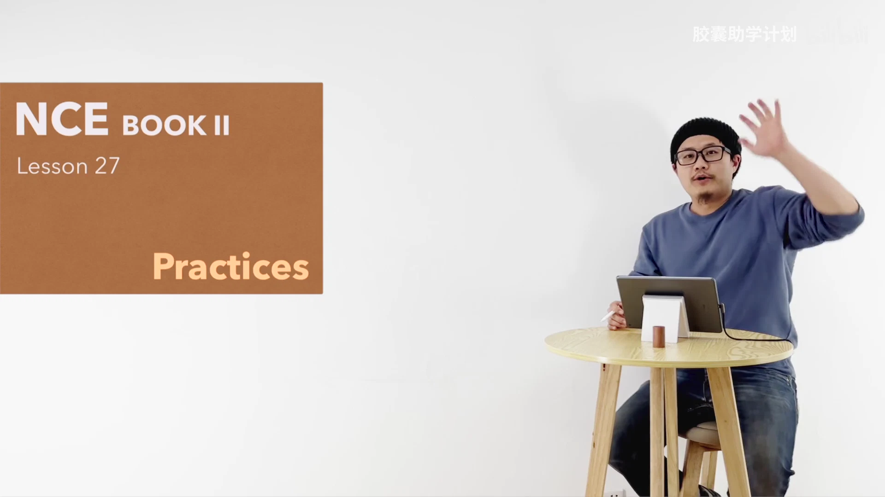

文字识别：NCE / BOOKII / Lesson 27 / Practices

### 画面 00:00:02

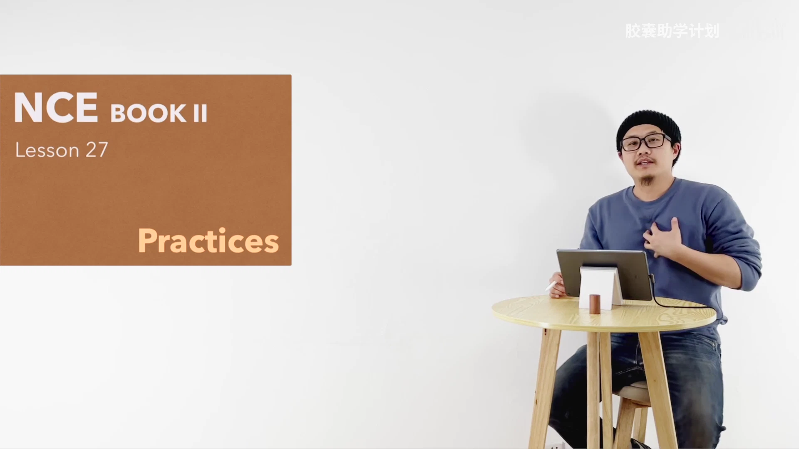

文字识别：NCE / BOOKII / Lesson 27 / Practices

### 画面 00:00:05

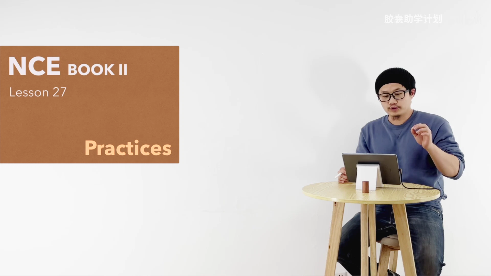

文字识别：NCE / BOOKI"I / Lesson 27 / Practices

### 画面 00:00:08

文字识别：进行如下练习唯一前提 / 文章跟读至熟读成诵 / 否则请勿开始

### 画面 00:00:17

文字识别：进行如下练习唯一前提 / 文章跟读至熟读成诵 / 否则请勿开始

### 画面 00:00:19

文字识别：胶囊助学计划bill

### 画面 00:00:22

### 画面 00:00:24

文字识别：Comprehension / 训练目标： / 听懂一般疑问句＆特殊疑问句

## 00:00:30–00:01:00

吧？您可以看书，但不要看我这里。我们尽量做一些听力和口语练习。来了，弟弟。When did the boys put up their tent? 答案: Late in the afternoon. Next one. Where did they put it up? 答案: In the middle of a field. Next one. What did they do next? They cooked a meal. Next one. Did they

### 画面 00:00:36

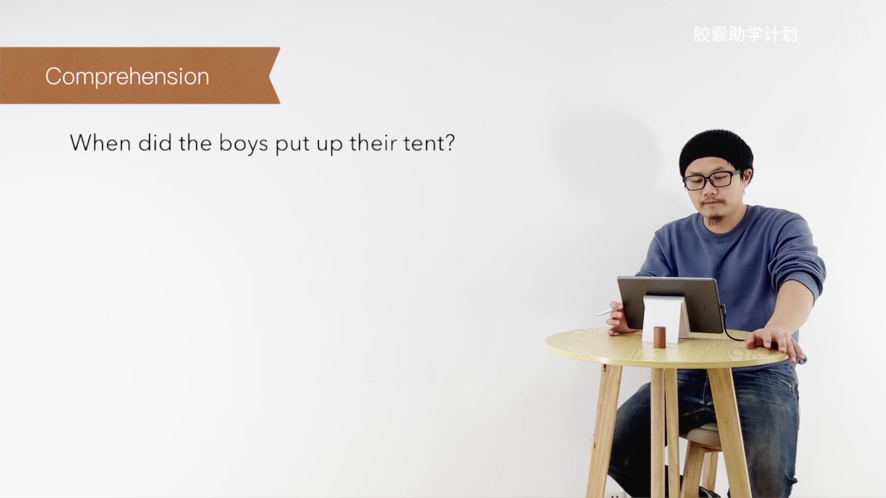

文字识别：Comprehension / When did the boys put up their tent?

### 画面 00:00:47

文字识别：Comprehension / Where did they put it up? / In the middle of a field.

## 00:01:00–00:01:30

all feel hungry? Yes, they did. Next one, what smelled good? The food, or the meal? Okay. Next one, what did they do after their meal? They told stories and sang songs. Next one, when did it begin to rain? Some time later. Next one,

### 画面 00:01:17

文字识别：Comprehension / What did they do after their meal? / They told stories and sang songs.

### 画面 00:01:24

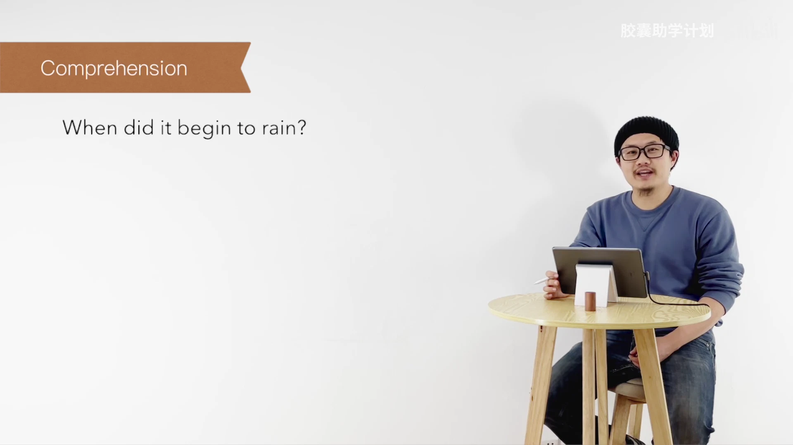

文字识别：Comprehension / When did it begin to rain?

## 00:01:30–00:02:00

Why did the boys put out the fire? Because they felt tired. Next one. Why did they all sleep soundly? Because their sleeping bags were warm and comfortable. Next one. When did two of the boys wake up? In the middle of the night. Next one. Why did

### 画面 00:01:44

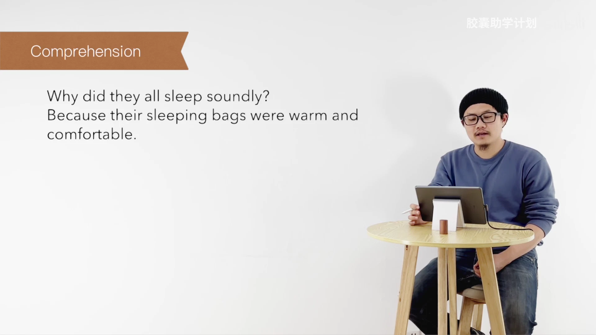

文字识别：Comprehension / Why did they allsleep soundly? / Because their sleeping / bags were warm and / comfortable.

### 画面 00:01:50

文字识别：Comprehension / When did two of the boys wake up?

## 00:02:00–00:02:30

they begin shouting? Because the tent was full of water. What did all the boys do? They leapt out of their sleeping bags and hurried outside.好，asking questions，训练目标，各位能说出来一般疑问句和特殊疑问句啊，简单来说就是您能发问了啊，练习我们发问的能力。那老习惯，我们还是先看

### 画面 00:02:02

文字识别：Comprehension / Why did they begin shouting? / Because the tent was full of water.

### 画面 00:02:07

文字识别：Comprehension / What did all the boys do?

### 画面 00:02:13

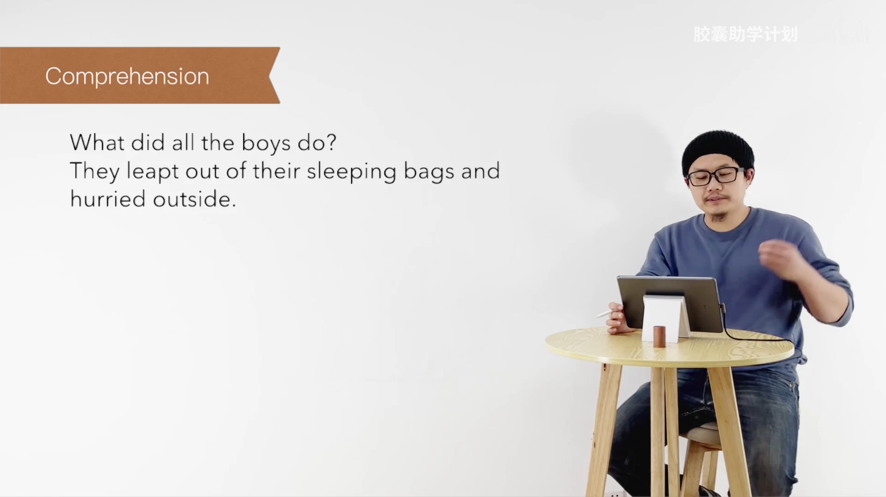

文字识别：Comprehension / What did all the boys do? / They leapt out of their sleeping bags and / hurried outside.

### 画面 00:02:18

文字识别：Asking questions / 训练目标： / 会说一般疑问句＆特殊疑问句 / Accuracy / Fluency

### 画面 00:02:27

文字识别：Asking questions

## 00:02:30–00:03:00

一个叫 Ask me if they put up their tent late in the afternoon. 注意，本课基本上巧了，全是一般过去时啊。本课我们练的也是一般过去时。哎，Did提前，动词换原形就行了。巧了，这个动词呢和过去式长得又一样，是吧？您看起来就不用换了。When对late in the afternoon提问，直接一替就可以了，好吧？接下来呢，我们还是老习惯，呃，只把思路大概思路说出来，然后各位回去要自己写，写完

### 画面 00:02:35

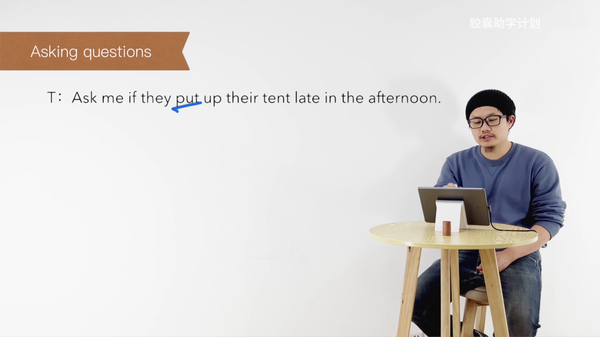

文字识别：Asking questions / T: Ask me if they put up their tent late in the afternoon.

### 画面 00:02:38

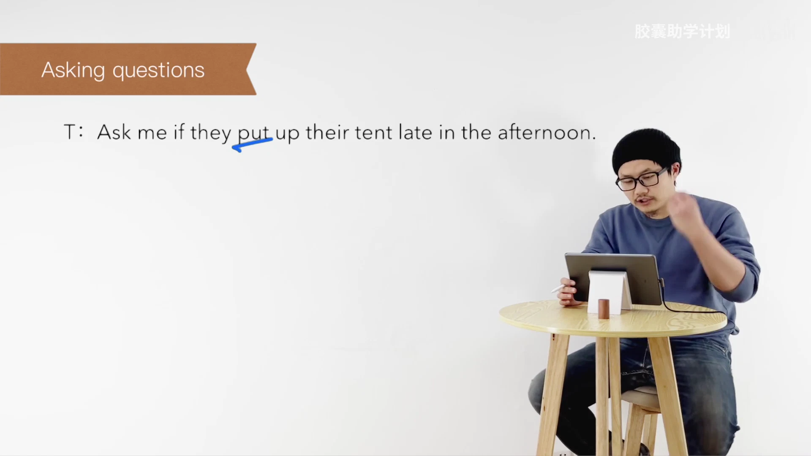

文字识别：Asking questions / T: Ask me if they put up their tent late in the afternoon.

### 画面 00:02:40

文字识别：Asking questions / T: Ask me if they put up their tent late in the afternoon. / S: Did they put up their tent late in the afternoon?

### 画面 00:02:52

文字识别：Asking questions

### 画面 00:02:56

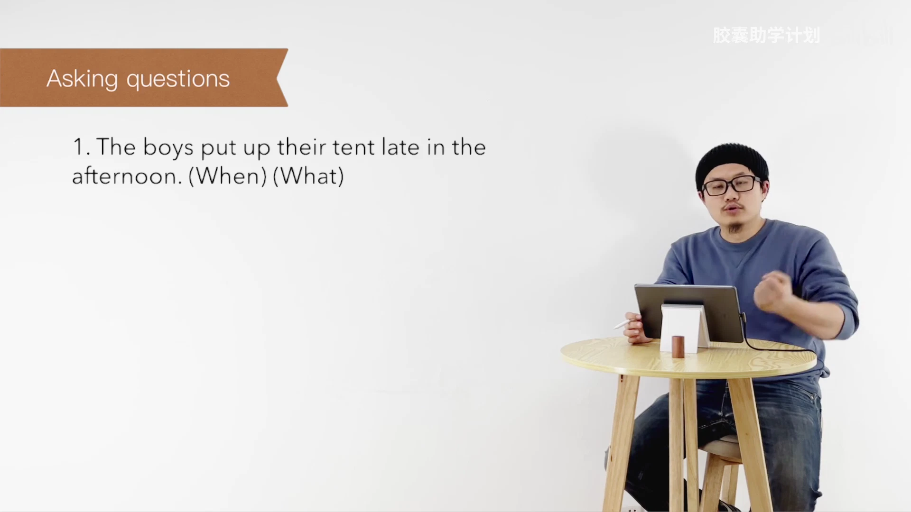

文字识别：Asking questions / 1.The boys put up their tent late in the / afternoon.(When)(What)

## 00:03:00–00:03:30

了大声朗读。那 what 对什么提问呢？肯定是 their tent嘛，对吧？下一个 it was in the middle of a field was 提前 where 对 in the middle of a field 提问。 They cooked a meal did 提前动词换回原形 what 对 a meal 提问。 They cooked it over an open fire. Okay, did 提前动词换回原形。 How 注意对什么提问？这我先把答案给各位，答案叫

### 画面 00:03:12

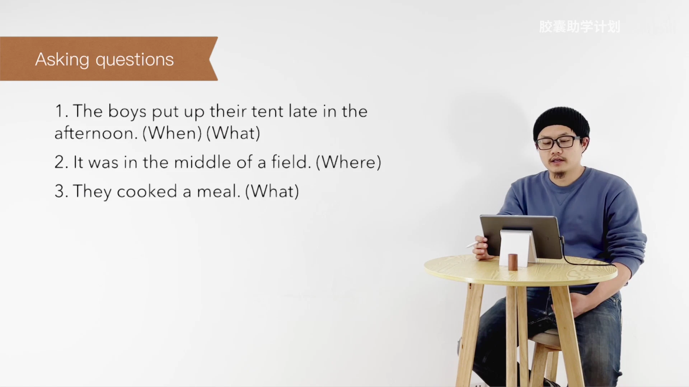

文字识别：Asking questions / 1. The boys put up their tent late in the / afternoon.(When) (What) / 2.It was in the middle of a field. (Where) / 3.They cooked a meal. (What)

### 画面 00:03:27

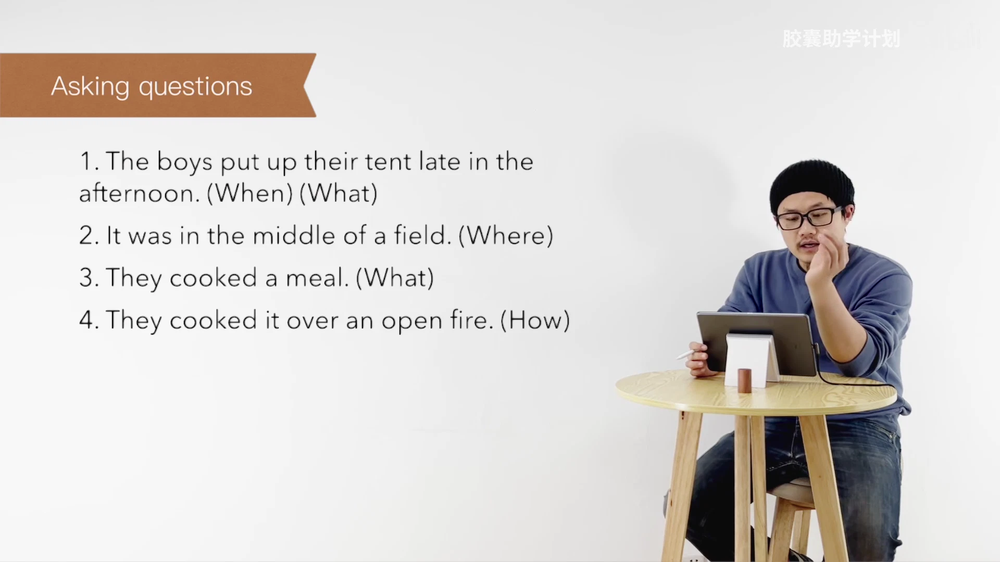

文字识别：Asking questions / 1.The boys put up their tent late in the / afternoon.(When)(What) / 2. Ilt was in the middle of a field. (Where) / 3. They cooked a meal. (What) / 4. They cooked it over an open fire. (How)

## 00:03:30–00:04:00

How did they cook it? 他们是如何做的这个饭呢？哎， over an open fire. 其实这里边用 where 好像也 OK。各位自己去想一下，是吧？我用 where 去问，我不用 how 了，对吧？ Next one, they told stories afterwards. Did 提前 What did they do? 标准的叫 What did they do afterwards? OK, they sang songs too. 好， Did 提前动词换回原形。 What else? What

### 画面 00:03:31

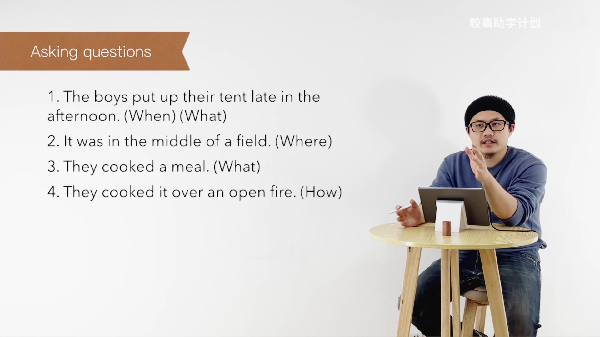

文字识别：Asking questions / 1.The boys put up their tent late in the / afternoon.(When)(What) / 2. Ilt was in the middle of a field. (Where) / 3. They cooked a meal. (What) / 4.They cooked it over an open fire. (How)

### 画面 00:03:43

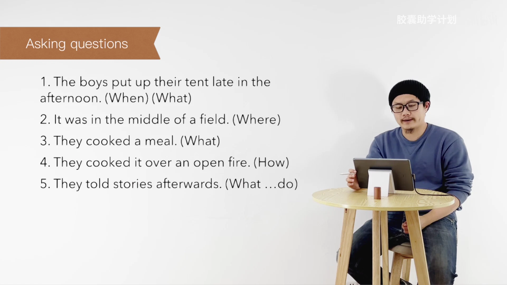

文字识别：Asking questions / 1. The boys put up their tent late in the / afternoon.(When)(What) / 2. Ilt was in the middle of a field. (Where) / 3. They cooked a meal. (What) / 4. They cooked it over an open fire.(How) / 5. They told stories afterwards. (What ...do)

## 00:04:00–00:04:30

else did they do? Okay. Good. They sat round the campfire. Did提前, where对round the campfire提问. It began to rain later. Did提前, 动词换回原形. When对later提问. The boys felt tired. Did提前, how对tired提问. How did the boys feel? They put

### 画面 00:04:04

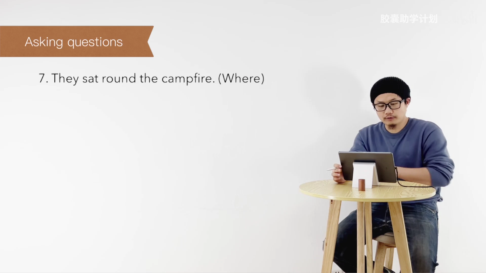

文字识别：Asking / questions / 7.They sat round the campfire. (Where)

### 画面 00:04:28

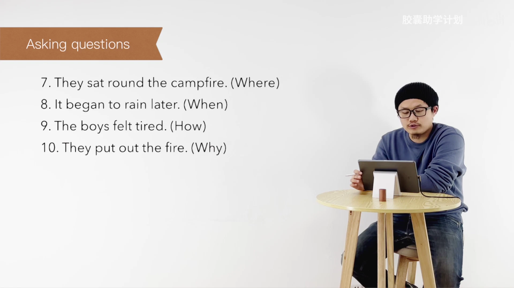

文字识别：Asking questions / 7. They sat round the campfire. (Where) / 8. It began to rain later. (When) / 9.The boys felt tired.(How) / 10. They put out the fire. (Why)

## 00:04:30–00:05:00

out the fire. Did提前Why对整句话提问They all slept soundly. Did提前How对soundly提问Who对They提问Okay,好Two boys woke up. Did提前Who对主语提问Why对整句话提问When对整句话提问，也就是Why did the twoWhy did two boys wake up? Ah, when did two boys wake? Okay, tell the stories.老习

### 画面 00:04:40

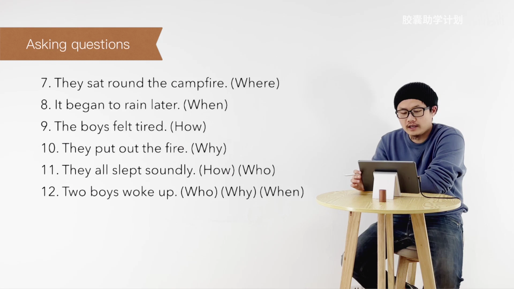

文字识别：Asking questions / 7. They sat round the campfire. (Where) / 8. It began to rain later. (When) / 9. The boys felt tired.(How) / 10.They put out the fire. (Why) / 11.They all slept soundly.(How) (Who) / 12. Two boys woke up. (Who) (Why) (When)

### 画面 00:04:57

文字识别：Tell the story / 训练目标： / 口语复述能力 / Accuracy / Fluency

## 00:05:00–00:05:30

惯练习的是我们口语复述能力。各位看着这些关键单词，尽可能把文章复述下来就可以了。第一个单元我们给大家做了非常多的示范，在这儿就不一一示范了，好吧？Summary writing，各位摘要写作先写，然后到这儿对一下答案。如果哪个地方您觉得有问题，不妨留言直接告诉我，好吧？然后呢，topic for discussion，这是我们所有练习的最终目的。我们

### 画面 00:05:01

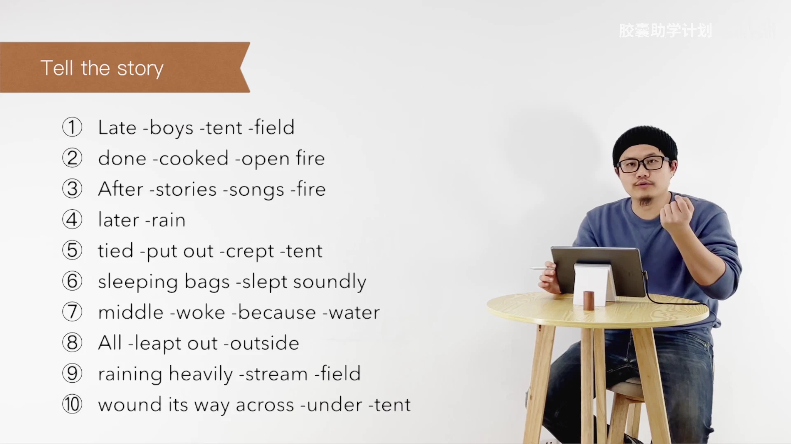

文字识别：Tell the story / 1 / D Late -boys -tent -field / done -cooked -open fire / After -stories -songs -fire / later -rain / tied -put out -crept -tent / sleeping bags -slept soundly / middle -woke -because -water / All -leapt out -outside / raining heavily -stream -field / ① /  wound its way across -under -tent

### 画面 00:05:13

文字识别：Summary writing: Key / 训练目标： / 写作复述能力

### 画面 00:05:17

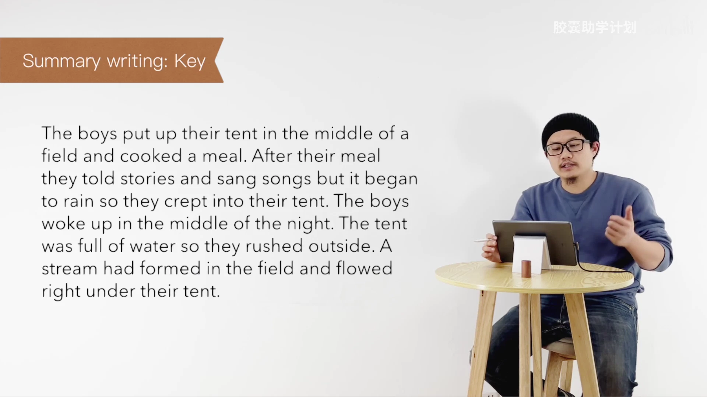

文字识别：Summary writing: Key / The boys put up their tent in the middle of a / field and cooked a meal. After their meal / they told stories and sang songs but it began / to rain so they crept into their tent. The boys / woke up in the middle of the night. The tent / was full of water so they rushed outside.A / stream had formed in the field and flowed / right under their tent.

### 画面 00:05:25

文字识别：Topics for discussion / 训练目标： / 完全自由的对话 / Accuracy / Fluency

### 画面 00:05:27

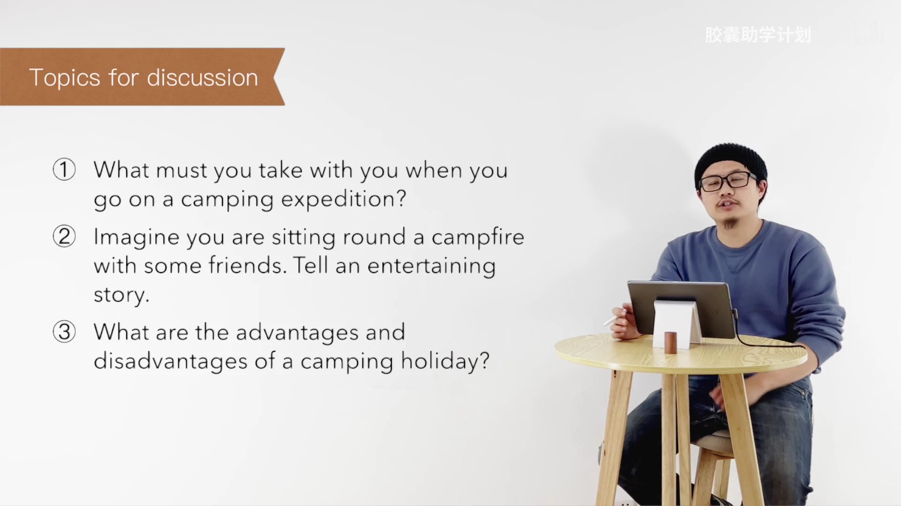

文字识别：Topics for discussion / What must you take with you when you / go on a camping expedition? / Imagine you are sitting round a campfire / with some friends. Tell an entertaining / story. / What are the advantages and / disadvantages of a camping holiday?

## 00:05:30–00:06:00

还是看一下题。What must you take with you when you go on a camping expedition?说如果你出去远行露营的时候，你需要带一些什么东西。OK，第二题说，Imagine you are sitting around a campfire with some friends, tell an entertaining story.假设你和你的朋友坐在篝火旁边，给大家讲一个特别有趣的故事。第三个说，What

### 画面 00:05:33

文字识别：Topics for discussion / What must youtake with you when you / go on a camping expedition? / Imagine you are sitting round a campfire / with some f / : friends. Tell an entertaining / story. / What are the advantages and / disadvantages of a camping holiday?

### 画面 00:05:36

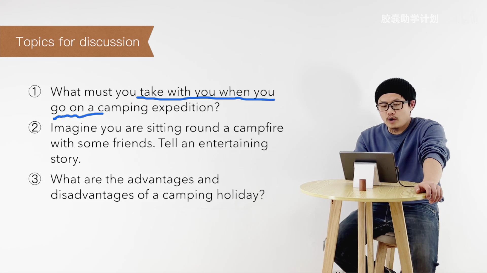

文字识别：Topics for discussion / What must you take with you when you / go on a camping / expedition? / Imagine /  you are sitting round a campfire / with some / friends. Tell a / an entertaining / story. / What are the advantages and / disadvantages of a camping holiday?

### 画面 00:05:38

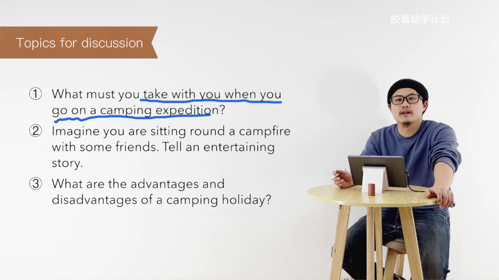

文字识别：Topics for discussion / What must youtake with you when you / go on a camping / expedition? / Imagine /  you are sitting round a campfire / with some / friends. Tell a / an entertaining / story. / What are the advantages and / disadvantages of a camping holiday?

## 00:06:00–00:06:30

the advantages and disadvantages of a camping holiday? 好，说 camping holiday 就是露营的这样的一个假期，那它有哪些优优点和哪些缺点？各位要自己去想一下，好吧？好，那将作业老习惯 ask me if 先写再朗读，Journal 写作先写，然后对答案 tell the story。各位一定要进行口语复述，然后进行啊，专栏当中可以找得到。

### 画面 00:06:07

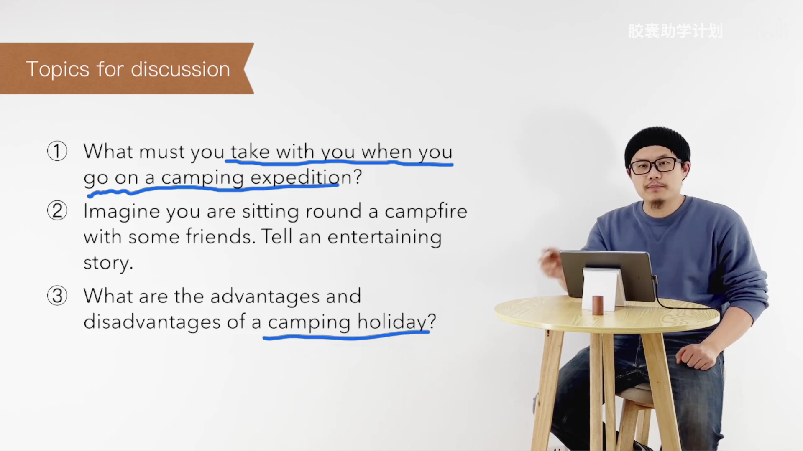

文字识别：Topics for discussion / What must youtake with you when you / go on a camping / expedition? / Imagine /  you are sitting round a campfire / with some / friends. Tell a / an entertaining / story. / What are the advantages and / disadvantages of a camping holiday?

### 画面 00:06:16

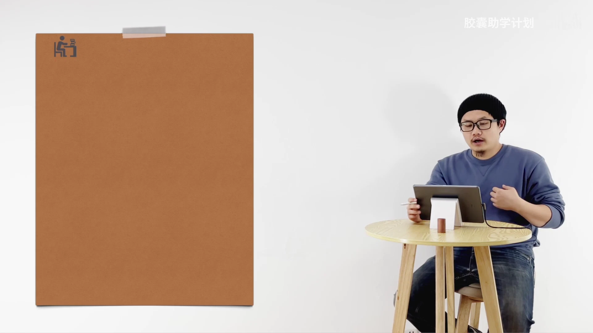

### 画面 00:06:19

文字识别：1. / Ask meif写&朗读

### 画面 00:06:21

文字识别：1.Ask me if写&朗读 / 2. / 摘要写作写&答案

### 画面 00:06:23

文字识别：1.Ask me if写&朗读 / 摘要写作写&答案 / 3.Tell the story 口语复述

### 画面 00:06:25

文字识别：1.Ask me if写&朗读 / 摘要写作写&答案 / 3.Tell the story 口语复述 / 专栏 / 4.

### 画面 00:06:29

文字识别：👍

## 00:06:30–00:06:52

那如果大家喜欢我们的课程呢，欢迎大家啊关注、订阅、一键三连、分享给那些需要的朋友，来帮助我们快速成长。See you next time.

### 画面 00:06:40

### 画面 00:06:42

文字识别：CAPSULEACADEMY / 胶囊助学计划 / 小红书 / Lecturer / □ / Leo / OE

### 画面 00:06:45

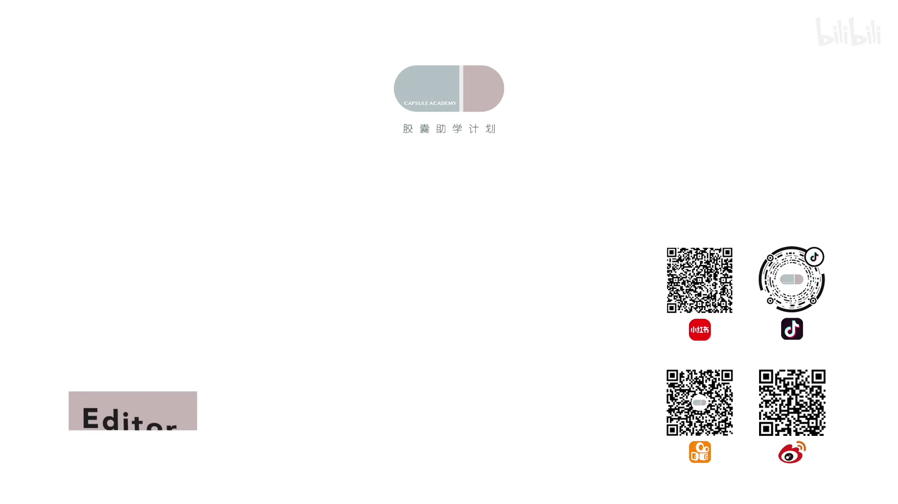

文字识别：CAPSULEACADEMY / 胶囊助学计划 / 『 / 小红书 / Editor / OE

### 画面 00:06:48

文字识别：CAPSULEACADEMY / 胶囊助学计划 / 『 / 小红书 / Creator / Leo & Berlin / OE

### 画面 00:06:50

文字识别：bilibili / 胶囊助学计划 / 胶囊助学计划 / 小红书 / OE

### 画面 00:06:52

文字识别：bilibili / 胶囊助学计划

