# L028 单词

快速机器解析：语音为单模型转写，未进行独立交叉校对或人工复核；画面每秒采样并按变化选帧，短时文字和标记可能遗漏。截图时间约有 1 秒误差。图片有损压缩；遇到疑点请按时间查看 Google Drive 原视频。

## 00:00:00–00:00:30

Hello everyone, welcome to Capsule Academy. This is Leo. Today we're going to learn new concept English Book Two Lesson Twenty Eight Words. 那老习惯进入正式课程之前，我们先看几个小的问题。那第一，如何表达在某个方面有一些麻烦困难？那第二，如何表达没有效果？那带着这两个问题，Hope you gonna enjoy. 好，那我们先看第一个单词啊，看着音标跟我一起读一下，叫做

### 画面 00:00:00

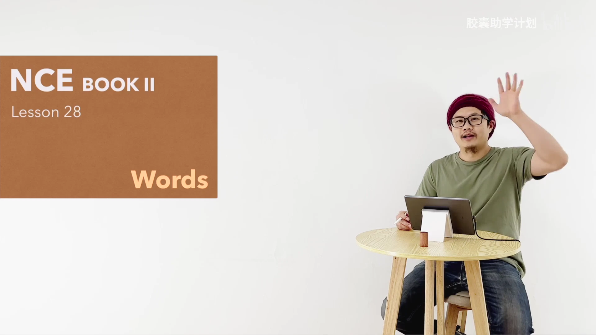

文字识别：NCE / BOOKⅡI / Lesson 28 / Words

### 画面 00:00:02

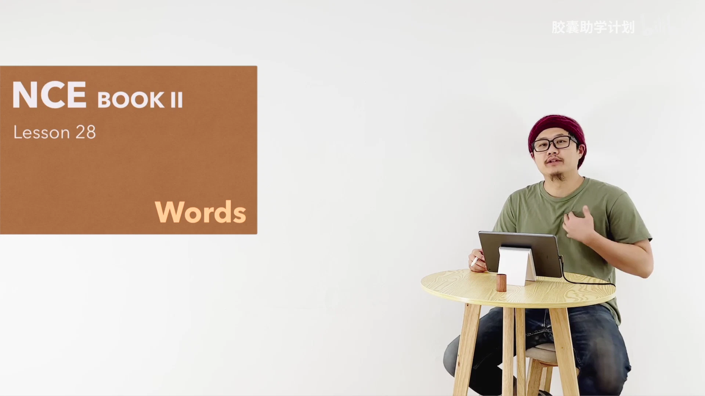

文字识别：NCE / BOOK I"I / Lesson 28 / Words

### 画面 00:00:05

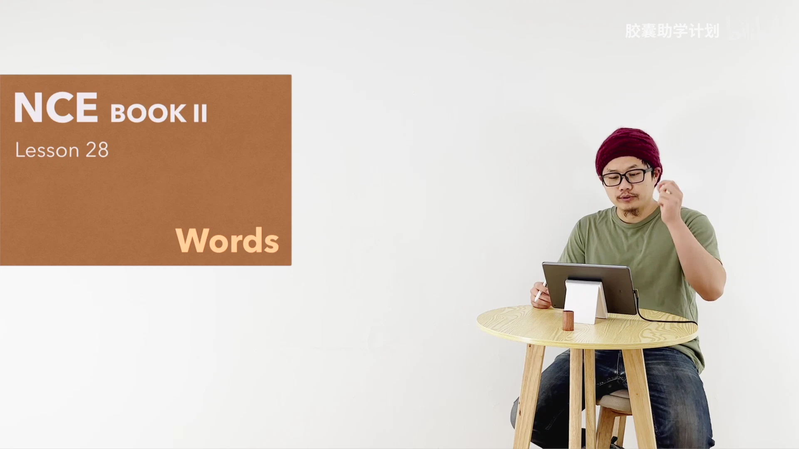

文字识别：NCE / BOOKII / Lesson 28 / Words

### 画面 00:00:08

文字识别：胶囊助学计划

### 画面 00:00:11

文字识别：①如何表达“在某方面有麻烦”？

### 画面 00:00:13

文字识别：①如何表达“在某方面有麻烦”？

### 画面 00:00:16

文字识别：①如何表达“在某方面有麻烦”？ / 如何表达“没有效果”?

### 画面 00:00:18

文字识别：①如何表达“在某方面有麻烦”？ / 如何表达“没有效果”

### 画面 00:00:21

文字识别：胶囊助学计划bill

### 画面 00:00:25

### 画面 00:00:27

文字识别：单词造句指南 / 网：v.+v.变化 / 胶囊 / 四句型转换 / 方式/地点/时间 / 结合习惯用法 / 其他单词+词性 / 原文摘抄+变 / 6123456 / /real / rare adj.

## 00:00:30–00:01:00

rare, rare. 它本身是一个形容词，表示的是罕见的、稀有的，对吧？比如说，呃， rare animal. 那我们把它放到一起，叫做罕见的动物、稀有动物，对吧？OK. 那我们造一句话，看着图去造，说 the white tiger is rare. 说这个白虎啊，啊，白色的这个老虎是怎么样呢？是非常罕见的。OK. Continue. 我还可以把它直接变成一个特殊疑问句，说 Why is the white tiger rare?

### 画面 00:00:30

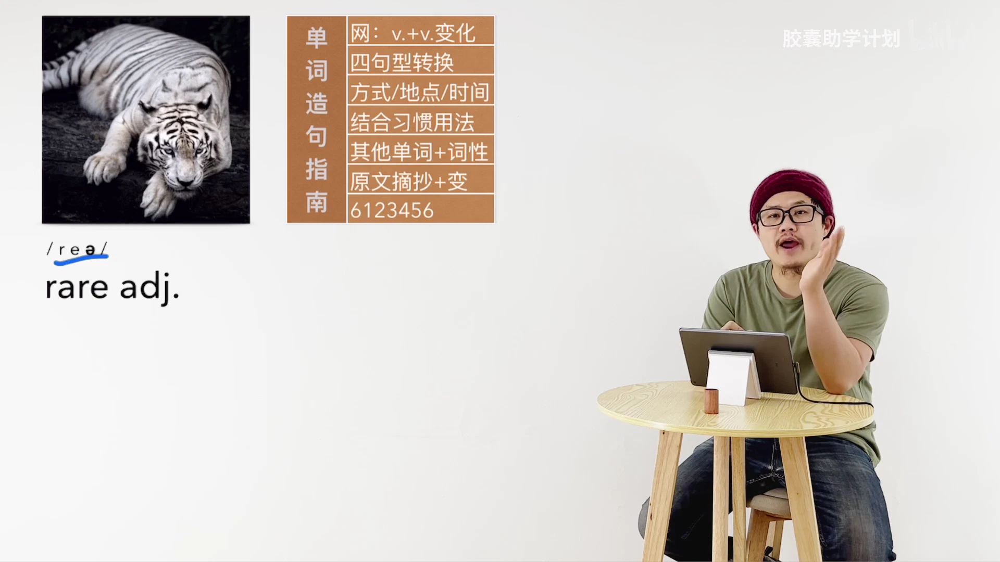

文字识别：单词造句指南 / 网：v.+v.变化 / 胶囊助学计划 / 四句型转换 / 方式/地点/时间 / 结合习惯用法 / 其他单词+词性 / 原文摘抄+变 / 6123456 / /real / adj. / rare 

### 画面 00:00:54

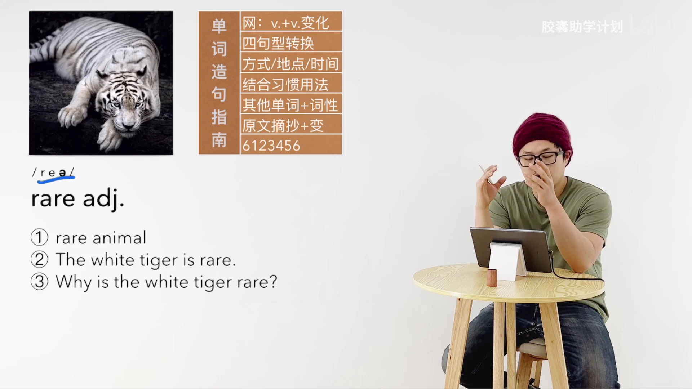

文字识别：单词造句指南 / 网：v.+v.变化 / 胶囊助学计划 / 四句型转换 / 方式/地点/时间 / 结合习惯用法 / 其他单词+词性 / 原文摘抄+变 / 6123456 / /real / rare adj. / rare animal / The white tiger is rare. / Why is the white tiger rare?

## 00:01:00–00:01:30

Okay,那其实就是这两句话之间中间差了一个一般疑问句。各位直接暂停屏幕，给自己用口语补一下就可以了，好吧？那再然后，我们结合第七课的一个习惯用法，叫To somebody's surprise，令某人感到很惊讶的是，说To my surprise, I saw a rare white tiger yesterday in the field.好，你看啊，我们实际上首先a rare white tiger是这里面咱们核心造句子要用到的东西，

### 画面 00:01:06

文字识别：单词造句指南 / 网：v.+v.变化 / 胶囊助学计划 / 四句型转换 / 方式/地点/时间 / 结合习惯用法 / 其他单词+词性 / 原文摘抄+变 / 6123456 / /real / rare adj. / rare animal / The white tiger is rare. / Why is the white tiger rare? / 3 / To my surprise, I saw a rare white tiger / yesterday in the field. L7

### 画面 00:01:10

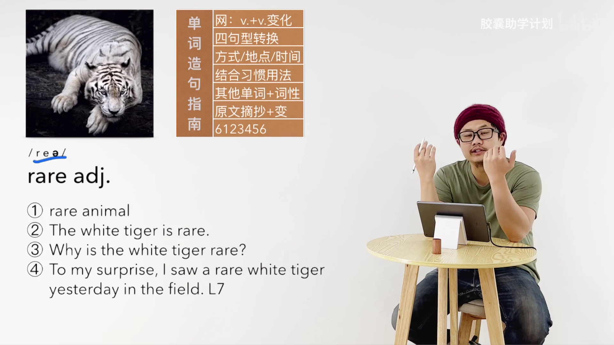

文字识别：单词造句指南 / 网：v.+v.变化 / 胶囊助学计划 / 四句型转换 / 方式/地点/时间 / 结合习惯用法 / 其他单词+词性 / 原文摘抄+变 / 6123456 / /real / rare adj. / rare animal / The white tiger is rare. / Why is the white tiger rare? / 3 / To my surprise, I saw a rare white tiger / yesterday in the field. L7

### 画面 00:01:25

文字识别：单词造句指南 / 网：v.+v.变化 / 四句型转换 / 方式/地点/时间 / 结合习惯用法 / 其他单词+词性 / 原文摘抄+变 / 6123456 / /real / rare adj. / rare animal / The white tiger is rare. / Why is the white tiger rare? / 3 / To my surprise, I saw a rare white tiger / yesterday in the field. L7

## 00:01:30–00:02:00

对吧？包含了 rare 这个单词。我说一下思路，思路是其实我先找到了这个习惯用法，叫 to somebody's surprise，令某人感到惊讶的是。那一般来说，这时候你就要去其实跟汉语是有关系了，你就去想一个动词。那我用到的是 saw，是之前的事情。然后我又加了一个时间，加了一个地点，叫 yesterday 和 in the field，都是我们之前学过的单词或者短语。那肯定句就造出来了。然后接下来各位可

### 画面 00:01:35

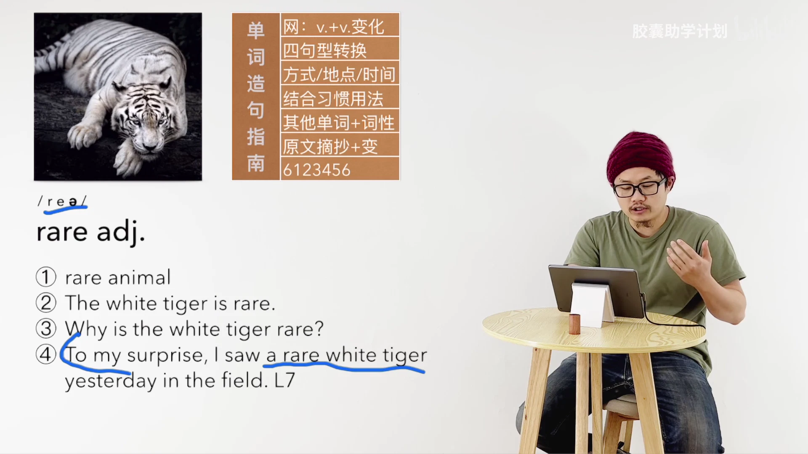

文字识别：单词造句指南 / 网：v.+v.变化 / 胶囊 / 四句型转换 / 方式/地点/时间 / 结合习惯用法 / 其他单词+词性 / 原文摘抄+变 / 6123456 / /real / rare adj. / rare animal / The white tiger is rare. / Why is the white tiger rare? / 3 / To my surprise, I saw a rare white tiger / yesterday in the field. L7

### 画面 00:01:39

文字识别：单词造句指南 / 网：v.+v.变化 / 四句型转换 / 方式/地点/时间 / 结合习惯用法 / 其他单词+词性 / 原文摘抄+变 / 6123456 / /real / rare adj. / rare animal / The white tiger is rare. / Why is the white tiger rare? / 3 / To my surprise, I saw a rare white tiger / yesterday in the field. L7

### 画面 00:01:41

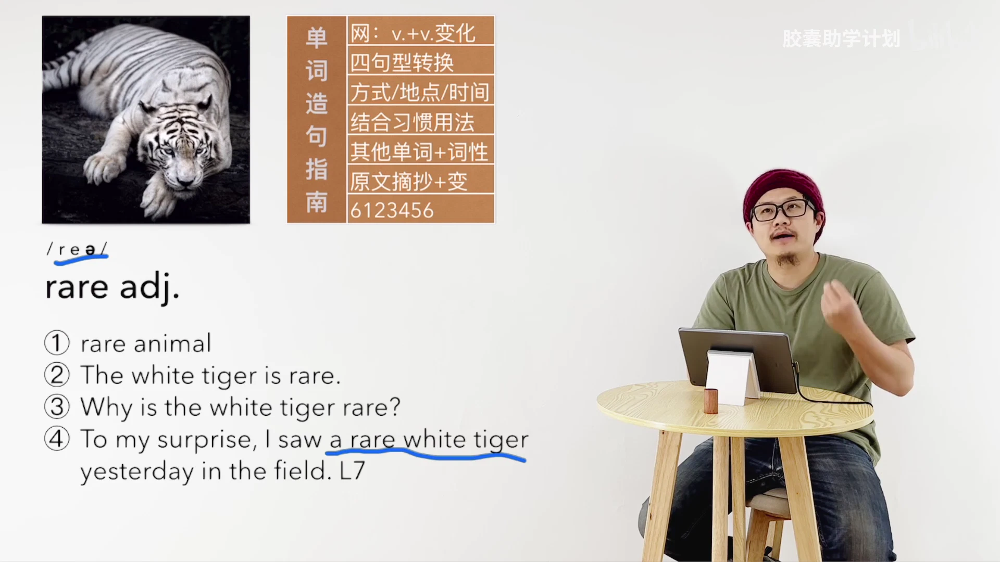

文字识别：单词造句指南 / 网：v.+v.变化 / 四句型转换 / 方式/地点/时间 / 结合习惯用法 / 其他单词+词性 / 原文摘抄+变 / 6123456 / /real / rare adj. / rare animal / The white tiger is rare. / Why is the white tiger rare? / 3 / To my surprise, I saw a rare white tiger / yesterday in the field. L7

### 画面 00:01:45

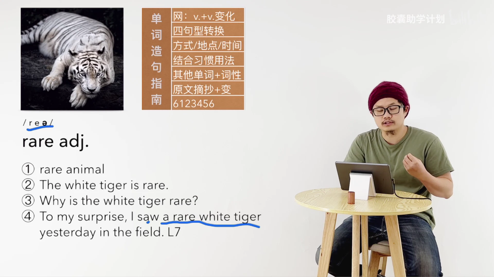

文字识别：单词造句指南 / 网：v.+v.变化 / 四句型转换 / 方式/地点/时间 / 结合习惯用法 / 其他单词+词性 / 原文摘抄+变 / 6123456 / /real / rare adj. / rare animal / The white tiger is rare. / Why is the white tiger rare? / 3 / To my surprise, I saw a rare white tiger / yesterday in the field. L7

### 画面 00:01:49

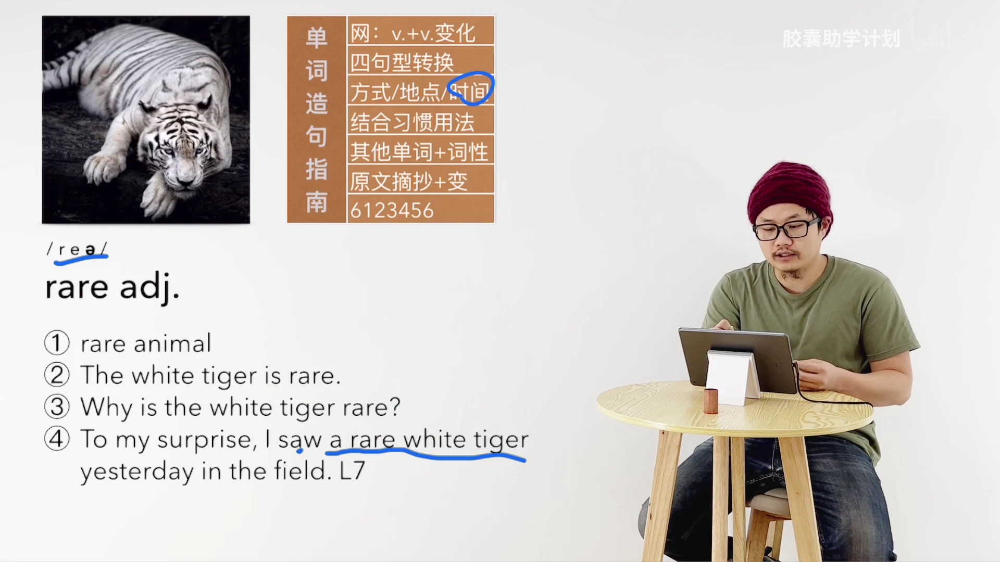

文字识别：单词造句指南 / 网：v.+v.变化 / 四句型转换 / 方式/地点/时间 / 结合习惯用法 / 其他单词+词性 / 原文摘抄+变 / 6123456 / /real / rare adj. / rare animal / The white tiger is rare. / Why is the white tiger rare? / 3 / To my surprise, I saw a rare white tiger / yesterday in the field. L7

### 画面 00:01:51

文字识别：单词造句指南 / 网：v.+v.变化 / 四句型转换 / 方式/也点时间 / 结合习惯用法 / 其他单词+词性 / 原文摘抄+变 / 6123456 / /real / rare adj. / rare animal / The white tiger is rare. / Why is the white tiger rare? / To my surprise, I saw a rare white tiger / yesterday in the field. L7

### 画面 00:01:53

文字识别：单词造句指南 / 网：v.+v.变化 / 四句型转换 / 方式/也点时间 / 结合习惯用法 / 其他单词+词性 / 原文摘抄+变 / 6123456 / /real / rare adj. / rare animal / The white tiger is rare. / Why is the white tiger rare? / To my surprise, I saw a rare white tiger / yesterday in the field. L7

### 画面 00:01:55

文字识别：单词造句指南 / 网：v.+v.变化 / 四句型转换 / 方式/也点时间 / 结合习惯用法 / 其他单词+词性 / 原文摘抄+变 / 6123456 / /real / rare adj. / rare animal / The white tiger is rare. / Why is the white tiger rare? / To my surprise, I saw a rare white tiger / yesterday in the field. L7

## 00:02:00–00:02:30

以做的事情就是四句型转化这个单词，您又多看了好几遍，而且是放在句子当中的。OK， next one，跟我一起读一下，叫做 a ancient ancient。OK，叫做古代的啊，远古时期的 ancient 啊，那更多指的应该是古代的，还不是远古时期的啊，是古代的 ancient 啊。比如说 Rome has a lot of ancient buildings，说罗马呀有非常多的古代建筑物，古罗马时期的

### 画面 00:02:01

文字识别：单词造句指南 / 网：v.+v.变化 / 四句型转换 / 方式/也点时间 / 结合习惯用法 / 其他单词+词性 / 原文摘抄+变 / 6123456 / /real / rare adj. / rare animal / The white tiger is rare. / 3 / Why is the white tiger rare? / To my surprise, I saw a rare white tiger / yesterday in the field. L7

### 画面 00:02:06

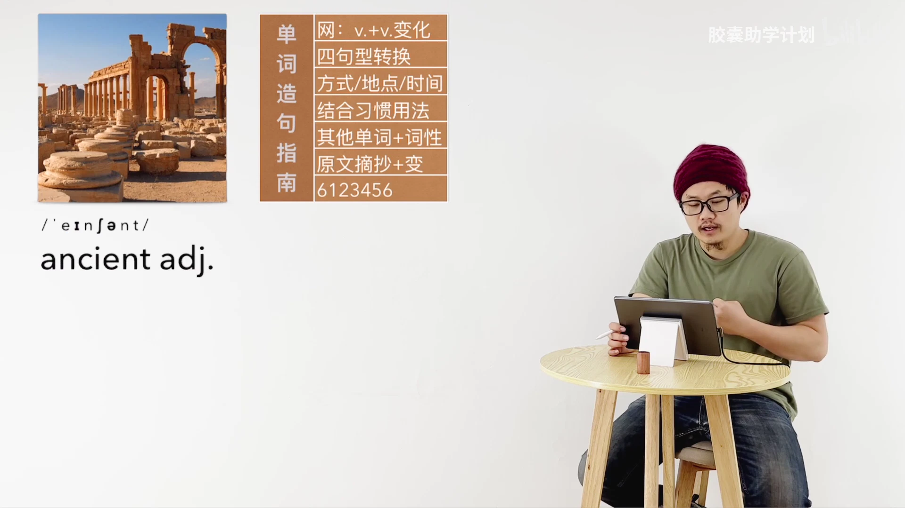

文字识别：单词造句指南 / 网：v.+v.变化 / 四句型转换 / 方式/地点/时间 / 结合习惯用法 / 其他单词+词性 / 原文摘抄+变 / 6123456 / /'ein∫ant/ / ancient adj.

### 画面 00:02:08

文字识别：单词造句指南 / 网：v.+v.变化 / 四句型转换 / 方式/地点/时间 / 结合习惯用法 / 其他单词+词性 / 原文摘抄+变 / 6123456 / /'ein∫ant/ / ancient adj.

### 画面 00:02:10

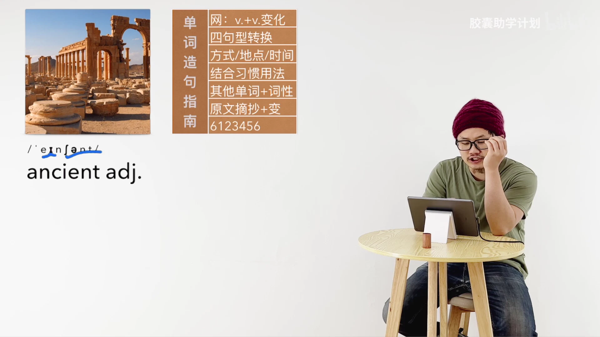

文字识别：单词造句指南 / 网：v.+v.变化 / 胶囊助学计划 / 四句型转换 / 方式/地点/时间 / 结合习惯用法 / 其他单词+词性 / 原文摘抄+变 / 6123456 / /'eln[antl / ancient adj.

### 画面 00:02:15

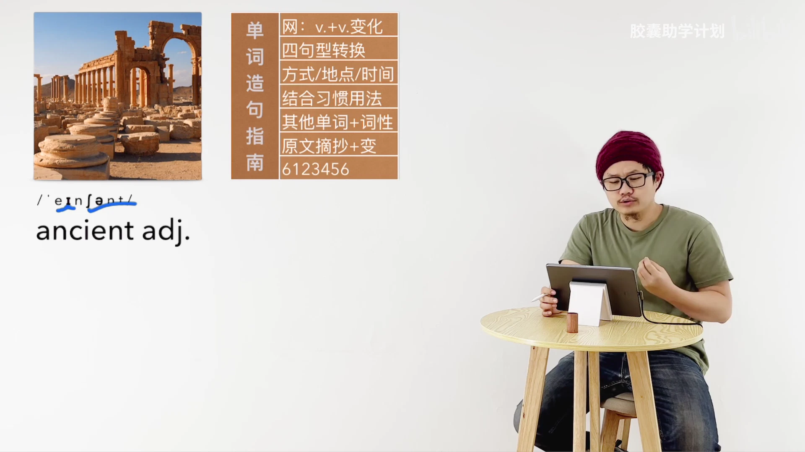

文字识别：单词造句指南 / 网：v.+v.变化 / 四句型转换 / 方式/地点/时间 / 结合习惯用法 / 其他单词+词性 / 原文摘抄+变 / 6123456 / /'einlantl / ancient adj.

### 画面 00:02:21

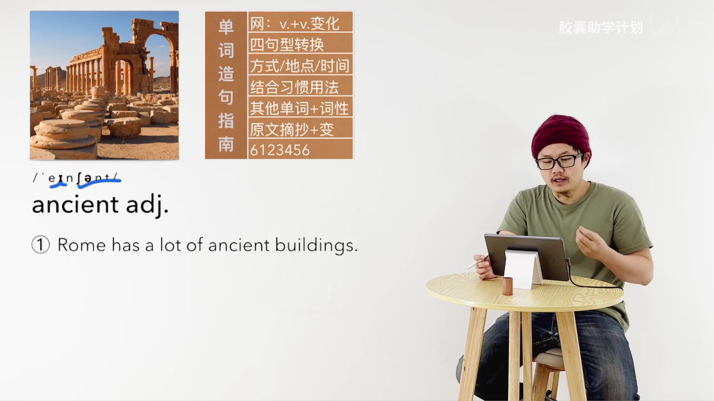

文字识别：单词造句指南 / 网：v.+v.变化 / 四句型转换 / 方式/地点/时间 / 结合习惯用法 / 其他单词+词性 / 原文摘抄+变 / 6123456 / /'einlantl / ancient adj. / ① Rome has a lot of ancient buildings.

### 画面 00:02:25

文字识别：单词造句指南 / 网：v.+v.变化 / 四句型转换 / 方式/地点/时间 / 结合习惯用法 / 其他单词+词性 / 原文摘抄+变 / 6123456 / /'einlantl / ancient adj. / ① Rome has a lot of ancient buildings.

## 00:02:30–00:03:00

建筑物。OK，好，再来。那我们还可以把这句话是一个肯定句，对吧？然后各种特殊疑问词和变一般疑问句要用什么单词，我都给您放到这个地方了。各位自己去处理一下就好了，是吧？这都是我们的基础。再来，我们又结合了第二十课叫 instead of doing something。那我造的句子叫 instead of visiting the modern buildings in Rome, they went to see the ancient ones，对吧？他们没有去看现代化的建筑物，替代

### 画面 00:02:30

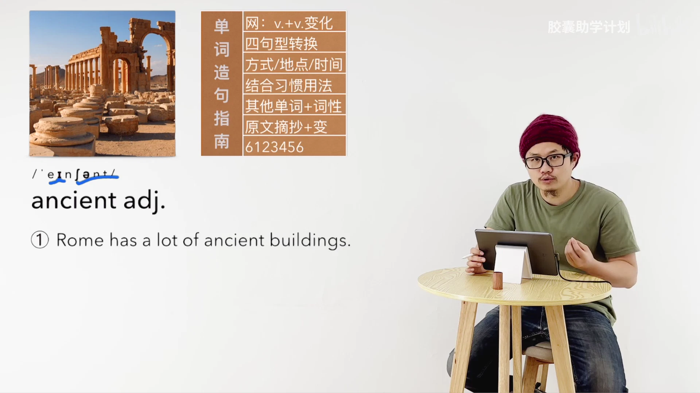

文字识别：单词造句指南 / 网：v.+v.变化 / 四句型转换 / 方式/地点/时间 / 结合习惯用法 / 其他单词+词性 / 原文摘抄+变 / 6123456 / /'einfantl / ancient adj. / ① Rome has a lot of ancient buildings.

### 画面 00:02:33

文字识别：单词造句指南 / 网：v.+v.变化 / 四句型转换 / 方式/地点/时间 / 结合习惯用法 / 其他单词+词性 / 原文摘抄+变 / 6123456 / /'elnfantl / ancient adj. / ① Rome has a lot of ancient buildings. / o does/why/where...

### 画面 00:02:35

文字识别：单词造句指南 / 网：v.+v.变化 / 四句型转换 / 方式/地点/时间 / 结合习惯用法 / 其他单词+词性 / 原文摘抄+变 / 6123456 / /'einlantl / ancient adj. / ① Rome has a lot of ancient buildings. / o does/why/where...

### 画面 00:02:37

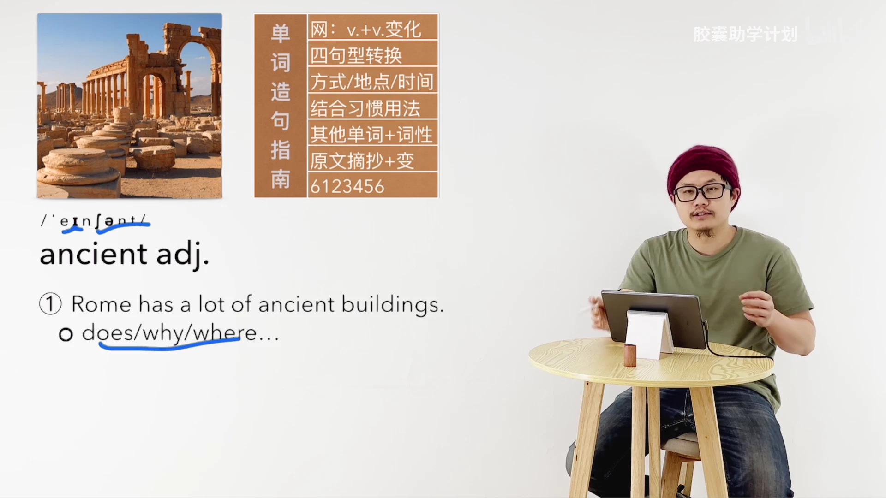

文字识别：单词造句指南 / 网：v.+v.变化 / 四句型转换 / 方式/地点/时间 / 结合习惯用法 / 其他单词+词性 / 原文摘抄+变 / 6123456 / /'elnfantl / ancient adj. / ① Rome has a lot of ancient buildings. / o does/why/where...

### 画面 00:02:40

文字识别：单词造句指南 / 网：v.+v.变化 / 四句型转换 / 方式/地点/时间 / 结合习惯用法 / 其他单词+词性 / 原文摘抄+变 / 6123456 / /'elnfantl / ancient adj. / ① Rome has a lot of ancient buildings. / o does/why/where...

### 画面 00:02:44

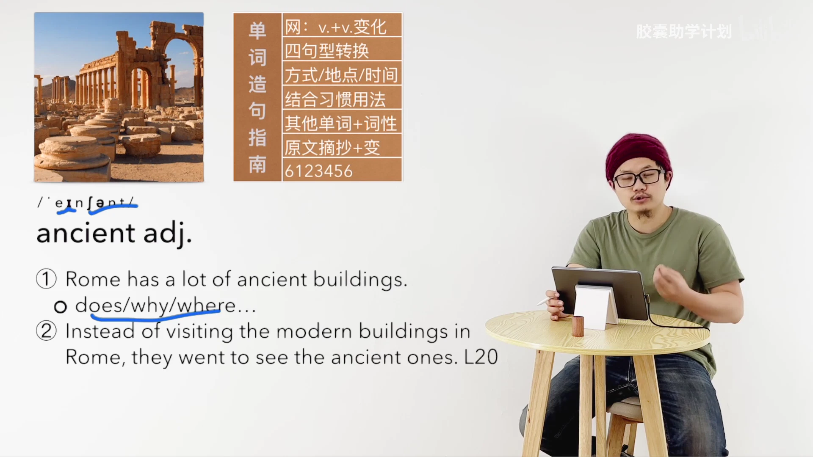

文字识别：单词造句指南 / 网：v.+v.变化 / 四句型转换 / 方式/地点/时间 / 结合习惯用法 / 其他单词+词性 / 原文摘抄+变 / 6123456 / /'elnfantl / ancient adj. / ① Rome has a lot of ancient buildings. / o does/why/where... / Instead of visiting the modern buildings in / Rome, they went to see the ancient ones. L20

### 画面 00:02:46

文字识别：单词造句指南 / 网：v.+v.变化 / 四句型转换 / 方式/地点/时间 / 结合习惯用法 / 其他单词+词性 / 原文摘抄+变 / 6123456 / /'elnfantl / ancient adj. / ① Rome has a lot of ancient buildings. / o does/why/where... / Instead of visiting the modern buildings in / Rome, they went to see the ancient ones. L20

### 画面 00:02:48

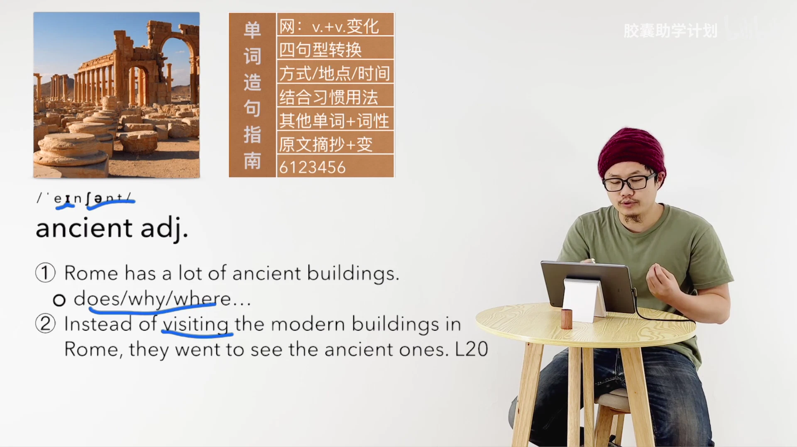

文字识别：单词造句指南 / 网：v.+v.变化 / 四句型转换 / 方式/地点/时间 / 结合习惯用法 / 其他单词+词性 / 原文摘抄+变 / 6123456 / /'elnfantl / ancient adj. / ① Rome has a lot of ancient buildings. / o does/why/where... / Instead of yisiting the modern buildings in / Rome, they went to see the ancient ones. L20

### 画面 00:02:50

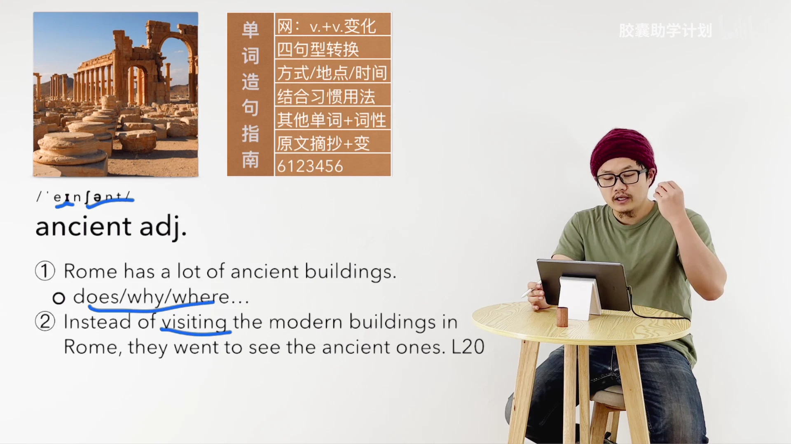

文字识别：单词造句指南 / 网：v.+v.变化 / 四句型转换 / 方式/地点/时间 / 结合习惯用法 / 其他单词+词性 / 原文摘抄+变 / 6123456 / /'elnfantl / ancient adj. / ① Rome has a lot of ancient buildings. / o does/why/where... / Instead of yisiting the modern buildings in / Rome, they went to see the ancient ones. L20

### 画面 00:02:55

文字识别：单词造句指南 / 网：v.+v.变化 / 四句型转换 / 方式/地点/时间 / 结合习惯用法 / 其他单词+词性 / 原文摘抄+变 / 6123456 / /'einlant/ / ancient adj. / ① Rome has a lot of ancient buildings. / o does/why/where... / Instead of yisiting the modern buildings in / Rome, they went to see the ancient ones. L20

### 画面 00:02:58

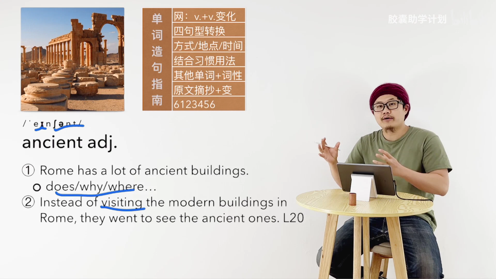

文字识别：单词造句指南 / 网：v.+v.变化 / 四句型转换 / 方式/地点/时间 / 结合习惯用法 / 其他单词+词性 / 原文摘抄+变 / 6123456 / /'einlant/ / ancient adj. / ① Rome has a lot of ancient buildings. / o does/why/where... / Instead of yisiting the modern buildings in / Rome, they went to see the ancient ones. L20

## 00:03:00–00:03:30

去看去拜访这些现代化的建筑物，对吧？去参观这些现代建的现代化的建筑物，他们做的事情是去看了那些古老的建筑物。OK，那最后再来一个句子，这是我们结合了第二十一课各位非常容易遗忘的动词变化的一个叫 must have been done，当时一定是被，对吧？那我们造句子说，this ancient building must have been built thousands of years ago。好，thousands of years ago叫数千

### 画面 00:03:00

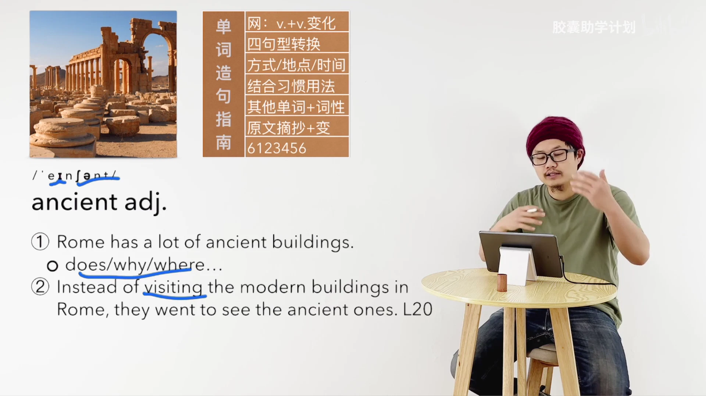

文字识别：单词造句指南 / 网：v.+v.变化 / 四句型转换 / 方式/地点/时间 / 结合习惯用法 / 其他单词+词性 / 原文摘抄+变 / 6123456 / /'elnlantl / ancient adj. / ① Rome has a lot of ancient buildings. / o does/why/where... / Instead of yisiting the modern buildings in / Rome, they went to see the ancient ones. L20

### 画面 00:03:05

文字识别：单词造句指南 / 网：v.+v.变化 / 四句型转换 / 方式/地点/时间 / 结合习惯用法 / 其他单词+词性 / 原文摘抄+变 / 6123456 / /'einlant/ / ancient adj. / ① Rome has a lot of ancient buildings. / o does/why/where... / Instead of yisiting the modern buildings in / Rome, they went to see the ancient ones. L20

### 画面 00:03:10

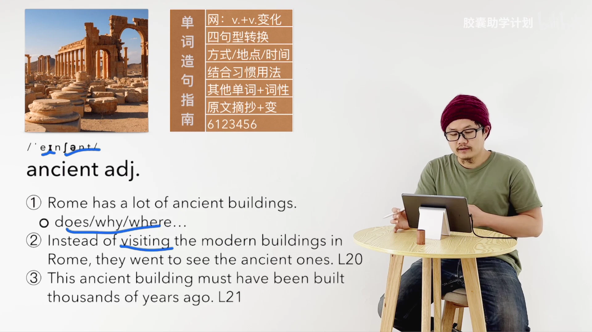

文字识别：单词造句指南 / 网：v.+v.变化 / 四句型转换 / 方式/地点/时间 / 结合习惯用法 / 其他单词+词性 / 原文摘抄+变 / 6123456 / /'einlantl / ancient adj. / ① Rome has a lot of ancient buildings. / o does/why/where... /  Instead of yisiting the modern buildings in / Rome, they went to see the ancient ones. L20 / This ancient building must have been built / thousands of years ago. L21

### 画面 00:03:14

文字识别：单词造句指南 / 网：v.+v.变化 / 四句型转换 / 方式/地点/时间 / 结合习惯用法 / 其他单词+词性 / 原文摘抄+变 / 6123456 / /'einlantl / ancient adj. / ① Rome has a lot of ancient buildings. / o does/why/where... / Instead of yisiting the modern buildings in / Rome, they went to see the ancient ones. L20 / This ancient building must have been built / thousands of years ago. L21

### 画面 00:03:16

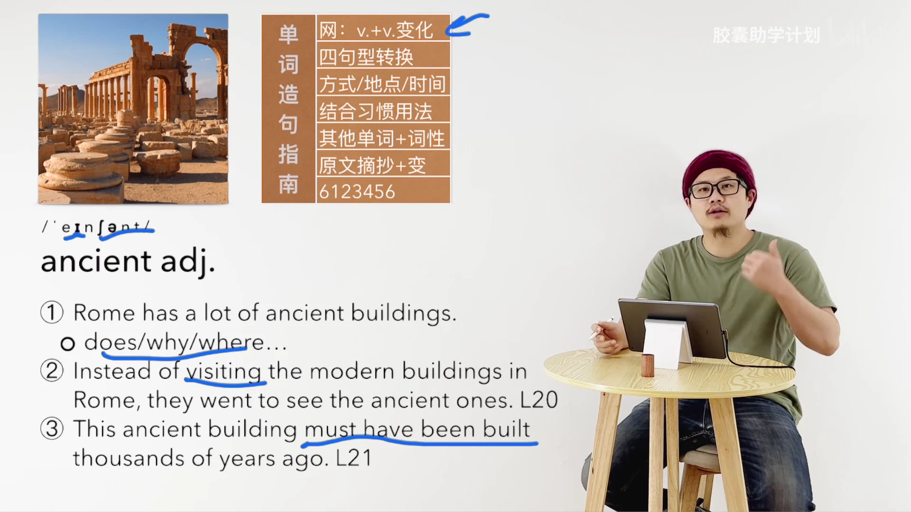

文字识别：单词造句指南 / 网：v.+v.变化 / 四句型转换 / 方式/地点/时间 / 结合习惯用法 / 其他单词+词性 / 原文摘抄+变 / 6123456 / /'einfantl / ancient adj. / ① Rome has a lot of ancient buildings. / o does/why/where... / Instead of yisiting the modern buildings in / Rome, they went to see the ancient ones. L20 / This ancient building must have been built / thousands of years ago. L21

### 画面 00:03:20

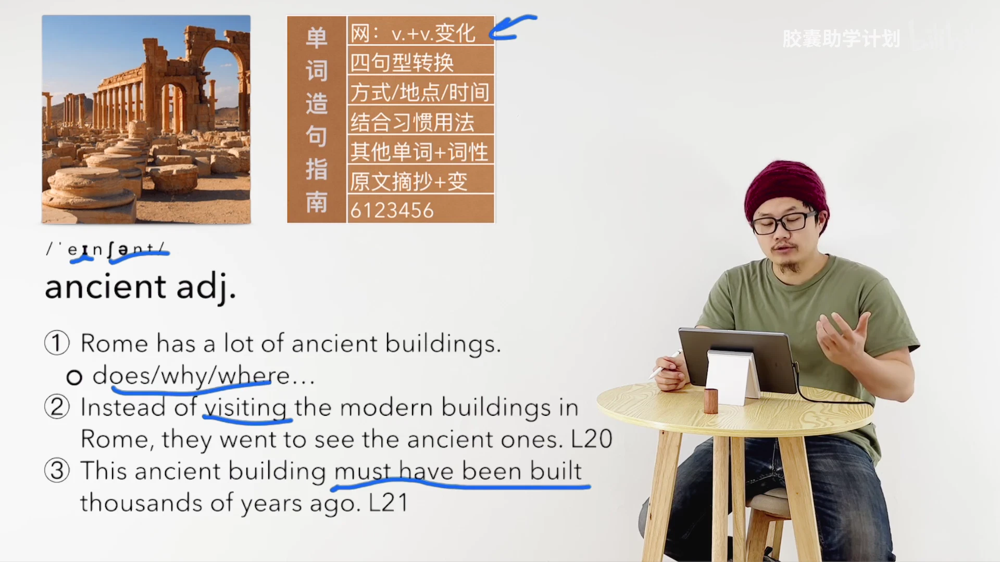

文字识别：单词造句指南 / 网：v.+v.变化 / 四句型转换 / 方式/地点/时间 / 结合习惯用法 / 其他单词+词性 / 原文摘抄+变 / 6123456 / /'einfantl / ancient adj. / ① Rome has a lot of ancient buildings. / o does/why/where... / Instead of yisiting the modern buildings in / Rome, they went to see the ancient ones. L20 / This ancient building must have been built / thousands of years ago. L21

### 画面 00:03:25

文字识别：单词造句指南 / 网：v.+v.变化 / 四句型转换 / 方式/地点/时间 / 结合习惯用法 / 其他单词+词性 / 原文摘抄+变 / 6123456 / /'einfantl / ancient adj. / ① Rome has a lot of ancient buildings. / o does/why/where... / Instead of yisiting the modern buildings in / Rome, they went to see the ancient ones. L20 / This ancient building must have been built / thousands of years ago. L21

## 00:03:30–00:04:00

年前。那Hundreds of years ago,叫做数百年前。那Must have been built,叫做当时一定是被建造，对吧？OK，表示对过去的一个肯定的推测，并且呢，它表示的是被动，must have been done。这是我们非常容易遗忘的一个动词变化。OK，那接下来我们还可以给大家留一个小的作业，我直接给大家了一个小的短语叫Ancient Egypt啊，直接翻译成汉语叫古埃及。那您试

### 画面 00:03:30

文字识别：单词造句指南 / 网：v.+v.变化 / 四句型转换 / 方式/地点/时间 / 结合习惯用法 / 其他单词+词性 / 原文摘抄+变 / 6123456 / /'einlantl / ancient adj. / ① Rome has a lot of ancient buildings. / o does/why/where... / Instead of yisiting the modern buildings in / Rome, they went to see the ancient ones. L20 / This ancient building must have been built / thousands of years ago. L21

### 画面 00:03:35

文字识别：单词造句指南 / 网：v.+v.变化 / 四句型转换 / 方式/地点/时间 / 结合习惯用法 / 其他单词+词性 / 原文摘抄+变 / 6123456 / /'einlantl / ancient adj. / ① Rome has a lot of ancient buildings. / o does/why/where... / Instead of yisiting the modern buildings in / Rome, they went to see the ancient ones. L20 / This ancient building must have been built / thousands of years ago. L21

### 画面 00:03:40

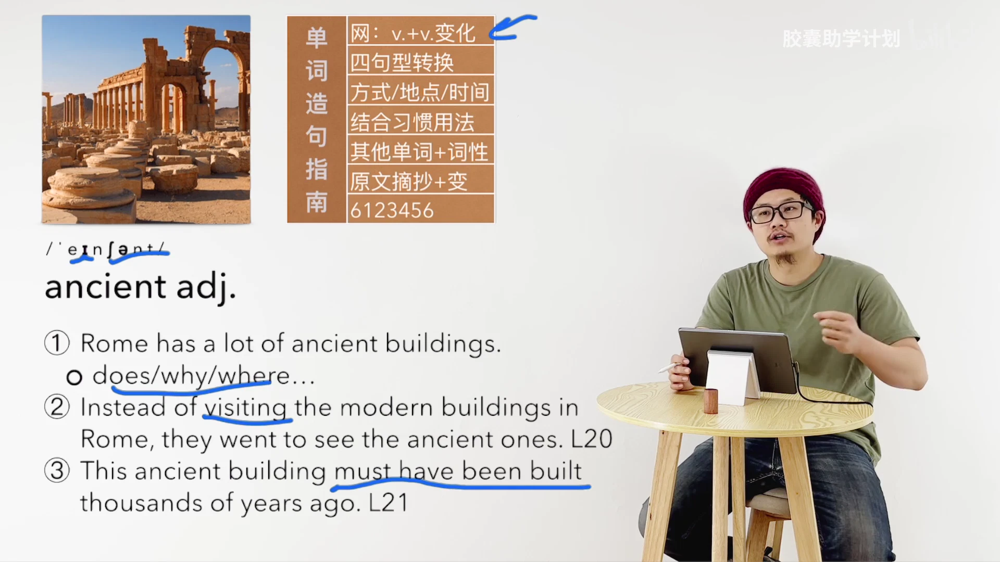

文字识别：单词造句指南 / 网：v.+v.变化 / 四句型转换 / 方式/地点/时间 / 结合习惯用法 / 其他单词+词性 / 原文摘抄+变 / 6123456 / /'einfantl / ancient adj. / ① Rome has a lot of ancient buildings. / o does/why/where... / Instead of yisiting the modern buildings in / Rome, they went to see the ancient ones. L20 / This ancient building must have been built / thousands of years ago. L21

### 画面 00:03:45

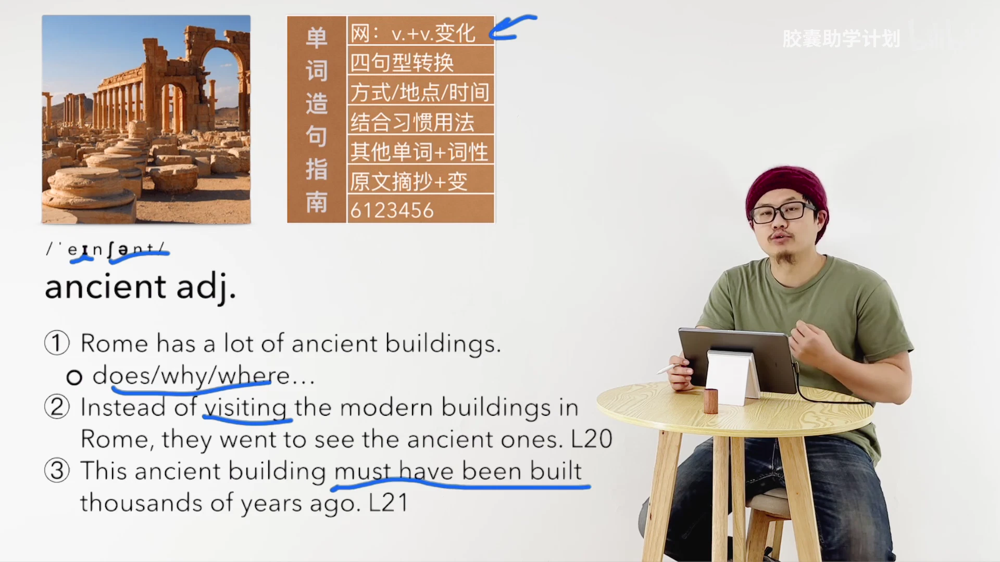

文字识别：单词造句指南 / 网：v.+v.变化 / 四句型转换 / 方式/地点/时间 / 结合习惯用法 / 其他单词+词性 / 原文摘抄+变 / 6123456 / /'einfantl / ancient adj. / ① Rome has a lot of ancient buildings. / o does/why/where... / Instead of yisiting the modern buildings in / Rome, they went to see the ancient ones. L20 / This ancient building must have been built / thousands of years ago. L21

### 画面 00:03:50

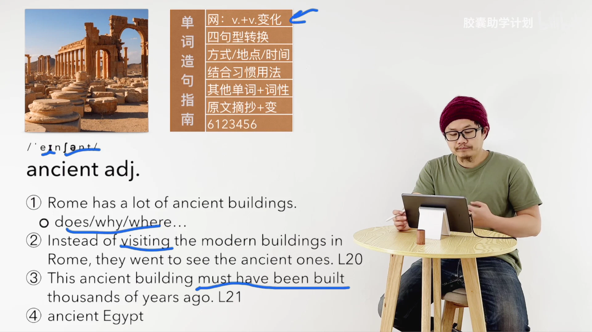

文字识别：单词造句指南 / 网：v.+v.变化 / 四句型转换 / 方式/地点/时间 / 结合习惯用法 / 其他单词+词性 / 原文摘抄+变 / 6123456 / /'einfantl / ancient adj. / ① Rome has a lot of ancient buildings. / o does/why/where... / Instead of yisiting the modern buildings in / Rome, they went to see the ancient ones. L20 / This ancient building must have been built / thousands of years ago. L21 / ancient Egypt

### 画面 00:03:54

文字识别：单词造句指南 / 网：v.+v.变化 / 四句型转换 / 方式/地点/时间 / 结合习惯用法 / 其他单词+词性 / 原文摘抄+变 / 6123456 / /'einfantl / ancient adj. / ① Rome has a lot of ancient buildings. / o does/why/where... / Instead of yisiting the modern buildings in / Rome, they went to see the ancient ones. L20 / This ancient building must have been built / thousands of years ago. L21 / ancient Egypt

### 画面 00:03:56

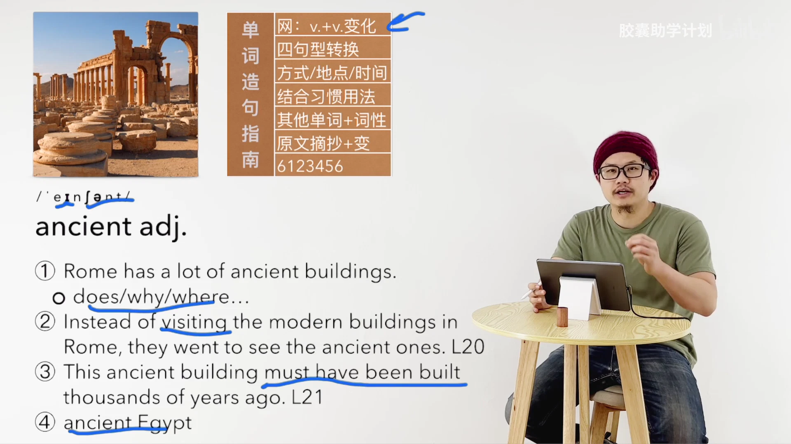

文字识别：单词造句指南 / 网：v.+v.变化 / 四句型转换 / 方式/地点/时间 / 结合习惯用法 / 其他单词+词性 / 原文摘抄+变 / 6123456 / /'elnlantl / ancient adj. / ① Rome has a lot of ancient buildings. / o does/why/where... / Instead of yisiting the modern buildings in / Rome, they went to see the ancient ones. L20 / This ancient building must have been built / thousands of years ago. L21 / ancient Egypt

## 00:04:00–00:04:30

着拿 Asian Egypt 尝试去造一些句子。如果各位实在不行，那您就把这些前三个做一些动词变化，您的家庭作业也算是完成了啊。OK，下一个单词跟我读一下，叫做 myth myth，对吧？后羿射日啊，就是 Chinese Asian myth，对吧？中国古代的一个神话传说 myth 就是神话传说。那我们看，比如说 Asian myth 两个单词放到一起，对吧？神话传说，古代的神话传说啊，曾经的神话传

### 画面 00:04:00

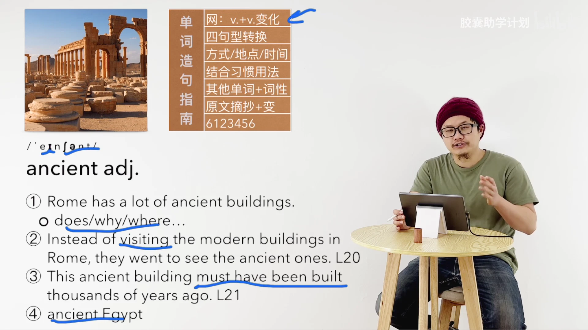

文字识别：单词造句指南 / 网：v.+v.变化 / 四句型转换 / 方式/地点/时间 / 结合习惯用法 / 其他单词+词性 / 原文摘抄+变 / 6123456 / /'einlantl / ancient adj. / ① Rome has a lot of ancient buildings. / o does/why/where... / Instead of yisiting the modern buildings in / Rome, they went to see the ancient ones. L20 / This ancient building must have been built / thousands of years ago. L21 / ancient Egypt

### 画面 00:04:05

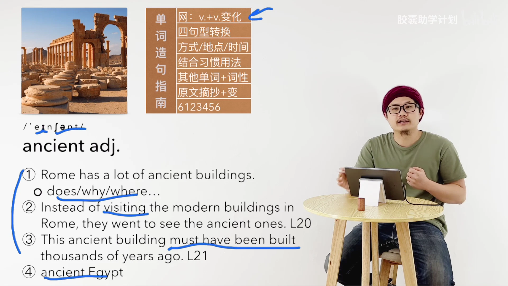

文字识别：单词造句指南 / 网：v.+v.变化 / 四句型转换 / 方式/地点/时间 / 结合习惯用法 / 其他单词+词性 / 原文摘抄+变 / 6123456 / /'einlant/ / ancient adj. / ① Rome has a lot of ancient buildings. / o does/why/where... / Instead of yisiting the modern buildings in / Rome, they went to see the ancient ones. L20 / This ancient building must have been built / thousands of years ago. L21 / ancient Egypt

### 画面 00:04:10

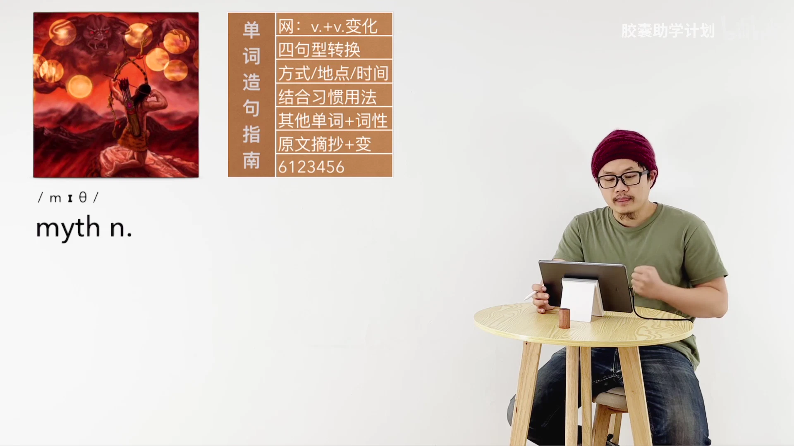

文字识别：单词造句指南 / 网：v.+v.变化 / 四句型转换 / 方式/地点/时间 / 结合习惯用法 / 其他单词+词性 / 原文摘抄+变 / 6123456 / /mI01 / myth n.

### 画面 00:04:15

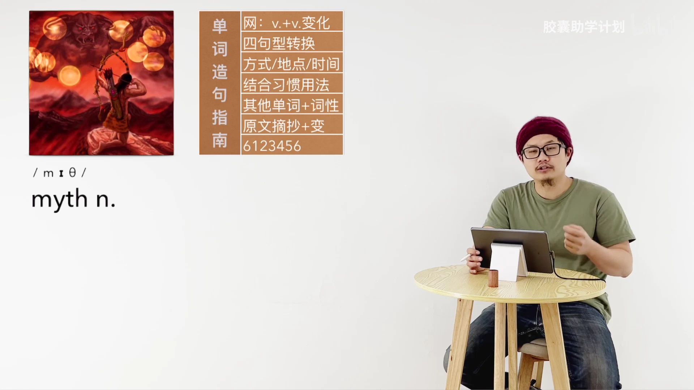

文字识别：单词造句指南 / 网：v.+v.变化 / 四句型转换 / 方式/地点/时间 / 结合习惯用法 / 其他单词+词性 / 原文摘抄+变 / 6123456 / /m1θ1 / myth n.

### 画面 00:04:20

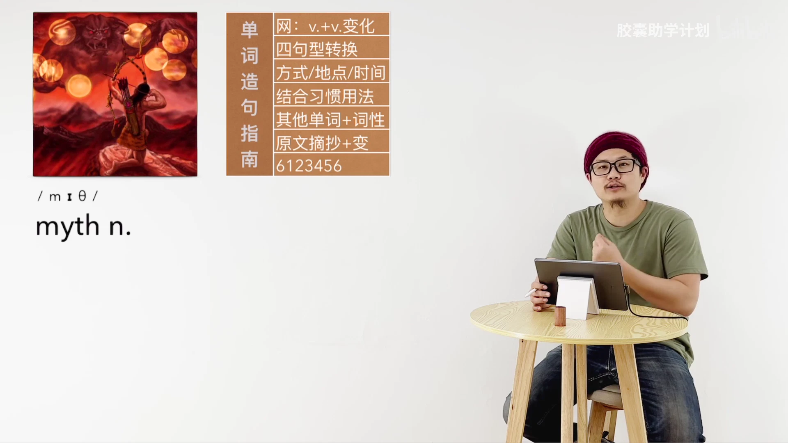

文字识别：单词造句指南 / 网：v.+v.变化 / 四句型转换 / 方式/地点/时间 / 结合习惯用法 / 其他单词+词性 / 原文摘抄+变 / 6123456 / /mⅠ0 1 / myth n.

### 画面 00:04:25

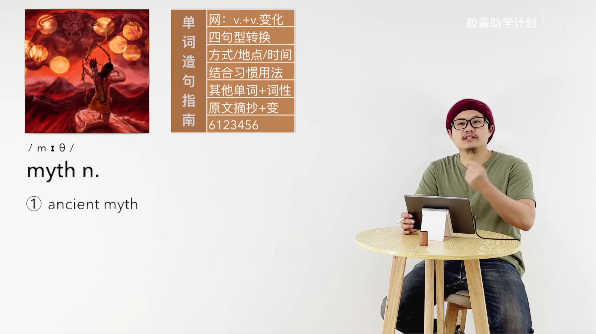

文字识别：单词造句指南 / 网：v.+v.变化 / 四句型转换 / 方式/地点/时间 / 结合习惯用法 / 其他单词+词性 / 原文摘抄+变 / 6123456 / 1m101 / myth n. / ancient myth

### 画面 00:04:29

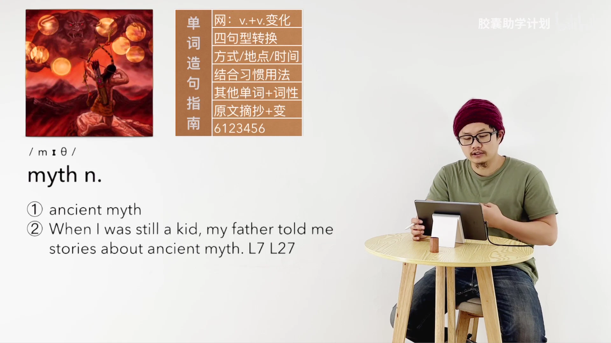

文字识别：单词造句指南 / 网：v.+v.变化 / 四句型转换 / 方式/地点/时间 / 结合习惯用法 / 其他单词+词性 / 原文摘抄+变 / 6123456 / 1mⅠθ1 / myth n. / ancient myth / When I was still a kid, my father told me / stories about ancient myth. L7 L27

## 00:04:30–00:05:00

说，比如说 When I was still a kid，当我还是一个孩子的时候呢，My mother， my father told me stories， How told stories，就是一个习惯用法了，About Asian myth，啊，所以本课啊，本句话当中我们用了两个，第一个习惯用法，第二个一个语法，对吧？二十七课学到的习惯用法，再来二十六课咱们学了一个 Pretend 加宾语从句，那说 You always pretend that you know every Asian myth，是

### 画面 00:04:31

文字识别：单词造句指南 / 网：v.+v.变化 / 四句型转换 / 方式/地点/时间 / 结合习惯用法 / 其他单词+词性 / 原文摘抄+变 / 6123456 / 1mⅠθ1 / myth n. / ancient myth / When I was still a kid, my father told me / stories about ancient myth. L7 L27

### 画面 00:04:36

文字识别：单词造句指南 / 网：v.+v.变化 / 四句型转换 / 方式/地点/时间 / 结合习惯用法 / 其他单词+词性 / 原文摘抄+变 / 6123456 / 1mⅠθ1 / myth n. / ancient myth / When I was still a kid, my father told me / stories about ancient myth. L7 L27

### 画面 00:04:42

文字识别：单词造句指南 / 网：v.+v.变化 / 四句型转换 / 方式/地点/时间 / 结合习惯用法 / 其他单词+词性 / 原文摘抄+变 / 6123456 / /m101 / myth n. / ancient myth / When I was still a kid, my father told me / stories about ancient myth. L7 L27

### 画面 00:04:45

文字识别：单词造句指南 / 网：v.+v.变化 / 四句型转换 / 方式/地点/时间 / 结合习惯用法 / 其他单词+词性 / 原文摘抄+变 / 6123456 / /m1θ1 / myth n. / ancient myth / When I was still a kid, my father told me / stories about ancient myth. L7 L27

### 画面 00:04:47

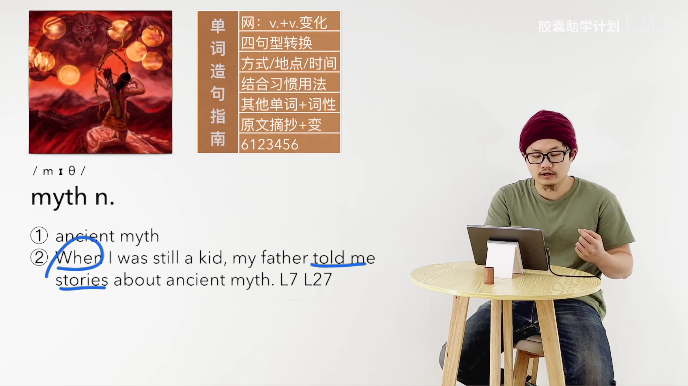

文字识别：单词造句指南 / 网：v.+v.变化 / 四句型转换 / 方式/地点/时间 / 结合习惯用法 / 其他单词+词性 / 原文摘抄+变 / 6123456 / /mⅠ 0 1 / myth n. / apcient myth / Whed / ∂ I was still a kid, my father told me / 2 / stories about ancient myth. L7 L27

### 画面 00:04:50

文字识别：单词造句指南 / 网：v.+v.变化 / 四句型转换 / 方式/地点/时间 / 结合习惯用法 / 其他单词+词性 / 原文摘抄+变 / 6123456 / 1mⅠθ1 / myth n. / 1 / apcient myth / When I was still a kid, my father told me / 2 / stories about ancient myth. L7 L27 / You always pretend that you know every / ancient myth. L26

### 画面 00:04:55

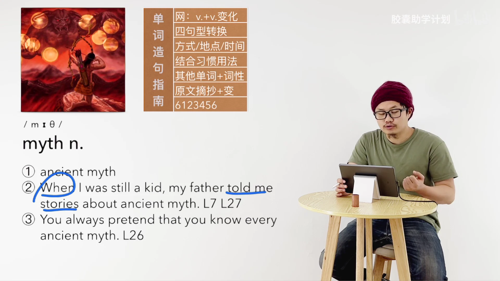

文字识别：单词造句指南 / 网：v.+v.变化 / 胶囊助学计划 / 四句型转换 / 方式/地点/时间 / 结合习惯用法 / 其他单词+词性 / 原文摘抄+变 / 6123456 / 1m1θ1 / myth n. / 1 / apcient myth / Whed I was still a kid, my father told me / 2 / stories about ancient myth. L7 L27 / You always pretend that you know every / ancient myth. L26

## 00:05:00–00:05:30

吧？你这个人不会，但你总是装作你懂得一切古代神话传说。Okay, very good.接下来下一个单词跟我读一下，叫做trouble, trouble啊，叫做麻烦、困难，是吧？麻烦、困难，甚至一些呃危险。Okay，都可以叫做trouble. Okay,好，那比如说我们直接给大家补一个小的短语，在文章当中也出现了，叫做have trouble with something or with somebody，对吧？那我们造一句话说，When I was still in

### 画面 00:05:00

文字识别：单词造句指南 / 网：v.+v.变化 / 胶囊助学计划 / 四句型转换 / 方式/地点/时间 / 结合习惯用法 / 其他单词+词性 / 原文摘抄+变 / 6123456 / 1m1θ1 / myth n. / 1 / apcient myth / Whed I was still a kid, my father told me / 2 / stories about ancient myth. L7 L27 / You always pretend that you know every / ancient myth. L26

### 画面 00:05:05

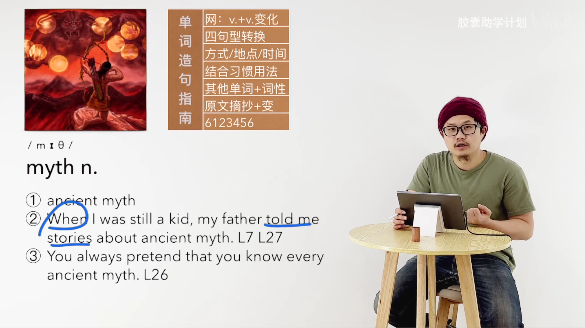

文字识别：单词造句指南 / 网：v.+v.变化 / 四句型转换 / 方式/地点/时间 / 结合习惯用法 / 其他单词+词性 / 原文摘抄+变 / 6123456 / /m1θ1 / myth n. / 1 / apcient myth / Wher I was still a kid, my father told me / 2 / stories about ancient myth. L7 L27 / You always pretend that you know every / ancient myth. L26

### 画面 00:05:07

文字识别：单词造句指南 / 网：v.+v.变化 / 胶囊助学计划 / 四句型转换 / 方式/地点/时间 / 结合习惯用法 / 其他单词+词性 / 原文摘抄+变 / 6123456 / / 'trabal/ / trouble n.

### 画面 00:05:10

文字识别：单词造句指南 / 网：v.+v.变化 / 胶囊助学计划 / 四句型转换 / 方式/地点/时间 / 结合习惯用法 / 其他单词+词性 / 原文摘抄+变 / 6123456 / / 'trΛbal/ / trouble n.

### 画面 00:05:20

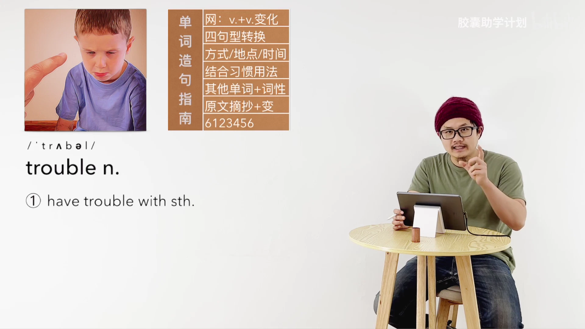

文字识别：单词造句指南 / 网：v.+v.变化 / 胶囊助学计划 / 四句型转换 / 方式/地点/时间 / 结合习惯用法 / 其他单词+词性 / 原文摘抄+变 / 6123456 / / 'trΛbal / / trouble n. / ① have trouble with sth.

### 画面 00:05:28

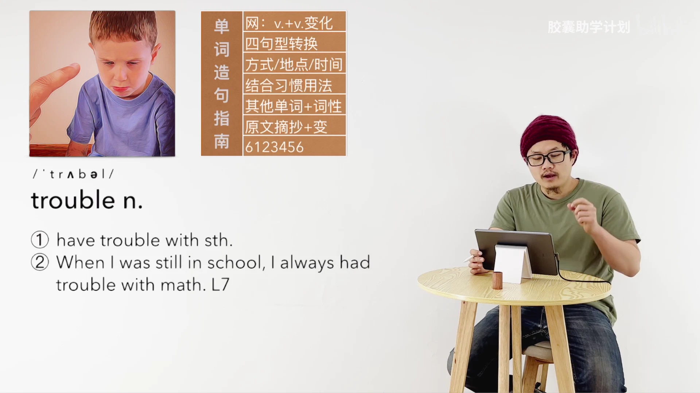

文字识别：单词造句指南 / 网：v.+v.变化 / 四句型转换 / 方式/地点/时间 / 结合习惯用法 / 其他单词+词性 / 原文摘抄+变 / 6123456 / / 'tra bal / / trouble n. / ① have trouble with sth. / When I was still in school, I always had / trouble with math. L7

## 00:05:30–00:06:00

school, 当我依旧在学校的时候呢, I always had trouble with math. 注意我时态做了一个小的改变，说的是当我还是在学校的时候。那 Clearly or right now I'm not in school right now, right? Okay, I'm out of school for so many years. 好，我现在已经不在学校里面了。那肯定这个事情发生在过去。说 I always had trouble with math. 啊，关于数学，我总是有很多的麻烦困难，

### 画面 00:05:30

文字识别：单词造句指南 / 网：v.+v.变化 / 四句型转换 / 方式/地点/时间 / 结合习惯用法 / 其他单词+词性 / 原文摘抄+变 / 6123456 / / 'trΛbal / / trouble n. / ① have trouble with sth. / When I was still in school, I always had / trouble with math. L7

### 画面 00:05:36

文字识别：单词造句指南 / 网：v.+v.变化 / 胶囊助学计划 / 四句型转换 / 方式/地点/时间 / 结合习惯用法 / 其他单词+词性 / 原文摘抄+变 / 6123456 / / 'trΛbal/ / trouble n. / ① have trouble with sth. / When I was still in school, I always had / trouble with math. L7

### 画面 00:05:40

文字识别：单词造句指南 / 网：v.+v.变化 / 四句型转换 / 方式/地点/时间 / 结合习惯用法 / 其他单词+词性 / 原文摘抄+变 / 6123456 / / 'trΛ bal / / trouble n. / ① have trouble with sth. / When I was still in school,I always had / trouble with math. L7

### 画面 00:05:45

文字识别：单词造句指南 / 网：v.+v.变化 / 四句型转换 / 方式/地点/时间 / 结合习惯用法 / 其他单词+词性 / 原文摘抄+变 / 6123456 / / 'tra bal / / trouble n. / ① have trouble with sth. / When I was still in school,I always had / trouble with math. L7

## 00:06:00–00:06:30

对吧？Okay,好很多的问题，也可以说I have trouble with my parents now，对吧？我现在和我的父母的关系有一些问题，叫I have trouble with my parents. Okay, very good. Next one，我可以说have trouble doing something。这是我们提前给大家补了一个，以后我们也会学到。那今天呢，我们直接在电影当中去看一下这个小的用法，叫做做某件事情有一些麻烦或者困难。比如说I have trouble sleeping at night，就是我

### 画面 00:06:05

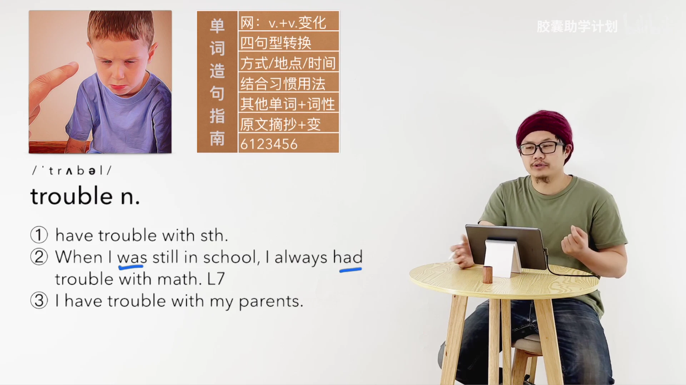

文字识别：单词造句指南 / 网：v.+v.变化 / 胶囊助学计划 / 四句型转换 / 方式/地点/时间 / 结合习惯用法 / 其他单词+词性 / 原文摘抄+变 / 6123456 / / 'trΛ bal / / trouble n. / ① have trouble with sth. / When I was still in school,I always had / trouble with math. L7 / ) I have trouble with my parents.

### 画面 00:06:10

文字识别：单词造句指南 / 网：v.+v.变化 / 四句型转换 / 方式/地点/时间 / 结合习惯用法 / 其他单词+词性 / 原文摘抄+变 / 6123456 / / 'trΛ bal / / trouble n. / ① have trouble with sth. / When I was still in school,I always had / trouble with math. L7 / ) I have trouble with my parents.

### 画面 00:06:15

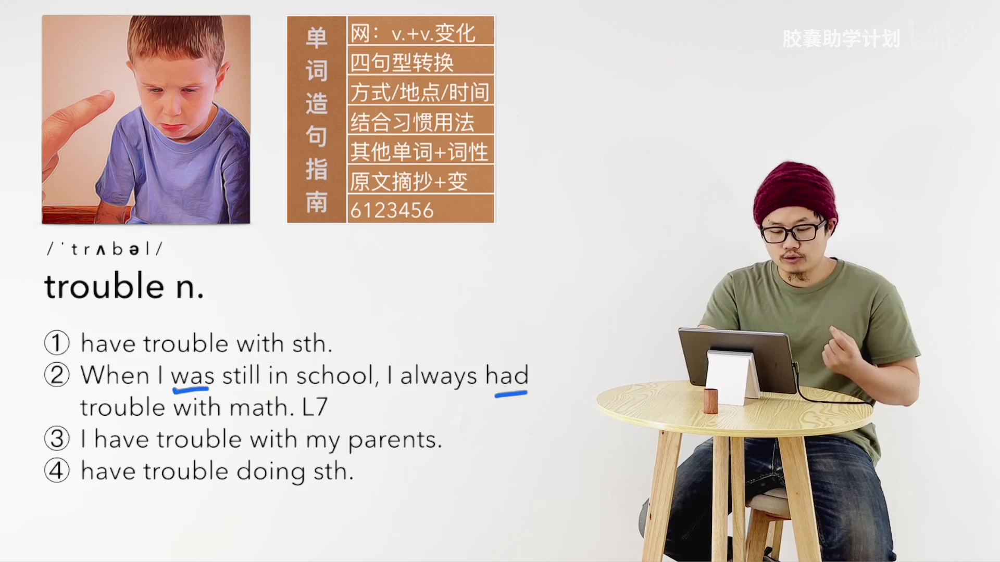

文字识别：单词造句指南 / 网：v.+v.变化 / 胶囊助学计划 / 四句型转换 / 方式/地点/时间 / 结合习惯用法 / 其他单词+词性 / 原文摘抄+变 / 6123456 / / 'trabal/ / trouble n. / ① have trouble with sth. / ) When I was still in school, I always had / trouble with math. L7 /  I have trouble with my parents. /  have trouble doing sth.

### 画面 00:06:17

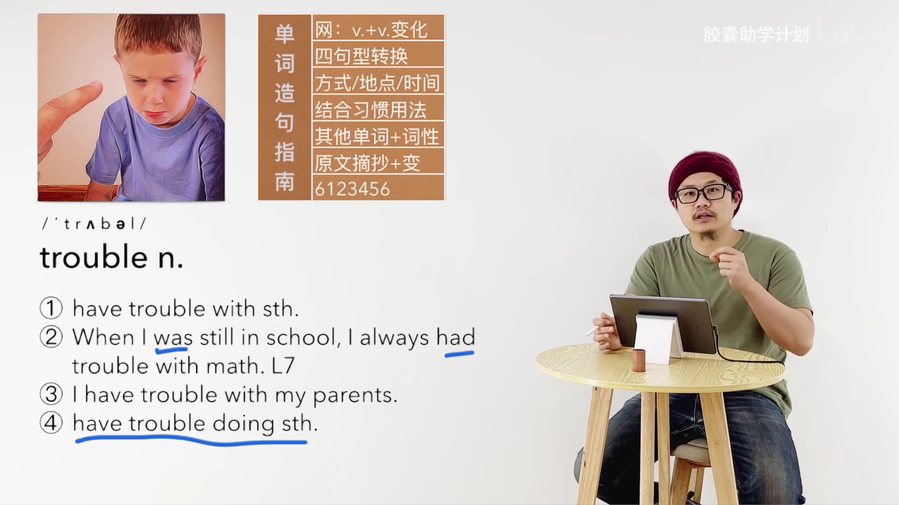

文字识别：单词造句指南 / 网：v.+v.变化 / 四句型转换 / 方式/地点/时间 / 结合习惯用法 / 其他单词+词性 / 原文摘抄+变 / 6123456 / / 'tra bal/ / trouble n. / ① have trouble with sth. / When I was still in school,I always had / trouble with math. L7 / I have trouble with my parents. / have trouble doing sth.

### 画面 00:06:20

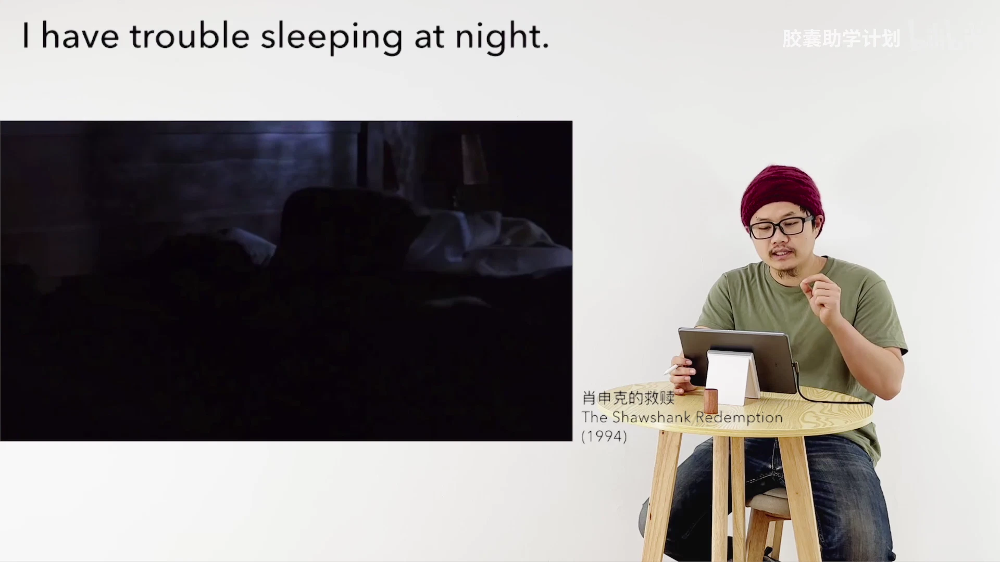

文字识别：I have trouble sleeping at night. / 胶囊助学计划 / 肖申克的救赎 / The Shawshank Redemption / (1994)

## 00:06:30–00:07:00

在夜晚入睡睡眠特别的困难。Okay,那接下来我们看这个小的电影片段。I have trouble sleeping at night. I have bad dreams like I'm falling. I wake up scared. Sometimes it takes me a while to remember where I am. Okay, I have trouble sleeping at night. I have trouble doing something,对吧？做某件事情有麻烦困难。比如说我临时给大家造

### 画面 00:06:37

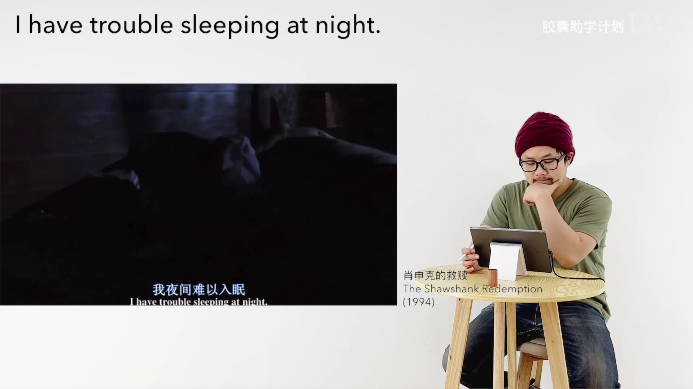

文字识别：I have trouble sleeping at night. / 胶囊助学计划 / 肖申克的救赎 / 我夜间难以入眠 / The Shawshank Redemption / I have trouble sleeping at night. / (1994)

### 画面 00:06:40

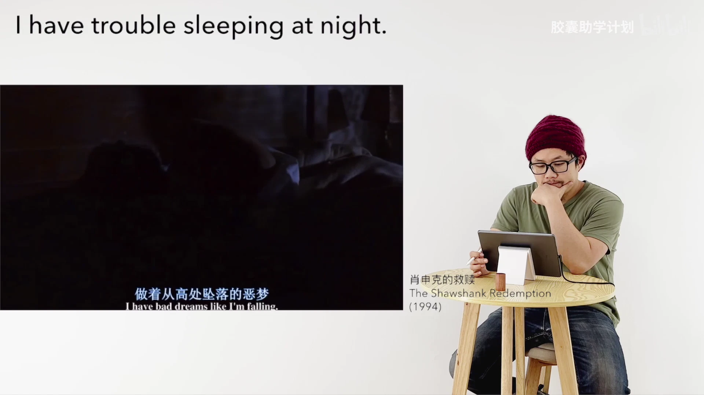

文字识别：I have trouble sleeping at night. / 胶囊助学计划 / 肖申克的救赎 / 做着从高处坠落的恶梦 / The Shawshank Redemption / I have bad dreams like I'm falling. / (1994)

### 画面 00:06:43

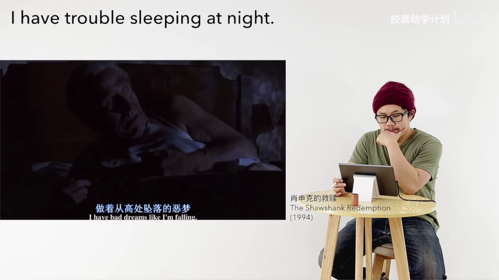

文字识别：I have trouble sleeping at night. / 胶囊助学计划 / 肖申克的救赎 / 做着从高处坠落的恶梦 / The Shawshank Redemption / I have bad dreams like I'm falling. / (1994)

### 画面 00:06:45

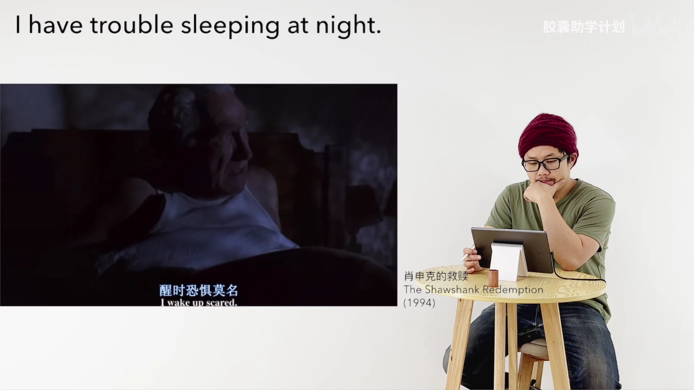

文字识别：I have trouble sleeping at night. / 胶囊助学计划 / 肖申克的救赎 / 醒时恐惧莫名 / The Shawshank Redemption / I wake up scared. / (1994)

### 画面 00:06:47

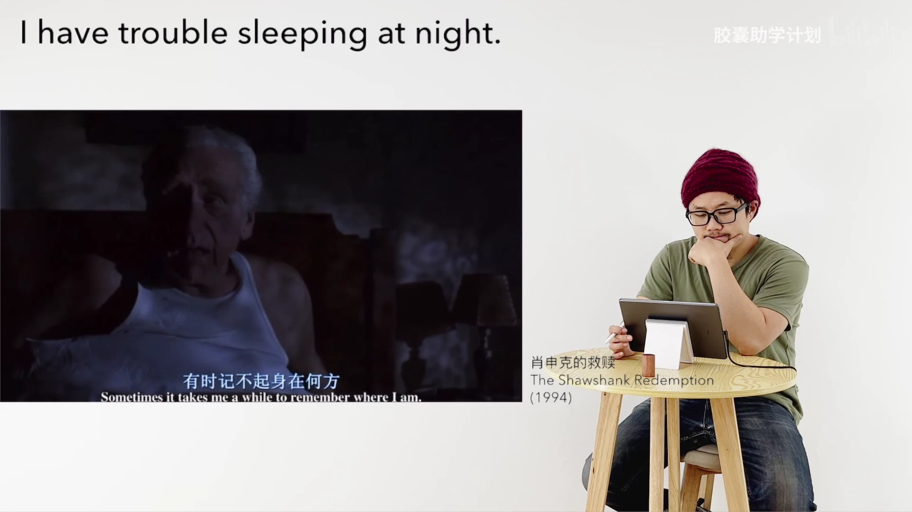

文字识别：I have trouble sleeping at night. / 胶囊助学计划 / 肖申克的救赎 / 有时记不起身在何方 / The Shawshank Redemption / Sometimes it takes me a while to remember where I am. / (1994)

### 画面 00:06:49

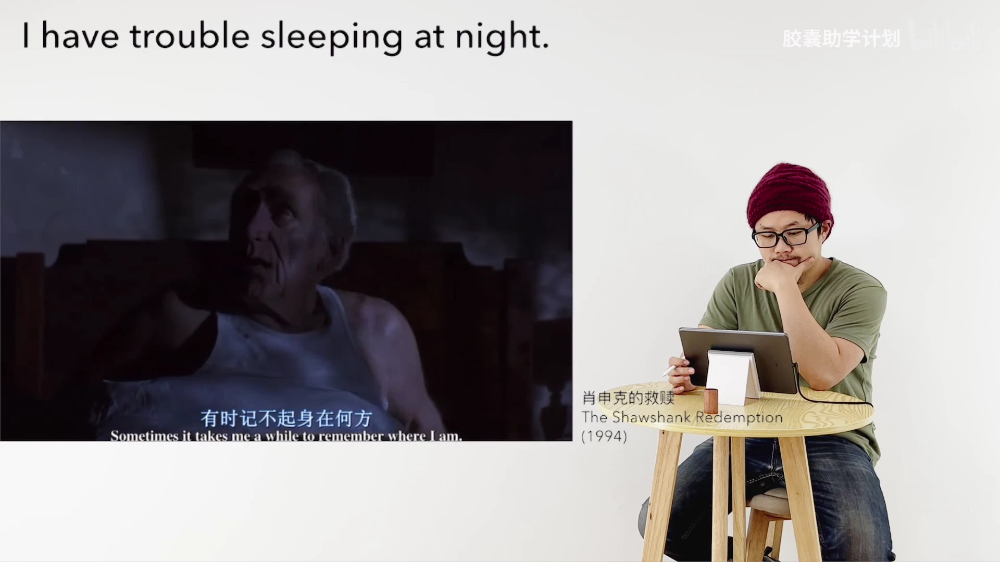

文字识别：I have trouble sleeping at night. / 胶囊助学计划 / 肖申克的救赎 / 有时记不起身在何方 / The Shawshank Redemption / Sometimes it takes me a while to remember where I am. / (1994)

### 画面 00:06:51

文字识别：I have trouble sleeping at night. / 胶囊助学计划 / 肖申克的救赎 / The Shawshank Redemption / (1994)

## 00:07:00–00:07:30

一句话，我说学英语啊，有好多的麻烦事情。我自己学英语的时候，那叫 I have trouble learning English. Okay, one more. 那接下来下一个单词跟我读一下，叫做 effect. Effect 啊，是什么样的一个效果？结果？比如说 have no effect，叫做没有效果，没有结果啊，没有后果，对吧？那 this doesn't have any effect，说的是这件事儿它就没有效果，或者这个东西它就没有效果。比如说啊，你说你要减肥，

### 画面 00:07:07

文字识别：单词造句指南 / 网：v.+v.变化 / 胶囊助学计划 / 四句型转换 / 方式/地点/时间 / 结合习惯用法 / 其他单词+词性 / 原文摘抄+变 / 6123456 / /I'fekt/ / effect n.

### 画面 00:07:10

文字识别：单词造句指南 / 网：v.+v.变化 / 胶囊助学计划 / 四句型转换 / 方式/地点/时间 / 结合习惯用法 / 其他单词+词性 / 原文摘抄+变 / 6123456 / /I'fekt/ / effect n.

### 画面 00:07:19

文字识别：单词造句指南 / 网：v.+v.变化 / 胶囊助学计划 / 四句型转换 / 方式/地点/时间 / 结合习惯用法 / 其他单词+词性 / 原文摘抄+变 / 6123456 / /I'fekt/ / effect n. / ① have no eff ect

### 画面 00:07:23

文字识别：单词造句指南 / 网：v.+v.变化 / 胶囊助学计划 / 四句型转换 / 方式/地点/时间 / 结合习惯用法 / 其他单词+词性 / 原文摘抄+变 / 6123456 / /I'fekt/ / effect n. / ① have no effect / This doesn't have any effect.

### 画面 00:07:28

文字识别：单词造句指南 / 网：v.+v.变化 / 胶囊助学计划 / 四句型转换 / 方式/地点/时间 / 结合习惯用法 / 其他单词+词性 / 原文摘抄+变 / 6123456 / /I'fekt/ / effect n. / ① have no effect / This doesn't have any effect.

## 00:07:30–00:08:00

然后呢，你比如说你要去呃吃一些减肥茶，那我们可能说说这个东西啊啊，this doesn't have any effect，对吧？OK啊，那是你节食引起的，或者我可以问，那你说我不太懂，那为什么呢？你能不能从营养学上给我讲一下呢？那我就会问说，Why doesn't this have any effect？对吧？那我就会告诉你，更多的是你身体内水分的一个流失啊，等等等等，对吧？OK， one again，那接下来呢，最后两个单词

### 画面 00:07:30

文字识别：单词造句指南 / 网：v.+v.变化 / 胶囊助学计划 / 四句型转换 / 方式/地点/时间 / 结合习惯用法 / 其他单词+词性 / 原文摘抄+变 / 6123456 / /I'fekt/ / effect n. / ① have no eff ect / This doesn't have any effect.

### 画面 00:07:44

文字识别：单词造句指南 / 网：v.+v.变化 / 胶囊助学计划 / 四句型转换 / 方式/地点/时间 / 结合习惯用法 / 其他单词+词性 / 原文摘抄+变 / 6123456 / /I'fekt/ / effect n. / ① have no effect / This doesn't have any effect. / ) Why doesn't this have any effect? / 3

### 画面 00:07:55

文字识别：单词造句指南 / 网：v.+v.变化 / 胶囊 / 四句型转换 / 方式/地点/时间 / 结合习惯用法 / 其他单词+词性 / 原文摘抄+变 / 6123456 / /I'fekt/ / effect n. / ① have no effect / This doesn't have any effect. / ) Why doesn't this have any effect? / 3

### 画面 00:07:58

文字识别：单词造句指南 / 网：v.+v.变化 / 胶囊助学计划 / 四句型转换 / 方式/地点/时间 / 结合习惯用法 / 其他单词+词性 / 原文摘抄+变 / 6123456 / /mr'djuiz?/ /'go:gan/ / Medusa Gorgon

## 00:08:00–00:08:30

我们不用拿它去造句了，我们只要知道它是什么意思就行了啊。这是第一个叫 Medusa 啊啊，OK，这个地方音标 Medusa 啊 Medusa 啊，美杜莎。后边这个呢，我们读一下叫做 Gorgon。好，我分别解释一下。首先，美杜莎可能对于各位来说，也许是比较熟悉的。它是没记错的话，应该是古希腊传说当中一个女子，然后她的头发不是头发，都是蛇，对吧？就像这个图中一样

### 画面 00:08:00

文字识别：单词造句指南 / 网：v.+v.变化 / 胶囊助学计划 / 四句型转换 / 方式/地点/时间 / 结合习惯用法 / 其他单词+词性 / 原文摘抄+变 / 6123456 / /mr'djuiz? / /'go:gan/ / Medusa Gorgon

### 画面 00:08:04

文字识别：单词造句指南 / 网：v.+v.变化 / 胶囊助学计划 / 四句型转换 / 方式/地点/时间 / 结合习惯用法 / 其他单词+词性 / 原文摘抄+变 / 6123456 / /mr'djuiz?/ /'go:gan/ / Medusa Gorgon

### 画面 00:08:09

文字识别：单词造句指南 / 网：v.+v.变化 / 胶囊助学计划 / 四句型转换 / 方式/地点/时间 / 结合习惯用法 / 其他单词+词性 / 原文摘抄+变 / 6123456 / /mr^diu:zQ//go:gan/ / Medusa Gorgon

### 画面 00:08:14

文字识别：单词造句指南 / 网：v.+v.变化 / 胶囊助学计划 / 四句型转换 / 方式/地点/时间 / 结合习惯用法 / 其他单词+词性 / 原文摘抄+变 / 6123456 / /mr'diu:zQ/ /go:gan/ / Medusa / Gorgon

### 画面 00:08:17

文字识别：单词造句指南 / 网：v.+v.变化 / 胶囊助学计划 / 四句型转换 / 方式/地点/时间 / 结合习惯用法 / 其他单词+词性 / 原文摘抄+变 / 6123456 / /mr^diuizQ/ /go:gan/ / Medusa / Gorgon

### 画面 00:08:19

文字识别：单词造句指南 / 网：v.+v.变化 / 胶囊助学计划 / 四句型转换 / 方式/地点/时间 / 结合习惯用法 / 其他单词+词性 / 原文摘抄+变 / 6123456 / /mr^diu:zQ/ /go:gan/ / Medusa / Gorgon

### 画面 00:08:28

文字识别：单词造句指南 / 网：v.+v.变化 / 胶囊助学计划 / 四句型转换 / 方式/地点/时间 / 结合习惯用法 / 其他单词+词性 / 原文摘抄+变 / 6123456 / /mr'diuizQ/ /go:gan/ / Medusa / Gorgon

## 00:08:30–00:09:00

啊，都是蛇。然后如果你去直视它的双眼，然后会怎么样呢？你会被变成一个石头，叫 turn into stone，对吧？那 Gorgon 是什么呢？其实这么理解就行了。Gorgon 是一个组合啊，我们最常见用这个单词，它本身有很多意思啊。我们最常见的这个单词指的是一个组合，指的是一二三三个女妖，其中一个女妖叫做 Medusa，也是最有名的那个女妖，叫

### 画面 00:08:30

文字识别：单词造句指南 / 网：v.+v.变化 / 胶囊助学计划 / 四句型转换 / 方式/地点/时间 / 结合习惯用法 / 其他单词+词性 / 原文摘抄+变 / 6123456 / /mr^diu:zQ/ / go:gan/ / Medusa / Gorgon

### 画面 00:08:34

文字识别：单词造句指南 / 网：v.+v.变化 / 胶囊助学计划 / 四句型转换 / 方式/地点/时间 / 结合习惯用法 / 其他单词+词性 / 原文摘抄+变 / 6123456 / /mr^diuizQ/ / go:gan/ / Medusa / Gorgon

### 画面 00:08:39

文字识别：单词造句指南 / 网：v.+v.变化 / 胶囊助学计划 / 四句型转换 / 方式/地点/时间 / 结合习惯用法 / 其他单词+词性 / 原文摘抄+变 / 6123456 / /mr^diuizQ/ / go:gan/ / Medusa / Gorgon

### 画面 00:08:42

文字识别：单词造句指南 / 网：v.+v.变化 / 胶囊助学计划 / 四句型转换 / 方式/地点/时间 / 结合习惯用法 / 其他单词+词性 / 原文摘抄+变 / 6123456 / /mr^diuizQ/ /go:gan/ / Medusa / Gorgon

### 画面 00:08:44

文字识别：单词造句指南 / 网：v.+v.变化 / 胶囊助学计划 / 四句型转换 / 方式/地点/时间 / 结合习惯用法 / 其他单词+词性 / 原文摘抄+变 / 6123456 / /mr^diuizQ/ / go:gan/ / Medusa / Gorgon

### 画面 00:08:50

文字识别：单词造句指南 / 网：v.+v.变化 / 胶囊助学计划 / 四句型转换 / 方式/地点/时间 / 结合习惯用法 / 其他单词+词性 / 原文摘抄+变 / 6123456 / /mr^diu:zQ/ /go:gan/ / Medusa / Gorgon

### 画面 00:08:53

文字识别：单词造句指南 / 网：v.+v.变化 / 胶囊助学计划 / 四句型转换 / 方式/地点/时间 / 结合习惯用法 / 其他单词+词性 / 原文摘抄+变 / 6123456 / /mr'diu:zQ/ / go:gan/ / Medusa / Gorgon

### 画面 00:08:55

文字识别：单词造句指南 / 网：v.+v.变化 / 胶囊助学计划 / 四句型转换 / 方式/地点/时间 / 结合习惯用法 / 其他单词+词性 / 原文摘抄+变 / 6123456 / /mr^diuizQ/ / go:gan/ / Medusa / Gorgon

## 00:09:00–00:09:30

做Medusa，是不是好理解了，对吧？所以Gorgon就是这个三个女妖的组合的名字，叫Gorgon，对吧？然后其中这个组合当中，其中最有名的那个女妖叫做Medusa。你看到她的双眼，你会被变成石头。这是古希腊的一个ancient myth，对吧？古代的一个神话传说。OK，好。呃，Recap，我们在本课呢主要学到了这样几个小的习惯用法：have trouble with

### 画面 00:09:02

文字识别：单词造句指南 / 网：v.+v.变化 / 胶囊助学计划 / 四句型转换 / 方式/地点/时间 / 结合习惯用法 / 其他单词+词性 / 原文摘抄+变 / 6123456 / /mr^diuizQ/ /go:gan/ / Medusa / Gorgon

### 画面 00:09:04

文字识别：单词造句指南 / 网：v.+v.变化 / 胶囊助学计划 / 四句型转换 / 方式/地点/时间 / 结合习惯用法 / 其他单词+词性 / 原文摘抄+变 / 6123456 / /mr^diuizQ/ / go:gan/ / Medusa / Gorgon

### 画面 00:09:09

文字识别：单词造句指南 / 网：v.+v.变化 / 胶囊助学计划 / 四句型转换 / 方式/地点/时间 / 结合习惯用法 / 其他单词+词性 / 原文摘抄+变 / 6123456 / /mr^diuizQ/ / go:gan/ / Medusa / Gorgon

### 画面 00:09:14

文字识别：单词造句指南 / 网：v.+v.变化 / 胶囊助学计划 / 四句型转换 / 方式/地点/时间 / 结合习惯用法 / 其他单词+词性 / 原文摘抄+变 / 6123456 / /mr^diuizQ/ / go:gan/ / Medusa / Gorgon

### 画面 00:09:19

文字识别：单词造句指南 / 网：v.+v.变化 / 胶囊助学计划 / 四句型转换 / 方式/地点/时间 / 结合习惯用法 / 其他单词+词性 / 原文摘抄+变 / 6123456 / /mr^diuizQ/ / go:gan/ / Medusa / Gorgon

### 画面 00:09:22

文字识别：Recap / 胶囊助学计划 / Words / have trouble with sth. / Expression / have no effect / have trouble doing sth.

### 画面 00:09:24

文字识别：Recap / 胶囊助学计划 / Words / have trouble with sth. / Expression / have no effect / have trouble doing sth.

### 画面 00:09:26

文字识别：Recap / 胶囊助学计划 / Words / havet / trouble with sth. / Expression / have no effect / havet /  trouble doing sth.

### 画面 00:09:29

文字识别：Recap / 胶囊助学计划 / Words / have trouble with sth. / Expression / have no effect / have trouble doing sth.

## 00:09:30–00:10:00

something, have no effect, 和 have trouble doing something. 我们前两个在文章当中都能见得到。那我们进入文章再看，好吧？ OK，那加上作业单词老习惯，听这个电影片段老习惯啊。那以上呢就是本期视频的全部内容了。如果大家喜欢我们的课程，欢迎大家关注、订阅、一键三连，分享给那些需要的朋友。 See you next time.

### 画面 00:09:32

文字识别：Recap / 胶囊助学计划 / Words / havet / trouble with sth. / Expression / have no effect / havet /  trouble doing sth.

### 画面 00:09:34

文字识别：Recap / 胶囊助学计划 / Words / have trouble with sth. / Expression / have no effect / have trouble doing sth.

### 画面 00:09:37

文字识别：Recap / 胶囊助学计划 / Words / have trouble with sth. / Expression / have no effect / have trouble doing sth.

### 画面 00:09:39

文字识别：胶囊助学计划 / 单词造句/对话 / 1. / 【单词造句指南】 / 每个5句

### 画面 00:09:41

文字识别：胶囊助学计划 / 单词造句/对话 / 【单词造句指南】 / 每个5句 / 反复听电影片段，直到能 / 听出关键短语/句子

### 画面 00:09:44

文字识别：胶囊助学计划 / 👍

### 画面 00:09:53

文字识别：80 / 不 / ￥

### 画面 00:09:55

文字识别：CAPSULEACADEMY / 胶囊助学计划 / 小红书 / Lecturer / Leo / OE

### 画面 00:09:58

文字识别：CAPSULEACADEMY / 胶囊助学计划 / 小红书 / 品质 / OE

## 00:10:00–00:10:06

### 画面 00:10:01

文字识别：CAPSULEACADEMY / 胶囊助学计划 / 『 / 小红书 / Creator / Leo & Berlin / OE

### 画面 00:10:03

文字识别：胶囊助学计划 bil出 / CAPSULEACADEMY / 胶囊助学计划 / 小红书 / OE

### 画面 00:10:05

文字识别：bilibili / 胶囊助学计划

