# L028 语法 定语从句

快速机器解析：语音为单模型转写，未进行独立交叉校对或人工复核；画面每秒采样并按变化选帧，短时文字和标记可能遗漏。截图时间约有 1 秒误差。图片有损压缩；遇到疑点请按时间查看 Google Drive 原视频。

## 00:00:00–00:00:30

Hello everyone, welcome to the Capsule Academy. This is Leo. Today we're going to learn new concept English book two lesson twenty eight grammar.老习惯进入正式课程之前，我们先看几个问题。第一，定语从句到底是什么样，对吧？那首先，我们其实新一在一百二十一课、一百二十三课已经学过了。今天我们再带着各位迅速的回顾一遍啊，就当做一个复习了啊，巩固。第二，那今天我们要多学一个东西，叫 whose 啊，这个单词引导的定从到底应该如何

### 画面 00:00:00

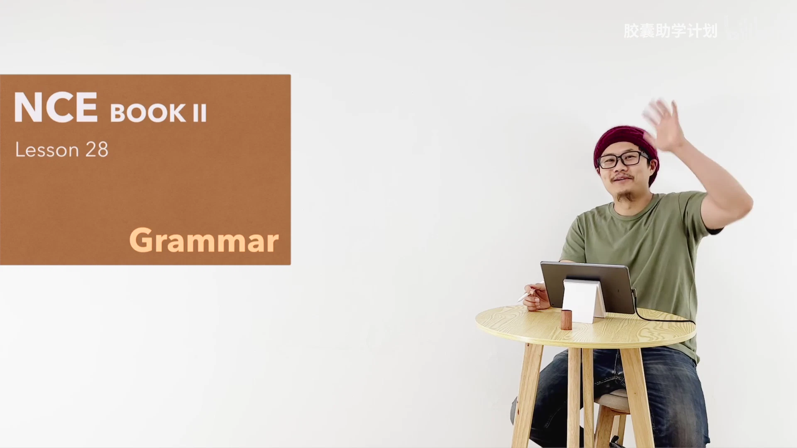

文字识别：NCE / BOOKⅡI / Lesson 28 / Grammar

### 画面 00:00:02

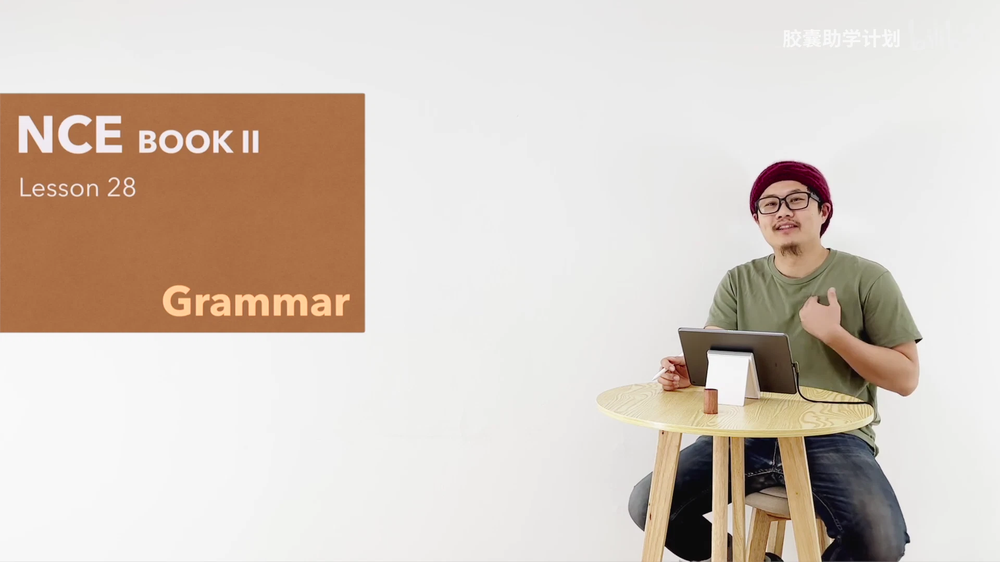

文字识别：NCE / BOOK I"I / Lesson 28 / Grammar

### 画面 00:00:06

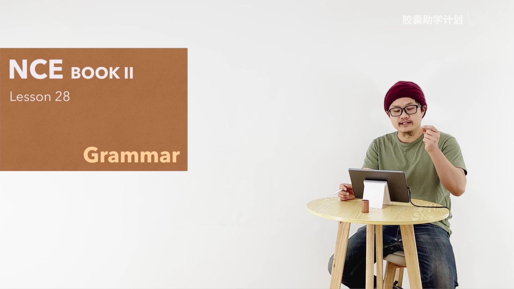

文字识别：NCE / BOOKⅡI / Lesson 28 / Grammar

### 画面 00:00:08

### 画面 00:00:10

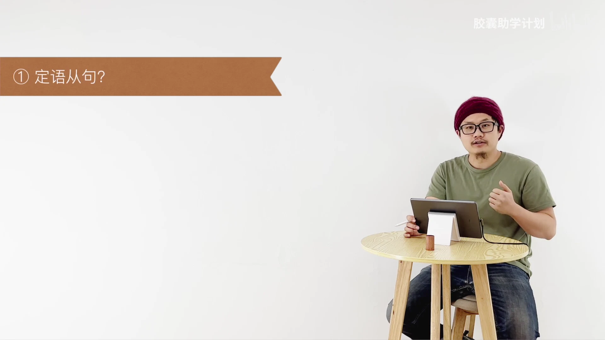

文字识别：①定语从句？

### 画面 00:00:15

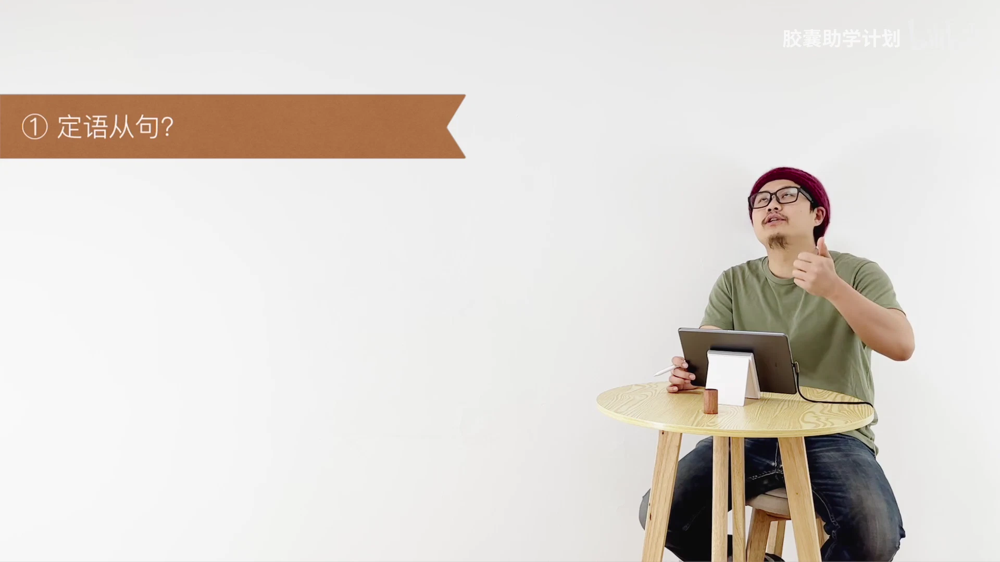

文字识别：①定语从句？

### 画面 00:00:21

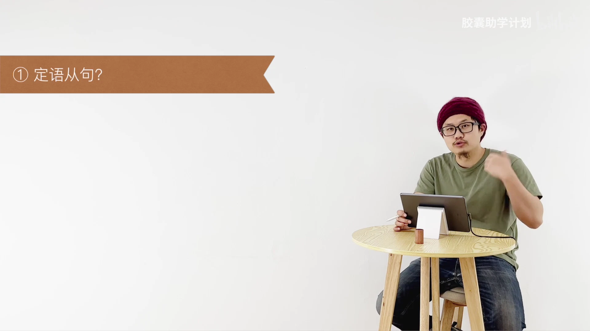

文字识别：①定语从句？

### 画面 00:00:23

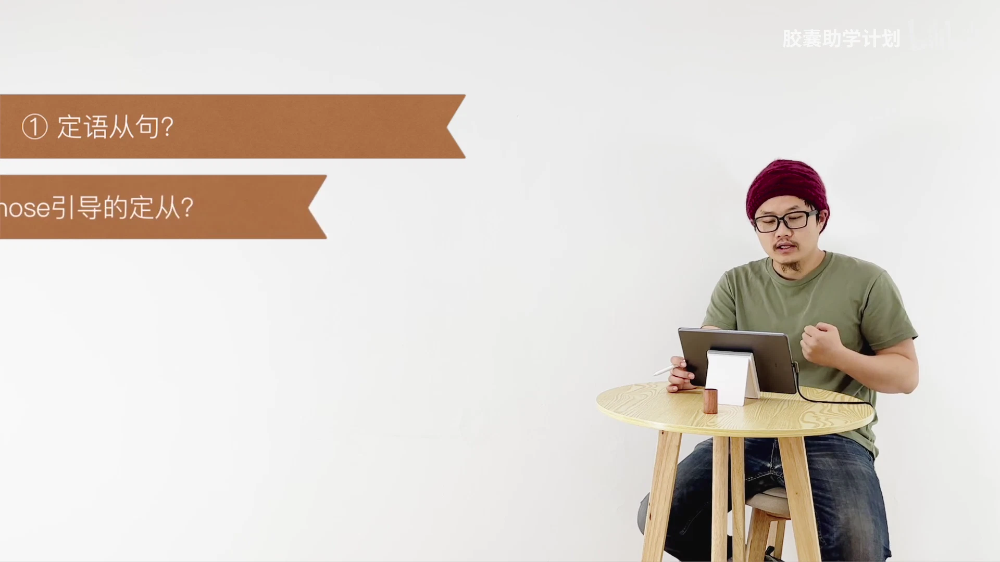

文字识别：①定语从句？ / nose引导的定从?

### 画面 00:00:25

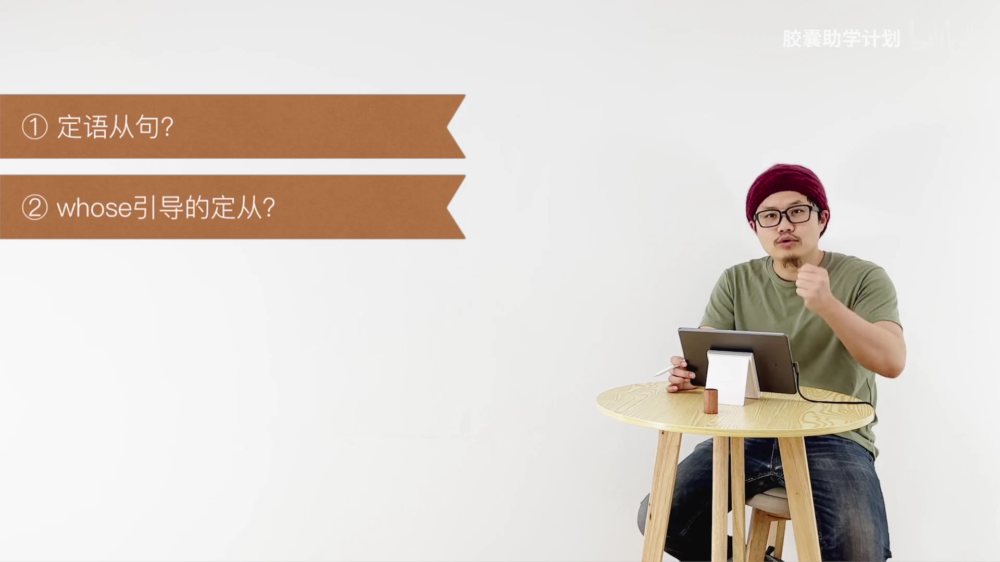

文字识别：①定语从句？ / whose引导的定从?

## 00:00:30–00:01:00

去理解？最后呢，我们还要回顾一下 have 加 done 啊，现在完成时这个语法。 OK，那带着以上的问题，后边呢， enjoy it。好，那鉴于我们定语从句已经对于各位来说理论上应该不是第一次学，是吧？我先抛出这个结论：对于各位来说，如果我们扎扎实实的去学习并练习了新概念一册一百二十一课到一百二十三

### 画面 00:00:30

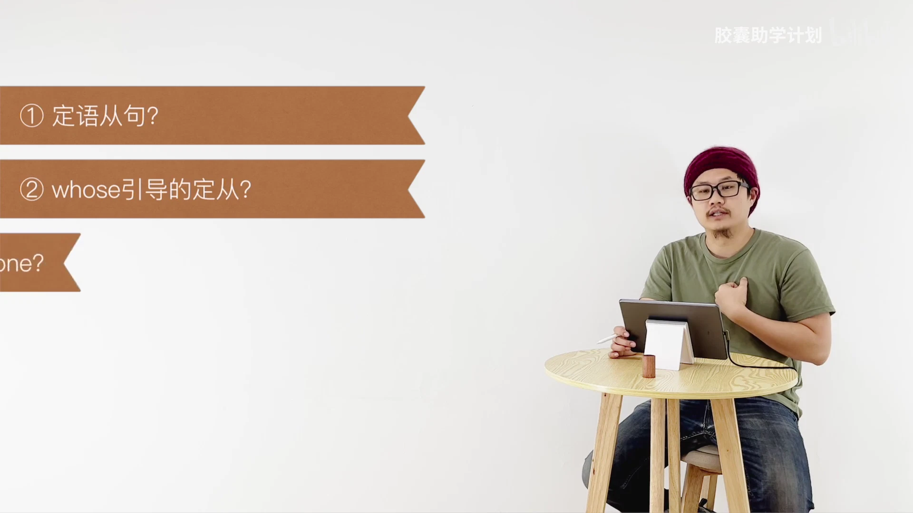

文字识别：①定语从句？ / whose引导的定从? / one?

### 画面 00:00:32

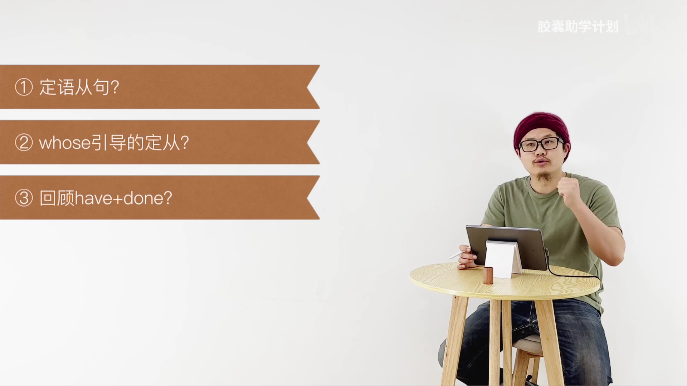

文字识别：①定语从句？ / whose引导的定从? / 回顾have+done?

### 画面 00:00:40

文字识别：胶囊助学计划 bilb出 / • / •

### 画面 00:00:44

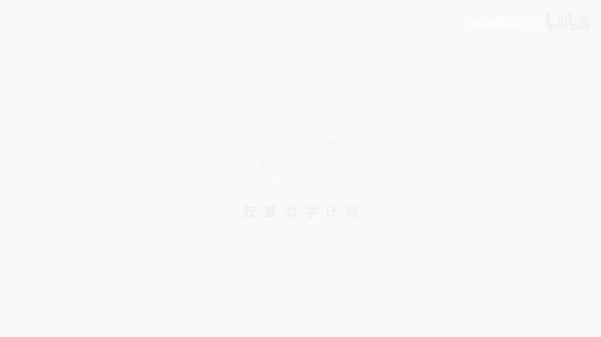

文字识别：胶囊助学计划

### 画面 00:00:46

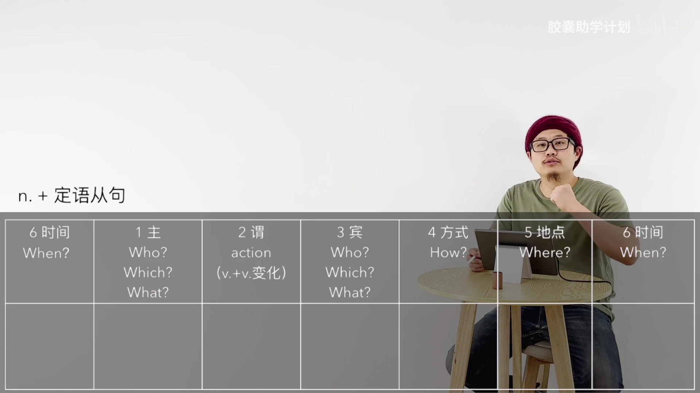

文字识别：胶囊助学计划 / n.+定语从句 / 6时间 / 1主 / 2谓 / 3宾 / 4方式 / 5地点 / 6时间 / When? / Who? / action / Who? / How? / Where? / When? / Which? / (v.+v.变化) / Which? / What? / What?

## 00:01:00–00:01:30

课的这个定语从句啊，这个语法，那各位现在应该清楚的知道一件事情，就是定语从句啊，它一般是去形容修饰一个名词的，对吧？而且呢，往往这个定语从句几乎啊，永远是放在这个名词的后面，并且紧跟着它的。那于是我们看六一二三四五六当中，我们要去思考定语从句可能会在哪些地方出现。那其实非常简单，我们就看名词会出现在哪些地方就可以了，

### 画面 00:01:16

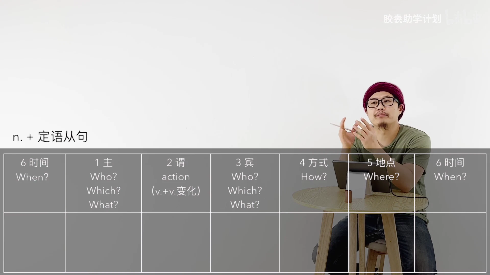

文字识别：胶囊助学计划 / n.+定语从句 / 6时间 / 1主 / 2谓 / 3宾 / 4方式 / 5地点 / 6时间 / When? / Who? / action / Who? / How? / Where? / When? / Which? / (v.+v.变化) / Which? / What? / What?

## 00:01:30–00:02:00

对不对？首先，时间上可不可能会出现名词呢？可能，所以定语从句可能出现在这里。主语有名词，这是大家各位最熟悉的，所以可能会出现定语从句。谓语是动词加动词变化，所以永远不可能出现定语从句，OK吧？然后宾语有名词，没问题，对吧？I like apple。啊，那什么样的 apple 呢？什么 which is on the counter，对吧？在这个呃柜台上的那个苹果啊，这就是随口

### 画面 00:01:46

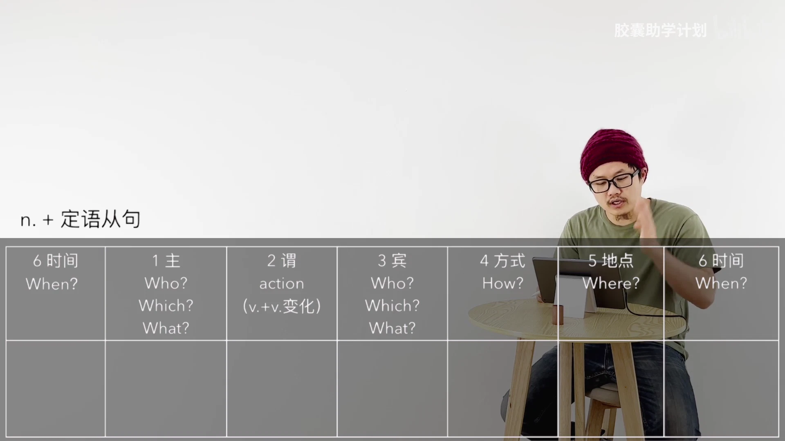

文字识别：胶囊助学计划 / n.+定语从句 / 6时间 / 1主 / 2谓 / 3宾 / 4方式 / 5地点 / 6时间 / When? / Who? / action / Who? / How? / Where? / When? / Which? / (v.+v.变化) / Which? / What? / What?

## 00:02:00–00:02:30

就给大家造了一个定语从句出来，所以宾语这个地方三啊，可能加上定语从句，方式往往是副词。从这个角度上来说，出现定语从句的可能性就不太大。地点呢有名词，对吧？可能会出现定语从句。所以其实我们从第二单元开始啊，二十五课开始呢，我们逐渐在做的一件事情是把我们第一单元学习的都是六一二三四五六，对吧？很简简单简单啊，然后呢，

### 画面 00:02:16

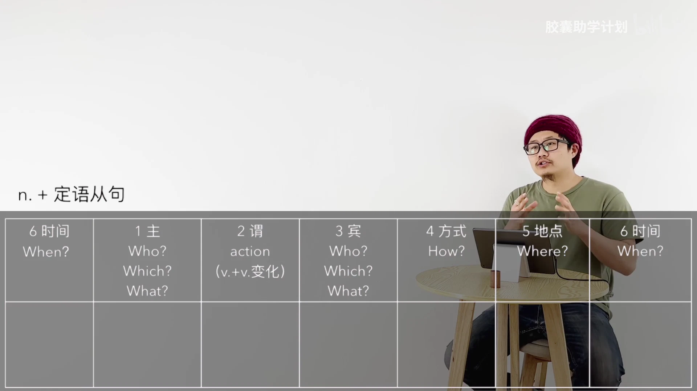

文字识别：胶台 / n.+定语从句 / 6时间 / 1主 / 2谓 / 3宾 / 4方式 / 5地点 / 6时间 / When? / Who? / action / Who? / How? / Where? / When? / Which? / (v.+v.变化) / Which? / What? / What?

## 00:02:30–00:03:00

用一个单词去当一个成分，逐渐把这个句子给它变得更长。比如说，原来呢就是一个名词做主语，现在呢可能是一个名词加一个定语从句，那么长一个东西合起来做主语，对吧？所以句子就被变长了。OK，好，那我们知道它了之后呢，给大家总结一下，我们如何去输出定从。我们先一起看一下啊，这个各位要记住，这个非常有用。第一叫一句汉语变两句英文。首

### 画面 00:02:46

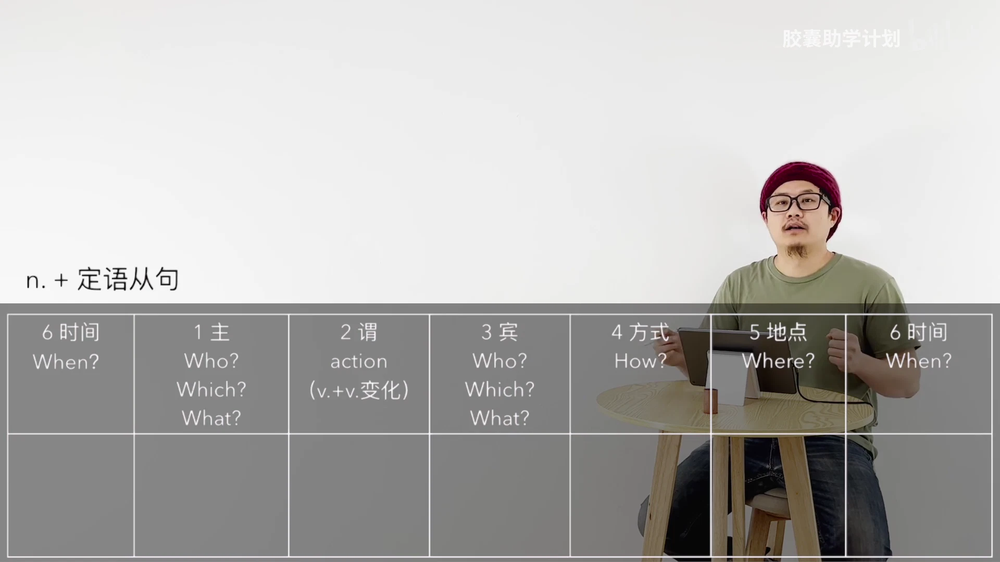

文字识别：n.+定语从句 / 6时间 / 1主 / 2谓 / 3宾 / 4方式 / 5地点 / 6时间 / When? / Who? / action / Who? / How? / Where? / When? / Which? / (v.+v.变化) / Which? / What? / What?

### 画面 00:02:48

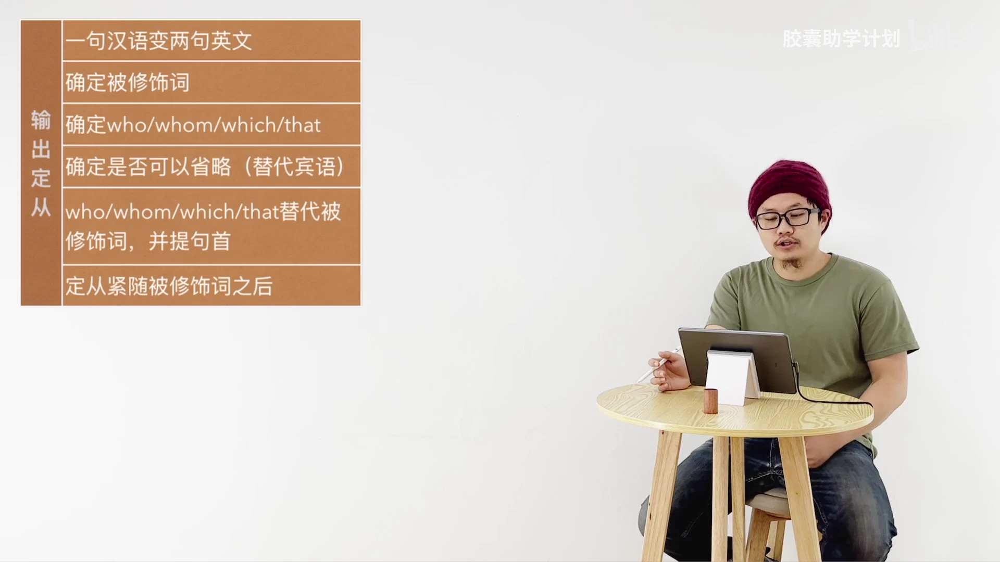

文字识别：句汉语变两句英文 / 确定被修饰词 / 输出定从 / 确定who/whom/which/that / 确定是否可以省略 (替代宾语) / who/whom/which/that替代被 / 修饰词，并提句首 / 定从紧随被修饰词之后

### 画面 00:02:50

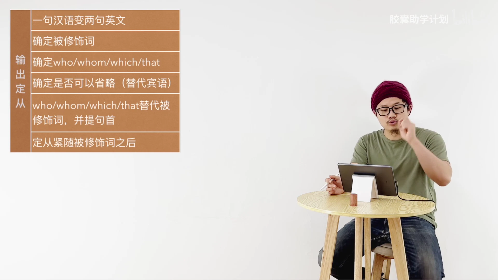

文字识别：句汉语变两句英文 / 确定被修饰词 / 输出定从 / 确定who/whom/which/that / 确定是否可以省略 （替代宾语) / who/whom/which/that替代被 / 修饰词，并提句首 / 定从紧随被修饰词之后

### 画面 00:02:54

文字识别：句汉语变两句英文 / 确定被修饰词 / 输出定从 / 确定who/whom/which/that / 确定是否可以省略 (替代宾语) / who/whom/which/that替代被 / 修饰词，并提句首 / 定从紧随被修饰词之后

### 画面 00:02:56

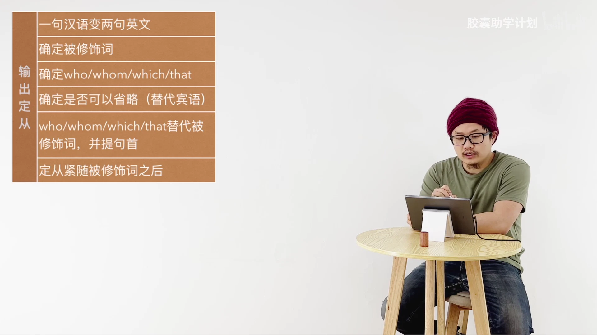

文字识别：句汉语变两句英文 / 胶囊助学计划 / 确定被修饰词 / 输出定从 / 确定who/whom/which/that / 确定是否可以省略 (替代宾语) / who/whom/which/that替代被 / 修饰词，并提句首 / 定从紧随被修饰词之后

### 画面 00:02:58

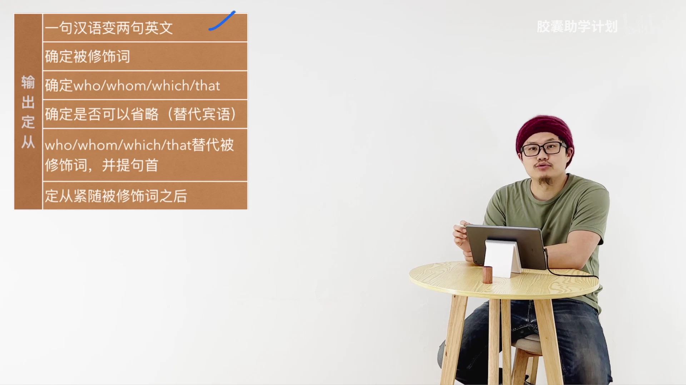

文字识别：句汉语变两句英文 / 确定被修饰词 / 输出定从 / 确定who/whom/which/that / 确定是否可以省略 (替代宾语) / who/whom/which/that替代被 / 修饰词，并提句首 / 定从紧随被修饰词之后

## 00:03:00–00:03:30

先，什么叫输出定从？叫做我脑海当中有一句汉语，我想把这句汉语变成英文，脑海当中的东西给它输出成英文，这叫做输出定从，对吧？OK，那一句汉语是我想输出的那句，呃，那个那那个那句话，对吧？叫做住在隔壁的男人是一个医生，把它变成两句英文。第一句叫男人是一个医生，这是我们新一讲过的。第二句叫做他住在隔壁，叫做He lives next door，对吧？好，

### 画面 00:03:00

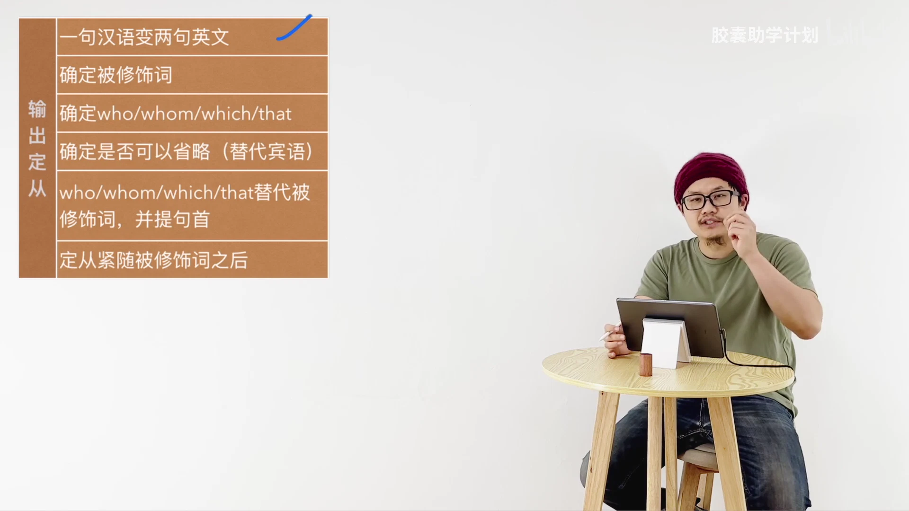

文字识别：句汉语变两句英文 / 胶囊助 / 计划 / 确定被修饰词 / 输出定从 / 确定who/whom/which/that / 确定是否可以省略 (替代宾语) / who/whom/which/that替代被 / 修饰词，并提句首 / 定从紧随被修饰词之后

### 画面 00:03:04

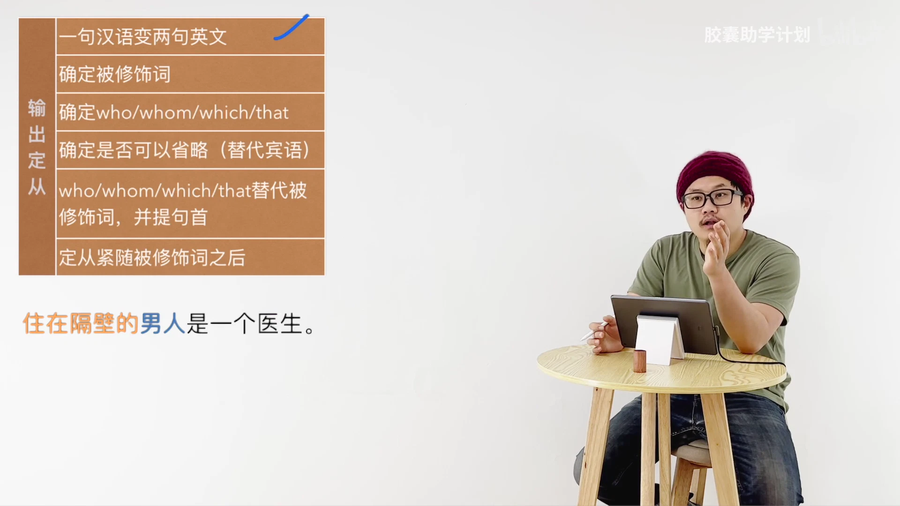

文字识别：句汉语变两句英文 / 胶囊助学计划 / 确定被修饰词 / 输出定从 / 确定who/whom/which/that / 确定是否可以省略（替代宾语） / who/whom/which/that替代被 / 修饰词，并提句首 / 定从紧随被修饰词之后 / 住在隔壁的男人是一个医生。

### 画面 00:03:06

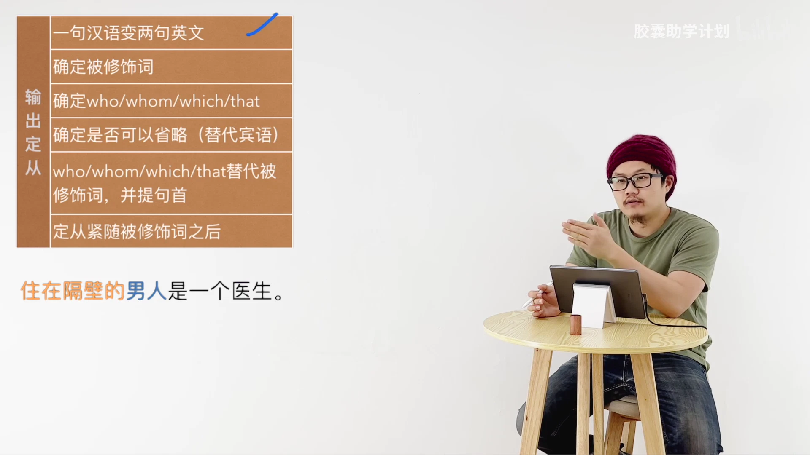

文字识别：句汉语变两句英文 / 胶囊助学计划 / 确定被修饰词 / 输出定从 / 确定who/whom/which/that / 确定是否可以省略(替代宾语） / who/whom/which/that替代被 / 修饰词，并提句首 / 定从紧随被修饰词之后 / 住在隔壁的男人是一个医生。

### 画面 00:03:10

文字识别：句汉语变两句英文 / 胶囊助学计划 / 确定被修饰词 / 输出定从 / 确定who/whom/which/that / 确定是否可以省略（替代宾语） / who/whom/which/that替代被 / 修饰词，并提句首 / 定从紧随被修饰词之后 / 住在隔壁的男人是一个医生。

### 画面 00:03:15

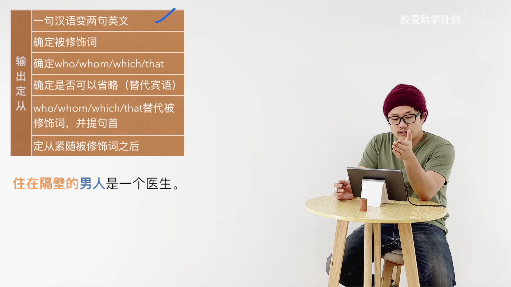

文字识别：句汉语变两句英 / 胶囊助学计划 / 确定被修饰词 / 输出定从 / 确定who/whom/which/that / 确定是否可以省略（替代宾语） / who/whom/which/that替代被 / 修饰词，并提句首 / 定从紧随被修饰词之后 / 住在隔壁的男人是一个医生。

### 画面 00:03:20

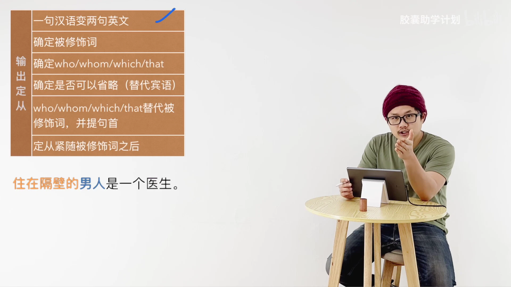

文字识别：句汉语变两句英文 / 胶囊助学计划 / 确定被修饰词 / 输出定从 / 确定who/whom/which/that / 确定是否可以省略 (替代宾语) / who/whom/which/that替代被 / 修饰词，并提句首 / 定从紧随被修饰词之后 / 住在隔壁的男人是一个医生。

### 画面 00:03:22

文字识别：句汉语变两句英文 / 胶囊助学计划 / 确定被修饰词 / 输出定从 / 确定who/whom/which/that / 确定是否可以省略 (替代宾语) / who/whom/which/that替代被 / 修饰词，并提句首 / 定从紧随被修饰词之后 / 住在隔壁的男人是一个医生，

### 画面 00:03:25

文字识别：句汉语变两句英文 / 胶囊助学计划 / 确定被修饰词 / 输出定从 / 确定who/whom/which/that / 确定是否可以省略(替代宾语) / who/whom/which/that替代被 / 修饰词，并提句首 / 定从紧随被修饰词之后 / 住在隔壁的男人是一个医生 / The man is a doctor.

### 画面 00:03:27

文字识别：句汉语变两句英 / 胶囊助学计划 / 确定被修饰词 / 输出定从 / 确定who/whom/which/that / 确定是否可以省略（替代宾语） / who/whom/which/that替代被 / 修饰词，并提句首 / 定从紧随被修饰词之后 / 住在隔壁的男人是一个医生 / The man is a doctor. / He lives next door. (who lives next door)

### 画面 00:03:29

文字识别：句汉语变两句英 / 胶囊助学计划 / 确定被修饰词 / 输出定从 / 确定who/whom/which/that / 确定是否可以省略（替代宾语） / who/whom/which/that替代被 / 修饰词，并提句首 / 定从紧随被修饰词之后 / 住在隔壁的男人是一个医生。 / The man is a doctor. / He lives next door. (who lives next door)

## 00:03:30–00:04:00

接下来确定被修饰词，重复部分就是被修饰词。其次叫做你实际上分析汉语也能看出来，定语从句修饰的是谁？是男人，对吧？叫 the man and he and he，对吧？这是重复部分，并且是被修饰词。再然后呢？由被修饰词去确定是 who whom which 还是 that 这四个单词。简单回顾一下，如果是人就可以是 who whom 或 that，但 whom 这个

### 画面 00:03:31

文字识别：句汉语变两句英文 / 胶囊助学计划 / 确定被修饰词 / 输出定从 / 确定who/whom/which/that / 确定是否可以省略（替代宾语） / who/whom/which/that替代被 / 修饰词，并提句首 / 定从紧随被修饰词之后 / 住在隔壁的男人是一个医生。 / The man is a doctor. / He lives next door. (who lives next door)

### 画面 00:03:35

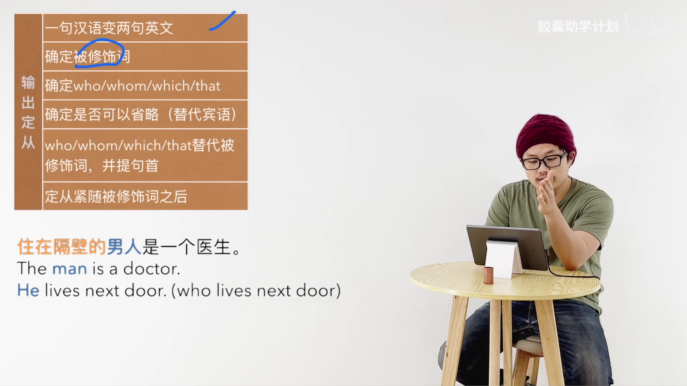

文字识别：句汉语变两句英文 / 胶囊助学计划 / 确定被修饰词 / 输出定从 / 确定who/whom/which/that / 确定是否可以省略（替代宾语） / who/whom/which/that替代被 / 修饰词，并提句首 / 定从紧随被修饰词之后 / 住在隔壁的男人是一个医生。 / The man is a doctor. / He lives next door. (who lives next door)

### 画面 00:03:37

文字识别：句汉语变两句英文 / 胶囊助学计划 / 确定被修饰词 / 输出定从 / 确定who/whom/which/that / 确定是否可以省略（替代宾语） / who/whom/which/that替代被 / 修饰词，并提句首 / 定从紧随被修饰词之后 / 住在隔壁的男人是一个医生。 / The man is a doctor. / He lives next door. (who lives next door)

### 画面 00:03:40

文字识别：句汉语变两句英文 / 胶囊助学计划 / 确定被修饰词 / 输出定从 / 确定who/whom/which/that / 确定是否可以省略（替代宾语） / who/whom/which/that替代被 / 修饰词，并提句首 / 定从紧随被修饰词之后 / 住在隔壁的男人是一个医生。 / The man is a doctor. / He lives next door. (who lives next door)

### 画面 00:03:45

文字识别：句汉语变两句英文 / 胶囊助学计划 / 确定被修饰词 / 输出定从 / 确定who/whom/which/that / 确定是否可以省略（替代宾语） / who/whom/which/that替代被 / 修饰词，并提句首 / 定从紧随被修饰词之后 / 住在隔壁的男人是一个医生。 / The man is a doctor. / He lives next door. (who lives next door)

### 画面 00:03:49

文字识别：句汉语变两句英文 / 胶囊助学计划 / 确定被修饰词 / 输出定从 / 确定who/whom/which/that / 确定是否可以省略（替代宾语） / who/whom/which/that替代被 / 修饰词，并提句首 / 定从紧随被修饰词之后 / 住在隔壁的男人是一个医生。 / The man is a doctor. / He lives next door. (who lives next door)

### 画面 00:03:51

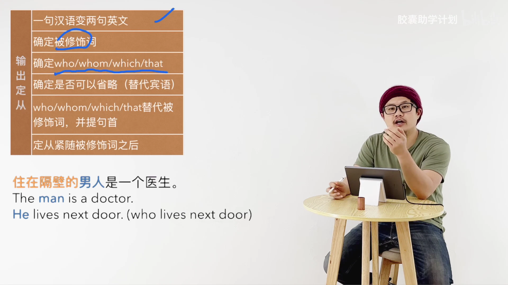

文字识别：句汉语变两句英文 / 胶囊助学计划 / 确定被修饰词 / 输出定从 / 确定who/whom/which/that / 确定是否可以省略（替代宾语） / who/whom/which/that替代被 / 修饰词，并提句首 / 定从紧随被修饰词之后 / 住在隔壁的男人是一个医生。 / The man is a doctor. / He lives next door. (who lives next door)

### 画面 00:03:55

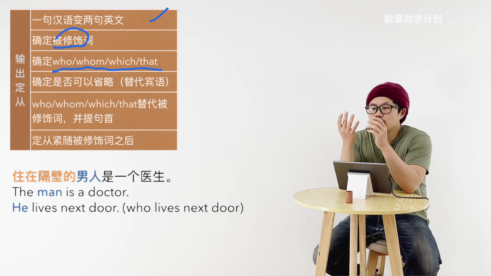

文字识别：句汉语变两句英文 / 胶囊助学计划 / 确定被修饰词 / 输出定从 / 确定who/whom/which/that / 确定是否可以省略（替代宾语） / who/whom/which/that替代被 / 修饰词，并提句首 / 定从紧随被修饰词之后 / 住在隔壁的男人是一个医生。 / The man is a doctor. / He lives next door. (who lives next door)

## 00:04:00–00:04:30

word is special. First, it is basically not used, right? So you don't use it at all, and there is no problem. Unless in a special exam, it may be a bit abnormal. If you are tested on the usage of whom, you should know that if this word is used to replace the subject, you should use who or that, right? If it is used to replace the object, you can use whom. OK. Well, let's look at here. If it is used to replace the subject, right? So you cannot use whom. You should use who or that or

### 画面 00:04:00

文字识别：句汉语变两句英文 / 胶囊助学计划 / 确定被修饰词 / 输出定从 / 确定who/whom/which/that / 确定是否可以省略（替代宾语） / who/whom/which/that替代被 / 修饰词，并提句首 / 定从紧随被修饰词之后 / 住在隔壁的男人是一个医生。 / The man is a doctor. / He lives next door. (who lives next door)

### 画面 00:04:05

文字识别：句汉语变两句英文 / 胶囊助学计划 / 确定被修饰词 / 输出定从 / 确定who/whom/which/that / 确定是否可以省略（替代宾语） / who/whom/which/that替代被 / 修饰词，并提句首 / 定从紧随被修饰词之后 / 住在隔壁的男人是一个医生。 / The man is a doctor. / He lives next door. (who lives next door)

### 画面 00:04:10

文字识别：句汉语变两句英文 / 胶囊助学计划 / 确定被修饰词 / 输出定从 / 确定who/whom/which/that / 确定是否可以省略（替代宾语） / who/whom/which/that替代被 / 修饰词，并提句首 / 定从紧随被修饰词之后 / 住在隔壁的男人是一个医生。 / The man is a doctor. / He lives next door. (who lives next door)

### 画面 00:04:15

文字识别：句汉语变两句英文 / 胶囊助学计划 / 确定被修饰词 / 输出定从 / 确定who/whom/which/that / 确定是否可以省略（替代宾语） / who/whom/which/that替代被 / 修饰词，并提句首 / 定从紧随被修饰词之后 / 住在隔壁的男人是一个医生。 / The man is a doctor. / He lives next door. (who lives next door)

### 画面 00:04:20

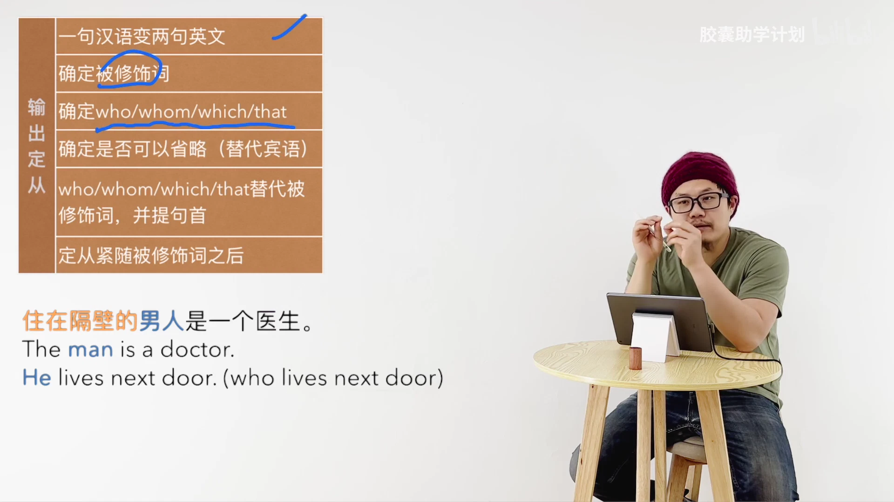

文字识别：句汉语变两句英文 / 胶囊助学计划 / 确定被修饰词 / 输出定从 / 确定who/whom/which/that / 确定是否可以省略（替代宾语） / who/whom/which/that替代被 / 修饰词，并提句首 / 定从紧随被修饰词之后 / 住在隔壁的男人是一个医生。 / The man is a doctor. / He lives next door. (who lives next door)

### 画面 00:04:25

文字识别：句汉语变两句英文 / 胶囊助学计划 / 确定被修饰词 / 输出定从 / 确定who/whom/which/that / 确定是否可以省略（替代宾语） / who/whom/which/that替代被 / 修饰词，并提句首 / 定从紧随被修饰词之后 / 住在隔壁的男人是一个医生。 / The man is a doctor. / He lives next door. (who lives next door)

## 00:04:30–00:05:00

或 which，然后 who that which 怎么判断呢？ who 是人， which 替代物， that 二者皆可，对吧？所以在这里我们就把 he 换成了 who，叫 who lives next door，这就是我们将来的定从，好吧？然后呢，确定是否可以省略，这也是我们新一一百二十三课那一课讲过的。怎么判断是否可以省略呢？就是这个 who 这个单词呢，替代主语不可省略，替代宾语就可以省略了。所以在

### 画面 00:04:30

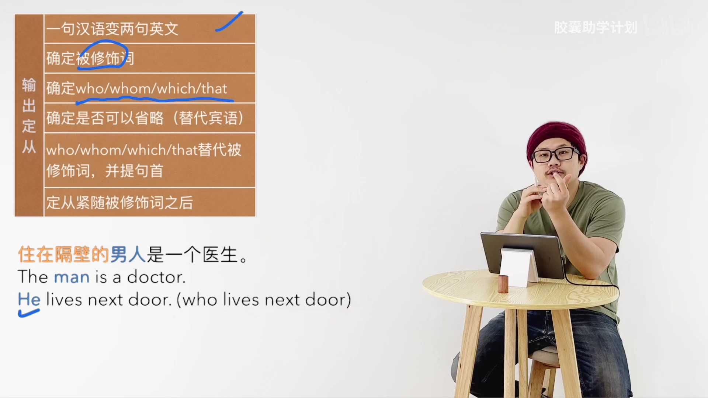

文字识别：句汉语变两句英文 / 胶囊助学计划 / 确定被修饰词 / 输出定从 / 确定who/whom/which/that / 确定是否可以省略（替代宾语） / who/whom/which/that替代被 / 修饰词，并提句首 / 定从紧随被修饰词之后 / 住在隔壁的男人是一个医生。 / The man is a doctor. / He lives next door. (who lives next door)

### 画面 00:04:35

文字识别：句汉语变两句英文 / 胶囊助学计划 / 确定被修饰词 / 输出定从 / 确定who/whom/which/that / 确定是否可以省略（替代宾语） / who/whom/which/that替代被 / 修饰词，并提句首 / 定从紧随被修饰词之后 / 住在隔壁的男人是一个医生。 / The man is a doctor. / He lives next door. (who lives next door)

### 画面 00:04:40

文字识别：句汉语变两句英文 / 胶囊助学计划 / 确定被修饰词 / 输出定从 / 确定who/whom/which/that / 确定是否可以省略（替代宾语） / who/whom/which/that替代被 / 修饰词，并提句首 / 定从紧随被修饰词之后 / 住在隔壁的男人是一个医生。 / The man is a doctor. / lives next door. (who lives next door)

### 画面 00:04:42

文字识别：句汉语变两句英文 / 胶囊助学计划 / 确定被修饰词 / 输出定从 / 确定who/whom/which/that / 确定是否可以省略(替代宾语) / who/whom/which/that替代被 / 修饰词，并提句首 / 定从紧随被修饰词之后 / 住在隔圣的男人是一个医生。 / Thg man is a doctor. / He / lives next door. (who lives next door)

### 画面 00:04:44

文字识别：句汉语变两句英文 / 胶囊助学计划 / 确定被修饰词 / 输出定从 / 确定who/whom/which/that / 确定是否可以省略（替代宾语） / who/whom/which/that替代被 / 修饰词，并提句首 / 定从紧随被修饰词之后 / 住在隔壁的男人是一个医生。 / The man is a doctor. / He lives next door. (who lives next door)

### 画面 00:04:46

文字识别：句汉语变两句英文 / 胶囊助学计划 / 确定被修饰词 / 输出定从 / 确定who/whom/which/that / 确定是否可以省略（替代宾语） / who/whom/which/that替代被 / 修饰词，并提句首 / 定从紧随被修饰词之后 / 住在隔壁的男人是一个医生。 / The man is a doctor. / He lives next door. (who lives next door)

### 画面 00:04:48

文字识别：句汉语变两句英文 / 胶囊助学计划 / 确定被修饰词 / 输出定从 / 确定who/whom/which/that / 确定是否可以省略（替代宾语） / who/whom/which/that替代被 / 修饰词，并提句首 / 定从紧随被修饰词之后 / 住在隔壁的男人是一个医生。 / The man is a doctor. / He lives next door. (who lives next door)

### 画面 00:04:50

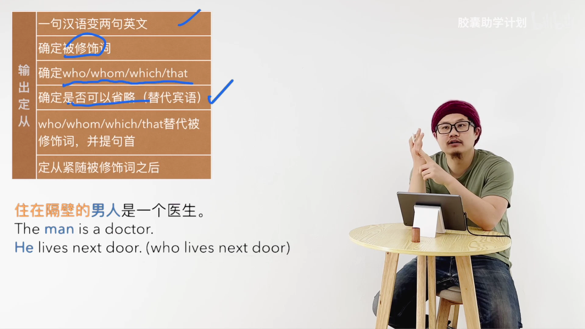

文字识别：句汉语变两句英文 / 胶囊助学计划 / 确定被修饰词 / 输出定从 / 确定who/whom/which/that / 确定是否可以省略（替代宾语） / who/whom/which/that替代被 / 修饰词，并提句首 / 定从紧随被修饰词之后 / 住在隔壁的男人是一个医生。 / The man is a doctor. / He lives next door. (who lives next door)

### 画面 00:04:55

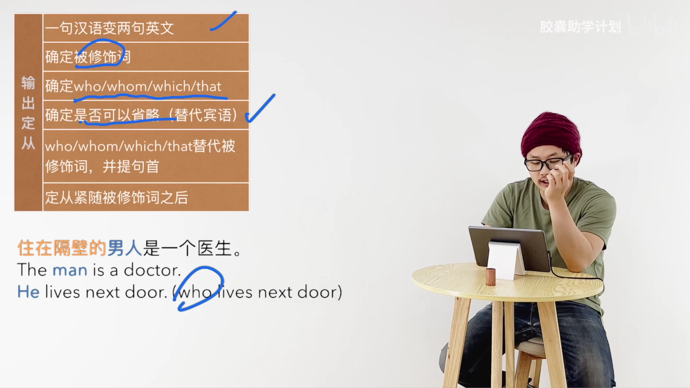

文字识别：句汉语变两句英文 / 胶囊助学计划 / 确定被修饰词 / 输出定从 / 确定who/whom/which/that / 确定是否可以省略（替代宾语） / who/whom/which/that替代被 / 修饰词，并提句首 / 定从紧随被修饰词之后 / 住在隔壁的男人是一个医生。 / The man is a doctor. / He lives next door. (Who lives next door)

## 00:05:00–00:05:30

这句话当中它不可省略。再然后，替代被修饰词了之后，并提到句首。如果你本身替代的是主语，那它已经在句首了，就不存在提了。如果它替代的是宾语，那你就要把它提到句首去。当然，也可以一个更简单粗暴的方式，直接给它省掉，对吧？最后，定语从句紧跟被修饰词，这是各位最容易忘的一件事情，就是变成这样一句话啊，叫做 The man who lives

### 画面 00:05:00

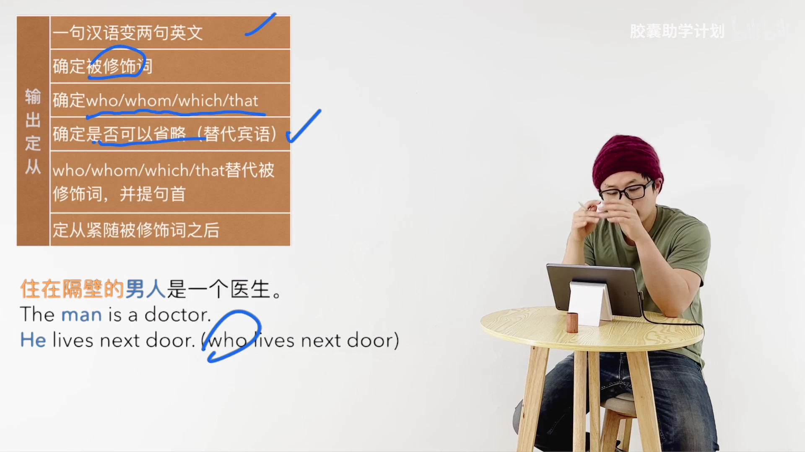

文字识别：句汉语变两句英文 / 胶囊助学计划 / 确定被修饰词 / 输出定从 / 确定who/whom/which/that / 确定是否可以省略（替代宾语） / who/whom/which/that替代被 / 修饰词，并提句首 / 定从紧随被修饰词之后 / 住在隔壁的男人是一个医生。 / The man is a doctor. / He lives next door. (Wholives next door)

### 画面 00:05:03

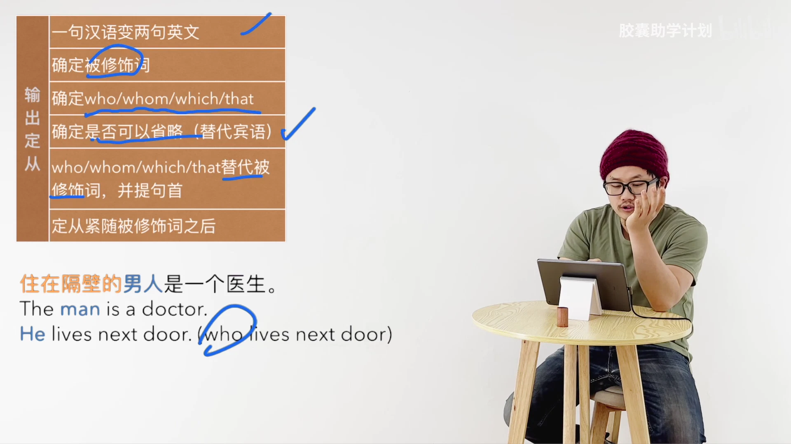

文字识别：句汉语变两句英文 / 胶囊助学计划 / 确定被修饰词 / 输出定从 / 确定who/whom/which/that / 确定是否可以省略（替代宾语） / who/whom/which/that替代被 / 修饰词，并提句首 / 定从紧随被修饰词之后 / 住在隔壁的男人是一个医生。 / The man is a doctor. / He lives next door. (Wholives next door)

### 画面 00:05:05

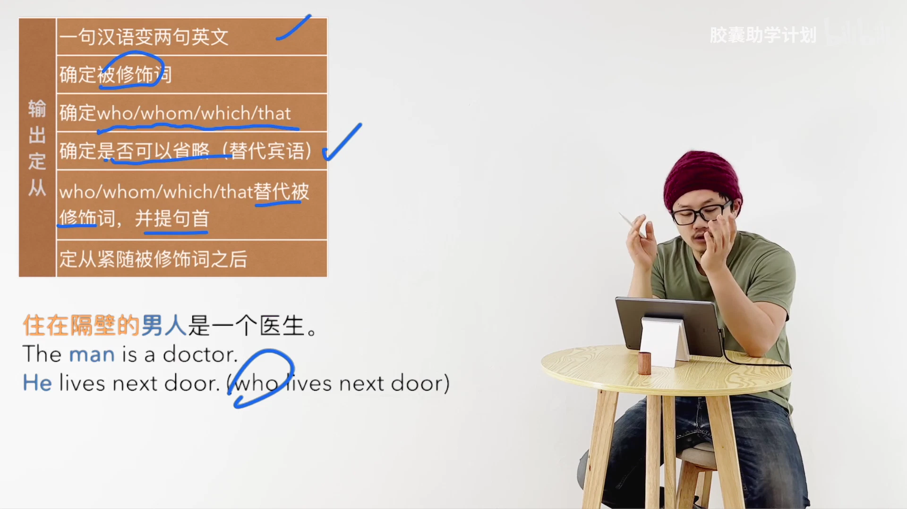

文字识别：句汉语变两句英文 / 胶囊助学计划 / 确定被修饰词 / 输出定从 / 确定who/whom/which/that / 确定是否可以省略（替代宾语） / who/whom/which/that替代被 / 修饰词，并提句首 / 定从紧随被修饰词之后 / 住在隔壁的男人是一个医生。 / The man is a doctor. / He lives next door. (Wholives next door)

### 画面 00:05:10

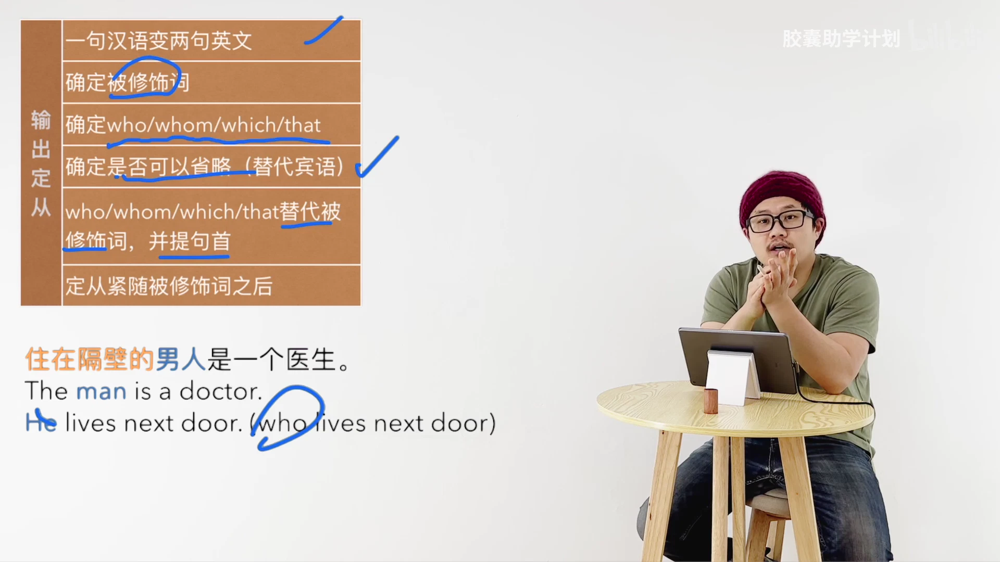

文字识别：句汉语变两句英文 / 胶囊助学计划 / 确定被修饰词 / 输出定从 / 确定who/whom/which/that / 确定是否可以省略（替代宾语） / who/whom/which/that替代被 / 修饰词，并提句首 / 定从紧随被修饰词之后 / 住在隔壁的男人是一个医生。 / The man is a doctor. / lives next door. (Wholives next door)

### 画面 00:05:15

文字识别：句汉语变两句英文 / 胶囊助学计划 / 确定被修饰词 / 输出定从 / 确定who/whom/which/that / 确定是否可以省略（替代宾语） / who/whom/which/that替代被 / 修饰词，并提句首 / 定从紧随被修饰词之后 / 住在隔壁的男人是一个医生。 / The man is a doctor. / lives next door. (Wholives next door)

### 画面 00:05:20

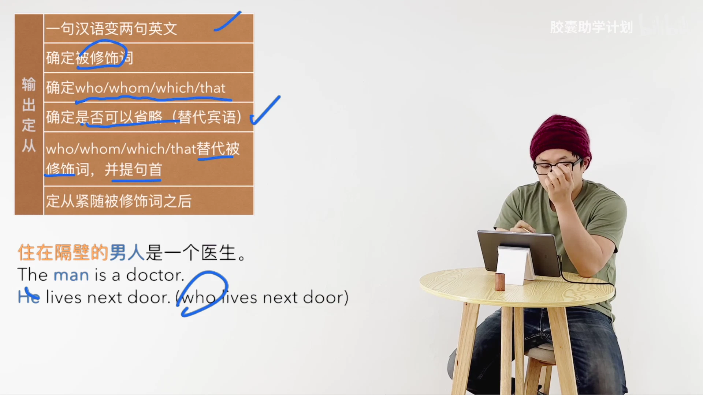

文字识别：句汉语变两句英文 / 胶囊助学计划 / 确定被修饰词 / 输出定从 / 确定who/whom/which/that / 确定是否可以省略（替代宾语） / who/whom/which/that替代被 / 修饰词，并提句首 / 定从紧随被修饰词之后 / 住在隔壁的男人是一个医生。 / The man is a doctor. / lives next door. (Wholives next door)

### 画面 00:05:22

文字识别：句汉语变两句英文 / 胶囊助学计划 / 确定被修饰词 / 输出定从 / 确定who/whom/which/that / 确定是否可以省略（替代宾语） / who/whom/which/that替代被 / 修饰词，并提句首 / 定从紧随被修饰词之后 / 住在隔壁的男人是一个医生。 / The man is a doctor. / lives next door. (Wholives next door)

### 画面 00:05:25

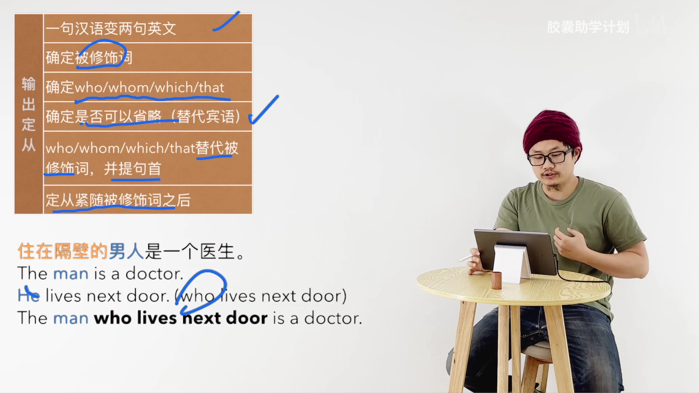

文字识别：句汉语变两句英文 / 确定被修饰词 / 输出定从 / 确定who/whom/which/that / 确定是否可以省略（替代宾语） / who/whom/which/that替代被 / 修饰词，并提句首 / 定从紧随被修饰词之后 / 住在隔壁的男人是一个医生。 / The man is a doctor. /  lives next door. (Wholives next door) / The man who lives hext door is a doctor.

### 画面 00:05:27

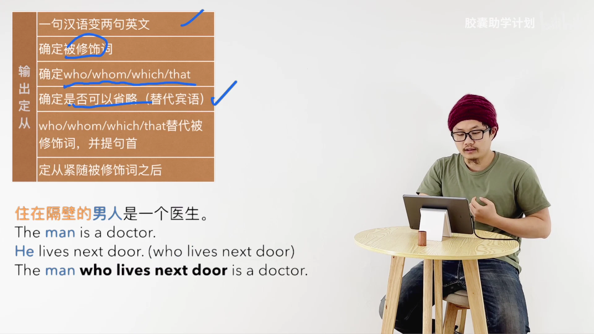

文字识别：句汉语变两句英文 / 确定被修饰词 / 输出定从 / 确定who/whom/which/that / 确定是否可以省略（替代宾语） / who/whom/which/that替代被 / 修饰词，并提句首 / 定从紧随被修饰词之后 / 住在隔壁的男人是一个医生。 / The man is a doctor. / He lives next door. (who lives next door) / The man who lives next door is a doctor.

## 00:05:30–00:06:00

next door is a doctor. 你注意 who lives next door 是修饰 the man 这个单词的，对吧？对于各位来说，你看这个是定语从句，是汉语的从定语从句，它放在了被修饰词的前面。英语的定语从句往往是放在被修饰词的后面，并且一般来说是紧紧跟着它的。千万不要把这句话放到后面去，那就不对了。放到前面才是对的，对吧？修饰谁，跟着谁啊？那这是第

### 画面 00:05:30

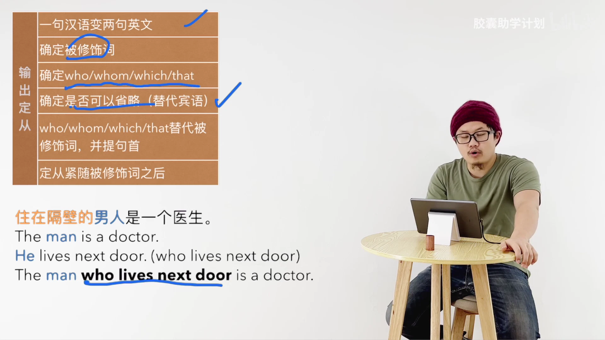

文字识别：句汉语变两句英文 / 胶囊 / 确定被修饰词 / 输出定从 / 确定who/whom/which/that / 确定是否可以省略（替代宾语） / who/whom/which/that替代被 / 修饰词，并提句首 / 定从紧随被修饰词之后 / 住在隔壁的男人是一个医生。 / The man is a doctor. / He lives next door. (who lives next door) / The man who lives next door is a doctor.

### 画面 00:05:35

文字识别：句汉语变两句英文 / 确定被修饰词 / 输出定从 / 确定who/whom/which/that / 确定是否可以省略（替代宾语） / who/whom/which/that替代被 / 修饰词，并提句首 / 定从紧随被修饰词之后 / 住在隔壁的男人是一个医生。 / The man is a doctor. / He lives next door. (who lives next door) / The man who lives next door is a doctor.

### 画面 00:05:39

文字识别：句汉语变两句英文 / 胶囊 / 助学计划 / 确定被修饰司 / 输出定从 / 确定who/whom/which/that / 确定是否可以省略（替代宾语） / who/whom/which/that替代被 / 修饰词，并提句首 / 定从紧随被修饰词之后 / 住在隔壁的男人是一个医生。 / The man is a doctor. / He lives next door. (who lives next door) / The man who lives next door is a doctor.

### 画面 00:05:41

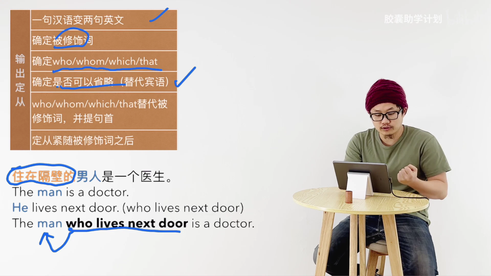

文字识别：句汉语变两句英文 / 胶囊 / 确定被修饰词 / 输出定从 / 确定who/whom/which/that / 确定是否可以省略（替代宾语） / who/whom/which/that替代被 / 修饰词，并提句首 / 定从紧随被修饰词之后 / 住在隔壁的男人是一个医生。 / The man is a doctor. / He lives next door. (who lives next door) / The man who lives next door is a doctor.

### 画面 00:05:45

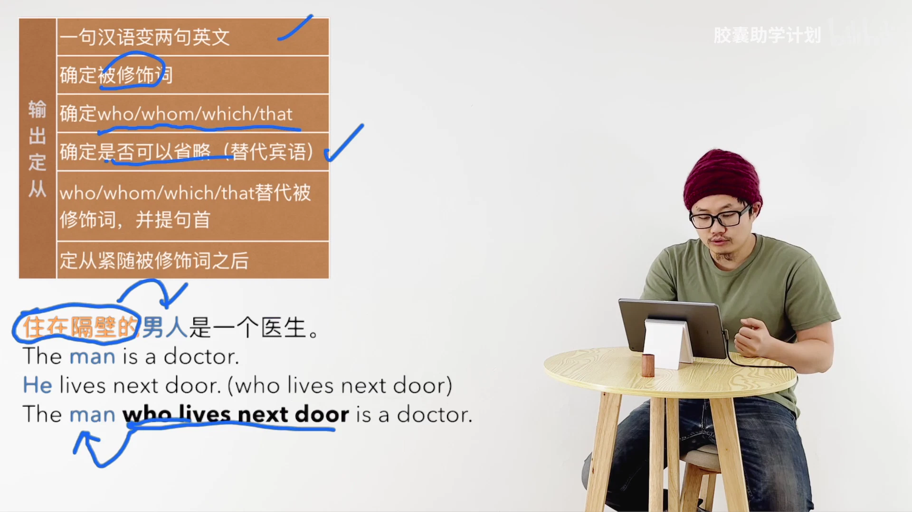

文字识别：句汉语变两句英文 / 胶囊助学计划 / 确定被修饰词 / 输出定从 / 确定who/whom/which/that / 确定是否可以省略（替代宾语） / who/whom/which/that替代被 / 修饰词，并提句首 / 定从紧随被修饰词之后 / 住在隔壁的男人是一个医生。 / The man is a doctor. / He lives next door. (who lives next door) / The man wholives next door is a doctor.

### 画面 00:05:47

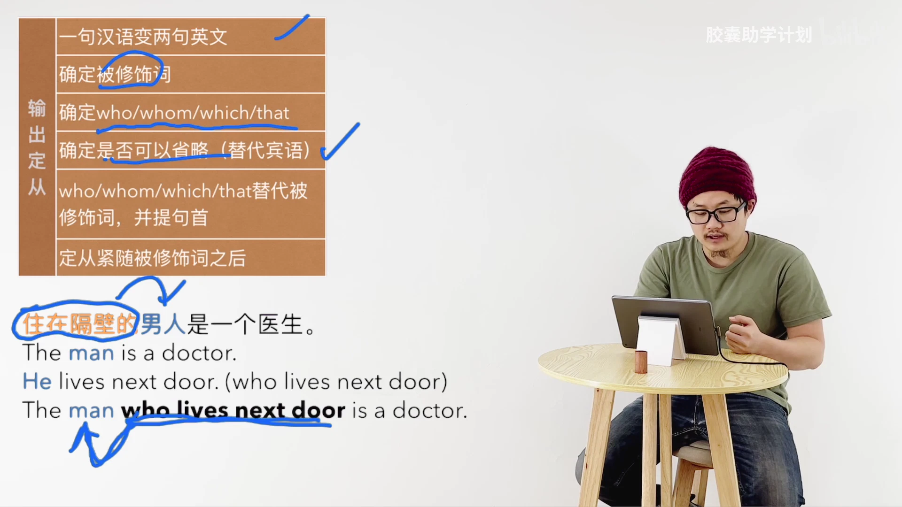

文字识别：句汉语变两句英文 / 胶囊助学计划 / 确定被修饰词 / 输出定从 / 确定who/whom/which/that / 确定是否可以省略（替代宾语） / who/whom/which/that替代被 / 修饰词，并提句首 / 定从紧随被修饰词之后 / 住在隔壁的男人是一个医生。 / The man is a doctor. / He lives next door. (who lives next door) / The man who lives next door is a doctor.

### 画面 00:05:50

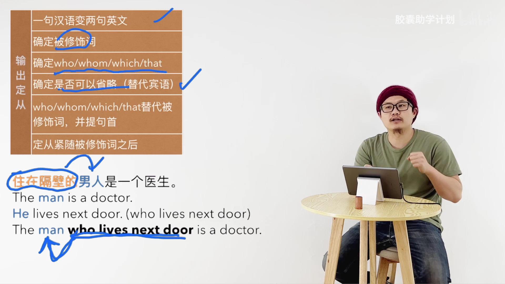

文字识别：句汉语变两句英文 / 确定被修饰词 / 输出定从 / 确定who/whom/which/that / 确定是否可以省略（替代宾语） / who/whom/which/that替代被 / 修饰词，并提句首 / 定从紧随被修饰词之后 / 住在隔壁的男人是一个医生。 / The man is a doctor. / He lives next door. (who lives next door) / The man who lives next door is a doctor.

### 画面 00:05:53

文字识别：句汉语变两句英文 / 胶囊 / 确定被修饰词 / 输出定从 / 确定who/whom/which/that / 确定是否可以省略（替代宾语） / who/whom/which/that替代被 / 修饰词，并提句首 / 定从紧随被修饰词之后 / 住在隔壁的男人是一个医生。 / The man is a doctor. / He lives next door. (who liveynext door) / The / e man who lives next door is a doctor.

### 画面 00:05:55

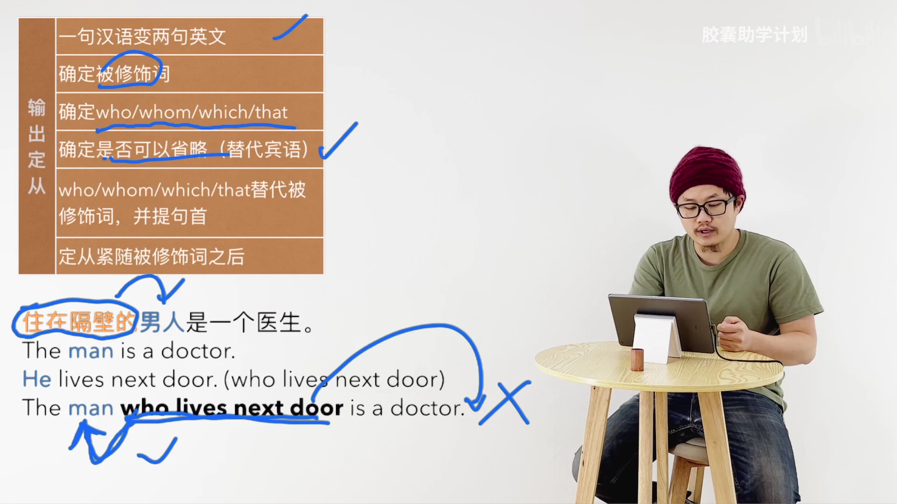

文字识别：句汉语变两句英文 / 胶囊助学计划 / 确定被修饰司 / 输出定从 / 确定who/whom/which/that / 确定是否可以省略（替代宾语） / who/whom/which/that替代被 / 修饰词，并提句首 / 定从紧随被修饰词之后 / 住在隔壁的男人是一个医生。 / The man is a doctor. / He lives next door. (who liveynext door) / The / man wholives next door is a doctor.

### 画面 00:05:59

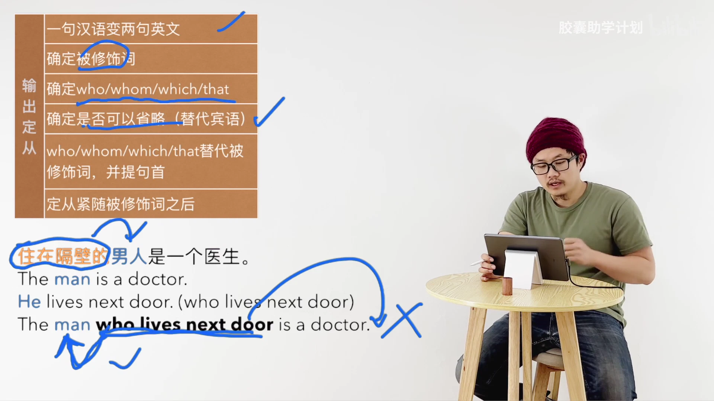

文字识别：句汉语变两句英文 / 胶囊 / 确定被修饰司 / 输出定从 / 确定who/whom/which/that / 确定是否可以省略（替代宾语） / who/whom/which/that替代被 / 修饰词，并提句首 / 定从紧随被修饰词之后 / 住在隔壁的男人是一个医生。 / The man is a doctor. / He lives next door. (who liveynext door) / The /  man who lives next door is a doctor. / K

## 00:06:00–00:06:30

一个，我们回顾了一下，希望大家都回想起来了。接下来我们再看一个，一句汉语，我认识许多住在伦敦的人，变成两句英语，我认识很多人。第二句，他们住伦敦，对吧？We know a lot of people. They live in London. OK，确定被修饰词由汉语就可以确定了，叫做人，对不对？就是 people 和 they。第二句话将来是变定语从句的，然后我们一看 they，一看 people，这是人，所以用 who 或者 that。能

### 画面 00:06:01

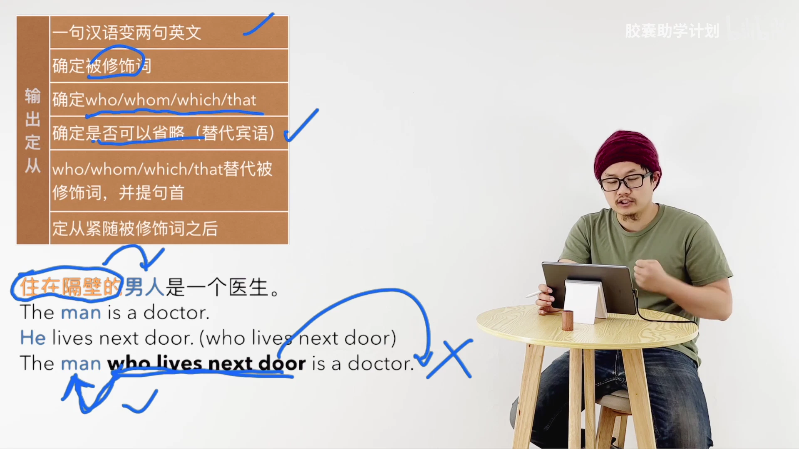

文字识别：句汉语变两句英文 / 胶囊助学计划 / 确定被修饰司 / 输出定从 / 确定who/whom/which/that / 确定是否可以省略（替代宾语） / who/whom/which/that替代被 / 修饰词，并提句首 / 定从紧随被修饰词之后 / 住在隔壁的男人是一个医生。 / The man is a doctor. / He lives next door. (who liveynext door) / The / : man who lives next door is a doctor.

### 画面 00:06:04

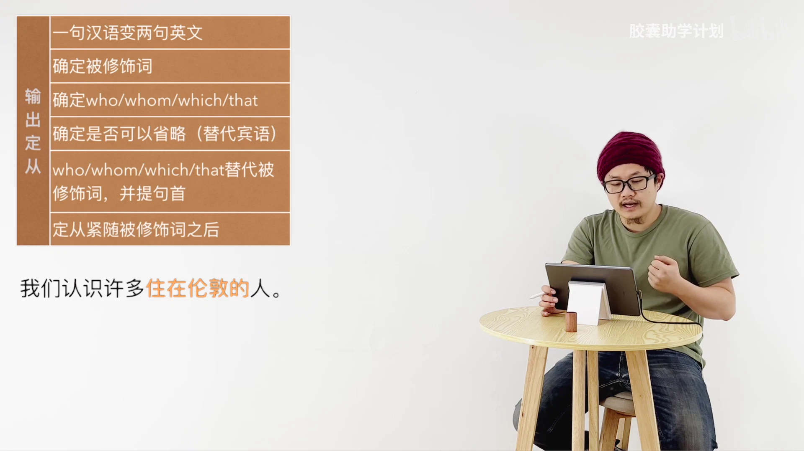

文字识别：句汉语变两句英文 / 胶囊助学计划 / 确定被修饰词 / 输出定从 / 确定who/whom/which/that / 确定是否可以省略(替代宾语) / who/whom/which/that替代被 / 修饰词，并提句首 / 定从紧随被修饰词之后 / 我们认识许多住在伦敦的人。

### 画面 00:06:06

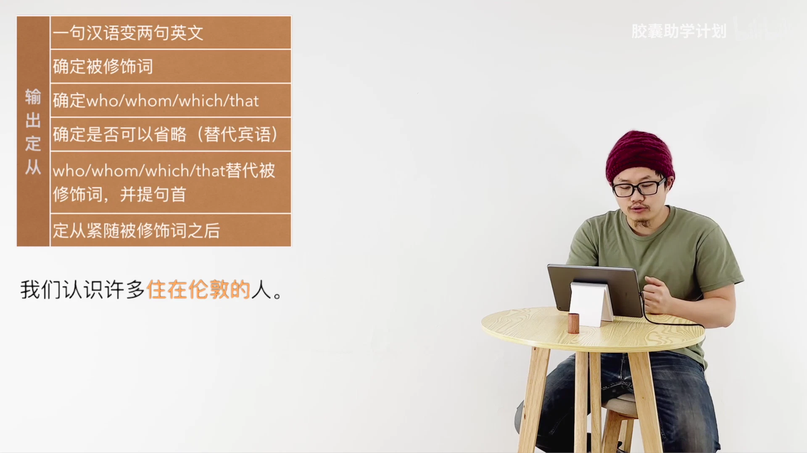

文字识别：句汉语变两句英文 / 胶囊助学计划 / 确定被修饰词 / 输出定从 / 确定who/whom/which/that / 确定是否可以省略 (替代宾语) / who/whom/which/that替代被 / 修饰词，并提句首 / 定从紧随被修饰词之后 / 我们认识许多住在伦敦的人。

### 画面 00:06:10

文字识别：句汉语变两句英文 / 胶囊助学计划 / 确定被修饰词 / 输出定从 / 确定who/whom/which/that / 确定是否可以省略(替代宾语) / who/whom/which/that替代被 / 修饰词，并提句首 / 定从紧随被修饰词之后 / 我们认识许多住在伦敦的人

### 画面 00:06:12

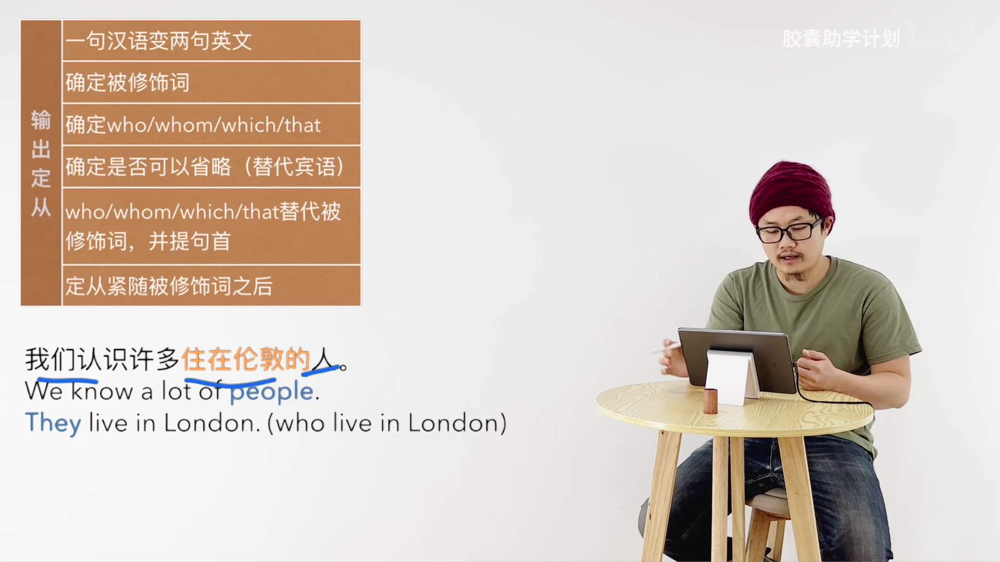

文字识别：句汉语变两句英文 / 胶囊助学计划 / 确定被修饰词 / 输出定从 / 确定who/whom/which/that / 确定是否可以省略（替代宾语) / who/whom/which/that替代被 / 修饰词，并提句首 / 定从紧随被修饰词之后 / 我们认识许多住在伦敦的人。 / We know a lot of people. / They live in London. (who live in London)

### 画面 00:06:14

文字识别：句汉语变两句英 / 胶囊助学计划 / 确定被修饰词 / 输出定从 / 确定who/whom/which/that / 确定是否可以省略（替代宾语） / who/whom/which/that替代被 / 修饰词，并提句首 / 定从紧随被修饰词之后 / 我们认识许多住在伦敦的人。 / We know a lot of people. / They live in London. (who live in London)

### 画面 00:06:16

文字识别：句汉语变两句英 / 胶囊助学计划 / 确定被修饰词 / 输出定从 / 确定who/whom/which/that / 确定是否可以省略（替代宾语） / who/whom/which/that替代被 / 修饰词，并提句首 / 定从紧随被修饰词之后 / 我们认识许多住在伦敦的人。 / We know a lot of people. / They live in London. (who live in London)

### 画面 00:06:20

文字识别：句汉语变两句英 / 胶囊助学计划 / 确定被修饰词 / 输出定从 / 确定who/whom/which/that / 确定是否可以省略(替代宾语) / who/whom/which/that替代被 / 修饰词，并提句首 / 定从紧随被修饰词之后 / 我们认识许多住在伦敦的 / We know a lot of people. / They live in London. (who live in London)

### 画面 00:06:25

文字识别：句汉语变两句英文 / 胶囊助学计划 / 确定被修饰词 / 输出定从 / 确定who/whom/which/that / 确定是否可以省略（替代宾语） / who/whom/which/that替代被 / 修饰词，并提句首 / 定从紧随被修饰词之后 / 我们认识许多住在伦敦的 / We know a lot of people. / They / live in London.(who live in London)

## 00:06:30–00:07:00

不能用 whom 呢？看一下它替代的是主语还是宾语。替代主语不能，替代宾语可以，对吧？所以呢，这地方就是用 who 去替代了 they，于是这句话就变成了 who live in London。这句话自己本身还不行，对吧？然后我们再看是否可以省略呢？替代宾语可以，现在替代主语不能省略。替代完了之后提句首，替代的就是主语已经在句首，不用管了。定从紧跟被修饰词之后，修饰的是

### 画面 00:06:30

文字识别：句汉语变两句英文 / 胶囊助学计划 / 确定被修饰词 / 输出定从 / 确定who/whom/which/that / 确定是否可以省略(替代宾语) / who/whom/which/that替代被 / 修饰词，并提句首 / 定从紧随被修饰词之后 / 我们认识许多住在伦敦的 / We know a lot of people. / They / live in London.(who live in London)

### 画面 00:06:33

文字识别：句汉语变两句英文 / 胶囊助学计划 / 确定被修饰词 / 输出定从 / 确定who/whom/which/that / 确定是否可以省略（替代宾语） / who/whom/which/that替代被 / 修饰词，并提句首 / 定从紧随被修饰词之后 / 我们认识许多住在伦敦的 / We know a lot of people. / They / live in London.(who live in London)

### 画面 00:06:35

文字识别：句汉语变两句英文 / 胶囊助学计划 / 确定被修饰词 / 输出定从 / 确定who/whom/which/that / 确定是否可以省略(替代宾语) / who/whom/which/that替代被 / 修饰词，并提句首 / 定从紧随被修饰词之后 / 我们认识许多住在伦敦的 / We know a lot of people. / hey / live in London.(who live in London)

### 画面 00:06:40

文字识别：句汉语变两句英文 / 胶囊助学计划 / 确定被修饰词 / 输出定从 / 确定who/whom/which/that / 确定是否可以省略（替代宾语） / who/whom/which/that替代被 / 修饰词，并提句首 / 定从紧随被修饰词之后 / 我们认识许多住在伦敦的 / We know a lot of people. / live in London.(who live in London)

### 画面 00:06:42

文字识别：句汉语变两句英文 / 胶囊助学计划 / 确定被修饰词 / 输出定从 / 确定who/whom/which/that / 确定是否可以省略（替代宾语） / who/whom/which/that替代被 / 修饰词，并提句首 / 定从紧随被修饰词之后 / 我们认识许多住在伦敦的 / We know a lot of people. / live in London.(who live in London)

### 画面 00:06:45

文字识别：句汉语变两句英文 / 胶囊助学计划 / 确定被修饰词 / 输出定从 / 确定who/whom/which/that / 确定是否可以省略（替代宾语） / who/whom/which/that替代被 / 修饰词，并提句首 / 定从紧随被修饰词之后 / 我们认识许多住在伦敦的 / We know a lot of people. / live in London.(who live in London)

### 画面 00:06:50

文字识别：句汉语变两句英文 / 胶囊助学计划 / 确定被修饰词 / 输出定从 / 确定who/whom/which/that / 确定是否可以省略（替代宾语） / who/whom/which/that替代被 / 修饰词，并提句首 / 定从紧随被修饰词之后 / 我们认识许多住在伦敦的 / We know a lot of people. / live in London.(who live in London)

### 画面 00:06:53

文字识别：句汉语变两句英文 / 胶囊助学计划 / 确定被修饰词 / 输出定从 / 确定who/whom/which/that / 确定是否可以省略(替代宾语) / who/whom/which/that替代被 / 修饰词，并提句首 / 定从紧随被修饰词之后 / 我们认识许多住在伦敦的 / We know a lot of people. / live in London.(who live in London)

### 画面 00:06:55

文字识别：句汉语变两句英文 / 胶囊助学计划 / 确定被修饰词 / 输出定从 / 确定who/whom/which/that / 确定是否可以省略（ / （替代宾语） / who/whom/which/that替代被 / 修饰词，并提句首 / 定从紧随被修饰词之后 / 我们认识许多住在伦敦的 / We know a lot of people. / live in London.(who live in London)

### 画面 00:06:57

文字识别：句汉语变两句英文 / 胶囊助学计划 / 确定被修饰词 / 输出定从 / 确定who/whom/which/that / 确定是否可以省略 / （替代宾语） / who/whom/which/that替代被 / 修饰词，并提句首 / 定从紧随被修饰词之后 / 我们认识许多住在伦敦的 / We know a lot of people. / live in London.(who live in London)

## 00:07:00–00:07:30

people，所以紧跟着它，于是这句话就出来了。We know a lot of people who live in London. Who就是在说 people的，对吧？OK，我们再来一个，说发生故障的那个机器已经被修理好了。一句汉语变两句英文，这是您的基本功，对吧？这一步是不取决于今天您学没学懂，取决于今天之前的所有课程您学没学好，对吧？所以这两句话，第一句话

### 画面 00:07:00

文字识别：句汉语变两句英文 / 胶囊助学计划 / 确定被修饰词 / 输出定从 / 确定who/whom/which/that / 确定是否可以省略 / （替代宾语） / who/whom/which/that替代被 / 修饰词，并提句首 / 定从紧随被修饰词之后 / 我们认识许多住在伦敦的 / We know a lot of people. / live in London.(who live in London)

### 画面 00:07:04

文字识别：句汉语变两句英文 / 胶囊助学计划 / 确定被修饰词 / 输出定从 / 确定who/whom/which/that / 确定是否可以省略 / （替代宾语） / who/whom/which/that替代被 / 修饰词，并提句首 / 定从紧随被修饰词之后 / 我们认识许多住在伦敦的 / We know a lot of / people. / live in London.(who live in London) / We know a lot of people who live in London.

### 画面 00:07:06

文字识别：句汉语变两句英文 / 胶囊助学计划 / 确定被修饰词 / 输出定从 / 确定who/whom/which/that / 确定是否可以省略 / （替代宾语） / who/whom/which/that替代被 / 修饰词，并提句首 / 定从紧随被修饰词之后 / 我们认识许多住在伦敦的 / We know a lot of / people. / live in London.(who live in London) / We know a lot of people who live in London.

### 画面 00:07:09

文字识别：句汉语变两句英文 / 胶囊助学计划 / 确定被修饰词 / 输出定从 / 确定who/whom/which/that / 确定是否可以省略 / （替代宾语） / who/whom/which/that替代被 / 修饰词，并提句首 / 定从紧随被修饰词之后 / 我们认识许多住在伦敦的 / We know a lot of / people. / live in London.(who live in London) / We know a lot of people who live in London.

### 画面 00:07:11

文字识别：句汉语变两句英文 / 胶囊助学计划 / 确定被修饰词 / 输出定从 / 确定who/whom/which/that / 确定是否可以省略（替代宾语） / who/whom/which/that替代被 / 修饰词，并提句首 / 定从紧随被修饰词之后 / 发生故障的那个机器已经被修理好了。

### 画面 00:07:13

文字识别：句汉语变两句英文 / 胶囊助学计划 / 确定被修饰词 / 输出定从 / 确定who/whom/which/that / 确定是否可以省略（替代宾语） / who/whom/which/that替代被 / 修饰词，并提句首 / 定从紧随被修饰词之后 / 发生故障的那个机器已经被修理好了。

### 画面 00:07:15

文字识别：句汉语变两句英文 / 胶囊助学计划 / 确定被修饰词 / 输出定从 / 确定who/whom/which/that / 确定是否可以省略（替代宾语） / who/whom/which/that替代被 / 修饰词，并提句首 / 定从紧随被修饰词之后 / 发生故障的那个机器已经被修理好了。

### 画面 00:07:19

文字识别：句汉语变两句英文 / 胶囊助学计划 / 确定被修饰词 / 输出定从 / 确定who/whom/which/that / 确定是否可以省略（替代宾语） / who/whom/which/that替代被 / 修饰词，并提句首 / 定从紧随被修饰词之后 / 发生故障的那个机器已经被修理好了。 / The machine has been repaired. / The machine broke down.(which broke down)

### 画面 00:07:21

文字识别：句汉语变两句英文 / 确定被修饰词 / 输出定从 / 确定who/whom/which/that / 确定是否可以省略（替代宾语） / who/whom/which/that替代被 / 修饰词，并提句首 / 定从紧随被修饰词之后 / 发生故障的那个机器已经被修理好了。 / The machine has been repaired. / The machine broke down.(which broke down)

### 画面 00:07:25

文字识别：句汉语变两句英文 / 胶囊助学计划 / 确定被修饰词 / 输出定从 / 确定who/whom/which/that / 确定是否可以省略（替代宾语） / who/whom/which/that替代被 / 修饰词，并提句首 / 定从紧随被修饰词之后 / 发生故障的那个机器已经被修理好了。 / The machine has been repaired. / The machine broke down.(which broke down)

## 00:07:30–00:08:00

叫 the machine has been repaired，叫做机器已经被修理好了。第二句话叫做发生故障，那缺个主语，叫做机器发生了故障。The machine broke down. Again.那接下来呢？我们要处理的事情是确定被修饰词那个机器，然后确定这个这一步，哎，肯定是用 which。确定是否可以省略？哎，替代主语不能被省略。然后提到句首已经在句首了，于是这句话就变成了 which broke down。最后定

### 画面 00:07:30

文字识别：句汉语变两句英文 / 胶囊助学计划 / 确定被修饰词 / 输出定从 / 确定who/whom/which/that / 确定是否可以省略（替代宾语） / who/whom/which/that替代被 / 修饰词，并提句首 / 定从紧随被修饰词之后 / 发生故障的那个机器已经被修理好了。 / The machine has been repaired. / The machine broke down.(which broke down)

### 画面 00:07:33

文字识别：句汉语变两句英文 / 胶囊助学计划 / 确定被修饰词 / 输出定从 / 确定who/whom/which/that / 确定是否可以省略（替代宾语） / who/whom/which/that替代被 / 修饰词，并提句首 / 定从紧随被修饰词之后 / 发生故障的那个机器已经被修理好了 / The machine has been repaired. / The machine broke down.(which broke down)

### 画面 00:07:35

文字识别：句汉语变两句英文 / 胶囊助学计划 / 确定被修饰词 / 输出定从 / 确定who/whom/which/that / 确定是否可以省略（替代宾语） / who/whom/which/that替代被 / 修饰词，并提句首 / 定从紧随被修饰词之后 / 发生故障的那个机器已经被修理好了 / The machine has been repaired. / The machine broke down.(which broke down)

### 画面 00:07:37

文字识别：句汉语变两句英文 / 胶囊助学计划 / 确定被修饰词 / 输出定从 / 确定who/whom/which/that / 确定是否可以省略（替代宾语） / who/whom/which/that替代被 / 修饰词，并提句首 / 定从紧随被修饰词之后 / 发生故障的那个机器已经被修理好了 / The machine has been repaired. / The machine broke down.(which broke down)

### 画面 00:07:40

文字识别：句汉语变两句英文 / 胶囊助学计划 / 确定被修饰词 / 输出定从 / 确定who/whom/which/that / 确定是否可以省略（替代宾语） / who/whom/which/that替代被 / 修饰词，并提句首 / 定从紧随被修饰词之后 / 发生故障的那个机器已经被修理好了 / The machine has been repaired. / The machine broke down.(which broke down)

### 画面 00:07:42

文字识别：句汉语变两句英文 / 胶囊助学计划 / 确定被修饰词 / 输出定从 / 确定who/whom/which/that / 确定是否可以省略（替代宾语） / who/whom/which/that替代被 / 修饰词，并提句首 / 定从紧随被修饰词之后 / 发生故障的那个机器已经被修理好了。 / The machine has been repaired. / The machine broke down.(which broke down)

### 画面 00:07:45

文字识别：句汉语变两句英文 / 胶囊助学计划 / 确定被修饰词 / 输出定从 / 确定who/whom/which/that / 确定是否可以省略（替代宾语） / who/whom/which/that替代被 / 修饰词，并提句首 / 定从紧随被修饰词之后 / 发生故障的那个机器已经被修理好了。 / The machine has been repaired. / The machine broke down.(which broke down)

### 画面 00:07:47

文字识别：句汉语变两句英文 / 胶囊助学计划 / 确定被修饰词 / 输出定从 / 确定who/whom/which/that / 确定是否可以省略（替代宾语） / who/whom/which/that替代被 / 修饰词，并提句首 / 定从紧随被修饰词之后 / 发生故障的那个机器已经被修理好了。 / The machine has been repaired. / The machine broke down.(which broke down)

### 画面 00:07:50

文字识别：句汉语变两句英文 / 胶囊助学计划 / 确定被修饰词 / 输出定从 / 确定who/whom/which/that / 确定是否可以省略（替代宾语） / who/whom/which/that替代被 / 修饰词，并提句首 / 定从紧随被修饰词之后 / 发生故障的那个机器已经被修理好了。 / The machine has been repaired. / The machine broke down.(which broke down)

### 画面 00:07:52

文字识别：句汉语变两句英文 / 胶囊助学计划 / 确定被修饰词 / 输出定从 / 确定who/whom/which/that / 确定是否可以省略（替代宾语） / who/whom/which/that替代被 / 修饰词，并提句首 / 定从紧随被修饰词之后 / 发生故障的那个机器已经被修理好了。 / The machine has been repaired. / The maype / broke down.(which broke down)

### 画面 00:07:55

文字识别：句汉语变两句英文 / 胶囊助学计划 / 确定被修饰词 / 输出定从 / 确定who/whom/which/that / 确定是否可以省略（替代宾语） / whq/whom/which/that替代被 / 修饰词，并提句首 / 定从紧随被修饰词之后 / 发生故障的那个机器已经被修理好了。 / The machine has been repaired. / The maype / broke down.(which broke down)

### 画面 00:07:57

文字识别：句汉语变两句英文 / 胶囊助学计划 / 确定被修饰词 / 输出定从 / 确定who/whom/which/that / 确定是否可以省略（替代宾语） / whe/whom/which/that替代被 / 修饰词，并提句首 / 定从紧随被修饰词之后 / 发生故障的那个机器已经被修理好了。 / The machine has been repaired. / The maype / broke down.(which broke down)

## 00:08:00–00:08:30

语从句紧跟被修饰词之后，对吧？好，那你注意，它就是一定要放在机器这个后面。其实呢，如果您从汉语的角度去说，无非就是把黄字搬到了机器的后面，叫那个机器发生故障的已经被修理好了。你看，英文就是这个语序，叫做那个机器发生故障的已经被修理好了。OK吧？OK，玩一个，再来说，我想见的那个女人去度假

### 画面 00:08:00

文字识别：句汉语变两句英文 / 胶囊助学计划 / 确定被修饰词 / 输出定从 / 确定who/whom/which/that / 确定是否可以省略（替代宾语） / whe/whom/which/that替代被 / 修饰词，并提句首 / 定从紧随被修饰词之后 / 发生故障的那个机器已经被修理好了。 / The machine has been repaired. / The maype / broke down.(which broke down)

### 画面 00:08:02

文字识别：句汉语变两句英文 / 胶囊助学计划 / 确定被修饰词 / 输出定从 / 确定who/whom/which/that / 确定是否可以省略（替代宾语） / whe/whom/which/that替代被 / 修饰词，并提句首 / 定从紧随被修饰词之后 / 发生故障的那个机器已经被修理好了。 / The machine has been repaired. / The maype / broke down.(which broke down)

### 画面 00:08:05

文字识别：句汉语变两句英文 / 胶囊助学计划 / 确定被修饰词 / 输出定从 / 确定who/whom/which/that / 确定是否可以省略 / （替代宾语） / whe/whom/which/that替代被 / 修饰词，并提句首 / 定从紧随被修饰词之后 / 发生故障的那个机器已经被修理好了。 / The machine has been repaired. / The maype / broke down.(which broke down)

### 画面 00:08:08

文字识别：句汉语变两句英文 / 胶囊助学计划 / 确定被修饰词 / 输出定从 / 确定who/whom/which/that / 确定是否可以省略（替代宾语） / whe/whom/which/that替代被 / 修饰词，并提句首 / 定从紧随被修饰词之后 / 发生故障的那个机器已经被修理好了。 / The machine has been repaired. / The maype / broke down.(which broke down)

### 画面 00:08:10

文字识别：句汉语变两句英文 / 胶囊助学计划 / 确定被修饰词 / 输出定从 / 确定who/whom/which/that / 确定是否可以省略（替代宾语） / who/whom/which/that替代被 / 修饰词，并提句首 / 定从紧随被修饰词之后 / 发生故障的那个机器已经被修理好了。 / The machine has been repaired. / The machine broke down.(which broke down)

### 画面 00:08:12

文字识别：句汉语变两句英文 / 胶囊助学计划 / 确定被修饰词 / 输出定从 / 确定who/whom/which/that / 确定是否可以省略（替代宾语） / who/whom/which/that替代被 / 修饰词，并提句首 / 定从紧随被修饰词之后 / 发生故障的那个机器已经被修理好了。 / The machine has been repaired. / The machine broke down.(which broke down)

### 画面 00:08:14

文字识别：句汉语变两句英文 / 胶囊助学计划 / 确定被修饰词 / 输出定从 / 确定who/whom/which/that / 确定是否可以省略（替代宾语） / who/whom/which/that替代被 / 修饰词，并提句首 / 定从紧随被修饰词之后 / 发生故障的那个机器已经被修理好了。 / The machine has been repaired. / The machine broke down.(which broke down)

### 画面 00:08:16

文字识别：句汉语变两句英文 / 胶囊助学计划 / 确定被修饰词 / 输出定从 / 确定who/whom/which/that / 确定是否可以省略（替代宾语） / who/whom/which/that替代被 / 修饰词，并提句首 / 定从紧随被修饰词之后 / 发生故障的那个机器已经被修理好了。 / The machine has been repaired. / The machine broke down.(which broke down)

### 画面 00:08:20

文字识别：句汉语变两句英文 / 胶囊助学计划 / 确定被修饰词 / 输出定从 / 确定who/whom/which/that / 确定是否可以省略（替代宾语） / who/whom/which/that替代被 / 修饰词，并提句首 / 定从紧随被修饰词之后 / 发生故障的那个机器已经被修理好了。 / The machine has been repaired. / The machine broke down.(which broke down) / The machine which broke down has been repaired.

### 画面 00:08:22

文字识别：句汉语变两句英文 / 胶囊助学计划 / 确定被修饰词 / 输出定从 / 确定who/whom/which/that / 确定是否可以省略（替代宾语） / who/whom/which/that替代被 / 修饰词，并提句首 / 定从紧随被修饰词之后 / 发生故障的那个机器已经被修理好了。 / The machine has been repaired. / The machine broke down.(which broke down) / The machine which broke down has been repaired.

### 画面 00:08:24

文字识别：句汉语变两句英文 / 胶囊助学计划 / 确定被修饰词 / 输出定从 / 确定who/whom/which/that / 确定是否可以省略（替代宾语） / who/whom/which/that替代被 / 修饰词，并提句首 / 定从紧随被修饰词之后 / 发生故障的那个机器已经被修理好了。 / The machine has been repaired. / The machine broke down.(which broke down) / The machine which broke down has been repaired.

### 画面 00:08:26

文字识别：句汉语变两句英文 / 胶囊助学计划 / 确定被修饰词 / 输出定从 / 确定who/whom/which/that / 确定是否可以省略(替代宾语) / who/whom/which/that替代被 / 修饰词，并提句首 / 定从紧随被修饰词之后 / 我想见的那个女人去度假了。

### 画面 00:08:28

文字识别：句汉语变两句英文 / 胶囊助学计划 / 确定被修饰词 / 输出定从 / 确定who/whom/which/that / 确定是否可以省略(替代宾语) / who/whom/which/that替代被 / 修饰词，并提句首 / 定从紧随被修饰词之后 / 我想见的那个女人去度假了。

## 00:08:30–00:09:00

了，玩一个第一一句汉语变两句英文。那个女人去度假了，我想见她。I wanted to see that woman。好，注意确定被修饰词，那个女人 woman woman 对吧？然后选择这四个单词，选谁呢？我们在这儿是人，选 who 或 that。然后是否可以被省略？看宾语可以被省略，替代了之后提句首，我把它提到这儿，并且加了个下划线。下划线的意思是告诉各位，它本身也

### 画面 00:08:30

文字识别：句汉语变两句英文 / 胶囊助学计划 / 确定被修饰词 / 输出定从 / 确定who/whom/which/that / 确定是否可以省略(替代宾语) / who/whom/which/that替代被 / 修饰词，并提句首 / 定从紧随被修饰词之后 / 我想见的那个女人去度假了。

### 画面 00:08:34

文字识别：句汉语变两句英文 / 胶囊助学计划 / 确定被修饰词 / 输出定从 / 确定who/whom/which/that / 确定是否可以省略（替代宾语） / who/whom/which/that替代被 / 修饰词，并提句首 / 定从紧随被修饰词之后 / 我想见的那个女人去度假了。 / The woman was away on holiday. / I wanted to see that woman.(who I wanted to see)

### 画面 00:08:36

文字识别：句汉语变两句英 / 胶囊助学计划 / 确定被修饰词 / 输出定从 / 确定who/whom/which/that / 确定是否可以省略（替代宾语） / who/whom/which/that替代被 / 修饰词，并提句首 / 定从紧随被修饰词之后 / 我想见的那个女人去度假了。 / The woman was away on holiday. / I wanted to see that woman.(who I wanted to see)

### 画面 00:08:40

文字识别：句汉语变两句英文 / 胶囊助学计划 / 确定被修饰词 / 输出定从 / 确定who/whom/which/that / 确定是否可以省略（替代宾语） / who/whom/which/that替代被 / 修饰词，并提句首 / 定从紧随被修饰词之后 / 我想见的那个女人去度假了。 / The woman was away on holiday. / I wanted to see that woman.(who I wanted to see)

### 画面 00:08:42

文字识别：句汉语变两句英文 / 胶囊助学计划 / 确定被修饰词 / 输出定从 / 确定who/whom/which/that / 确定是否可以省略（替代宾语） / who/whom/which/that替代被 / 修饰词，并提句首 / 定从紧随被修饰词之后 / 我想见的那个女人去度假了。 / The woman was away on holiday. / I wanted to see that woman.(who I wanted to see)

### 画面 00:08:44

文字识别：句汉语变两句英文 / 胶囊助学计划 / 确定被修饰词 / 输出定从 / 确定who/whom/which/that / 确定是否可以省略（替代宾语） / who/whom/which/that替代被 / 修饰词，并提句首 / 定从紧随被修饰词之后 / 我想见的那个女人去度假了。 / The woman was away on holiday. / I wanted to see that woman.(who I wanted to see)

### 画面 00:08:46

文字识别：句汉语变两句英文 / 胶囊助学计划 / 确定被修饰词 / 输出定从 / 确定who/whom/which/that / 确定是否可以省略（替代宾语） / who/whom/which/that替代被 / 修饰词，并提句首 / 定从紧随被修饰词之后 / 我想见的那个女人去度假了。 / The woman was away on holiday. / I wanted to see that woman.(who I wanted to see)

### 画面 00:08:49

文字识别：句汉语变两句英文 / 胶囊助学计划 / 确定被修饰词 / 输出定从 / 确定who/whom/which/that / 确定是否可以省略（替代宾语） / who/whom/which/that替代被 / 修饰词，并提句首 / 定从紧随被修饰词之后 / 我想见的那个女人去度假了。 / The woman was away on holiday. / I wanted to see that woman.(who I wanted to see)

### 画面 00:08:51

文字识别：句汉语变两句英文 / 胶囊助学计划 / 确定被修饰词 / 输出定从 / 确定who/whom/which/that / 确定是否可以省略（替代宾语） / who/whom/which/that替代被 / 修饰词，并提句首 / 定从紧随被修饰词之后 / 我想见的那个女人去度假了。 / The woman was away on holiday. / I wanted to see that woman.(who I wanted to see)

### 画面 00:08:54

文字识别：句汉语变两句英文 / 胶囊助学计划 / 确定被修饰词 / 输出定从 / 确定who/whom/which/that / 确定是否可以省略（替代宾语） / who/whom/which/that替代被 / 修饰词，并提句首 / 定从紧随被修饰词之后 / 我想见的那个女人去度假了。 / The woman was away on holiday. / I wanted to see that woman.(who I wanted to see)

### 画面 00:08:56

文字识别：句汉语变两句英文 / 胶囊助学计划 / 确定被修饰词 / 输出定从 / 确定who/whom/which/that / 确定是否可以省略（替代宾语） / who/whom/which/that替代被 / 修饰词，并提句首 / 定从紧随被修饰词之后 / 我想见的那个女人去度假了。 / The woman was away on holiday. / I wanted to see that woman.(who I wanted to see)

### 画面 00:08:58

文字识别：句汉语变两句英 / 胶囊助学计划 / 确定被修饰词 / 输出定从 / 确定who/whom/which/that / 确定是否可以省略（替代宾语） / who/whom/which/that替代被 / 修饰词，并提句首 / 定从紧随被修饰词之后 / 我想见的那个女人去度假了。 / The woman was away on holiday. / I wanted to see that woman.(who I wanted to see)

## 00:09:00–00:09:30

可以被省略，对吧？修饰谁，紧跟着谁，哎，没问题。修饰的是 woman，紧跟着 woman，并且加了一个下划线，告诉各位这个单词在这儿可以被省略掉。所以这句话就变成了 the woman who I wanted to see was away on holiday. Okay, one more.刚才我们简单的回顾了一下定语从句的一些非常关键的点。那我们主要用到的是四个单词 who, whom,

### 画面 00:09:00

文字识别：句汉语变两句英文 / 胶囊助学计划 / 确定被修饰词 / 输出定从 / 确定who/whom/which/that / 确定是否可以省略（替代宾语） / who/whom/which/that替代被 / 修饰词，并提句首 / 定从紧随被修饰词之后 / 我想见的那个女人去度假了。 / The woman was away on holiday. / I wanted to see that woman.(who I wanted to see)

### 画面 00:09:04

文字识别：句汉语变两句英文 / 胶囊助学计划 / 确定被修饰词 / 输出定从 / 确定who/whom/which/that / 确定是否可以省略（替代宾语） / who/whom/which/that替代被 / 修饰词，并提句首 / 定从紧随被修饰词之后 / 我想见的那个女人去度假了。 / The woman was away on holiday. / I wanted to see that woman. (who I wanted to see) / The woman who I wanted to see was away on holiday.

### 画面 00:09:06

文字识别：句汉语变两句英文 / 胶囊助学计划 / 确定被修饰词 / 输出定从 / 确定who/whom/which/that / 确定是否可以省略（替代宾语） / who/whom/which/that替代被 / 修饰词，并提句首 / 定从紧随被修饰词之后 / 我想见的那个女人去度假了。 / The woman was away on holiday. / I wanted to see that woman. (who I wanted to see) / The woman who I wanted to see was away on holiday.

### 画面 00:09:10

文字识别：句汉语变两句英 / 胶囊助学计划 / 确定被修饰词 / 输出定从 / 确定who/whom/which/that / 确定是否可以省略（替代宾语） / who/whom/which/that替代被 / 修饰词，并提句首 / 定从紧随被修饰词之后 / 我想见的那个女人去度假了。 / The woman was away on holiday. / I wanted to see that woman.(who I wanted to see) / The woman who I wanted to see was away on holiday.

### 画面 00:09:15

文字识别：句汉语变两句英文 / 确定被修饰词 / 输出定从 / 确定who/whom/which/that / 确定是否可以省略（替代宾语） / who/whom/which/that替代被 / 修饰词，并提句首 / 定从紧随被修饰词之后 / 我想见的那个女人去度假了。 / The woman was away on holiday. / I wanted to see that woman.(who I wanted to see) / The woman who I wanted to see was away on holiday.

### 画面 00:09:19

文字识别：胶囊助学计划 / whose引导的定从

## 00:09:30–00:10:00

that 和 which 对吧？那这个其中的 whom 出现的频率是最低的。对于各位来说，除了应付极少数的考试，在大部分的生活工作当中，您不需要太关心它。基本上 who 或 that 就可以搞定了。接下来呢，我们按照相同的逻辑去迅速给大家讲一下 whose 引导的定从到底长什么样。那第一步，我们就要先回顾一下 whose 它最基本的意思是什么？它最基本的意思

### 画面 00:09:49

文字识别：胶囊助学计划 / whose引导的定从

## 00:10:00–00:10:30

表示的是谁的，对吧？那我们看一下它如何去用。其实还是老习惯，先把一句汉语给它拆成两句英文，只不过汉语这样说的情况相对来说会少很多，所以我们直接看两句英文。第一句话叫 We saw some people，我们看到了一些人啊。第二句话叫做 Their car had broke down，说他们的车坏了。那你看，完全相同的思路，There 指的就是 people's car，对吧？

### 画面 00:10:19

文字识别：胶囊助学计划 / whose引导的定从 / We saw some people. / Their car had broken down.

### 画面 00:10:27

文字识别：胶囊助学计划 / whose引导的定从 / We saw some people. / Their car had broken down.

## 00:10:30–00:11:00

所以重复部分就是 there 和前面的 people，但是 there 和 they 的区别是什么呢？ They 是人，所以你用 who 去替代，而 there 呢，它不是人，它是人的，所以就要用 whose 去替代它。替代完了之后，老习惯修饰谁跟着谁，所以您看这句话就变成了 We saw some people whose car had broken down. 然后注意这里的 whose 不是翻译成谁的了，对吧？它不是一个

### 画面 00:10:34

文字识别：胶囊助学计划 / whose引导的定从 / We saw some people. / Theu / car had broken down.

### 画面 00:10:36

文字识别：Ther / 胶囊助学计划 / whose引导的定从 / We saw some people. / Thel / car had broken down.

### 画面 00:10:38

文字识别：They / w / 胶囊助学计划 / whose引导的定从 / We saw s / some / people. / Thel / car had k / broken down.

### 画面 00:10:41

文字识别：who / They / 胶囊助学计划 / whose引导的定从 / We / saw / some / people. / Thel / car had / broken down.

### 画面 00:10:45

文字识别：who / They / 胶囊助学计划 / whose引导的定从 / WEsáw / some / people. / car had / broken down.

### 画面 00:10:49

文字识别：who / They / whose引导的定从 / WEsáw / some / people. / car had / broken / down. / We / saw / some people / whose car had broken down.

### 画面 00:10:52

文字识别：They / who / 胶囊助学计划 / whose引导的定从 / Wesáw / some / people. / car had / broken / down. / We / saw / some / people / whose car had broken down.

### 画面 00:10:54

文字识别：They / who / 胶囊助学计划 / whose引导的定从 / Wesáw / some / people. / car / had / broken / down. / We / saw / some / people / whose / car had broken down.

### 画面 00:10:58

文字识别：who / They / 胶囊助学计划 / whose引导的定从 / Wesáw / some / people. / car / had / broken / down. / We / saw / some / people / whose / car had broken down.

## 00:11:00–00:11:30

特殊疑问词，在这里的whose翻译成什么呢？翻译成前面这个单词，然后再加一个的，对吧？比如说这句话，我们就可以把它拆成两句话啊。如果我们不是说把这两句话变成这一句话，而是要理解最后面这句话怎么读怎么办呢？很简单，We saw some people一个斜线，因为你看到了whose了。那whose是什么意思呢？就是peoples，对吧？当然人们一般不这么用，所以你就直接说

### 画面 00:11:03

文字识别：who / They / 胶囊助学计划 / whose引导的定从 / Wsáw / some / people. / car / had / broken / down. / We / saw / some / people / whose / car had broken down.

### 画面 00:11:05

文字识别：They / who / 胶囊助学计划 / whose引导的定从 / Wesáw / some / people. / car / had / broken / down. / We / saw / some / people / whose / car had broken down.

### 画面 00:11:10

文字识别：who / They / 胶囊助学计划 / whose引导的定从 / We / saw / some / people. / Thel / car had / broken / down. / We / saw / some / e people / whose car had broken down.

### 画面 00:11:12

文字识别：胶囊助学计划 / whose引导的定从 / We saw some people. / Their car had broken down. / We saw some people / whose car had broken down.

### 画面 00:11:15

文字识别：胶嚢助学计划 / whose引导的定从 / We saw some people. / Their car had broken down. / We / saw some people / whose car had broken down.

### 画面 00:11:22

文字识别：胶囊 / whose引导的定从 / We s / saw some /  people. / Their car had broken down. / We / saw some peoply whose car had broken down.

### 画面 00:11:26

文字识别：计划 / whose引导的定从 / Wes / saw some /  people. / Their / r car had broken down. / We / saw some /  peepl whose car had broken down.

## 00:11:30–00:12:00

there 就行了。也就是对于各位来说，这样的定语从句，你要把它拆成第一句话和第二句话，您就理解了。于是这句话就变成我们看了一些人，他们的车坏了，对吧？然后我们再来一个，说 I met a man. 我我哎，我遇到一男的，His wife 说他媳妇儿是个英语老师。哎，你要不要学英语？我可以帮你问一下，对吧？I met a man. His wife is an English teacher. Very good. 那你注意重复部分，

### 画面 00:11:34

文字识别：胶囊助学计划 / whose引导的定从 / We / saw some /  people. / Their / car had k / broken down. / We / saw some /  peepl whose car had broken down..

### 画面 00:11:36

文字识别：胶囊 / 计划 / whose引导的定从 / e people. / We / saw / some / Their / car / had / broken down.2 / We / whose / car had broken down.. / saw / some / peeplg

### 画面 00:11:39

文字识别：胶囊 / whose引导的定从 / We / saw / some / Their / car l / had / We / whose car had broken down. / saw / some / peeplg

### 画面 00:11:43

文字识别：胶囊助学计划 / whose引导的定从

### 画面 00:11:46

文字识别：胶囊助学计划 / whose引导的定从 / I met a man. / His wife is an English teacher.

### 画面 00:11:50

文字识别：胶囊助学计划 / whose引导的定从 / I met a man. / His wife is an English teacher.

## 00:12:00–00:12:30

其实是是 his 和 man 类似是重复的，但不完全相同，因为 his 表示的是他的，对吧？所以在这地方去替代的时候，我们就要用 whose 这个单词去替代，并且是在句首，对吧？所以这句话就变成了 I met a man whose wife is an English teacher. Okay, 这地方有一个小 typo 啊, an English teacher. 所以你看我们读底下这句话，叫我遇到一个男的，看到 whose，直接第一句话结束，第二句话 whose 翻译成谁呢？翻译

### 画面 00:12:00

文字识别：胶囊助学计划 / whose引导的定从 / I met a man. / Hiswife is an English teacher.

### 画面 00:12:09

文字识别：胶囊助学计划 / whose引导的定从 / I met a man. / wife is an English teacher.

### 画面 00:12:21

文字识别：胶囊助学计划 / whose引导的定从 / Imet a man. / wife is an English teacher. / I met a man / whose wife is a English teacher.

### 画面 00:12:25

文字识别：胶囊助学计划 / whose引导的定从 / I met a man. / wife is an English teacher. / I met a manwhose wife is a English teacher.

## 00:12:30–00:13:00

成这个男的加ps，对吧？他的那其实就等同于his这个单词嘛，对吧？说他媳妇儿啊，他老婆是一个英语老师。OK，好，再接下来，I met somebody，我遇到了一个人。His parents work in a bank，说他父母啊在银行工作。注意，你看，someone， somebody和his啊，各位注意一下。于是这句话就变成了，I met somebody whose parents

### 画面 00:12:30

文字识别：胶囊助学计划 / whose引导的定从 / Imet a man. / wife is anEnglish teacher. / Imet a man / whose / wife is aEnglish teacher.

### 画面 00:12:34

文字识别：胶囊助学计划 / whose引导的定从 / Imet a man. / wife is anEnglish teacher. / I met a man / owhose / wife is aEnglish teacher.

### 画面 00:12:40

文字识别：胶囊助学计划 / whose引导的定从

### 画面 00:12:51

文字识别：胶囊助学计划 / whose引导的定从 / I met somebody. / His / parents work in a bank.

### 画面 00:12:59

文字识别：胶囊助学计划 / whose引导的定从 / I met somebody. / His / parents work in a bank. / Tmet somebody / whose parents work in a bank.

## 00:13:00–00:13:30

work in the bank.好，whose替代的是his啊。我希望各位大概应该是可以理解了的啊。OK，我们再来一个。I met somebody. Her mother writes story.说她母亲呢写小说啊或者写故事，对吧？那her我们就要用whose去替代。为什么？因为she是人，her是谁的，对吧？是她的，所以我们要用whose这个单词去替代。依旧老习惯，我遇到了某个人，看

### 画面 00:13:01

文字识别：胶囊助学计划 / whose引导的定从 / I met somebody. / His / parents work in a bank. / Tmet somebody / whose / parents work in a bank.

### 画面 00:13:03

文字识别：胶囊助学计划 / whose引导的定从 / I met somebody. / His / parents work in a bank. / Tmet somebody / whose / parents work in a bank.

### 画面 00:13:08

文字识别：胶囊助学计划 / whose引导的定从

### 画面 00:13:26

文字识别：胶囊助学计划 / whose引导的定从 / I met somebody. / Her mother writes stories. / Tmet somebody / whose mother writes stories.

### 画面 00:13:29

文字识别：胶囊助学计划 / whose引导的定从 / I met somebody. / Her mother writes stories. / Tmet somebody / whose mother writes stories.

## 00:13:30–00:14:00

到 whose 前面一个斜线，whose 就是他，对吧？当然了，这个地方可你不不确定性别，三伯利是不知道性别的，所以回去的时候我们不确定，只能知道是也许男他，也许女他，对吧？反正就是他的母亲写故事啊，这个人的母亲写故事，对吧？写小说啊。OK，那刚才我们复习了，首先我们迅速回顾一下啊，本课的语法，我们复习了定语从句，学

### 画面 00:13:33

文字识别：胶囊助学计划 / whose引导的定从 / Imet somebody. / Her mother writes stories. / Tmet somebodywhose mother writes stories.

### 画面 00:13:35

文字识别：胶囊助学计划 / whose引导的定从 / Imet somebody. / Her mother writes stories. / Tmet somebodywhose mother writes stories.

### 画面 00:13:52

文字识别：胶囊助学计划 / Repetition drill / 训练目标： / 听力口语 / 练习包含have+done的句子 / Accuracy / Fluency

## 00:14:00–00:14:30

习了 whose 引导的定语从句。呃，在本文当中啊，二十八课的文章当中，我们会见到定语从句，好吧？但见不到 whose 引导的定语从句，所以这个我们要在红皮书当中，中级红皮书当中去找、去看、去练，好吧？接下来呢，二十八课，你看啊，我们二十五课是第二单元的第一课，对吧？二十五、二六、二七、二八，二十八课是第二单元的第四课，

### 画面 00:14:22

文字识别：胶囊助学计划 / Repetition drill / 训练目标： / 听力口语 / 练习包含have+done的句子 / Accuracy / Fluency

## 00:14:30–00:15:00

它的语法和第一单元的第四课处理的其实是一样的。第一单元第四课我们学习的是 have 加 but，所以本课作为第二单元的第四课，我们还是要复习一下 have 加 but。 OK，那我们直接去做一些小的口语练习啊。我说您跟着我朗读就行了。来，第一题。Did you see him in January? Yes, I did. But I haven't seen him since

### 画面 00:14:47

文字识别：胶囊助学计划 / Repetition drill

### 画面 00:14:54

文字识别：胶囊助学计划 / Repetition drill / 1T: Did you see Tim in January?

## 00:15:00–00:15:30

January.好，注意，我们要先确定 have 加 but 目前在我们脑海当中有两个用法，一个是言之过去意在当下，一个是从过去持续或重复到现在。那你看这句话叫我一直都没看见他，自从一月份，就是一个非常典型的从过去持续到现在都没有发生，对吧？我一直都没有见到他。接下来都是相同的思路，各位大声跟我朗读就好了啊。我们复习一下这个用法，来了。

### 画面 00:15:01

文字识别：胶囊助学计划 / Repetition drill / 1T: Did you see Tim in January? / S: Yes, I did, but I haven't seen him since / January.

### 画面 00:15:03

文字识别：胶囊助学计划 / Repetition drill / 1T: Did you see Tim in January? / S: Yes, I did, but I haven't seen him since / January.

### 画面 00:15:15

文字识别：胶囊助学计划 / Repetition drill / 1T: Did you see Tim in January? / S: Yes, I did, but I haven't seen him since / January.

### 画面 00:15:28

文字识别：胶囊助学计划 / Repetition drill / 1T: Did you see / e Tim in January? / S: Yes, I did, but I haven't seen him since / January.

## 00:15:30–00:16:00

Did he win a prize last year? Yes, he did. But he hasn't won a prize since last year. Next one. Did you stay with him in 1992? Yes, I did. But I haven't stayed with him since 1992. Next one. Did she see him at Christmas?

### 画面 00:15:31

文字识别：胶囊助学计划 / Repetition drill / 2T: Did he win a prize last year?

### 画面 00:15:48

文字识别：胶囊助学计划 / Repetition drill / 3T: Did you stay with him in 1992? / S: Yes, I did, but I haven't stayed with him / since 1992.

### 画面 00:15:55

文字识别：胶囊助学计划 / Repetition drill / 4T: Did she see him at Christmas?

## 00:16:00–00:16:30

yes, she did, but she hasn't seen him since Christmas. Next one, did you receive a letter from him in November? Yes, I did, but I haven't received a letter from him since November. Next one, did you meet him in 1995? Yes, I did, but I haven't met him since 1995.

### 画面 00:16:12

文字识别：胶囊助学计划 / Repetition drill / 5T: Did you receive a letter from him in / November? / S: Yes, I did, but I haven't received a letter / from him since November.

### 画面 00:16:19

文字识别：胶囊助学计划 / Repetition drill / 6T: Did you meet him in 1995?

## 00:16:30–00:17:00

Next one, did she telephone him this morning? Yes, she did, but she hasn't telephoned him since this morning. Next one, did she write to him on December eleventh? Yes, she did, but she hasn't written to him since December eleventh. Next one, did he have a meal at one o'clock?

### 画面 00:16:35

文字识别：胶囊助学计划 / Repetition drill / 7T: Did she telephone him this morning? / S: Yes, she did, but she hasn't telephoned / him since this morning.

### 画面 00:16:42

文字识别：胶囊助学计划 / Repetition drill / 8T: Did she write to him on December 11th?

## 00:17:00–00:17:30

哎，这是一般过去时，对吧？Yes, he did. But he hasn't had a meal since one o'clock.哎，自从一点钟就没有再吃了，对吧？从过去持续到现在啊。Next one, did you hear from him last month?你听到他的消息了吗？有他的消息吗？Yes, I did. But I haven't heard from him since last month. Okay, very good.接下来我们依旧是用 pattern drill 去练习包含 have 加 but 的句

### 画面 00:17:02

文字识别：胶囊助学计划 / Repetition drill / 9T: Did he have a meal at one o'clock? / S: Yes, he did, but he hasn't had a meal / since one o'clock.

### 画面 00:17:12

文字识别：胶囊助学计划 / Repetition drill

### 画面 00:17:18

文字识别：胶囊助学计划 / Repetition drill / 10T: Did you hear from him last month? / S: Yes, I did, but I haven't heard from him / since last month.

### 画面 00:17:21

文字识别：Repetition drill / 10T: Did you hear from him last month? / S: Yes, I did, but I haven't heard from him / since last month.

### 画面 00:17:24

文字识别：胶囊助学计划 / Pattern drill / 训练目标： / 写作口语 / 练习包含have+done的句子 / Accuracy / Fluency

### 画面 00:17:26

文字识别：胶囊助学计划 / Pattern drill / 训练目标： / 写作口语 / 练习包含have+done的句子 / Accuracy / Fluency

## 00:17:30–00:18:00

子啊，来，我们先看第一题。老习惯，我们要做的事情是帮各位去处理 S E S 二这两句话。各位课下要处理的事情是把他们带进去，对吧？说 He's an ugly man, isn't he？啊，说他他好丑啊，对吧？啊，就是我们新一百零三课吧，好像学过的，对吧？应该是一百零三课咱们学过的啊。这个语法，反义疑问句是吧？Yes, he's one of the ugliest man I've ever seen，是吧？他是我见过最丑的

### 画面 00:17:30

文字识别：胶囊助学计划 / Pattern drill / 训练目标： / 写作口语 / 练习包含have+done的句子 / Accuracy / Fluency

### 画面 00:17:32

文字识别：Pattern drill / 1T:ugly man -seen / S1: He's an ugly man, isn't he? / S2: Yes, he's one of the ugliest men I've / ever seen. / pretty girl -met / dull book -read / bad photo -taken / nice boy -known / smart coat -worn / nice prize -won / fast car -driven / good meal -had

## 00:18:00–00:18:30

男人之一。好，注意一下，这个是我们新一一百一十一课，包括新二第八课，咱们都见过这个句型，对吧？Okay, next one.说What an ugly man！感叹句啊，太丑了。Yes, I've never seen such an ugly man before.说从我的我这一辈子以前就从来没见过如此丑陋的人。Okay,那各位要做的是依旧带进去啊。我们只讲两句话的含义和尝试练的语法。

### 画面 00:18:02

文字识别：Pattern drill / 1T:ugly man -seen / S1: He's an ugly man, isn't he? / S2: Yes, he's one of the ugliest men I've / ever seen. / pretty girl -met / dull book -read / bad photo -taken / nice boy -known / smart coat -worn / nice prize -won / fast car -driven / good meal -had

### 画面 00:18:09

文字识别：Pattern drill / 2 T: an ugly man -seen / S1: What an ugly man! / S2: Yes, I've never seen such an ugly man before! / a silly story -read / a good film -seen / a high note -sung / noisy people -met / a bad meal -eaten / bad luck -had / fresh milk -drunk / lovely music -heard

## 00:18:30–00:19:00

第三个，How long have you known him？你认识他多长时间了？从过去持续到现在，典型的现在完成时。I've known him since childhood。我自从孩提时代，对吧？自从我是个孩子啊，我就认识他了，发小，对吧？Have加现在完成时，从过去持续到现在。再来了啊，说How many times have you seen that film？那个电影你看了多少次了？I've seen it three times so far。说我已经

### 画面 00:18:30

文字识别：Pattern drill / 3 T: known him -since childhood / S1: How long have you known him? / S2: I've known him since childhood. / owned a car/bicycle / -for six months / worked here/at the library / ------fora week / studied the violin/piano / -for two years / --- / been a doctor/teacher - / -----since 1989

### 画面 00:18:48

文字识别：Pattern drill / 4T: seen that film / S1: How many times have you seen that film? / S2: I've seen it three times so far. / given that speech / had that dream / written to diary / broken your leg / worn that dress / met my boss / taken the exams / flown that plane

## 00:19:00–00:19:30

它 three times 三次了 so far. 叫截止到目前为止，我已经看了它三次了。你看啊，从过去持续或重复重复了三次，对吧？这是一个很典型的重复，它不是单纯的持续了。OK，好，Recap，本课的语法点会稍微多一点。第一，定语从句，我们复习了一下新一一百二十一课一百二十三课学到的语法啊。如果您不是特别清楚，您一定要翻回去再看一下，找

### 画面 00:19:16

文字识别：Recap / 胶囊助学计划 / Patterns / 定语从句NCE1 L121＆L123 / whose引导的特殊疑问句 / Grammar / 复习have+done

### 画面 00:19:18

文字识别：Recap / 胶囊 / 计划 / Patterns / 定语从句NCE1 L121＆L123 / ＆ / whose引导的特殊疑问句 / Grammar / 复习have+done

### 画面 00:19:20

文字识别：Recap / 胶囊助 / Patterns / 定语从句NCE1 L121＆L123 / ＆ / whose引导的特殊疑问句 / Grammar / 复习have+done

### 画面 00:19:24

文字识别：Recap / 胶囊 / 学计划 / Patterns / 定语从句NCE1 L121＆L123 / ＆ / whose引导的特殊疑问句 / Grammar / 复习have+done

### 画面 00:19:26

文字识别：Recap / Patterns / 定语从句NCE1 L121 ＆L123 / ＆ / whose引导的特殊疑问句 / Grammar / 复习have+done

## 00:19:30–00:20:00

一下这个视频，花半个小时再看一遍，好吧？第二，在第一个基础之上，我们又给大家迅速讲了一下 whose 引导的特殊疑问句啊，而不是叫特殊疑问句了啊，在这里应该是 whose 引导的定从，对吧？哎，应该是长成什么样子？虽然再然后呢，我们又简单的学习了一下，呃，又复习了一下 have 加 but 现在完成时啊，这两个用法啊。OK，呃，将作业老习惯 pattern drill 尝试回

### 画面 00:19:30

文字识别：Recap / 胶囊助学计划 / Patterns / 定语从句NCE1 L121＆L123 / ＆ / whose引导的特殊疑问句 / Grammar / 复习have+done

### 画面 00:19:35

文字识别：Recap / Patterns / 定语从句NCE1 L121＆L123 / ＆ / whose引导的特殊疑问句 / Grammar / 复习have+done

### 画面 00:19:37

文字识别：Recap / 胶囊助学计划 / Patterns / 定语从句NCE1 L121＆L123 / ＆ / whose引导的特殊疑问句 / Grammar / 复习have+done

### 画面 00:19:40

文字识别：Recap / 胶囊助学计划 / Patterns / 定语从句NCE1 L121＆L123 / ＆ / whose引导的特殊疑问句 / Grammar / 复习have+done

### 画面 00:19:43

文字识别：Recap / 胶囊助学计划 / Patterns / 定语从句NCE1 L121＆L123 / ＆ / whose引导的特殊疑心 / 特殊疑何司 / Grammar / 复习 have+done

### 画面 00:19:45

文字识别：Recap / Patterns / 定语从句NCE1 L121＆L123 / ＆ / whose引导的特殊疑 / 特殊疑尚可 / Grammar / 复习have+done

### 画面 00:19:50

文字识别：Recap / 胶囊助学计划 / Patterns / 定语从句NCE1 L121＆L123 / ＆ / whose引|导的特殊疑 / 特沐疑何可 / Grammar / 复习have+done

### 画面 00:19:55

文字识别：Recap / Patterns / 定语从句NCE1 L121＆L123 / ＆ / whose引导的特殊疑 / 特沐疑可可 / Grammar / 复习have+done

### 画面 00:19:57

文字识别：1.f / Pattern Drill写&朗读 / 专栏 / 4×4

### 画面 00:19:59

文字识别：1. / Pattern Drill写&朗读 / 专栏 / 4×4 / 尝试回忆并给自己讲解一 / 遍今天的核心语法 / Study-Test / Learning Pyramid

## 00:20:00–00:20:30

忆并给自己讲解，最后各位去尝试翻阅一下红皮书中级，找到今天学的这些语法点。如果利用啊这个您有多余的时间啊，然后呢您再尝试去写一下它的对应的练习，好吧？那以上呢就是本期视频的全部内容了。如果大家喜欢我们的课程的，欢迎大家关注、订阅、一键三连，分享给那些需要的朋友。See you next time.

### 画面 00:20:01

文字识别：胶囊助学计划 / 1. f / Pattern Drill 写&朗读 / 专栏 / 4×4 / 尝试回忆并给自己讲解一 / 遍今天的核心语法 / Study-Test / Learning Pyramid / 尝试翻阅红皮书（中级） / 通过目录或索引(Index) / 查找到本课语法

### 画面 00:20:05

文字识别：胶囊助学计划 / Pattern Drill写&朗读 / 1. / 专栏 / 4×4 / 尝试回忆并给自己讲解一 / 遍今天的核心语法 / Study-Test / Learning Pyramid / 尝试翻阅红皮书（中级） / 通过目录或索引(Index) / 查找到本课语法

### 画面 00:20:10

文字识别：胶囊助学计划 / 1. / Pattern Drill写&朗读 / 专栏 / 4×4 / 尝试回忆并给自己讲解一 / 遍今天的核心语法 / Study-Test / Learning Pyramid / 尝试翻阅红皮书（中级） / 通过目录或索引(Index) / 查找到本课语法

### 画面 00:20:15

文字识别：胶囊助学计划

### 画面 00:20:25

### 画面 00:20:27

文字识别：CAPSULEACADEMY / 胶囊助学计划 / 『 / 小红书 / Lecturer / □ / 口 / Leo / OE

## 00:20:30–00:20:37

### 画面 00:20:30

文字识别：CAPSULEACADEMY / 胶囊助学计划 / 『 / 小红书 / Edita. / OE

### 画面 00:20:33

文字识别：CAPSULEACADEMY / 胶囊助学计划 / 『 / 小红书 / Creator / Leo & Berlin / OE

### 画面 00:20:35

文字识别：bilibili / 胶囊助学计划 / APSULEACADEM / 胶囊助学计划 / 小红书 / OE

### 画面 00:20:37

文字识别：bilibili / 胶囊助学计划

