# L028 文章

快速机器解析：语音为单模型转写，未进行独立交叉校对或人工复核；画面每秒采样并按变化选帧，短时文字和标记可能遗漏。截图时间约有 1 秒误差。图片有损压缩；遇到疑点请按时间查看 Google Drive 原视频。

## 00:00:00–00:00:30

Hello everyone, welcome to Capsule Academy. This is Leo. Today we're going to learn New Concept English Book Two, Lesson Twenty Eight, Story. Hope you gonna enjoy it.好，那我们直接看文章啊，来了。说 Jasper White is好，首先是一个人名，是什么样的？One of those rare people.好，不往后看了，看到 who 估计后边是个定语从句，咱先给他来这个斜线，对吧？好，One of

### 画面 00:00:00

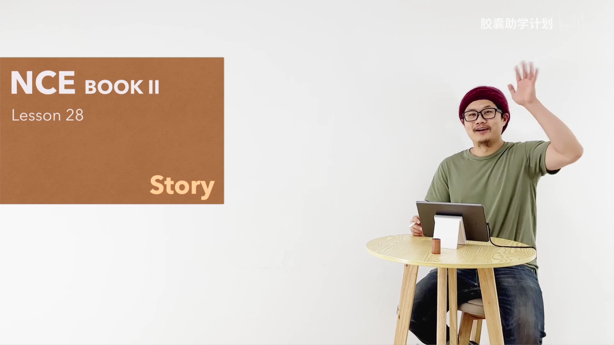

文字识别：NCE / BOOKⅡI / Lesson 28 / Story

### 画面 00:00:02

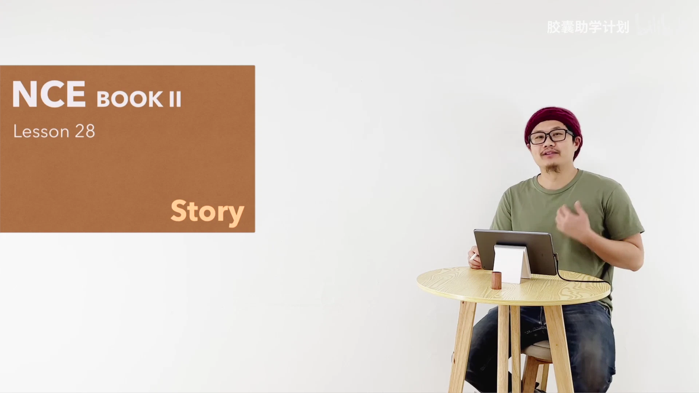

文字识别：NCE / BOOKⅡI / Lesson 28 / Story

### 画面 00:00:05

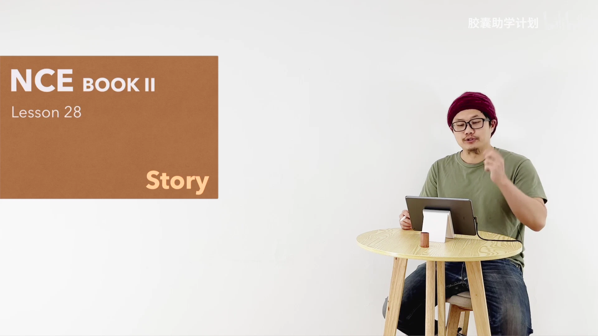

文字识别：NCE / BOOKⅡI / Lesson 28 / Story

### 画面 00:00:09

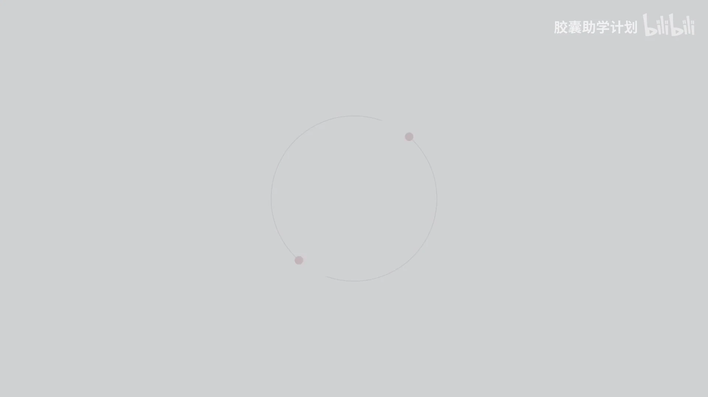

文字识别：胶囊助学计划bll

### 画面 00:00:13

### 画面 00:00:15

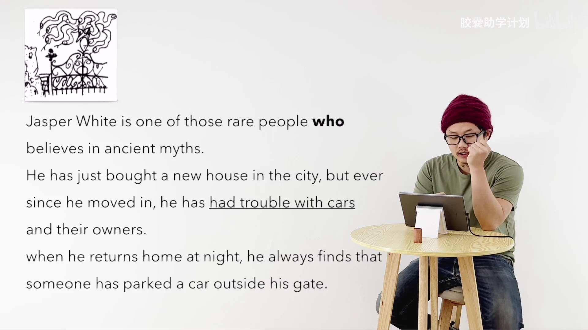

文字识别：胶囊助学计划 / Jasper White is one of those rare people who / believes in ancient myths. / He has just bought a new house in the city, but ever / since he moved in, he has had trouble with cars / and their owners. / when he returns home at night, he always finds that / someone has parked a car outside his gate.

## 00:00:30–00:01:00

其中之一, those rare people叫那些罕见的人，是那些罕见的人之一，一个人对吧？那些罕见的人之一，who注意就是他对吧？他怎么样呢？Believes in ancient myth，相信古代的神话传说。Okay, very good.注意一个小点，为什么我说who在这个地方实际上就是he而不是they呢？哪怕它紧跟着

### 画面 00:00:45

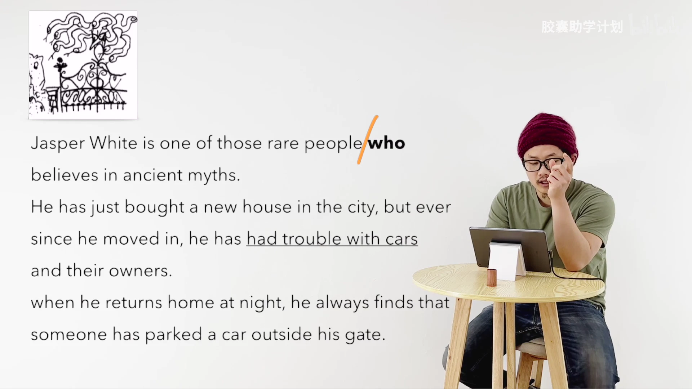

文字识别：胶囊助学计划 / Jasper White is one of those rare people/who / believes in ancient myths. / He has just bought a new house in the city, but ever / since he moved in, he has had trouble with cars / and their owners. / when he returns home at night, he always finds that / someone has parked a car outside his gate.

### 画面 00:00:57

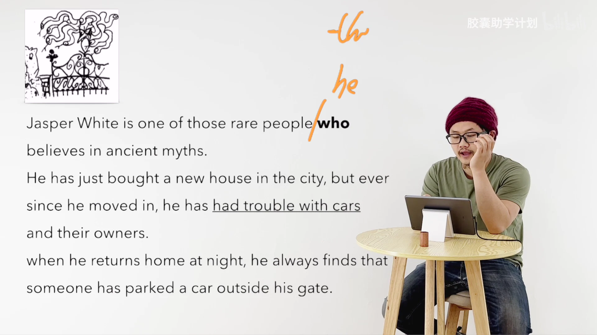

文字识别：胶囊助学计划 / he / Jasper White is one of those rare people/who / believes in ancient myths. / He has just bought a new house in the city, but ever / since he moved in, he has had trouble with cars / and their owners. / when he returns home at night, he always finds that / someone has parked a car outside his gate.

## 00:01:00–00:01:30

people，从几个角度我们去判断。第一，从语法的角度，后边是三单，他不能是 they，对吧？其次，他已经说了 one of those rare people，其中之一，所以一定是单数，所以就是 he 啊。如果我们再确定他是一个男人的话，那就是 he；女人就是 she，对吧？He has just bought，说他刚刚买，现在完成时 a new house in the city，他刚刚买了一个新的房子在市里边。好，注意

### 画面 00:01:00

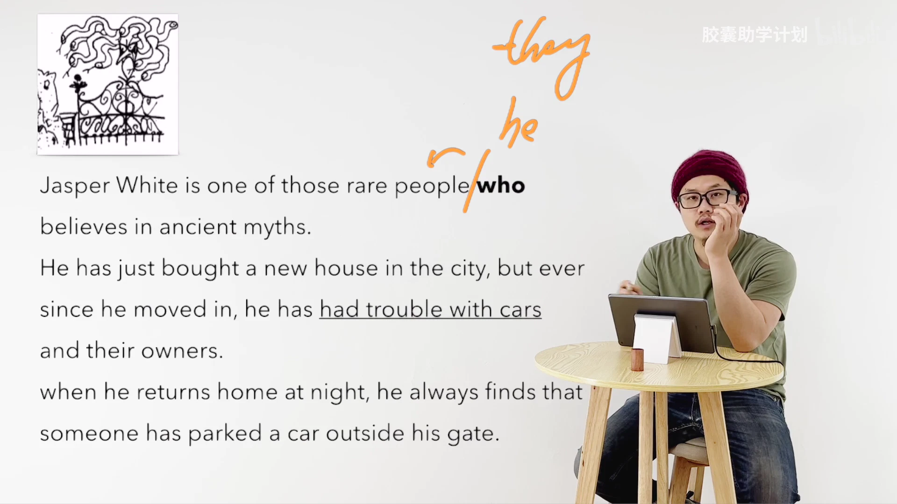

文字识别：they / 胶囊助学计划 / he / Jasper White is one of those rare people who / believes in ancient myths. / He has just bought a new house in the city, but ever / since he moved in, he has had trouble with cars / and their owners. / when he returns home at night, he always finds that / someone has parked a car outside his gate.

### 画面 00:01:08

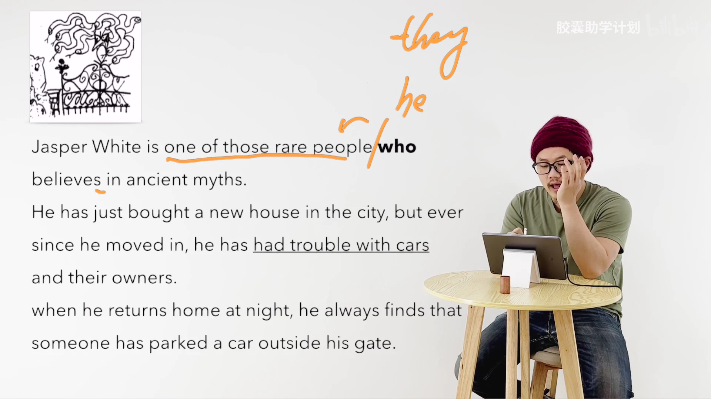

文字识别：thoy / 胶囊助 / he / Jasper White is one of those rare people who / believes in ancient myths. / He has just bought a new house in the city, but ever / since he moved in, he has had trouble with cars / and their owners. / when he returns home at night, he always finds that / someone has parked a car outside his gate.

## 00:01:30–00:02:00

这个现在完成时，就是告诉你他刚刚买了一个房子，然后一定他又不是从过去持续到现在，他一定接下来是围绕着这个房子去进行故事的讲解，这个逻辑才对，对吧？而不是说我刚刚买了一个新房子，哎，咱们来聊一聊什么苹果好吃吧，哪个哪个种类的苹果好吃，这不成谈话了逻辑，对吧？所以他一定是告诉你之前买了一个房子，对现在的他的生活产生了什么样的影响，我们看一下

### 画面 00:01:38

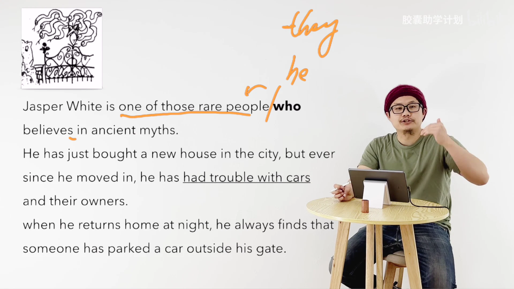

文字识别：thoy / he / Jasper White is one of those rare people who / believes in ancient myths. / He has just bought a new house in the city, but ever / since he moved in, he has had trouble with cars / and their owners. / when he returns home at night, he always finds that / someone has parked a car outside his gate.

### 画面 00:01:49

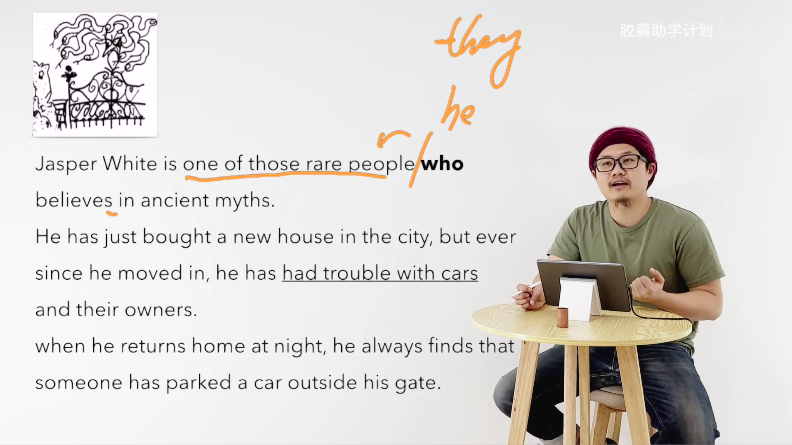

文字识别：thoy / he / Jasper White is one of those rare people who / believes in ancient myths. / He has just bought a new house in the city, but ever / since he moved in, he has had trouble with cars / and their owners. / when he returns home at night, he always finds that / someone has parked a car outside his gate.

### 画面 00:01:51

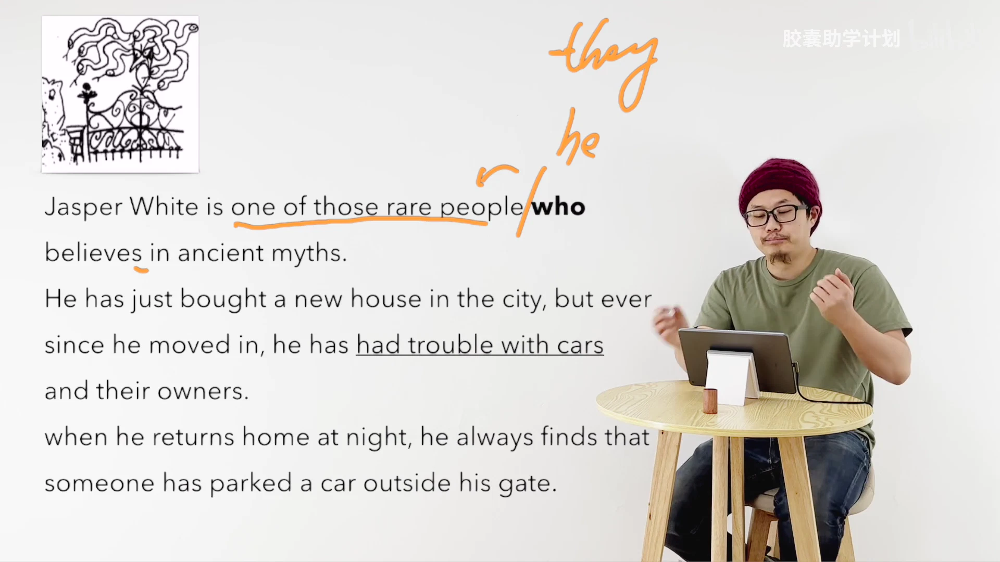

文字识别：thoy / he / Jasper White is one of those rare people who / believes in ancient myths. / He has just bought a new house in the city, but ever / since he moved in, he has had trouble with cars / and their owners. / when he returns home at night, he always finds that / someone has parked a car outside his gate.

### 画面 00:01:53

文字识别：thoy / he / Jasper White is one of those rare people who / believes in ancient myths. / He has just bought a new house in the city, but ever / since he moved in, he has had trouble with cars / and their owners. / when he returns home at night, he always finds that / someone has parked a car outside his gate.

## 00:02:00–00:02:30

是不是啊？但是 ever since 这是一个非常小的用法，叫做自从。你看，不用管 ever，只说 since 的话叫自从。那 ever since 其实还是自从，没有任何区别啊。自从 he moved in，自从他搬进来，怎么样呢？He has had trouble, had trouble with something. 这是一个习惯用法，但是我们在单词部分已经见过了，对吧？和什么什么会有一些麻烦

### 画面 00:02:05

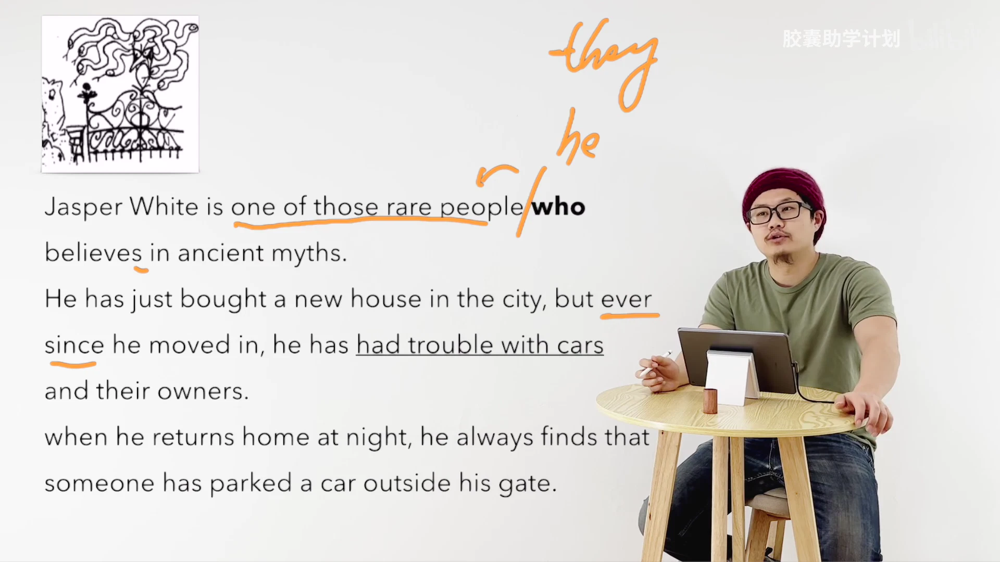

文字识别：thoy / he / Jasper White is one of those rare people who / believes in ancient myths. / He has just bought a new house in the city, but ever / since he moved in, he has had trouble with cars / and their owners. / when he returns home at night, he always finds that / someone has parked a car outside his gate.

### 画面 00:02:18

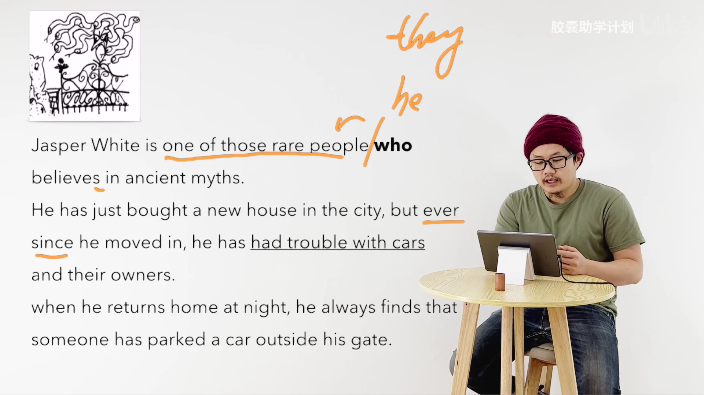

文字识别：hoy / he / Jasper White is one of those rare people who / believes in ancient myths. / He has just bought a new house in the city, but ever / since he moved in, he has had trouble with cars / and their owners. / when he returns home at night, he always finds that / someone has parked a car outside his gate.

## 00:02:30–00:03:00

困难，对吧？他一直就有一些麻烦和什么呢？和车 and their owners 以及他们的拥有者。好，到这儿我们也只是看到了一个现在完成时，叫 he has had，说他一直都有这样的一些麻烦。我们依旧很好奇的事情是有什么样的麻烦。所以正常来说，下文一定会讲这个。我们有这样一个心理预期，看一下是不是啊？ When 当第七课咱学的，对吧？ He returns home at night. 他返回

### 画面 00:02:48

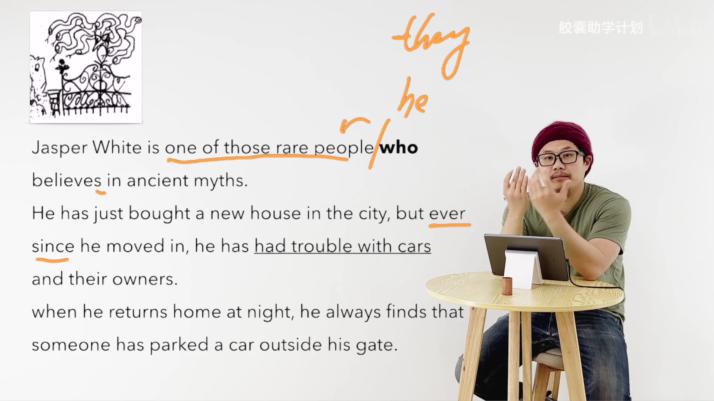

文字识别：thoy / 胶囊 / he / Jasper White is one of those rare people who / believes in ancient myths. / He has just bought a new house in the city, but ever / since he moved in, he has had trouble with cars / and their owners. / when he returns home at night, he always finds that / someone has parked a car outside his gate.

## 00:03:00–00:03:30

到家 at night，在夜晚的时候，哎，当他晚上回家的时候，he always find that。好，注意这个 that，各位看到，你就要去反应一下是定从还是宾从了，对吧？他前面跟了一个动词，他后边很可能是宾从；他前面跟了一个名词，他后边很可能是定从，不绝对如此啊。OK，那在这地方他说他经常发现一件事情，这件事情就是宾从。发现的事情是什么呢？说 someone

### 画面 00:03:14

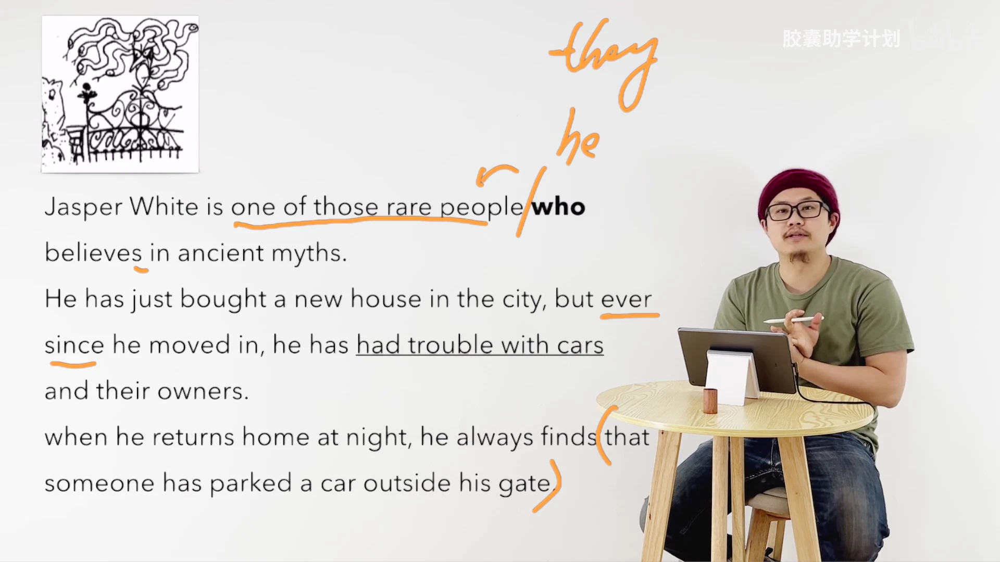

文字识别：thoy / he / Jasper White is one of those rare people who / believes in ancient myths. / He has just bought a new house in the city, but ever / since he moved in, he has had trouble with cars / and their owners. / when he returns home at night, he always finds that / someone has parked a car outside his gate

## 00:03:30–00:04:00

has parked a car outside his gate. 说有人呢已经停了一辆车 outside his gate，在他大门的外面已经停了一辆车了。OK，好，接下来说 because of this，因为这，因为什么呢？这指的是什么呢？叫做他回家的时候发现已经有人把车停在他家门口了。因为这件事情，he has not been able to，他一直都怎么样？Not叫不

### 画面 00:03:42

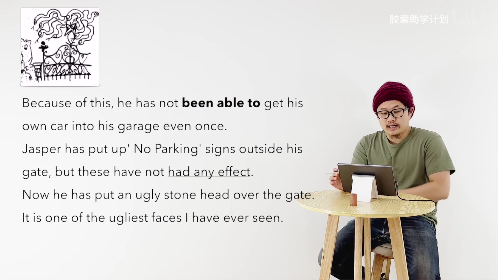

文字识别：Because of this, he has not been able to get his / own car into his garage even once. / Jasper has put up' No Parking' signs outside his / gate, but these have not had any effect. / Now he has put an ugly stone head over the gate. / It is one of the ugliest faces I have ever seen.

## 00:04:00–00:04:30

不不能怎么样呢? Being able to是，我们以后会学到。我记得是三十二课，咱们会学到的一个语法叫be able to。我们今天先不管它，我们先稍微等一下。我们只要知道它的意思，在这儿表示的是能啊。叫他一直都不能怎么样呢? Get his own car into his garage even once.哎，even once叫哪怕一次啊，once叫一次，even once叫甚至哪怕一次

### 画面 00:04:12

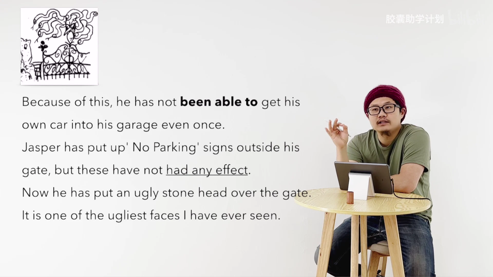

文字识别：胶囊助学计划 / Because of this, he has not been able to get his / own car into his garage even once. / Jasper has put up' No Parking' signs outside his / gate, but these have not had any effect. / Now he has put an ugly stone head over the gate. / It is one of the ugliest faces I have ever seen.

### 画面 00:04:23

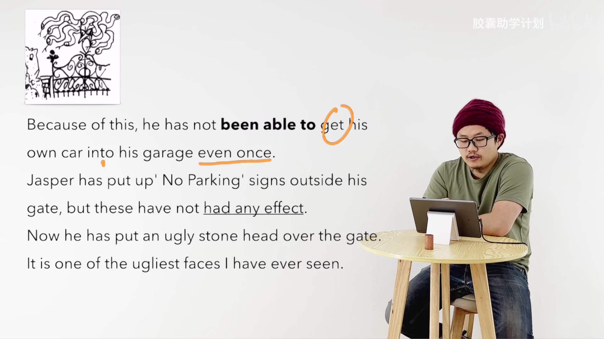

文字识别：胶囊助学计划 / Because of this, he has not been able to / gethis / own car into his garage even once. / Jasper has put up' No Parking' signs outside his / gate, but these have not had any effect. / Now he has put an ugly stone head over the gate. / It is one of the ugliest faces I have ever seen.

## 00:04:30–00:05:00

都不行，对吧？OK，那于是我们在这儿出现了一个单词叫 get，get 这个单词我们在新一可能我印象当中我们已经见过了，对吧？指的是获得。那 get 这个单词，我想提一下，其实它是一个万金油，是一个万能动词。放在句子当中的时候呢，你前后文都读懂了，get 在这个地方一般来说符合前后前后文语境，怎么翻译舒服怎么翻译，因为 get 意思实在

### 画面 00:04:36

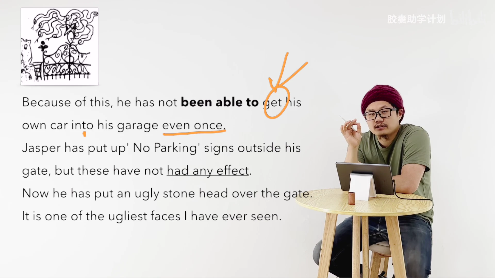

文字识别：胶囊助学计划 / Because of this, he has not been able to / gethis / own car into his garage even once. / - / Jasper has put up' No Parking' signs outside his / gate, but these have not had any effect. / Now he has put an ugly stone head over the gate. / It is one of the ugliest faces I have ever seen.

## 00:05:00–00:05:30

太多了。比如说，get his own car into his garage。我们先不管 get，叫 his own car，叫他自己的车；into his garage，叫进入他的车库。好，你注意，那什么叫 get his own car into his garage？开着他的车进入他的车库，叫做或者让他的车进入他的车库，使他的车进入他的车库。这地方的 get 都可以，好吧？所以我们管它叫万能动词。继续说，Jasper has put up。

### 画面 00:05:03

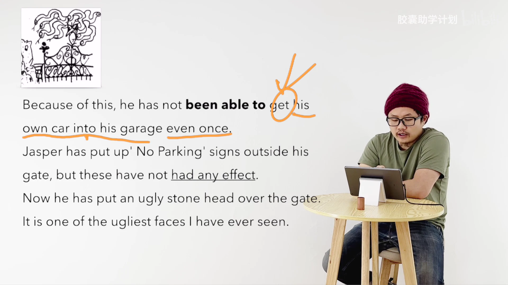

文字识别：胶囊助学计划 / Because of this, he has not been able to / gethis / own car into his garage even once. / Jasper has put up' No Parking' signs outside his / gate, but these have not had any effect. / Now he has put an ugly stone head over the gate. / It is one of the ugliest faces I have ever seen.

## 00:05:30–00:06:00

说 Jasper 已经 put up, put up. 哎，你想一下，put up the tent. 我们二十八课，哎，二十七课刚刚学过的，对吧？叫支起帐篷。他一，哎，他已经支起了一个什么呢？ No parking signs. No parking. 哎，禁止停车 signs 标志啊，禁止停车的一个标志。他竖了这么一个东西， outside his gate 在他大门的外面。这地方要提一个小点，就是 gate 和 door 稍

### 画面 00:05:33

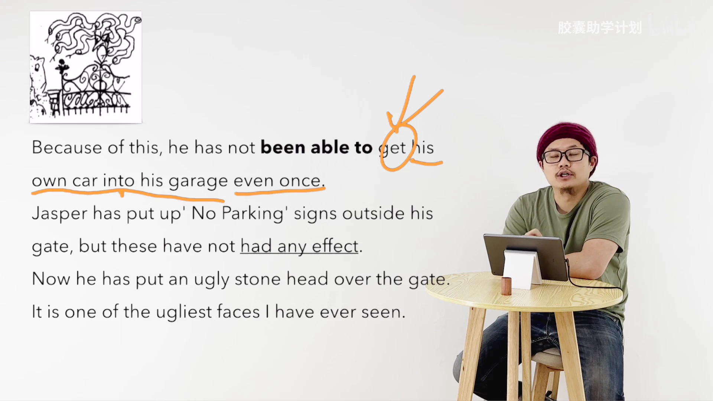

文字识别：Because of this, he has not been able to / get) / his / own car into his garage even once. / Jasper has put up' No Parking' signs outside his / gate, but these have not had any effect. / Now he has put an ugly stone head over the gate. / It is one of the ugliest faces I have ever seen.

## 00:06:00–00:06:30

微有一点点区别。如果你们自己家有院子，院子外边那个大铁门，我们一般把管它叫做 gate。那 door 呢，给人脑海当中的印象一般是你们家入户。如果比如说您住的是公寓，没有院子，你住六层，对吧？上去那个东西就叫做 door， OK 吧？好，放在它这个大铁门的外面。但是 but 啊，连词对吧？连了两个句子，六一二三四五六，连到了一起。This 说这

### 画面 00:06:00

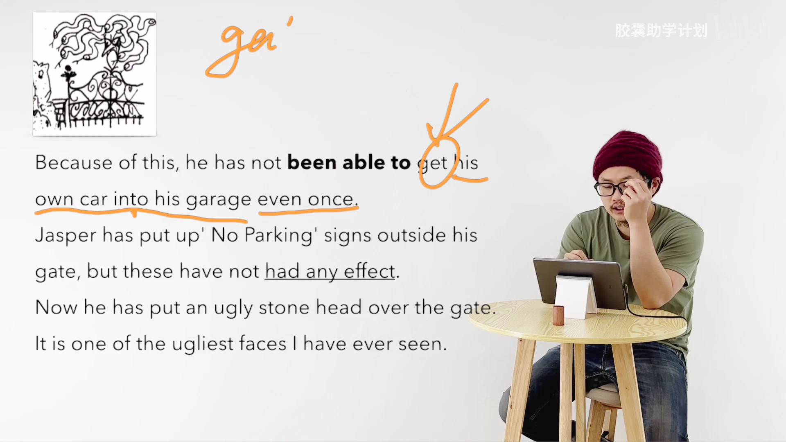

文字识别：胶囊助学计划 / Because of this, he has not been able to / get人 / his / own car into his garage even once. / Jasper has put up' No Parking' signs outside his / gate, but these have not had any effect. / Now he has put an ugly stone head over the gate. / It is one of the ugliest faces I have ever seen.

### 画面 00:06:02

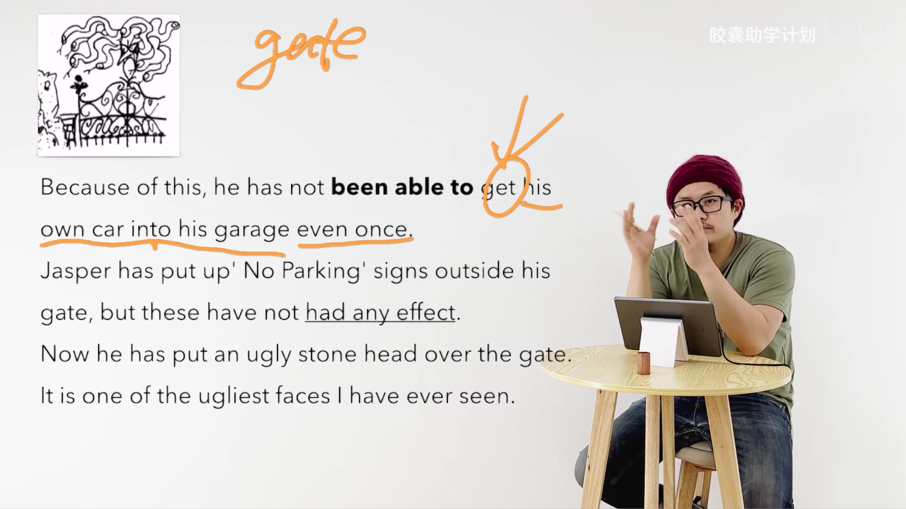

文字识别：gode / 胶囊助学计划 / Because of this, he has not been able to / gethis / own car into his garage even once. / Jasper has put up' No Parking' signs outside his / gate, but these have not had any effect. / Now he has put an ugly stone head over the gate. / It is one of the ugliest faces I have ever seen.

## 00:06:30–00:07:00

些 signs对吧？你看，注意还不是一个 signs对吧？复数说这些牌子呀，has not had any effect，一直都没有任何的效果，have no effect对吧？没有任何的效果。这个实际上我们在单词部分依旧还是提过了，已经啊。Now现在呢，he has put他已经放置了an ugly stone head，一个丑陋的石石头

### 画面 00:06:32

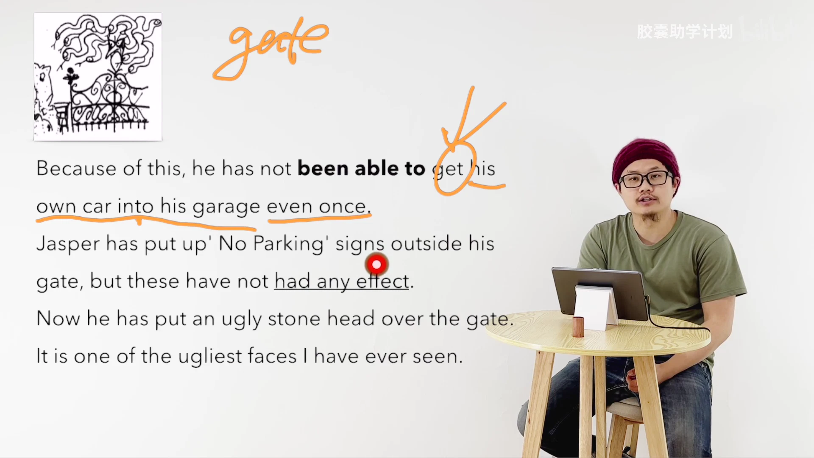

文字识别：gote / Because of this, he has not been able to / gethis / own car into his garage even once. / Jasper has put up' No Parking' signs outside his / gate, but these have not had any effect. / Now he has put an ugly stone head over the gate. / It is one of the ugliest faces I have ever seen.

### 画面 00:06:58

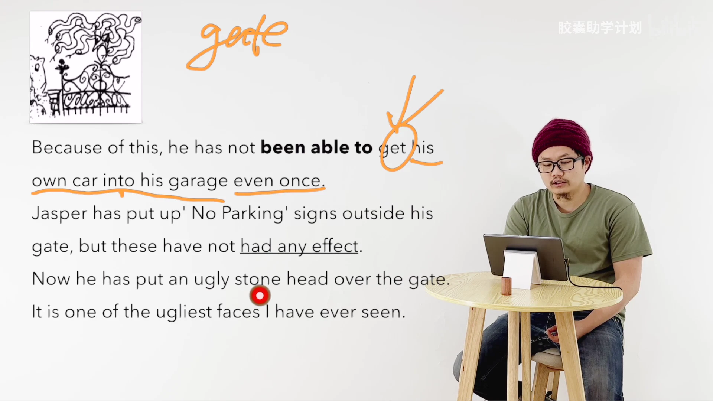

文字识别：gode / Because of this, he has not been able to / gethis / own car into his garage even once. / Jasper has put up' No Parking' signs outside his / gate, but these have not had any effect. / Now he has put an ugly stone head over the gate. / It is one of the ugliest faces I have ever seen.

## 00:07:00–00:07:30

做的头 over the gate，在这个大铁门的上方。It is one of the ugliest faces I've ever seen. 第八课我们直接当习惯用法去处理的一个句型，对吧？说它是最丑陋的一张脸，我所见过的，我所见过最丑的一张脸啊！您看图上面是不是有小蛇美杜莎？对吧？我们接往下。I asked him. 我问了他 what it was. 好，叫它是什么？我

### 画面 00:07:06

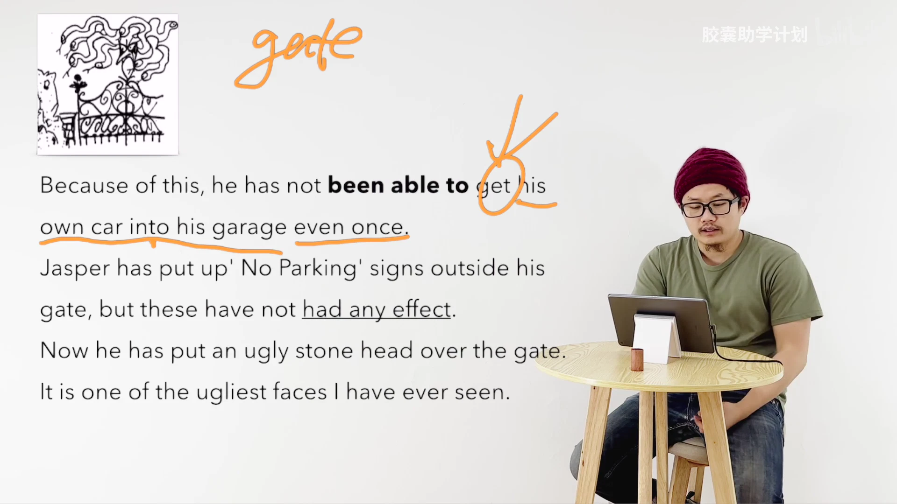

文字识别：gote / Because of this, he has not been able to / gethis / own car into his garage even once. / Jasper has put up' No Parking' signs outside his / gate, but these have not had any effect. / Now he has put an ugly stone head over the gate. / It is one of the ugliest faces I have ever seen.

### 画面 00:07:22

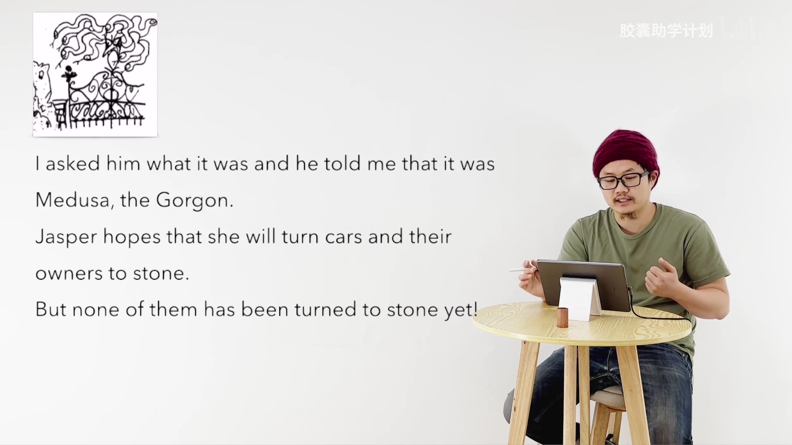

文字识别：I asked him what it was and he told me that it was / Medusa, the Gorgon. / Jasper hopes that she will turn cars and their / owners to stone. / But none of them has been turned to stone yet!

## 00:07:30–00:08:00

问了他，说他是什么？And连接了两个句子。He told me他告诉我的是什么呢？后面一个宾从，That it was Medusa the Gorgon说他是美杜莎Gorgon，对吧？啊，就是一个组合，然后是这个里边的一个人物。Jasper hopes他希望的是什么呢？后边跟的不是定从，跟的是一个宾语从句。希望的是She will turn cars and their owners

### 画面 00:07:52

文字识别：胶囊助学计划 / I asked him what it was and he told me that it was / Medusa, the Gorgon. / Jasper hopes hat she will turn cars and their / owners to stone.7 / But none of them has been turned to stone yet!

## 00:08:00–00:08:30

to stone.说这个美杜莎呀，能将turn cars and their owners to stone变啊，turn就是变，变这个车以及他们的拥有者变成石头，是吧？相信的是古代希腊的传说。刚记得我讲单词的时候说到，说如果你去看美杜莎的眼睛，你会被变成石头，对吧？他就那儿放了个美杜莎的雕像啊。但是but none of them啊，没有对

### 画面 00:08:05

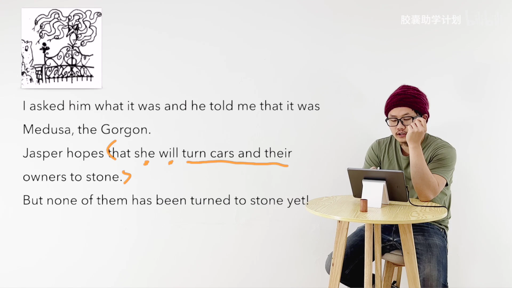

文字识别：胶囊助学计划 / I asked him what it was and he told me that it was / Medusa, the Gorgon. / Jasper hopes hat she willturn cars and their / owners to stone.7 / But none of them has been turned to stone yet!

### 画面 00:08:10

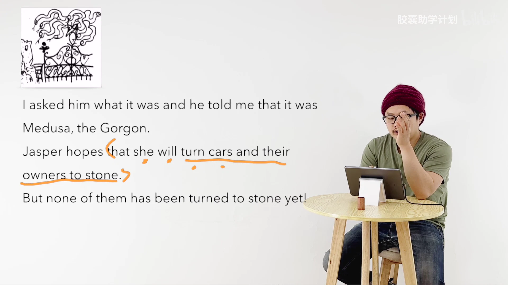

文字识别：胶囊助 / I asked him what it was and he told me that it was / Medusa, the Gorgon. / Jasper hopes hat she will turn cars and their / owners to stone.> / But none of them has been turned to stone yet!

### 画面 00:08:28

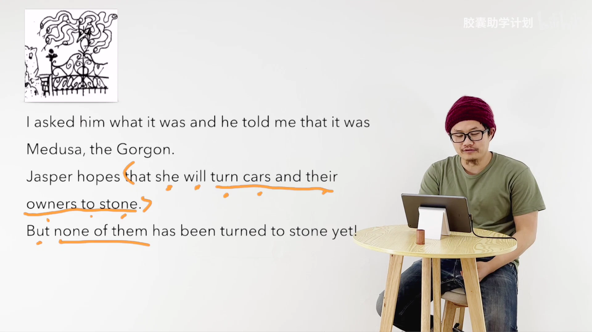

文字识别：I asked him what it was and he told me that it was / Medusa, the Gorgon. / Jasper hopes hat she will turn cars and their / owners to stone.> / But none of them has been turned to stone yet!

## 00:08:30–00:09:00

吧？None of them就是没有啊，就是no one啊，has been turned叫做已经被变了to stone变成石头了。Yet叫做仍然是吧，还啊还没有任何人被变成石头。Has been但啊这是一个现在完成时的被动，应该是我们第十课学过的动词变化，对吧？好，Recap本课没有过多的习惯用法，只有两个我认为价值很高的，我们在单词部分已经讲过

### 画面 00:08:41

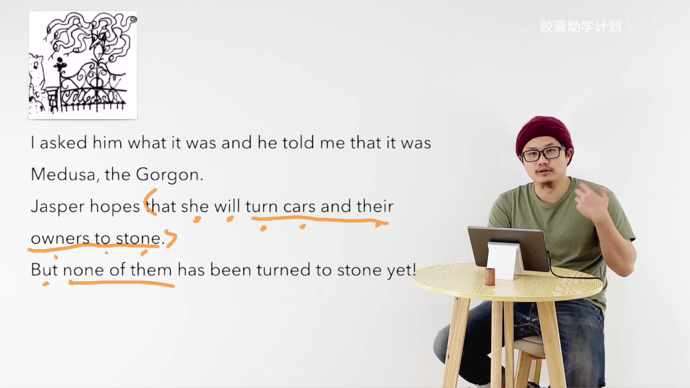

文字识别：I asked him what it was and he told me that it was / Medusa, the Gorgon. / Jasper hopes hat she willturn cars and their / owners to stone.? / But none of them has been turned to stone yet!

### 画面 00:08:51

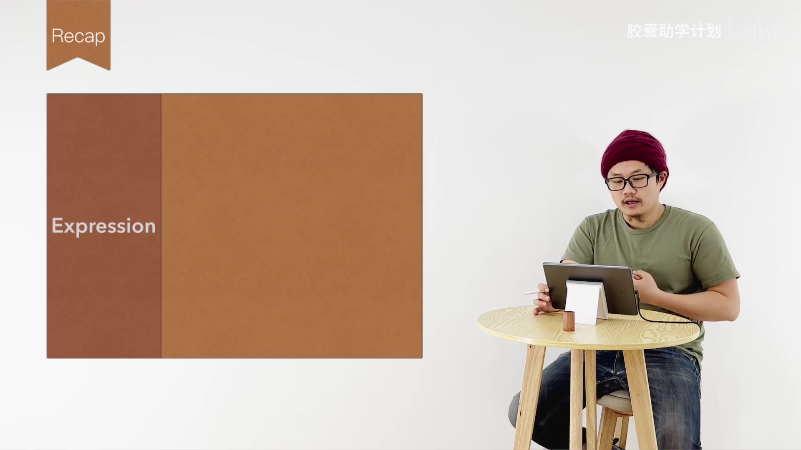

文字识别：Recap / Expression

### 画面 00:08:53

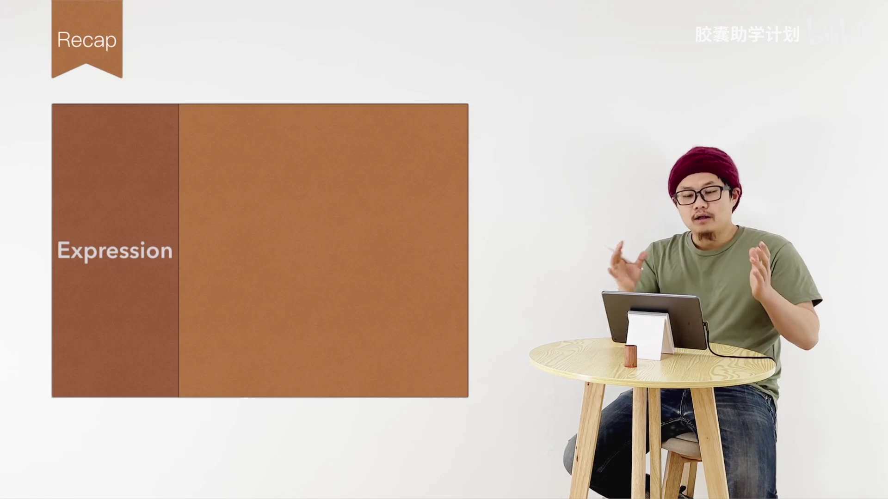

文字识别：Recap / Expression

### 画面 00:08:55

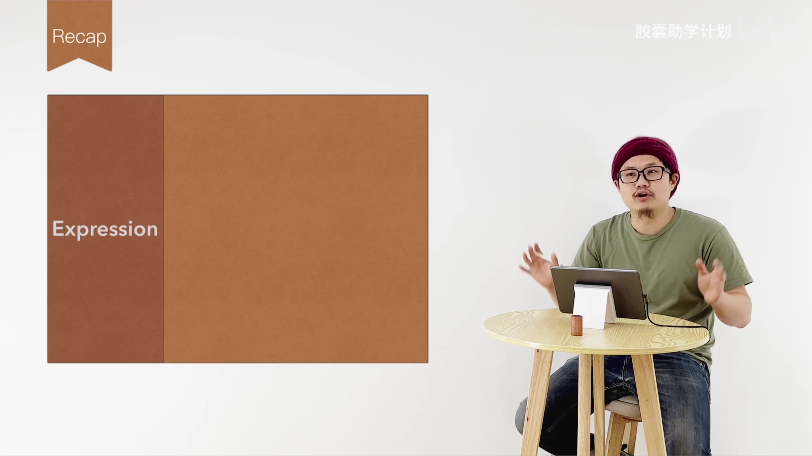

文字识别：Recap / Expression

### 画面 00:08:58

文字识别：Recap / Expression

## 00:09:00–00:09:30

了，所以呢，对于各位来说，最重要的事情就变成了第二个，叫文章一定要熟读成诵，好吧？那以上呢就是本期视频的全部内容了。如果大家喜欢我们的课程呢，欢迎大家关注、订阅、一键三连，分享给那些需要的朋友。See you next time.

### 画面 00:09:01

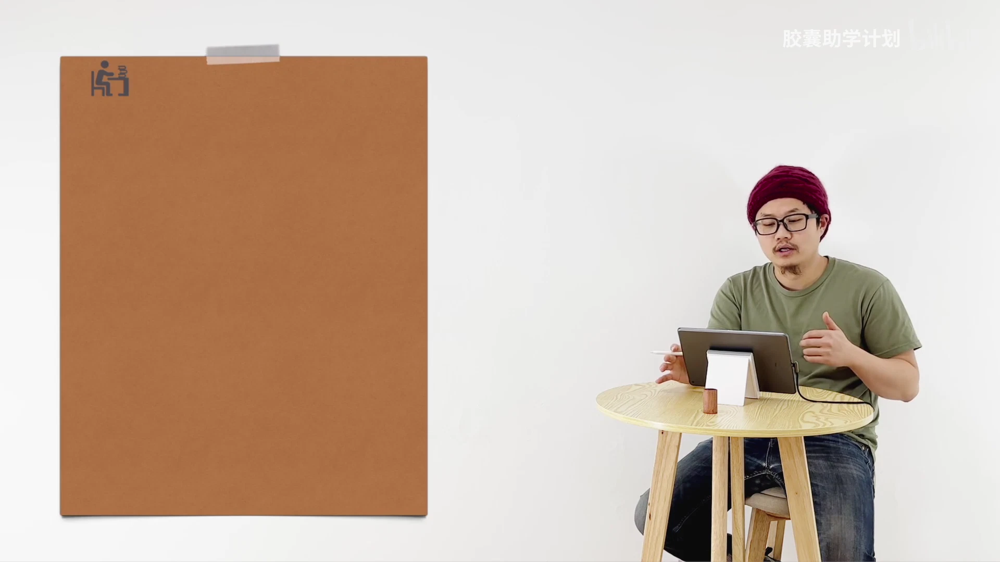

文字识别：$

### 画面 00:09:03

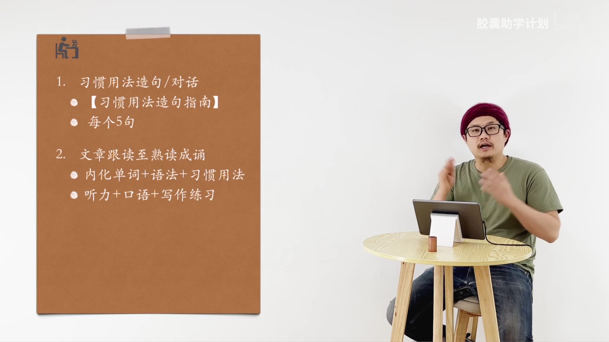

文字识别：胶囊助学计划 / 1. / 习惯用法造句/对话 / 【习惯用法造句指南】 / 每个5句 / 文章跟读至熟读成诵 / 内化单词+语法+习惯用法 / 听力+口语+写作练习

### 画面 00:09:05

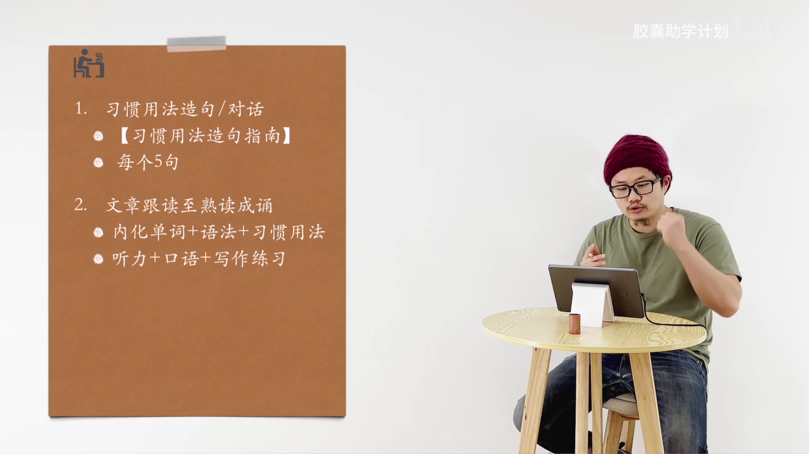

文字识别：胶囊助学计划 / 1. / 习惯用法造句/对话 / 【习惯用法造句指南】 / 每个5句 / 文章跟读至熟读成诵 / 内化单词+语法+习惯用法 / 听力+口语+写作练习

### 画面 00:09:07

文字识别：胶囊助学计划

### 画面 00:09:18

### 画面 00:09:20

文字识别：CAPSULEACADEMY / 胶囊助学计划 / 『 / 小红书 / Lecturer / Leo / OE

### 画面 00:09:23

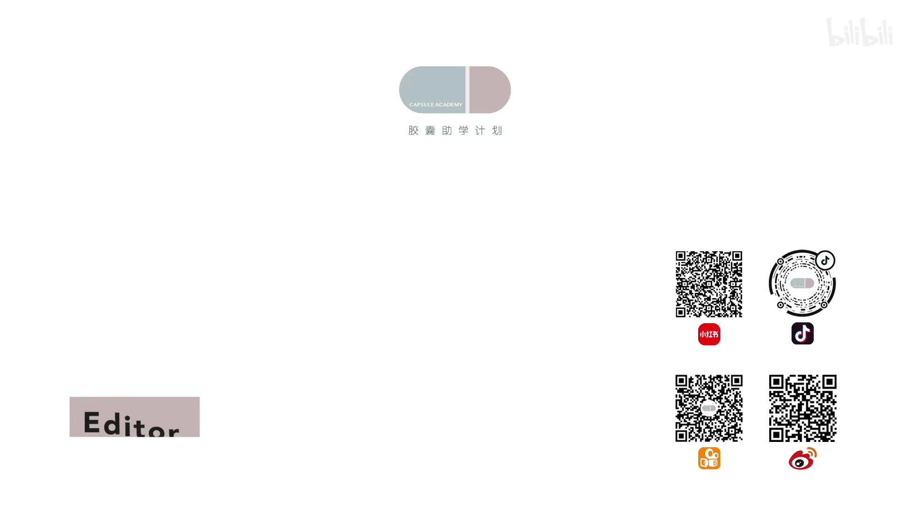

文字识别：CAPSULEACADEMY / 胶囊助学计划 / 『 / 小红书 / Editor / OE

### 画面 00:09:26

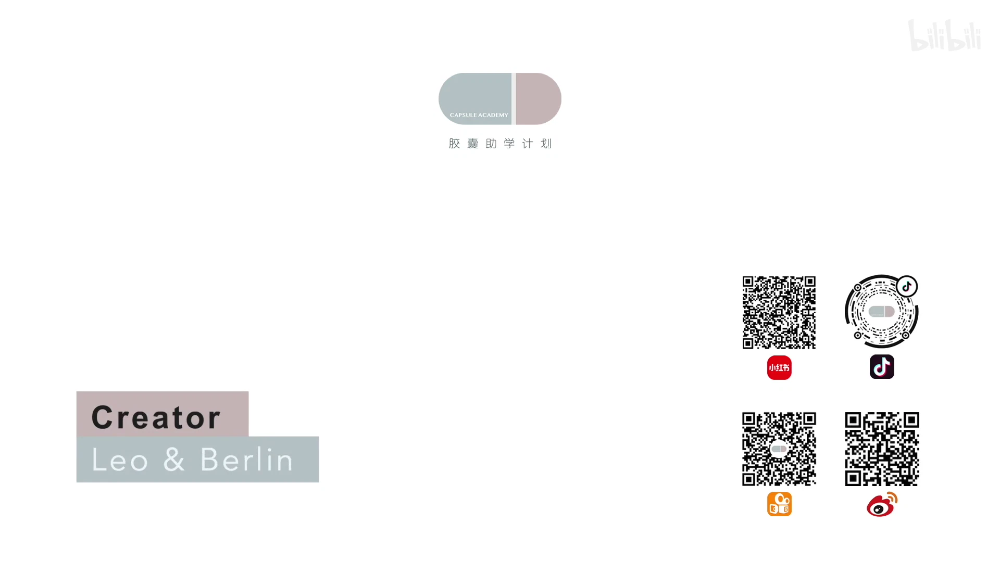

文字识别：CAPSULEACADEMY / 胶囊助学计划 / 『 / 小红书 / Creator / Leo & Berlin / OE

### 画面 00:09:28

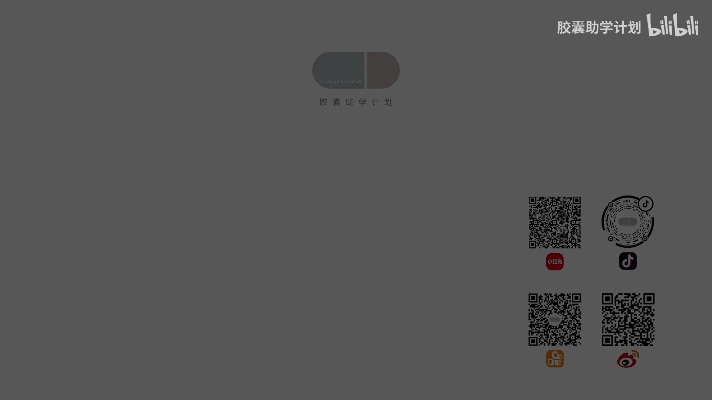

文字识别：bilibili / 胶囊助学计划 / 胶囊助学计划 / 小红书 / OE

## 00:09:30–00:09:30

### 画面 00:09:30

文字识别：bilibili / 胶囊助学计划

