# L028 听说读写复述练习

快速机器解析：语音为单模型转写，未进行独立交叉校对或人工复核；画面每秒采样并按变化选帧，短时文字和标记可能遗漏。截图时间约有 1 秒误差。图片有损压缩；遇到疑点请按时间查看 Google Drive 原视频。

## 00:00:00–00:00:30

Hello everyone, welcome to Capsule Academy. This is Leo. Today we're going to learn New Concept English Book Two, Lesson Twenty Eight Practices.老习惯，各位一定要知道啊！进行如下练习唯一的前提就是文章您一定要熟读成诵，否则请勿开始。Hope you gonna enjoy it.好，那我们先看第一题 comprehension. 它的目的就是能让我们听懂别人的发问，我问您答。别看

### 画面 00:00:00

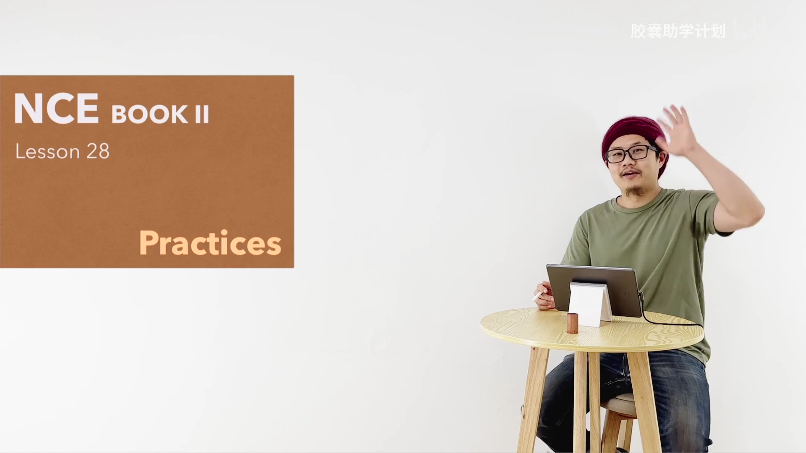

文字识别：NCE / BOOKI"I / Lesson 28 / Practices

### 画面 00:00:02

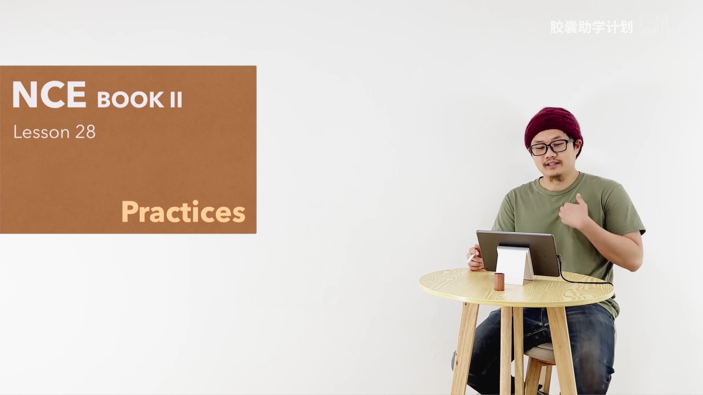

文字识别：NCE / BOOK I"I / Lesson 28 / Practices

### 画面 00:00:05

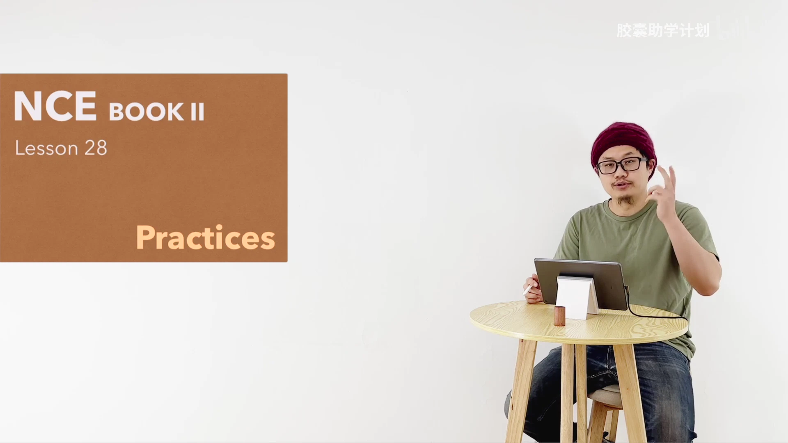

文字识别：NCE / BOOKII / Lesson 28 / Practices

### 画面 00:00:08

文字识别：进行如下练习唯一前提 / 文章跟读至熟读成诵 / 否则请勿开始

### 画面 00:00:12

文字识别：进行如下练习唯一前提 / 文章跟读至熟读成诵 / 否则请勿开始

### 画面 00:00:18

文字识别：胶囊助学计划bil / •

### 画面 00:00:22

文字识别：胶囊助学计划

### 画面 00:00:24

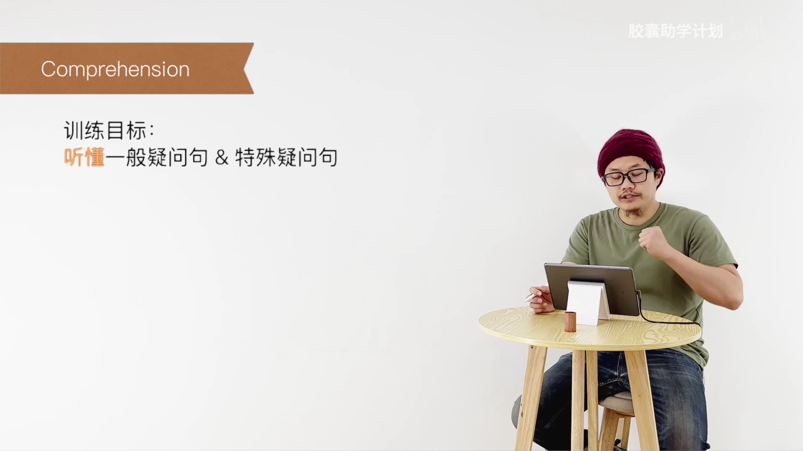

文字识别：Comprehension / 训练目标： / 听懂一般疑问句＆特殊疑问句

## 00:00:30–00:01:00

吧？你可以看着文章找答案。来了，第一题。Are there many people who believes in Asian myth? 第一句话就给你答案了，对吧？No, there aren't. Next one. Does Jasper White believe in Asian myth? Yes, he does. Next one. What has he just bought? A new house. Next one. Where is it?

### 画面 00:00:32

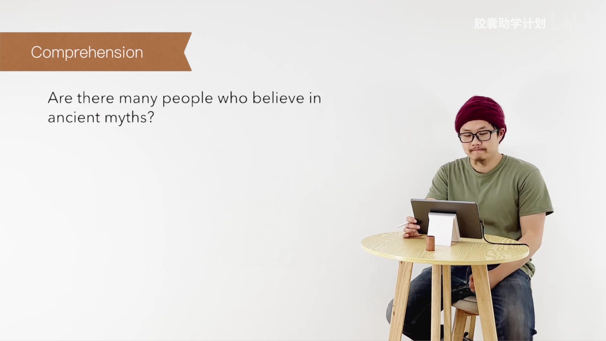

文字识别：Comprehension / Are there many people who believe in / ancient myths?

### 画面 00:00:46

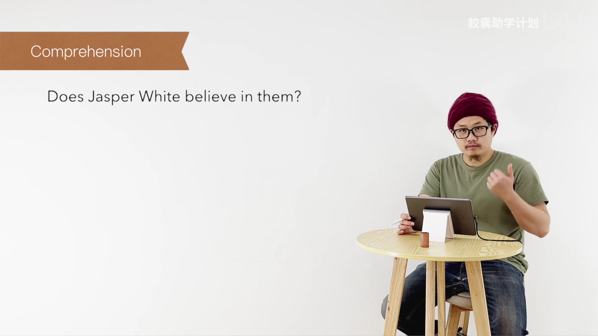

文字识别：Comprehension / Does Jasper White believe in them?

## 00:01:00–00:01:30

in the city? Next one, since when has he had trouble with cars and their owners? Since he moved in. Next one, what does he always find when he comes home in the evenings? That someone has parked a car outside his gate. Next one, is this why he's never

### 画面 00:01:03

文字识别：Comprehension / Since when has he had trouble with cars and / their owners?

### 画面 00:01:13

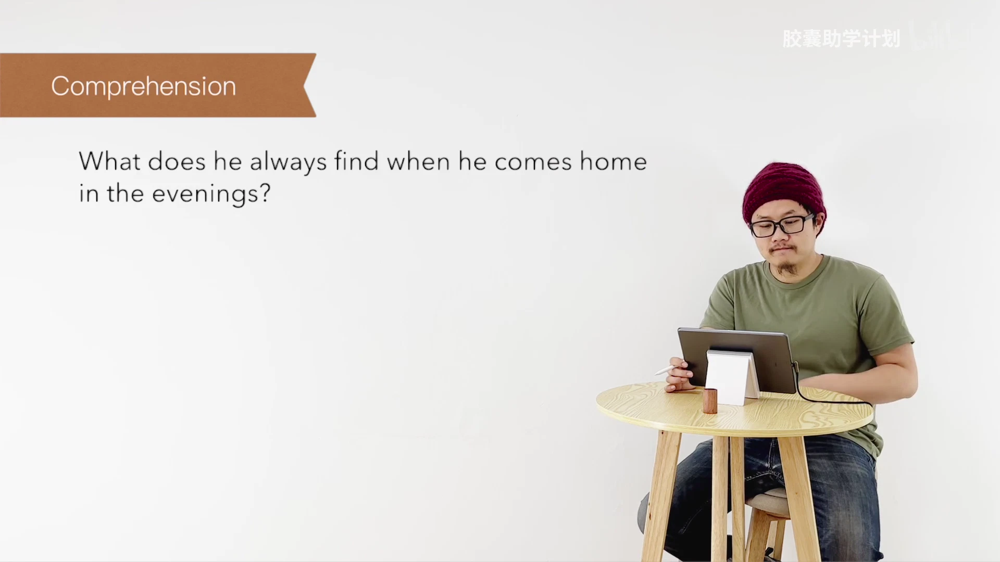

文字识别：Comprehension / What does he always find when he comes home / in the evenings?

### 画面 00:01:26

文字识别：Comprehension / Is this why he's never been able to get his / car into his garage?

## 00:01:30–00:02:00

been able to get his car into his garage? Yes, it is. Next one, what has he put up outside his gate? No parking signs. Next one, have they had any effect? No, they haven't. Next one, where has he put a stone hat over the gate? Next one, was

### 画面 00:01:36

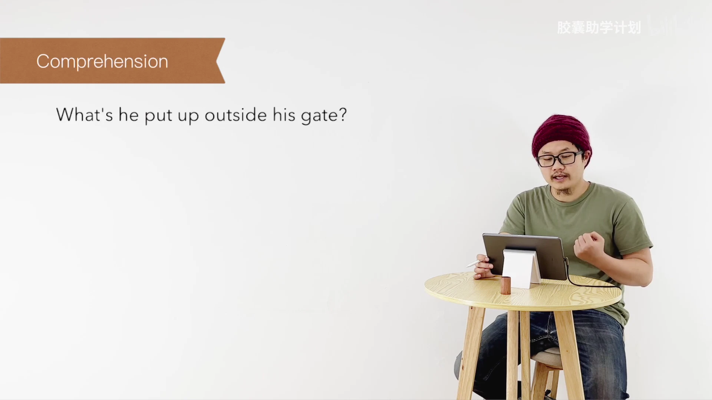

文字识别：Comprehension / What's he put up outside his gate?

## 00:02:00–00:02:30

it like? Very ugly. Good asking questions, right? 各位训练的能力是各位能发问的能力啊，准确性 accuracy 非常的重要啊， fluency 没有那么的重要，所以一定可以慢啊，可以慢，但一定不能错啊。好，我们老习惯还是先给大家说一下 Jasper White believes in Asian myth. 一般现在时 does 提前动词换回原形，然后 what 对 Asian myth

### 画面 00:02:04

文字识别：Asking questions / 训练目标： / 会说一般疑问句＆特殊疑问句 / Accuracy / Fluency

### 画面 00:02:20

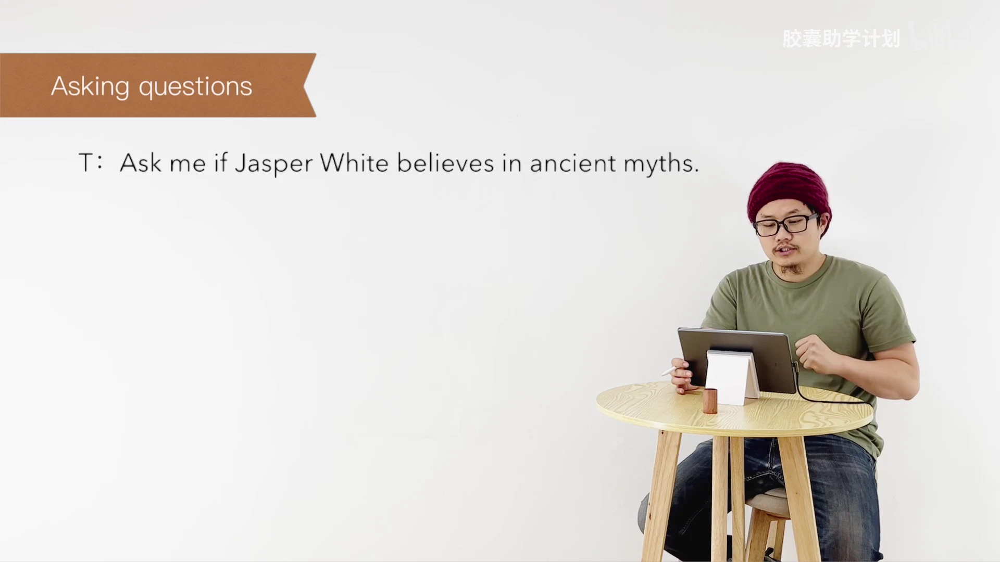

文字识别：Asking questions / T: Ask me if Jasper White believes in ancient myths.

### 画面 00:02:29

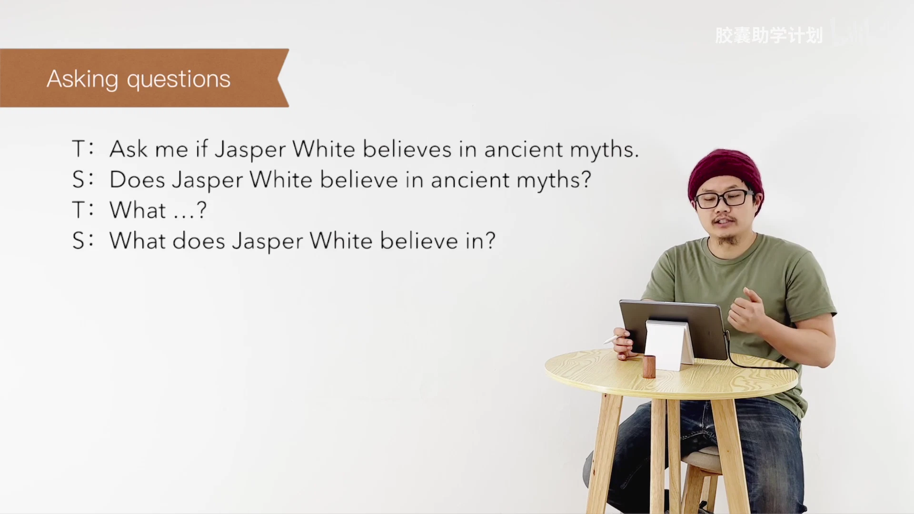

文字识别：Asking questions / T: Ask me if Jasper White believes in ancient myths. / S: Does Jasper White believe in ancient myths? / T: What ...? / S: What does Jasper White believe in?

## 00:02:30–00:03:00

提问叫 what does Jasper White believe in 对吧这是一个例子接下来呢全是这个思路啊我们挨个去简单的说一下那 what kind what kind 往往是对形容词提问对吧 what kind of 那在这里面形容词就是 ancient 所以那就是 what kind of myth 啊 does Jasper White believe in OK 那 who 对主语提问直接替代就可以了 next one 啊那 who 啊好的 OK 说 he has just bought a new house

### 画面 00:02:34

文字识别：Asking questions

### 画面 00:02:39

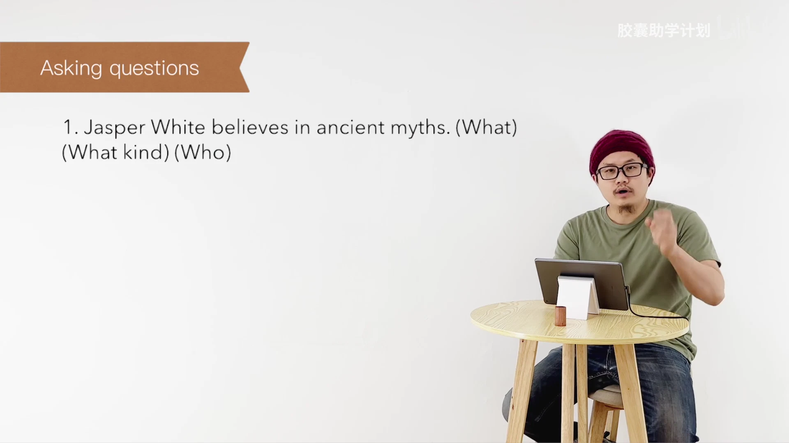

文字识别：Asking questions / 1. Jasper White believes in ancient myths. (What) / (What kind)(Who)

## 00:03:00–00:03:30

P.S. is has提前. What对a new house提问. Is in the city. Is提前. Where对in the city提问. What对主语提问. His he has had trouble since he moved in. Has提前. What对trouble提问. What kind of对吧？其实这里面没有，那就直接说What kind of trouble has he had since he moved in? Why整句话对吧？Okay.

### 画面 00:03:03

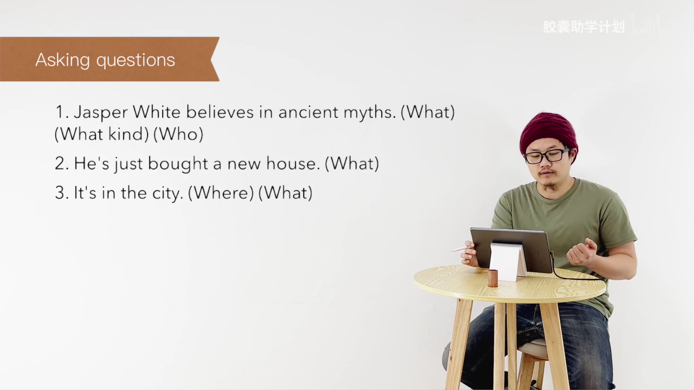

文字识别：Asking questions / 1. Jasper White believes in ancient myths. (What) / (What kind)(Who) / 2. He's just bought a new house. (What) / 3. Ilt's in the city. (Where) (What)

### 画面 00:03:08

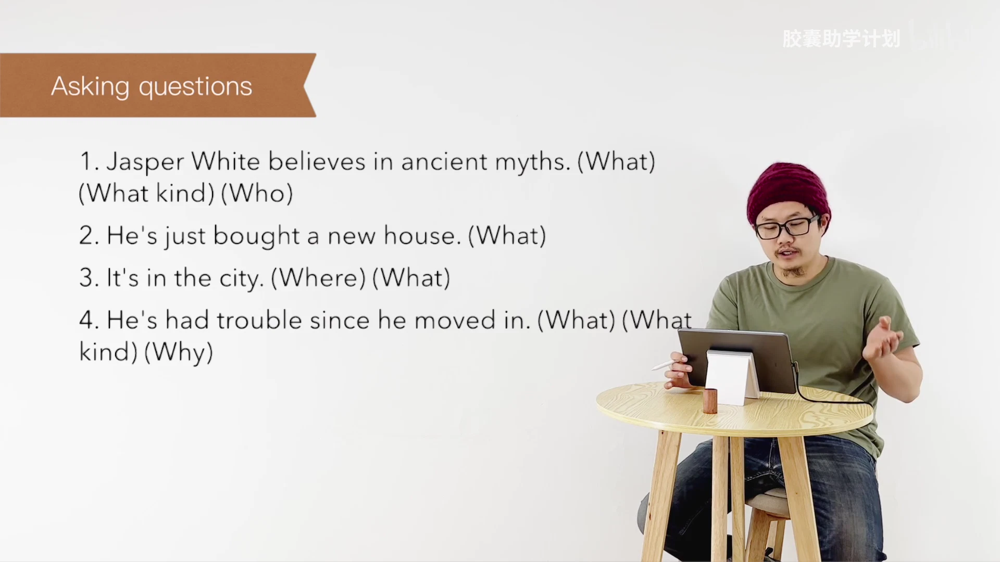

文字识别：Asking questions / 1. Jasper White believes in ancient myths. (What) / (What kind)(Who) / 2. He's just bought a new house. (What) / 3. It's in the city. (Where) (What) / 4. He's had trouble since he moved in.(What) (What / kind)(Why)

## 00:03:30–00:04:00

He has trouble with cars and their owners. Who对主语直接提问就行了，对吧？Okay.嗯，下一个They parked outside his gate.一般现在是do提前。Where对outside his gate提问。This happens every night.一般现在是does提前。How often问频率，那肯定是every night提问，对吧？所以How often does this happen?啊，答案He's put up no parking signs. P.S.是has has提前。What对no parking signs提问，

### 画面 00:03:35

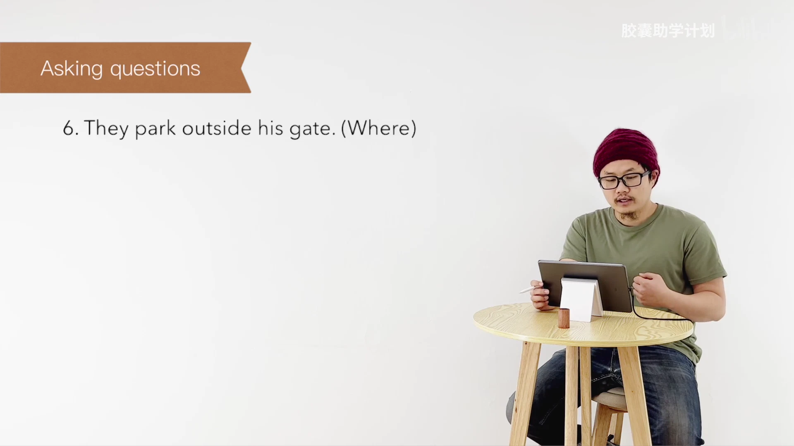

文字识别：Asking questions / 6. They park outside his gate. (Where)

### 画面 00:03:49

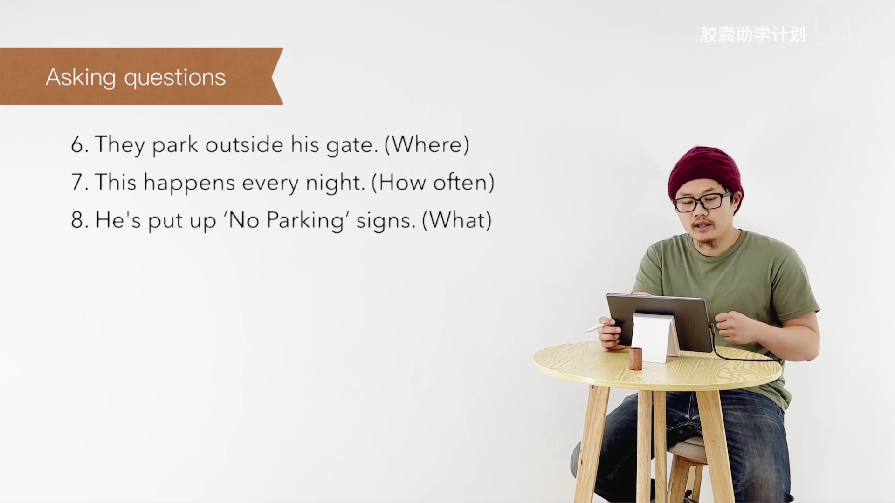

文字识别：Asking questions / 6. They park outside his gate.(Where) / 7. This happens every night. (How often) / 8. He's put up 'No Parking' signs. (What)

## 00:04:00–00:04:30

对吧？他支起了什么？There outside his gate are提前where对outside his gate提问。He's put an ugly stone head over the gate has提前what kind of对什么提问？An ugly stone，对吧？就所以是what kind of head has he put over the gate？Okay，那where肯定是对over the gate提问。Why对整句话啊没什么可说的，是一个呃did提前what对

### 画面 00:04:06

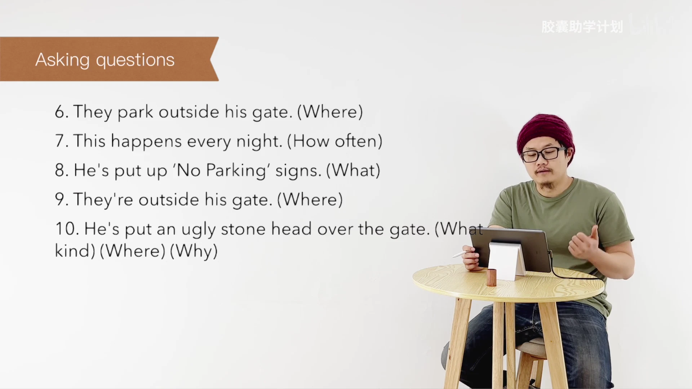

文字识别：Asking questions / 6. They park outside his gate.(Where) / 7. This happens every night. (How often) / 8. He's put up 'No Parking' signs. (What) / 9. They're outside his gate. (Where) / 10. He's put an ugly stone head over the gate. (What / kind) (Where) (Why)

## 00:04:30–00:05:00

What it was提问，所以What did you ask him?你问他什么了呢？我问的他是What it was，对吧？它是什么东西啊？好，Tell the story复述能力啊，文章一定要读到很熟，可以有一点点错误，但不能太慢。练的是我们流利性，这个地方放到这儿，因为我们第一单元做了很多示范，各位在这里简单的给自己过一遍就可以了，好吧？好，接下来呢，Summary writing摘要写作，写完来这里对答案就

### 画面 00:04:36

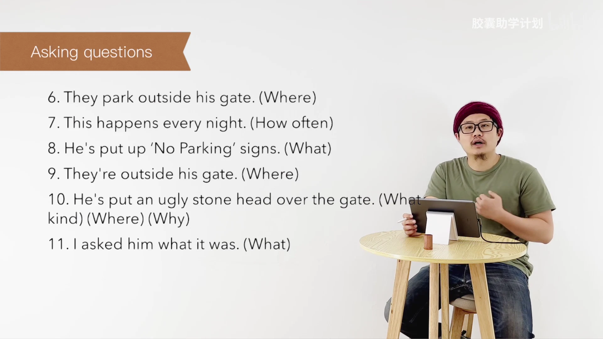

文字识别：Asking questions / 6. They park outside his gate. (Where) / 7. This happens every night. (How often) / 8. He's put up 'No Parking' signs. (What) / 9. They're outside his gate. (Where) / 10. He's put an ugly stone head over the gate.(What / kind) (Where) (Why) / 11.| asked him what it was. (What)

### 画面 00:04:39

文字识别：Tell the story / 训练目标： / 口语复述能力 / Accuracy / Fluency

### 画面 00:04:48

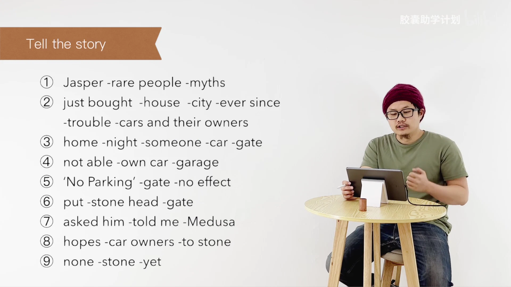

文字识别：Tell the story / 1 / Jasper -rare people -myths / just bought -house -city -ever since / -trouble -cars and their owners / home -night -someone -car -gate / not able -own car -garage / 'No Parking'-gate -no effect / put -stone head -gate / 6 / asked him -told me -Medusa / hopes -car owners -to stone / 9 / none -stone -yet

### 画面 00:04:55

文字识别：Summary writing: Key / 训练目标： / 写作复述能力

### 画面 00:04:58

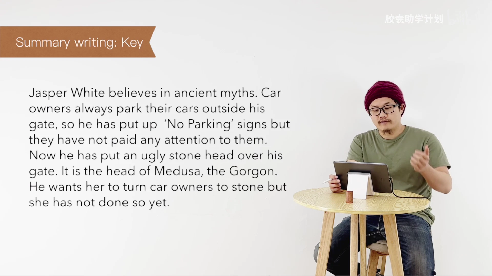

文字识别：Summary writing: Key / Jasper White believes in ancient myths. Car / owners always park their cars outside his / gate, so he has put up 'No Parking' signs but / they have not paid any attention to them. / Now he has put an ugly stone head over his / gate. It is the head of Medusa, the Gorgon. / He wants her to turn car owners to stone but / she has not done so yet.

## 00:05:00–00:05:30

可以了。在最后 topic for discussion，它是练习我们完全自由的对话，accuracy and fluency全要练，对吧？好，那我们看一下三道题。第一，说 is there anything is there anything that annoys you very much about other people's behavior? Tell us about it。说别人有没有一些行为会让你觉得特别的烦恼啊？给我们讲一讲这些事儿，对吧？OK。第二，说 what rules would you like to make for cars and their owners？说

### 画面 00:05:00

文字识别：Topics for discussion / 训练目标： / 完全自由的对话 / Accuracy / Fluency

### 画面 00:05:09

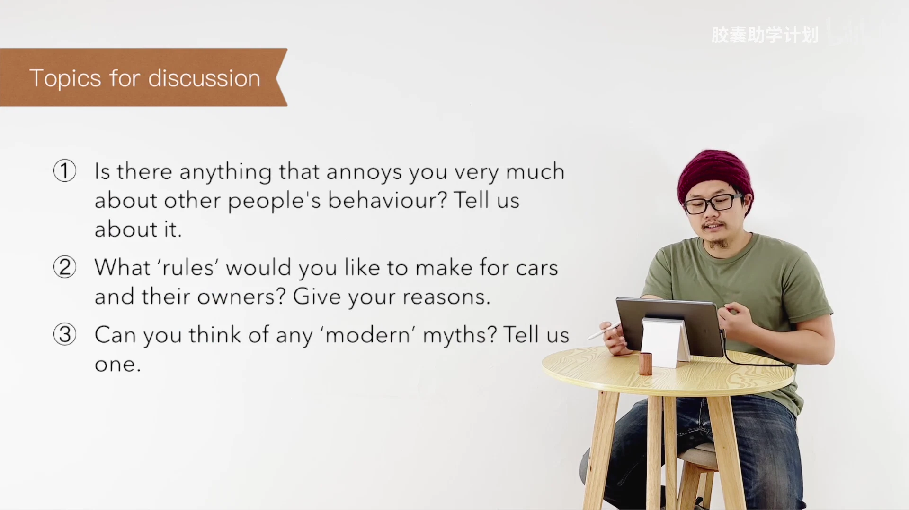

文字识别：Topics for discussion / Is there anything that annoys you very much / about other people's behaviour? Tell us / about it. / What'rules' would you like to make for cars / and their owners? Give your reasons. / Can you think of any'modern'myths? Tell us / one.

## 00:05:30–00:06:00

Hey, you want to give other cars and car owners some rules? Rules, rules, rules. Rules, rules, rules. Rules, rules, rules. Rules, rules, rules. Rules, rules, rules. Rules, rules, rules. Rules, rules, rules. Rules, rules, rules. Rules, rules, rules. Rules, rules, rules. Rules, rules, rules. Rules, rules, rules. Rules, rules, rules. Rules, rules, rules. Rules, rules, rules. Rules, rules, rules. Rules, rules, rules. Rules, rules, rules. Rules, rules, rules. Rules, rules, rules. Rules, rules, rules. Rules, rules, rules. Rules, rules, rules. Rules, rules, rules. Rules, rules, rules. Rules, rules, rules. Rules, rules, rules. Rules, rules, rules. Rules, rules, rules. Rules, rules, rules. Rules, rules, rules. Rules, rules, rules. Rules, rules, rules. Rules, rules, rules. Rules, rules, rules. Rules, rules, rules. Rules, rules, rules. Rules, rules, rules. Rules, rules, rules.

### 画面 00:05:39

文字识别：Topics for discussion / Is there anything that annoys you very much / about other people's behaviour? Tell us / about it. / What'rules' would you like to make for cars / and their owners? Give your reasons. / Can you think of any'modern' myths? Tell us / one.

### 画面 00:05:52

文字识别：胶囊助学计划

### 画面 00:05:55

文字识别：胶囊助学计划 / 1.Ask me if写&朗读 / 摘要写作写&答案 / 元

### 画面 00:05:57

文字识别：胶囊助学计划 / 1.Askme if写&朗读 / 摘要写作写&答案 / 3.Tell the story 口语复述

### 画面 00:05:59

文字识别：胶囊助学计划 / 1.Ask me if写&朗读 / 摘要写作写&答案 / 3.Tell the story 口语复述 / 专栏 / 4.

## 00:06:00–00:06:24

专栏，老习惯能找到，好吧？那以上呢就是本期视频的全部内容了。如果大家喜欢我们的课程呢，欢迎大家关注、订阅、一键三连，分享给那些需要的朋友。See you next time.

### 画面 00:06:01

文字识别：胶囊助学计划 / 1.Ask me if写&朗读 / 摘要写作写&答案 / 3.Tell the story 口语复述 / 专栏 / 4.

### 画面 00:06:03

文字识别：胶囊助学计划

### 画面 00:06:12

文字识别：👍

### 画面 00:06:14

文字识别：CAPSULEACADEMY / 胶囊助学计划 / 『 / 小红书 / Lecturer / Leo / OE

### 画面 00:06:17

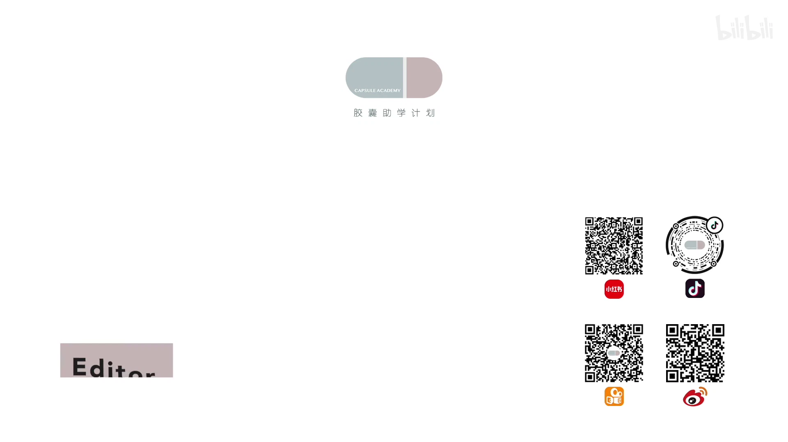

文字识别：CAPSULEACADEMY / 胶囊助学计划 / 小红书 / Editor / OE

### 画面 00:06:20

文字识别：CAPSULEACADEMY / 胶囊助学计划 / 『 / 小红书 / Creator / □ / Leo & Berlin / OE

### 画面 00:06:22

文字识别：bilibili / 胶囊助学计划 / 胶囊助学计划 / 小红书 / OE

### 画面 00:06:24

文字识别：bilibili / 胶囊助学计划

