# L029 单词

快速机器解析：语音为单模型转写，未进行独立交叉校对或人工复核；画面每秒采样并按变化选帧，短时文字和标记可能遗漏。截图时间约有 1 秒误差。图片有损压缩；遇到疑点请按时间查看 Google Drive 原视频。

## 00:00:00–00:00:30

Hello everyone, welcome to Capsule Academy. This is Leo. Today we're going to learn New Concept English Book Two Lesson Twenty Nine Words. 那老习惯进入正式课程之前，我们看一个问题，如何用英文去表达打车啊？那带着这个问题，Hope you guys enjoy it. 好，那我们上来先看第一个单词，跟我一起读一下，叫做 taxi, taxi啊，出租车对吧？Taxi. OK, 那

### 画面 00:00:00

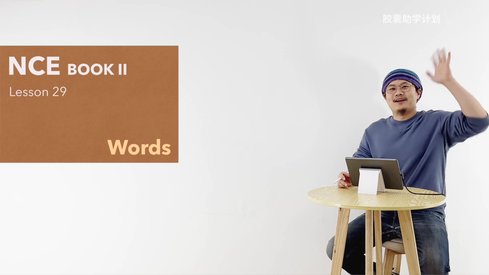

文字识别：NCE / BOOKⅡI / Lesson 29 / Words

### 画面 00:00:02

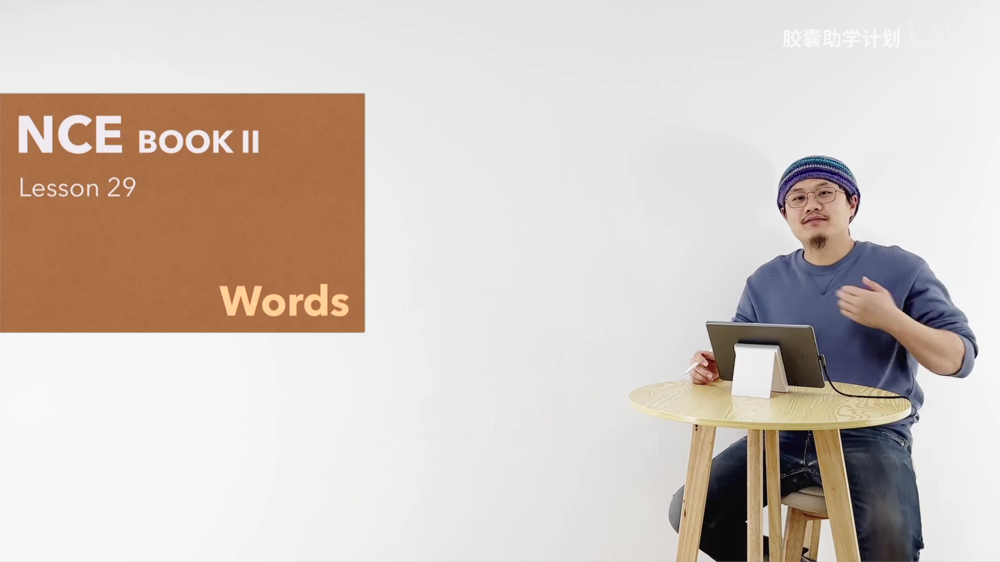

文字识别：NCE / BOOKⅡI / Lesson 29 / Words

### 画面 00:00:07

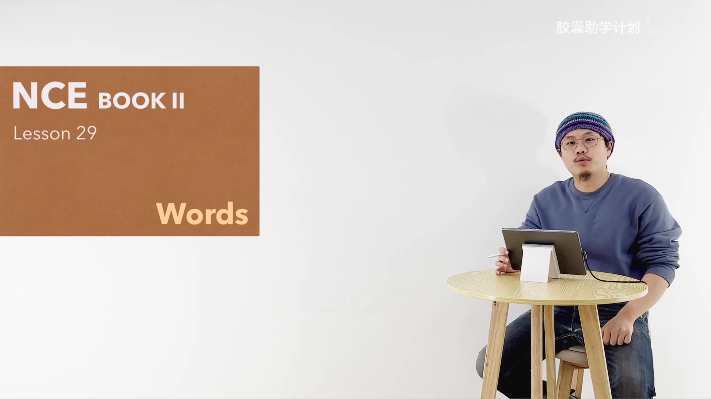

文字识别：NCE / BOOK I"I / Lesson 29 / Words

### 画面 00:00:09

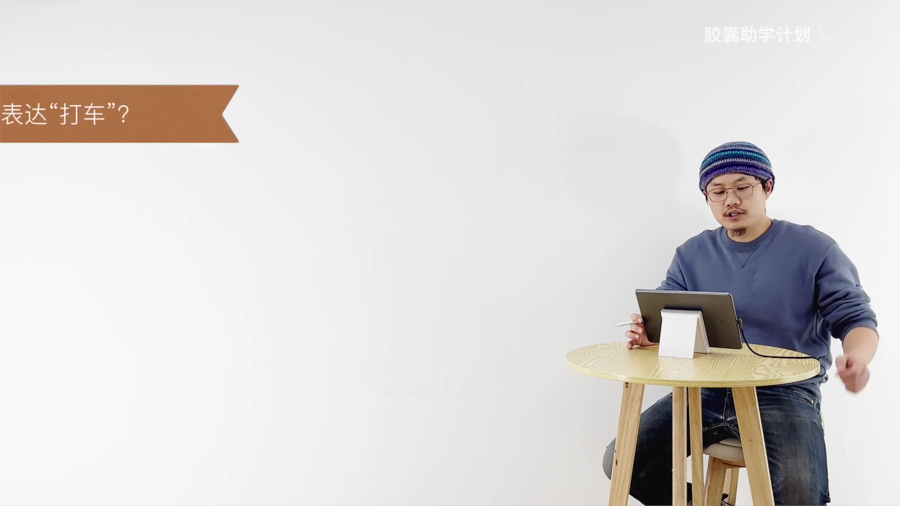

文字识别：表达“打车”？

### 画面 00:00:11

文字识别：①如何表达“打车”？

### 画面 00:00:16

文字识别：胶囊助学计划 blb出 / •

### 画面 00:00:20

文字识别：胶囊助学计划

### 画面 00:00:22

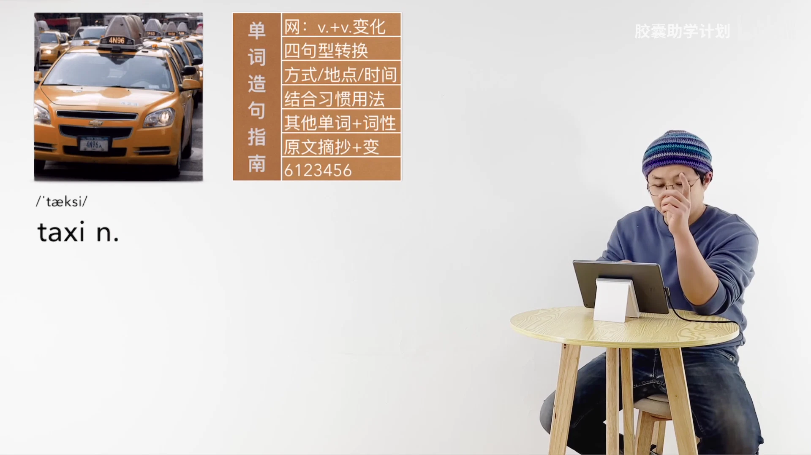

文字识别：单词造句指南 / 网：v.+v.变化 / 四句型转换 / 方式/地点/时间 / 结合习惯用法 / 其他单词+词性 / 4N96A / 原文摘抄+变 / 6123456 / /'tæeksi/ / taxi n.

### 画面 00:00:25

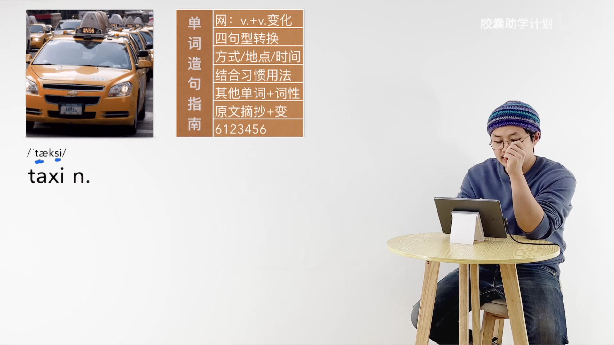

文字识别：单词造句指南 / 网：v.+v.变化 / 胶囊助 / 四句型转换 / 方式/地点/时间 / 结合习惯用法 / 其他单词+词性 / 4N96A / 原文摘抄+变 / 6123456 / /'tæeksi/ / taxi n.

## 00:00:30–00:01:00

打车怎么说呢？特别的简单，叫做take a taxi，对吧？叫做乘坐一辆出租车啊，打一辆车。Okay, very good.那我们拿它造句子，说If you take a taxi there, then you don't have to get up so early.说Take a taxi there，叫坐出租车去那里，那你就don't have to，不必了，对吧？早早就起床，如此的早就起来了。Okay，第十六课的语法，if引导的，对吧？Next

### 画面 00:00:30

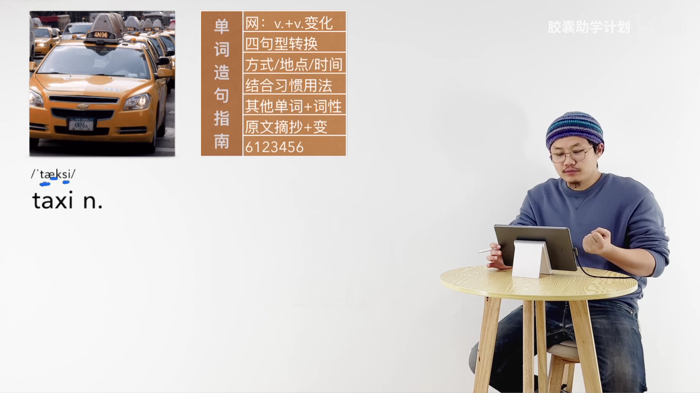

文字识别：单词造句指南 / 网：v.+v.变化 / 四句型转换 / 方式/地点/时间 / 结合习惯用法 / 其他单词+词性 / 4N96A / 原文摘抄+变 / 6123456 / /'tæeksi/ / taxi n.

### 画面 00:00:35

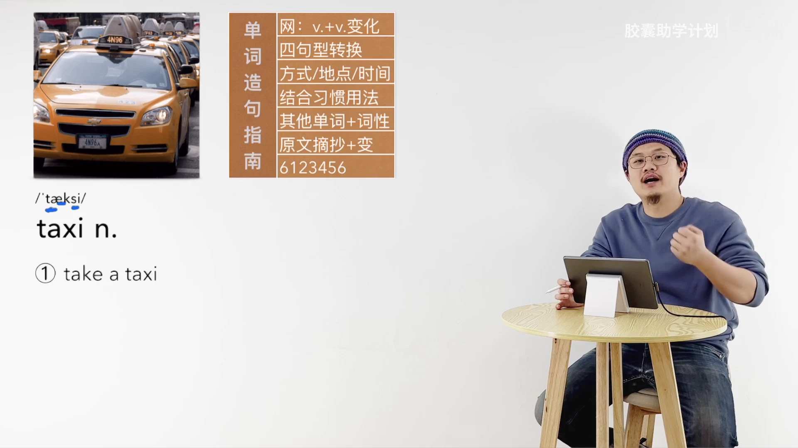

文字识别：单词造句指南 / 网：v.+v.变化 / 四句型转换 / 方式/地点/时间 / 结合习惯用法 / 其他单词+词性 / 4N96A / 原文摘抄+变 / 6123456 / /'tæeksi/ / taxi n. / ① take a taxi

### 画面 00:00:38

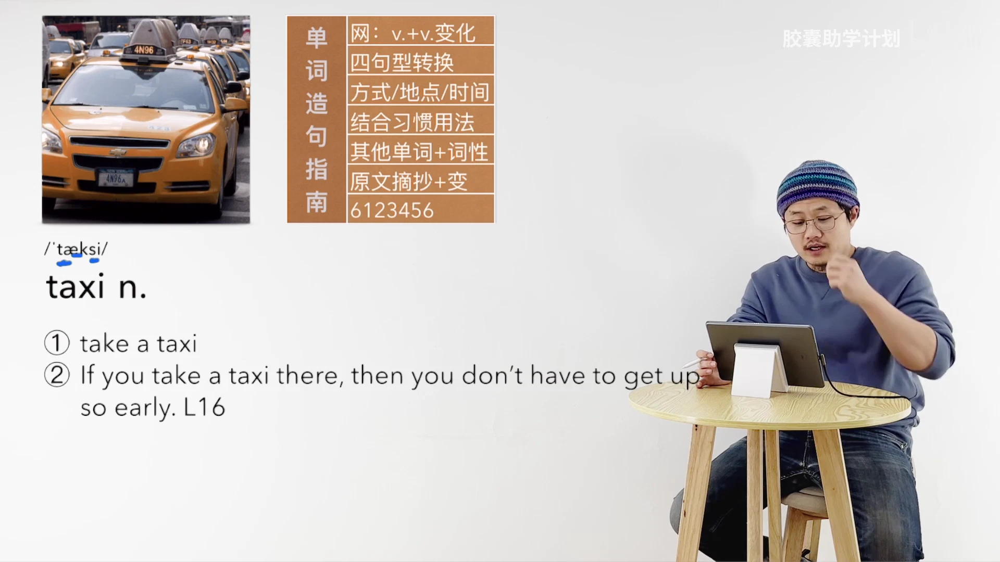

文字识别：单词造句指南 / 网：v.+v.变化 / 四句型转换 / 方式/地点/时间 / 结合习惯用法 / 其他单词+词性 / 4N96A / 原文摘抄+变 / 6123456 / /'tæksi/ / taxi n. / ① take a taxi / If you take a taxi there, then you don't have to get up / so early. L16

### 画面 00:00:40

文字识别：单词造句指南 / 网：v.+v.变化 / 四句型转换 / 方式/地点/时间 / 结合习惯用法 / 其他单词+词性 / 4N96A / 原文摘抄+变 / 6123456 / /'tæeksi/ / taxi n. / ① take a taxi / If you take a taxi there, then you don't have to get up / so early. L16

### 画面 00:00:45

文字识别：单词造句指南 / 网：v.+v.变化 / 四句型转换 / 方式/地点/时间 / 结合习惯用法 / 其他单词+词性 / 4N96A / 原文摘抄+变 / 6123456 / /'tæeksi/ / taxi n. / ①take a taxi / If you take a taxi there, then you don't have to get up / so early. L16

### 画面 00:00:50

文字识别：单词造句指南 / 网：v.+v.变化 / 四句型转换 / 方式/地点/时间 / 结合习惯用法 / 其他单词+词性 / 4N96A / 原文摘抄+变 / 6123456 / /'tæksi/ / taxi n. / ① take a taxi / If you take a taxi there, then you don't have to get up / so early. L16

### 画面 00:00:53

文字识别：单词造句指南 / 网：v.+v.变化 / 四句型转换 / 方式/地点/时间 / 结合习惯用法 / 其他单词+词性 / AN96A / 原文摘抄+变 / 6123456 / /'tæeksi/ / taxi n. / ① take a taxi / If you take a taxi there, then you don't have to get up / so early. L16

### 画面 00:00:55

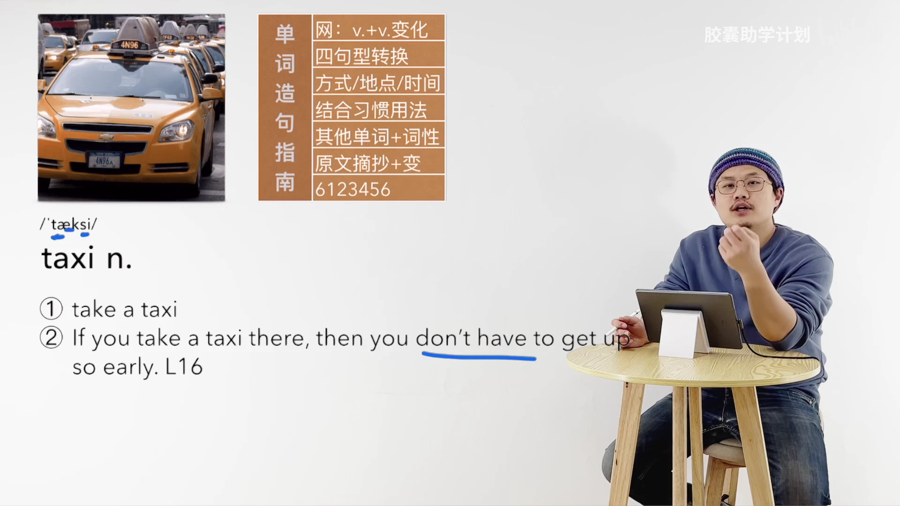

文字识别：单词造句指南 / 网：v.+v.变化 / 四句型转换 / 方式/地点/时间 / 结合习惯用法 / 其他单词+词性 / 4N96A / 原文摘抄+变 / 6123456 / /'tæeksi/ / taxi n. / ① take a taxi /  If you take a taxi there, then you don't have to get up / so early. L16

## 00:01:00–00:01:30

one，第十七课的一个习惯用法说，It must be terrible to do something to take a taxi in that city。说在那个城市打车一定特别的糟糕啊，比如说总给你绕道，是吧？Next one，说The taxi which you took last night。OK，注意定语从句给大家加粗了，对吧？叫做你昨天晚上打的那辆出租车怎么样了呢？Broke down this morning。二十八课学的定语从句，叫今天早晨出故障了。

### 画面 00:01:00

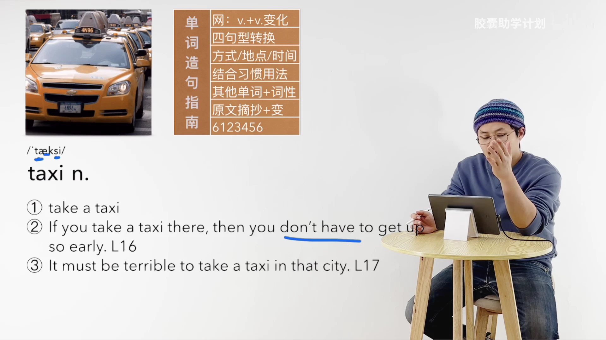

文字识别：单词造句指南 / 网：v.+v.变化 / 四句型转换 / 方式/地点/时间 / 结合习惯用法 / 其他单词+词性 / AN96A / 原文摘抄+变 / 6123456 / /'tæeksi/ / taxi n. / ①take a taxi /  If you take a taxi there, then you don't have to get ui / 2) / so early. L16 /  It must be terrible to take a taxi in that city. L17

### 画面 00:01:05

文字识别：单词造句指南 / 网：v.+v.变化 / 四句型转换 / 方式/地点/时间 / 结合习惯用法 / 其他单词+词性 / 4N96A / 原文摘抄+变 / 6123456 / /'tæksi/ / taxi n. / ① take a taxi /  If you take a taxi there, then you don't have to get up / 2 / so early. L16 / It must be terrible to take a taxi in that city. L17

### 画面 00:01:10

文字识别：单词造句指南 / 网：v.+v.变化 / 四句型转换 / 方式/地点/时间 / 结合习惯用法 / 其他单词+词性 / 4N96A / 原文摘抄+变 / 6123456 / /'tæeksi/ / taxi n. / ① take a taxi / ) If you take a taxi there, then you don't have to get ups / 2） / so early. L16 / It must be terrible to take a taxi in that city. L17

### 画面 00:01:12

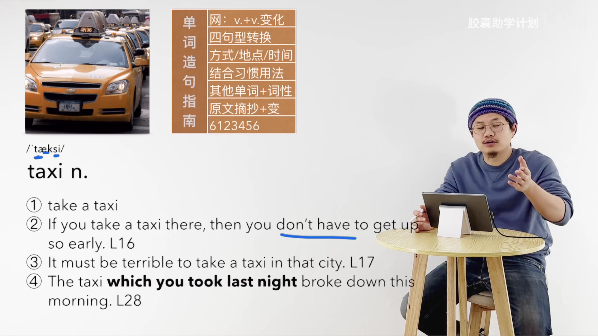

文字识别：单词造句指南 / 网：v.+v.变化 / 四句型转换 / 方式/地点/时间 / 结合习惯用法 / 其他单词+词性 / 4N96 / 原文摘抄+变 / 6123456 / /'taæeksi/ / taxi n. / ① take a taxi / ② If you take a taxi there, then you don't have to get up / so early. L16 / It must be terrible to take a taxi in that city. L17 / The taxi which you took last night broke down this / morning. L28

### 画面 00:01:15

文字识别：单词造句指南 / 网：v.+v.变化 / 四句型转换 / 方式/地点/时间 / 结合习惯用法 / 其他单词+词性 / 4N96A / 原文摘抄+变 / 6123456 / /'taeksi/ / taxi n. / ① take a taxi / ② If you take a taxi there, then you don't have to get up / 2 / so early. L16 / It must be terrible to take a taxi in that city. L17 / The taxi which you took last night broke down this / morning. L28

### 画面 00:01:20

文字识别：单词造句指南 / 网：v.+v.变化 / 四句型转换 / 方式/地点/时间 / 结合习惯用法 / 其他单词+词性 / 4N96A / 原文摘抄+变 / 6123456 / /'tæeksi/ / taxi n. / ① take a taxi / ② If you take a taxi there, then you don't have to get up / so early. L16 / It must be terrible to take a taxi in that city. L17 / The taxi which you took last night broke down this / morning. L28

### 画面 00:01:25

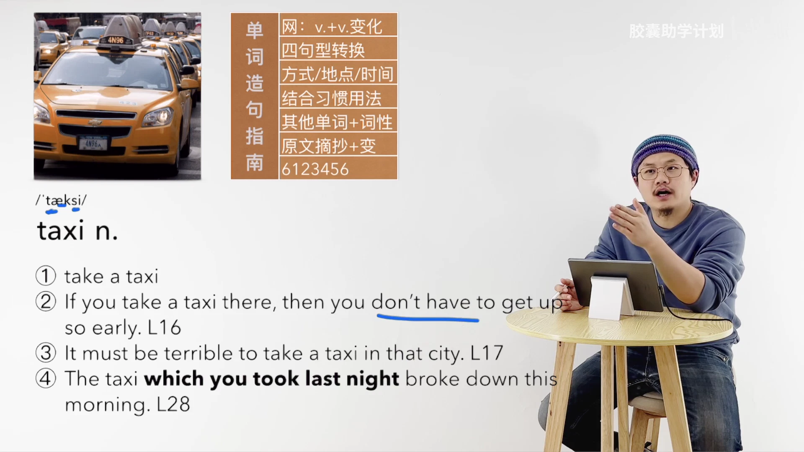

文字识别：单词造句指南 / 网：v.+v.变化 / 四句型转换 / 方式/地点/时间 / 结合习惯用法 / 其他单词+词性 / 4N96A / 原文摘抄+变 / 6123456 / /'tæeksi/ / taxi n. / ① take a taxi / ② If you take a taxi there, then you don't have to get up / so early. L16 / It must be terrible to take a taxi in that city. L17 / The taxi which you took last night broke down this / morning. L28

## 00:01:30–00:02:00

Okay, very good.好，接下来我们看一个小的电影片段。哎，各位做一下听力练习啊。我们挑，我专门找了好几个这个视频当中，take a taxi非常的清楚。各位看一下自己能不能听出来。来了。Oh, oh, baby said she'd be here even if we were late. Well, if she's not here, we can take a taxi. They probably have taxis in Boston. Oh, she'll be here

### 画面 00:01:30

文字识别：单词造句指南 / 网：v.+v.变化 / 四句型转换 / 方式/地点/时间 / 结合习惯用法 / 其他单词+词性 / 4N96A / 原文摘抄+变 / 6123456 / /'tæeksi/ / taxi n. / ① take a taxi / ) If you take a taxi there, then you don't have to get up / 2 / so early. L16 / It must be terrible to take a taxi in that city. L17 / The taxi which you took last night broke down this / morning. L28

### 画面 00:01:32

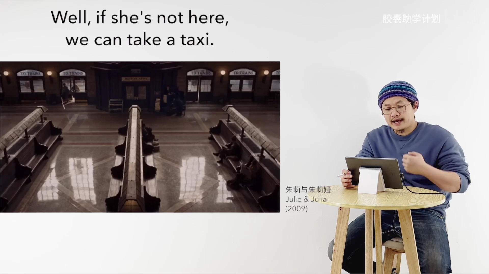

文字识别：Well, if she's not here, / we can take a taxi. / RAINS / 朱莉与朱莉娅 / Julie & Julia / (2009)

### 画面 00:01:49

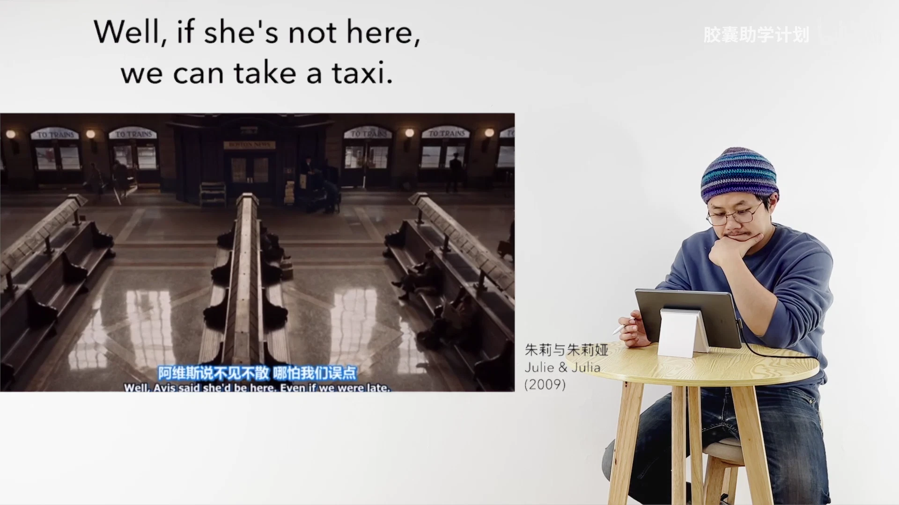

文字识别：Well, if she's not here, / we can take a taxi. / RAN / OAN / 朱莉与朱莉娅 / Julie & Julia / 阿维斯说不见不散哪怕我们误点 / (2009) / Well,Avis said she'd be here. Even if we were late.

### 画面 00:01:54

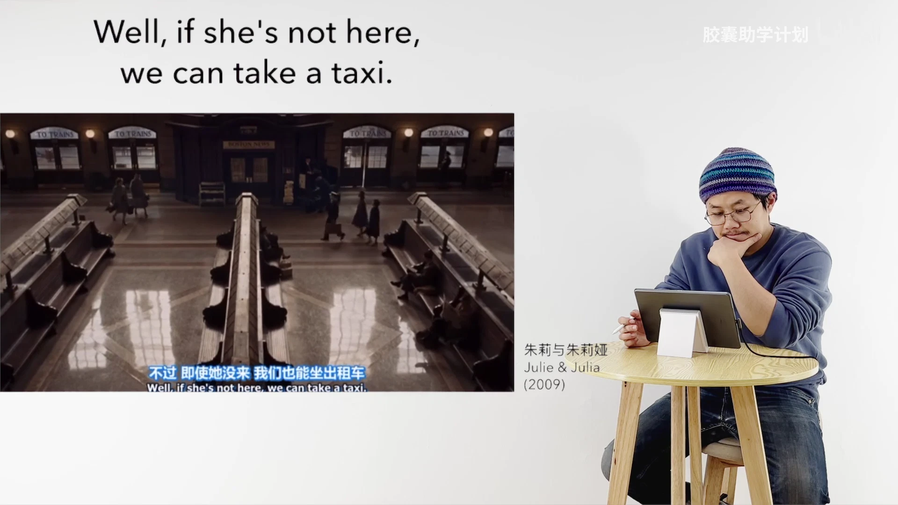

文字识别：Well, if she's not here, / we can take a taxi. / RAIN / 朱莉与朱莉娅 / Julie & Julia / 不过即使她没来我们也能坐出租车 / (2009) / Well,if she's not here, we can take a taxi.

### 画面 00:01:58

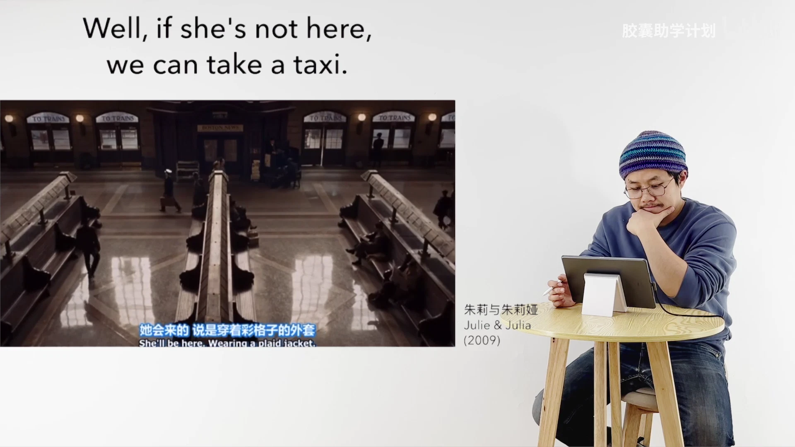

文字识别：Well, if she's not here, / we can take a taxi. / O TRAINS / 朱莉与朱莉娅 / Julie & Julia / 她会来的说是穿着彩格子的外套 / (2009) / Shell be here. Wearing a plaid facket.

## 00:02:00–00:02:30

wearing a plaid jacket. That's how I'm to recognize her. What do you mean recognize her? Has she changed? Oh, well, look for the middle-aged woman in a plaid jacket. Okay, very good. Well,哎，口头禅说 if she's not here, we can take a taxi.说如果她不在这里，我们可以打一辆出租车，对吧？

### 画面 00:02:02

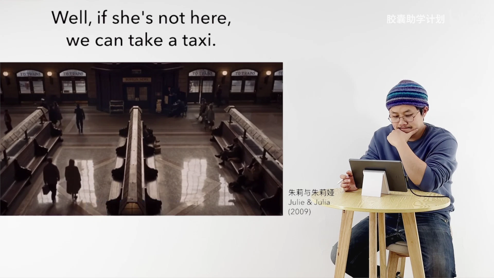

文字识别：Well, if she's not here, / we can take a taxi. / TOTRAINS / 朱莉与朱莉娅 / Julie & Julia / (2009)

### 画面 00:02:04

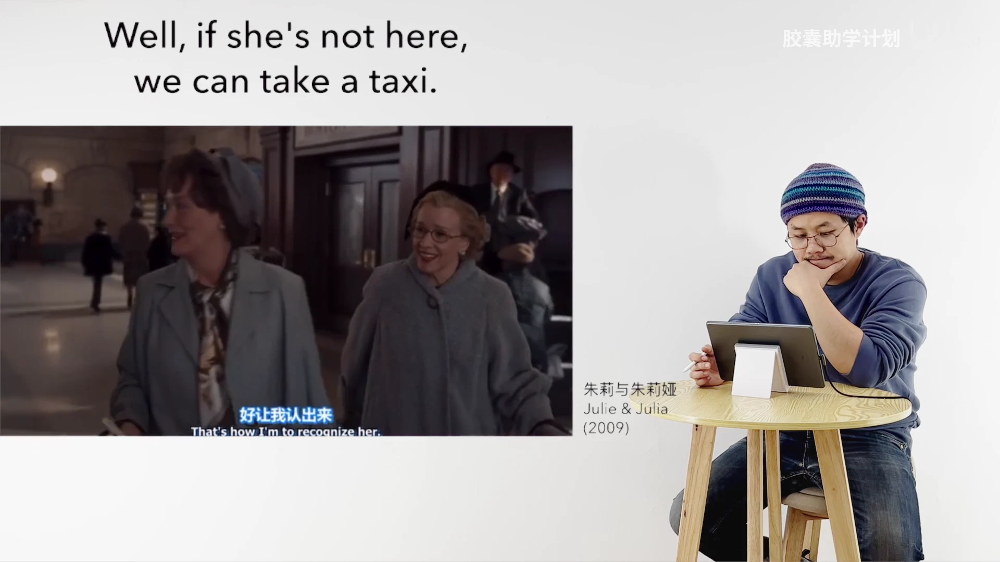

文字识别：Well, if she's not here, / we can take a taxi. / 朱莉与朱莉娅 / Julie & Julia / 好让我认出来 / (2009) / That's how I'm to recoanize her.

### 画面 00:02:06

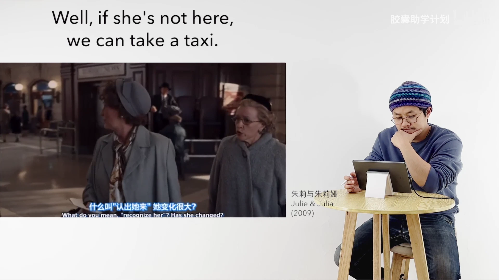

文字识别：Well, if she's not here, / we can take a taxi. / 朱莉与朱莉娅 / Julie & Julia / 什么叫"认出她来"她变化很大？ / (2009) / What do you mean,"recoanize her"? Has she changed?

### 画面 00:02:08

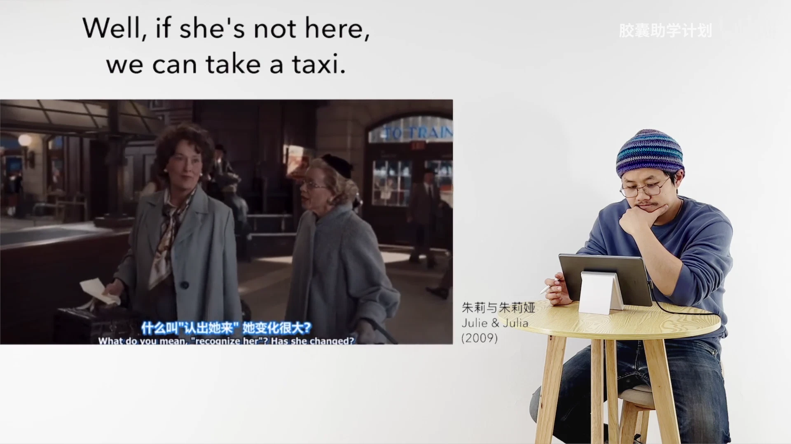

文字识别：Well, if she's not here, / we can take a taxi. / LTOTRAIN / 朱莉与朱莉娅 / Julie & Julia / 什么叫"认出她来"她变化很大？ / (2009) / What do you mean,"recoanize her"? Has she changed?

### 画面 00:02:10

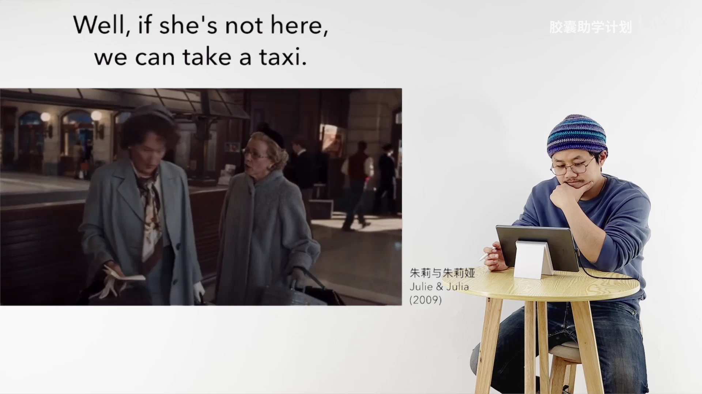

文字识别：Well, if she's not here, / we can take a taxi. / 朱莉与朱莉娅 / Julie & Julia / (2009)

### 画面 00:02:12

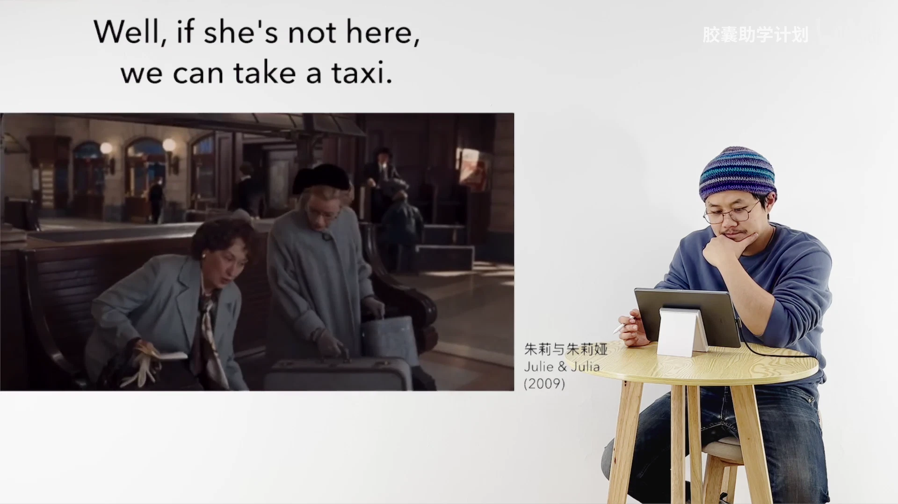

文字识别：Well, if she's not here, / we can take a taxi. / 朱莉与朱莉娅 / Julie & Julia / (2009)

### 画面 00:02:14

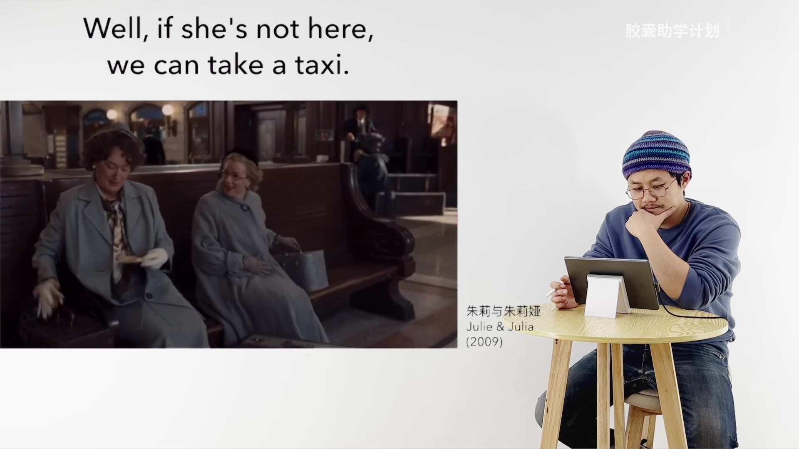

文字识别：Well, if she's not here, / we can take a taxi. / 朱莉与朱莉娅 / Julie & Julia / (2009)

### 画面 00:02:16

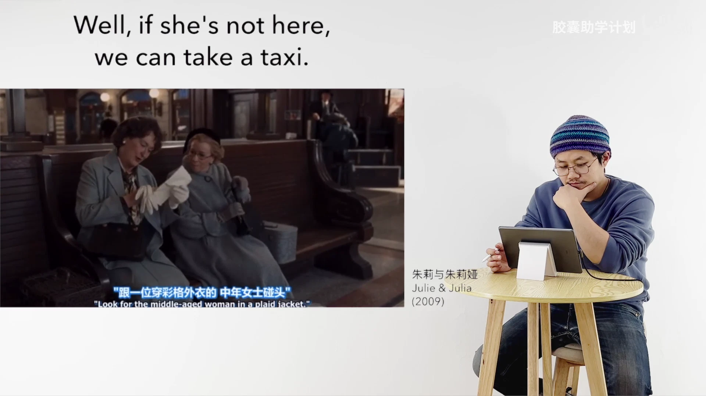

文字识别：Well, if she's not here, / we can take a taxi. / 朱莉与朱莉娅 / Julie & Julia / “跟一位穿彩格外衣的中年女士碰头” / (2009) / "Look for the middle-aged woman in a plaid iacket."

### 画面 00:02:18

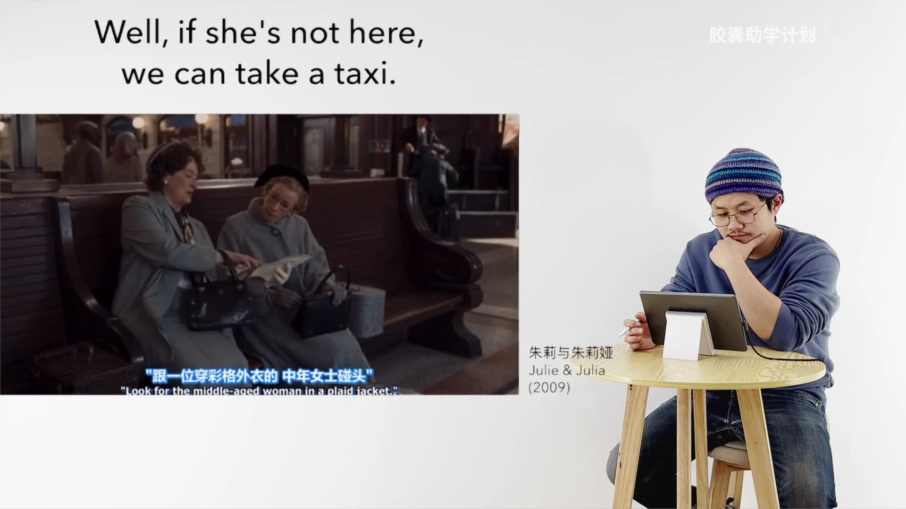

文字识别：Well, if she's not here, / we can take a taxi. / 朱莉与朱莉娅 / Julie & Julia / “跟一位穿彩格外衣的中年女士碰头” / (2009) / "Look for the middle-aged woman in a plaid iacket."

### 画面 00:02:20

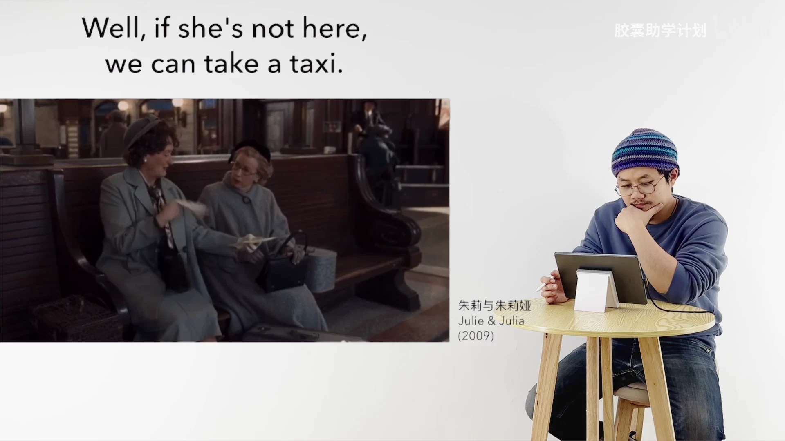

文字识别：Well, if she's not here, / we can take a taxi. / 朱莉与朱莉娅 / Julie & Julia / (2009)

## 00:02:30–00:03:00

吧？OK，玩一个。Next one，下一个单词各位会读就行了，它就是一种飞机型号的名字，对吧？叫做 Pilatus Porter 啊，这种单词各位记不住，完全没有任何的问题啊。Pilatus Porter，OK，那我们不多说了，也不需要拿它去造句了啊。直接看下一个单词，跟我一起读一下，叫做 land land 啊，飞机着陆的时候，着陆这个动作翻译成英文就叫做 land。所以那我们一般都

### 画面 00:02:30

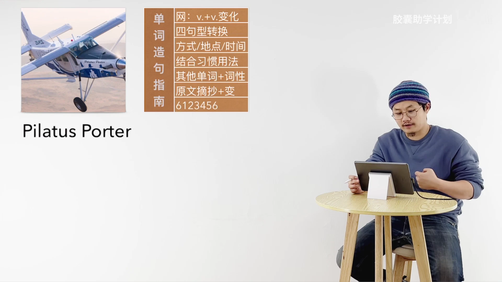

文字识别：单词造句指南 / 网：v.+v.变化 / 四句型转换 / P0 / 方式/地点/时间 / 结合习惯用法 / Platas Porter / 其他单词+词性 / 原文摘抄+变 / 6123456 / Pilatus Porter

### 画面 00:02:32

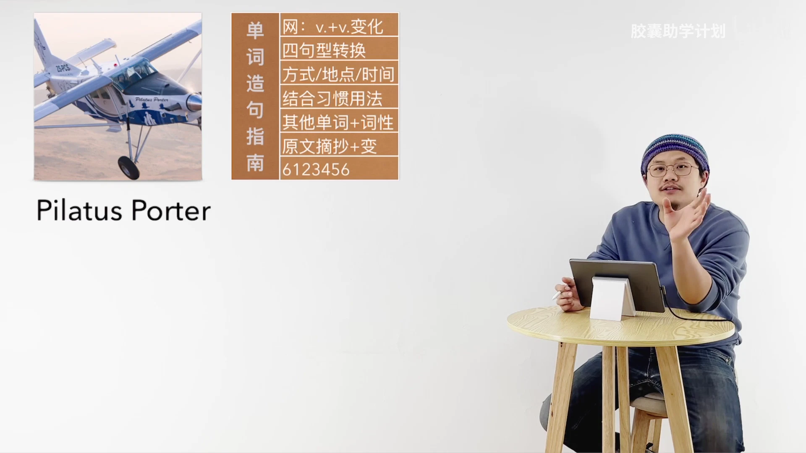

文字识别：单词造句指南 / 网：v.+v.变化 / 四句型转换 / 方式/地点/时间 / 结合习惯用法 / Pilatus Porter / 其他单词+词性 / 原文摘抄+变 / 6123456 / Pilatus Porter

### 画面 00:02:35

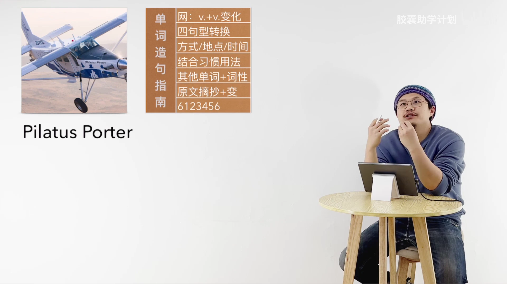

文字识别：单词造句指南 / 网：v.+v.变化 / 四句型转换 / 方式/地点/时间 / 结合习惯用法 / Pulatus Porter / 其他单词+词性 / 原文摘抄+变 / 6123456 / Pilatus Porter

### 画面 00:02:45

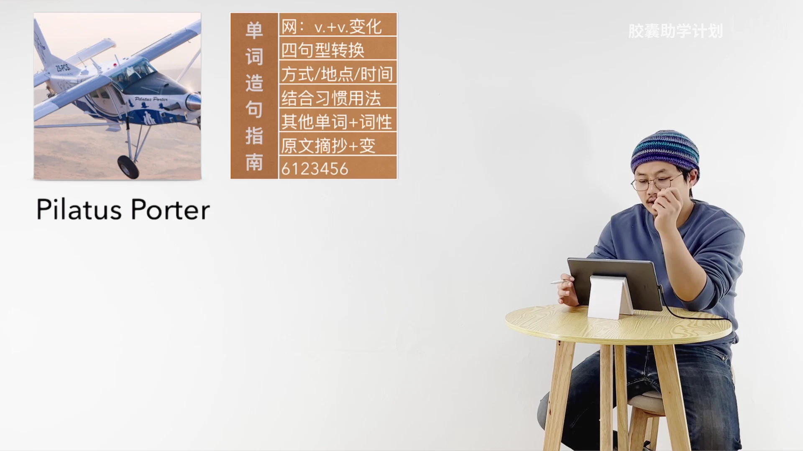

文字识别：单词造句指南 / 网：v.+v.变化 / 四句型转换 / 方式/地点/时间 / 结合习惯用法 / Pilatus Porten / 其他单词+词性 / 原文摘抄+变 / 6123456 / Pilatus Porter

### 画面 00:02:47

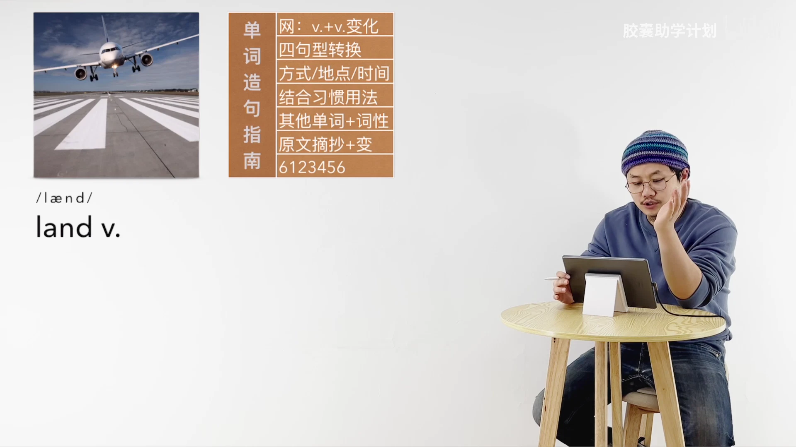

文字识别：单词造句指南 / 网：v.+v.变化 / 四句型转换 / 方式/地点/时间 / 结合习惯用法 / 其他单词+词性 / 原文摘抄+变 / 6123456 / /læend/ / land v.

### 画面 00:02:49

文字识别：单词造句指南 / 网：v.+v.变化 / 四句型转换 / 方式/地点/时间 / 结合习惯用法 / 其他单词+词性 / 原文摘抄+变 / 6123456 / /læend/ / land v.

### 画面 00:02:51

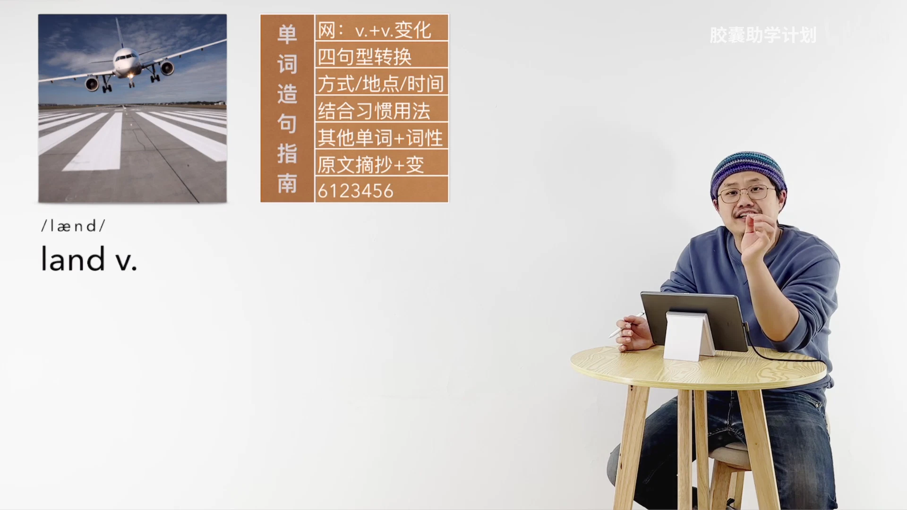

文字识别：单词造句指南 / 网：v.+v.变化 / 胶囊 / 四句型转换 / 方式/地点/时间 / 结合习惯用法 / 其他单词+词性 / 原文摘抄+变 / 6123456 / /læend/ / land v.

### 画面 00:02:55

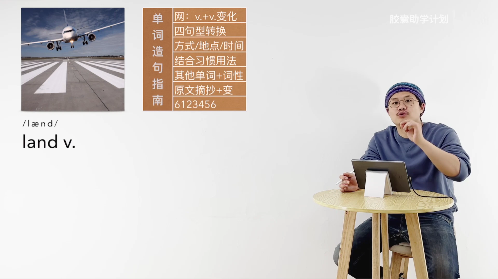

文字识别：单词造句指南 / 网：v.+v.变化 / 四句型转换 / 方式/地点/时间 / 结合习惯用法 / 其他单词+词性 / 原文摘抄+变 / 6123456 / /læend/ / land v.

## 00:03:00–00:03:30

说着陆在什么地方，对吧？降落在什么地方？那比如说 landed in the field or landed in the airfield. 啊，在田野当中或者在飞机场那个跑道上。OK，那由他去造句的时候，我们就一定要可能还加一些方式、地点、时间了，对不对？好，当然了，主语就是 plane. OK，说 the plane landed in the airfield an hour ago. 一个小时之前降落在停

### 画面 00:03:00

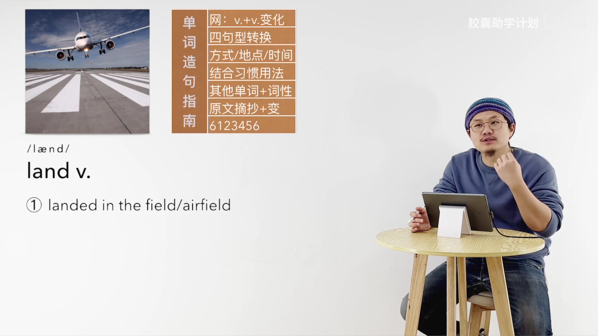

文字识别：单词造句指南 / 网：v.+v.变化 / 四句型转换 / 方式/地点/时间 / 结合习惯用法 / 其他单词+词性 / 原文摘抄+变 / 6123456 / /læend/ / land v. / ① landed in the field/airfield

### 画面 00:03:05

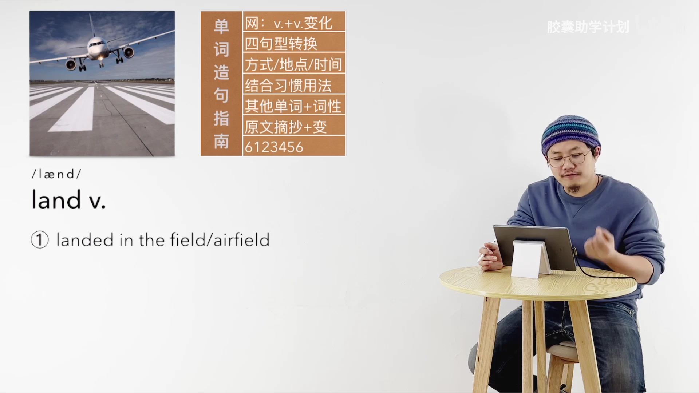

文字识别：单词造句指南 / 网：v.+v.变化 / 四句型转换 / 方式/地点/时间 / 结合习惯用法 / 其他单词+词性 / 原文摘抄+变 / 6123456 / /læend/ / land v. / ① landed in the field/airfield

### 画面 00:03:10

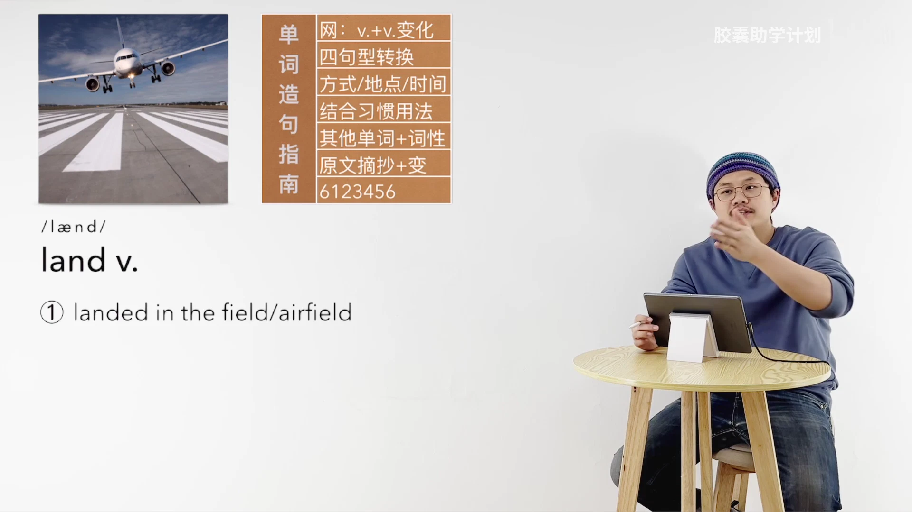

文字识别：单词造句指南 / 网：v.+v.变化 / 四句型转换 / 方式/地点/时间 / 结合习惯用法 / 其他单词+词性 / 原文摘抄+变 / 6123456 / /læend/ / land v. / ① landed in the field/airfield

### 画面 00:03:14

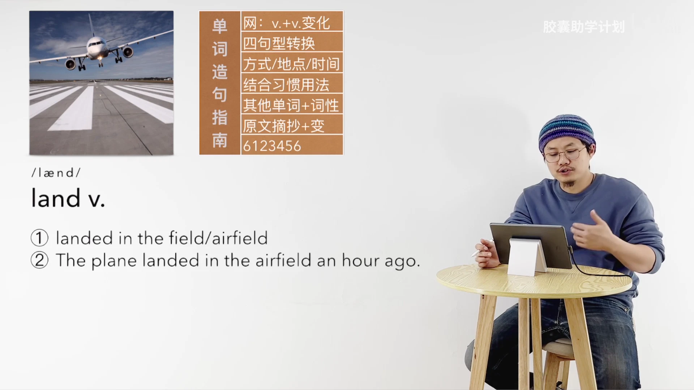

文字识别：单词造句指南 / 网：v.+v.变化 / 四句型转换 / 方式/地点/时间 / 结合习惯用法 / 其他单词+词性 / 原文摘抄+变 / 6123456 / /læend/ / land v. / ① landed in the field/airfield / The plane landed in the airfield an hour ago.

### 画面 00:03:16

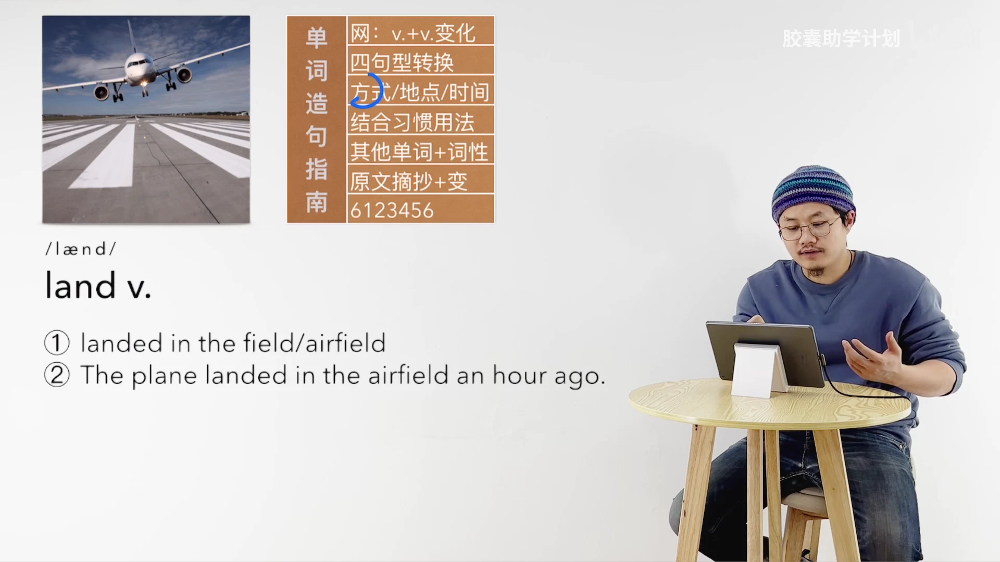

文字识别：单词造句指南 / 网：v.+v.变化 / 四句型转换 / 方式/地点/时间 / 结合习惯用法 / 其他单词+词性 / 原文摘抄+变 / 6123456 / /læend/ / land v. / ① Ianded in the field/airfield / The plane landed in the airfield an hour ago.

### 画面 00:03:18

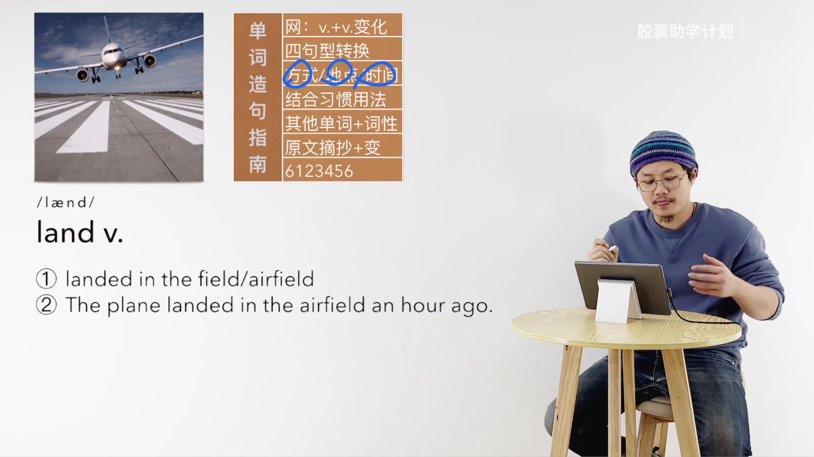

文字识别：单词造句指南 / 网：v.+v.变化 / 四句型转换 / 示式也点时间 / 结合习惯用法 / 其他单词+词性 / 原文摘抄+变 / 6123456 / /æend/ / land v. / ① Ianded in the field/airfield / The plane landed in the airfield an hour ago.

### 画面 00:03:23

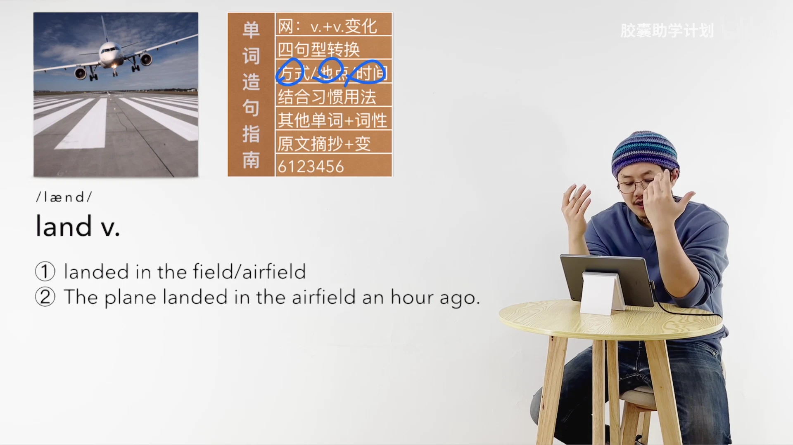

文字识别：单词造句指南 / 网：v.+v.变化 / 胶囊助学 / 四句型转换 / 示式也点时自 / 结合习惯用法 / 其他单词+词性 / 原文摘抄+变 / 6123456 / /læend/ / land v. / ① Ianded in the field/airfield / The plane landed in the airfield an hour ago.

### 画面 00:03:26

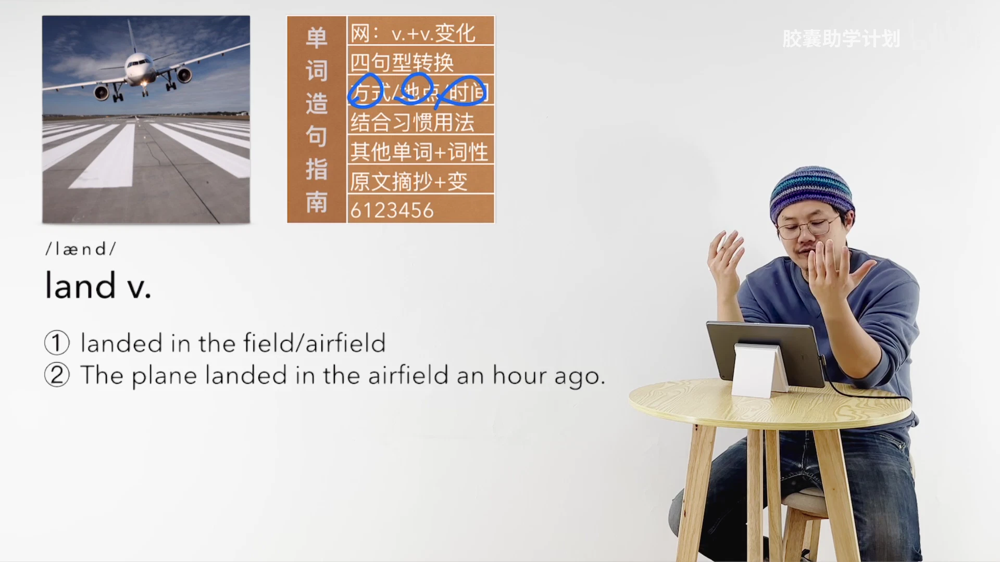

文字识别：单词造句指南 / 网：v.+v.变化 / 四句型转换 / 宁式也点时间 / 结合习惯用法 / 其他单词+词性 / 原文摘抄+变 / 6123456 / /æend/ / land v. / ① Ianded in the field/airfield / The plane landed in the airfield an hour ago.

## 00:03:30–00:04:00

机坪上了，对吧？然后肯定句给各位了各种一般疑问句、特殊疑问句，各位顺手就处理了，加上作业搞定，对吧？这就是我们所谓的四句型转换啊。当然了，您如果愿意的话，也可以自己去试一下，能不能加一点，比如说我换一个动作，比如说表示常态啊，这辆这个飞机经常是在这个地方着陆的。OK，那就变成一般现在时等等。您换一些动词变化啊，包括试试能不能用被动呢？OK，玩一个，这是各位自己去

### 画面 00:03:30

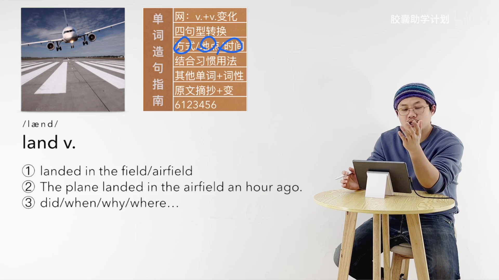

文字识别：单词造句指南 / 网：v.+v.变化 / 四句型转换 / 宁式也点时间 / 结合习惯用法 / 其他单词+词性 / 原文摘抄+变 / 6123456 / /æend/ / land v. / ① landed in the field/airfield / The plane landed in the airfield an hour ago. / did/when/why/where...

### 画面 00:03:35

文字识别：单词造句指南 / 网：v.+v.变化 / 四句型转换 / 示式也点时自 / 结合习惯用法 / 其他单词+词性 / 原文摘抄+变 / 6123456 / /læend/ / land v. / ① landed in the field/airfield / The plane landed in the airfield an hour ago. / did/when/why/where...

### 画面 00:03:40

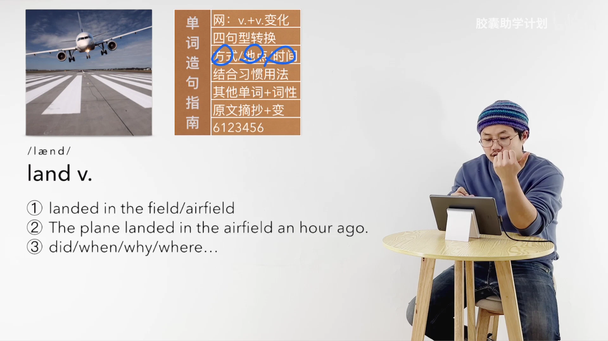

文字识别：单词造句指南 / 网：v.+v.变化 / 四句型转换 / 示式也点时间 / 结合习惯用法 / 其他单词+词性 / 原文摘抄+变 / 6123456 / /æend/ / land v. / ① landed in the field/airfield / The plane landed in the airfield an hour ago. / did/when/why/where...

### 画面 00:03:42

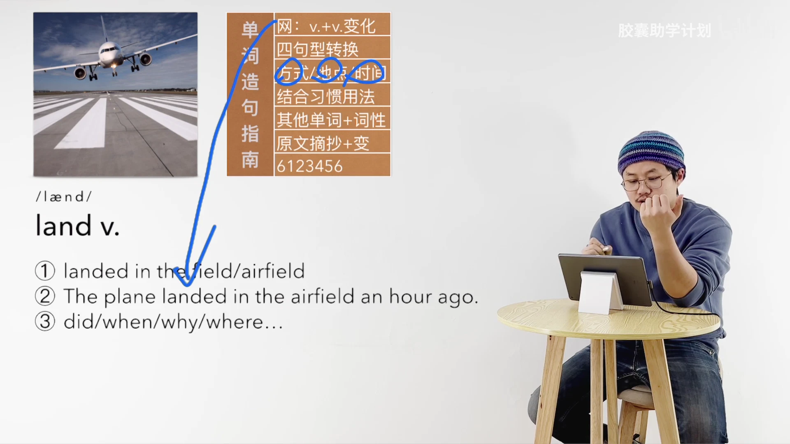

文字识别：单询造句指南 / 网：v.+v.变化 / 四句型转换 / 示式也点时自 / 结合习惯用法 / 其他单词+词性 / 原文摘抄+变 / 6123456 / /æend/ / land v. / ① landed in the/ield/airfield / The plane landed in the airfield an hour ago. / did/when/why/where...

### 画面 00:03:44

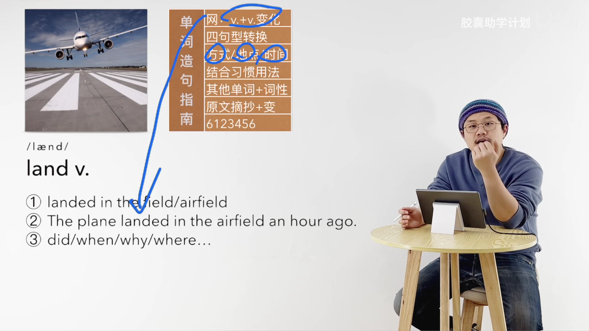

文字识别：单询造句指南 / 网v.+v.变 / 四句型转换 / 示式也点时自 / 结合习惯用法 / 其他单词+词性 / 原文摘抄+变 / 6123456 / /æend/ / land v. / ① landed in the/ield/airfield / The plane landed in the airfield an hour ago. / did/when/why/where...

### 画面 00:03:46

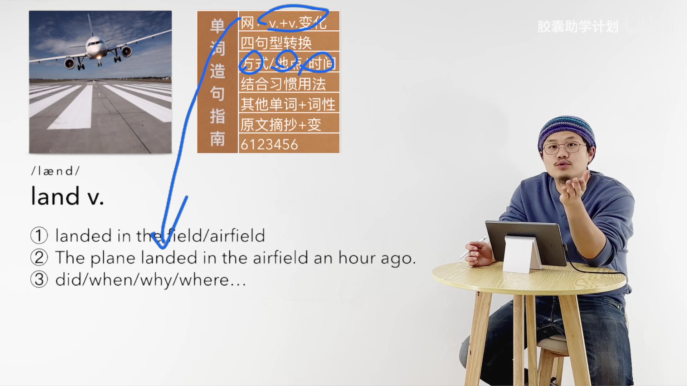

文字识别：单询造句指南 / 网v.+v.变 / 胶囊 / 四句型转换 / 示式也点时怕 / 结合习惯用法 / 其他单词+词性 / 原文摘抄+变 / 6123456 / /læend/ / land v. / ① landed in the/ield/airfield / The plane landed in the airfield an hour ago. / did/when/why/where...

### 画面 00:03:52

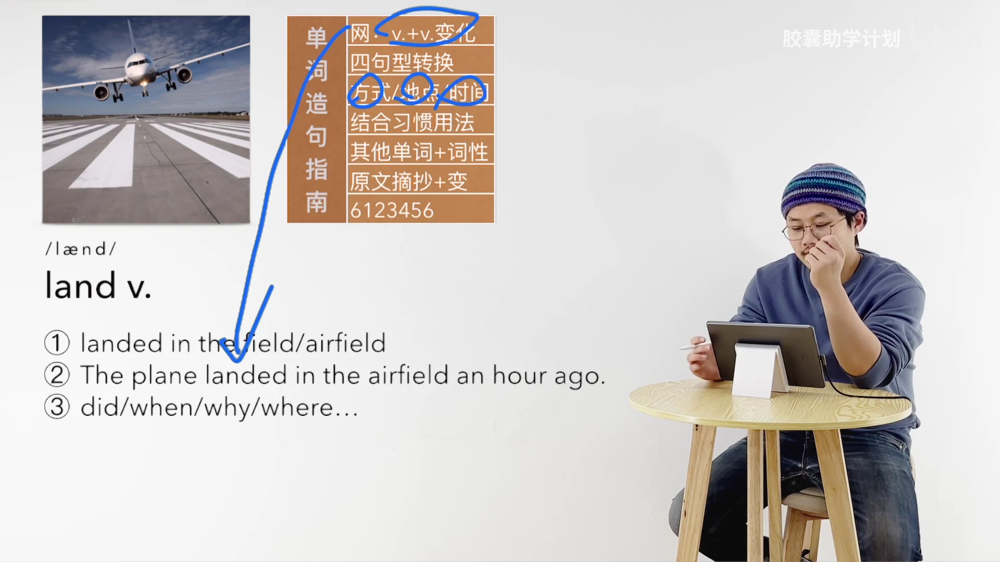

文字识别：单询造句指南 / 网v.+v.变 / 四句型转换 / 宁式也点时自 / 结合习惯用法 / 其他单词+词性 / 原文摘抄+变 / 6123456 / /æend/ / land v. / ① landed in the/ield/airfield / The plane landed in the airfield an hour ago. / did/when/why/where...

### 画面 00:03:55

文字识别：单询造句指南 / 网v.+v.变 / 四句型转换 / 示式也点时自 / 结合习惯用法 / 其他单词+词性 / 原文摘抄+变 / 6123456 / /æend/ / land v. / ① landed in the/ield/airfield / The plane landed in the airfield an hour ago. / did/when/why/where...

### 画面 00:03:59

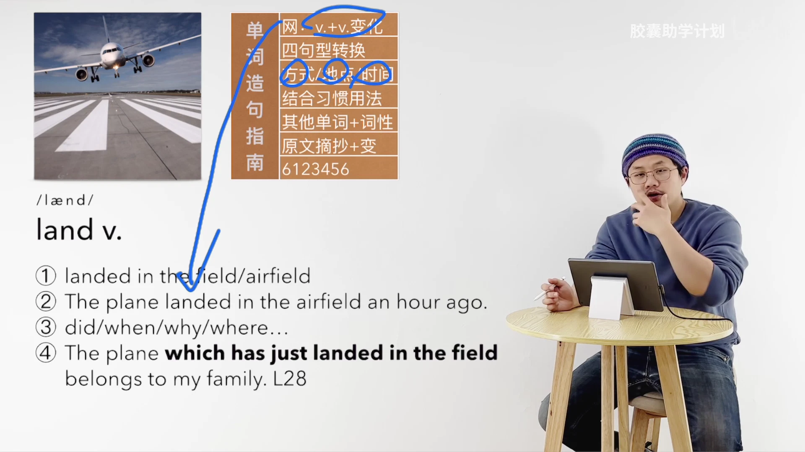

文字识别：单词造句指南 / 网v.+v.变化 / 四句型转换 / 示式也点时怕 / 结合习惯用法 / 其他单词+词性 / 原文摘抄+变 / 6123456 / /lænd/ / land v. / ① landed in thelield/airfield / The plane landed in the airfield an hour ago. / did/when/why/where... / The plane which has just landed in the field / belongs to my family. L28

## 00:04:00–00:04:30

想的。下一个句子说，The plane which has just landed in the field belongs to my family.啊，注意一个定从叫做刚刚降落在这片地上的那个飞机属于我们家族，对吧？属于我们家庭啊。二十八课定语从句啊，各位还是定语从句。您二十八课学完了之后，学完了真不代表我们就特别熟了，熟全是靠练出来的，不是靠学出来的，对吧？学

### 画面 00:04:01

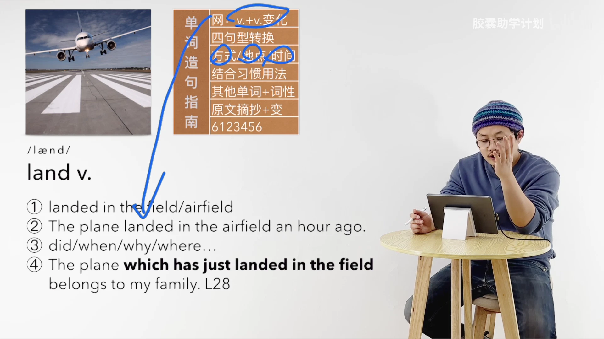

文字识别：单询造句指南 / 网v.+v.变化 / 四句型转换 / 宁式也点时间 / 结合习惯用法 / 其他单词+词性 / 原文摘抄+变 / 6123456 / /lænd/ / land v. / ① landed in thelield/airfield / The plane landed in the airfield an hour ago. / did/when/why/where... / The plane which has just landed in the field / belongs to my family. L28

### 画面 00:04:05

文字识别：单询造句指南 / 网v.+V.变化 / 四句型转换 / 示也点时间 / 结合习惯用法 / 其他单词+词性 / 原文摘抄+变 / 6123456 / /lænd/ / land v. / ① landed in theield/airfield / The plane landed in the airfield an hour ago. / did/when/why/where... / The plane which has just landed in the field / belongs to my family. L28

### 画面 00:04:10

文字识别：单词造句指南 / 网v.+v.变 / 四句型转换 / 宁式也点时 / 结合习惯用法 / 其他单词+词性 / 原文摘抄+变 / 6123456 / /lænd/ / land v. / ① landed in theield/airfield / The plane landed in the airfield an hour ago. / did/when/why/where... / The plane which has iust landed in the field / belongs to my family. L28

### 画面 00:04:15

文字识别：单询造句指南 / 网v.+V.变 / 四句型转换 / 宁式也点时间 / 结合习惯用法 / 其他单词+词性 / 原文摘抄+变 / 6123456 / /lænd/ / land v. / ① landed in thelield/airfield / The plane landed in the airfield an hour ago. / did/when/why/where... / The plane which has iust landed in the field / belongs to my family. L28

## 00:04:30–00:05:00

十遍不如练十遍，差太远了，对吧？所以接下来单词造句的时候，能想起来您就不停的往里面去加定语从句，先不用管这定从您写的好还是不好，至少先写出来，对吧？然后我们再一步一步把它变得更好。OK，好，接下来下一个单词，跟我们一起读一下，叫做plow，plow啊，耕地耕田这个动作叫plow。OK，那拿它去造句，说When they were plowing the field,

### 画面 00:04:45

文字识别：单词造句指南 / 网v.+v.变化 / 四句型转换 / 宁式也点时间 / 结合习惯用法 / 其他单词+词性 / 原文摘抄+变 / 6123456 / /lænd/ / land v. / ① landed in thelield/airfield / The plane landed in the airfield an hour ago. / did/when/why/where... / The plane which has iust landed in the field / belongs to my family. L28

### 画面 00:04:48

文字识别：单词造句指南 / 网：v.+v.变化 / 四句型转换 / 方式/地点/时间 / 结合习惯用法 / 其他单词+词性 / 原文摘抄+变 / 6123456 / /ｐlau / / plough v.

### 画面 00:04:50

文字识别：单词造句指南 / 网：v.+v.变化 / 四句型转换 / 方式/地点/时间 / 结合习惯用法 / 其他单词+词性 / 原文摘抄+变 / 6123456 / /ｐ lau / / plough v.

### 画面 00:04:55

文字识别：单词造句指南 / 网：v.+v.变化 / 四句型转换 / 方式/地点/时间 / 结合习惯用法 / 其他单词+词性 / 原文摘抄+变 / 6123456 / /ｐ lau / / plough v. / ① When they were ploughing the field, they saw a / rare white tiger. L7

## 00:05:00–00:05:30

They saw a rare white tiger.好，在这儿，首先我们用到了第七课的语法 when 和 were plowing.其次，还有一个非常小的隐藏的东西叫做 rare white tiger. 这是我们不久前刚刚学的一个单词，叫 rare，叫罕见的，对吧？One of those rare people who believe in ancient myths.那像这个单词，对于各位来说，您非常容易学几课之后，这个单词就忘了，怎么

### 画面 00:05:00

文字识别：单词造句指南 / 网：v.+v.变化 / 四句型转换 / 方式/地点/时间 / 结合习惯用法 / 其他单词+词性 / 原文摘抄+变 / 6123456 / /ｐ lau / / plough v. / ① When they were ploughing the field, they saw a / rare white tiger. L7

### 画面 00:05:05

文字识别：单词造句指南 / 网：v.+v.变化 / 四句型转换 / 方式/地点/时间 / 结合习惯用法 / 其他单词+词性 / 原文摘抄+变 / 6123456 / /ｐ lau / / plough v. / ① When they were ploughing the field, they saw a / rare white tiger. L7

### 画面 00:05:07

文字识别：单词造句指南 / 网：v.+v.变化 / 四句型转换 / 方式/地点/时间 / 结合习惯用法 / 其他单词+词性 / 原文摘抄+变 / 6123456 / /ｐ lau / / plough v. / ①Wherl they were ploughing the field, they saw a / rare white tiger. L7

### 画面 00:05:10

文字识别：单词造句指南 / 网：v.+v.变化 / 四句型转换 / 方式/地点/时间 / 结合习惯用法 / 其他单词+词性 / 原文摘抄+变 / 6123456 / /ｐ lau / / plough v. / ①Whel they were ploughing the field, they saw a / rare white tiger. L7

### 画面 00:05:13

文字识别：单词造句指南 / 网：v.+v.变化 / 四句型转换 / 方式/地点/时间 / 结合习惯用法 / 其他单词+词性 / 原文摘抄+变 / 6123456 / /p lau / / plough v. / ①Whel they were ploughing the field, they saw a / rare white tiaer. L7

### 画面 00:05:15

文字识别：单词造句指南 / 网：v.+v.变化 / 四句型转换 / 方式/地点/时间 / 结合习惯用法 / 其他单词+词性 / 原文摘抄+变 / 6123456 / /ｐ lau / / plough v. / ① / Wherl they were ploughing the field, they saw a / rare white tiaer. L7

### 画面 00:05:23

文字识别：单词造句指南 / 网：v.+v.变化 / 四句型转换 / 方式/地点/时间 / 结合习惯用法 / 其他单词+词性 / 原文摘抄+变 / 6123456 / /ｐlau / / plough v. / ①Wher they were ploughing the field, they saw a / rare white tiaer. L7

### 画面 00:05:25

文字识别：单词造句指南 / 网：v.+v.变化 / 四句型转换 / 方式/地点/时间 / 结合习惯用法 / 其他单词+词性 / 原文摘抄+变 / 6123456 / /p lau / / plough v. / ①Whel they were ploughing the field, they saw a / rare white tiaer. L7

## 00:05:30–00:06:00

办呢？单词接下来别的课程单词造句的时候，对吧？二十八课您学的 rare，我没有记错的话，那在二十九课单词造句的时候就把它再拿出来啊，或者说您跑到第四十课学一个新的单词的时候，你就想一想能不能把之前学过的单词拉过来，跟新学的这个单词组成哎一个一句话，或者至少放到一句话当中，对吧？这样不停的拉着前面学的东西，您就不会忘了。否则很多同学会发现学着学

### 画面 00:05:30

文字识别：单词造句指南 / 网：v.+v.变化 / 胶囊 / 四句型转换 / 方式/地点/时间 / 结合习惯用法 / 其他单词+词性 / 原文摘抄+变 / 6123456 / /p lau / / plough v. / ①Whel they were ploughing the field, they saw a / rare white tiaer. L7

### 画面 00:05:48

文字识别：单词造句指南 / 网：v.+v.变化 / 四句型转换 / 方式/地点/时间 / 结合习惯用法 / 其他单词+词性 / 原文摘抄+变 / 6123456 / /ｐ lau / / plough v. / ①Whel they were ploughing the field, they saw a / rare white tiaer. L7

## 00:06:00–00:06:30

着，就我们所谓叫“熊瞎子皮苞米”，对吧？啊，就是到最后的结果就是后边今天的会了，但之前刚学的就忘了。OK，好，那这个方法啊，单词造句的方法就帮我们解决了这个问题。接下来下一句话，我们用到了二十七课和十四课啊。我们先看一下，说After the farmer had plowed the field, they cooked a meal over an open fire，是吧？你看，cooked a meal over an open fire，这二十七课原文了，对吧？

### 画面 00:06:01

文字识别：单词造句指南 / 网：v.+v.变化 / 四句型转换 / 方式/地点/时间 / 结合习惯用法 / 其他单词+词性 / 原文摘抄+变 / 6123456 / /p lau / / plough v. / ①Whel they were ploughing the field, they saw a / rare white tiaer. L7

### 画面 00:06:05

文字识别：单词造句指南 / 网：v.+v.变化 / 四句型转换 / 方式/地点/时间 / 结合习惯用法 / 其他单词+词性 / 原文摘抄+变 / 6123456 / /ｐ lau / / plough v. / ①Whel they were ploughing the field, they saw a / rare white tiaer. L7

### 画面 00:06:10

文字识别：单词造句指南 / 网：v.+v.变化 / 四句型转换 / 方式/地点/时间 / 结合习惯用法 / 其他单词+词性 / 原文摘抄+变 / 6123456 / /ｐ lau / / plough v. / ①Whel they were ploughing the field, they saw a / rare white tiaer. L7 / After the farmer had ploughed the field, they / cooked a meal over an open fire. L27 L14

### 画面 00:06:15

文字识别：单词造句指南 / 网：v.+v.变化 / 四句型转换 / 方式/地点/时间 / 结合习惯用法 / 其他单词+词性 / 原文摘抄+变 / 6123456 / /ｐ lau / / plough v. / ①Whel they were ploughing the field, they saw a / rare white tiaer. L7 / After the farmer had ploughed the field, they / cooked a meal over an open fire. L27 L14

### 画面 00:06:20

文字识别：单词造句指南 / 网：v.+v.变化 / 四句型转换 / 方式/地点/时间 / 结合习惯用法 / 其他单词+词性 / 原文摘抄+变 / 6123456 / /ｐ lau / / plough v. / ①Whel they were ploughing the field, they saw a / rare white tiaer. L7 / After the farmer had ploughed the field, they / cooked a meal over an open fire. L27 L14

### 画面 00:06:23

文字识别：单词造句指南 / 网：v.+v.变化 / 四句型转换 / 方式/地点/时间 / 结合习惯用法 / 其他单词+词性 / 原文摘抄+变 / 6123456 / /ｐ lau / / plough v. / ①Whel they were ploughing the field, they saw a / rare white tiaer. L7 / After the farmer had ploughed the field, they / cooked a meal over an open fire. L27 L14

### 画面 00:06:25

文字识别：单词造句指南 / 网：v.+v.变化 / 四句型转换 / 方式/地点/时间 / 结合习惯用法 / 其他单词+词性 / 原文摘抄+变 / 6123456 / /ｐ lau / / plough v. / ①Wher they were ploughing the field, they saw a / rare white tiaer. L7 / After the farmer had ploughed the field, they / cooked a meal over an open fire. L27 L14

## 00:06:30–00:07:00

您忘了拿过来一用就可以了，对吧？然后 after a逗号 b a是 had加但 b可以是 did第十四课学的 had加但这个语法啊。Next one说 the farmer who had just plowed the field is my father. Far farmer农民对吧？刚刚这个耕过地的那个农民，他就是我的父亲。二十八课定语从句，very good.好，Next one下一个单词，跟我一起读一下，叫做 lonely lonely. Okay,

### 画面 00:06:30

文字识别：单词造句指南 / 网：v.+v.变化 / 四句型转换 / 方式/地点/时间 / 结合习惯用法 / 其他单词+词性 / 原文摘抄+变 / 6123456 / /ｐ lau / / plough v. / ①Wher they were ploughing the field, they saw a / rare white tiaer. L7 / After the farmer had ploughed the field, they / cooked a meal over an open fire. L27 L14

### 画面 00:06:35

文字识别：单词造句指南 / 网：v.+v.变化 / 四句型转换 / 方式/地点/时间 / 结合习惯用法 / 其他单词+词性 / 原文摘抄+变 / 6123456 / /ｐ lau / / plough v. / ①Wher they were ploughing the field, they saw a / rare white tiaer. L7 / After the farmer had ploughed the field, they / cooked a meal over an open fire. L27 L14

### 画面 00:06:39

文字识别：单词造句指南 / 网：v.+v.变化 / 四句型转换 / 方式/地点/时间 / 结合习惯用法 / 其他单词+词性 / 原文摘抄+变 / 6123456 / /ｐlau / / plough v. / ①Whel they were ploughing the field, they saw a / rare white tiaer. L7 / After the farmer had ploughed the field, they / cooked a meal over an open fire. L27 L14 / The farmer who had just ploughed the field is / my father. L28

### 画面 00:06:41

文字识别：单词造句指南 / 网：v.+v.变化 / 四句型转换 / 方式/地点/时间 / 结合习惯用法 / 其他单词+词性 / 原文摘抄+变 / 6123456 / /ｐlau / / plough v. / ①Whel they were ploughing the field, they saw a / rare white tiaer. L7 / After the farmer had ploughed the field, they / cooked a meal over an open fire. L27 L14 / The farmer who had just ploughed the field is / my father. L28

### 画面 00:06:45

文字识别：单词造句指南 / 网：v.+v.变化 / 四句型转换 / 方式/地点/时间 / 结合习惯用法 / 其他单词+词性 / 原文摘抄+变 / 6123456 / /ｐ lau / / plough v. / ①Whel they were ploughing the field, they saw a / rare white tiaer. L7 / After the farmer had ploughed the field, they / cooked a meal over an open fire. L27 L14 / The farmer who had just ploughed the field is / my father. L28

### 画面 00:06:50

文字识别：单词造句指南 / 网：v.+v.变化 / 四句型转换 / 方式/地点/时间 / 结合习惯用法 / 其他单词+词性 / 原文摘抄+变 / 6123456 / /ｐ lau / / plough v. / ①Whel they were ploughing the field, they saw a / rare white tiaer. L7 / After the farmer had ploughed the field, they / cooked a meal over an open fire. L27 L14 / The farmer who had just ploughed the field is / my father. L28

### 画面 00:06:54

文字识别：单词造句指南 / 网：v.+v.变化 / 四句型转换 / 方式/地点/时间 / 结合习惯用法 / 其他单词+词性 / 原文摘抄+变 / 6123456 / /'launli/ / lonely adj.

### 画面 00:06:56

文字识别：单词造句指南 / 网：v.+v.变化 / 四句型转换 / 方式/地点/时间 / 结合习惯用法 / 其他单词+词性 / 原文摘抄+变 / 6123456 / /'launli/ / lonely adj.

### 画面 00:06:58

文字识别：单词造句指南 / 网：v.+v.变化 / 四句型转换 / 方式/地点/时间 / 结合习惯用法 / 其他单词+词性 / 原文摘抄+变 / 6123456 / /'launli/ / lonely adj.

## 00:07:00–00:07:30

那lonely指的是孤单的，对吧？它，比如说我造一句话说，When I was in Auckland, I sometimes felt lonely.啊，当我依旧在奥克兰的时候，一个人在海外留学，那你就会觉得，哎，有的时候感觉还挺孤单的，叫做felt lonely. Okay,好，那它还有另一个意思，指的是偏僻的。其实根据我的语感来说，lonely啊，它表示孤单的人心里上孤单的这种，

### 画面 00:07:00

文字识别：单词造句指南 / 网：v.+v.变化 / 四句型转换 / 方式/地点/时间 / 结合习惯用法 / 其他单词+词性 / 原文摘抄+变 / 6123456 / /'launli/ / lonely adj.

### 画面 00:07:03

文字识别：单词造句指南 / 网：v.+v.变化 / 四句型转换 / 方式/地点/时间 / 结合习惯用法 / 其他单词+词性 / 原文摘抄+变 / 6123456 / /'launli/ / lonely adj. / ① When I was in Auckland, I sometimes felt lonely. L7

### 画面 00:07:05

文字识别：单词造句指南 / 网：v.+v.变化 / 四句型转换 / 方式/地点/时间 / 结合习惯用法 / 其他单词+词性 / 原文摘抄+变 / 6123456 / /'launli/ / lonely adj. / ① When I was in Auckland, I sometimes felt lonely. L7

### 画面 00:07:10

文字识别：单词造句指南 / 网：v.+v.变化 / 四句型转换 / 方式/地点/时间 / 结合习惯用法 / 其他单词+词性 / 原文摘抄+变 / 6123456 / /'launli/ / lonely adj. / ① When I was in Auckland, I sometimes felt lonely. L7

### 画面 00:07:18

文字识别：单词造句指南 / 网：v.+v.变化 / 四句型转换 / 方式/地点/时间 / 结合习惯用法 / 其他单词+词性 / 原文摘抄+变 / 6123456 / /'launli/ / lonely adj. / ① When I was in Auckland, I sometimes felt lonely. L7

### 画面 00:07:20

文字识别：单词造句指南 / 网：v.+v.变化 / 四句型转换 / 方式/地点/时间 / 结合习惯用法 / 其他单词+词性 / 原文摘抄+变 / 6123456 / /'launli/ / lonely adj. / ① When I was in Auckland, I sometimes felt lonely. L7 / ② a lonely village

### 画面 00:07:25

文字识别：单词造句指南 / 网：v.+v.变化 / 四句型转换 / 方式/地点/时间 / 结合习惯用法 / 其他单词+词性 / 原文摘抄+变 / 6123456 / /'launli/ / lonely adj. / ① When I was in Auckland, I sometimes felt lonely. L7 / ② a lonely village

## 00:07:30–00:08:00

呃含义出现的频率，某种程度上远远多于表示偏僻的啊，所以我们才在这儿给大家补充了一个这样的一个含义，好吧？那 a lonely village 由原文文章当中给我们的这个含义，我们可以判断它指的是一个偏僻的村落。嗯，你可以把它当做宾语，也可以把它当做地点，都好说。那我们造句来了啊，说 the man who grew up in a lonely

### 画面 00:07:33

文字识别：单词造句指南 / 网：v.+v.变化 / 四句型转换 / 方式/地点/时间 / 结合习惯用法 / 其他单词+词性 / 原文摘抄+变 / 6123456 / /'launli/ / lonely adj. / ① When I was in Auckland, I sometimes felt lonely. L7 / ② a lonely village

### 画面 00:07:40

文字识别：单词造句指南 / 网：v.+v.变化 / 四句型转换 / 方式/地点/时间 / 结合习惯用法 / 其他单词+词性 / 原文摘抄+变 / 6123456 / /'launli/ / lonely adj. / ① When I was in Auckland, I sometimes felt lonely. L7 / ② a lonely village

### 画面 00:07:45

文字识别：单词造句指南 / 网：v.+v.变化 / 四句型转换 / 方式/地点/时间 / 结合习惯用法 / 其他单词+词性 / 原文摘抄+变 / 6123456 / /'launli/ / lonely adj. / ① When I was in Auckland, I sometimes felt lonely. L7 / ② a lonely village

### 画面 00:07:50

文字识别：单词造句指南 / 网：v.+v.变化 / 四句型转换 / 方式/地点/时间 / 结合习惯用法 / 其他单词+词性 / 原文摘抄+变 / 6123456 / /'launli/ / lonely adj. / ① When I was in Auckland, I sometimes felt lonely. L7 / ② a lonely village

### 画面 00:07:55

文字识别：单词造句指南 / 网：v.+v.变化 / 四句型转换 / 方式/地点/时间 / 结合习惯用法 / 其他单词+词性 / 原文摘抄+变 / 6123456 / /'launli/ / lonely adj. / ① When I was in Auckland, I sometimes felt lonely. L7 / ② a lonely village / o The man who grew up in a lonely village has / lived in the big city for 10 years. L28

### 画面 00:07:59

文字识别：单词造句指南 / 网：v.+v.变化 / 四句型转换 / 方式/地点/时间 / 结合习惯用法 / 其他单词+词性 / 原文摘抄+变 / 6123456 / /'launli/ / lonely adj. / ① When I was in Auckland, I sometimes felt lonely. L7 / ② a lonely village / o The man who grew up in a lonely village has / lived in the big city for 10 years. L28

## 00:08:00–00:08:30

village.哎，在一个偏远山村长大的这个男人 has lived in the big city for ten years.已经住在这个大城市十年了。二十八课，对吧？定语从句啊。Next one,说 they will be driving to a lonely village.十三课 will be doing将来进行时。OK，那如果比如说我到这儿，我现在讲到十三课将来进行时，您忘了怎么办呢？翻回十三课，花一点点时间迅速过一遍那个

### 画面 00:08:04

文字识别：单词造句指南 / 网：v.+v.变化 / 四句型转换 / 方式/地点/时间 / 结合习惯用法 / 其他单词+词性 / 原文摘抄+变 / 6123456 / /'launli/ / lonely adj. / ① When I was in Auckland, I sometimes felt lonely. L7 / ② a lonely village / o The man who grew up in a lonely village has / lived in the big city for 10 years. L28

### 画面 00:08:10

文字识别：单词造句指南 / 网：v.+v.变化 / 四句型转换 / 方式/地点/时间 / 结合习惯用法 / 其他单词+词性 / 原文摘抄+变 / 6123456 / /'launli/ / lonely adj. / ① When I was in Auckland, I sometimes felt lonely. L7 / ② a lonely village / o The man who grew up in a lonely village has / lived in the big city for 10 years. L28

### 画面 00:08:14

文字识别：单词造句指南 / 网：v.+v.变化 / 四句型转换 / 方式/地点/时间 / 结合习惯用法 / 其他单词+词性 / 原文摘抄+变 / 6123456 / /'launli/ / lonely adj. / ① When I was in Auckland, I sometimes felt lonely. L7 / ② a lonely village / o The man who grew up in a lonely village has / lived in the big city for 10 years. L28 / o They will be driving to a lonely village. L13

### 画面 00:08:20

文字识别：单词造句指南 / 网：v.+v.变化 / 四句型转换 / 方式/地点/时间 / 结合习惯用法 / 其他单词+词性 / 原文摘抄+变 / 6123456 / /'launli/ / lonely adj. / ① When I was in Auckland, I sometimes felt lonely. L7 / ② a lonely village / o The man who grew up in a lonely village has / lived in the big city for 10 years. L28 / o They will be driving to a lonely village. L13

### 画面 00:08:24

文字识别：单词造句指南 / 网：v.+v.变化 / 四句型转换 / 方式/地点/时间 / 结合习惯用法 / 其他单词+词性 / 原文摘抄+变 / 6123456 / /'launli/ / lonely adj. / ① When I was in Auckland, I sometimes felt lonely. L7 / ② a lonely village / o The man who grew up in a lonely village has / lived in the big city for 10 years. L28 / o They will be driving to a lonely village. L13

### 画面 00:08:29

文字识别：单词造句指南 / 网：v.+v.变化 / 四句型转换 / 方式/地点/时间 / 结合习惯用法 / 其他单词+词性 / 原文摘抄+变 / 6123456 / /'launli/ / lonely adj. / ① When I was in Auckland, I sometimes felt lonely. L7 / ② a lonely village / o The man who grew up in a lonely village has / lived in the big city for 10 years. L28 / o They will be driving to a lonely village. L13

## 00:08:30–00:09:00

视频，对吧？让我们回顾一下之前学到的知识点。OK，好，Next one，接下来这两个单词依旧我们不需要去造句，您知道什么意思就行了。首先，Wales是我们优先去讲的，叫威尔士，对吧？我们在新一就讲过大英帝国啊，它实际上是四个部分组成的，其中一个部分就是威尔士。那威尔士人或威尔士的，就是Welsh，Welsh。各位只要知道它是这个意思就行了，不用拿它

### 画面 00:08:34

文字识别：单词造句指南 / 网：v.+v.变化 / 四句型转换 / 方式/地点/时间 / 结合习惯用法 / 其他单词+词性 / 原文摘抄+变 / 6123456 / /we l ∫/ / /weilz/ / Welsh adj. Wales

### 画面 00:08:36

文字识别：单词造句指南 / 网：v.+v.变化 / 四句型转换 / 方式/地点/时间 / 结合习惯用法 / 其他单词+词性 / 原文摘抄+变 / 6123456 / /we l ∫/ / /weilz l / Welsh adj. Wales

### 画面 00:08:39

文字识别：单词造句指南 / 网：v.+v.变化 / 四句型转换 / 方式/地点/时间 / 结合习惯用法 / 其他单词+词性 / 原文摘抄+变 / 6123456 / /wel ∫/ / /weilz l / Welsh adj. Wales

### 画面 00:08:44

文字识别：单词造句指南 / 网：v.+v.变化 / 四句型转换 / 方式/地点/时间 / 结合习惯用法 / 其他单词+词性 / 原文摘抄+变 / 6123456 / /we l ∫/ / /weilz l / Welsh adj. Wales / n.

### 画面 00:08:53

文字识别：单词造句指南 / 网：v.+v.变化 / 四句型转换 / 方式/地点/时间 / 结合习惯用法 / 其他单词+词性 / 原文摘抄+变 / 6123456 / /we l ∫/ / /wel lzl / Welsh adj. Wales / n.

### 画面 00:08:55

文字识别：单词造句指南 / 网：v.+v.变化 / 胶囊助学计划 / 四句型转换 / 方式/地点/时间 / 结合习惯用法 / 其他单词+词性 / 原文摘抄+变 / 6123456 / /we l ∫/ / /weilzl / Welsh adj. Wales / 0

## 00:09:00–00:09:30

去造句啊。OK，接下来下一个单词跟我读一下，叫做 roof， roof。OK，那 roof 指的就是我们那个房顶，注意它指的是我们外侧的那个房顶啊，不是我们上边的这个屋子上边这个房顶，是吧？指的是外侧的啊，和自这个大自然能联系起来的这个，各位可以这样理解啊，能接触的这一侧。OK，所以比如说 landed on the roof，哎，这就是我们之前把

### 画面 00:09:01

文字识别：单词造句指南 / 网：v.+v.变化 / 胶囊助学计划 / 四句型转换 / 方式/地点/时间 / 结合习惯用法 / 其他单词+词性 / 原文摘抄+变 / 6123456 / /ru:f/ / roof n.

### 画面 00:09:04

文字识别：单词造句指南 / 网：v.+v.变化 / 胶囊助学计划 / 四句型转换 / 方式/地点/时间 / 结合习惯用法 / 其他单词+词性 / 原文摘抄+变 / 6123456 / /ru:f/ / roof n.

### 画面 00:09:09

文字识别：单词造句指南 / 网：v.+v.变化 / 四句型转换 / 方式/地点/时间 / 结合习惯用法 / 其他单词+词性 / 原文摘抄+变 / 6123456 / /ru:f/ / roof n.

### 画面 00:09:14

文字识别：单词造句指南 / 网：v.+v.变化 / 四句型转换 / 方式/地点/时间 / 结合习惯用法 / 其他单词+词性 / 原文摘抄+变 / 6123456 / /ru:f/ / roof n.

### 画面 00:09:17

文字识别：单词造句指南 / 网：v.+v.变化 / 四句型转换 / 方式/地点/时间 / 结合习惯用法 / 其他单词+词性 / 原文摘抄+变 / 6123456 / /ru:f/ / roof n.

### 画面 00:09:19

文字识别：单词造句指南 / 网：v.+v.变化 / 胶囊助学 / 四句型转换 / 方式/地点/时间 / 结合习惯用法 / 其他单词+词性 / 原文摘抄+变 / 6123456 / /ru:f/ / roof n.

### 画面 00:09:21

文字识别：单词造句指南 / 网：v.+v.变化 / 四句型转换 / 方式/地点/时间 / 结合习惯用法 / 其他单词+词性 / 原文摘抄+变 / 6123456 / /ru:f/ / roof n.

### 画面 00:09:24

文字识别：单词造句指南 / 网：v.+v.变化 / 胶囊助学计划 / 四句型转换 / 方式/地点/时间 / 结合习惯用法 / 其他单词+词性 / 原文摘抄+变 / 6123456 / /ru:f/ / roof n. / ① landed on the roof

### 画面 00:09:29

文字识别：单词造句指南 / 网：v.+v.变化 / 胶囊助学计划 / 四句型转换 / 方式/地点/时间 / 结合习惯用法 / 其他单词+词性 / 原文摘抄+变 / 6123456 / /ru:f/ / roof n. / ① landed on the roof

## 00:09:30–00:10:00

今天刚学的一个单词和另一个单词结合到了一起，叫做降落在这个呃房顶上，对吧？OK，比如说 the plane landed on the roof，说这个飞机它怎么降落在这个房顶上了呢？对吧？降落在房顶上了，然后直接就问了，说 How did the plane land on the roof？其实中间还差了个一般疑问句，对不对？OK， next one，说 the man who is repairing the roof is my

### 画面 00:09:34

文字识别：单词造句指南 / 网：v.+v.变化 / 胶囊助学计划 / 四句型转换 / 方式/地点/时间 / 结合习惯用法 / 其他单词+词性 / 原文摘抄+变 / 6123456 / /ru:f/ / roof n. / ① landed on the roof

### 画面 00:09:39

文字识别：单词造句指南 / 网：v.+v.变化 / 四句型转换 / 方式/地点/时间 / 结合习惯用法 / 其他单词+词性 / 原文摘抄+变 / 6123456 / /ru:f/ / roof n. / ① landed on the roof / The plane landed on the roof.

### 画面 00:09:44

文字识别：单词造句指南 / 网：v.+v.变化 / 四句型转换 / 方式/地点/时间 / 结合习惯用法 / 其他单词+词性 / 原文摘抄+变 / 6123456 / /ru:f/ / roof n. / ① landed on the roof / The plane landed on the roof.

### 画面 00:09:47

文字识别：单词造句指南 / 网：v.+v.变化 / 四句型转换 / 方式/地点/时间 / 结合习惯用法 / 其他单词+词性 / 原文摘抄+变 / 6123456 / /ru:f/ / roof n. / ① landed on the roof / The plane landed on the roof. / 2） / How did the plane land on the roof?

### 画面 00:09:49

文字识别：单词造句指南 / 网：v.+v.变化 / 四句型转换 / 方式/地点/时间 / 结合习惯用法 / 其他单词+词性 / 原文摘抄+变 / 6123456 / /ru:f/ / roof n. / ① landed on the roof / The plane landed on the roof. / 2） / How did the plane land on the roof?

### 画面 00:09:54

文字识别：单词造句指南 / 网：v.+v.变化 / 四句型转换 / 方式/地点/时间 / 结合习惯用法 / 其他单词+词性 / 原文摘抄+变 / 6123456 / /ru:f/ / roof n. / ① landed on the roof / The plane landed on the roof. / How did the plane land on the roof? / ) The man who is repairing the roof is my brother. L28

### 画面 00:09:59

文字识别：单词造句指南 / 网：v.+v.变化 / 四句型转换 / 方式/地点/时间 / 结合习惯用法 / 其他单词+词性 / 原文摘抄+变 / 6123456 / /ru:f/ / roof n. / ① landed on the roof / The plane landed on the roof. / How did the plane land on the roof? / ) The man who is repairing the roof is my brother. L28

## 00:10:00–00:10:30

brother.说正在修这个房顶的这个男人啊，是我兄弟。二十八课定语从句，对吧？Okay, next one.说The children were telling stories on the roof earlier. Okay,好，他们之前正在这边讲故事啊。我们这样，我们直接把earlier去掉，earlier和were加telling稍微有一点点怪，但是tell stories是二十七课咱们学的习惯用法，对吧？Tell a

### 画面 00:10:04

文字识别：单词造句指南 / 网：v.+v.变化 / 四句型转换 / 方式/地点/时间 / 结合习惯用法 / 其他单词+词性 / 原文摘抄+变 / 6123456 / /ru:f/ / roof n. / ① landed on the roof / The plane landed on the roof. / How did the plane land on the roof? / ) The man who is repairing the roof is my brother. L28

### 画面 00:10:08

文字识别：单词造句指南 / 网：v.+v.变化 / 四句型转换 / 方式/地点/时间 / 结合习惯用法 / 其他单词+词性 / 原文摘抄+变 / 6123456 / /ru:f/ / roof n. / ① landed on the roof / The plane landed on the roof. / 2 / How did the plane land on the roof? / The man who is repairing the roof is my brother. L28 /  The children were telling stories on the roof earlier.L2

### 画面 00:10:10

文字识别：单词造句指南 / 网：v.+v.变化 / 四句型转换 / 方式/地点/时间 / 结合习惯用法 / 其他单词+词性 / 原文摘抄+变 / 6123456 / /ru:f/ / roof n. / ① landed on the roof / The plane landed on the roof. / 2 / How did the plane land on the roof? / The man who is repairing the roof is my brother. L28 /  The children were telling stories on the roof earlier.L2

### 画面 00:10:14

文字识别：单词造句指南 / 网：v.+v.变化 / 四句型转换 / 方式/地点/时间 / 结合习惯用法 / 其他单词+词性 / 原文摘抄+变 / 6123456 / /ru:f/ / roof n. / ① landed on the roof / The plane landed on the roof. / 2 / How did the plane land on the roof? / The man who is repairing the roof is my brother. L28 /  The children were telling stories on the roof earlier.L2

### 画面 00:10:17

文字识别：单词造句指南 / 网：v.+v.变化 / 四句型转换 / 方式/地点/时间 / 结合习惯用法 / 其他单词+词性 / 原文摘抄+变 / 6123456 / /ru:f/ / roof n. / ① landed on the roof / The plane landed on the roof. / 2 / How did the plane land on the roof? / The man who is repairing the roof is my brother. L28 /  The children were telling stories on the roof earlier.L2

### 画面 00:10:19

文字识别：单词造句指南 / 网：v.+v.变化 / 四句型转换 / 方式/地点/时间 / 结合习惯用法 / 其他单词+词性 / 原文摘抄+变 / 6123456 / /ru:f/ / roof n. / ① landed on the roof / The plane landed on the roof. / How did the plane land on the roof? / The man who is repairing the roof is my brother. L28 /  The children were telling stories on the roof eartter.L2

### 画面 00:10:21

文字识别：单词造句指南 / 网：v.+v.变化 / 胶囊助学计划 / 四句型转换 / 方式/地点/时间 / 结合习惯用法 / 其他单词+词性 / 原文摘抄+变 / 6123456 / /ru:f/ / roof n. / ① landed on the roof / The plane landed on the roof. / How did the plane land on the roof? / The man who is repairing the roof is my brother. L28 / ) The children were telling stories on the roof / L2

### 画面 00:10:24

文字识别：单词造句指南 / 网：v.+v.变化 / 胶囊 / 四句型转换 / 方式/地点/时间 / 结合习惯用法 / 其他单词+词性 / 原文摘抄+变 / 6123456 / /ru:f/ / roof n. / ① landed on the roof / The plane landed on the roof. / How did the plane land on the roof? / The man who is repairing the roof is my brother. L28 / ) The children weretelling stories on the roof. / L2

### 画面 00:10:27

文字识别：单词造句指南 / 网：v.+v.变化 / 胶囊助学计划 / 四句型转换 / 方式/地点/时间 / 结合习惯用法 / 其他单词+词性 / 原文摘抄+变 / 6123456 / /ru:f/ / roof n. / ① landed on the roof / The plane landed on the roof. / How did the plane land on the roof? / The man who is repairing the roof is my brother. L28 / )The children weretelling storieson the roof. / L2

### 画面 00:10:29

文字识别：单词造句指南 / 网：v.+v.变化 / 四句型转换 / 方式/地点/时间 / 结合习惯用法 / 其他单词+词性 / 原文摘抄+变 / 6123456 / /ru:f/ / roof n. / ① landed on the roof / The plane landed on the roof. / How did the plane land on the roof? / The man who is repairing the roof is my brother. L28 / ) The children weretelling storieson the roof / L2

## 00:10:30–00:11:00

a story or tell stories,讲故事。Very good. Next one,接下来我们给大家补了一个单词。首先原文出现的是第一个和第三个单词。第一个单词跟我读一下，叫做flat，叫公寓，对吧？那其实公寓对应的另一个单词，就我们汉语经常开玩笑说要买一个大house，对吧？House这个玩意儿呢，其实在西方当中更像是对应的中国的那个独栋别墅的感觉，对吧？但实

### 画面 00:10:32

文字识别：单词造句指南 / 网：v.+v.变化 / 胶囊助学计划 / 四句型转换 / 方式/地点/时间 / 结合习惯用法 / 其他单词+词性 / 原文摘抄+变 / 6123456 / /flæet/ / /a'paitmant/ / /blｏk/ / flat n. apartment block n.

### 画面 00:10:34

文字识别：单词造句指南 / 网：v.+v.变化 / 胶囊助学计划 / 四句型转换 / 方式/地点/时间 / 结合习惯用法 / 其他单词+词性 / 原文摘抄+变 / 6123456 / /flæet/ / /a'pa:tmant/ / /blｏk/ / flat n. apartment block n.

### 画面 00:10:38

文字识别：单词造句指南 / 网：v.+v.变化 / 胶囊助学计划 / 四句型转换 / 方式/地点/时间 / 结合习惯用法 / 其他单词+词性 / 原文摘抄+变 / 6123456 / /flæet/ / /a'paitmant/ / /blｏk/ / flat n. apartment / block n.

### 画面 00:10:40

文字识别：单词造句指南 / 网：v.+v.变化 / 胶囊助学计划 / 四句型转换 / 方式/地点/时间 / 结合习惯用法 / 其他单词+词性 / 原文摘抄+变 / 6123456 / /flæet/ / /a'paitmant/ / /blｏk/ / flat n. apartment / block n.

### 画面 00:10:45

文字识别：单词造句指南 / 网：v.+v.变化 / 胶囊助学计划 / 四句型转换 / 方式/地点/时间 / 结合习惯用法 / 其他单词+词性 / 原文摘抄+变 / 6123456 / /flæet/ / /a'pa:tmant/ / /blｏk/ / flat n. apartment / : block n.

### 画面 00:10:47

文字识别：单词造句指南 / 网：v.+v.变化 / 胶囊助学计划 / 四句型转换 / hon / 方式/地点/时间 / 结合习惯用法 / 其他单词+词性 / 原文摘抄+变 / 6123456 / /flæet/ / /a'pa:tmant/ / /blｏk/ / flat n. apartment / t block n.

### 画面 00:10:49

文字识别：单词造句指南 / 网：v.+v.变化 / 胶囊助学计划 / 四句型转换 / honse / 方式/地点/时间 / 结合习惯用法 / 其他单词+词性 / 原文摘抄+变 / 6123456 / /flæet/ / /a'pa:tmant/ / /blｏk/ / flat n. apartment / t block n.

## 00:11:00–00:11:30

际上，因为西方可能人口比较少导致的，他们的成交啊，大部分都是这样的一个独栋的，类似于别墅这样。你看我在新西兰租房子住的时候，住的本身也是 house，尤其是后两年，对吧？那第一年我住澳大宿舍的时候，它其实就是叫做 flat。那后面这个单词 apartment 什么意思呢？ apartment 它也是公寓的意思，只不过啊，各位听清楚啊，这二者首先各

### 画面 00:11:04

文字识别：单词造句指南 / 网：v.+v.变化 / 胶囊助学计划 / 四句型转换 / honse / 方式/地点/时间 / 结合习惯用法 / 其他单词+词性 / 原文摘抄+变 / 6123456 / /flæet/ / /a'pa:tmant/ / /blｏk/ / flat n. apartment / block n.

### 画面 00:11:15

文字识别：单词造句指南 / 网：v.+v.变化 / 胶囊助学计划 / 四句型转换 / honse / 方式/地点/时间 / 结合习惯用法 / 其他单词+词性 / 原文摘抄+变 / 6123456 / /flæet/ / /a'paitmant/ / /blｏk/ / flat n. apartment / block n.

### 画面 00:11:18

文字识别：单词造句指南 / 网：v.+v.变化 / 胶囊助学计划 / 四句型转换 / honse / 方式/地点/时间 / 结合习惯用法 / 其他单词+词性 / 原文摘抄+变 / 6123456 / /flaæet/ / /a'pa:tmant/ / /blｏk/ / flat n / block n. / apartment

### 画面 00:11:21

文字识别：单词造句指南 / 网：v.+v.变化 / 胶囊助学计划 / 四句型转换 / honse / 方式/地点/时间 / 结合习惯用法 / 其他单词+词性 / 原文摘抄+变 / 6123456 / /flæet/ / /a'pa:tmant/ / /blｏk/ / flat n / block n. / apartment

### 画面 00:11:29

文字识别：单词造句指南 / 网：v.+v.变化 / 胶囊助学计划 / 四句型转换 / honse / 方式/地点/时间 / 结合习惯用法 / 其他单词+词性 / 原文摘抄+变 / 6123456 / /flaæet/ / /a'pa:tmant/ / /blｏk/ / flat n / block n. / apartment

## 00:11:30–00:12:00

位基本上混着用问题不大啊，全世界人都能听懂。只不过 flat 更偏向于英式，而 apartment 更偏向于美式。但因为我们有互联网的存在，这个世界上的语言实际上是被混合了的。所以你在呃，比如说像新西兰这样的国家，它曾经是英属殖民地，对吧？按理来说它应该用 flat 多一点，对不对？但实际上很多人也会用

### 画面 00:11:59

文字识别：单词造句指南 / 网：v.+v.变化 / 胶囊助学计划 / 四句型转换 / honse / 方式/地点/时间 / 结合习惯用法 / 其他单词+词性 / 原文摘抄+变 / 6123456 / /flaæet/ / /a'pa:tmant/ / /blｏk/ / flat n / block n. / apartment

## 00:12:00–00:12:30

apartment，所以从这个角度，我想说一下，各位不用过分去区分哪个是英式的，哪个是美式的啊。其实意义不是特别大啊。根据我的个人经验，next one，那 block 一会儿我们再说啊。我们先往下走，会读就行了。我们先拿前两个单词造句，说 the man who owns ten flats in the city，啊，在市区当中，他拥有十个公寓的那个男人 decided to go on a trip by himself，

### 画面 00:12:04

文字识别：单词造句指南 / 网：v.+v.变化 / 四句型转换 / honse / 方式/地点/时间 / 结合习惯用法 / 其他单词+词性 / 原文摘抄+变 / 6123456 / /flaæet/ / /a'paitmant/ / /blｏk/ / flat n / block n. / apartment

### 画面 00:12:11

文字识别：单词造句指南 / 网：v.+v.变化 / 胶囊助学计划 / 四句型转换 / honse / 方式/地点/时间 / 结合习惯用法 / 其他单词+词性 / 原文摘抄+变 / 6123456 / /flaæet/ / /a'paitmant/ / /blｏk/ / flat n / block n. / apartment

### 画面 00:12:14

文字识别：单词造句指南 / 网：v.+v.变化 / 胶囊 / 四句型转换 / honse / 方式/地点/时间 / 结合习惯用法 / 其他单词+词性 / 原文摘抄+变 / 6123456 / /flaæet/ / /a'paitmant/ / /blｏk/ / flat n / block n. / apartment / The man who owns ten flats in the city decided / 1 / to go on trip by himself. L28 L22

### 画面 00:12:18

文字识别：单词造句指南 / 网：v.+v.变化 / 胶囊助学计划 / 四句型转换 / honse / 方式/地点/时间 / 结合习惯用法 / 其他单词+词性 / 原文摘抄+变 / 6123456 / /flæet/ / /a'paitmant/ / /blｏk / / flat n / block n. / apartment / The man who owns ten flats in the city decided / to go on trip by himself. L28 L22

### 画面 00:12:20

文字识别：单词造句指南 / 网：v.+v.变化 / 胶囊助学计划 / 四句型转换 / honse / 方式/地点/时间 / 结合习惯用法 / 其他单词+词性 / 原文摘抄+变 / 6123456 / /flæet/ / /a'pa:tmant / / /blｏk / / flat n / block n. / apartment / The man who owns ten flats in the city decided / to go on trip by himself. L28 L22

### 画面 00:12:24

文字识别：单词造句指南 / 网：v.+v.变化 / 四句型转换 / honse / 方式/地点/时间 / 结合习惯用法 / 其他单词+词性 / 原文摘抄+变 / 6123456 / /flæet/ / /a'paitmant/ / /blok / / flat n / block n. / apartment / The man who owns ten flats in the city decided / 1 / to go on trip by himself. L28 L22

### 画面 00:12:29

文字识别：单词造句指南 / 网：v.+v.变化 / 四句型转换 / honse / 方式/地点/时间 / 结合习惯用法 / 其他单词+词性 / 原文摘抄+变 / 6123456 / /flæet/ / /a'paitmant/ / /blｏk / / flat n / block n. / apartment / The man who owns ten flats in the city decided / to go on trip by himself. L28 L22

## 00:12:30–00:13:00

决定自己去旅游一圈。哎，二十八课定语从句，再加二十二课，对吧？Okay. Next one, say this flight. 说这个公寓啊, must have been cleaned last night. 说昨晚一定是已经被打扫过了。二十一课，对吧？Must have been done. Okay. Here we go. Next one, 第三个说, it's a pity that she sold that apartment. 说很遗憾呢, it's a pity that. 十九课学

### 画面 00:12:34

文字识别：单词造句指南 / 网：v.+v.变化 / 四句型转换 / honse / 方式/地点/时间 / 结合习惯用法 / 其他单词+词性 / 原文摘抄+变 / 6123456 / /flæet/ / /a'paitmant / / /blｏk / / flat n / block n. / apartment / The man who owns ten flats in the city decided / to go on trip by himself. L28 L22

### 画面 00:12:39

文字识别：单词造句指南 / 网：v.+v.变化 / 胶囊助学计划 / 四句型转换 / honse / 方式/地点/时间 / 结合习惯用法 / 其他单词+词性 / 原文摘抄+变 / 6123456 / /flæet/ / /a'paitmant/ / /blｏk/ / flat n / block n. / apartment / The man who owns ten flats in the city decided / 1 / to go on trip by himself. L28 L22 / This flat must have been cleaned last night. L21

### 画面 00:12:44

文字识别：单词造句指南 / 网：v.+v.变化 / 胶囊助学计划 / 四句型转换 / honse / 方式/地点/时间 / 结合习惯用法 / 其他单词+词性 / 原文摘抄+变 / 6123456 / /flæet/ / /a'paitmant/ / /blｏk/ / flat n / block n. / apartment / The man who owns ten flats in the city decided / 1 / to go on trip by himself. L28 L22 / This flat must have been cleaned last night. L21

### 画面 00:12:46

文字识别：单词造句指南 / 网：v.+v.变化 / 四句型转换 / honse / 方式/地点/时间 / 结合习惯用法 / 其他单词+词性 / 原文摘抄+变 / 6123456 / /flæet/ / /a'paitmant/ / /blｏk/ / flat n / block n. / apartment / The man who owns ten flats in the city decided / 1 / to go on trip by himself. L28 L22 / This flat must have been cleaned last night. L21

### 画面 00:12:49

文字识别：单词造句指南 / 网：v.+v.变化 / 四句型转换 / honse / 方式/地点/时间 / 结合习惯用法 / 其他单词+词性 / 原文摘抄+变 / 6123456 / /flæet/ / /a'paitmant/ / /blｏk/ / flat n / block n. / apartment / The man who owns ten flats in the city decided / 1 / to go on trip by himself. L28 L22 / This flat must have been cleaned last night. L21

### 画面 00:12:51

文字识别：单词造句指南 / 网：v.+v.变化 / 四句型转换 / honse / 方式/地点/时间 / 结合习惯用法 / 其他单词+词性 / 原文摘抄+变 / 6123456 / /flæet/ / /a'paitmant/ / /blｏk/ / flat n / block n. / apartment / The man who owns ten flats in the city decided / 1 / to go on trip by himself. L28 L22 / This flat must have been cleaned last night. L21 / It's a pity that she sold that apartment. L19 / 3

### 画面 00:12:54

文字识别：单词造句指南 / 网：v.+v.变化 / 四句型转换 / honse / 方式/地点/时间 / 结合习惯用法 / 其他单词+词性 / 原文摘抄+变 / 6123456 / /flæet/ / /a'pa:tmant/ / /blｏk/ / flat n / block n. / apartment /  The man who owns ten flats in the city decided / 1 / to go on trip by himself. L28 L22 / This flat must have been cleaned last night. L21 / It's a pity that she sold that apartment. L19 / 3

### 画面 00:12:56

文字识别：单词造句指南 / 网：v.+v.变化 / 四句型转换 / honse / 方式/地点/时间 / 结合习惯用法 / 其他单词+词性 / 原文摘抄+变 / 6123456 / /flæet/ / /a'paitmant/ / /blｏk / / flat n / block n. / apartment /  The man who owns ten flats in the city decided / 1 / to go on trip by himself. L28 L22 / This flat must have been cleaned last night. L21 /  It's a pity that she sold that apartment. L19 / 3

### 画面 00:12:59

文字识别：单词造句指南 / 网：v.+v.变化 / 四句型转换 / honse / 方式/地点/时间 / 结合习惯用法 / 其他单词+词性 / 原文摘抄+变 / 6123456 / /flæet/ / /a'paitmant/ / /blｏk/ / flat n / block n. / apartment /  The man who owns ten flats in the city decided / 1 / to go on trip by himself. L28 L22 / This flat must have been cleaned last night. L21 / It's a pity that she sold that apartment. L19 / 3

## 00:13:00–00:13:30

的后边加一个小的句子就行了，叫做他把那个 apartment 给卖掉了。OK，那 block 这个地方啊，我们提几个小的点。第一个小的点，block 在本文它其你看一个公寓，一栋楼里面其实有 n 个公寓，对不对？那 block 就是你可以理解为是包含很多个公寓的一栋楼，就叫做 block。但 block 其实更常用的意思啊，

### 画面 00:13:01

文字识别：单词造句指南 / 网：v.+v.变化 / 四句型转换 / honse / 方式/地点/时间 / 结合习惯用法 / 其他单词+词性 / 原文摘抄+变 / 6123456 / /flæet/ / /a'paitmant/ / /blｏk/ / flat n / block n. / apartment /  The man who owns ten flats in the city decided / 1 / to go on trip by himself. L28 L22 / This flat must have been cleaned last night. L21 / It's a pity that she sold that apartment. L19 / 3

### 画面 00:13:04

文字识别：单词造句指南 / 网：v.+v.变化 / 四句型转换 / honse / 方式/地点/时间 / 结合习惯用法 / 其他单词+词性 / 原文摘抄+变 / 6123456 / /flæet/ / /a'paitmant/ / /blｏk/ / flat n / block n. / apartment / ① /  The man who owns ten flats in the city decided / to go on trip by himself. L28 L22 / This flat must have been cleaned last night. L21 / It's a pity that she sold that apartment. L19 / 3

### 画面 00:13:08

文字识别：单词造句指南 / 网：v.+v.变化 / 四句型转换 / honse / 方式/地点/时间 / 结合习惯用法 / 其他单词+词性 / 原文摘抄+变 / 6123456 / /flæet/ / /a'paitmant/ / /blｏk/ / flat n / block n. / apartment /  The man who owns ten flats in the city decided / 1 / to go on trip by himself. L28 L22 / This flat must have been cleaned last night. L21 / 3 / It's a pity that she sold that apartment. L19 / The museum is just six blocks away.

### 画面 00:13:10

文字识别：单词造句指南 / 网：v.+v.变化 / 胶囊助学计划 / 四句型转换 / honse / 方式/地点/时间 / 结合习惯用法 / 其他单词+词性 / 原文摘抄+变 / 6123456 / /flaæet/ / /a'paitmant/ / /blゅk/ / flat n / block n. / apartment / ① / ) The man who owns ten flats in the city decided / to go on trip by himself. L28 L22 / This flat must have been cleaned last night. L21 / 3 / It's a pity that she sold that apartment. L19 / The museum is just six blocks away.

### 画面 00:13:14

文字识别：单词造句指南 / 网：v.+v.变化 / 胶囊助学计划 / 四句型转换 / honse / 方式/地点/时间 / 结合习惯用法 / 其他单词+词性 / 原文摘抄+变 / 6123456 / /flæet/ / /a'pa:tmant/ / /blｏk / / flat n / block n. / apartment / 1 / ) The man who owns ten flats in the city decided / to go on trip by himself. L28 L22 / This flat must have been cleaned last night. L21 / 3 / It's a pity that she sold that apartment. L19 / The museum is just six blocks away.

### 画面 00:13:22

文字识别：单词造句指南 / 网：v.+v.变化 / 胶囊助学计划 / 四句型转换 / honse / 方式/地点/时间 / 结合习惯用法 / 其他单词+词性 / 原文摘抄+变 / 6123456 / /flæet/ / /a'paitmant/ / /blｏk / / flat n / block n. / apartment /  The man who owns ten flats in the city decided / 1 / to go on trip by himself. L28 L22 / This flat must have been cleaned last night. L21 / 3 / It's a pity that she sold that apartment. L19 / The museum is just six blocks away.

## 00:13:30–00:14:00

并不是我们本文的意思，而是这句话当中的意思，叫 The museum is just six blocks away. Block，各位可以理解为是一个街区，怎么去理解呢？假设啊，各位我现在画的这些都是什么呢？都是路，马路，对吧？那这个区域啊，比如说一啊、二、三、四、五、六，对吧？各位可以能理解，就是一二三四五

### 画面 00:13:33

文字识别：单词造句指南 / 网：v.+v.变化 / 胶囊助学计划 / 四句型转换 / honse / 方式/地点/时间 / 结合习惯用法 / 其他单词+词性 / 原文摘抄+变 / 6123456 / /flæet/ / /a'pa:tmant/ / /blｏk/ / flat n / block n. / apartment / 1 / The man who owns ten flats in the city decided / to go on trip by himself. L28 L22 / This flat must have been cleaned last night. L21 / 3 / It's a pity that she sold that apartment. L19 / The museum is just six blocks away.

### 画面 00:13:35

文字识别：单词造句指南 / 网：v.+v.变化 / 四句型转换 / honse / 方式/地点/时间 / 结合习惯用法 / 其他单词+词性 / 原文摘抄+变 / 6123456 / /flæet/ / /a'paitmant/ / /blｏk/ / flat n / block n. / apartment / 1 / The man who owns ten flats in the city decided / to go on trip by himself. L28 L22 / This flat must have been cleaned last night. L21 / 3 / It's a pity that she sold that apartment. L19 / The museum is just six blocks away.

### 画面 00:13:39

文字识别：单词造句指南 / 网：v.+v.变化 / 四句型转换 / honse / 方式/地点/时间 / 结合习惯用法 / 其他单词+词性 / 原文摘抄+变 / 6123456 / /flæet/ / /a'paitmant/ / /blｏk/ / flat n / block n. / apartment / 1 / The man who owns ten flats in the city decided / to go on trip by himself. L28 L22 / This flat must have been cleaned last night. L21 / 3 / It's a pity that she sold that apartment. L19 / The museum is just six blocks away.

### 画面 00:13:42

文字识别：单词造句指南 / 网：v.+v.变化 / 四句型转换 / honse / 方式/地点/时间 / 结合习惯用法 / 其他单词+词性 / 原文摘抄+变 / 6123456 / /flæet/ / /a'pa:tmant/ / /blｏk/ / flat n / block n. / apartment / The man who owns ten flats in the city decided / 1 / to go on trip by himself. L28 L22 / This flat must have been cleaned last night. L21 / 3 / It's a pity that she sold that apartment. L19 / The museum is just six blocks away.

### 画面 00:13:44

文字识别：单词造句指南 / 网：v.+v.变化 / 四句型转换 / honse / 方式/地点/时间 / 结合习惯用法 / 其他单词+词性 / 原文摘抄+变 / 6123456 / /flæet/ / /a'paitmant/ / /blｏk/ / flat n / block n. / apartment / The man who owns ten flats in the city decided / 1 / to go on trip by himself. L28 L22 / This flat must have been cleaned last night. L21 / It's a pity that she sold that apartment. L19 / 3 / The museum is just six blocks away.

### 画面 00:13:46

文字识别：单词造句指南 / 网：v.+v.变化 / 四句型转换 / honse / 方式/地点/时间 / 结合习惯用法 / 其他单词+词性 / 原文摘抄+变 / 6123456 / /flæet/ / /a'paitmant/ / /blｏk/ / flat n / block n. / apartment / The man who owns ten flats in the city decided / 1 / to go on trip by himself. L28 L22 / This flat must have been cleaned last night. L21 / It's a pity that she sold that apartment. L19 / 3 / The museum is just six blocks away.

### 画面 00:13:50

文字识别：单词造句指南 / 网：v.+v.变化 / 四句型转换 / honse / 方式/地点/时间 / 结合习惯用法 / 其他单词+词性 / 原文摘抄+变 / 6123456 / /flæet/ / /a'paitmant/ / /blｏk/ / flat n / block n. / apartment / The man who owns ten flats in the city decided / to go on trip by himself. L28 L22 / This flat must have been cleaned last night. L21 / It's a pity that she sold that apartment. L19 / The museum is just six blocks away.

### 画面 00:13:54

文字识别：单词造句指南 / 网：v.+v.变化 / honse / 四句型转换 / 方式/地点/时间 / 结合习惯用法 / 其他单词+词性 / 原文摘抄+变 / 6123456 / /flæet/ / /a'paitmant/ / /blok / / flat n / block n. / apartment / The man  /  who owns ten flats in the city decided / to go on trip by himself. L28 L22 / This flat must have been cleaned last night. L21 / It's a pity that she sold that apartment. L19 / The / : museum is just six blocks away.

### 画面 00:13:57

文字识别：单词造句指南 / 网：v.+v.变化 / 胶囊 / honse / 四句型转换 / 方式/地点/时间 / 结合习惯用法 / 其他单词+词性 / 原文摘抄+变 / 6123456 / cf / /flæet/ / /a'paitmant/ / /blok / / flat n / block n. / apartment / 1 / The man /  who owns ten flats in the city decided / to go on trip by himself. L28 L22 / This flat must have been cleaned last night. L21 / It's a pity that she sold that apartment. L19 / The / : museum is just six blocks away.

### 画面 00:13:59

文字识别：单词造句指南 / 网：v.+v.变化 / 胶囊 / honse / 四句型转换 / 方式/地点/时间 / 结合习惯用法 / 其他单词+词性 / 原文摘抄+变 / 6123456 / c5l / /flæet/ / /a'paitmant/ / /blｏk / / flat n / block n. / apartment / 1 / The man  /  who owns ten flats in the city decided / to go on trip by himself. L28 L22 / This flat must have been cleaned last night. L21 / It's a pity that she sold that apartment. L19 / e museum is just six blocks away. / The

## 00:14:00–00:14:30

六，每一个数字它本身就是一个 block，就是一个街区。比如说，我现在想从红色的这个地方走到紫色的这个地方，这样直着过去，其实就是我经历了 three blocks。各位好理解吧？这是西方特别常用的一个表达。所以他说， museum is just six blocks away，就是说这个呃 museum 啊，

### 画面 00:14:04

文字识别：单词造句指南 / 网：v.+v.变化 / honse / 四句型转换 / 方式/地点/时间 / 结合习惯用法 / 其他单词+词性 / 原文摘抄+变 / 6123456 / /flæet/ / /a'pa:tmant/ / /blok / / flat n / block n. / apartment / 1 / The man /  who owns ten flats in the city decided / to go on trip by himself. L28 L22 / This flat must have been cleaned last night. L21 / It's a pity that she sold that apartment. L19 / The / : museum is just six blocks away.

### 画面 00:14:09

文字识别：单词造句指南 / 网：v.+v.变化 / honse / 四句型转换 / 方式/地点/时间 / 结合习惯用法 / 其他单词+词性 / 原文摘抄+变 / 6123456 / c56 / /flæet/ / /a'paitmant/ / /blｏk / / flat n / block n. / apartment / The man who owns ten flats in the city decided / 1 / to go on trip by himself. L28 L22 / This flat must have been cleaned last night. L21 / It's a pity that she sold that apartment. L19 / The / e museum is just six blocks away.

### 画面 00:14:14

文字识别：单词造句指南 / 网：v.+v.变化 / honse / 四句型转换 / 方式/地点/时间 / 结合习惯用法 / 其他单词+词性 / 2 / 了 / 原文摘抄+变 / 6123456 / /flæet/ / /a'paitmant/ / /blｏk/ / flat n / block n. / apartment / The man who owns ten flats in the city decided / 1 / to go on trip by himself. L28 L22 / This flat must have been cleaned last night. L21 / It's a pity that she sold that apartment. L19 / The museum is just six blocks away.

### 画面 00:14:17

文字识别：单词造句指南 / 网：v.+v.变化 / 胶囊助学计划 / 四句型转换 / honse / 方式/地点/时间 / 结合习惯用法 / 其他单词+词性 / 23 / 原文摘抄+变 / 6123456 / /flæet/ / /a'paitmant/ / /blｏk / / flat n / block n. / apartment / The man who owns ten flats in the city decided / 1 / to go on trip by himself. L28 L22 / This flat must have been cleaned last night. L21 / It's a pity that she sold that apartment. L19 / The museum is just six blocks away.

### 画面 00:14:19

文字识别：单词造句指南 / 网：v.+v.变化 / 胶囊助学计划 / honse / 四句型转换 / 方式/地点/时间 / 结合习惯用法 / 其他单词+词性 / 23 / 原文摘抄+变 / 6123456 / /flæet/ / /a'paitmant/ / /blｏk / / flat n / block n. / apartment / ① / The man who owns ten flats in the city decided / to go on trip by himself. L28 L22 / This flat must have been cleaned last night. L21 / It's a pity that she sold that apartment. L19 / The museum is just six blocks away.

### 画面 00:14:24

文字识别：单词造句指南 / 网：v.+v.变化 / 胶囊 / 四句型转换 / honse / 方式/地点/时间 / 结合习惯用法 / 其他单词+词性 / 23 / 原文摘抄+变 / 6123456 / c56 / /flæet/ / /a'paitmant/ / /blｏk/ / flat n / block n. / apartment / The man who owns ten flats in the city decided / 1 / to go on trip by himself. L28 L22 / This flat must have been cleaned last night. L21 / It's a pity that she sold that apartment. L19 / The museum is just six blocks away.

### 画面 00:14:29

文字识别：单词造句指南 / 网：v.+v.变化 / 四句型转换 / honse / 方式/地点/时间 / 结合习惯用法 / 其他单词+词性 / 23 / 原文摘抄+变 / 6123456 / /flæet/ / /a'pa:tmant/ / /blｏk/ / flat n / block n. / apartment / The man who owns ten flats in the city decided / 1 / to go on trip by himself. L28 L22 / This flat must have been cleaned last night. L21 / It's a pity that she sold that apartment. L19 / The museum is just six blocks away.

## 00:14:30–00:15:00

对于啊博博物馆呢，离我们仅仅只有六个街区的远近，各位可以这样理解就可以了，对吧？这是block最常见的一个意思，在本文当中这个意思并不常见，指这一栋楼，对吧？OK，next one，下一个单词，文章当中出现的是这个意思啊，是动词。你看这两个单词一模一样，动词读desert，而名词读desert。首先第一个音节

### 画面 00:14:39

文字识别：单词造句指南 / 网：v.+v.变化 / 四句型转换 / honse / 方式/地点/时间 / 结合习惯用法 / 其他单词+词性 / 23 / 原文摘抄+变 / 6123456 / /flæet/ / /a'pa:tmant/ / /blｏk/ / flat n / block n. / apartment /  The man who owns ten flats in the city decided / 1 / to go on trip by himself. L28 L22 / This flat must have been cleaned last night. L21 / It's a pity that she sold that apartment. L19 / The museum is just six blocks away.

### 画面 00:14:45

文字识别：单词造句指南 / 网：v.+v.变化 / 四句型转换 / 方式/地点/时间 / 结合习惯用法 / 其他单词+词性 / 原文摘抄+变 / 6123456 / /'dezat/ / /dI'z3:t/ / desert n. desert v.

### 画面 00:14:49

文字识别：单词造句指南 / 网：v.+v.变化 / 四句型转换 / 方式/地点/时间 / 结合习惯用法 / 其他单词+词性 / 原文摘抄+变 / 6123456 / /'dezat/ / /dI'z3:t/ / desert n.odesert v.

## 00:15:00–00:15:30

就不一样，其次重音的位置也不一样，这个要注意一下。当它是动词的时候，desert指的叫做遗弃的、抛弃的啊，而名词的时候的desert它的含义指的是沙漠。OK，沙漠、骆驼是吧？沙漠啊，那我们先拿desert去造句，说It has been deserted for some time。哎，这实际上是第十课has been done，叫做它已经被怎么怎么样了，现在完成时对吧？叫它已经

### 画面 00:15:05

文字识别：单词造句指南 / 网：v.+v.变化 / 四句型转换 / 方式/地点/时间 / 结合习惯用法 / 其他单词+词性 / 原文摘抄+变 / 6123456 / /'dezat/ / /dI'z3:t/ / desert n. desert v.

### 画面 00:15:10

文字识别：单词造句指南 / 网：v.+v.变化 / 四句型转换 / 方式/地点/时间 / 结合习惯用法 / 其他单词+词性 / 原文摘抄+变 / 6123456 / zat/ / /dI'z3:t/ / desert n. desert v.

### 画面 00:15:14

文字识别：单词造句指南 / 网：v.+v.变化 / 胶囊助学计划 / 四句型转换 / 方式/地点/时间 / 结合习惯用法 / 其他单词+词性 / 原文摘抄+变 / 6123456 / /'dezat/ / /dI'z3:t/ / desert n. desert v.

### 画面 00:15:19

文字识别：单词造句指南 / 网：v.+v.变化 / 四句型转换 / 方式/地点/时间 / 结合习惯用法 / 其他单词+词性 / 原文摘抄+变 / 6123456 / /'dezat/ / /dI'z3:t/ / desert n. desert v. / ① It has been deserted for some time. L10

### 画面 00:15:24

文字识别：单词造句指南 / 网：v.+v.变化 / 四句型转换 / 方式/地点/时间 / 结合习惯用法 / 其他单词+词性 / 原文摘抄+变 / 6123456 / /dezat/ / /dI'z3:t/ / desert n. desert v. / ① It has been deserted for some time. L10

## 00:15:30–00:16:00

被遗弃一段时间了，for some time已经持续了一段时间了，对吧？被动啊。接下来把它变一般疑问句，Has it been deserted for some time？非常简单，一般疑问句。接下来，How long对for some time提问，说How long has it been deserted？OK，Very good。接下来我们再来一个Have been to，叫Have you ever been to the desert？注意这个地方的desert就是名词了，叫做你以

### 画面 00:15:36

文字识别：单词造句指南 / 网：v.+v.变化 / 四句型转换 / 方式/地点/时间 / 结合习惯用法 / 其他单词+词性 / 原文摘抄+变 / 6123456 / /dezat/ / /dI'z3:t/ / desert n. desert v. / ① It has been deserted for some time. L10 / ) Has it been deserted for some time?

### 画面 00:15:39

文字识别：单词造句指南 / 网：v.+v.变化 / 四句型转换 / 方式/地点/时间 / 结合习惯用法 / 其他单词+词性 / 原文摘抄+变 / 6123456 / /dezat/ / /dI'z3:t/ / desert n. desert v. / ① It has been deserted for some time. L10 / ) Has it been deserted for some time?

### 画面 00:15:44

文字识别：单词造句指南 / 网：v.+v.变化 / 四句型转换 / 方式/地点/时间 / 结合习惯用法 / 其他单词+词性 / 原文摘抄+变 / 6123456 / /'dezat/ / /d1'z3:t/ / desert n. desert v. / ① It has been deserted for some time. L10 / ) Has it been deserted for some time? / 2 / How long has it been deserted? / 3

### 画面 00:15:49

文字识别：单词造句指南 / 网：v.+v.变化 / 四句型转换 / 方式/地点/时间 / 结合习惯用法 / 其他单词+词性 / 原文摘抄+变 / 6123456 / /dezat/ / /dI'z3:t/ / desert n. desert v. / ① It has been deserted for some time. L10 / ) Has it been deserted for some time? / How long has it been deserted? / 3 / ) Have you ever been to the desert?

### 画面 00:15:54

文字识别：单词造句指南 / 网：v.+v.变化 / 四句型转换 / 方式/地点/时间 / 结合习惯用法 / 其他单词+词性 / 原文摘抄+变 / 6123456 / /dezat/ / /dI'z3:t/ / desert n. desert v. / ① It has been deserted for some time. L10 / Has it been deserted for some time? / How long has it been deserted? / 3 / ) Have you ever been to the desert?

### 画面 00:15:58

文字识别：单词造句指南 / 网：v.+v.变化 / 四句型转换 / 方式/地点/时间 / 结合习惯用法 / 其他单词+词性 / 原文摘抄+变 / 6123456 / /'dezat/ / /dI'z3:t/ / desert n. desert v. / ① It has been deserted for some time. L10 / Has it been deserted for some time? / How long has it been deserted? / ) Have you ever been to the desert?

## 00:16:00–00:16:30

前去过沙漠吗？OK，好，那我们直接看一个小的电影片段，它就出现了这句话，叫做 It has been deserted for some time，叫它已经被遗弃一段时间了。注意力集中来了。 Yes, our scout ships have reached onto it. They found the remains of a rebel base, but they estimate that it has been deserted for some time. They are now conducting an extensive search of the surrounding systems.

### 画面 00:16:01

文字识别：单词造句指南 / 网：v.+v.变化 / 四句型转换 / 方式/地点/时间 / 结合习惯用法 / 其他单词+词性 / 原文摘抄+变 / 6123456 / /'dezat/ / /dI'z3:t/ / desert n. desert v. / ① It has been deserted for some time. L10 / Has it been deserted for some time? / How long has it been deserted? / 3 / ) Have you ever been to the desert?

### 画面 00:16:04

文字识别：It has been deserted / for some time. / 星球大战 / Star Wars / (1977)

### 画面 00:16:18

文字识别：It has been deserted / for some time. / 星球大战 / Star Wars / (1977)

### 画面 00:16:22

文字识别：It has been deserted / for some time. / 11 / 星球大战 / Star Wars / 我们的侦察船到了塔图因 / (1977)

### 画面 00:16:26

文字识别：It has been deserted / for some time. / 星球大战 / Star Wars / 但他们估计叛军已经撤离了有一段时间了 / (1977)

## 00:16:30–00:17:00

She lied. She lied to us. Okay, very good. That recap.本课除了单词非常重要以外，多了一个小的习惯用法，叫做 take a taxi.啊，非常常用的一个表达，各位把它一定要记下来，然后多去造一些句子。啊，那我们看一下本课家庭作业，单词造句，老习惯，注意个数啊，注意一定要用单词造句指南，不要自己想到哪儿造到哪儿，好吧？然后反复听电影片

### 画面 00:16:35

文字识别：Recap / Words / Expression / take a taxi

### 画面 00:16:37

文字识别：Recap / Words / Expression / take a taxi

### 画面 00:16:39

文字识别：Recap / Words / Expression / take a taxi

### 画面 00:16:43

文字识别：Recap / Words / Expression / take a taxi

### 画面 00:16:45

文字识别：Recap / Words / Expression / take a taxi

### 画面 00:16:49

文字识别：胶囊助学计

### 画面 00:16:51

文字识别：单词造句/对话 / 【单词造句指南】 / 每个5句 / 反复听电影片段，直到能 / 听出关键短语/句子

### 画面 00:16:53

文字识别：胶囊助学计划 / 单词造句/对话 / 1. / 【单词造句指南】 / 每个5句 / 反复听电影片段，直到能 / 听出关键短语/句子

### 画面 00:16:55

文字识别：单词造句/对话 / 1. / 【单词造句指南】 / 每个5句 / 反复听电影片段，直到能 / 听出关键短语/句子

### 画面 00:16:59

文字识别：1. / 单词造白/对话 / 【单词造句指南】 / 每个5句 / 反复听电影片段，直到能 / 2. / 听出关键短语/句子

## 00:17:00–00:17:30

段啊，练提升我们的听力啊。我们真的用真真人的这种电影片段去听的时候呢，你的听力提升其实是最舒服的、最快一点的啊。听到的也是真的都能在生活当中用得到的。OK，那如果各位喜欢我们的课程呢，欢迎各位关注、订阅、一键三连，分享给那些需要的朋友，来帮助我们快速成长。See you next time.

### 画面 00:17:04

文字识别：胶囊助 / 计划 / 单词造白/对话 / 1. / 单词造句指南】 / 每个5句 / 反复听电影片段，直到能 / 听出关键短语/句子

### 画面 00:17:09

文字识别：单词造句/对话 / 1. / （单词造句指南】 / 每个5句 / 反复听电影片段，直到能 / 听出关键短语/句子

### 画面 00:17:14

文字识别：单词造句/对话 / 1. / 【单词造句指南】 / 每个5句 / 2.反复听电影片段，直到能 / 听出关键短语/句子

### 画面 00:17:16

文字识别：￥

### 画面 00:17:25

### 画面 00:17:27

文字识别：CAPSULEACADEMY / 胶囊助学计划 / 小红书 / Lecturer / □ / Leo / OE

### 画面 00:17:29

文字识别：CAPSULEACADEMY / 胶囊助学计划 / 『 / 小红书 / Photographer / Berlin / OE

## 00:17:30–00:17:37

### 画面 00:17:31

文字识别：CAPSULEACADEMY / 胶囊助学计划 / 『 / 小红书 / Editor / □ / 口 / Berlin / OE

### 画面 00:17:34

文字识别：CAPSULEACADEMY / 胶囊助学计划 / 小红书

### 画面 00:17:36

文字识别：bilibili / 胶囊助学计划

