# L029 语法

快速机器解析：语音为单模型转写，未进行独立交叉校对或人工复核；画面每秒采样并按变化选帧，短时文字和标记可能遗漏。截图时间约有 1 秒误差。图片有损压缩；遇到疑点请按时间查看 Google Drive 原视频。

## 00:00:00–00:00:30

Hello everyone, welcome to Capsule Academy. This is Leo. Today we are going to learn New Concept English Book Two Lesson Twenty Nine Grammar. 那老习惯进入正式课程之前，我们看几个小的问题。那第一，如何使用但去做定语？在这儿简单说一下，但就是过去分词，对吧？过去分词如何去做定语？OK。那第二个，英文它定语的位置到底应该是什么样的？比如说形容词，比如说定语从句啊。OK。接下

### 画面 00:00:00

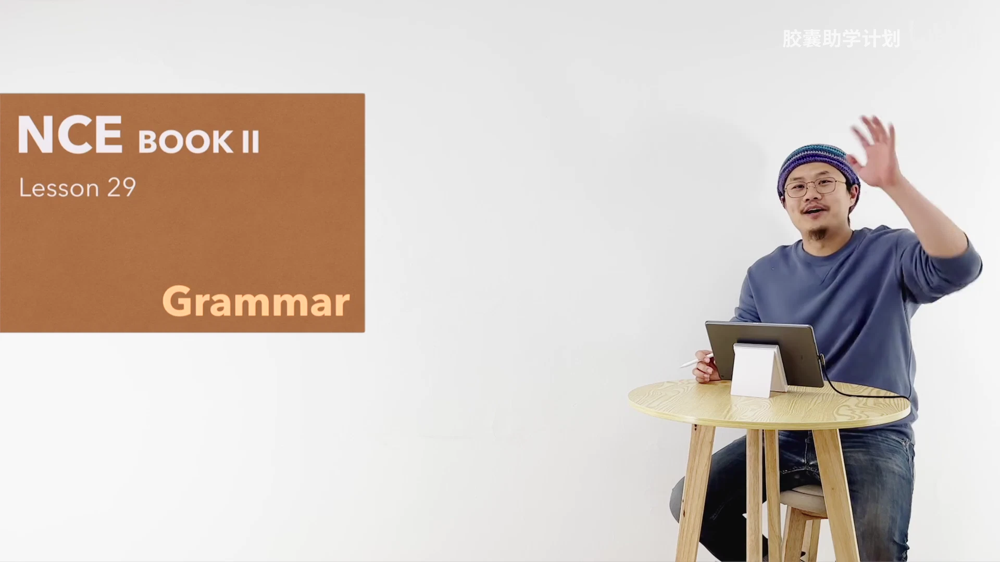

文字识别：NCE / BOOKⅡI / Lesson 29 / Grammar

### 画面 00:00:02

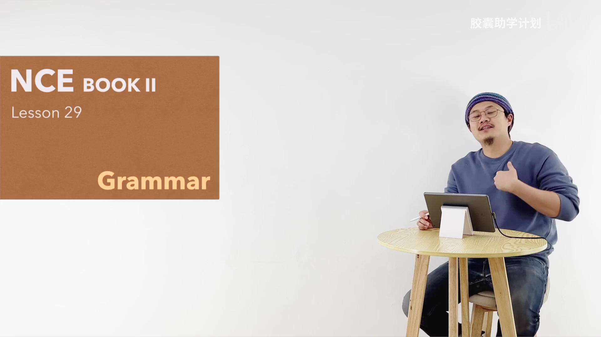

文字识别：NCE / BOOKII / Lesson 29 / Grammar

### 画面 00:00:08

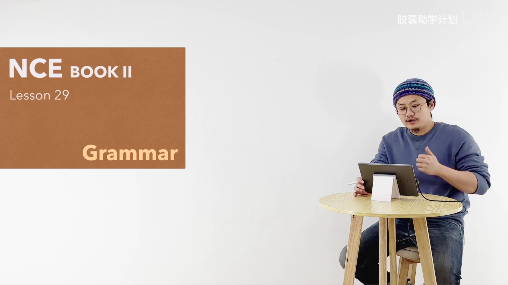

文字识别：NCE / BOOKI"I / Lesson 29 / Grammar

### 画面 00:00:10

文字识别：胶囊助学计

### 画面 00:00:12

文字识别：①如何使用done做定语?

### 画面 00:00:21

文字识别：①如何使用done做定语？ / 英文定语位置?

### 画面 00:00:23

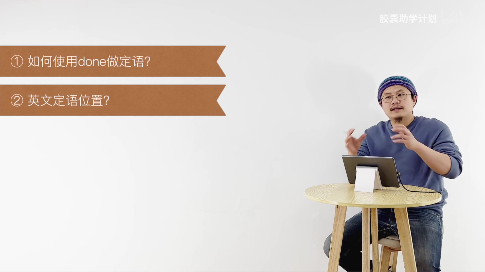

文字识别：①如何使用done做定语？ / 英文定语位置?

### 画面 00:00:29

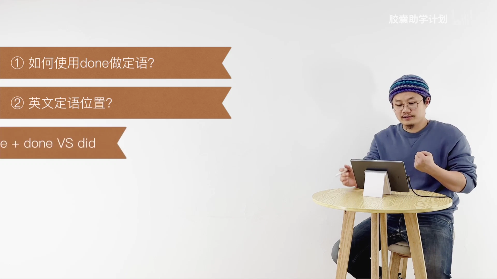

文字识别：①如何使用done做定语? / 英文定语位置? / e + done VS did

## 00:00:30–00:01:00

来我们再复习一下 have 加 done 与 did 这两个时态，OK，那带着这些问题后皮皮呢， enjoy。好，那我们还是回到六一二三四五六，对吧？这个东西非常的重要，这贯穿整个新二、新三甚至新四啊。那我们本课要学的新的语法叫但做定语加名词，定语是修饰名词的，对吧？那于是

### 画面 00:00:31

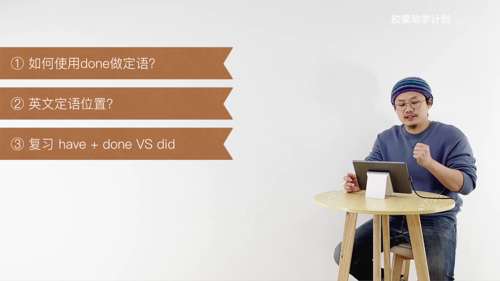

文字识别：①如何使用done做定语? / 英文定语位置? / 复习have + done VS did

### 画面 00:00:37

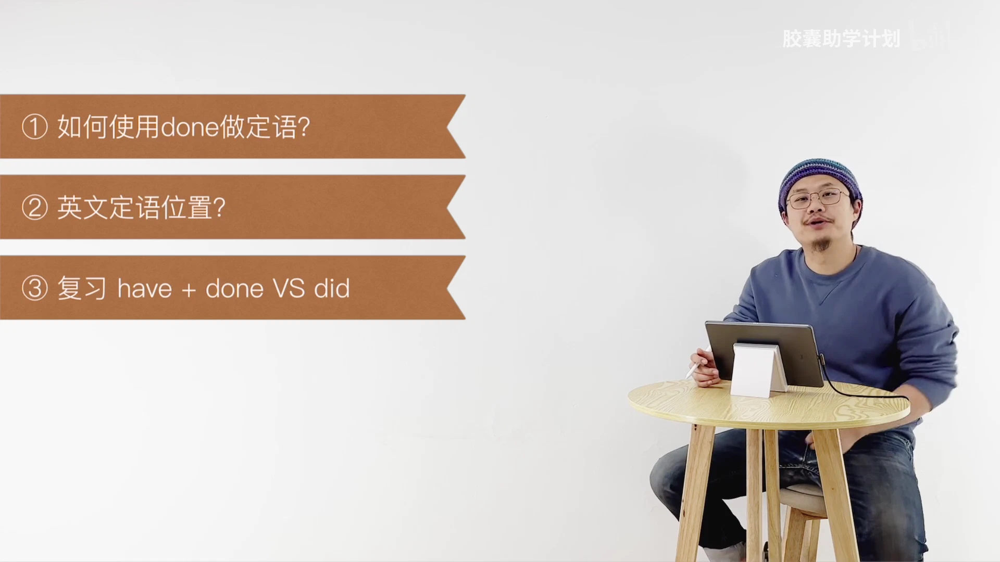

文字识别：①如何使用done做定语？ / 英文定语位置? / 复习have + done VS did

### 画面 00:00:39

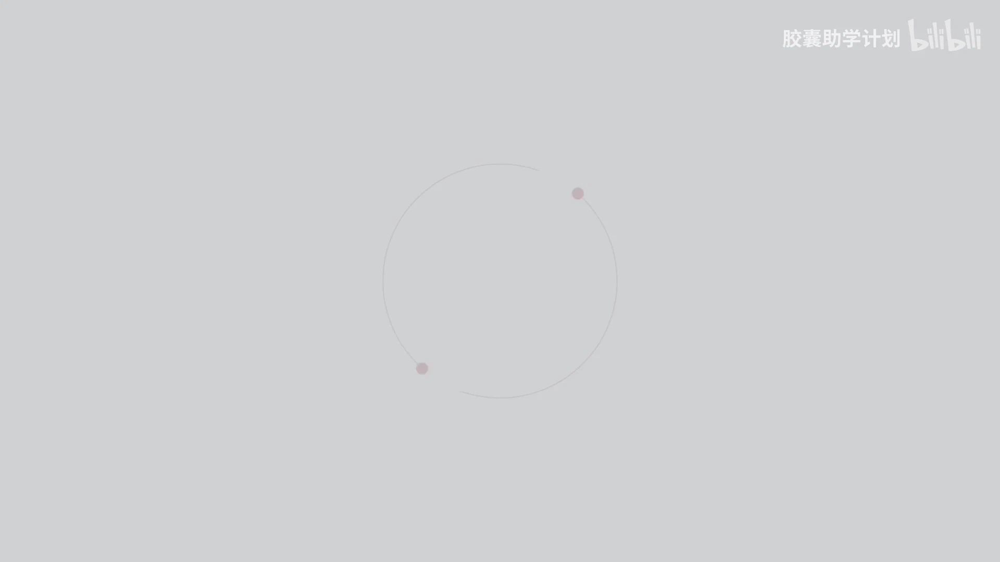

文字识别：胶囊助学计划 bilbl / •

### 画面 00:00:43

### 画面 00:00:45

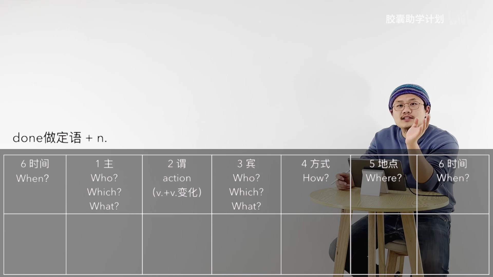

文字识别：胶囊助学计划 / done做定语 / + n. / 6时间 / 1主 / 2谓 / 3宾 / 4方式 / 5地点 / 6时间 / When? / Who? / action / Who? / How? / Where? / When? / Which? / (v.+v.变化) / Which? / What? / What?

## 00:01:00–00:01:30

我们要去讨论这个语法在哪些地方可能出现的时候，其实关键点就是名词在哪些地方可能出现。六可以，一可以，二不行，因为二是动词加动词变化。三可以，四方式往往是副词，不不聊它。地点可以，时间可以，对吧？也就是说，这这个语法，咱们现在学的这个语法，它在谓语动词和方式当中往往不出现，剩下在别的地方都可能会出现。好好学啊，很重要。

### 画面 00:01:10

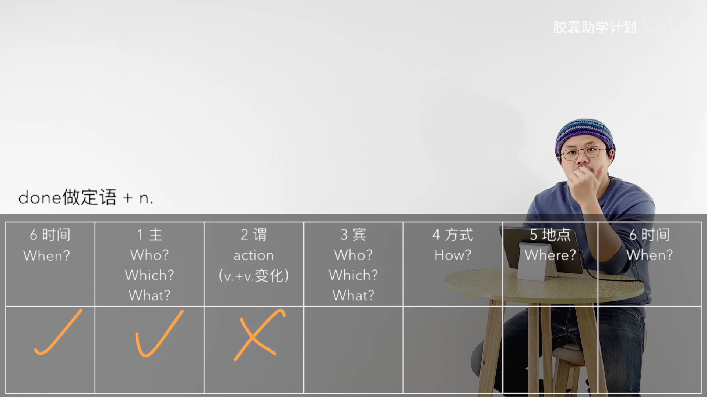

文字识别：胶囊助学计划 / done做定语 / + n. / 6时间 / 1主 / 2谓 / 3宾 / 4方式 / 5地点 / 6时间 / When? / Who? / action / Who? / How? / Where? / When? / Which? / (v.+v.变化) / Which? / What? / What?

### 画面 00:01:14

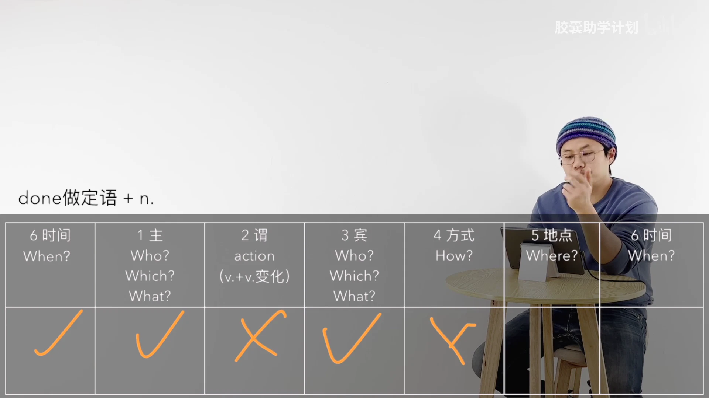

文字识别：胶囊助学计划 / done做定语 / + n. / 6时间 / 1主 / 2谓 / 3宾 / 4方式 / 5地点 / 6时间 / When? / Who? / action / Who? / How? / Where? / When? / Which? / (v.+v.变化) / Which? / What? / What?

### 画面 00:01:16

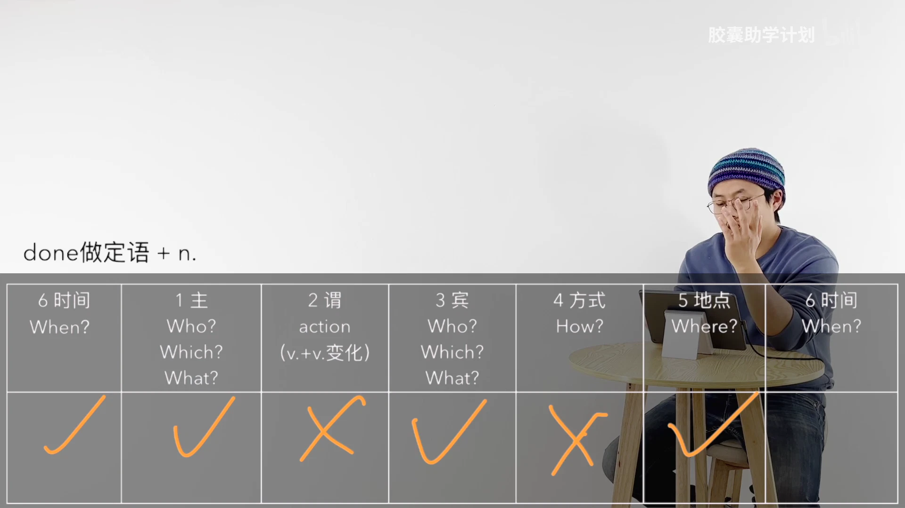

文字识别：胶囊助学计划 / done做定语 / + n. / 6时间 / 1主 / 2谓 / 3宾 / 4方式 / 5地点 / 6时间 / When? / Who? / action / Who? / How? / Where? / When? / Which? / (v.+v.变化) / Which? / What? / What?

### 画面 00:01:29

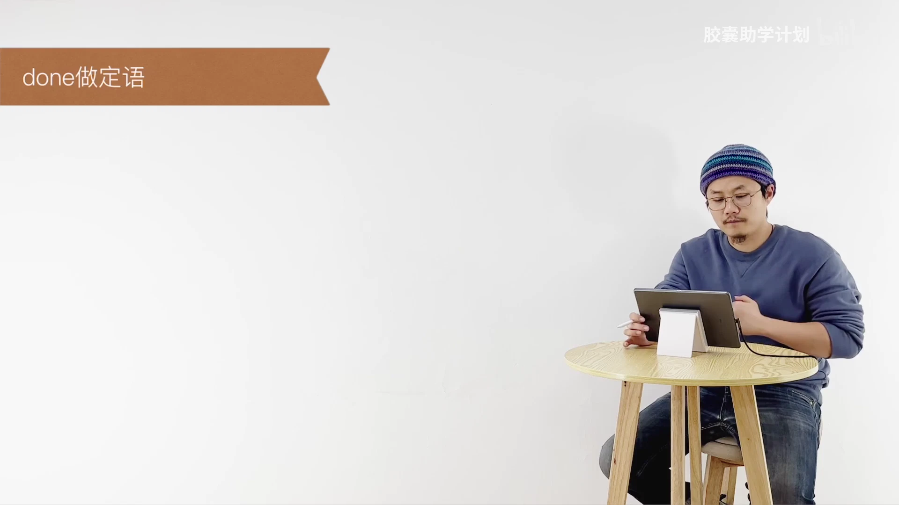

文字识别：胶囊助学计 / done做定语

## 00:01:30–00:02:00

那我们先看但做定语。首先我们在文章当中出现了这句话，我们提前拿出来看一下啊。说 the taxi is a small Swiss airplane，是一个小的飞机 called a pilot supporter。好，这个地方的 called a pilot supporter 的这个 called 它本身不是 called 过去式，它是 called 过去分词。虽然长得是一样的，对吧？ called 过去式过去分词都是 called 啊，后边加 e d。 OK，那在这儿怎么翻译

### 画面 00:01:32

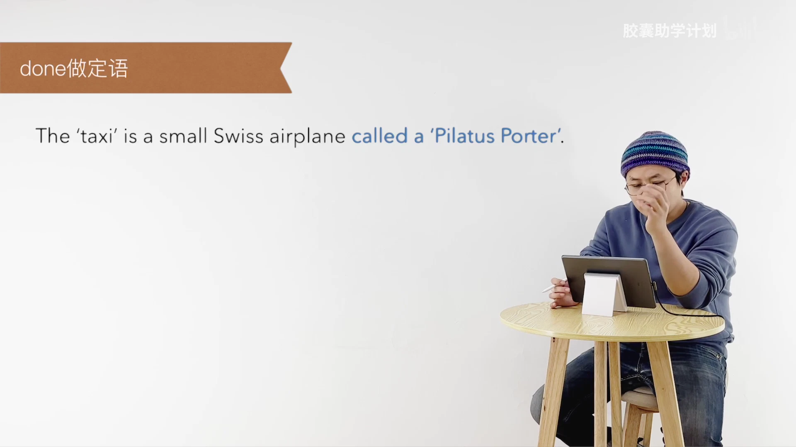

文字识别：done做定语 / The'taxi' is a small Swiss airplane called a 'Pilatus Porter'.

### 画面 00:01:34

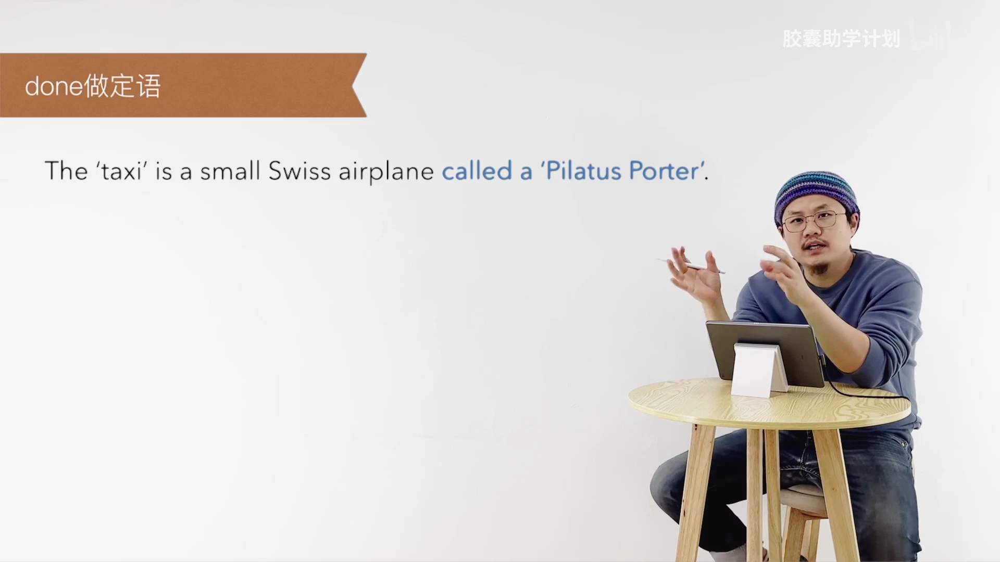

文字识别：胶囊助学 / done做定语 / The'taxi' is a small Swiss airplane called a 'Pilatus Porter'.

### 画面 00:01:44

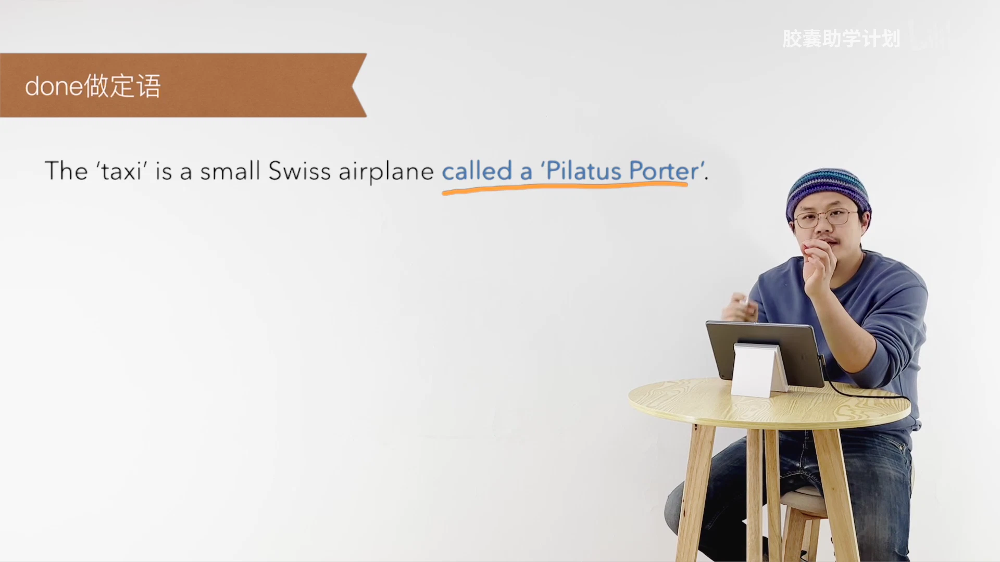

文字识别：胶囊助学计划 / done做定语 / The'taxi' is a small Swiss airplane called a 'Pilatus Porter'.

### 画面 00:01:49

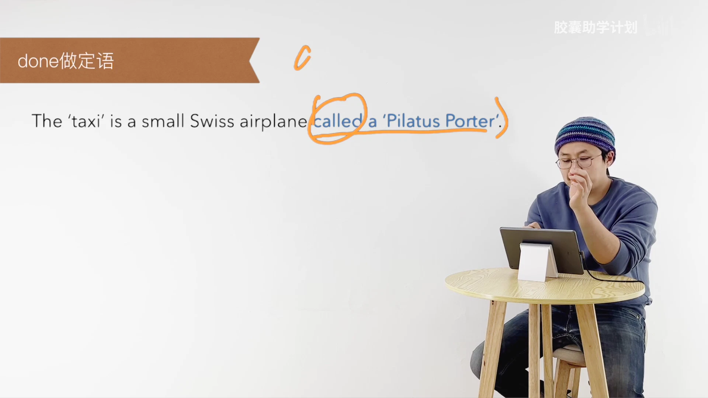

文字识别：胶囊助学计划 / done做定语 / The 'taxi' is a small Swiss airplane calleda 'Pilatus Porter'

### 画面 00:01:52

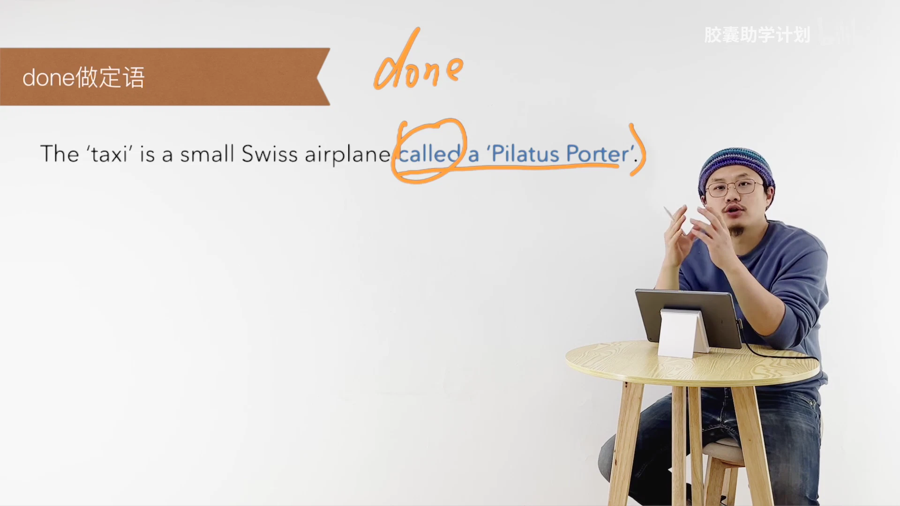

文字识别：olone / 胶囊助学计划 / done做定语 / eCalled a 'Pilatus Porter'. / The'taxi' is a small Swiss : / airplane

## 00:02:00–00:02:30

呢？叫做被叫做 Pilatus Porter 的一个小的瑞士产飞机啊。OK，下面还有一个小短语叫做 Unapplaud Field。你看这个短语在句子当中，它其实就是处于地点这样一个位置啊。六二三四五六当中处于五，对吧？那 Unapplaud Field 怎么去理解呢？首先，applaud 它本身是个动词，你把它变成它的过去分词了之后，它是可以起到形容词

### 画面 00:02:22

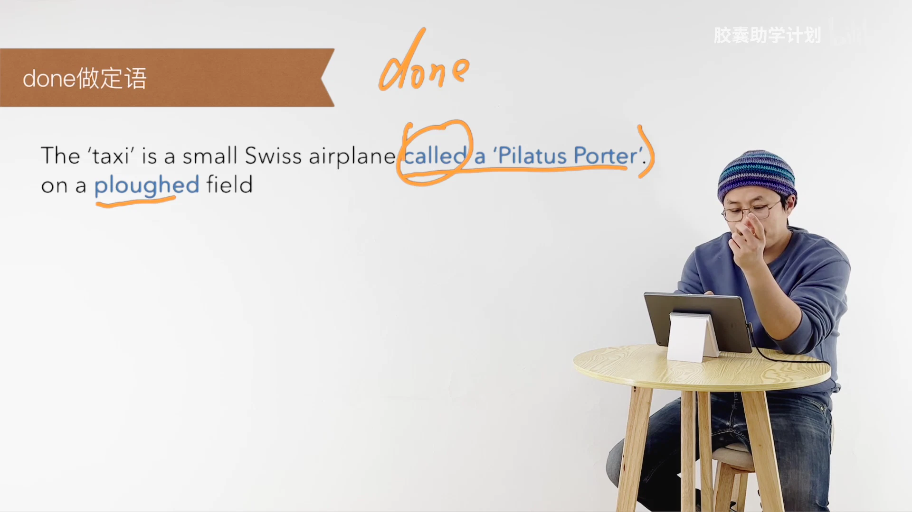

文字识别：done / 胶囊助学计划 / done做定语 / The / 'taxi' is a small  / Swiss / airplane / Calleda / 'Pilatus / Porter' / a / ona / ploughed / field

### 画面 00:02:26

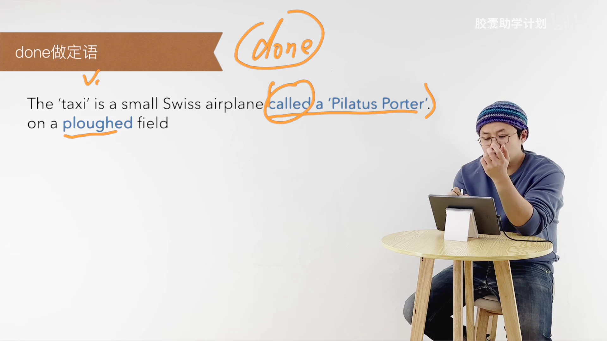

文字识别：胶囊助学计划 / done / done做定语 / V / The / 'taxi'is a small ! / Swiss / airplane / Calleda / 'Pilatus / Porter' / a / ona / ploughed / field

## 00:02:30–00:03:00

作用的，所以放到了名词的前面，看见了吧？所以 on a plowed field 怎么去翻译呢？我先翻译一下，叫做在一个被耕过的地的上面，对吧？OK, very good. 接下来 deserted car park 这也是文章当中出现的一个短语。那 deserted 首先 desert 本身是啊一个动词，对吧？叫做遗弃、抛弃。那 deserted

### 画面 00:02:50

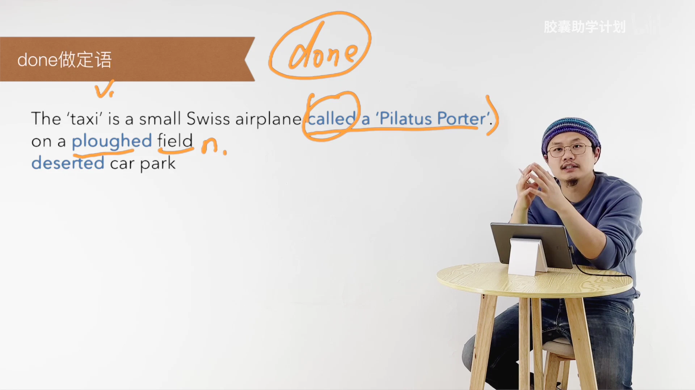

文字识别：胶囊目 / 孕计划 / done / done做定语 / V / The / 'taxi' / 'isa small / Swiss / airplane / Called / 'Pilatus / Porter' / a / ona / ploughed / field / n. / deserted / car park

## 00:03:00–00:03:30

car park car park 就是汽车公园，可以这样理解呗，对吧？或停车场啊。那 deserted car park 怎么去理解呢？哎，告诉各位，叫做已经被抛弃了的。各位不知道意没意识到，其实这至少后边这两句我在翻译的时候都翻译成叫已经和被，对吧？所以这就是 but 去做定语的时候，各位要注意的一个关键点，叫做它通常表示的是

### 画面 00:03:15

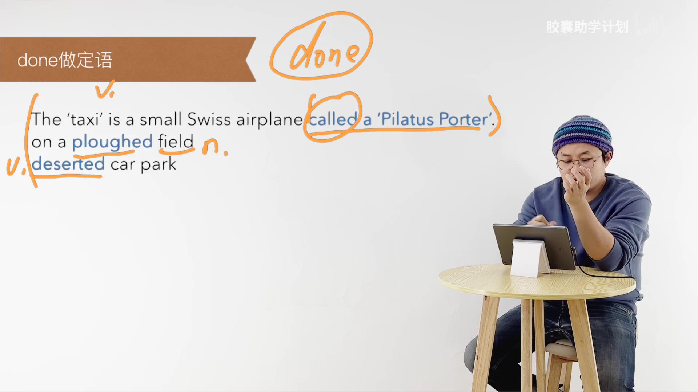

文字识别：胶囊目 / 力学计划 / done / done做定语 / V / The / 'taxi' / is a small / Swiss / airplane / Called / 'Pilatus / Porter' / a / ona / ploughed / field / n. / V,deserted / car park

### 画面 00:03:22

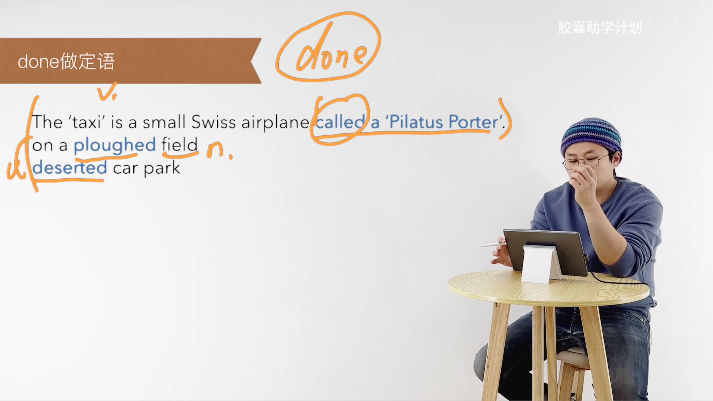

文字识别：胶囊 / done / done做定语 / V / The / 'taxi' / isa small / Swiss / airplane / Called / 'Pilatus / Porter' / a / Ton a / ploughed / field / n. / deserted / car park

### 画面 00:03:25

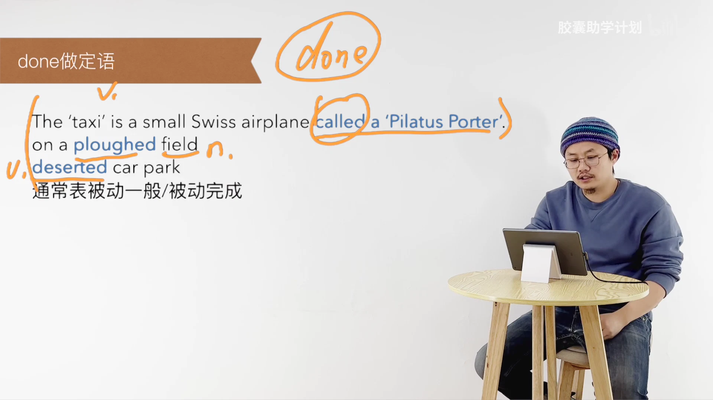

文字识别：胶囊助学计划 / done / done做定语 / V / The / 'taxi' is a small  / Swiss / airplane / Calleda / 'Pilatus / Porter' / a / ona / ploughed / field / V / deserted / car park / 通常表被动一般/被动完成

### 画面 00:03:27

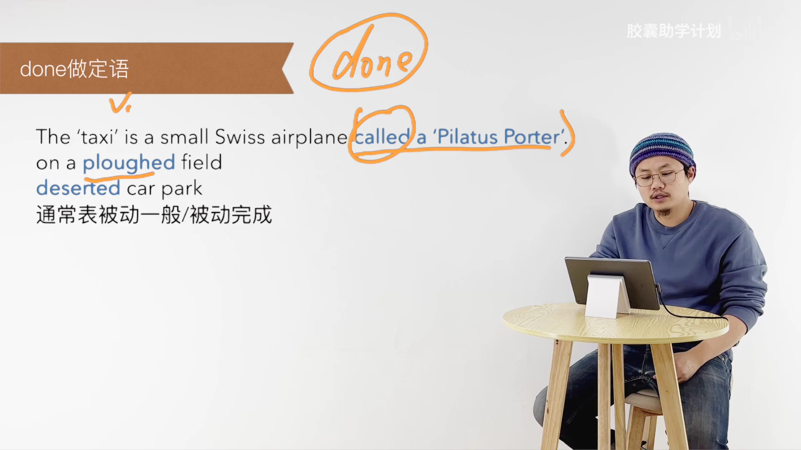

文字识别：done / done做定语 / V / eCalleda'Pilatus Porter' / The / 'taxi'is a small Swiss / airplane / ona / ploughed / field / deserted carpark / 通常表被动一般/被动完成

### 画面 00:03:29

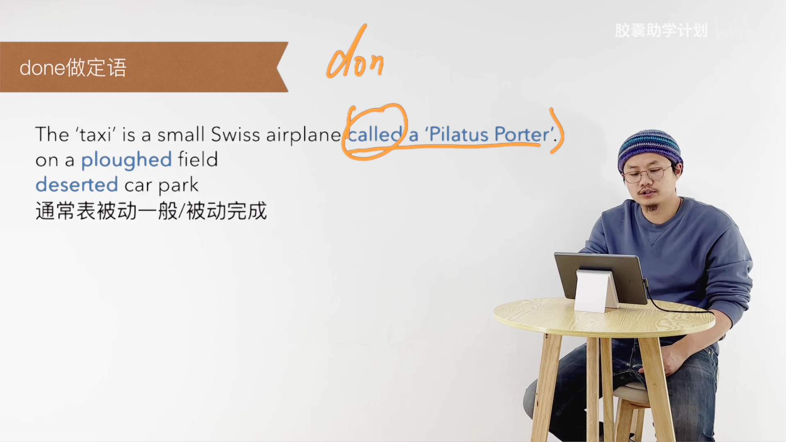

文字识别：胶囊 / don / done做定语 / The'taxi' is a small Swiss / airplane / eCalleda'Pilatus Porter' / on a ploughed field / deserted car park / 通常表被动一般/被动完成

## 00:03:30–00:04:00

被动啊，一般或被动完成。怎么去理解被动一般或被动完成呢？我们先说被动很好理解，它往往但做定语的时候都是翻译成被，比如说被叫做 Peter's Porter，被耕过的地，被抛弃的这个停车场，对吧？OK，所以它都往往是被动啊，但是是通常状态下啊，就是高概率事件。那什么叫被动一般呢？其实就类似于它可以是一

### 画面 00:03:31

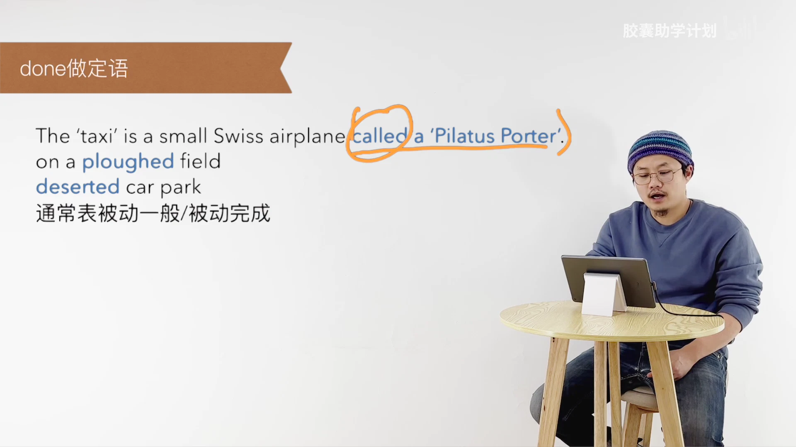

文字识别：胶囊助学计划 / done做定语 / The'taxi' is a small Swiss a / airplane / e calleda'Pilatus Porter' / on a ploughed field / deserted car park / 通常表被动一般/被动完成

### 画面 00:03:33

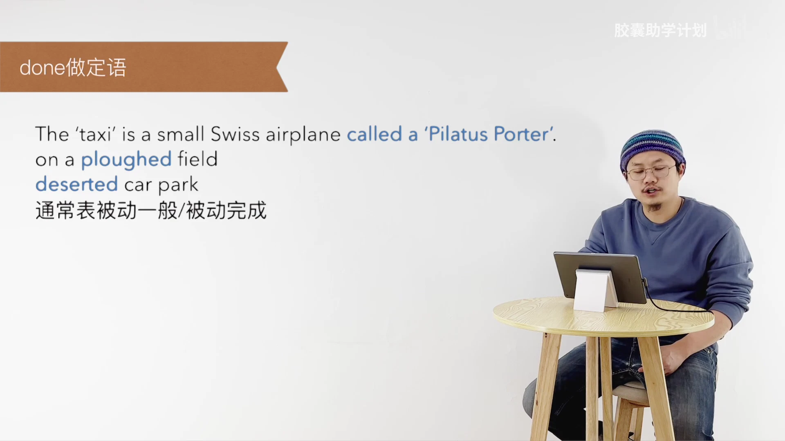

文字识别：胶囊助学计划 / done做定语 / The'taxi' is a small Swiss airplane called a 'Pilatus Porter'. / on a ploughed field / deserted car park / 通常表被动一般/被动完成

### 画面 00:03:36

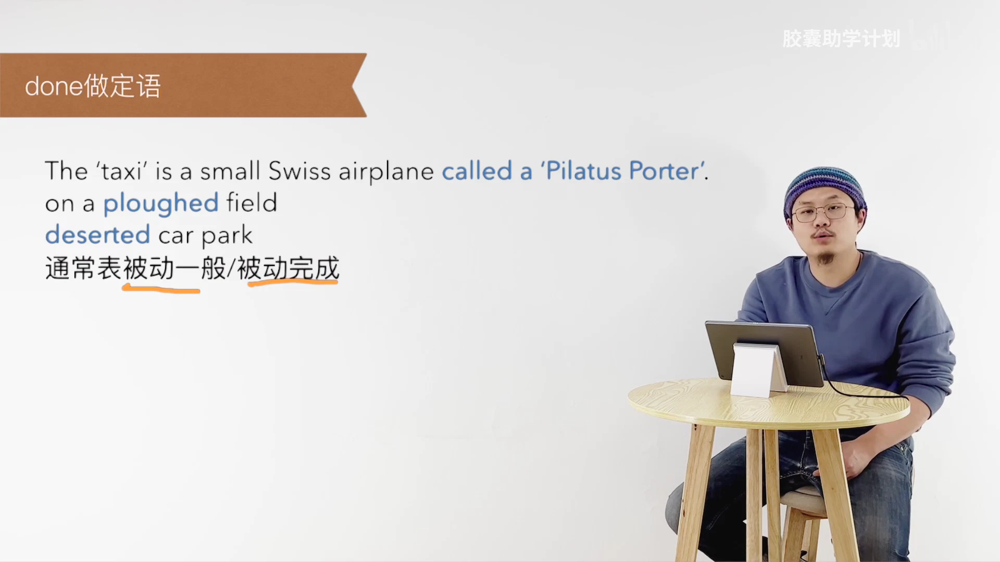

文字识别：done做定语 / The'taxi' is a small Swiss airplane called a 'Pilatus Porter'. / on a ploughed field / deserted car park / 通常表被动一般/被动完成

## 00:04:00–00:04:30

般现在时，可以是一般过去时啊。比如说被耕过的地，它其实某种程度上叫做一般现在时的感觉，对吧？如果是已经被耕过的地，就是呃呃现在完成时的感觉。但是各位不用去做这个区分。比如说像这个短语当中，它是翻译成被耕过的地还是已经被耕过的地，其实并不影响整个短语的含义，所以我们不需要去做非常具体的区分。所以关键

### 画面 00:04:06

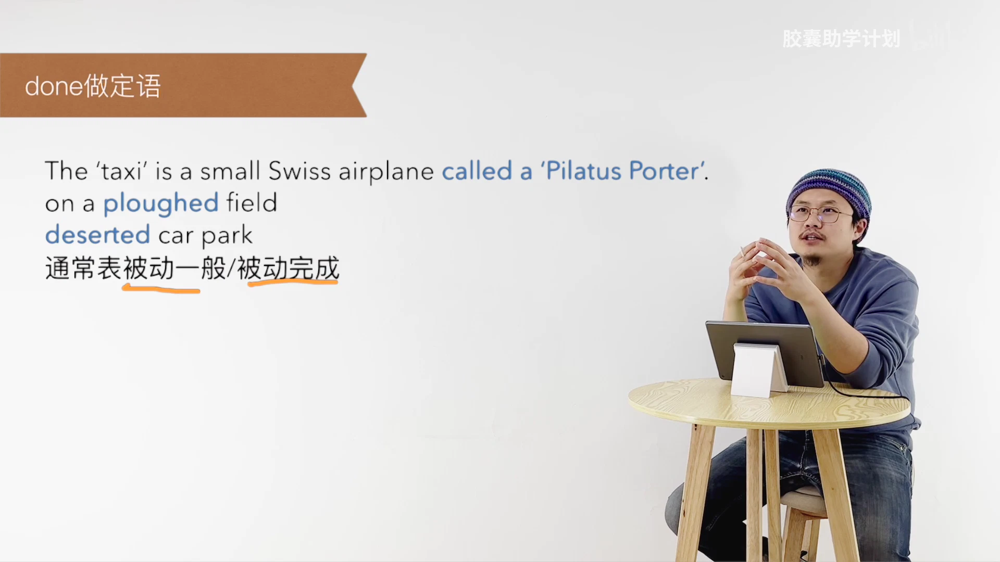

文字识别：done做定语 / The'taxi' is a small Swiss airplane called a 'Pilatus Porter'. / on a ploughed field / deserted car park / 通常表被动一般/被动完成

## 00:04:30–00:05:00

点只要知道它是被动就可以了，对吧？其次呢，完成那刚才我们就翻译了，叫已经，对吧？已经被遗弃了的，对吧？很长时间了，已经被更过了啊。那这其实都是一个典型的完成时，OK。所以它翻译成被动一般或被动完成。因为但做定语，各位回想一下，我们目前讨论定语的时候，讨论过一些东西。第一，形容词可以做定语，对吧？我们在新概念一册一百二十一课、一百二十三课那课语法当中有过非常详细的

### 画面 00:04:34

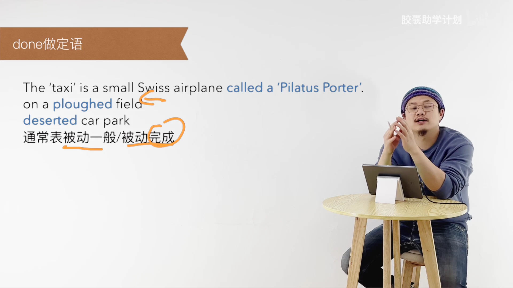

文字识别：done做定语 / The'taxi' is a small Swiss airplane called a 'Pilatus Porter'. / on a ploughed fielaS / deserted car park / 通常表被动一般/被动完成

## 00:05:00–00:05:30

介绍，比如说红色、黄色、蓝色的香蕉，对吧？那它自己本身起到的作用是帮你定住你想要哪一个香蕉。然后呢，那定语从句我们是新概念一册一百二十一课、一百二十三课，新概念二册第八课啊、第二十八课，我们都学过的。它本身这个句子也是起到一个定语的作用。所以，我们尝试这样去给大家分析一下啊。比如说，我们看叫 a broken car，对吧？a

### 画面 00:05:04

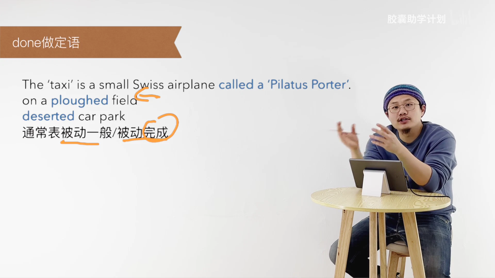

文字识别：done做定语 / The'taxi' is a small Swiss airplane called a 'Pilatus Porter'. / on a ploughed fiela / deserted car park / 通常表被动一般/被动完成

### 画面 00:05:24

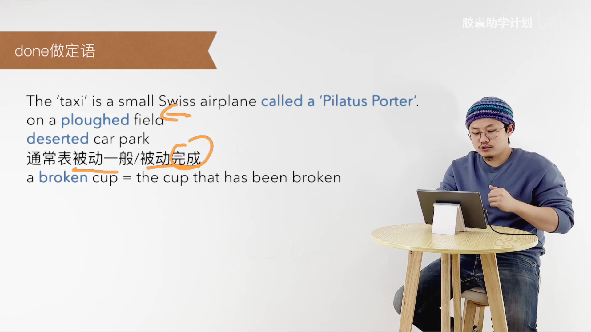

文字识别：done做定语 / The'taxi' is a small Swiss airplane called a 'Pilatus Porter'. / on a ploughed fiela / deserted car park / 通常表被动一般/被动完成 / a broken cup = the cup that has been broken

### 画面 00:05:26

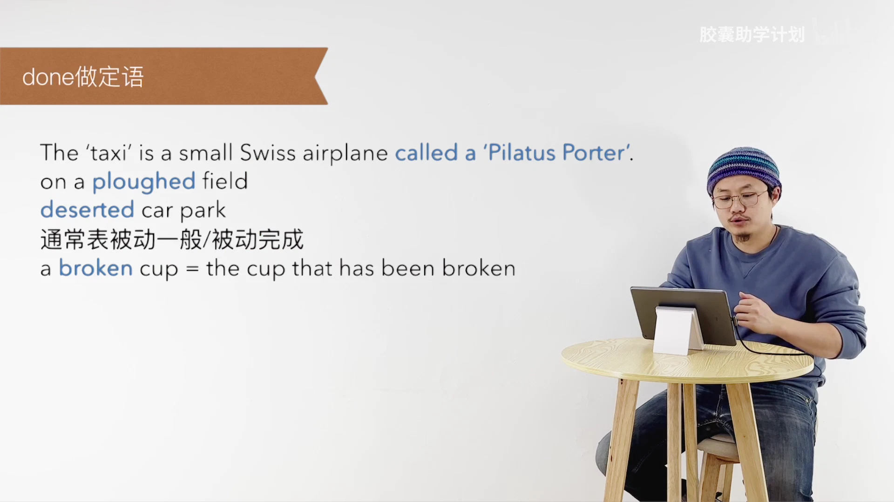

文字识别：done做定语 / The'taxi' is a small Swiss airplane called a 'Pilatus Porter'. / on a ploughed field / deserted car park / 通常表被动一般/被动完成 / a broken cup = the cup that has been broken

## 00:05:30–00:06:00

broken cup. Okay,一个cup杯子。那broken首先break各位非常清楚，它本身是一个动词，对吧？叫做打碎、打破。那broken就是break的过去分词，也就是done，对不对？done叫过去分词嘛。那a broken cup叫做看啊，被动一般或被动完成，反正它一定翻译成叫做被打碎了的杯子。至于是已

### 画面 00:05:38

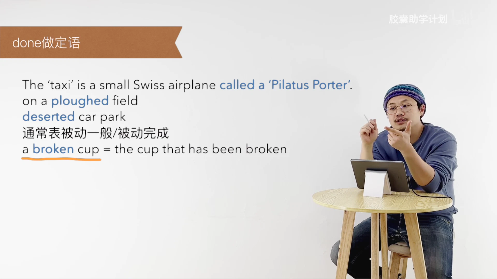

文字识别：done做定语 / The'taxi'is a small Swiss airplane called a'Pilatus Porter'. / on a ploughed field / deserted car park / 通常表被动一般/被动完成 / a broken cup = the cup that has been broken

### 画面 00:05:53

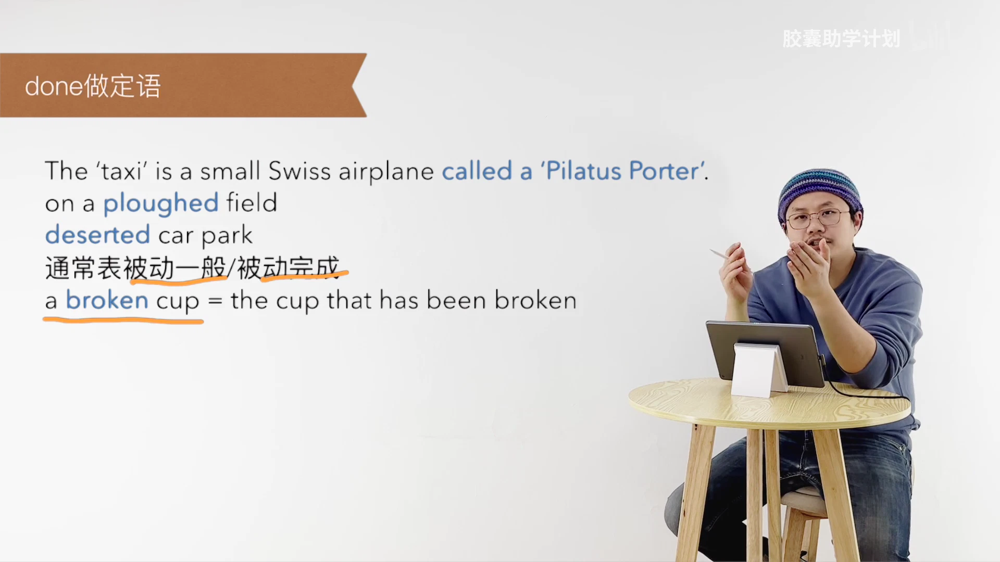

文字识别：done做定语 / The'taxi' is a small Swiss airplane called a 'Pilatus Porter'. / on a ploughed field / deserted car park / 通常表被动一般/被动完成 / a broken cup = the cup that has been broken

## 00:06:00–00:06:30

经被打碎了的杯子还是被打碎了的杯子，也就是说让你去判断到底是一般还是完成的时候，您怎么觉得舒服怎么来就可以了，不用去做过分的区分啊。比如说，我们就可以把它变成一个定语从句，叫做 the cup that has been broken。你看 that has been broken 就是一个典型的定语从句，叫做这个杯子什么样的杯子呢？它已经被打碎了，所以 a broken broken 这个单词

### 画面 00:06:14

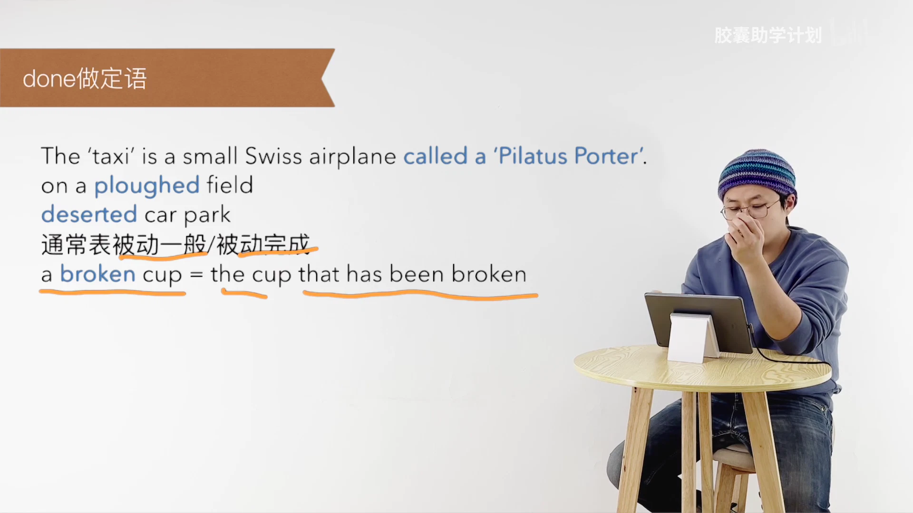

文字识别：学计划 / done做定语 / The'taxi' is a small Swiss / airplane called a 'Pilatus Porter' / on a ploughed field / deserted car park / 通常表被动一般/被动完成 / a broken cup = the cup that has been broken

### 画面 00:06:21

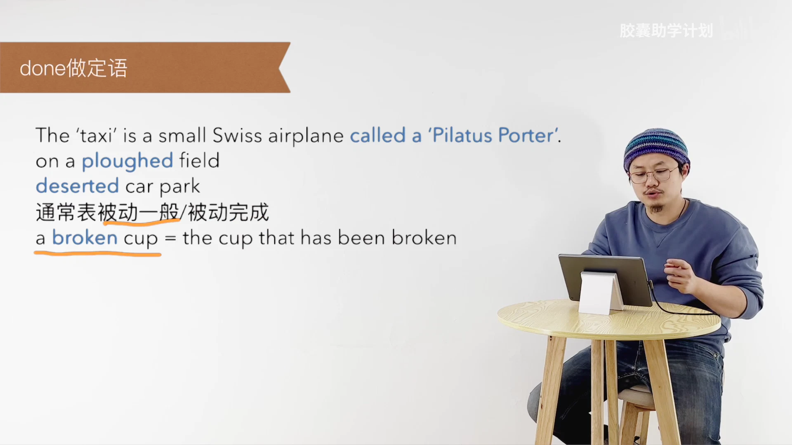

文字识别：done做定语 / The'taxi' is a small Swiss airplane called a 'Pilatus Porter'. / on a ploughed field / deserted car park / 通常表被动一般/被动完成 / a broken cup = the cup that has been broken

### 画面 00:06:23

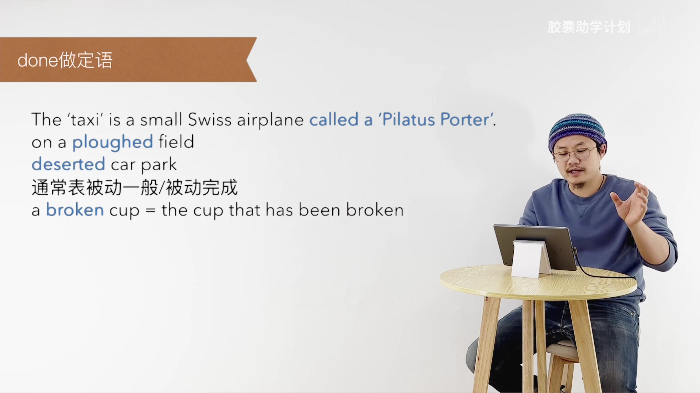

文字识别：done做定语 / The'taxi' is a small Swiss airplane called a 'Pilatus Porter'. / on a ploughed field / deserted car park / 通常表被动一般/被动完成 / a broken cup = the cup that has been broken

## 00:06:30–00:07:00

基本上起到的作用就是整个定语从句的作用。OK，那我们再来一个例子，比如说boiled water啊，叫做被烧好的水，被煮沸的水，对吧？那water that has been boiled，已经被煮沸了的水。再来，刚才举了两个例子了之后，首先你要知道，大多数状态下是被动一般或被动完成，偶尔还可以表达主动完成。好，在这个地方你

### 画面 00:06:31

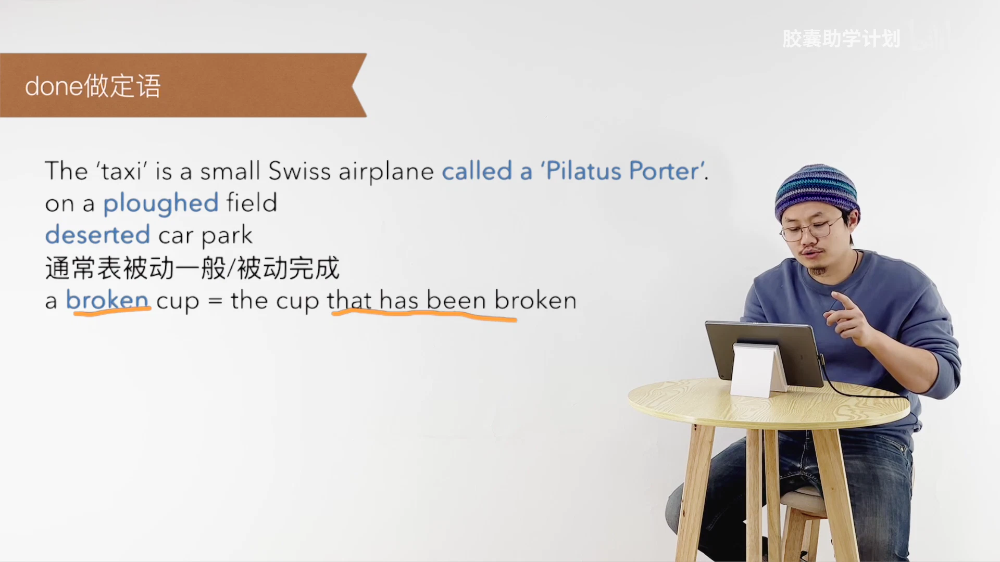

文字识别：done做定语 / The'taxi' is a small Swiss airplane called a 'Pilatus Porter'. / on a ploughed field / deserted car park / 通常表被动一般/被动完成 / a broken cup = the cup that has been broken

### 画面 00:06:33

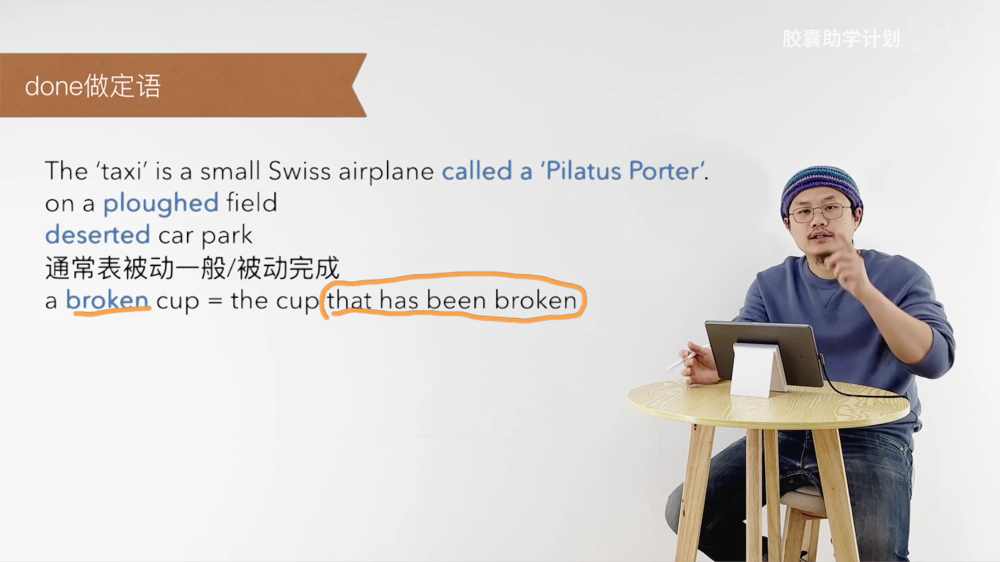

文字识别：done做定语 / The'taxi' is a small Swiss airplane called a 'Pilatus Porter'. / on a ploughed field / deserted car park / 通常表被动一般/被动完成 / a broken cup = the cup / that has been broken

### 画面 00:06:46

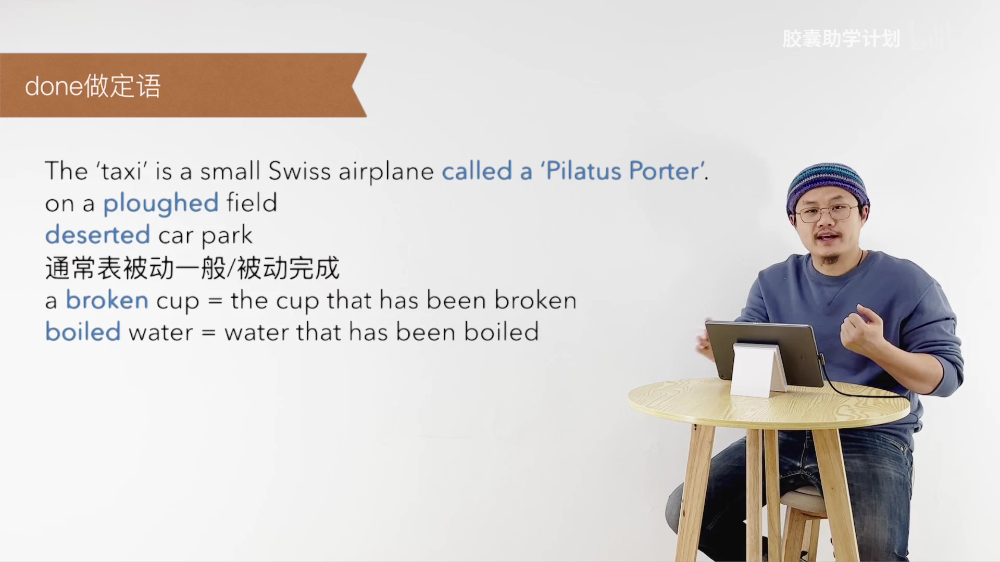

文字识别：done做定语 / The'taxi' is a small Swiss airplane called a 'Pilatus Porter'. / on a ploughed field / deserted car park / 通常表被动一般/被动完成 / a broken cup = the cup that has been broken / boiled water = water that has been boiled

### 画面 00:06:51

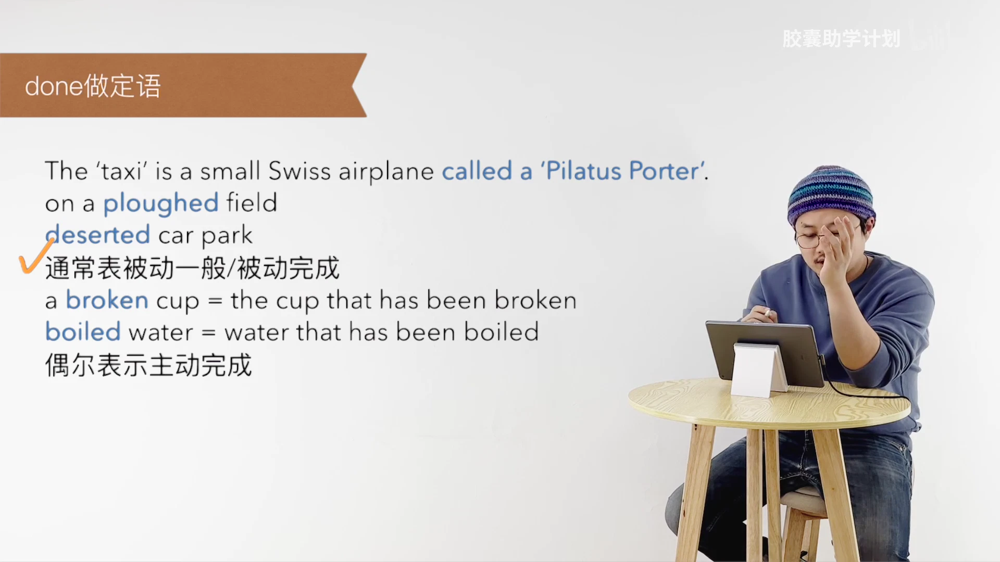

文字识别：胶囊助学计划 / done做定语 / The'taxi' is a small Swiss airplane called a 'Pilatus Porter'. / on a ploughed field / deserted car park / 通常表被动一般/被动完成 / a broken cup = the cup that has been broken / boiled water = water that has been boiled / 偶尔表示主动完成

### 画面 00:06:59

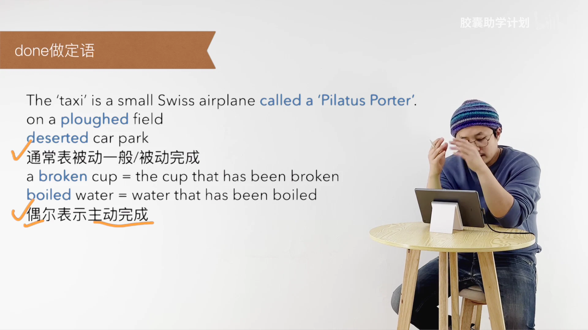

文字识别：done做定语 / The'taxi' is a small Swiss airplane called a 'Pilatus Porter'. / on a ploughed field / deserted car park / 通常表被动一般/被动完成 / a broken cup = the cup that has been broken / boiled water = water that has been boiled / 偶尔表示主动完成

## 00:07:00–00:07:30

可能会问一个问题，那如何去判断这个但做定语的时候是被动一般、被动完成还是主动完成，对吧？这个听上去很复杂，其实非常简单，就是你把它放到句子当中去的时候呢，你就优先考虑它是被动，你就去拿被动去翻译，翻译完了之后，你感觉驴唇不对马嘴，因为你有汉语语感嘛，对吧？你觉得这玩意儿是没法是被动的，那它就一定是主动，就这么简单，是吧？你不需要去记谁是及物谁是不及物，因为有的单词它有二十个含

### 画面 00:07:01

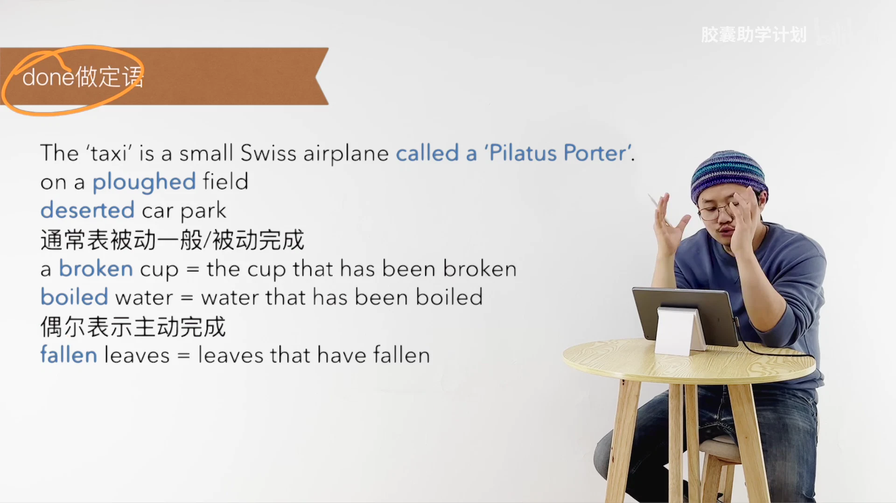

文字识别：胶囊助学计划 / done做定语 / The'taxi' is a small Swiss airplane called a 'Pilatus Porter'. / on a ploughed field / deserted car park / 通常表被动一般/被动完成 / a broken cup = the cup that has been broken / boiled water = water that has been boiled / 偶尔表示主动完成 / fallen leaves = leaves that have fallen

## 00:07:30–00:08:00

义，对吧？然后十五个含义是及物的，五个含义是不及物的。你还要先去看它在这是哪个含义，然后再去判断。那样其实不符合我们学习的思路，特别复杂。这种多简单，直接就判断被动对不对？对，那就是被动；不对就是主动，就这么简单，对吧？而且大多数情况下你见到的都是主动，比如说 a retired captain， retire 动词退休，那退休的船长，你看这个就不存在什么被动，被退

### 画面 00:07:31

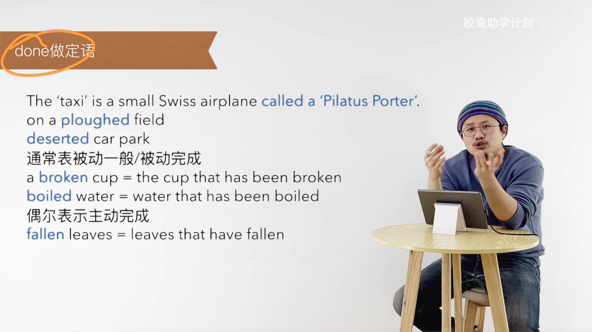

文字识别：done做定语 / The'taxi' is a small Swiss airplane called a 'Pilatus Porter'. / on a ploughed field / deserted car park / 通常表被动一般/被动完成 / a broken cup = the cup that has been broken / boiled water = water that has been boiled / 偶尔表示主动完成 / fallen leaves = leaves that have fallen

### 画面 00:07:48

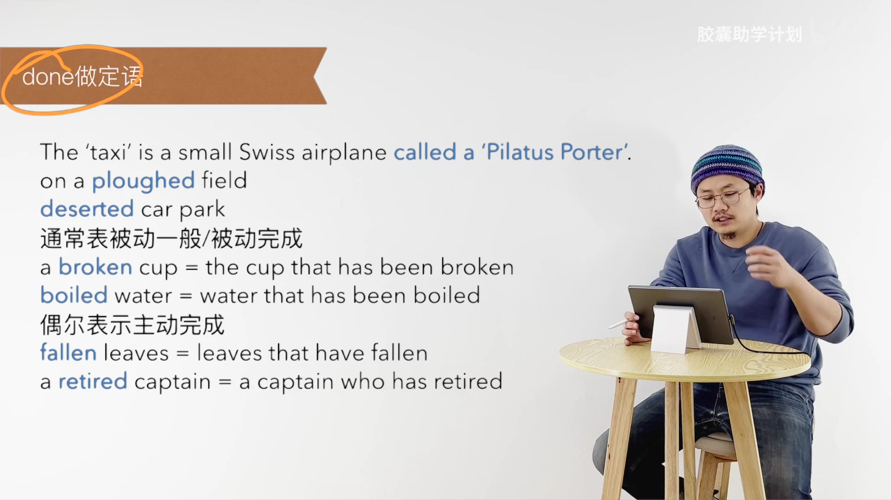

文字识别：done做定语 / The'taxi' is a small Swiss airplane called a 'Pilatus Porter'. / on a ploughed field / deserted car park / 通常表被动一般/被动完成 / a broken cup = the cup that has been broken / boiled water = water that has been boiled / 偶尔表示主动完成 / fallen leaves = leaves that have fallen / a retired captain = a captain who has retired

## 00:08:00–00:08:30

休的船长就听上去很怪，除非结合上下文，真的可能是这个样子，对吧？但英文也不这样表达。OK，好，那再来一个叫做 a married man，叫做一个结婚已经结婚了的男子，叫已婚男子，对吧？Married 本身是个动词，然后把它变成但过去分词的时候，那放到 man 的前面。各位注意到了哈，我们接下来要讲一个关键点，叫做定语的位置。如果它

### 画面 00:08:11

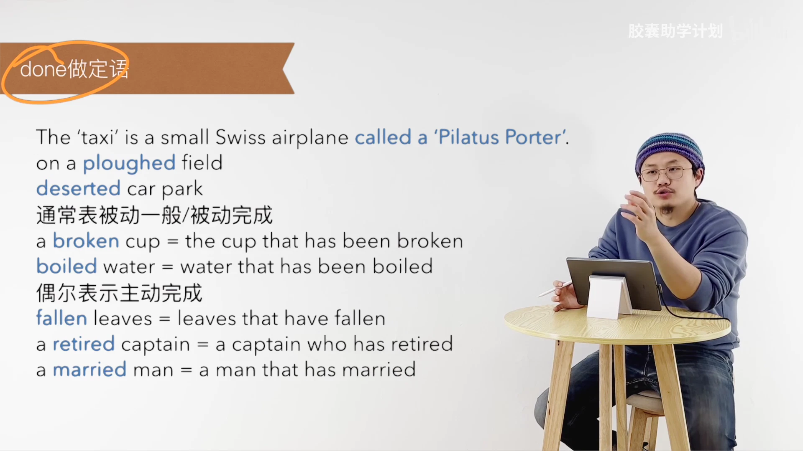

文字识别：done做定语 / The'taxi' is a small Swiss airplane called a 'Pilatus Porter'. / on a ploughed field / deserted car park / 通常表被动一般/被动完成 / a broken cup = the cup that has been broken / boiled water = water that has been boiled / 偶尔表示主动完成 / fallen leaves = leaves that have fallen / a retired captain = a captain who has retired / a married man = a man that has married

### 画面 00:08:25

文字识别：done做定语 / The'taxi' is a small Swiss airplane called a'Pilatus Porter'. / on a ploughed field / deserted car park / 通常表被动一般/被动完成 / a broken cup = the cup that has been broken / boiled water = water that has been boiled / 偶尔表示主动完成 / fallen leaves = leaves that have fallen / a retired captain = a captain who has retired / a married man = a man that has married / 位置：单词(done)+n.+ done引导的短语

## 00:08:30–00:09:00

是单词，但去做定语的时候，往往是放在名词的前面。我举一些例子，plowed field 放在 field 前面，deserted car park deserted 放在 car park 的前面，broken 放到了 cup 的前面，对吧？如果是但引导的短语，那你就把它放到名词的后面。比如说 called a pilot spotter，在说的是 error planned，也就是目前我们大概能得出这样一个结论，就是不管

### 画面 00:08:30

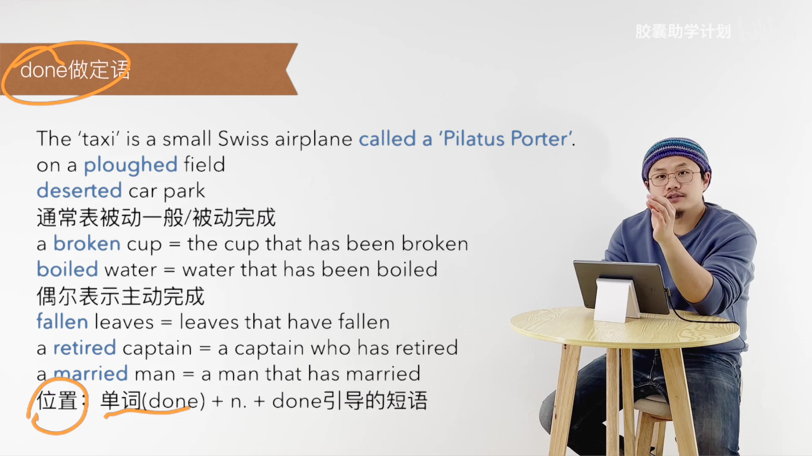

文字识别：done做定语 / The'taxi' is a small Swiss airplane called a'Pilatus Porter'. / on a ploughed field / deserted car park / 通常表被动一般/被动完成 / a broken cup = the cup that has been broken / boiled water = water that has been boiled / 偶尔表示主动完成 / fallen leaves = leaves that have fallen / a retired captain = a captain who has retired / a married man = a man that has married / 位置 / 单词(done)+ n.+ done引|导的短语

### 画面 00:08:36

文字识别：胶囊助学计划 / done做定语 / The'taxi' is a small Swiss airplane called a 'Pilatus Porter'. / ploughedfield / ona / deserted car park / 通常表被动一般/被动完成 / a broken cup = the cup that has been broken / boiled water = water that has been boiled / 偶尔表示主动完成 / fallen leaves = leaves that have fallen / a retired captain = a captain who has retired / a married man = a man that has married / 位置 / 单词(done)+n. / +done引导的短语

### 画面 00:08:39

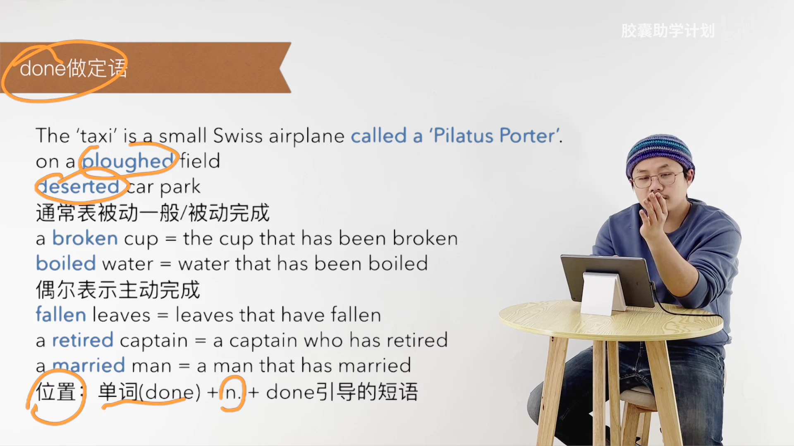

文字识别：胶囊助学 / done做定语 / The'taxi' is a small Swiss airplane called a 'Pilatus Porter'. / oloughedfield / ona / desertedcar park / 通常表被动一般/被动完成 / a broken cup = the cup that has been broken / boiled water = water that has been boiled / 偶尔表示主动完成 / fallen leaves = leaves that have fallen / a retired captain = a captain who has retired / a married man = a man that has married / 位置 / 单词(done)+n. / +done引导的短语

### 画面 00:08:43

文字识别：胶囊助学计划 / done做定语 / The'taxi' is a small Swiss airplane called a 'Pilatus Porter'. / oloughedfield / ona / desertedCar park / 通常表被动一般/被动完成 / Croker cup = the cup that has been broken / a / boiled water = water that has been boiled / 偶尔表示主动完成 / fallen leaves = leaves that have fallen / a retired captain = a captain who has retired / a married / I man = a man that has married / 位置 / 单词(done)+n. / + done引导的短语

### 画面 00:08:47

文字识别：done做定语 / The'taxi' is a small Swiss airplane called a'Pilatus Porter'. / oloughedfield / ona / desertedcar park / 通常表被动一般/被动完成 / Groker cup = the cup that has been broken / a / boiled water = water that has been boiled / 偶尔表示主动完成 / fallen leaves = leaves that have fallen / a retired captain = a captain who has retired / a married / man = a man that has married / 位置 / 单词(done)+n. / +done引l导的短语

### 画面 00:08:52

文字识别：胶囊 / done做定语 / The'taxi' is a small Swiss airplane called a 'Pilatus Porter'. / oloughedfield / ona / deserted car park / 通常表被动一般/被动完成 / Oroken cup = the cup that has been broken / a / boiled water = water that has been boiled / 偶尔表示主动完成 / fallen leaves = leaves that have fallen / a retired captain = a captain who has retired / a married / man = a man that has married / 位置 / 单词(done)+n. / +done引l导的短语

## 00:09:00–00:09:30

你是形容词还是但，如果你去形容名词的时候，都放在名词的前面；如果你是短语或者句子，那你就要放在名词的后面，对吧？这跟汉语是不太一样的。等我们到三十课，给各位整体上总结一下。OK，第三十课我们还要学doing做定语，现在分词做定语啊。OK，好，那刚才讲完了核心的两个点，第一叫但做定语如何去用，

### 画面 00:09:00

文字识别：胶囊助学计划 / done做定语 / The'taxi' is a small Swiss airplane called a 'Pilatus Porter' / oloughedfield / ona / deserted car park / 通常表被动一般/被动完成 / Groken cup = the cup that has been broken / a / boiled water = water that has been boiled / 偶尔表示主动完成 / fallen leaves = leaves that have fallen / a retired captain = a captain who has retired / a married / man = a man that has married / 位置 / 单词(done)+n. / done引导的短语

### 画面 00:09:24

文字识别：Repetition drill / 训练目标： / 听力口语 / 练习包含have done VS did的句子 / Accuracy / Fluency

## 00:09:30–00:10:00

这个对于各位来说，现在各位不需要去主动用，在文章当中见到能懂就行了，对吧？他对各位目前的要求是这样的。接下来呢，因为本课是我们新概念二册第二单元的第五课，它和第一单元第五课是一样的，所以我们要再复习一下 have 加 but 和 did。呃，很简单，因为我之前讲过了，我就不再花时间专门去讲了。我们在这儿只做一些复习，用口语听力的方式去练习，好吧？我问

### 画面 00:09:47

文字识别：胶囊助学计划 / Repetition drill / 训练目标： / 听力口语 / 练习包含have done VS did的句子 / Accuracy / Fluency

### 画面 00:09:51

文字识别：Repetition drill / 训练目标： / 听力口语 / 练习包含have done VS did的句子 / Accuracy / Fluency

## 00:10:00–00:10:30

您答啊，跟我读就行了，大声朗读。来了，第一题，When did you see Tim in January？来合起来叫，I saw Tim in January， but I haven't seen him since then。 Next one， When did he read this book last year？ He read this book last year， but he hasn't read it since then。

### 画面 00:10:02

文字识别：Repetition drill

### 画面 00:10:09

文字识别：Repetition drill / 1T:When did you see Tim? In January. / I saw Tim in January, but I haven't seen him / since then.

### 画面 00:10:18

文字识别：Repetition drill / 2T:When did he read this book? Last year.

## 00:10:30–00:11:00

你看，一般过去时对吧？现在完成时啊。Next one, when did she meet him? In 1993, she met him in 1993, but she hasn't met him since then. Next one, when did he wake up at one o'clock? He woke up at one o'clock, but he hasn't woke up since then. Next

### 画面 00:10:31

文字识别：Repetition drill / 2T:When did he read this book? Last year. / He read this book last year, but he hasn't / read it since then.

### 画面 00:10:34

文字识别：Repetition drill / 3T:When did she meet him?In 1993. / She met him in 1993, but she hasn't met him / since then.

### 画面 00:10:47

文字识别：Repetition drill / 4T:When did he wake up? At one o'clock. / He woke up at one o'clock, but he hasn't / woken up since then.

## 00:11:00–00:11:30

one. When did you hear from him at Christmas? Hear from, 听到他的消息啊. I heard from him at Christmas, but I haven't heard from him since then. 自从那时，我就一直没有再接收到他的消息了. Next one. When did she sweep the floor on Wednesday? She swept the floor on Wednesday, but she hasn't swept it since then.

### 画面 00:11:00

文字识别：Repetition drill / 5T:When did you hear from him? At Christmas. / I heard from him at Christmas, but I haven't heard / from him since then.

### 画面 00:11:13

文字识别：胶囊助学计 / Repetition drill

### 画面 00:11:16

文字识别：Repetition drill / 7T:When did she sweep the floor? On Wednesday. / She swept the floor on Wednesday, but she hasn't / swept it since then.

## 00:11:30–00:12:00

Next one, when did you think about it? Yesterday, I thought about it yesterday, but I haven't thought about it since then. Next one, when did he teach them? In 1986, he taught them in 1986, but he hasn't taught them since then. Last one, when

### 画面 00:11:30

文字识别：Repetition drill / 8 T:When did you think about it? Yesterday. / I thought about it yesterday, but I haven't / thought about it since then.

### 画面 00:11:42

文字识别：胶囊助学计划 / Repetition drill / 9T:When did he teach them? In 1986.

### 画面 00:11:58

文字识别：胶囊助学计划 / Repetition drill / 10T:When did she notice it? Last week. / She noticed it last week, but she hasn't / noticed it since then.

## 00:12:00–00:12:30

did she notice it? Last week. She noticed it last week, but she hasn't noticed it since then. 自从那时开始就一直没有注意到了，对吧？ Okay, 那不多说了。接下来 pattern drill，这对于各位来说要先写，然后再大声朗读的一个作业，对吧？我们要给各位处理的事情就是这两句话什么意思，把底下往上去带，是各位课下的事情啊。说 I've posted your letter. 现在完成时，我

### 画面 00:12:13

文字识别：胶囊助学计划 / Pattern drill / 训练目标： / 写作口语 / 练习包含have done VS did的句子 / Accuracy / Fluency

### 画面 00:12:19

文字识别：Pattern drill / 1T:posted your letter -stamped / S1:l've posted your letter. / S2:I hope you stamped it before you posted it. / eaten those apples / -washed/peeled / put the plates away / -Washed/dried / painted the door / -cleaned/mended / sent that letter off / -signed/read

## 00:12:30–00:13:00

已经寄出了你那封信。第二个人说，I hope后边跟了一个宾语从句，对吧？You stamped it. How stamp这个单词在各位脑海当中，新一学过是名词，是邮票的意思，对吧？那它在这儿是动词，叫做你贴了邮票，stamped it，给它贴了邮票。Before在什么之前呢？Before you posted it，对吧？Posted it. OK，在你把它寄出去之前，所以各位要做的事情

### 画面 00:12:49

文字识别：Pattern drill / 1T:posted your letter -stamped / S1:I've posted your letter. / S2:I hope you stamped it before you posted it. / eaten those apples / -washed/peeled / put the plates away / -washed/dried / painted the door / -cleaned/mended / sent that letter off / -signed/read

## 00:13:00–00:13:30

就是把这些带到蓝字部分，把这些带到黄字部分啊，然后我们就自然而然练了现在完成时和一般过去时。OK，第二题说 Have you ever worked in a bank？说你以前在银行工作过吗？现在完成时啊 Have you？你以前做过什么什么事儿吗？非常常用的一个句型啊。S二第二个 student 说 I worked in one。我之前在一个银行工作过 for two months，持续了两个

### 画面 00:13:11

文字识别：Pattern drill / 2T:worked in a bank / S1:Have you ever worked in a bank? / S2:I worked in one for two months once. / owned a horse / driven a Toyota / lived in a fl at / lived on a farm / kept a cat / stayed at a hotel / had a bad cold / had a pen friend

## 00:13:30–00:14:00

月. Once,曾经，对吧？就这句话，因为是一般过去时，所以它意味着现在我已经不在这里工作了。各位要注意到，好吧？Next one,说Has anyone seen Tim?啊，就No one seen Tim是蓝字，对吧？He moved是这句话啊。说有任何人看到Tim吗？He hasn't been seen.他一直都没有被看到。Since he moved,自从他离开，

### 画面 00:13:40

文字识别：Pattern drill / 3 T :No one's seen Tim -he's moved , / S1:Has anyone seen Tim? / S2:He hasn't been seen since he moved. / dusted the room/hall -the maid's left / missed Mary/Mrs. Jones -she's gone away / cleared the road/path -it's snowed / mended the stereo/TV -Jane's broken it

## 00:14:00–00:14:30

就没有人再看到他，一直都没有人看到他，对吧？Okay, very good.典型的现在完成时，并且是个被动，看见了吧？Next one, did it take long to write the essay? Did it take long? Take long?叫花费很长时间去写一篇essay吗？Essay各位可以理解为就是一篇小的文章啊。I wrote it in two hours.说我写它呀用了两在两个小时用了两个小时。I've

### 画面 00:14:09

文字识别：胶囊助学计划 / Pattern drill / 4T:write the essay / S1:Did it take long to write the essay? / S2:I wrote it in two hours. I've never written / an essay so quickly before. / paint the picture / read the book / write the poem / catch the thief / do the job / make the dress / clean the garage / mend the TV

## 00:14:30–00:15:00

never written an essay so quickly before. 我以前从来没有如此快的写完过一篇 essay 文章。OK，各位还是老习惯，往里面去带，好吧？呃，那 recap 本课，各位非常重要的是要知道这么一件事情，叫做 but 是可以做定语的。这个时候它起到的是形容词的作用，它不再是动词了，对吧？其次呢，我们复习了一下 have 加 but 和 did。讲作业

### 画面 00:14:39

文字识别：Pattern drill / 4T:write the essay / S1:Did it take long to write the essay? / S2:I wrote it in two hours. I've never written / an essay so quickly before. / paint the picture / read the book / write the poem / catch the thief / do the job / make the dress / clean the garage / mend the TV

### 画面 00:14:42

文字识别：Recap / 胶囊助学计划 / Patterns / done做定语 / ＆ / 复习 have done VS did / Grammar

### 画面 00:14:44

文字识别：Recap / 胶囊助学计划 / Patterns / done做定语 / ＆ / 复习have done VS did / Grammar

### 画面 00:14:46

文字识别：Recap / 胶囊助学计划 / Patterns / done做定语 / ＆ / 复习 have done VS did / Grammar

### 画面 00:14:50

文字识别：Recap / 胶囊助学计划 / Patterns / done做定语 / ＆ / 复习 have done VS did / Grammar

### 画面 00:14:55

文字识别：Recap / Patterns / done做定语 / ＆ / 复习 have done VS did / Grammar

### 画面 00:14:58

文字识别：Recap / 胶囊助学 / Patterns / done做定语 / ＆ / 复习have done VS did / Grammar

## 00:15:00–00:15:30

pattern drill 老习惯先写，然后大声朗读，尝试回忆，给自己讲解今天的核心语法，尤其是 dan 这个地方啊。然后呢，尝试翻阅红皮书，各位去通过目录或索引的方式找到本课的语法啊。比如说，各位可以尝试翻阅呃中级的红皮书，去把 have 加 dan 和 did 再复习一遍，写一写啊。那以上呢就是本期视频的全部内容了。如果各位喜欢我们的课程呢，欢迎各位关注、订阅、一键三连，分

### 画面 00:15:00

文字识别：胶囊助学计划 / 1.f / Pattern Drill 写&朗读 / 专栏 / 4×4

### 画面 00:15:02

文字识别：胶囊助学计划 / Pattern Drill写&朗读 / 1. / 专栏 / 4×4 / 尝试回忆并给自己讲解一 / 遍今天的核心语法 / Study-Test / Learning Pyramid

### 画面 00:15:05

文字识别：胶囊助学计划 / 1. / Pattern Drill写&朗读 / 专栏 / 4X4 / 尝试回忆并给自己讲解一 / 遍今天的核心语法 / Study-Test / Learning Pyramid

### 画面 00:15:08

文字识别：胶囊助学计划 / Pattern Drill 写&朗读 / 1. f / 专栏 / 4X4 / 尝试回忆并给自己讲解一 / 遍今天的核心语法 / Study-Test / Learning Pyramid / 尝试翻阅红皮书（中级） / 通过目录或索引(Index) / 查找到本课语法

### 画面 00:15:10

文字识别：胶囊助学计划 / Pattern Drill写&朗读 / 1. f / 专栏 / 4×4 / 尝试回忆并给自己讲解一 / 遍今天的核心语法 / Study-Test / Learning Pyramid / 尝试翻阅红皮书（中级） / 通过目录或索引(Index) / 查找到本课语法

### 画面 00:15:15

文字识别：胶囊助学计划 / Pattern Drill写&朗读 / 1. f / 专栏 / 4×4 / 尝试回忆并给自己讲解一 / 遍今天的核心语法 / Study-Test / Learning Pyramid / 尝试翻阅红皮书（中级） / 通过目录或索引(Index) / 查找到本课语法

### 画面 00:15:20

文字识别：胶囊助学计划 / Pattern Drill写&朗读 / 1. / 专栏 / 4×4 / 尝试回忆并给自己讲解一 / 遍今天的核心语法 / Study-Test / Learning Pyramid / 尝试翻阅红皮书（中级） / 通过目录或索引(Index) / 查找到本课语法

### 画面 00:15:22

文字识别：胶囊助学计 / 👍

## 00:15:30–00:15:46

享给那些需要的朋友啊！See you next time.

### 画面 00:15:33

### 画面 00:15:35

文字识别：CAPSULEACADEMY / 胶囊助学计划 / 『 / 小红书 / Lecturer / 口 / Leo / OE

### 画面 00:15:38

文字识别：CAPSULEACADEMY / 胶囊助学计划 / 『 / 小红书 / OE

### 画面 00:15:41

文字识别：CAPSULEACADEMY / 胶囊助学计划 / 『 / 小红书 / Creator / □ / Leo & Berlin

### 画面 00:15:43

文字识别：bilbili / 胶囊助学计划 / CAPSULEACADEMY / 胶囊助学计划 / 小红书 / OE

### 画面 00:15:45

文字识别：bilibili / 胶囊助学计划

