# L029 文章

快速机器解析：语音为单模型转写，未进行独立交叉校对或人工复核；画面每秒采样并按变化选帧，短时文字和标记可能遗漏。截图时间约有 1 秒误差。图片有损压缩；遇到疑点请按时间查看 Google Drive 原视频。

## 00:00:00–00:00:30

Hello everyone, welcome to Capsule Academy. This is Leo. Today we're going to learn New Concept English Book Two, Lesson Twenty Nine, Story. Hope you guys enjoy it.好，那咱们直接看文章啊。来了，说 Captain Ben Forsyte. Oh,首先 Captain 这个单词，我印象当中我们在十二课好像应该是学过，对吧？我们当时管它叫船长。呃，我们其实在这个地方呢，

### 画面 00:00:00

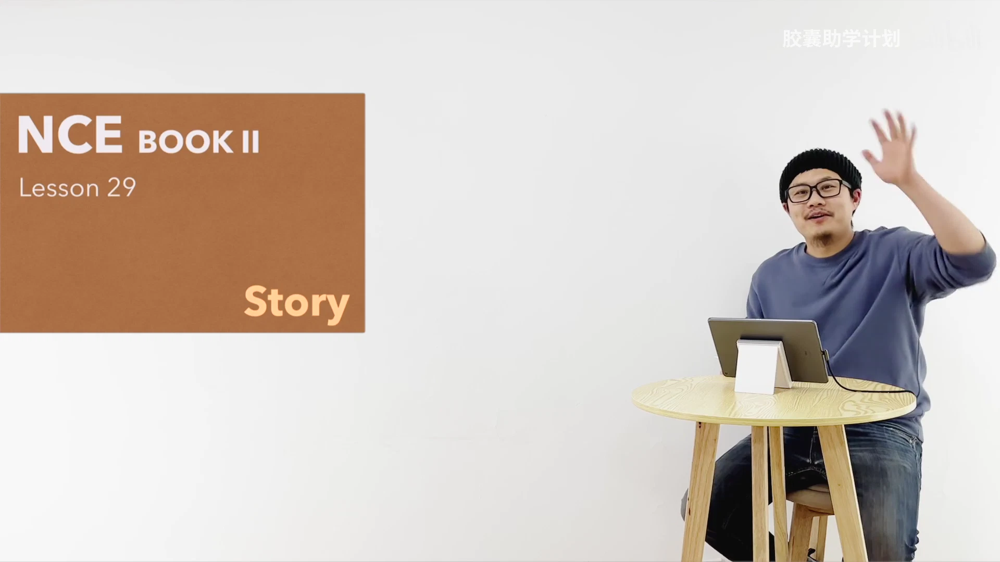

文字识别：NCE / BOOK"I / Lesson 29 / Story

### 画面 00:00:02

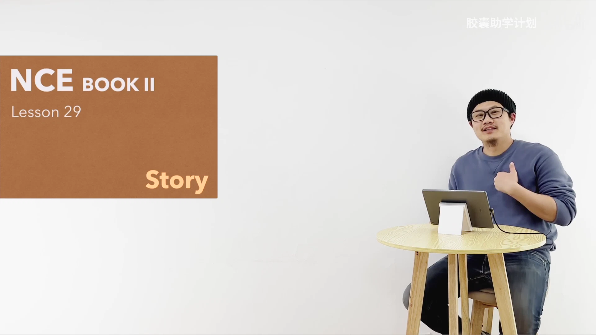

文字识别：NCE / BOOKⅡI / Lesson 29 / Story

### 画面 00:00:05

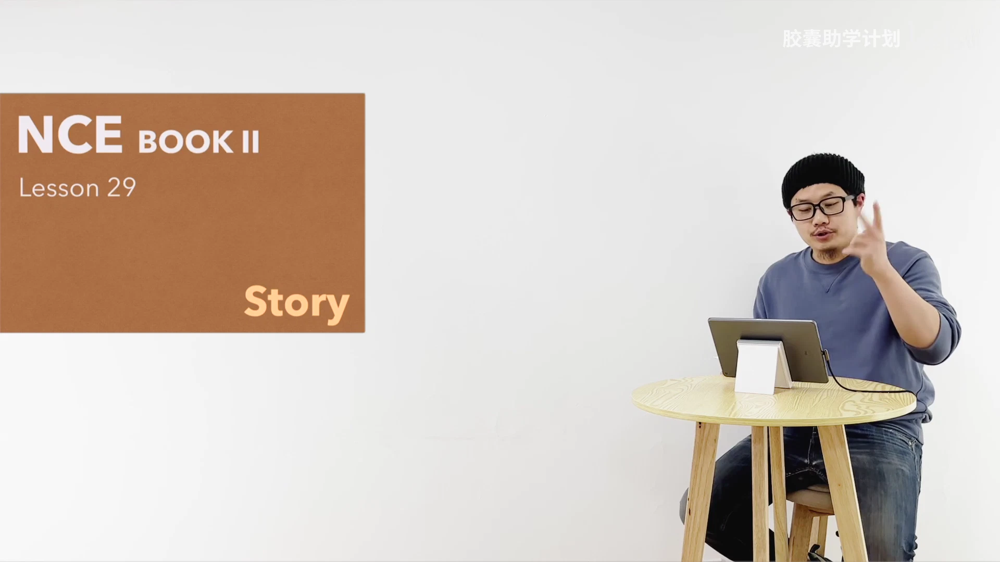

文字识别：NCE / BOOKⅡI / Lesson 29 / Story

### 画面 00:00:09

文字识别：胶囊助学计划 bilbl

### 画面 00:00:13

文字识别：胶囊助学计划

### 画面 00:00:15

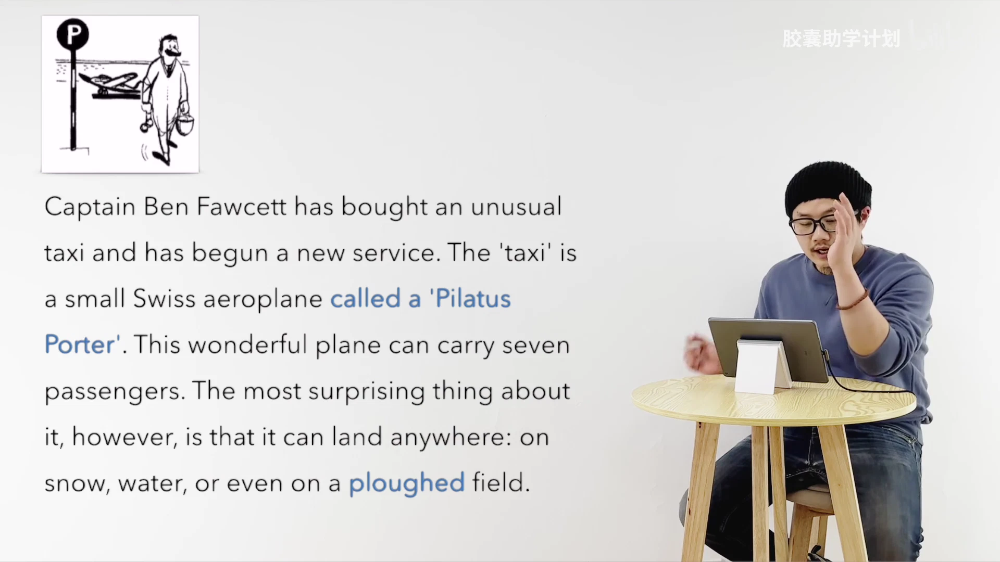

文字识别：P / 胶囊助学计划 / Captain Ben Fawcett has bought an unusual / taxi and has begun a new service. The'taxi' is / a small Swiss aeroplane called a 'Pilatus / Porter'.This wonderful plane can carry seven / passengers. The most surprising thing about / it, however, is that it can land anywhere: on / snow, water, or even on a ploughed field.

## 00:00:30–00:01:00

我们先往下看啊。我提前跟各位说，其实你如果拥有一辆飞机的话，某种程度上，它是一个尊称，对吧？你也可以管它叫 captain 啊。你看这个 Infosat，其实它自己本身就是有一辆飞机啊。Has bought，刚刚买了 an an Euro taxi。好，首先 an Euro，它其实是 Euro，然后前面加了个 un，un 表否定，对吧？不寻常的 taxi 叫做出租车。

### 画面 00:00:45

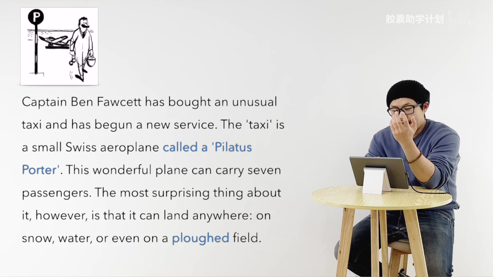

文字识别：P / 胶囊助学计划 / Captain Ben Fawcett has bought an unusual / taxi and has begun a new service. The'taxi' is / a small Swiss aeroplane called a 'Pilatus / Porter'. This wonderful plane can carry seven / passengers. The most surprising thing about / it, however, is that it can land anywhere: on / snow, water, or even on a ploughed field.

## 00:01:00–00:01:30

and has begun已经开始了，a new service开始了一个新的服务。Okay，首先我们在语法那一个地方，那个视频当中已经带着各位复习了现在完成时跟一般过去时。那在这里各位可以看到，开篇上来两个现在完成时，提醒各位这件事情发生在过去，但对现在有一个小的影响，对吧？连续的两个has bought和has began，于是接下来我们正常的心理预

### 画面 00:01:15

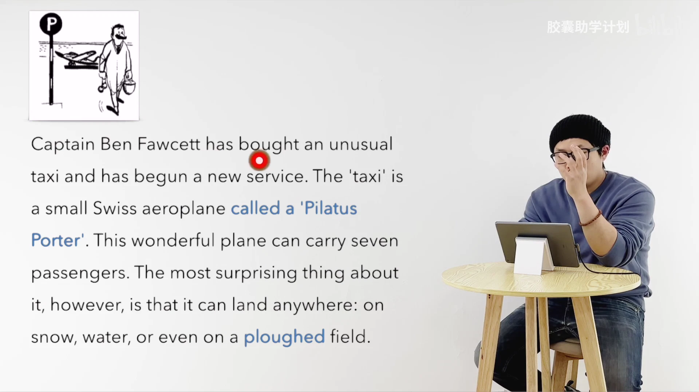

文字识别：P / 胶囊助学计划 / Captain Ben Fawcett has bought an unusual / taxi and has begun a new service. The'taxi' is / a small Swiss aeroplane called a 'Pilatus / Porter'.This wonderful plane can carry seven / passengers. The most surprising thing about / it, however, is that it can land anywhere: on / snow, water, or even on a ploughed field.

## 00:01:30–00:02:00

期应该是，它一定会讲到这个“an Euro taxi”和“a new service”的内容是什么。我们一起看一下。说“the taxi”，taxi加了个引号，就所谓的这个出租车是什么呢？Is a small Swiss airplane，是一个小的瑞产的飞机。OK，各位能知道这个taxi为什么加引号了，对吧？它不是真的出租车，它是一个飞机出租车，对吧？提供的是出租车的那个服务啊。Called a pilotus

### 画面 00:01:45

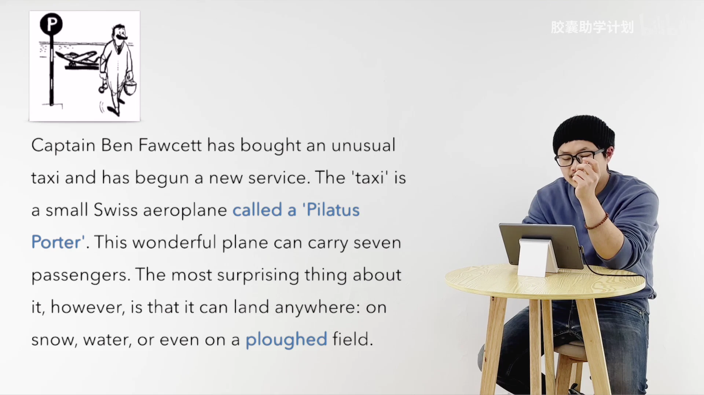

文字识别：P / 胶囊助学计划 / Captain Ben Fawcett has bought an unusual / taxi and has begun a new service. The'taxi' is / a small Swiss aeroplane called a 'Pilatus / Porter'. This wonderful plane can carry seven / passengers. The most surprising thing about / it, however, is that it can land anywhere: on / snow, water, or even on a ploughed field.

## 00:02:00–00:02:30

porter,哎，这个我们在语法那个地方已经讲过了。回顾几个知识点，第一 called，对吧？在这地方不是 did，它是 done，叫做现在啊过去分词，并且呢它是个短语，所以它放到了 airplane 的后面去修饰 airplane，对吧？定语后置了啊，它是 done 引导的短语，叫做被叫做 pilatus porter，对吧？最常见的两种情况叫被动一般或被动完成啊。

### 画面 00:02:15

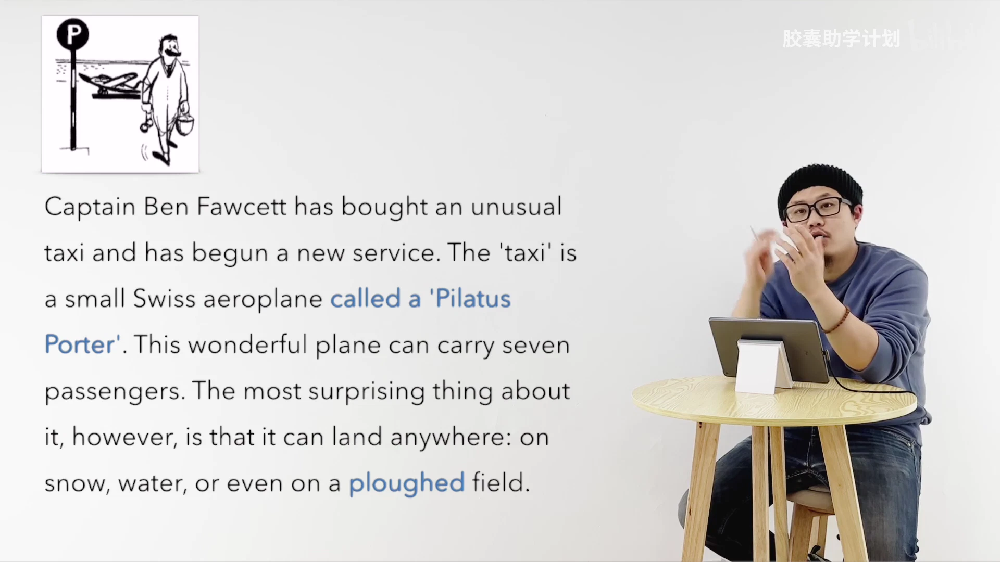

文字识别：P / 胶囊助学计划 / Captain Ben Fawcett has bought an unusual / taxi and has begun a new service. The'taxi' is / a small Swiss aeroplane called a 'Pilatus / Porter'.This wonderful plane can carry seven / passengers. The most surprising thing about / it, however, is that it can land anywhere: on / snow, water, or even on a ploughed field.

## 00:02:30–00:03:00

Okay,说this wonderful plane说这个特别棒的飞机can carry seven passengers可以携带七名乘客。The most surprising thing说最令人感到惊讶的事情about it关于这件飞机这辆飞机。However然而呢is that it can land anywhere是什么呢That不用管它，它能停留在任何地方。比如说

### 画面 00:02:45

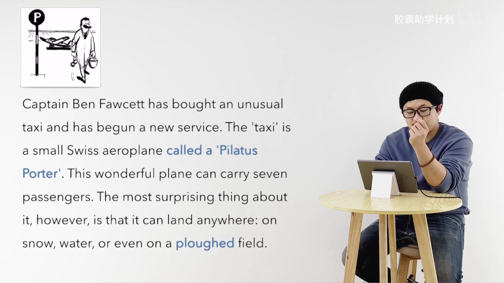

文字识别：P / 胶囊助学计划 / Captain Ben Fawcett has bought an unusual / taxi and has begun a new service. The'taxi' is / a small Swiss aeroplane called a 'Pilatus / Porter'.This wonderful plane can carry seven / passengers. The most surprising thing about / it, however, is that it can land anywhere: on / snow, water, or even on a ploughed field.

## 00:03:00–00:03:30

on snow, water, 啊，在呃雪上，在水上， or 甚至啊， or even 啊，或者是甚至怎么样呢？ On a plowed field, 在一片被耕过的田地上，它也可以停下来。哎，同理， plowed 实际上是 but 对吧？是 plowed 过去分词，放到这个地方去修饰 field。 OK，玩一个。接下来， Captain Fessize, his first passenger was a doctor. 说他

### 画面 00:03:15

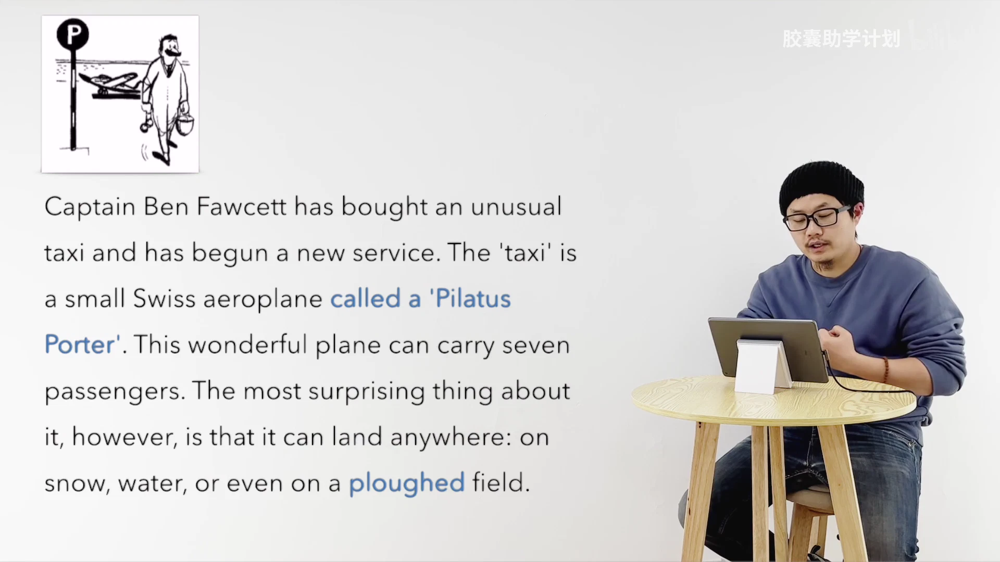

文字识别：P / 胶囊助学计划 / Captain Ben Fawcett has bought an unusual / taxi and has begun a new service. The'taxi' is / a small Swiss aeroplane called a 'Pilatus / Porter'. This wonderful plane can carry seven / passengers. The most surprising thing about / it, however, is that it can land anywhere: on / snow, water, or even on a ploughed field.

### 画面 00:03:22

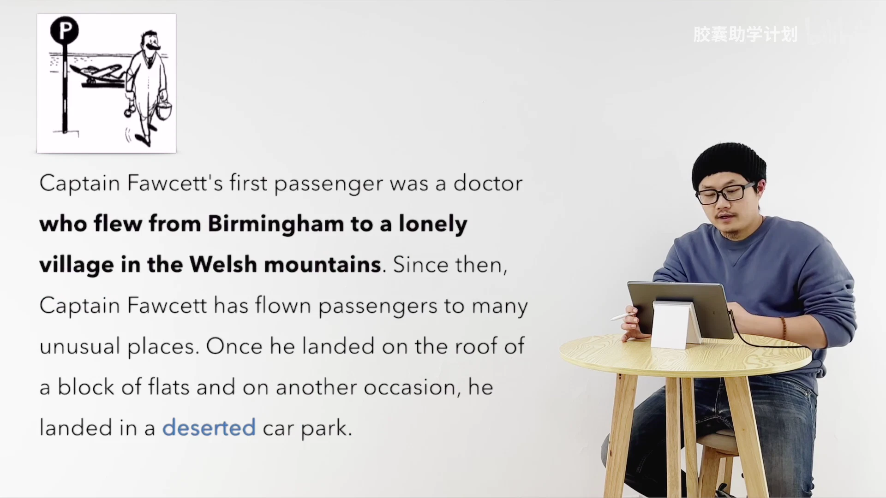

文字识别：P / 胶囊助学计划 / Captain Fawcett's first passenger was a doctor / who flew from Birmingham to a lonely / village in the Welsh mountains. Since then, / Captain Fawcett has flown passengers to many / unusual places. Once he landed on the roof of / a block of flats and on another occasion, he / landed in a deserted car park.

## 00:03:30–00:04:00

第一个乘客是一个医生。什么样的医生呢？注意后边给了一个很长的定语从句，是这样的一个医生。并且我们看到这个地方的时候，实际上不是把它翻译成什么什么什么什么样的一个医生，这个太费劲了。我们直接把who替代这个doctor，对吧？用这个doctor替代who就可以了，就是he or she，对吧？说flew from Birmingham to a lonely village.好，飞从哪儿呢？

### 画面 00:03:52

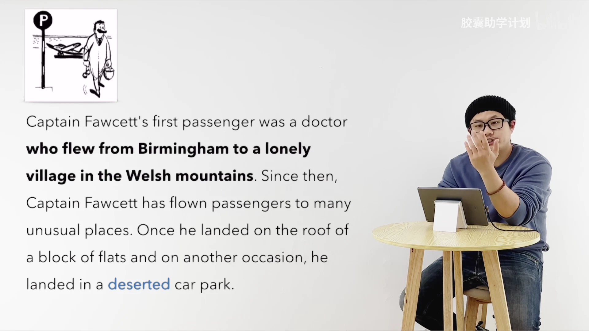

文字识别：P / 胶囊助学计划 / Captain Fawcett's first passenger was a doctor / who flew from Birmingham to a lonely / village in the Welsh mountains. Since then, / Captain Fawcett has flown passengers to many / unusual places. Once he landed on the roof of / a block of flats and on another occasion, he / landed in a deserted car park.

## 00:04:00–00:04:30

从 Birmingham 这个地方去一个偏远的乡村。这个偏远乡村在什么地方呢？In the Welsh mountains，在威尔士的，OK，啊，Welsh mountains，在威尔士的群山当中。OK， very good. Since then，这个我们在练习的时候见过他很多次。自从那时，Captain Fossett has flown，已经承载，哎，这地方 fly 的原形，呃，它 flown

### 画面 00:04:22

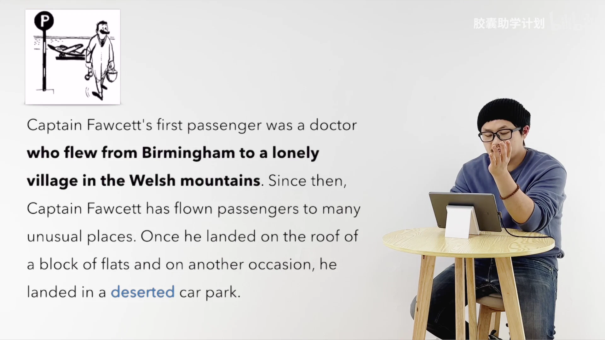

文字识别：P / 胶囊助学计划 / Captain Fawcett's first passenger was a doctor / who flew from Birmingham to a lonely / village in the Welsh mountains. Since then, / Captain Fawcett has flown passengers to many / unusual places. Once he landed on the roof of / a block of flats and on another occasion, he / landed in a deserted car park.

## 00:04:30–00:05:00

的原型是fly，是飞对吧？啊，在这个地方其实还是飞，它是可以理解为是承载着乘客飞啊，passengers乘客，to many unusual places去了很多不同寻常的地方。Once哎，有这么一次。注意，你看这个once一出来，就提醒你接下来的时态可能是一般过去时了。讲的是有这么一次嘛？一般是过去对吧？He landed on the roof.他降落在

### 画面 00:04:52

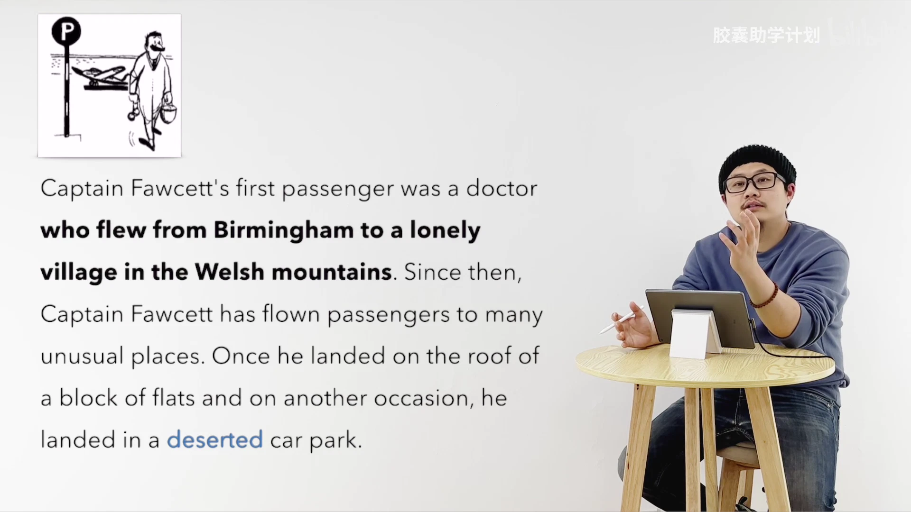

文字识别：P / 胶囊助学计划 / Captain Fawcett's first passenger was a doctor / who flew from Birmingham to a lonely / village in the Welsh mountains. Since then, / Captain Fawcett has flown passengers to many / unusual places. Once he landed on the roof of / a block of flats and on another occasion, he / landed in a deserted car park.

## 00:05:00–00:05:30

一个什么呢？ On the roof，降落在了一个房顶上。什么的房顶呢？ A block of flats， a block of flats其实就是 a building，对吧？那这个 building 的作用是 contains a lot of flats，啊，包含了很多的公寓，它不是别的一个地方啊。说落在了一一个公寓的楼顶上， and 然后呢？ On another occasion，在另一个场合之下， he landed in

### 画面 00:05:11

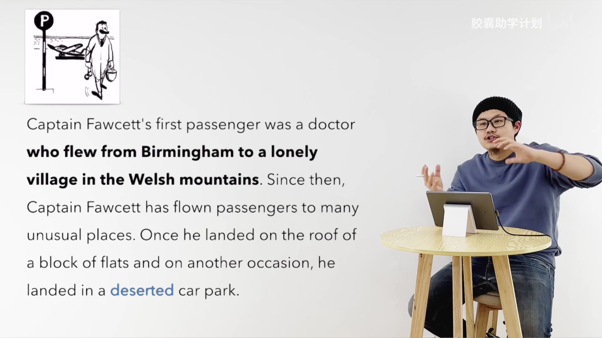

文字识别：P / 胶囊助学计划 / Captain Fawcett's first passenger was a doctor / who flew from Birmingham to a lonely / village in the Welsh mountains. Since then, / Captain Fawcett has flown passengers to many / unusual places. Once he landed on the roof of / a block of flats and on another occasion, he / landed in a deserted car park.

### 画面 00:05:15

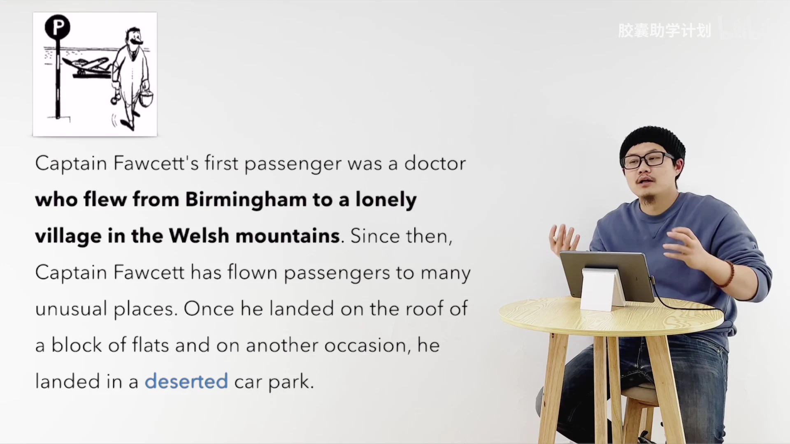

文字识别：P / 胶囊助学计划 / Captain Fawcett's first passenger was a doctor / who flew from Birmingham to a lonely / village in the Welsh mountains. Since then, / Captain Fawcett has flown passengers to many / unusual places. Once he landed on the roof of / a block of flats and on another occasion, he / landed in a deserted car park.

## 00:05:30–00:06:00

a deserted car park.在另一个场合下呢，他降落在了一个什么里边呢？被遗弃的停车场里面，deserted，已经被遗弃的，对吧？我们把它翻译成被动已经，对吧？或啊，被动完成，对吧？OK，用已经去代表这个完成。下一个，Captain Fosseid has just refused刚刚拒绝了a strange request from a businessman一个特别

### 画面 00:05:45

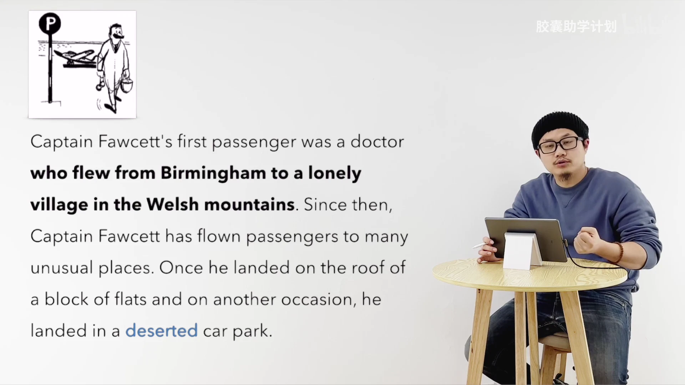

文字识别：P / 胶囊助学计划 / Captain Fawcett's first passenger was a doctor / who flew from Birmingham to a lonely / village in the Welsh mountains. Since then, / Captain Fawcett has flown passengers to many / unusual places. Once he landed on the roof of / a block of flats and on another occasion, he / landed in a deserted car park.

### 画面 00:05:48

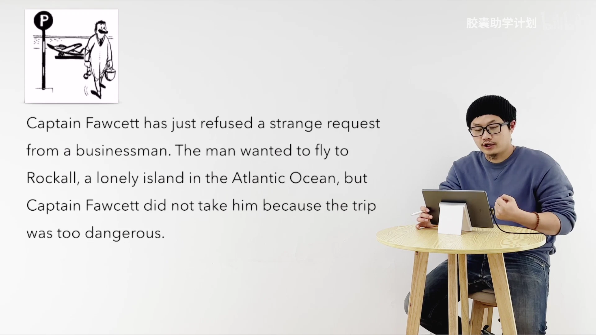

文字识别：P / 胶囊助学计划 / Captain Fawcett has just refused a strange request / from a businessman. The man wanted to fly to / Rockall, a lonely island in the Atlantic Ocean, but / Captain Fawcett did not take him because the trip / was too dangerous.

## 00:06:00–00:06:30

奇怪的request.我们之前学过第一单元叫做要求发出来的请求，对吧？哎，来自于一个商人。你看啊，如果你是这样去用的时态，那接下来我正常来说，我的理解是你要告诉我他过去拒绝了。然后呢，接下来你一定要跟我聊这件事情，对吧？这是现在完成时的一个用法。我们看他接下来是不是这样聊。The man wanted to fly to Raco.哎，是的，是这样用，对吧？说这个男的呀，

### 画面 00:06:18

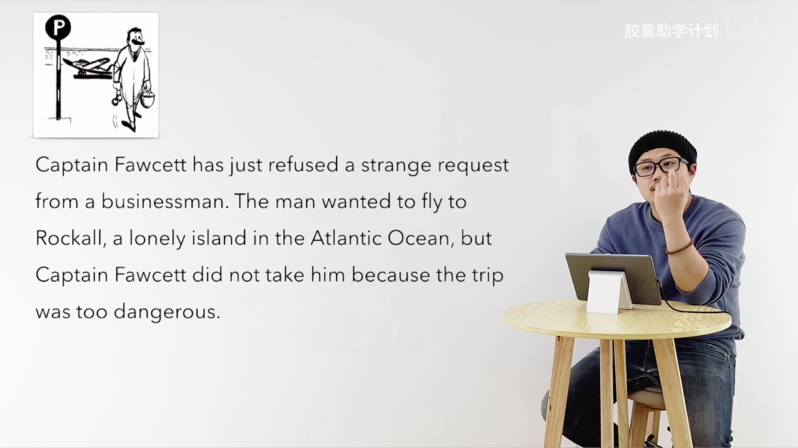

文字识别：P / 胶囊助学计划 / Captain Fawcett has just refused a strange request / from a businessman. The man wanted to fly to / Rockall, a lonely island in the Atlantic Ocean, but / Captain Fawcett did not take him because the trip / was too dangerous.

## 00:06:30–00:07:00

想要飞去 Raco 这样一个地方，什么地方呢？A lonely island in the Atlantic Ocean 啊，一个偏远的岛屿在什么呢？在大西洋上，Atlantic Ocean，对吧？那 Pacific Ocean 就是太平洋啊。But 但是 Captain Versailles did not take him, 没有带他, because 因为 the trip was too dangerous. 新概念一册一百零三课语法, too 加形容词,

### 画面 00:06:48

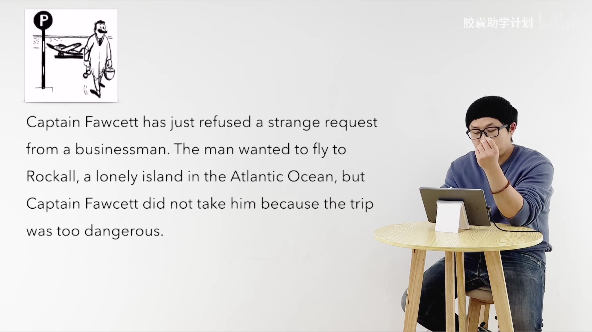

文字识别：P / 胶囊助学计划 / Captain Fawcett has just refused a strange request / from a businessman. The man wanted to fly to / Rockall, a lonely island in the Atlantic Ocean, but / Captain Fawcett did not take him because the trip / was too dangerous.

## 00:07:00–00:07:30

过于的危险了，而没有这样去做。呃，那本课呢没有什么新的习惯用法，都是我们以前见过的，对吧？所以我们就不用管它了。那对于各位来说格外重要的就不是习惯用法造句了，而是文章熟读成诵这件这个作业，好吧？那以上呢就是本期视频的全部内容了。如果各位喜欢我们的课程呢，欢迎各位关注、订阅、一键三连，分享给那些需要的朋友，来帮助我们快速成长。 See you next

### 画面 00:07:04

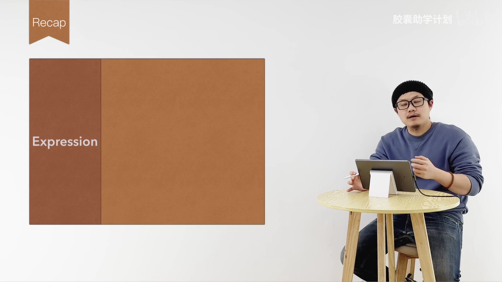

文字识别：Recap / 胶囊助学计划 / Expression

### 画面 00:07:06

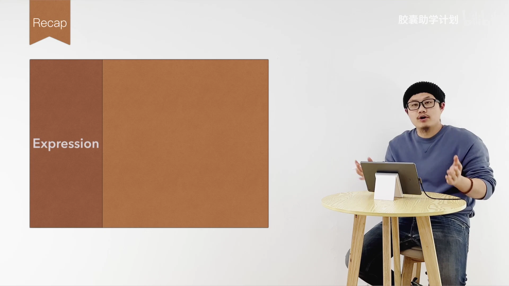

文字识别：Recap / 胶囊助学计划 / Expression

### 画面 00:07:10

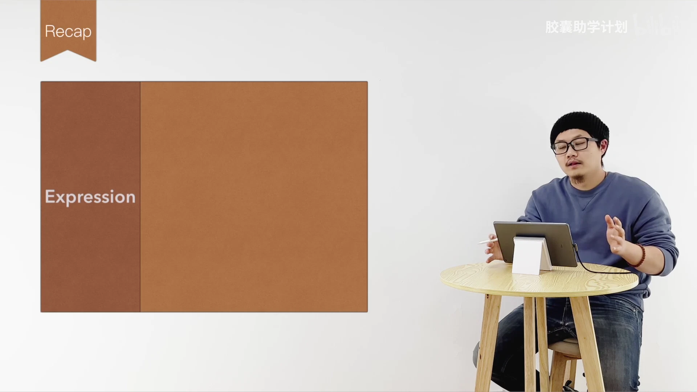

文字识别：Recap / 胶囊助学计划 / Expression

### 画面 00:07:12

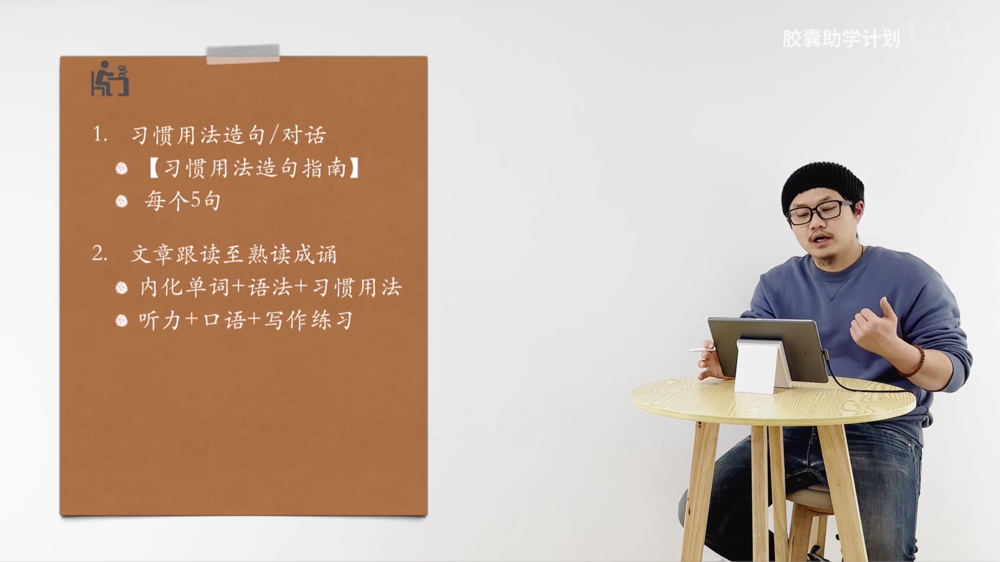

文字识别：胶囊助学计划 / 习惯用法造句/对话 / 1. / 【习惯用法造句指南】 / 每个5句 / 文章跟读至熟读成诵 / 内化单词+语法+习惯用法 / 听力+口语+写作练习

### 画面 00:07:15

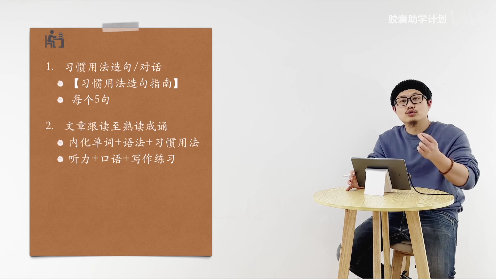

文字识别：胶囊助学计划 / 1. / 习惯用法造句/对话 / 【习惯用法造句指南】 / 每个5句 / 文章跟读至熟读成诵 / 内化单词+语法+习惯用法 / 听力+口语+写作练习

### 画面 00:07:18

文字识别：胶囊助学计划 / 👍

## 00:07:30–00:07:43

time.

### 画面 00:07:30

文字识别：￥

### 画面 00:07:32

文字识别：CAPSULEACADEMY / 胶囊助学计划 / 小红书 / Lecturer / 口 / Leo / OE

### 画面 00:07:35

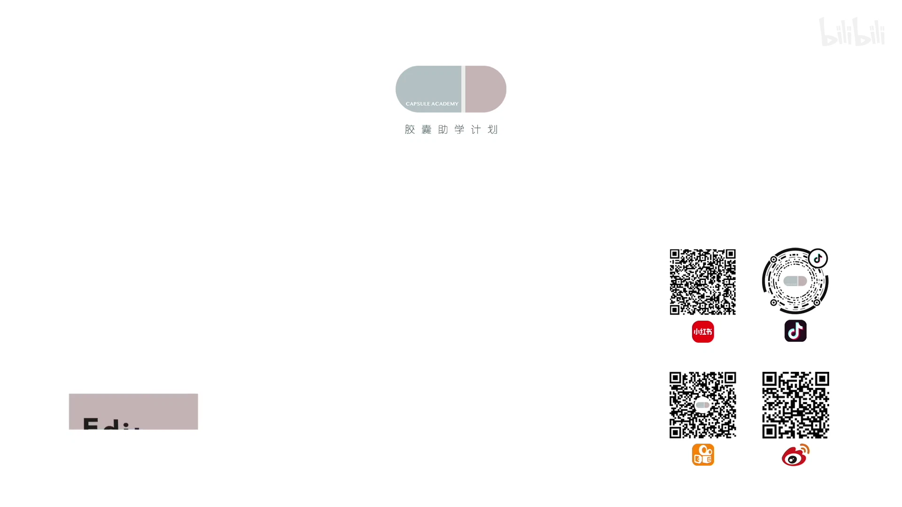

文字识别：CAPSULEACADEMY / 胶囊助学计划 / 小红书 / 品 / OE

### 画面 00:07:38

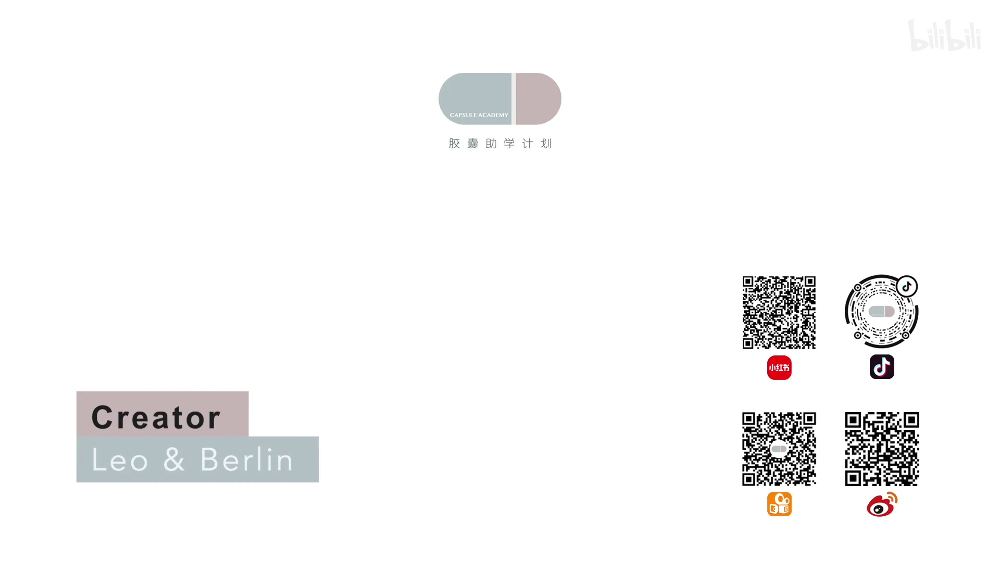

文字识别：CAPSULEACADEMY / 胶囊助学计划 / 小红书 / Creator / Leo & Berlin / OE

### 画面 00:07:40

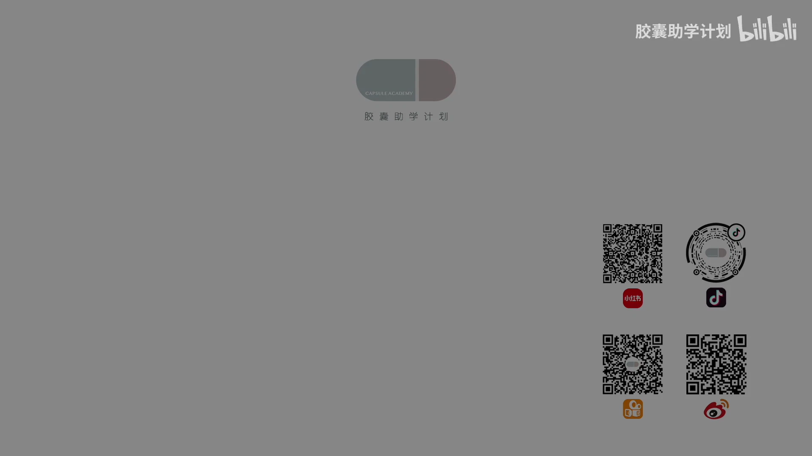

文字识别：bilbili / 胶囊助学计划 / CAPSULEACADEMY / 胶囊助学计划 / 小红书 / OE

### 画面 00:07:42

文字识别：bilibili / 胶囊助学计划

