# L029 听说读写复述练习

快速机器解析：语音为单模型转写，未进行独立交叉校对或人工复核；画面每秒采样并按变化选帧，短时文字和标记可能遗漏。截图时间约有 1 秒误差。图片有损压缩；遇到疑点请按时间查看 Google Drive 原视频。

## 00:00:00–00:00:30

Hello everyone, welcome to Capsule Academy. This is Leo. Today we're going to learn new concept in English Book Two, Lesson Twenty Nine Practices. 那老习惯，各位一定要知道进行如下练习，唯一的前提就是文章跟读至熟读成诵，否则请勿开始啊。 Hope you gonna enjoy it. 好，那我们先看第一题，Comprehension训练的目标是我们能听懂别人发问的这样一个能力，对吧？ OK，

### 画面 00:00:00

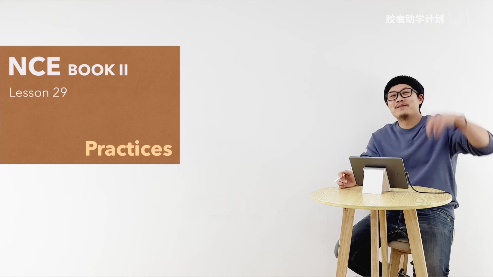

文字识别：胶囊助学计划 / NCE / BOOKI"I / Lesson 29 / Practices

### 画面 00:00:05

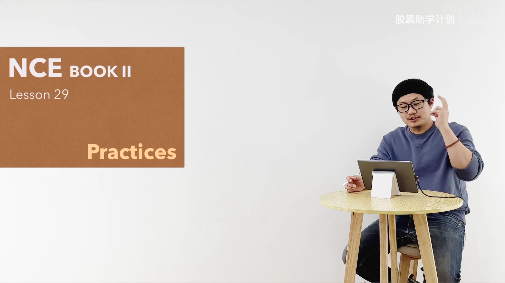

文字识别：胶囊助学计划 / NCE / BOOKII / Lesson 29 / Practices

### 画面 00:00:08

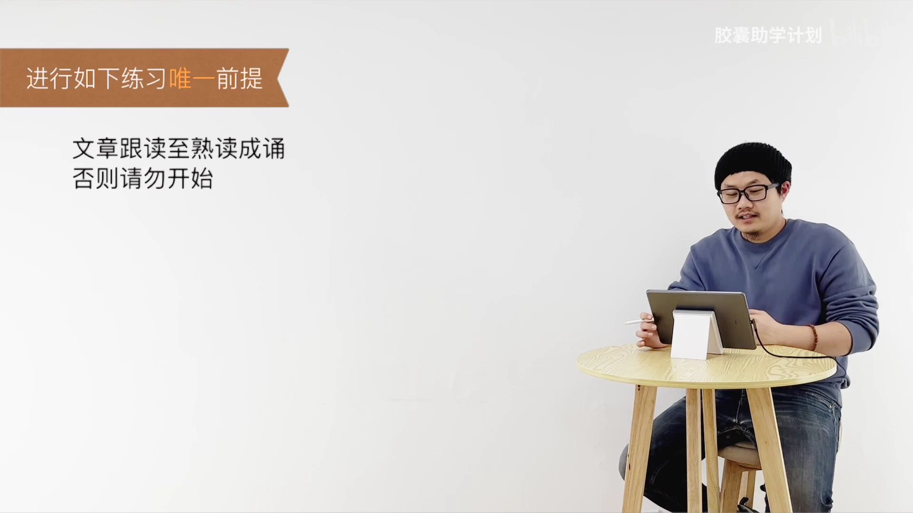

文字识别：胶囊助学计划 / 进行如下练习唯一前提 / 文章跟读至熟读成诵 / 否则请勿开始

### 画面 00:00:18

文字识别：胶囊助学计划bill / •

### 画面 00:00:22

文字识别：胶囊助学计划

### 画面 00:00:24

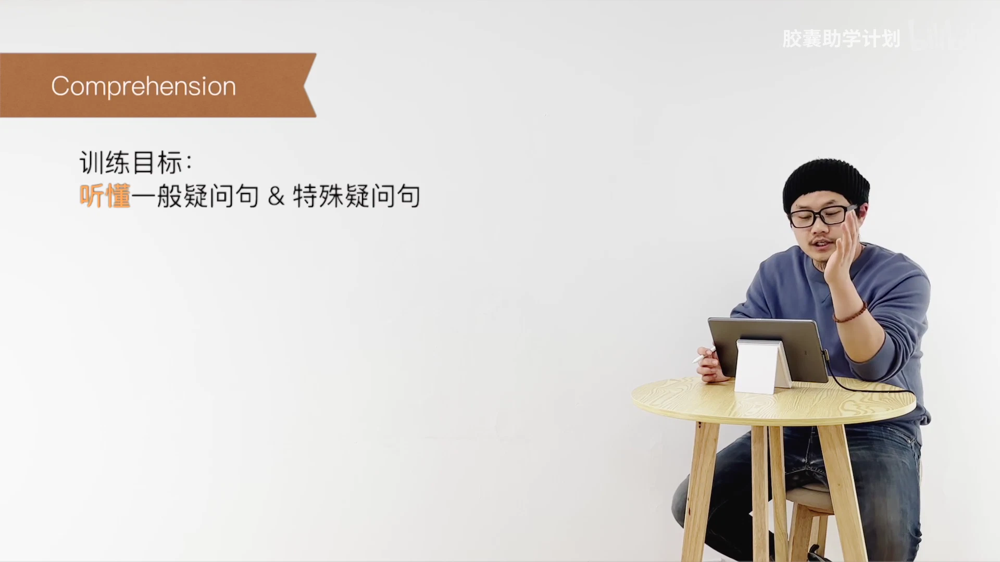

文字识别：胶囊助学计划 / Comprehension / 训练目标： / 听懂一般疑问句＆特殊疑问句

## 00:00:30–00:01:00

那第一题我问您答，您可以看着文章啊。当然，如果读的非常熟，不看文章更好。第一题，Who's bought an aerial taxi? Captain Benfarside. Next one, What has he begun? A new service. What is the taxi? In fact, in fact,就实际上，a small airplane.

### 画面 00:00:30

文字识别：胶囊助学计划 / Comprehension

### 画面 00:00:38

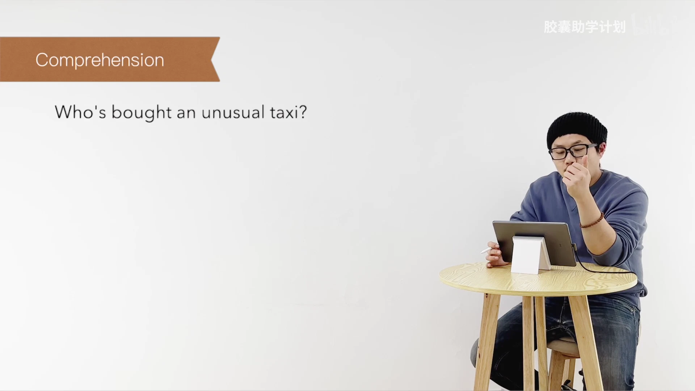

文字识别：胶囊助学计划 / Comprehension / Who's bought an unusual taxi?

## 00:01:00–00:01:30

What was it made? Where was it made? In Switzerland, ah, right? Swiss airplane. Next one. What is it called? A pilot's porter, or just directly called pilot's porter. Next one. How many passengers can it carry? Seven. Next one. Where can it land? Anywhere, right? Next one.

### 画面 00:01:08

文字识别：胶囊助学计划 / Comprehension / What is it called?

## 00:01:30–00:02:00

who was the captain's first passenger? A doctor. Next one, where did he fly from? Birmingham. Next one, where did he fly to? A lonely village in the Welsh mountains. Next one, what's Captain Forsythe done since then? He

### 画面 00:01:38

文字识别：胶囊助学计划 / Comprehension / Where did he fly from?

### 画面 00:01:59

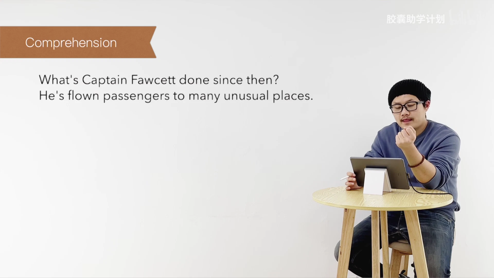

文字识别：胶囊助学计划 / Comprehension / What's Captain Fawcett done since then? / He's flown passengers to many unusual places.

## 00:02:00–00:02:30

has flown passengers to many unusual places. Next one, has he ever landed on a roof? Yes, he has. Next one, where else has he landed? In a deserted car park. Next one, asking questions.老习惯肯定句、一般疑问句、特殊疑问句。我们先给大家一个例子，比如说 Ask me if Captain

### 画面 00:02:05

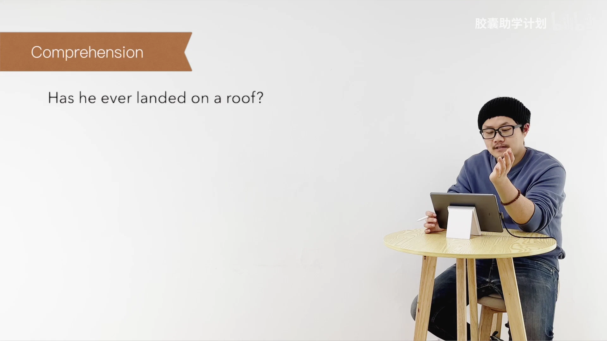

文字识别：胶囊助学计划 / Comprehension / Has he ever landed on a roof?

### 画面 00:02:17

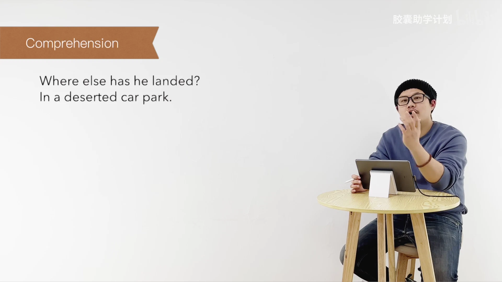

文字识别：胶囊助学计划 / Comprehension / Where else has he landed? / In a deserted car park.

### 画面 00:02:20

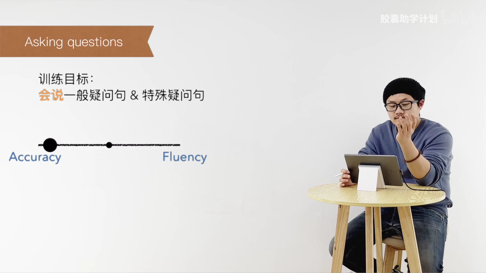

文字识别：胶囊助学计划 / Asking questions / 训练目标： / 会说一般疑问句＆特殊疑问句 / Accuracy / Fluency

### 画面 00:02:26

文字识别：胶囊助学计划 / Asking questions / T: Ask me if Captain Ben Fawcett has / begun a new taxi service.

## 00:02:30–00:03:00

Fosside has begun a new service. 现在完成时 has 提前，对吧？然后 who 对主语提问，直接替代 who has begun a new service. Okay, very good. 那接下来呢？我们一个一个来啊。重点难的，我给大家说一下答案。一般我们之前都练过了，我们就简单说一下思路。首先说 what，那 what 就是对 a new service 提问，没有什么难的。下一个现在完成时 has 提前，what

### 画面 00:02:33

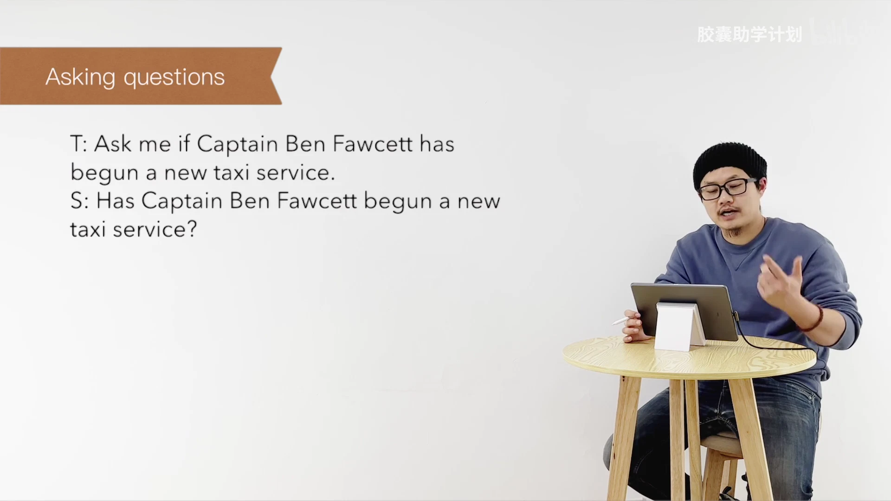

文字识别：胶囊助学计划 / Asking questions / T: Ask me if Captain Ben Fawcett has / begun a new taxi service. / S: Has Captain Ben Fawcett begun a new / taxi service?

### 画面 00:02:41

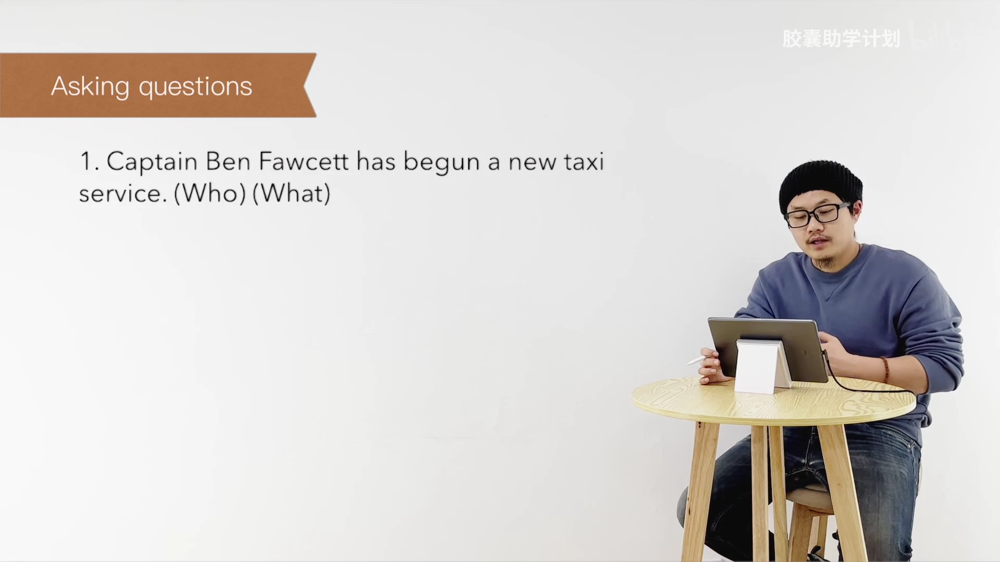

文字识别：胶囊助学计划 / Asking questions / 1. Captain Ben Fawcett has begun a new taxi / service.(Who)(What)

### 画面 00:02:49

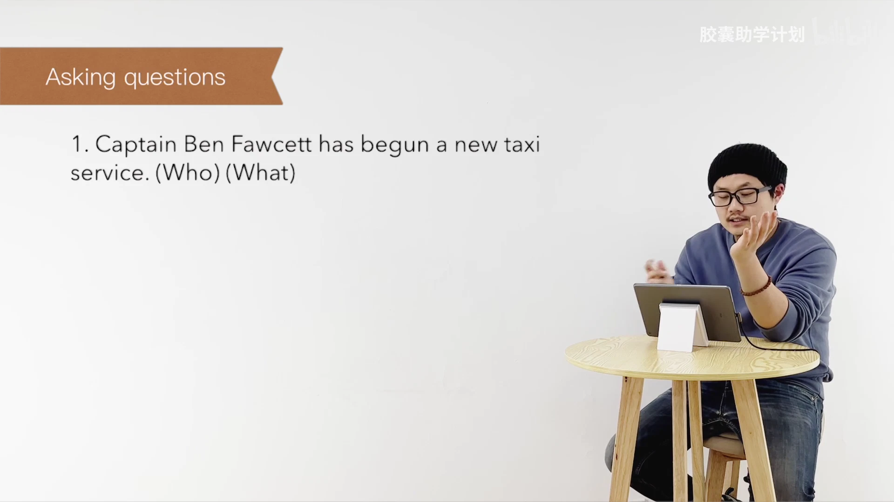

文字识别：胶囊助学计划 / Asking questions / 1. Captain Ben Fawcett has begun a new taxi / service.(Who)(What)

## 00:03:00–00:03:30

对An an Euro taxi提问啊，Next one说Is a small sweet airplane Is提前What对A small airplane所以答案就是What is it它到底是什么对吧OK Next one It comes from from Switzerland Does提前Where对Switzerland提问这是咱新一就学过的五十三五十一五十三课就学过对吧说Is called a pilot supporter其实在这句话当中它就是被动了It is called a pilot supporter

### 画面 00:03:02

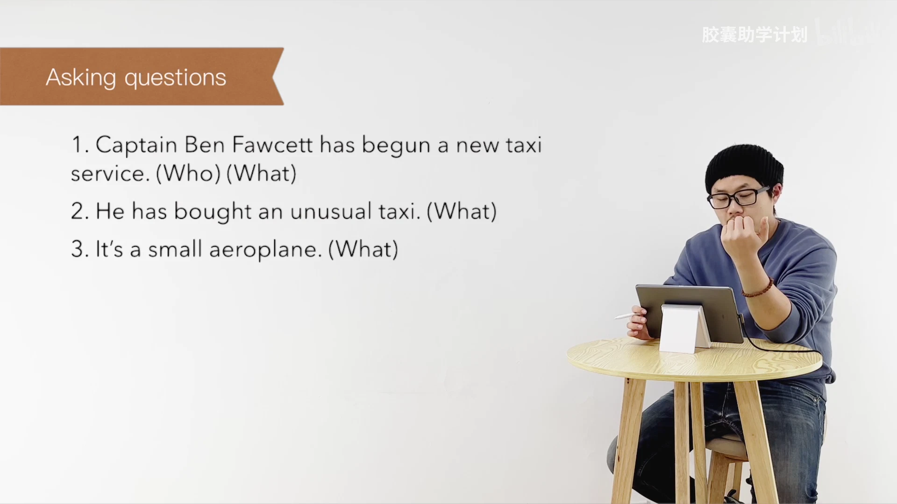

文字识别：胶囊助学计划 / Asking questions / 1. Captain Ben Fawcett has begun a new taxi / service.(Who)(What) / 2. He has bought an unusual taxi. (What) / 3. It's a small aeroplane. (What)

### 画面 00:03:22

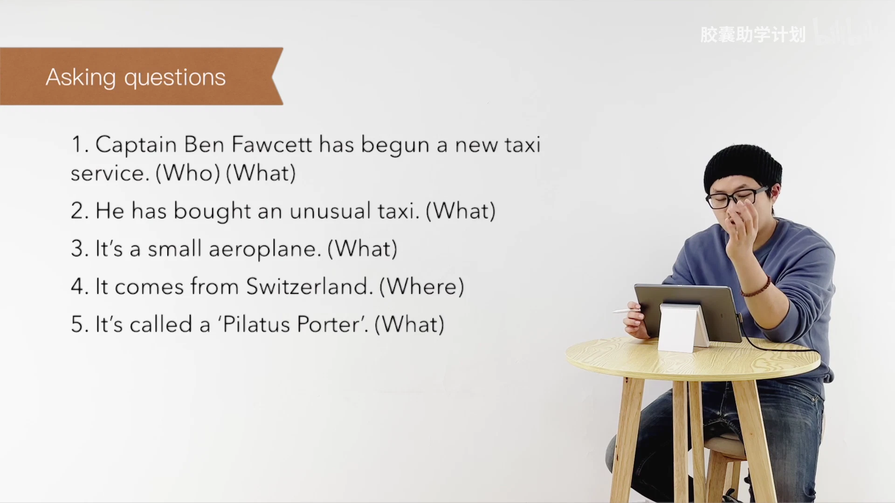

文字识别：胶囊助学计划 / Asking questions / 1. Captain Ben Fawcett has begun a new taxi / service.(Who)(What) / 2. He has bought an unusual taxi. (What) / 3. Ilt's a small aeroplane. (What) / 4. Ilt comes from Switzerland.(Where) / 5. It's called a 'Pilatus Porter'. (What)

## 00:03:30–00:04:00

第十课咱们学过几乎一样的，对吧？Okay,那is提前what对a pilatus porter提问，答案就是what is it called? Okay, next one,呃第六个说it can carry seven passengers. Can提前对吧？How many对seven提问，所以这地方我简单说一下，它应该叫做how many passengers can it carry?啊，第七个it can land anywhere. Can提前where对anywhere提问，it can land

### 画面 00:03:40

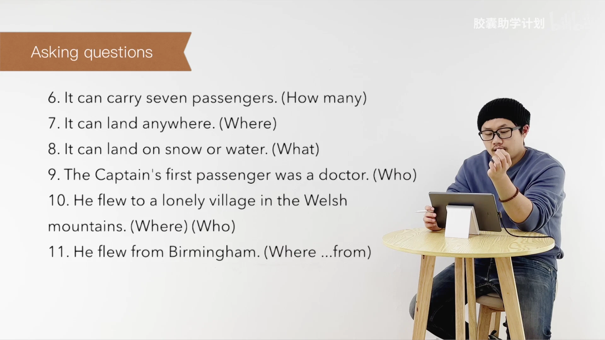

文字识别：胶囊助学计划 / Asking questions / 6. It can carry seven passengers. (How many) / 7. It can land anywhere. (Where) / 8. It can land on snow or water. (What) / 9. The Captain's first passenger was a doctor.(Who) / 10. He flew to a lonely village in the Welsh / mountains.(Where) (Who) / 11. He flew from Birmingham.(Where ..from)

## 00:04:00–00:04:30

on snow or water. Can提前, what注意它不是where了，是what，所以what是对snow or water提问，它的答案就是what can it land on?它能降落在什么上啊？然后the captain's first passenger was a doctor. Was提前, who可以对主语，可以对a doctor啊。He flew to a lonely village in the Welsh mountains. Did提前，动词换原形，

### 画面 00:04:10

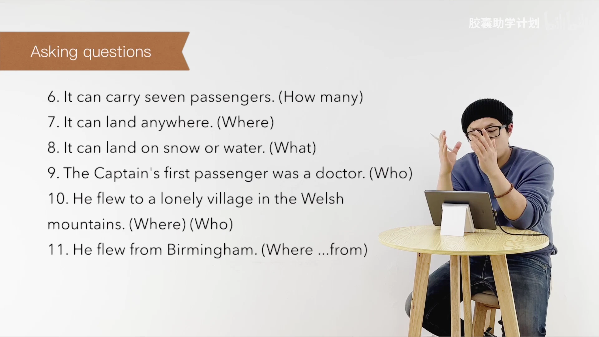

文字识别：胶囊助学计划 / Asking questions / 6. It can carry seven passengers. (How many) / 7. It can land anywhere. (Where) / 8. It can land on snow or water. (What) / 9. The Captain's first passenger was a doctor.(Who) / 10. He flew to a lonely village in the Welsh / mountains.(Where) (Who) / 11. He flew from Birmingham.(Where ..from)

## 00:04:30–00:05:00

呃，那where对a lonely village in the Welsh mountains，或者直接对in the Welsh mountains提问，对吧？Where did he？哦，我们觉得应应该是a lonely village in the Welsh mountains，叫Where did he fly to？啊，他飞到什么地方？Who对主语提问，直接替代，不用变一般疑问句了啊。He flew from Birmingham. Did提前动词换回fly。Where对Birmingham提问，所以答案叫Where did he fly from？OK，

### 画面 00:04:40

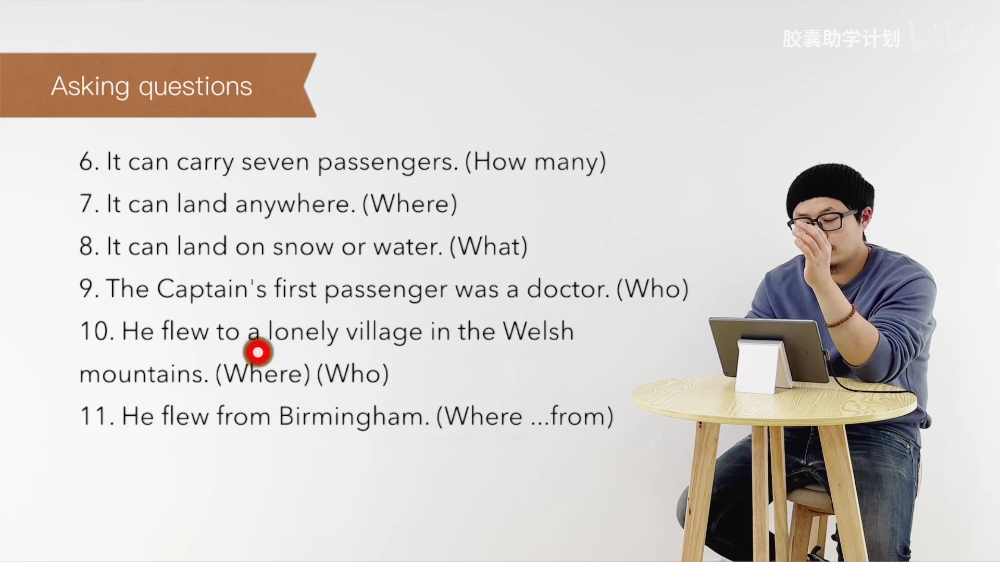

文字识别：胶囊助学计划 / Asking questions / 6. It can carry seven passengers. (How many) / 7. It can land anywhere.(Where) / 8. It can land on snow or water. (What) / 9. The Captain's first passenger was a doctor.(Who) / 10. He flew to a lonely village in the Welsh / mountains.(Where) (Who) / 11. He flew from Birmingham.(Where .from)

## 00:05:00–00:05:30

Um, tell the story.老习惯练习口语复述能力。前提是各位文章读到非常熟啊，尽可能尝试去做这个练习，好吧？Okay.接下来呢，summary writing摘要写作。各位写完来这里暂停屏幕对答案就可以了。Okay. Next one, topic for discussion.这是我们完全自由的对话，还是我们只给大家说一下，他让我们练了什么？各位有时间可以自己去试啊。这个我们在视频上很

### 画面 00:05:00

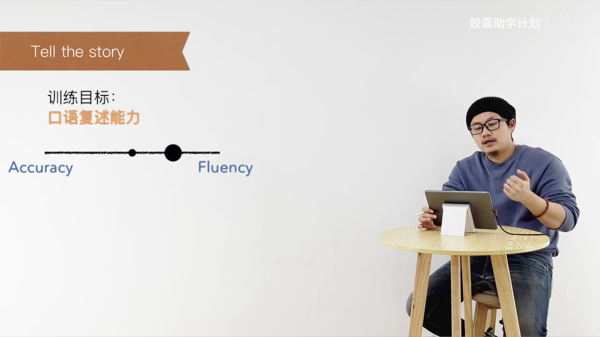

文字识别：胶囊助学计划 / Tell the story / 训练目标： / 口语复述能力 / Accuracy / Fluency

### 画面 00:05:03

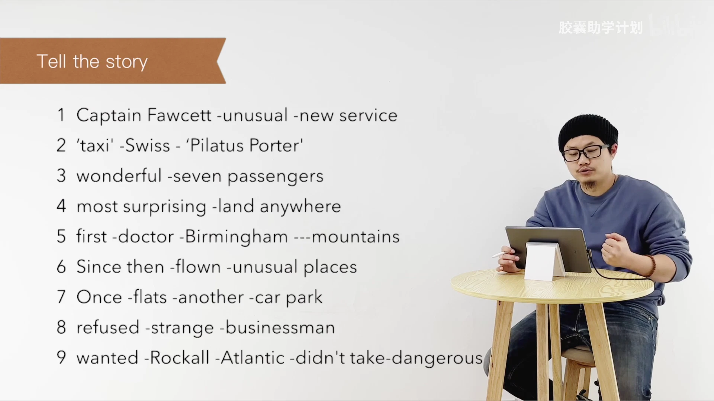

文字识别：胶囊助学计划 / Tell the story / 1 Captain Fawcett -unusual -new service / 2 'taxi'-Swiss -'Pilatus Porter' / 3 wonderful -seven passengers / 4 most surprising -land anywhere / 5 first -doctor -Birmingham ---mountains / 6 Since then -flown -unusual places / 7 Once -flats -another -car park / 8 refused -strange -businessman / 9 wanted -Rockall -Atlantic -didn't take-dangerous

### 画面 00:05:10

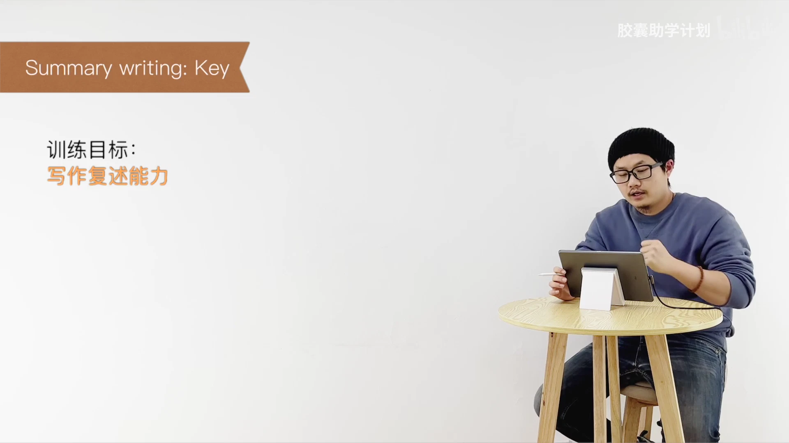

文字识别：胶囊助学计划 / Summary writing: Key / 训练目标： / 写作复述能力

### 画面 00:05:13

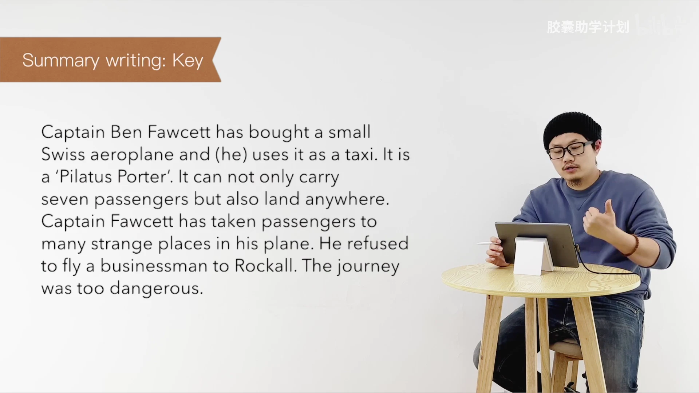

文字识别：胶囊助学计划 / Summary writing: Key / Captain Ben Fawcett has bought a small / Swiss aeroplane and (he) uses it as a taxi. lt is / a 'Pilatus Porter'. It can not only carry / seven passengers but also land anywhere. / Captain Fawcett has taken passengers to / many strange places in his plane. He refused / to fly a businessman to Rockall. The journey / was too dangerous.

### 画面 00:05:17

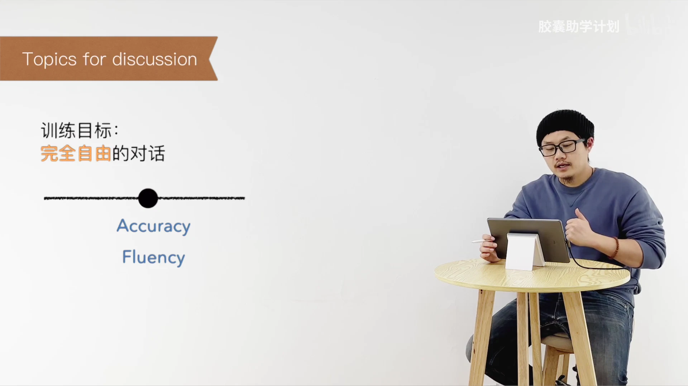

文字识别：胶囊助学计划 / Topics for discussion / 训练目标： / 完全自由的对话 / Accuracy / Fluency

### 画面 00:05:20

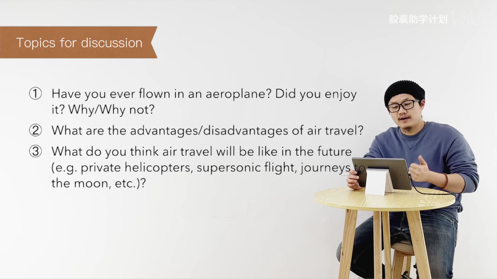

文字识别：胶囊助学计划 / Topics for discussion / Have you ever flown in an aeroplane? Did you enjoy / it? Why/Why not? / What are the advantages/disadvantages of air travel? / What do you think air travel will be like in the future / 3 / (e.g. private helicopters, supersonic flight, journeys / the moon, etc.)?

## 00:05:30–00:06:00

难给大家展现出来。说 Have you ever flown in an airplane? 啊，你在飞机里坐过飞机吗？Do you enjoy it? 你享受坐飞机的过程吗？享受为什么享受？不享受为什么不享受？对吧？Next one. 说 What are the advantages or disadvantages of air travel? 啊，说坐飞机旅行的优势和缺点是什么？OK，这个题听上去就非常像托福雅思的口语题了。您说三个，再给

### 画面 00:05:30

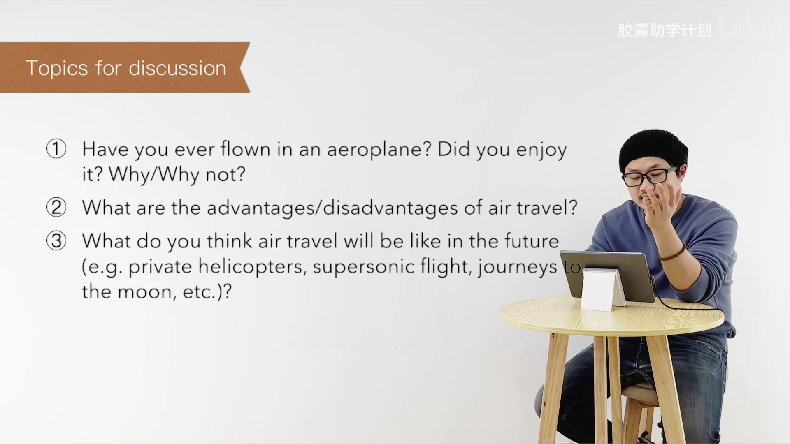

文字识别：胶囊助学计划 / Topics for discussion / Have you ever flown in an aeroplane? Did you enjoy / it? Why/Why not? / What are the advantages/disadvantages of air travel? / What do you think air travel will be like in the future / 3 / (e.g. private helicopters, supersonic flight, journeys / the moon, etc.)?

## 00:06:00–00:06:30

个原因，对吧？OK，第三个说，What do you think air travel will be like in the future? 啊，pr，比如说什么 private helicopter, supersonic flight journey to the moon. OK，老师，你认为航空旅行对吧？未来会发展成什么样？比如说什么私人飞机啊，超音速飞机啊，或者说啊，我们能旅行去月球啊，等等啊，这个您发挥自己的想象力就可以了啊。我们不多说了，家庭作业 ask if，先写再朗读，

### 画面 00:06:00

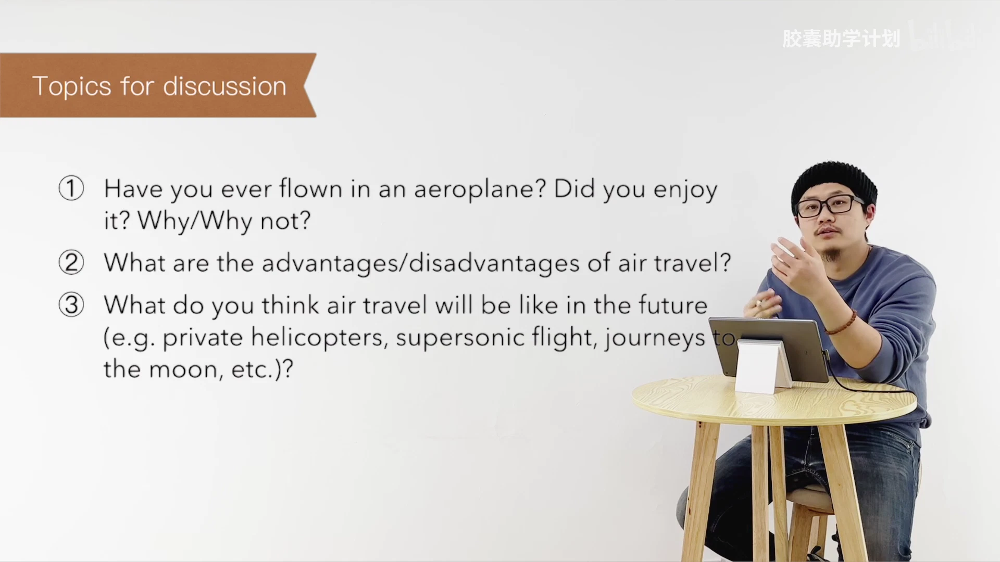

文字识别：胶囊助学计划 / Topics for discussion / Have you ever flown in an aeroplane? Did you enjoy / it? Why/Why not? / What are the advantages/disadvantages of air travel? / What do you think air travel will be like in the future / 3 / (e.g. private helicopters, supersonic flight, journeys / the moon, etc.)?

### 画面 00:06:26

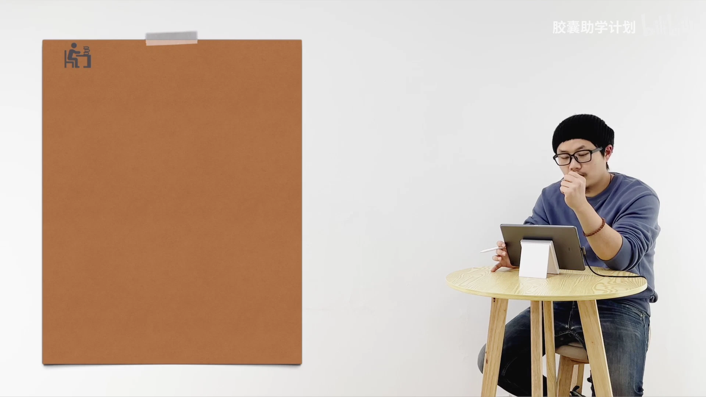

文字识别：胶囊助学计划

### 画面 00:06:29

文字识别：胶囊助学计划 / 1.Ask me if写&朗读 / 2. / 摘要写作写&答案

## 00:06:30–00:07:00

这要写作，写完之后来这对答案。Tell the story口语进行复述，专栏当中可以找得到。那以上呢就是本期视频的全部内容了。如果各位喜欢我们的课程呢，欢迎各位关注、订阅、一键三连，分享给那些需要的朋友。See you next time.

### 画面 00:06:31

文字识别：胶囊助学计划 / 1.Ask me if写&朗读 / 摘要写作写&答案 / 3.Tell the story 口语复述

### 画面 00:06:34

文字识别：胶囊助学计划 / 1.Ask me if写&朗读 / 摘要写作写&答案 / 3.Tell the story 口语复述 / 专栏 / 4.

### 画面 00:06:36

文字识别：胶囊助学计划 / 1.Ask me if写&朗读 / 2.摘要写作写&答案 / 3.Tell the story 口语复述 / 专栏 / 4.

### 画面 00:06:38

文字识别：胶囊助学计划 / 🌟

### 画面 00:06:49

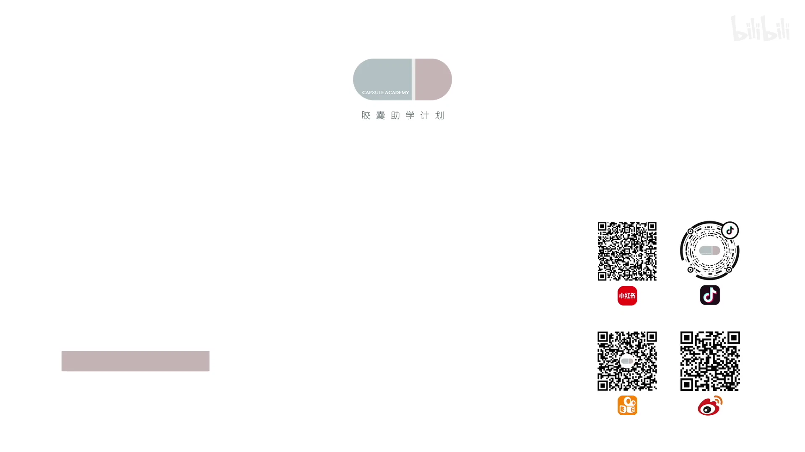

文字识别：CAPSULEACADEMY / 胶囊助学计划 / 小红书 / OE

### 画面 00:06:51

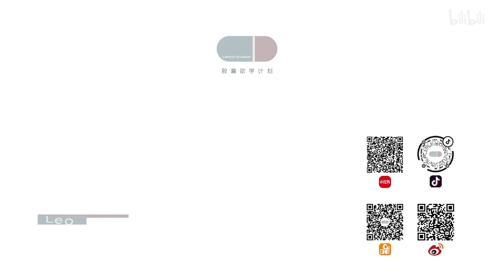

文字识别：CAPSULEACADEMY / 胶囊助学计划 / 『 / 小红书 / 品 / Le / O / OE

### 画面 00:06:57

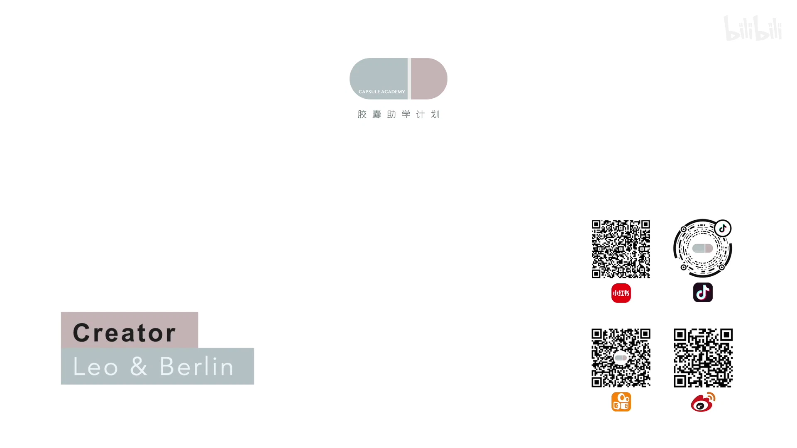

文字识别：CAPSULEACADEMY / 胶囊助学计划 / 『 / 小红书 / Creator / □ / Leo & Berlin / OE

### 画面 00:06:59

文字识别：bilibili / 胶囊助学计划

## 00:07:00–00:07:01

### 画面 00:07:00

文字识别：bilibili / 胶囊助学计划

