# L030 语法 + 单词

快速机器解析：语音为单模型转写，未进行独立交叉校对或人工复核；画面每秒采样并按变化选帧，短时文字和标记可能遗漏。截图时间约有 1 秒误差。图片有损压缩；遇到疑点请按时间查看 Google Drive 原视频。

## 00:00:00–00:00:30

Hello everyone, welcome to Capsule Academy. This is Leo. Today we're going to learn new concept English Book Two Lesson Thirty Grammar and Words. 那老习惯进入正式课程之前，我们先看几个小的问题。那首先 doing 做定语应该如何去应用啊？如何去理解啊？我们二十九课刚刚学过了 done 去做定语，今天我们来学一下 doing 做定语。接下来呢，那定语的位置啊，我们现在已知的 done 可以

### 画面 00:00:00

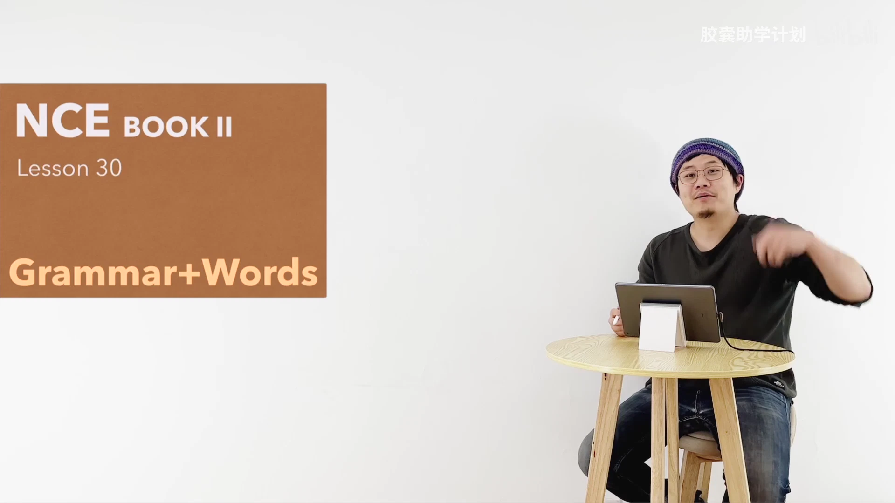

文字识别：NCE / BOOKI"I / Lesson 30 / Grammar+Words

### 画面 00:00:03

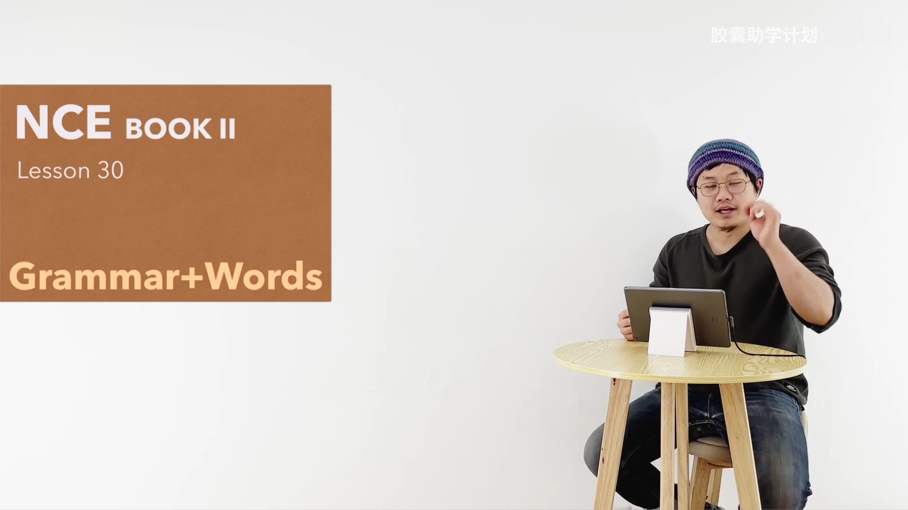

文字识别：NCE / BOOKII / Lesson 30 / Grammar+Words

### 画面 00:00:07

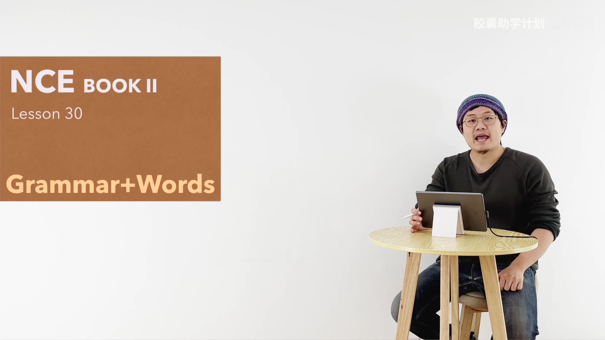

文字识别：NCE / BOOKI"I / Lesson 30 / Grammar+Words

### 画面 00:00:12

文字识别：吾？

### 画面 00:00:14

文字识别：①doing 做定语？

### 画面 00:00:25

文字识别：①doing 做定语? / 内位置？

### 画面 00:00:27

文字识别：①doing 做定语? / 定语的位置?

## 00:00:30–00:01:00

定语，doing可以做定语，形容词也可以做定语，那定语从句还可以做定语，那它们的位置是什么样子的呢？最后一个问题，如何表达揍某人一顿？那带着这三个问题，hope you enjoy。好，那我们上来先看 doing 现在分词去做定语啊。首先呢，我们先简单介绍一下它现在分词。

### 画面 00:00:38

文字识别：①doing 做定语? / 定语的位置? / “揍某人一顿”?

### 画面 00:00:40

文字识别：①doing 做定语? / 定语的位置? / 如何表达“揍某人一顿”？

### 画面 00:00:44

文字识别：胶囊助学计划bilbl / •

### 画面 00:00:48

文字识别：胶囊助学计划

### 画面 00:00:50

文字识别：doing 现在分词做定语

### 画面 00:00:53

文字识别：doing 现在分词做定语

### 画面 00:00:56

文字识别：doing 现在分词做定语 / doing现在分词做定语：主动进行/主动一般

## 00:01:00–00:01:30

我们最开始见到它是在新概念一册三十一课，对吧？呃，去组成时态的时候，比如说 I am teaching you guys English right now. OK，我现在正在教各位英文，对吧？I am teaching t teach 加 I N G 叫 teaching right. OK，那所以它当时是一起到了一个动词的作用。今天呢，注意我们现在其实是让这个现在分词去做一个定语。那早在我们二十八课、二十九课也就已经讲过了，

### 画面 00:01:03

文字识别：doing 现在分词做定语 / doing现在分词做定语：主动进行/主动一般

## 00:01:30–00:02:00

定语其实有点像形容词的这样一个作用，对吧？去修饰一个名词。那所以今天我们看到的不是它的动词啊，各位要注意怎么去理解呢？去翻译它的时候，翻译成的叫做主动进行或主动一般。但因为主动一般的情况相对来说比较罕见，今天我们就不着急举例子了。我们今天多说一些主动进行。比如说，我举个例子啊，叫 the sinking ship。你看，sink，

### 画面 00:01:33

文字识别：doing 现在分词做定语 / doing现在分词做定语：主动进行/主动一般

### 画面 00:01:43

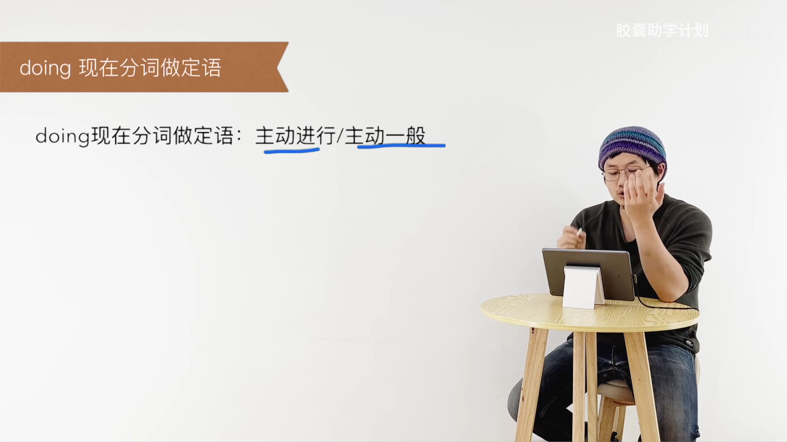

文字识别：doing 现在分词做定语 / doing现在分词做定语：主动进行/主动一般

## 00:02:00–00:02:30

首先s i n k它本身是一个动词对吧，表示沉没。那加上i n g了之后，我们可以造一个句子说这个船正在沉没，对吧？正在往下沉。OK，这个动作。那如果我把它去当做一个定语，就是起到一个形容词作用的时候，那the sinking ship如何去理解呢？首先它是主动，它不是被沉没了，对吧？OK，其次它可以表示进行，这个出现的频率是比较高的。所

### 画面 00:02:04

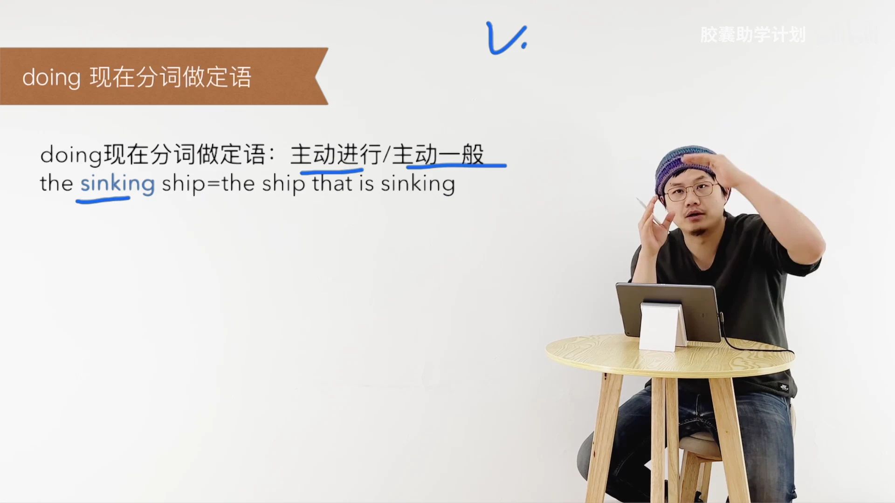

文字识别：doing / 现在分词做定语 / doing现在分词做定语： / 主动进行/主动一般 / the / sinking / ship=the: / ship / that is sinking

## 00:02:30–00:03:00

以 the sinking ship 对于各位来说理解其实就是 the ship that is sinking 啊，这个船它正在沉，或者说正在沉的一艘船，对吧？ Okay, next one, say the rising sun. Okay, 那正在升起的太阳等于 the sun that is rising. Okay, very good. Next one, say the sleeping child. 正在睡觉的孩子等于的是 the child who is sleeping. 你看我们翻译出来，不

### 画面 00:02:33

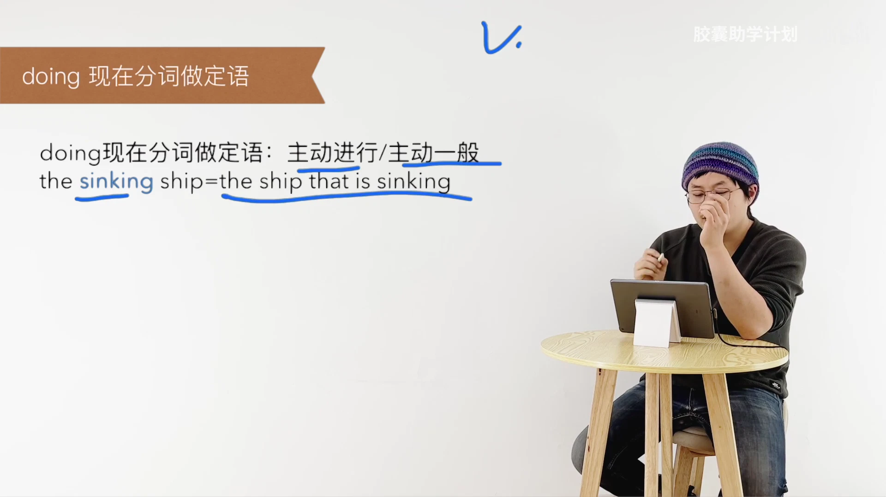

文字识别：doing / 现在分词做定语 / doing现在分词做定语： / 主动进行/主动一般 / the / sinking / ship=the / ship / that is sinking

### 画面 00:02:42

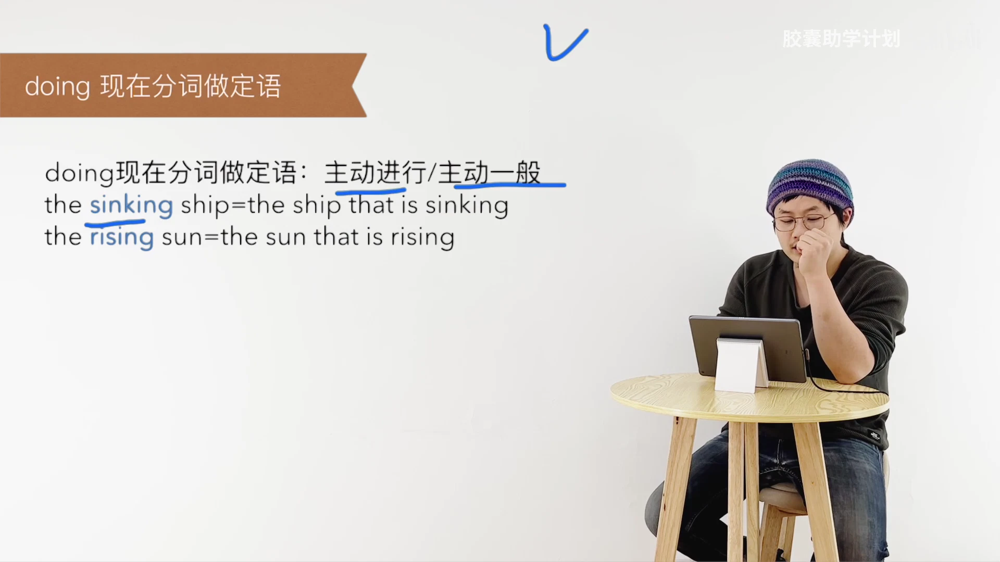

文字识别：doing / 现在分词做定语 / doing现在分词做定语： / 主动进行/主动一般 / the / sinking / ship=the / ship / that is / sinking / the / rising / sun=the / e sun / that is rising

### 画面 00:02:55

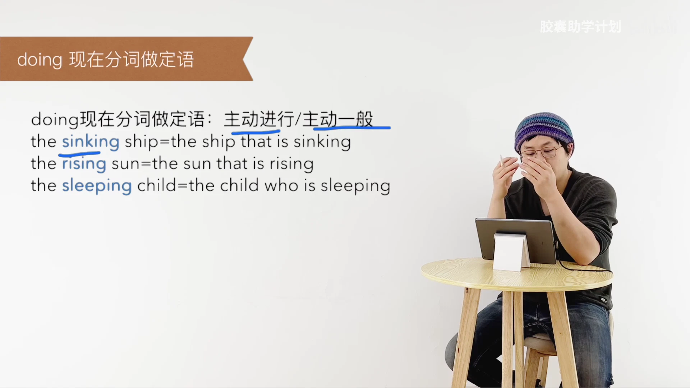

文字识别：doing / 现在分词做定语 / doing现在分词做定语： / 主动进行/主动一般 / the / sinking / ship=the / ship / that is / sinking / the / rising / sun=the / sun / that is / rising / the / sleeping / child=the / child / who is sleeping

## 00:03:00–00:03:30

管是 sinking、rising 还是 sleeping，它都翻译不出来被动，对吧？都是一个主动。所谓主动，就是这个动作和它的后边这个名词之间的这个关系是主动还是被动，对吧？它都是主动的，都是船自己在往下沉，对吧？然后太阳自己升起来，不是被别人翘起来的，对不对？然后孩子是自己在睡觉啊，不是被睡觉，这翻译不通的，对不对？并且呢，我们看后面它都是一个进行的状态，我们管它叫

### 画面 00:03:09

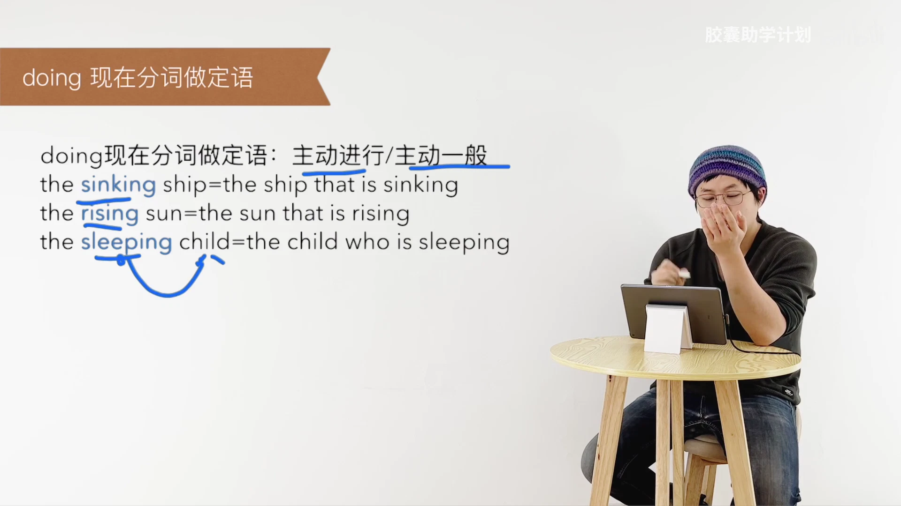

文字识别：doing / 现在分词做定语 / doing现在分词做定语： / 主动进行/主动一般 / the / sinking / ship=the / ship / that is / sinking / the / rising / sun=the / sun / that is / rising / the / sleeping / child=the / child / who is sleeping

### 画面 00:03:27

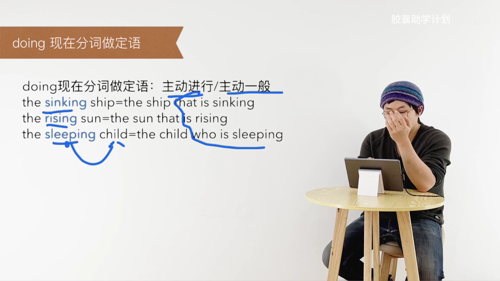

文字识别：doing / 现在分词做定语 / doing现在分词做定语： / 主动进行/主动一般 / the / sinking / ship=the / ship / hat is / sinking / the / rising / sun=the / sun / that / is rising / the / sleeping / child=the / child / who is sleeping

### 画面 00:03:29

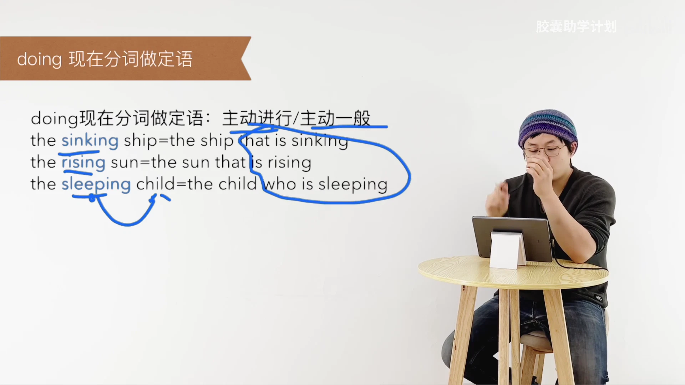

文字识别：doing / 现在分词做定语 / doing现在分词做定语： / 主动进行/主动一般 / the / sinking / ship=the / ship / hat is / sinking / the / rising / sun=the / sun / that /  rising / S / the / sleeping / child=the / child / who is / sleeping

## 00:03:30–00:04:00

做主动进行。OK，好，比如说，那我们再来一个叫 I like the girl dancing with that guy。注意啊，你看 I like the girl，叫我喜欢那个姑娘。注意一个小点，dancing with that guy，dancing 其实就是 dance 后边加了 ing，啊，去 e 加了 ing。那 dancing with that guy 直接翻译叫做正和那个小伙子跳舞。好，注意正和那个小伙子跳舞，它在这个地

### 画面 00:03:31

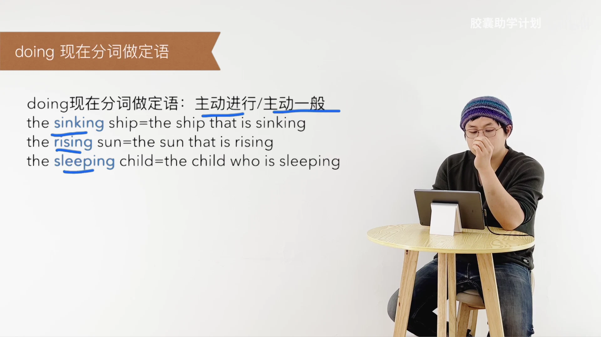

文字识别：doing / 现在分词做定语 / doing现在分词做定语： / 主动进行/主动一般 / the / sinking / ship=the / ship / that is / sinking / the / rising / sun=the / sun / that is / rising / the / sleeping / child=the / child / who is sleeping

### 画面 00:03:33

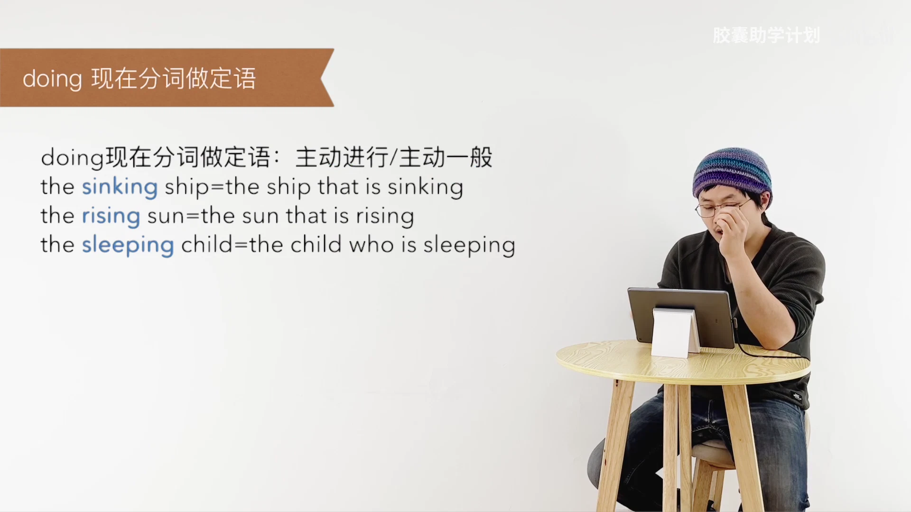

文字识别：doing / 现在分词做定语 / doing现在分词做定语： / 主动进行/主动一般 / the / sinking / ship=the / ship / that is sinking / the / rising / sun=the / e sun / that is / rising / the / sleeping / child=the / child / who is sleeping

### 画面 00:03:35

文字识别：doing / 现在分词做定语 / doing现在分词做定语： / 主动进行/主动一般 / the / sinking / ship=the / ship / that is / sinking / the / rising / sun=the / sun / that is / rising / the / sleeping / child=the / child / who is sleeping / Ilike / the girl / dancing / with t /  that guy.

### 画面 00:03:44

文字识别：doing / 现在分词做定语 / doing现在分词做定语： / 主动进行/主动一般 / the / sinking / ship=the / ship / that is / sinking / the / rising / sun=the / sun / that is / rising / the / sleeping / child=the / child / who is sleeping / Ilike / the girl / dancing witht / that guy.

## 00:04:00–00:04:30

方是一个短语，是由 dancing 去引导的，对不对？好，各位回顾一下，由 dance 去引导的短语做定语的时候，是放在名词的后面的啊，对吧？那由 doing 去引导的这个短语的时候，它也是要放在名词的后面，这跟汉语不太一样。其次呢，那 dancing with that guy 有两种翻译方式，一个叫主动进行，一个叫主动一般，这个不太能翻译成主动一般，对吧？我们就翻译成叫做正在和那个小伙子跳舞，

### 画面 00:04:09

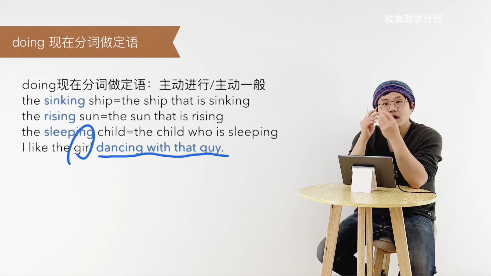

文字识别：doing / 现在分词做定语 / doing现在分词做定语： / 主动进行/主动一般 / the / sinking / ship=the / ship / that is. / sinking / the / rising / sun=the / sun / that is / rising / the / sleeping / child=the / child / who is sleeping / Ilike / the / gir / dancing with t / that guy.

## 00:04:30–00:05:00

正在和那个哥们儿、那个家伙跳舞的姑娘，看见了吧？我们汉语是把 dancing with that guy 放到了 the girl 的前面，对吧？OK，那由这儿呢就引出来了一个非常关键的东西，叫做我们要总结一下定语的位置啊。呃，今天我们见到的都是我们之前已经学过的，我们已经学过很多了。那首先我们要清楚一件事情，就是我们管它叫定语的位置。我们先明

### 画面 00:04:35

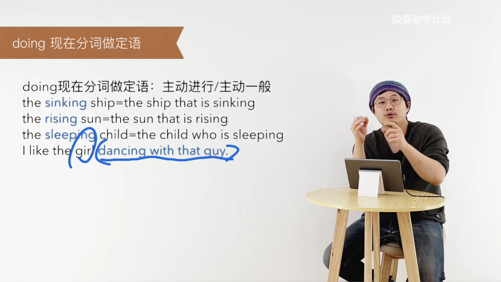

文字识别：doing / 现在分词做定语 / doing现在分词做定语： / 主动进行/主动一般 / the / sinking / ship=the / ship / that is / sinking / the / rising / sun=the / sun / that is / rising / the / sleeping / child=the / child / who is sleeping / Ilike / the / gir / dancing / with / that guy.

### 画面 00:04:39

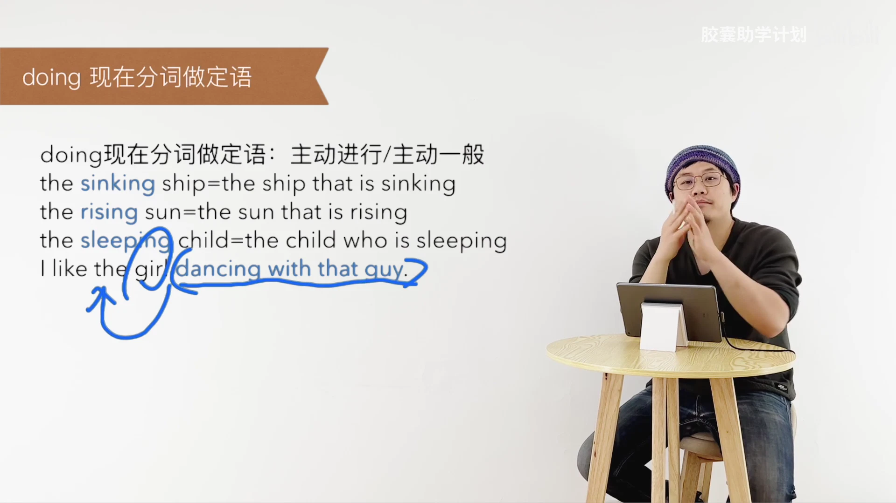

文字识别：doing / 现在分词做定语 / doing现在分词做定语： / 主动进行/主动一般 / the / sinking / ship=the / ship / that is / sinking / the / rising / sun=the / sun / that is / rising / the / sleeping / child=the / child / who is sleeping / Ilike / the gir / dancing / witht / that guy.

### 画面 00:04:43

文字识别：doing 现在分词做定语 / 总结定语位置：

### 画面 00:04:55

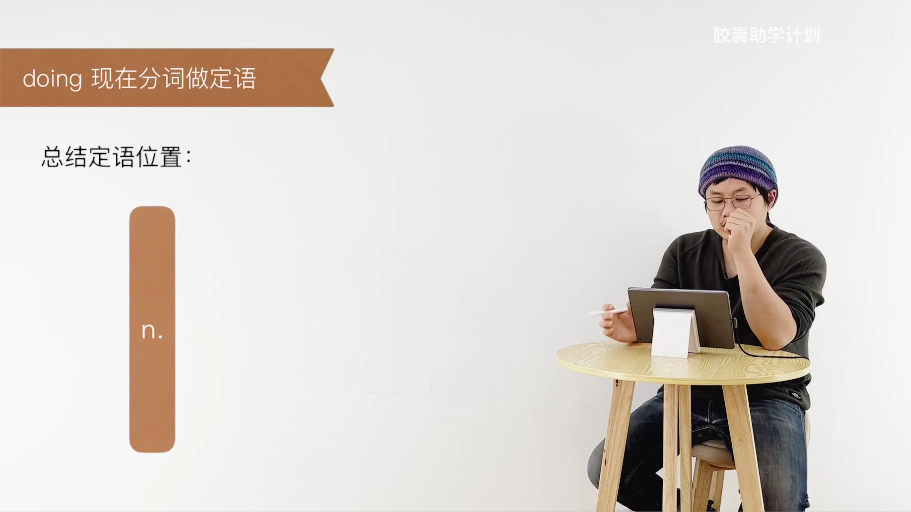

文字识别：doing 现在分词做定语 / 总结定语位置： / n.

### 画面 00:04:57

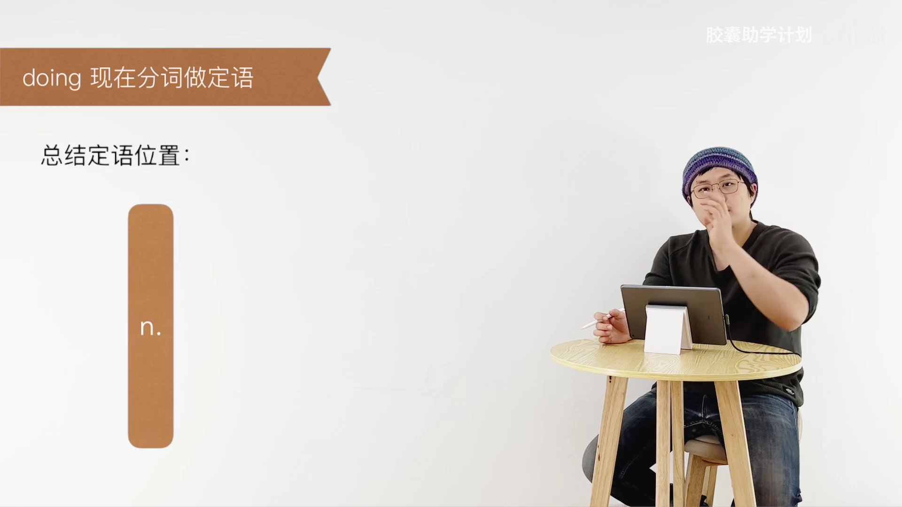

文字识别：doing 现在分词做定语 / 总结定语位置： / n.

## 00:05:00–00:05:30

白定语是围绕着谁去谈位置，对吧？它围绕着是名词。OK，对于各位来说最容易理解的就是形容词放在名词的前面，对吧？在语句上来说就是放在它的左面，也就是它的前面啊。我们的语言英语和汉语都是从左往右书写的，左面即为前面，右面即为后面。OK，所以形容词放在名词的前面，什么啊？blue啊呃，这个blue sky

### 画面 00:05:00

文字识别：doing 现在分词做定语 / 总结定语位置： / n.

### 画面 00:05:05

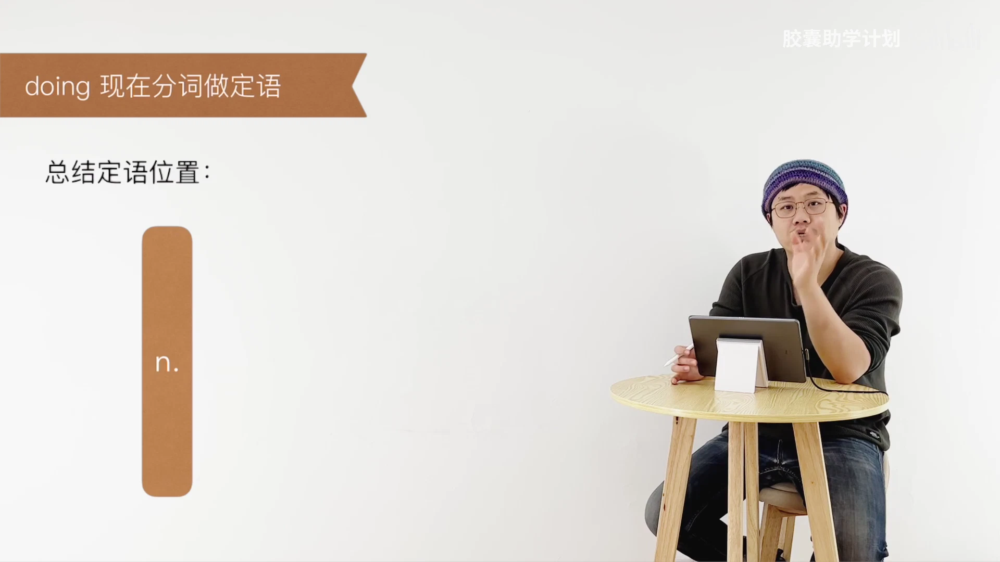

文字识别：doing 现在分词做定语 / 总结定语位置： / n.

### 画面 00:05:09

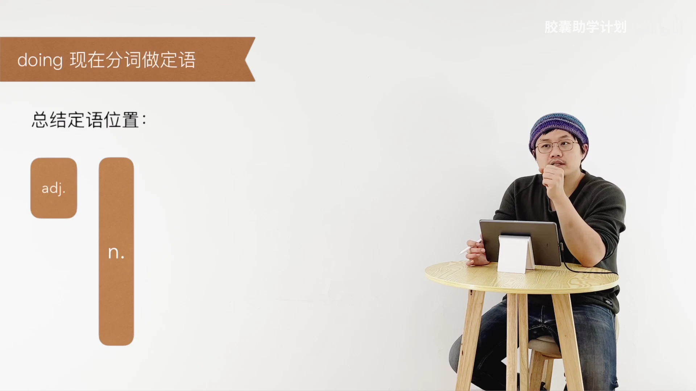

文字识别：doing 现在分词做定语 / 总结定语位置： / adj. / n.

### 画面 00:05:11

文字识别：doing 现在分词做定语 / 总结定语位置： / adj. / n.

### 画面 00:05:15

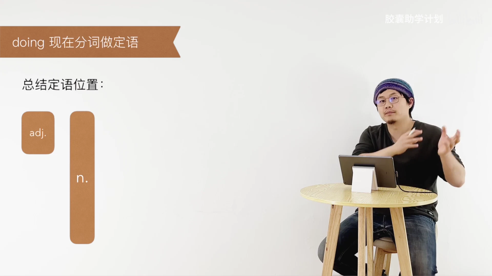

文字识别：doing 现在分词做定语 / 总结定语位置： / adj. / n.

### 画面 00:05:23

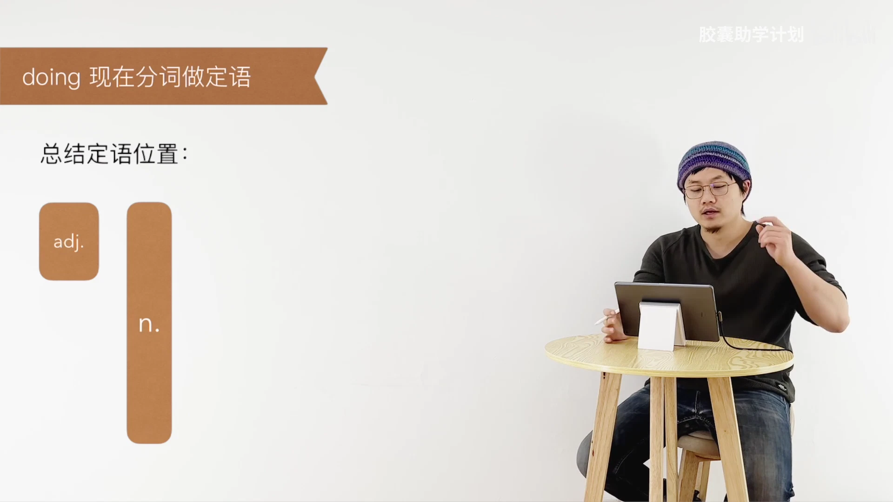

文字识别：doing 现在分词做定语 / 总结定语位置： / adj. / n.

### 画面 00:05:26

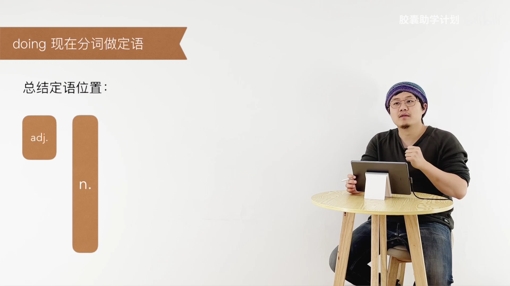

文字识别：doing 现在分词做定语 / 总结定语位置： / adj. / n.

## 00:05:30–00:06:00

对吧？啊，然后什么这个 red apple，等等。OK，接下来呢，但和 doing 分别是我们二十九课和本课三十课新学到的。他们如果只是单词的话，都是放在了名词的前面。OK，好，那但呢， doing 我们今天刚学两种翻译方式，主动进行或主动一般，因为主动进行见的频率比较高，所以我们今天只看先学这个啊。其次，二十九

### 画面 00:05:34

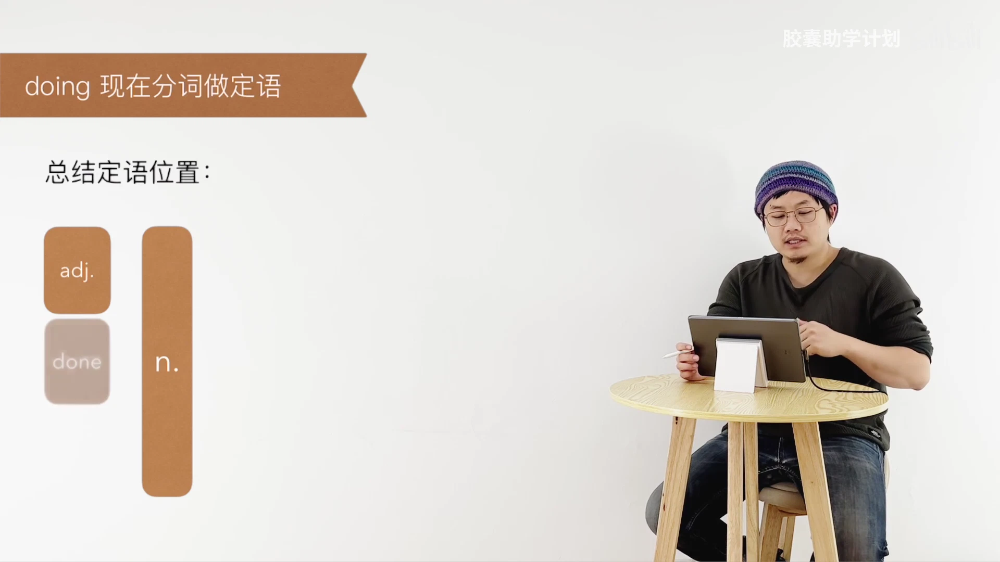

文字识别：doing 现在分词做定语 / 总结定语位置： / adj. / done / n.

### 画面 00:05:36

文字识别：doing 现在分词做定语 / 总结定语位置： / adj. / done / n. / doing

### 画面 00:05:38

文字识别：doing 现在分词做定语 / 总结定语位置： / adj. / done / n. / doing

### 画面 00:05:40

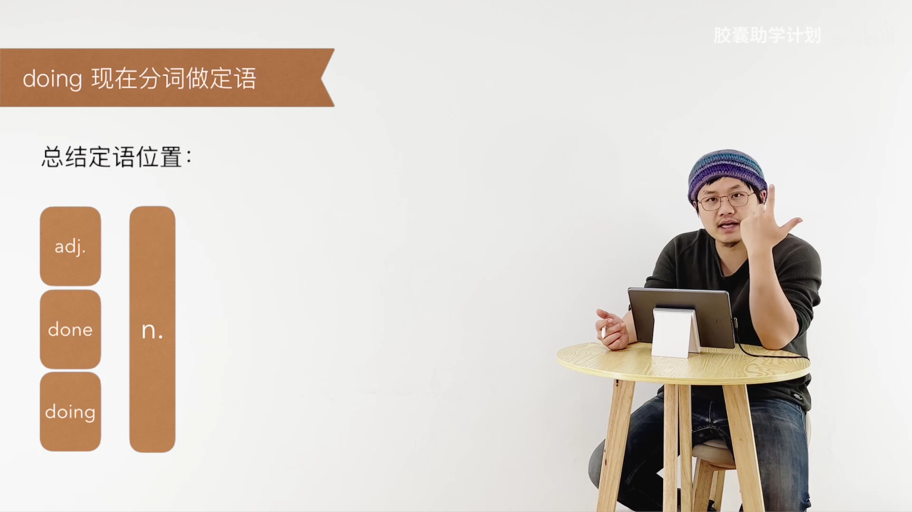

文字识别：doing 现在分词做定语 / 总结定语位置： / adj. / done / n. / doing

### 画面 00:05:45

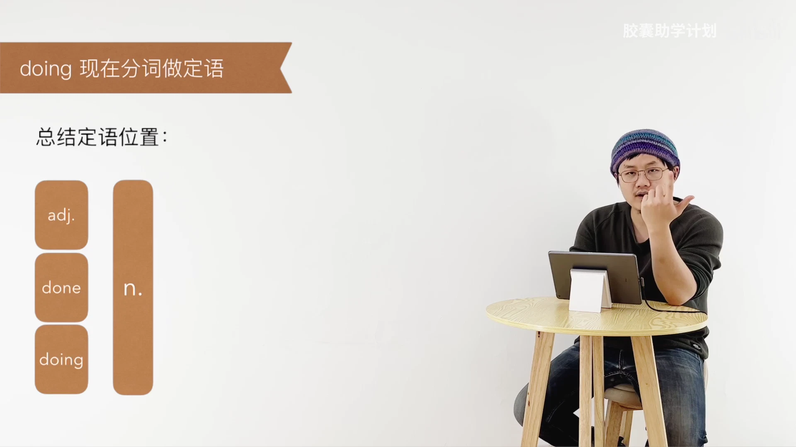

文字识别：doing 现在分词做定语 / 总结定语位置： / adj. / done / n. / doing

### 画面 00:05:50

文字识别：doing 现在分词做定语 / 总结定语位置： / adj. / done / n. / doing

### 画面 00:05:55

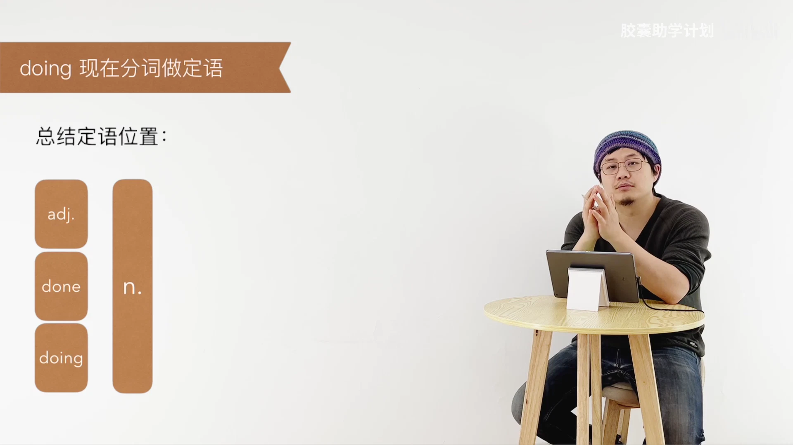

文字识别：doing 现在分词做定语 / 总结定语位置： / adj. / done / n. / doing

## 00:06:00–00:06:30

课的蛋呢，我们提到它叫做被动完成、被动一般，当然也有主动完成啊，有主动的时候，但是那个频率特别特别的低，对吧？我们具体情况具体去讨论。OK，这是说名词啊，这是说单词啊。如果是单词，我们就放一般放在名词的前面。接下来呢，如果它是短语，它一般是要放在名词的后面的。这个短语有不同的短语，比如说可以是

### 画面 00:06:00

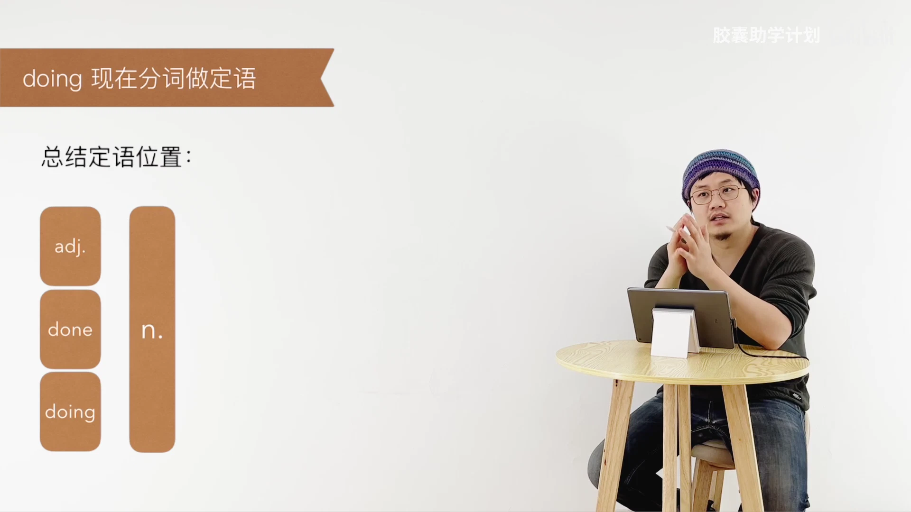

文字识别：doing 现在分词做定语 / 总结定语位置： / adj. / done / n. / doing

### 画面 00:06:07

文字识别：doing 现在分词做定语 / 总结定语位置： / adj. / done / n. / doing

### 画面 00:06:10

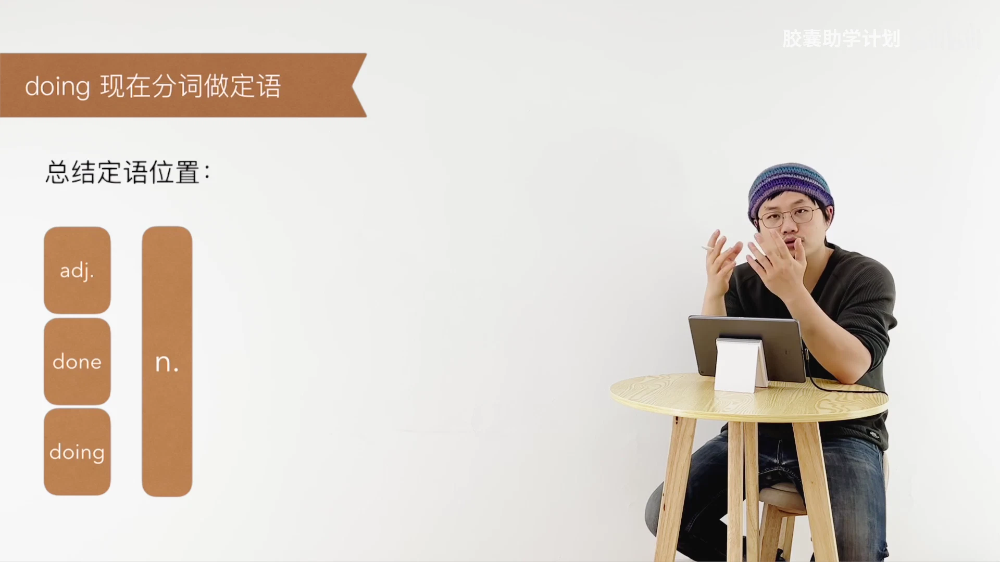

文字识别：doing 现在分词做定语 / 总结定语位置： / adj. / done / n. / doing

### 画面 00:06:14

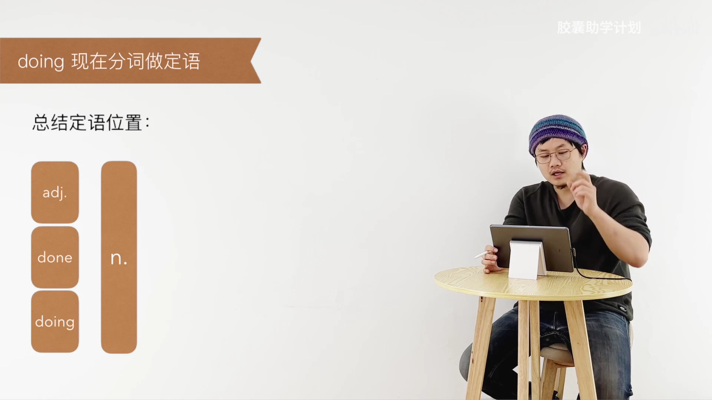

文字识别：doing 现在分词做定语 / 总结定语位置： / adj. / done / n. / doing

### 画面 00:06:16

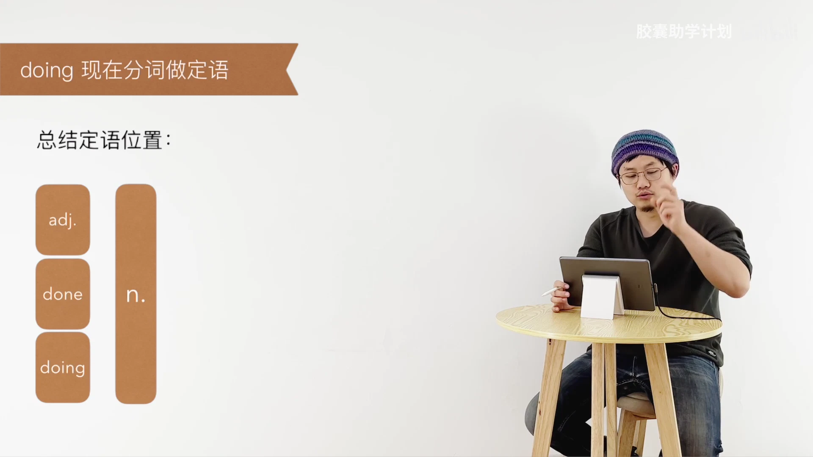

文字识别：doing / 现在分词做定语 / 总结定语位置: / adj. / done / n. / doing

### 画面 00:06:20

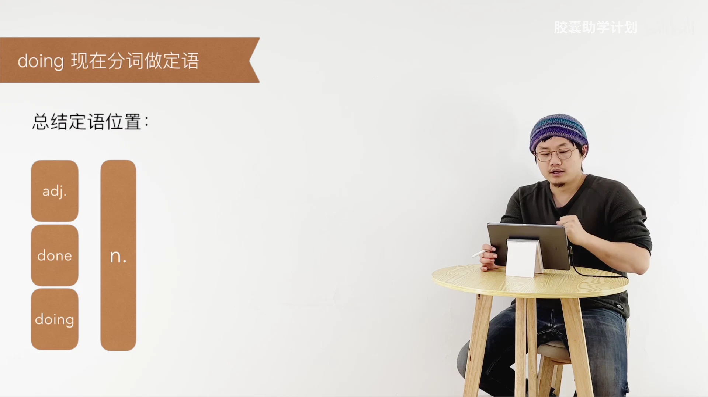

文字识别：doing 现在分词做定语 / 总结定语位置： / adj. / done / n. / doing

### 画面 00:06:22

文字识别：doing 现在分词做定语 / 总结定语位置: / adj. / 短语 / done / n. / doing

### 画面 00:06:24

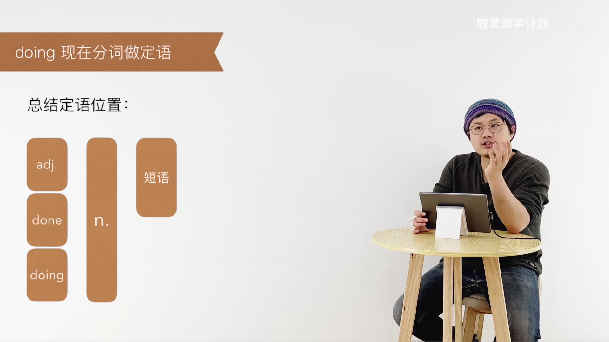

文字识别：doing 现在分词做定语 / 总结定语位置： / adj. / 短语 / done / n. / doing

### 画面 00:06:26

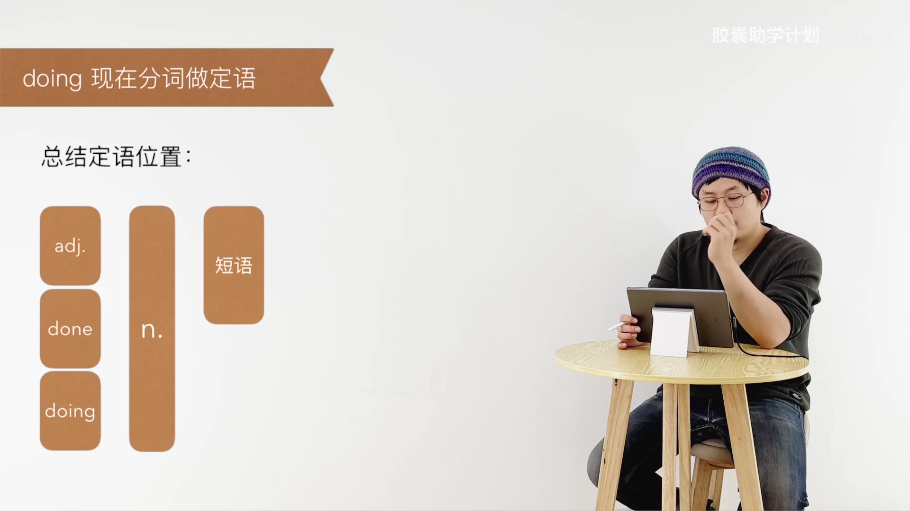

文字识别：doing / 现在分词做定语 / 总结定语位置: / adj. / 短语 / done / n. / doing

### 画面 00:06:29

文字识别：doing / 现在分词做定语 / 总结定语位置: / prep.引导 / adj. / 短语 / done / n. / doing

## 00:06:30–00:07:00

介词引导的啊。我们等下一个视频进入文章的时候，我给大家介绍几个由介词引导的短语去做定语的时候，放在了名词的后面。其实我们之前已经见过很多次了，只是可能各位没有特别注意啊。其次呢，但引导和 doing 引导，我们分别至少给各位了一个例子，对吧？在讲语法的时候，在二十九课和本课刚刚的上一页 P P T 当中，对吧？我们分别给各位了一个例子。所以不管怎么样，

### 画面 00:06:31

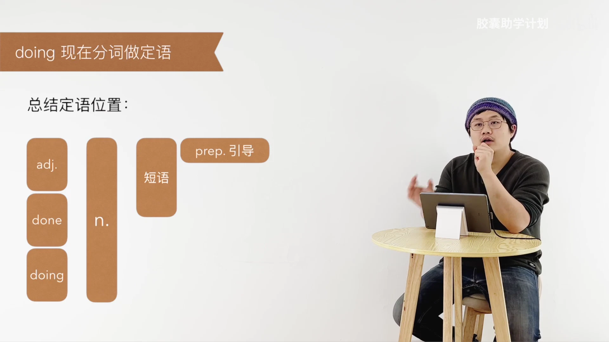

文字识别：doing 现在分词做定语 / 总结定语位置： / prep.引导 / adj. / 短语 / done / n. / doing

### 画面 00:06:35

文字识别：doing 现在分词做定语 / 总结定语位置： / prep.引导 / adj. / 短语 / done / n. / doing

### 画面 00:06:40

文字识别：doing 现在分词做定语 / 总结定语位置： / prep.引导 / adj. / 短语 / done / n. / doing

### 画面 00:06:45

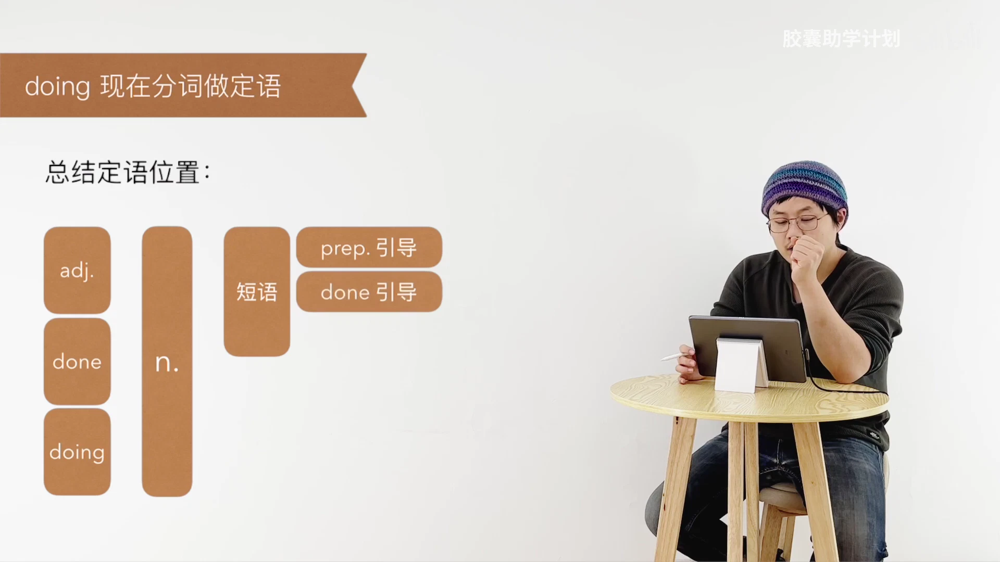

文字识别：doing王 / 现在分词做定语 / 总结定语位置： / prep.引导 / adj. / 短语 / done引导 / done / n. / doing

### 画面 00:06:47

文字识别：doing / 现在分词做定语 / 总结定语位置： / prep.引导 / adj. / 短语 / done引导 / doing引导 / done / n. / doing

### 画面 00:06:50

文字识别：doing / 现在分词做定语 / 总结定语位置： / prep.引导 / adj. / 短语 / done引导 / doing引导 / done / n. / doing

### 画面 00:06:53

文字识别：doing / 现在分词做定语 / 总结定语位置： / prep.引导 / adj. / 短语 / done引导 / doing引导 / done / n. / doing

### 画面 00:06:55

文字识别：doingI / 现在分词做定语 / 总结定语位置： / prep.引导 / adj. / 短语 / done引导 / doing引导 / done / n. / doing

## 00:07:00–00:07:30

短语有三种形式，可以是介词引导、doing引导、但引导，但只要是他们引导的短语，它修饰名词的时候，一般是放在后面的。最后一个其实是句子，也就是咱们经常提到的叫做定语从句。好，注意一小下，定语从句早在新概念一册一百二十一课、一百二十三课我们就学过，新概念二册二十八课我们又重温了一遍。好，简单来说，跟

### 画面 00:07:00

文字识别：doing / 现在分词做定语 / 总结定语位置： / prep.引导 / adj. / 短语 / done 引导 / doing / 引导 / done / n. / doing

### 画面 00:07:02

文字识别：doing / 现在分词做定语 / 总结定语位置： / prep.引导 / adj. / 短语 / done引导 / doing / 引导 / done / n. / doing

### 画面 00:07:05

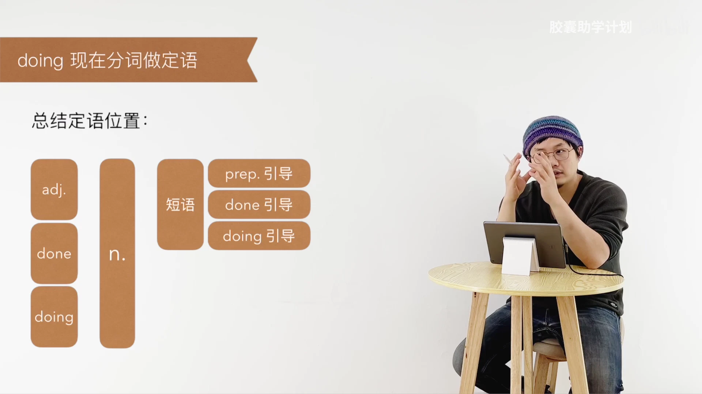

文字识别：doing / 现在分词做定语 / 总结定语位置： / prep.引导 / adj. / 短语 / done引导 / doing引导 / done / n. / doing

### 画面 00:07:10

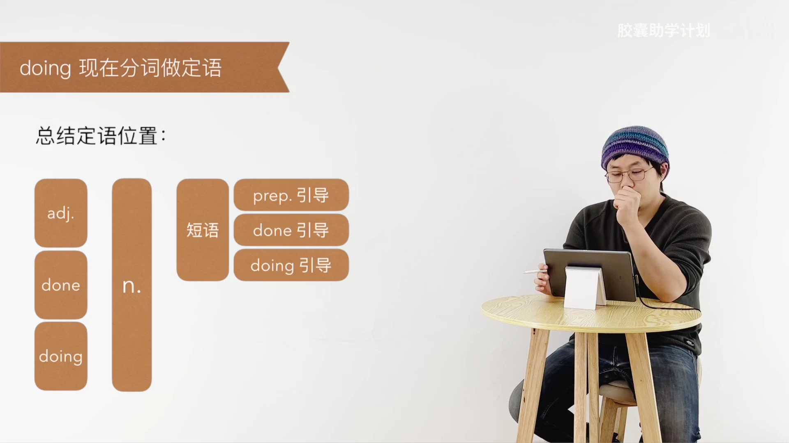

文字识别：doing / 现在分词做定语 / 总结定语位置： / prep.引导 / adj. / 短语 / done引导 / doing引导 / done / n. / doing

### 画面 00:07:12

文字识别：doing / 现在分词做定语 / 总结定语位置： / prep.引导 / adj. / 短语 / done引导 / doing / 引导 / done / n. / 定语 / 从句 / doing

### 画面 00:07:14

文字识别：doing / 现在分词做定语 / 总结定语位置： / prep.引导 / adj. / 短语 / done引导 / doing / 引导 / done / n. / 定语 / 从句 / doing

### 画面 00:07:16

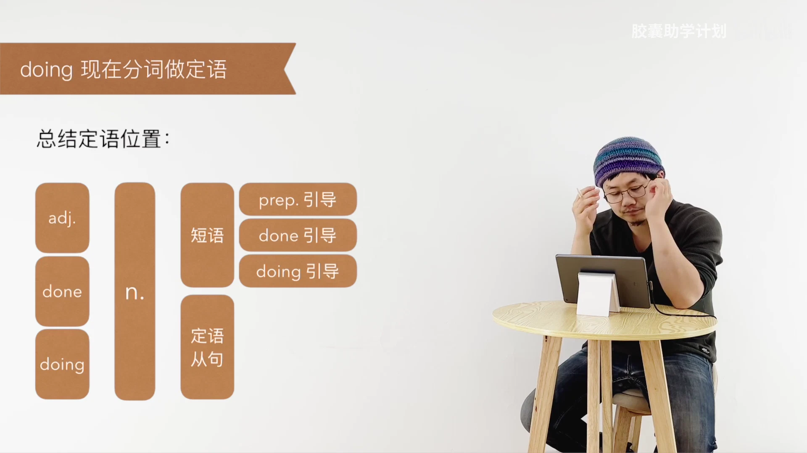

文字识别：doing / 现在分词做定语 / 总结定语位置： / prep.引导 / adj. / 短语 / done引导 / doing / 引导 / done / n. / 定语 / 从句 / doing

### 画面 00:07:20

文字识别：doing / 现在分词做定语 / 总结定语位置： / prep.引导 / adj. / 短语 / done引导 / doing引导 / done / n. / 定语 / 从句 / doing

### 画面 00:07:24

文字识别：doing / 现在分词做定语 / 总结定语位置： / prep.引导 / adj. / 短语 / done引导 / doing引导 / done / n. / 定语 / 从句 / doing

### 画面 00:07:26

文字识别：doing / 现在分词做定语 / 总结定语位置： / prep.引导 / adj. / 短语 / done引导 / doing / 引导 / done / n. / 定语 / 从句 / doing

## 00:07:30–00:08:00

汉语这是一个非常大的区别。汉语都放在名词的前面，而英语都放在了这个名词的后面。例子呢，也是我们以后见一个去学一个。而这个小的图，各位一定要给它，要么写在您的笔记本当中，要么截屏去进行一个保存这个图片，对吧？非常的重要，以后我们会不停的说到它。OK，定语的位置，三十克，这个笔记很重要啊。OK，呃，

### 画面 00:07:30

文字识别：doing / 现在分词做定语 / 总结定语位置： / prep.引导 / adj. / 短语 / done引导 / doing引导 / done / n. / 定语 / 从句 / doing

### 画面 00:07:35

文字识别：doing / 现在分词做定语 / 总结定语位置： / prep.引导 / adj. / 短语 / done引导 / doing引导 / done / n. / 定语 / 从句 / doing

### 画面 00:07:39

文字识别：doing / 现在分词做定语 / 总结定语位置： / prep.引导 / adj. / 短语 / done 引导 / doing引导 / done / n. / 定语 / 从句 / doing

### 画面 00:07:41

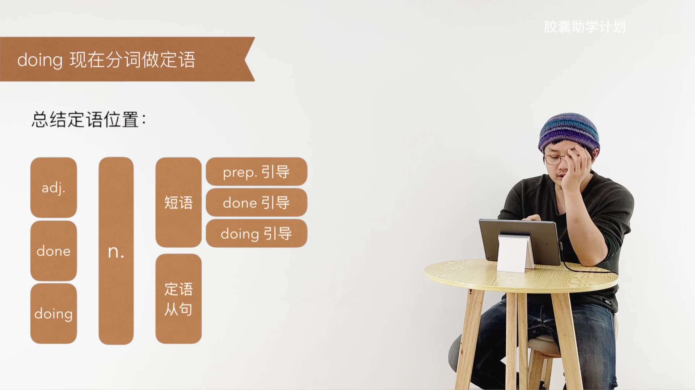

文字识别：doing / 现在分词做定语 / 总结定语位置： / prep.引导 / adj. / 短语 / done引导 / doing引导 / done / n. / 定语 / 从句 / doing

### 画面 00:07:43

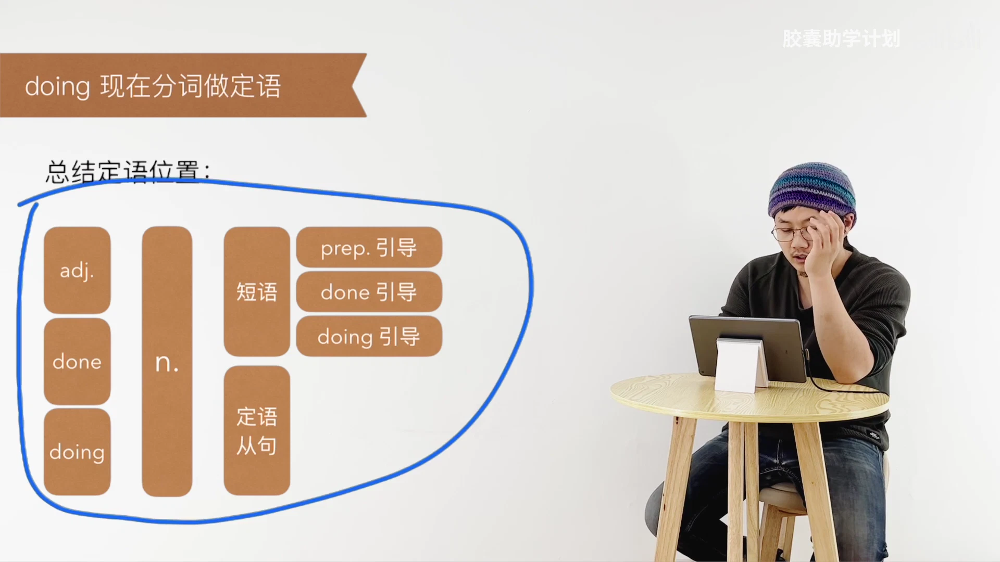

文字识别：doing / 现在分词做定语 / 总结定语位置： / prep.引导 / adj. / 短语 / done引导 / doing 引导 / done / n. / 定语 / 从句 / doing

### 画面 00:07:45

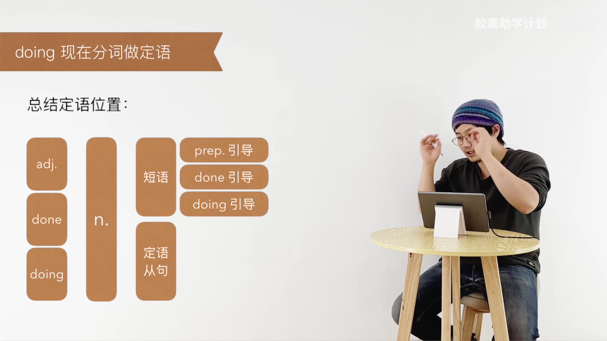

文字识别：doing / 现在分词做定语 / 总结定语位置： / prep.引导 / adj. / 短语 / done 引导 / doing引导 / done / n. / 定语 / 从句 / doing

### 画面 00:07:50

文字识别：doing / 现在分词做定语 / 总结定语位置： / prep.引导 / adj. / 短语 / done引导 / doing引导 / done / n. / 定语 / 从句 / doing

### 画面 00:07:52

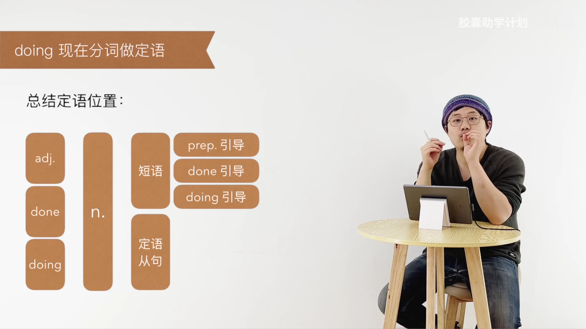

文字识别：doing / 现在分词做定语 / 总结定语位置： / prep.引导 / adj. / 短语 / done引导 / doing引导 / done / n. / 定语 / 从句 / doing

### 画面 00:07:55

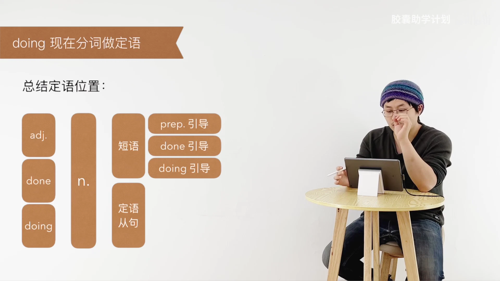

文字识别：doing / 现在分词做定语 / 总结定语位置： / prep.引导 / adj. / 短语 / done 引导 / doing引导 / done / n. / 定语 / 从句 / doing

### 画面 00:07:59

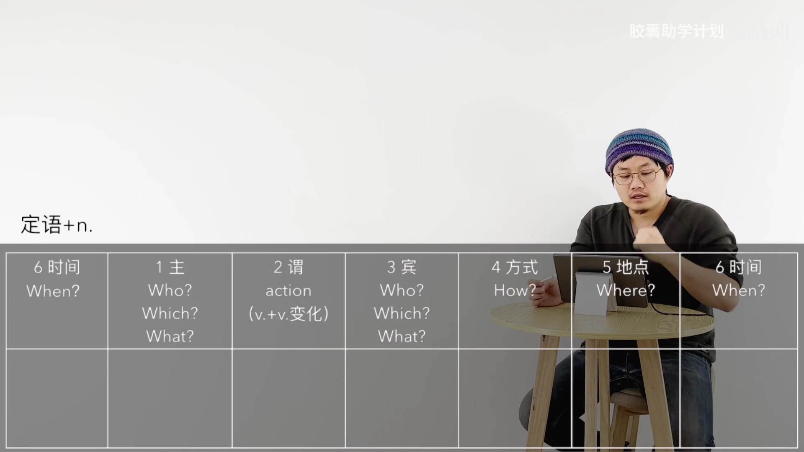

文字识别：定语+n. / 6时间 / 1主 / 2谓 / 3宾 / 4方式 / 5地点 / 6时间 / When? / Who? / action / Who? / How? / Where? / When? / Which? / (v.+v.变化) / Which? / What? / What?

## 00:08:00–00:08:30

那我们回顾一下这个语法点，它可能会出现什么什么地方啊？我们今天其实主要给大家是总结了一下定语，定语呢，我们又提到了，不管你是放在名词的前面还是名词的后面，反正它是要跟着名词一起走的。于是我们要思考的问题就是六一二三四五六当中哪些地方可以放名词？时间一般问题不大，主语没问题，谓语是动词，宾语没问题，方式一般不用名词，对吧？地点可以

### 画面 00:08:21

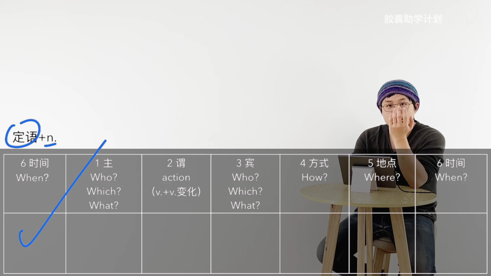

文字识别：定语+n. / 6时间 / 1主 / 2谓 / 3宾 / 4方式 / 5地点 / 6时间 / When? / Who? / action / Who? / How? / Where? / When? / Which? / (v.+v.变化) / Which? / What? / What?

### 画面 00:08:23

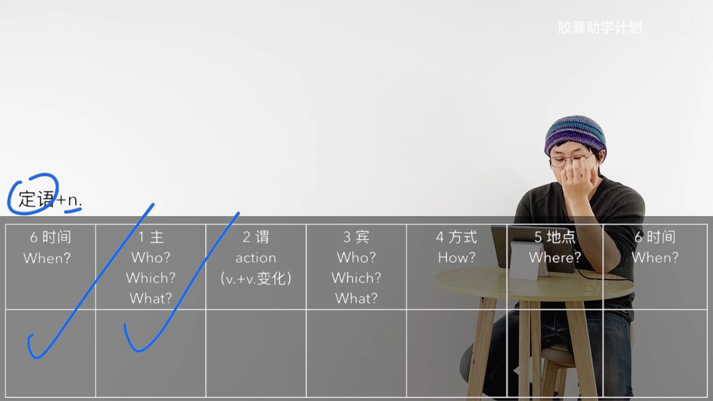

文字识别：定语+n. / 6时间 / 1主 / 2谓 / 3宾 / 4方式 / 5地点 / 6时间 / When? / Who? / action / Who? / How? / Where? / When? / Which? / (v.+v.变化) / Which? / What? / What?

### 画面 00:08:25

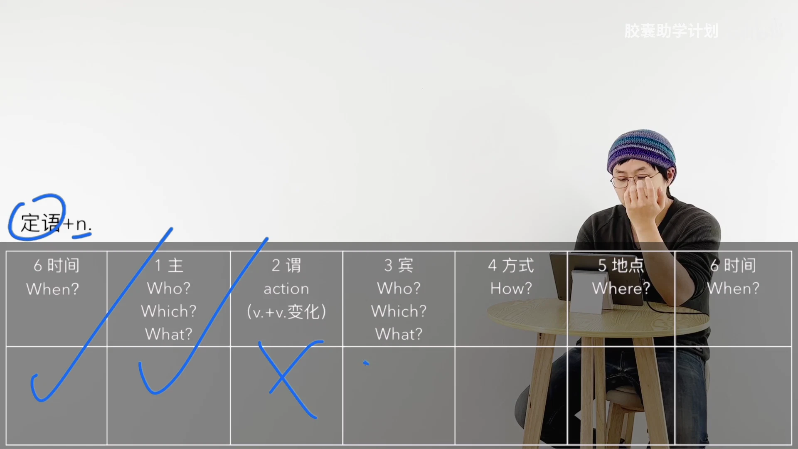

文字识别：定语+n. / 6时间 / 1主 / 2谓 / 3宾 / 4方式 / 5地点 / 6时间 / When? / Who? / action / Who? / How? / Where? / When? / Which? / (v.+v.变化) / Which? / What? / What?

### 画面 00:08:27

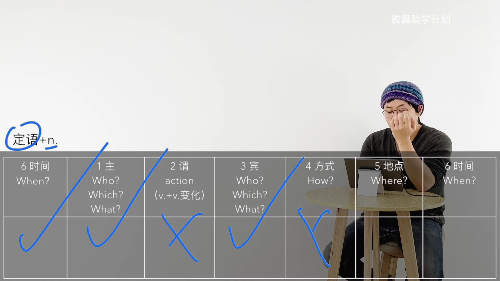

文字识别：定语+n. / 6时间 / 1主 / 2谓 / 3宾 / 4方式 / 5地点 / 6时间 / When? / Who? / action / Who? / How? / Where? / When? / Which? / (v.+v.变化) / Which? / What? / What?

### 画面 00:08:29

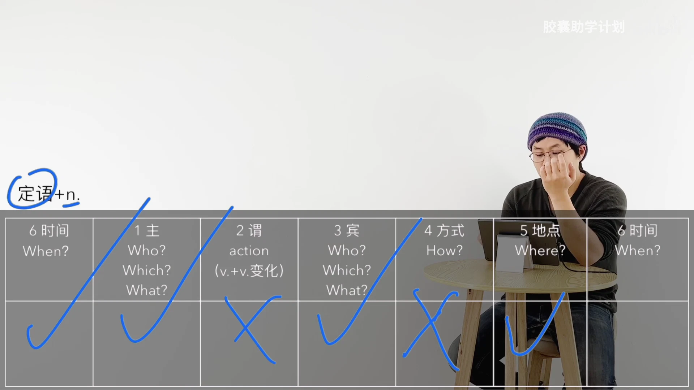

文字识别：定语+n. / 6时间 / 1主 / 2谓 / 3宾 / 4方式 / 5地点 / 6时间 / When? / Who? / action / Who? / How? / Where? / When? / Which? / (v.+v.变化) / Which? / What? / What?

## 00:08:30–00:09:00

用名词，时间可以用名词，所以这个今天学到的知识点，除了在二和四当中几乎不会出现以外，在六一啊三五它都会出现，所以还真的比较重要。OK，好，那进入文章我们再说更多啊，以及以后再学习的时候。今天呢，我们接下来看一下本课的单词。首先第一个单词跟我读一下，叫做 polo polo。OK，那

### 画面 00:08:31

文字识别：定语+n. / 6时间 / 1主 / 2谓 / 3宾 / 4方式 / 5地点 / 6时间 / When? / Who? / action / Who? / How? / Where? / When? / Which? / (v.+v.变化) / Which? / What? / What?

### 画面 00:08:50

文字识别：单词造句指南 / 网：v.+v.变化 / 四句型转换 / 方式/地点/时间 / 结合习惯用法 / 其他单词+词性 / 原文摘抄+变 / 6123456 / /'paulau/ / polo n.

### 画面 00:08:52

文字识别：单词造句指南 / 网：v.+v.变化 / 四句型转换 / 方式/地点/时间 / 结合习惯用法 / 其他单词+词性 / 原文摘抄+变 / 6123456 / /'paulau/ / polo n.

### 画面 00:08:54

文字识别：单词造句指南 / 网：v.+v.变化 / 四句型转换 / 方式/地点/时间 / 结合习惯用法 / 其他单词+词性 / 原文摘抄+变 / 6123456 / /'paulau/ / polo n.

### 画面 00:08:56

文字识别：单词造句指南 / 网：v.+v.变化 / 四句型转换 / 方式/地点/时间 / arond / 结合习惯用法 / 其他单词+词性 / 原文摘抄+变 / 6123456 / /'paulau/ / polo n.

## 00:09:00–00:09:30

注意一个小点，我们如果想说本科的这个水球，对吧？那叫做 water polo 啊，一般是要加一个 water 的。单独用 polo 的时候是什么含义呢？好，这个我想给各位留一个小的作业，您不妨在视频下方查完了之后告诉我，单独用 polo 往往指的是什么意思，对吧？Okay, 那我们拿 water polo 去造句，造了第一个句子叫做 The man who likes to play water polo complains

### 画面 00:09:00

文字识别：单词造句指南 / 网：v.+v.变化 / 四句型转换 / 方式/地点/时间 / arend / 结合习惯用法 / 其他单词+词性 / 原文摘抄+变 / 6123456 / /'paulau/ / polo n. / water polo

### 画面 00:09:02

文字识别：单词造句指南 / 网：v.+v.变化 / 四句型转换 / 方式/地点/时间 / arond / 结合习惯用法 / 其他单词+词性 / 原文摘抄+变 / 6123456 / /'paulau/ / polo n. / water polo

### 画面 00:09:05

文字识别：单词造句指南 / 网：v.+v.变化 / 四句型转换 / 方式/地点/时间 / 结合习惯用法 / 其他单词+词性 / 原文摘抄+变 / 6123456 / /'paulau/ / polo n. / water polo

### 画面 00:09:10

文字识别：单词造句指南 / 网：v.+v.变化 / 四句型转换 / 方式/地点/时间 / arend / 结合习惯用法 / 其他单词+词性 / 原文摘抄+变 / 6123456 / /'paulau/ / polo n. / water polo

### 画面 00:09:15

文字识别：单词造句指南 / 网：v.+v.变化 / 四句型转换 / 方式/地点/时间 / 结合习惯用法 / 其他单词+词性 / 原文摘抄+变 / 6123456 / /'paulau/ / polo n. / water polo

### 画面 00:09:20

文字识别：单词造句指南 / 网：v.+v.变化 / 四句型转换 / 方式/地点/时间 / arena / 结合习惯用法 / 其他单词+词性 / 原文摘抄+变 / 6123456 / /'paulau/ / polo n. / water polo

### 画面 00:09:22

文字识别：单词造句指南 / 网：v.+v.变化 / 四句型转换 / 方式/地点/时间 / 结合习惯用法 / 其他单词+词性 / 原文摘抄+变 / 6123456 / /'paulau/ / polo n. / water polo

### 画面 00:09:24

文字识别：单词造句指南 / 网：v.+v.变化 / 四句型转换 / 方式/地点/时间 / arono / 结合习惯用法 / 其他单词+词性 / 原文摘抄+变 / 6123456 / /'paulau/ / polo n. / water polo / The man who likes to play water polo / complains about the weather all the time. L28

### 画面 00:09:26

文字识别：单词造句指南 / 网：v.+v.变化 / 四句型转换 / 方式/地点/时间 / aren / 结合习惯用法 / 其他单词+词性 / 原文摘抄+变 / 6123456 / /'paulau/ / polo n. / water polo / The man who likes to play water polo / complains about the weather all the time. L28

## 00:09:30–00:10:00

about the weather all the time.好了，注意，你看 who likes to play water polo?各位在这儿首先要知道一件事儿，这是二十八课刚刚学到的定语从句。其次，这儿的 who 能不能省略呢？好，我简单直接给一下答案。替代主语不能省略，替代宾语可以省略。于是我们要看后边这句话当中缺了什么成分。Likes to play water polo 明显是缺了主语，所以不要给它省略，叫做 the man who likes to play

### 画面 00:09:30

文字识别：单词造句指南 / 网：v.+v.变化 / 四句型转换 / 方式/地点/时间 / arona / 结合习惯用法 / 其他单词+词性 / 原文摘抄+变 / 6123456 / /'paulau/ / polo n. / water polo / The man who likes to play water polo / complains about the weather all the time. L28

### 画面 00:09:32

文字识别：单词造句指南 / 网：v.+v.变化 / 四句型转换 / 方式/地点/时间 / 结合习惯用法 / 其他单词+词性 / 原文摘抄+变 / 6123456 / /'paulau/ / polo n. / water polo / The man who likes to play water polo / complains about the weather all the time. L28

### 画面 00:09:34

文字识别：单词造句指南 / 网：v.+v.变化 / 四句型转换 / 方式/地点/时间 / arond / 结合习惯用法 / 其他单词+词性 / 原文摘抄+变 / 6123456 / /'paulau/ / polo n. / water polo / The man who likes to play water polg / complains about the weather all the time. L28

### 画面 00:09:36

文字识别：单词造句指南 / 网：v.+v.变化 / 四句型转换 / 方式/地点/时间 / 结合习惯用法 / 其他单词+词性 / 原文摘抄+变 / 6123456 / /'paulau/ / polo n. / water polo / The man / Who likes to play water polg / complains about the weather all the time. L28

### 画面 00:09:39

文字识别：单词造句指南 / 网：v.+v.变化 / 四句型转换 / 方式/地点/时间 / 结合习惯用法 / 其他单词+词性 / 原文摘抄+变 / 6123456 / /'paulau/ / polo n. / water polo / The man / Who likes to play water polo / complains about the weather all the time. L28

### 画面 00:09:41

文字识别：单词造句指南 / 网：v.+v.变化 / 四句型转换 / 方式/地点/时间 / 结合习惯用法 / 其他单词+词性 / 原文摘抄+变 / 6123456 / /'paulau/ / polo n. / water polo / The man / Who likes to play water polo / complains about the weather all the time. L28

### 画面 00:09:45

文字识别：单词造句指南 / 网：v.+v.变化 / 四句型转换 / 方式/地点/时间 / areno / 结合习惯用法 / 其他单词+词性 / 原文摘抄+变 / 6123456 / /'paulau/ / polo n. / water polo / The man / Who likes to play water polo / complains about the weather allthe time. L28

### 画面 00:09:48

文字识别：单词造句指南 / 网：v.+v.变化 / 四句型转换 / 方式/地点/时间 / 结合习惯用法 / 其他单词+词性 / 原文摘抄+变 / 6123456 / /'paulau/ / polo n. / water polo / The man / Who likes to play water polo / complains about the weather allthe time. L28

### 画面 00:09:50

文字识别：单词造句指南 / 网：v.+v.变化 / 四句型转换 / 方式/地点/时间 / 结合习惯用法 / 其他单词+词性 / 原文摘抄+变 / 6123456 / /'paulau/ / polo n. / water polo / The man / Who likes to play water polo / complains about the weather all the time. L28

### 画面 00:09:55

文字识别：单词造句指南 / 网：v.+v.变化 / 四句型转换 / 方式/地点/时间 / arond / 结合习惯用法 / 其他单词+词性 / 原文摘抄+变 / 6123456 / /'paulau/ / polo n. / water polo / The man / Who likes to play water polo / complains about the weather all the time. L28

### 画面 00:09:59

文字识别：单词造句指南 / 网：v.+v.变化 / 四句型转换 / 方式/地点/时间 / areno / 结合习惯用法 / 其他单词+词性 / 原文摘抄+变 / 6123456 / /'paulau/ / polo n. / water polo / The man / Who likes to play water polo / complains about the weather all the time. L28

## 00:10:00–00:10:30

water polo,哎，who不能省略。接下来我们用到了二十五课学到的连词，叫做Either his father or his grandfather plays water polo.好，注意其次这个地方的plays为什么是as呢？我也想问一下这个问题。如果您忘了，翻到二十五课语法，简单去看一下Either A or B，要么是他爸爸，要么是他父亲。哎，我也说不太清楚了。反正

### 画面 00:10:01

文字识别：单词造句指南 / 网：v.+v.变化 / 四句型转换 / 方式/地点/时间 / 结合习惯用法 / 其他单词+词性 / 原文摘抄+变 / 6123456 / /'paulau/ / polo n. / water polo / The man / Who likes to play water polo / complains about the weather all the time. L28

### 画面 00:10:04

文字识别：单词造句指南 / 网：v.+v.变化 / 四句型转换 / 方式/地点/时间 / 结合习惯用法 / 其他单词+词性 / 原文摘抄+变 / 6123456 / /'paulau/ / polo n. / water polo / The man / Who likes to play water polo / complains about the weather all the time. L28 / Either his father or his grandfather plays water / polo. L25

### 画面 00:10:06

文字识别：单词造句指南 / 网：v.+v.变化 / 四句型转换 / 方式/地点/时间 / arena / 结合习惯用法 / 其他单词+词性 / 原文摘抄+变 / 6123456 / /'paulau/ / polo n. / water polo / The man / Who likes to play water polo / complains about the weather all the time. L28 / Either his father or his grandfather plays water / polo. L25

### 画面 00:10:09

文字识别：单词造句指南 / 网：v.+v.变化 / 四句型转换 / 方式/地点/时间 / arnd / 结合习惯用法 / 其他单词+词性 / 原文摘抄+变 / 6123456 / /'paulau/ / polo n. / water polo / The man / Who likes to play water polo / complains about the weather all the time. L28 / Either his father or his grandfather plays water / polo. L25

### 画面 00:10:11

文字识别：单词造句指南 / 网：v.+v.变化 / 四句型转换 / 方式/地点/时间 / 结合习惯用法 / 其他单词+词性 / 原文摘抄+变 / 6123456 / /'paulau/ / polo n. / water polo / 1 / The man / Who likes to play water polo / complains about the weather all the time. L28 / Either his father or his grandfather plays water / polo. L25

### 画面 00:10:13

文字识别：单词造句指南 / 网：v.+v.变化 / 四句型转换 / 方式/地点/时间 / 结合习惯用法 / 其他单词+词性 / 原文摘抄+变 / 6123456 / /'paulau/ / polo n. / water polo / The man / Who likes to play water polo / complains about the weather all the time. L28 / Either his father or his grandfather plays water / polo. L25

### 画面 00:10:15

文字识别：单词造句指南 / 网：v.+v.变化 / 四句型转换 / 方式/地点/时间 / areno / 结合习惯用法 / 其他单词+词性 / 原文摘抄+变 / 6123456 / /'paulau/ / polo n. / water polo / The man / Who likes to play water polo / complains about the weather all the time. L28 / Either his father or his grandfather flays water / polo. L25

### 画面 00:10:18

文字识别：单词造句指南 / 网：v.+v.变化 / 四句型转换 / 方式/地点/时间 / 结合习惯用法 / 其他单词+词性 / 原文摘抄+变 / 6123456 / /'paulau/ / polo n. / water polo / The man / Who likes to play water polo / complains about the weather all the time. L28 / Either his father or his grandfather flays water / polo. L25

### 画面 00:10:20

文字识别：单词造句指南 / 网：v.+v.变化 / 四句型转换 / 方式/地点/时间 / 结合习惯用法 / 其他单词+词性 / 原文摘抄+变 / 6123456 / /'paulau/ / polo n. / water polo / The man / Who likes to play water polo / complains about the weather all the time. L28 / Either his father or his grandfather flays water / polo. L25

### 画面 00:10:23

文字识别：单词造句指南 / 网：v.+v.变化 / 四句型转换 / 方式/地点/时间 / 结合习惯用法 / 其他单词+词性 / 原文摘抄+变 / 6123456 / /'paulau/ / polo n. / water polo / The man / Who likes to play water polo / complains about the weather all the time. L28 / Either his father or his grandfather Plays water / polo. L25

### 画面 00:10:25

文字识别：单词造句指南 / 网：v.+v.变化 / 四句型转换 / 方式/地点/时间 / 结合习惯用法 / 其他单词+词性 / 原文摘抄+变 / 6123456 / /'paulau/ / polo n. / water polo / The man / Who likes to play water polo / complains about the weather all the time. L28 / Either his father or his grandfather Olayswater / polo. L25

### 画面 00:10:28

文字识别：单词造句指南 / 网：v.+v.变化 / 四句型转换 / 方式/地点/时间 / 结合习惯用法 / 其他单词+词性 / 原文摘抄+变 / 6123456 / /'paulau/ / polo n. / water polo / The man / Who likes to play water polo / complains about the weather all the time. L28 / Either his father or his grandfather Plays water / polo. L25

## 00:10:30–00:11:00

这两个人有一个是打水球的，对吧？玩水球的。OK，玩一个。再接下来，我们造一句话叫 He decided to learn water polo last summer。二十二课 decide to do something，简单的结合了一下之前学过的习惯用法。OK，还是啊，在这儿学单词造句的时候，各位把这些句子背下来并不是最重要的，我拿这些单词去造句的思路是最重

### 画面 00:10:30

文字识别：单词造句指南 / 网：v.+v.变化 / 四句型转换 / 方式/地点/时间 / 结合习惯用法 / 其他单词+词性 / 原文摘抄+变 / 6123456 / /'paulau/ / polo n. / water polo / The man / Who likes to play water polo / complains about the weather all the time. L28 / Either his father or his grandfather Plays water / polo. L25

### 画面 00:10:33

文字识别：单词造句指南 / 网：v.+v.变化 / 四句型转换 / 方式/地点/时间 / 结合习惯用法 / 其他单词+词性 / 原文摘抄+变 / 6123456 / /'paulau/ / polo n. / water polo / The man / Who likes to play water polo / complains about the weather allthe time. L28 / Either his father or his grandfather Plays water / polo. L25

### 画面 00:10:35

文字识别：单词造句指南 / 网：v.+v.变化 / 四句型转换 / 方式/地点/时间 / 结合习惯用法 / 其他单词+词性 / 原文摘抄+变 / 6123456 / /'paulau/ / polo n. / water polo / The man / Who likes to play water polo / complains about the weather all the time. L28 / Either his father or his grandfather Olays water / polo. L25 / He decided to learn water polo last summer. L22

### 画面 00:10:38

文字识别：单词造句指南 / 网：v.+v.变化 / 四句型转换 / 方式/地点/时间 / 结合习惯用法 / 其他单词+词性 / 原文摘抄+变 / 6123456 / /'paulau/ / polo n. / water polo / The man / Who likes to play water polo / complains about the weather all the time. L28 / Either his father or his grandfather Olays water / polo. L25 /  He decided to learn water polo last summer. L22

### 画面 00:10:40

文字识别：单词造句指南 / 网：v.+v.变化 / 四句型转换 / 方式/地点/时间 / 结合习惯用法 / 其他单词+词性 / 原文摘抄+变 / 6123456 / /'paulau/ / polo n. / water polo / 1 / The man / Who likes to play water polo / complains about the weather all the time. L28 / Either his father or his grandfather Olays water / polo. L25 / He decided to learn water polo last summer. L22

### 画面 00:10:43

文字识别：单词造句指南 / 网：v.+v.变化 / 四句型转换 / 方式/地点/时间 / 结合习惯用法 / 其他单词+词性 / 原文摘抄+变 / 6123456 / /'paulau/ / polo n. / water polo / 1 / The man / Who likes to play water polo / complains about the weather allthe time. L28 / Either his father or his grandfather plays water / polo. L25 / He decided to learn water polo last summer. L22

### 画面 00:10:45

文字识别：单词造句指南 / 网：v.+v.变化 / 四句型转换 / 方式/地点/时间 / 结合习惯用法 / 其他单词+词性 / 原文摘抄+变 / 6123456 / /'paulau/ / polo n. / water polo / 1 / The man / Who likes to play water polo / complains about the weather all the time. L28 / Either his father or his grandfather Olays water / polo. L25 /  He decided to learn water polo last summer. L22

### 画面 00:10:47

文字识别：单词造句指南 / 网：v.+v.变化 / 四句型转换 / 方式/地点/时间 / 结合习惯用法 / 其他单词+词性 / 原文摘抄+变 / 6123456 / /'paulau/ / polo n. / water polo / 1 / The man / Who likes to play water polo / complains about the weather all the time. L28 / Either his father or his grandfather Olays water / polo. L25 /  He decided to learn water polo last summer. L22

### 画面 00:10:50

文字识别：单词造句指南 / 网：v.+v.变化 / 四句型转换 / 方式/地点/时间 / 结合习惯用法 / 其他单词+词性 / 原文摘抄+变 / 6123456 / /'paulau/ / polo n. / water polo / 1 / The man / Who likes to play water polo / complains about the weather all the time. L28 / Either his father or his grandfather Plays water / polo. L25 /  He decided to learn water polo last summer. L22

### 画面 00:10:54

文字识别：单词造句指南 / 网：v.+v.变化 / 四句型转换 / 方式/地点/时间 / 结合习惯用法 / 其他单词+词性 / 原文摘抄+变 / 6123456 / /'paulau/ / polo n. / water polo / 1 / The man / Who likes to play water polo / complains about the weather all the time. L28 / Either his father or his grandfather Plays water / polo. L25 / He decided to learn water polo last summer. L22

### 画面 00:10:56

文字识别：单词造句指南 / 网：v.+v.变化 / 四句型转换 / 方式/地点/时间 / 结合习惯用法 / 其他单词+词性 / 原文摘抄+变 / 6123456 / /'paulau/ / polo n. / water polo / 1 / The man / Who likes to play water polo / complains about the weather allthe time. L28 / Either his father or his grandfather plays water / polo. L25 / He decided to learn water polo last summer. L22

### 画面 00:10:59

文字识别：单词造句指南 / 网：v.+v.变化 / 四句型转换 / 方式/地点/时间 / 结合习惯用法 / 其他单词+词性 / 原文摘抄+变 / 9456 / /'paulau/ / polo n. / water polo / 1 / The man / Who likes to play water polo / complains about the weather all the time. L28 / Either his father or his grandfather Plays water / polo. L25 / He decided to learn water polo last summer. L22

## 00:11:00–00:11:30

要的，各位要把它们牢牢记住，好吧？OK，Next one，下面这个单词就是一个地名，还不是一个非常有名的地名，各位看着音标会读，完全够了，不用拿它去造句啊，不用去造句，来读一下，Well，Well，OK，玩一个，一个河的名字啊，不用管它。下一个单词跟我一起读一下，过呃，原形、过去式、过去分词长得是一样的，一起读来叫做Cut，Cut啊。新

### 画面 00:11:01

文字识别：单词造句指南 / 网：v.+v.变化 / 四句型转换 / 方式/地点/时间 / 结合习惯用法 / 其他单词+词性 / 原文摘抄+变 / 456 / /'paulau/ / polo n. / water polo / The man / Who likes to play water polo / complains about the weather all the time. L28 / Either his father or his grandfather Playswater / polo. L25 / He decided to learn water polo last summer. L22

### 画面 00:11:03

文字识别：单词造句指南 / 网：v.+v.变化 / 四句型转换 / 方式/地点/时间 / 结合习惯用法 / 其他单词+词性 / 原文摘抄+变 / 6123456 / / w e i l/ / Wayle n.

### 画面 00:11:05

文字识别：单词造句指南 / 网：v.+v.变化 / 四句型转换 / 方式/地点/时间 / 结合习惯用法 / 其他单词+词性 / 原文摘抄+变 / 6123456 / / w ei l / / Wayle n.

### 画面 00:11:10

文字识别：单词造句指南 / 网：v.+v.变化 / 四句型转换 / 方式/地点/时间 / 结合习惯用法 / 其他单词+词性 / 原文摘抄+变 / 6123456 / / w e i l / / Wayle n.

### 画面 00:11:13

文字识别：单词造句指南 / 网：v.+v.变化 / 四句型转换 / 方式/地点/时间 / 结合习惯用法 / 其他单词+词性 / 原文摘抄+变 / 6123456 / / w ei l / / Wayle n.

### 画面 00:11:15

文字识别：单词造句指南 / 网：v.+v.变化 / 四句型转换 / 方式/地点/时间 / 结合习惯用法 / 其他单词+词性 / 原文摘抄+变 / 6123456 / / w e i l / / Wayle n.

### 画面 00:11:18

文字识别：单词造句指南 / 网：v.+v.变化 / 四句型转换 / 方式/地点/时间 / 结合习惯用法 / 其他单词+词性 / 原文摘抄+变 / 6123456 / /kat/ / cut cut cut v.

### 画面 00:11:20

文字识别：单词造句指南 / 网：v.+v.变化 / 四句型转换 / 方式/地点/时间 / 结合习惯用法 / 其他单词+词性 / 原文摘抄+变 / 6123456 / /kat/ / cut cut cut v.

### 画面 00:11:25

文字识别：单词造句指南 / 网：v.+v.变化 / 四句型转换 / 方式/地点/时间 / 结合习惯用法 / 其他单词+词性 / 原文摘抄+变 / 6123456 / /kat/ / cut cut cut v.

## 00:11:30–00:12:00

概念一册七十四个课，我没记错，咱们就一起学过这个单词。当时学它的意思叫做割，对吧？比如说或者呃，划到、拿到啊，割到、切到都可以用cut。比如说你shave yourself啊，刮胡子的时候刮了一个口子，那个动作就叫做啊cut，对吧？那你切菜剁到手了，那个动作也叫cut，啊都没有问题。在本课呢，cut多了一个新的意思。我们看一下这句话，叫That

### 画面 00:11:31

文字识别：单词造句指南 / 网：v.+v.变化 / 四句型转换 / 方式/地点/时间 / 结合习惯用法 / 其他单词+词性 / 原文摘抄+变 / 6123456 / /kat/ / cut cut cut v.

### 画面 00:11:37

文字识别：单词造句指南 / 网：v.+v.变化 / 四句型转换 / 方式/地点/时间 / 结合习惯用法 / 其他单词+词性 / 原文摘抄+变 / 6123456 / /kat/ / cut cut cut v.

### 画面 00:11:55

文字识别：单词造句指南 / 网：v.+v.变化 / 四句型转换 / 方式/地点/时间 / 结合习惯用法 / 其他单词+词性 / 原文摘抄+变 / 6123456 / /kat/ / cut cut cut v. /  That river cuts across the park. / 1

### 画面 00:11:57

文字识别：单词造句指南 / 网：v.+v.变化 / 四句型转换 / 方式/地点/时间 / 结合习惯用法 / 其他单词+词性 / 原文摘抄+变 / 6123456 / /kat/ / cut cut cut v. /  That river cuts across the park. / 1

## 00:12:00–00:12:30

river cuts across the park. 说那条河切割穿过这个公园。我觉得根据汉语，我们猜也能猜出来，它指的是这条河横穿过这个公园，对吧？哎，流经这个公园。OK啊，后边一个。接下来肯定句给各位了，一般疑问句和特殊疑问句就不多说了。然后我们来一个口语常用的一句话，叫 Don't cut yourself. 别划到你自己，

### 画面 00:12:00

文字识别：单词造句指南 / 网：v.+v.变化 / 四句型转换 / 方式/地点/时间 / 结合习惯用法 / 其他单词+词性 / 原文摘抄+变 / 6123456 / /kat/ / cut cut cut v. /  That river cuts across the park.

### 画面 00:12:03

文字识别：单词造句指南 / 网：v.+v.变化 / 四句型转换 / 方式/地点/时间 / 结合习惯用法 / 其他单词+词性 / 原文摘抄+变 / 6123456 / /kat/ / cut cut cut v. /  That river cuts across the park.

### 画面 00:12:05

文字识别：单词造句指南 / 网：v.+v.变化 / 四句型转换 / 方式/地点/时间 / 结合习惯用法 / 其他单词+词性 / 原文摘抄+变 / 6123456 / /kat/ / cut cut cut v. / ) That river cuts across the park.

### 画面 00:12:10

文字识别：单词造句指南 / 网：v.+v.变化 / 四句型转换 / 方式/地点/时间 / 结合习惯用法 / 其他单词+词性 / 原文摘抄+变 / 6123456 / /kat/ / cut cut cut v. / ) That river cuts across the park.

### 画面 00:12:15

文字识别：单词造句指南 / 网：v.+v.变化 / 四句型转换 / 方式/地点/时间 / 结合习惯用法 / 其他单词+词性 / 原文摘抄+变 / 6123456 / /kat/ / cut cut cut v. / ) That river cuts across the park.

### 画面 00:12:19

文字识别：单词造句指南 / 网：v.+v.变化 / 四句型转换 / 方式/地点/时间 / 结合习惯用法 / 其他单词+词性 / 原文摘抄+变 / 6123456 / /kat/ / cut cut cut v. / ) That river cuts across the park. / does/where...

### 画面 00:12:21

文字识别：单词造句指南 / 网：v.+v.变化 / 四句型转换 / 方式/地点/时间 / 结合习惯用法 / 其他单词+词性 / 原文摘抄+变 / 6123456 / /kat/ / cut cut cut v. / ① That river cuts across the park. / ② does/where...

### 画面 00:12:24

文字识别：单词造句指南 / 网：v.+v.变化 / 四句型转换 / 方式/地点/时间 / 结合习惯用法 / 其他单词+词性 / 原文摘抄+变 / 6123456 / /kat/ / cut cut cut v. / ① That river cuts across the park. / 2 /  does/where... / ) Don't cut yourself.

### 画面 00:12:26

文字识别：单词造句指南 / 网：v.+v.变化 / 四句型转换 / 方式/地点/时间 / 结合习惯用法 / 其他单词+词性 / 原文摘抄+变 / 6123456 / /kat/ / cut cut cut v. / ① That river cuts across the park. /  does/where... / 2 / ) Don't cut yourself.

## 00:12:30–00:13:00

己，别切到你自己啊！翻译成英文叫 Don't cut yourself 啊！当然了，我们也可以说，这是我们结合新概念一册七十四课的那个含义造了一个句子，叫 He cut himself yesterday. 他昨天切到自己了。肯定句给您了，一般疑问句、特殊疑问句，您暂停个屏幕就可以去口语做一个练习了，好吧？当然也可以当家庭作业啊。好，Did who win？啊，不多说，下一个单词我们一起读一下，

### 画面 00:12:30

文字识别：单词造句指南 / 网：v.+v.变化 / 四句型转换 / 方式/地点/时间 / 结合习惯用法 / 其他单词+词性 / 原文摘抄+变 / 6123456 / /kat/ / cut cut cut v. / ① That river cuts across the park. /  does/where... / 2 / ) Don't cut yourself.

### 画面 00:12:33

文字识别：单词造句指南 / 网：v.+v.变化 / 四句型转换 / 方式/地点/时间 / 结合习惯用法 / 其他单词+词性 / 原文摘抄+变 / 6123456 / /kat/ / cut cut cut v. / ① That river cuts across the park. / does/where... / 2 / Don't cut yourself. / ) He cut himself yesterday.

### 画面 00:12:35

文字识别：单词造句指南 / 网：v.+v.变化 / 四句型转换 / 方式/地点/时间 / 结合习惯用法 / 其他单词+词性 / 原文摘抄+变 / 6123456 / /kat/ / cut cut cut v. / ① That river cuts across the park. / does/where... / 2 / Don't cut yourself. / ) He cut himself yesterday.

### 画面 00:12:39

文字识别：单词造句指南 / 网：v.+v.变化 / 四句型转换 / 方式/地点/时间 / 结合习惯用法 / 其他单词+词性 / 原文摘抄+变 / 6123456 / /kat/ / cut cut cut v. / ① That river cuts across the park. / does/where... / 2 / Don't cut yourself. / ) He cut himself yesterday.

### 画面 00:12:41

文字识别：单词造句指南 / 网：v.+v.变化 / 四句型转换 / 方式/地点/时间 / 结合习惯用法 / 其他单词+词性 / 原文摘抄+变 / 6123456 / /kat/ / cut cut cut v. / ① That river cuts across the park. / does/where... / 2 / Don't cut yourself. / ) He cut himself yesterday.

### 画面 00:12:45

文字识别：单词造句指南 / 网：v.+v.变化 / 四句型转换 / 方式/地点/时间 / 结合习惯用法 / 其他单词+词性 / 原文摘抄+变 / 6123456 / /kat/ / cut cut cut v. / ① That river cuts across the park. / does/where... / 2 / Don't cut yourself. / ) He cut himself yesterday.

### 画面 00:12:50

文字识别：单词造句指南 / 网：v.+v.变化 / 四句型转换 / 方式/地点/时间 / 结合习惯用法 / 其他单词+词性 / 原文摘抄+变 / 6123456 / /kat/ / cut cut cut v. / ① That river cuts across the park. / does/where... / 2 / Don't cut yourself. / ) He cut himself yesterday.

### 画面 00:12:55

文字识别：单词造句指南 / 网：v.+v.变化 / 四句型转换 / 方式/地点/时间 / 结合习惯用法 / 其他单词+词性 / 原文摘抄+变 / 6123456 / /kat/ / cut cut cut v. / ① That river cuts across the park. / does/where... / 2 / Don't cut yourself. / - / He cut himself yesterday. / did/who/when...

### 画面 00:12:57

文字识别：单词造句指南 / 网：v.+v.变化 / 四句型转换 / 方式/地点/时间 / 结合习惯用法 / 其他单词+词性 / 原文摘抄+变 / 6123456 / /rau/ / row v.

### 画面 00:12:59

文字识别：单词造句指南 / 网：v.+v.变化 / 四句型转换 / 方式/地点/时间 / 结合习惯用法 / 其他单词+词性 / 原文摘抄+变 / 6123456 / /rau/ / row v.

## 00:13:00–00:13:30

叫做 row row 啊，划船这个动作啊，我们管它叫做 row 啊。那我们健身的时候，同样划船这个动作还叫 row，叫 rowing，对吧？OK， row 划船。我们造一句话说，When they were rowing on the river, it began to rain。又一个 began to do something 之前学到的习惯用法。那 they were rowing，这是我们结合了之前学过的语法，对不对？动词加动词变化，我们选择了一个

### 画面 00:13:01

文字识别：单词造句指南 / 网：v.+v.变化 / 四句型转换 / 方式/地点/时间 / 结合习惯用法 / 其他单词+词性 / 原文摘抄+变 / 6123456 / /rau/ / row v.

### 画面 00:13:05

文字识别：单词造句指南 / 网：v.+v.变化 / 四句型转换 / 方式/地点/时间 / 结合习惯用法 / 其他单词+词性 / 原文摘抄+变 / 6123456 / /rau/ / row v.

### 画面 00:13:10

文字识别：单词造句指南 / 网：v.+v.变化 / 四句型转换 / 方式/地点/时间 / 结合习惯用法 / 其他单词+词性 / 原文摘抄+变 / 6123456 / /rau/ / row v.

### 画面 00:13:12

文字识别：单词造句指南 / 网：v.+v.变化 / 四句型转换 / 方式/地点/时间 / 结合习惯用法 / 其他单词+词性 / 原文摘抄+变 / 6123456 / /rau/ / row v. / ① When they were rowing on the river, it began / to rain. L7

### 画面 00:13:14

文字识别：单词造句指南 / 网：v.+v.变化 / 四句型转换 / 方式/地点/时间 / 结合习惯用法 / 其他单词+词性 / 原文摘抄+变 / 6123456 / /rau/ / row v. / ① When they were rowing on the river, it began / to rain. L7

### 画面 00:13:16

文字识别：单词造句指南 / 网：v.+v.变化 / 四句型转换 / 方式/地点/时间 / 结合习惯用法 / 其他单词+词性 / 原文摘抄+变 / 6123456 / /rau/ / row v. / ① When they were rowing on the river, it began / to rain. L7

### 画面 00:13:19

文字识别：单词造句指南 / 网：v.+v.变化 / 四句型转换 / 方式/地点/时间 / 结合习惯用法 / 其他单词+词性 / 原文摘抄+变 / 6123456 / /rau/ / row v. / ① When they were rowing on the river, it began / to rain. L7

### 画面 00:13:21

文字识别：单词造句指南 / 网：v.+v.变化 / 四句型转换 / 方式/地点/时间 / 结合习惯用法 / 其他单词+词性 / 原文摘抄+变 / 6123456 / /rau/ / row v. / D When they were rowing on the river, it began / to rain. L7

### 画面 00:13:23

文字识别：单词造句指南 / 网：v.+v.变化 / 四句型转换 / 方式/地点/时间 / 结合习惯用法 / 其他单词+词性 / 原文摘抄+变 / 6123456 / /rau/ / row v. /  When they were rowing on the river, it began / to rain. L7

### 画面 00:13:25

文字识别：单词造句指南 / 网：v.+v.变化 / 四句型转换 / 方式/地点/时间 / 结合习惯用法 / 其他单词+词性 / 原文摘抄+变 / 6123456 / /rau/ / row v. /  When they were rowing on the river, it began / to rain. L7

### 画面 00:13:27

文字识别：单词造句指南 / 网：v.+v.变化 / 四句型转换 / 方式/地点/时间 / 结合习惯用法 / 其他单词+词性 / 原文摘抄+变 / 6123456 / /rau/ / row v. /  When they were rowing on the river, it began / 1 / to rain. L7

## 00:13:30–00:14:00

叫过去进行时这个时态。Next one，说 Where were they? I don't know. They may have been rowing on the river. 说之前他们在哪儿呢？说我也不知道，他们之前可能是 may have been doing。这是我们十九课学的，对吧？好，继续说 My mother, my brother is keen on rowing on the river. 第二十课 be keen on doing something，热衷于做某件事情啊。我

### 画面 00:13:30

文字识别：单词造句指南 / 网：v.+v.变化 / 四句型转换 / 方式/地点/时间 / 结合习惯用法 / 其他单词+词性 / 原文摘抄+变 / 6123456 / /rau/ / row v. / D When they were rowing on the river, it began / 1 / to rain. L7

### 画面 00:13:33

文字识别：单词造句指南 / 网：v.+v.变化 / 四句型转换 / 方式/地点/时间 / 结合习惯用法 / 其他单词+词性 / 原文摘抄+变 / 6123456 / /rau/ / row v. / ① When they were rowing on the river, it began / to rain. L7 / Where were they? I don't know. They may have / been rowing on the river. L19

### 画面 00:13:35

文字识别：单词造句指南 / 网：v.+v.变化 / 四句型转换 / 方式/地点/时间 / 结合习惯用法 / 其他单词+词性 / 原文摘抄+变 / 6123456 / /rau/ / row v. / ① When they were rowing on the river, it began / to rain. L7 / Where were they? I don't know. They may have / been rowing on the river. L19

### 画面 00:13:38

文字识别：单词造句指南 / 网：v.+v.变化 / 四句型转换 / 方式/地点/时间 / 结合习惯用法 / 其他单词+词性 / 原文摘抄+变 / 6123456 / /rau/ / row v. / ① When they were rowing on the river, it began / to rain. L7 / Where were they? I don't know. They may have / been rowing on the river. L19

### 画面 00:13:40

文字识别：单词造句指南 / 网：v.+v.变化 / 四句型转换 / 方式/地点/时间 / 结合习惯用法 / 其他单词+词性 / 原文摘抄+变 / 6123456 / /rau/ / row v. / ① When they were rowing on the river, it began / to rain. LZ / Wherewere / they? I don't know. They may have / been rowing on the river. L19

### 画面 00:13:42

文字识别：单词造句指南 / 网：v.+v.变化 / 四句型转换 / 方式/地点/时间 / 结合习惯用法 / 其他单词+词性 / 原文摘抄+变 / 6123456 / /rau/ / row v. / ① When they were rowing on the river, it began / to rain. LZ / Wherewere / they? I don't know. They may have / been rowing on the river. L19

### 画面 00:13:45

文字识别：单词造句指南 / 网：v.+v.变化 / 四句型转换 / 方式/地点/时间 / 结合习惯用法 / 其他单词+词性 / 原文摘抄+变 / 6123456 / /rau/ / row v. / ① When they were rowing on the river, it began / to rain. LZ / Where were / they? I don't know. They may have / been rowing on the river. L19

### 画面 00:13:48

文字识别：单词造句指南 / 网：v.+v.变化 / 四句型转换 / 方式/地点/时间 / 结合习惯用法 / 其他单词+词性 / 原文摘抄+变 / 6123456 / /rau/ / row v. / ① When they were rowing on the river, it began / to rain. LZ / Whereweret / they? I don't know. They may have / been rowing on the river. L19 / My brother is keen on rowing on the river. L20

### 画面 00:13:50

文字识别：单词造句指南 / 网：v.+v.变化 / 四句型转换 / 方式/地点/时间 / 结合习惯用法 / 其他单词+词性 / 原文摘抄+变 / 6123456 / /rau/ / row v. / ① When they were rowing on the river, it began / to rain. LZ / Where were / they? I don't know. They may have / been rowing on the river. L19 / My brother is keen on rowing on the river. L20

### 画面 00:13:55

文字识别：单词造句指南 / 网：v.+v.变化 / 四句型转换 / 方式/地点/时间 / 结合习惯用法 / 其他单词+词性 / 原文摘抄+变 / 6123456 / /rau/ / row v. / ① When they were rowing on the river, it began / to rain. LZ / Where were / they? I don't know. They may have / been rowing on the river. L19 / My brother is keen on rowing on the river. L20

### 画面 00:13:57

文字识别：单词造句指南 / 网：v.+v.变化 / 四句型转换 / 方式/地点/时间 / 结合习惯用法 / 其他单词+词性 / 原文摘抄+变 / 6123456 / /rau/ / row v. / ① When they were rowing on the river, it began / to rain. LZ / Wherewere / they? I don't know. They may have / been rowing on the river. L19 / My brother is keen on rowing_on the river. L20

### 画面 00:13:59

文字识别：单词造句指南 / 网：v.+v.变化 / 四句型转换 / 方式/地点/时间 / 结合习惯用法 / 其他单词+词性 / 原文摘抄+变 / 6123456 / /rau/ / row v. / ① When they were rowing on the river, it began / to rain. LZ / Where were / they? I don't know. They may have / been rowing on the river. L19 / My brother is keen on rowing on the river. L20

## 00:14:00–00:14:30

们结合了之前的习惯用法，very good。Next one，下一个单词跟我一起读一下，叫做kick。好，kick这个动作，注意它是个动词，对吧？就是像我们图中展现的这样，非常简单，就是一个动作叫踢啊，叫做踢。好，那原文给了一句话，对吧？我们有一个原文摘抄加变法，叫One of the children kicked a ball very hard。说有一个孩子啊，

### 画面 00:14:01

文字识别：单词造句指南 / 网：v.+v.变化 / 四句型转换 / 方式/地点/时间 / 结合习惯用法 / 其他单词+词性 / 原文摘抄+变 / 6123456 / /rau/ / row v. / ① When they were rowing on the river, it began / to rain. LZ / Where were / they? I don't know. They may have / been rowing on the river. L19 / My brother is keen on rowing on the river. L20

### 画面 00:14:04

文字识别：单词造句指南 / 网：v.+v.变化 / 四句型转换 / 方式/地点/时间 / 结合习惯用法 / 其他单词+词性 / 原文摘抄+变 / 6123456 / / kik/ / kick v.

### 画面 00:14:06

文字识别：单词造句指南 / 网：v.+v.变化 / 四句型转换 / 方式/地点/时间 / 结合习惯用法 / 其他单词+词性 / 原文摘抄+变 / 6123456 / /kIk/ / kick v.

### 画面 00:14:09

文字识别：单词造句指南 / 网：v.+v.变化 / 四句型转换 / 方式/地点/时间 / 结合习惯用法 / 其他单词+词性 / 原文摘抄+变 / 6123456 / /kik/ / kick v.

### 画面 00:14:14

文字识别：单词造句指南 / 网：v.+v.变化 / 四句型转换 / 方式/地点/时间 / 结合习惯用法 / 其他单词+词性 / 原文摘抄+变 / 6123456 / /kik/ / kick v.

### 画面 00:14:19

文字识别：单词造句指南 / 网：v.+v.变化 / 四句型转换 / 方式/地点/时间 / 结合习惯用法 / 其他单词+词性 / 原文摘抄+变 / 6123456 / /kik/ / kick v. / ① [Story:] One of the children kicked a ball / very hard.

### 画面 00:14:21

文字识别：单词造句指南 / 网：v.+v.变化 / 四句型转换 / 方式/地点/时间 / 结合习惯用法 / 其他单词+词性 / 原文摘抄+变 / 6123456 / /kik/ / kick v. / ① [Story:] One of the children kicked a ball / very hard.

### 画面 00:14:23

文字识别：单词造句指南 / 网：v.+v.变化 / 四句型转换 / 方式/地点/时间 / 结合习惯用法 / 其他单词+词性 / 原文摘抄+变 / 6123456 / /kik/ / kick v. / ① [Story:] One of the children kicked a ball / very hard.

### 画面 00:14:25

文字识别：单词造句指南 / 网：v.+v.变化 / 四句型转换 / 方式/地点/时间 / 结合习惯用法 / 其他单词+词性 / 原文摘抄+变 / 6123456 / /kik/ / kick v. / ① [Story:] One of the children kicked a ball / very hard.

### 画面 00:14:29

文字识别：单词造句指南 / 网：v.+v.变化 / 四句型转换 / 方式/地点/时间 / 结合习惯用法 / 其他单词+词性 / 原文摘抄+变 / 6123456 / /kik/ / kick v. / ① [Story:] One of the children kicked a ball / very hard.

## 00:14:30–00:15:00

踢了这个球特别用力啊，很用力的踢了这个球。玩一个肯定句给各位了，一般疑问句和各种特殊疑问句我就放到这儿了，这就是各位自己的任务了。OK，好，那我们在补一个口语当中特别常用的，叫做“胖揍某人一顿”啊，叫“kick his ass”啊。你看直译“kick”叫踢，“his”叫他的，“ass”叫屁股啊，屁股。那“kick

### 画面 00:14:34

文字识别：单词造句指南 / 网：v.+v.变化 / 四句型转换 / 方式/地点/时间 / 结合习惯用法 / 其他单词+词性 / 原文摘抄+变 / 6123456 / /kik/ / kick v. / ① [Story:] One of the children kicked a ball / very hard.

### 画面 00:14:36

文字识别：单词造句指南 / 网：v.+v.变化 / 四句型转换 / 方式/地点/时间 / 结合习惯用法 / 其他单词+词性 / 原文摘抄+变 / 6123456 / /kik/ / kick v. / ① [Story:] One of the children kicked a ball / very hard.

### 画面 00:14:38

文字识别：单词造句指南 / 网：v.+v.变化 / 四句型转换 / 方式/地点/时间 / 结合习惯用法 / 其他单词+词性 / 原文摘抄+变 / 6123456 / /kik/ / kick v. / ① [Story:] One of the children kicked a ball / very hard. / did/who/why/how hard/when...

### 画面 00:14:40

文字识别：单词造句指南 / 网：v.+v.变化 / 四句型转换 / 方式/地点/时间 / 结合习惯用法 / 其他单词+词性 / 原文摘抄+变 / 6123456 / /kik/ / kick v. / ① [Story:] One of the children kicked a ball / very hard. / did/who/why/how hard/when...

### 画面 00:14:43

文字识别：单词造句指南 / 网：v.+v.变化 / 四句型转换 / 方式/地点/时间 / 结合习惯用法 / 其他单词+词性 / 原文摘抄+变 / 6123456 / /kik/ / kick v. / ① [Story:] One of the children kicked a ball / very hard. / did/who/why/how hard/when...

### 画面 00:14:45

文字识别：单词造句指南 / 网：v.+v.变化 / 四句型转换 / 方式/地点/时间 / 结合习惯用法 / 其他单词+词性 / 原文摘抄+变 / 6123456 / /kik/ / kick v. / ① [Story:] One of the children kicked a ball / very hard. / did/who/why/how hard/when... / kick his ass

### 画面 00:14:49

文字识别：单词造句指南 / 网：v.+v.变化 / 四句型转换 / 方式/地点/时间 / 结合习惯用法 / 其他单词+词性 / 原文摘抄+变 / 6123456 / /kik/ / kick v. / ① [Story:] One of the children kicked a ball / very hard. / did/who/why/how hard/when... /  kick his ass

### 画面 00:14:53

文字识别：单词造句指南 / 网：v.+v.变化 / 四句型转换 / 方式/地点/时间 / 结合习惯用法 / 其他单词+词性 / 原文摘抄+变 / 6123456 / /kik/ / kick v. / ① [Story:] One of the children kicked a ball / very hard. / did/who/why/how hard/when... / kick his ass

### 画面 00:14:55

文字识别：单词造句指南 / 网：v.+v.变化 / 四句型转换 / 方式/地点/时间 / 结合习惯用法 / 其他单词+词性 / 原文摘抄+变 / 6123456 / /kik/ / kick v. / ① [Story:] One of the children kicked a ball / very hard. / did/who/why/how hard/when... / kick his ass

### 画面 00:14:59

文字识别：单词造句指南 / 网：v.+v.变化 / 四句型转换 / 方式/地点/时间 / 结合习惯用法 / 其他单词+词性 / 原文摘抄+变 / 6123456 / /kik1 / kick v. / ① [Story:] One of the children kicked a ball / very hard. / did/who/why/how hard/when... / kick his ass

## 00:15:00–00:15:30

his ass 意译好像叫踢他屁股啊，并不是是吧？别人跟你说 kick his ass 的时候，不是让你踢另一个人的屁股，那个意思是让你给他点颜色瞧一瞧，胖揍他一顿，对吧？口语当中非常常见。我给大家呢找了一个电影的合集，呃，在不同的电影片段当中不停的出现了叫 kick his ass。 OK，我们当一个小的听力训练，一起来听一下。 Charlie, kick his ass. I told him that if he didn't leave us alone, you were going to kick his

### 画面 00:15:04

文字识别：单词造句指南 / 网：v.+v.变化 / 四句型转换 / 方式/地点/时间 / 结合习惯用法 / 其他单词+词性 / 原文摘抄+变 / 6123456 / /kik/ / kick v. / ① [Story:] One of the children kicked a ball / very hard. / did/who/why/how hard/when... / kick his ass

### 画面 00:15:09

文字识别：单词造句指南 / 网：v.+v.变化 / 四句型转换 / 方式/地点/时间 / 结合习惯用法 / 其他单词+词性 / 原文摘抄+变 / 6123456 / /kik/ / kick v. / ① [Story:] One of the children kicked a ball / very hard. / did/who/why/how hard/when... / kick his ass

### 画面 00:15:13

文字识别：kick his ass / No one except Charlie when we kick his ass.

### 画面 00:15:25

文字识别：kick his ass / No one except Charlie when we kick his ass

### 画面 00:15:27

文字识别：kick his ass / I told him if hedidn't leave us alone,you'd kick his ass.

### 画面 00:15:29

文字识别：kick his ass / I told him if hedidn't leave us alone,you'd kick his ass.

## 00:15:30–00:16:00

不多说了。下一个单词啊，我们之前应该是见过的。跟我一起读一下，叫做 towards. towards啊，它是一个小的介词，叫朝向。比如说， they walked towards that park.啊，对于各位来说，其实介词可能是我们初期造句比较费劲的词性。而

### 画面 00:15:31

文字识别：kick his ass / 09-Tm / I told him if he didn't leave us alone, you'd kick his ass.

### 画面 00:15:33

文字识别：kick his ass / ButI am gonna kick his ass.

### 画面 00:15:35

文字识别：kick his ass / Whoohoo! Kick his ass!

### 画面 00:15:37

文字识别：kick his ass / Whoohoo! Kick his ass!

### 画面 00:15:39

文字识别：单词造句指南 / 网：v.+v.变化 / 四句型转换 / 方式/地点/时间 / 结合习惯用法 / 其他单词+词性 / 原文摘抄+变 / 6123456 / /ta'wo:dz/ / towards prep.

### 画面 00:15:41

文字识别：单词造句指南 / 网：v.+v.变化 / 四句型转换 / 方式/地点/时间 / 结合习惯用法 / 其他单词+词性 / 原文摘抄+变 / 6123456 / /ta'wo:dz/ / towards prep.

### 画面 00:15:44

文字识别：单词造句指南 / 网：v.+v.变化 / 四句型转换 / 方式/地点/时间 / 结合习惯用法 / 其他单词+词性 / 原文摘抄+变 / 6123456 / /ta'wo:dz/ / towards prep.

### 画面 00:15:49

文字识别：单词造句指南 / 网：v.+v.变化 / 四句型转换 / 方式/地点/时间 / 结合习惯用法 / 其他单词+词性 / 原文摘抄+变 / 6123456 / /ta'wo:dz/ / towards prep. / ① They walked towards that park.

### 画面 00:15:54

文字识别：单词造句指南 / 网：v.+v.变化 / 四句型转换 / 方式/地点/时间 / 结合习惯用法 / 其他单词+词性 / 原文摘抄+变 / 6123456 / /ta'wo:dz/ / towards prep. / ① They walked towards that park.

### 画面 00:15:59

文字识别：单词造句指南 / 网：v.+v.变化 / 四句型转换 / 方式/地点/时间 / 结合习惯用法 / 其他单词+词性 / 原文摘抄+变 / 6123456 / /ta'wo:dz/ / towards prep. / ① They walked towards that park.

## 00:16:00–00:16:30

形容词、名词、动词、副词，对于各位来说造句可能都会相对简单一点，那介词会稍微难一点点。我给各位造一个句子，您自己去做一些四句型转化就可以了，对吧？OK，玩一个，再来说。When I got home last night，当我昨天晚上到家的时候，my son and my dog ran towards me，冲着我就跑过来了。Towards，冲着，对吧？哎，冲着我就跑过来了。It feels so good，说那个感觉太棒了

### 画面 00:16:04

文字识别：单词造句指南 / 网：v.+v.变化 / 四句型转换 / 方式/地点/时间 / 结合习惯用法 / 其他单词+词性 / 原文摘抄+变 / 6123456 / /ta'wo:dz/ / towards prep. / ① They walked towards that park.

### 画面 00:16:09

文字识别：单词造句指南 / 网：v.+v.变化 / 四句型转换 / 方式/地点/时间 / 结合习惯用法 / 其他单词+词性 / 原文摘抄+变 / 6123456 / /ta'wo:dz/ / towards prep. / ① They walked towards that park.

### 画面 00:16:11

文字识别：单词造句指南 / 网：v.+v.变化 / 四句型转换 / 方式/地点/时间 / 结合习惯用法 / 其他单词+词性 / 原文摘抄+变 / 6123456 / /ta'wo:dz/ / towards prep. / ① They walked towards that park.

### 画面 00:16:13

文字识别：单词造句指南 / 网：v.+v.变化 / 四句型转换 / 方式/地点/时间 / 结合习惯用法 / 其他单词+词性 / 原文摘抄+变 / 6123456 / /ta'wo:dz/ / towards prep. / ① They walked towards that park. / did/where/who... / When I got home last night, my son and my / dog ran towards me. It feels so good.

### 画面 00:16:15

文字识别：单词造句指南 / 网：v.+v.变化 / 四句型转换 / 方式/地点/时间 / 结合习惯用法 / 其他单词+词性 / 原文摘抄+变 / 6123456 / /ta'wo:dz/ / towards prep. / ① They walked towards that park. / did/where/who... / When I got home last night, my son and my / dog ran towards me. It feels so good.

### 画面 00:16:19

文字识别：单词造句指南 / 网：v.+v.变化 / 四句型转换 / 方式/地点/时间 / 结合习惯用法 / 其他单词+词性 / 原文摘抄+变 / 6123456 / /ta'wo:dz/ / towards prep. / ① They walked towards that park. / did/where/who... / When I got home last night, my son and my / dog ran towards me. It feels so good.

### 画面 00:16:23

文字识别：单词造句指南 / 网：v.+v.变化 / 四句型转换 / 方式/地点/时间 / 结合习惯用法 / 其他单词+词性 / 原文摘抄+变 / 6123456 / /ta'wo:dz/ / towards prep. / ① They walked towards that park. / did/where/who... / When I got home last night, my son and my / dog ran towards me. It feels so good.

### 画面 00:16:25

文字识别：单词造句指南 / 网：v.+v.变化 / 四句型转换 / 方式/地点/时间 / 结合习惯用法 / 其他单词+词性 / 原文摘抄+变 / 6123456 / /ta'wo:dz/ / towards prep. / ① They walked towards that park. / did/where/who... / When I got home last night, my son and my / dog ran towards me. It feels so good.

### 画面 00:16:28

文字识别：单词造句指南 / 网：v.+v.变化 / 四句型转换 / 方式/地点/时间 / 结合习惯用法 / 其他单词+词性 / 原文摘抄+变 / 6123456 / /ta'wo:dz/ / towards prep. / ① They walked towards that park. / did/where/who... / When I got home last night, my son and my / dog ran towards me. It feels so good.

## 00:16:30–00:17:00

啊。Okay, another one. Next one.接下来下一个单词很简单，新一也学过，所以我们今天就给大家找了一个视频片段，各位简单看一下就完了啊。跟我一起读，叫做nearly, nearly. Okay,好，那我们一起看一下，它叫做几乎将近啊。来，Thank you. And I hear you have a son. Yes, Lucius. He'll be

### 画面 00:16:30

文字识别：单词造句指南 / 网：v.+v.变化 / 四句型转换 / 方式/地点/时间 / 结合习惯用法 / 其他单词+词性 / 原文摘抄+变 / 6123456 / /ta'wo:dz/ / towards prep. / ① They walked towards that park. / did/where/who... / When I got home last night, my son and my / dog ran towards me. It feels so good.

### 画面 00:16:32

文字识别：/'niali/ / nearly / 角斗士 / Gladiator / (2000)

### 画面 00:16:37

文字识别：/^niali/ / nearly / 角斗士 / Gladiator / (2000)

### 画面 00:16:50

文字识别：/^niali/ / nearly / 角斗士 / Gladiator / (2000)

### 画面 00:16:52

文字识别：/'niali / / nearly / 角斗士 / -谢谢你-我听说你有个儿子 / Gladiator / -Thank you. -And I hear you have a son. / (2000)

### 画面 00:16:54

文字识别：/^niali / / nearly / 角斗士 / Gladiator / (2000)

### 画面 00:16:56

文字识别：/^niali/ / nearly / 角斗士 / 是他叫卢修斯 / Gladiator / Yes. Lucius. / (2000)

### 画面 00:16:58

文字识别：/'niali/ / nearly / 角斗士 / Gladiator / (2000)

## 00:17:00–00:17:30

nearly eight years old. My son is also nearly eight. I thank you for your prayers. Okay,你看他说到了叫 My son is nearly eight, 就马上就要到八岁了啊。 Okay, 呃 next one 下一个单词啊叫视野范围对吧？跟我一起读一下先。来 sight sight. Okay, 那两个小的短语 inside 叫在视野范围之内, out of sight 叫在

### 画面 00:17:00

文字识别：/'niali/ / nearly / 角斗士 / 他快八岁了 / Gladiator / He'll be nearly eight years old. / (2000)

### 画面 00:17:02

文字识别：/'niali/ / nearly / 角斗士 / 我儿子也快八岁 / Gladiator / My son is also nearly eight. / (2000)

### 画面 00:17:04

文字识别：/^niali / / nearly / 角斗士 / Gladiator / (2000)

### 画面 00:17:06

文字识别：/'niali/ / nearly / 角斗士 / 谢谢你的祈祷 / Gladiator / I thank you for your prayers. / (2000)

### 画面 00:17:08

文字识别：/'niali/ / nearly / 角斗士 / 谢谢你的祈祷 / Gladiator / I thank you for your prayers. / (2000)

### 画面 00:17:10

文字识别：/'niali/ / nearly / 角斗士 / Gladiator / (2000)

### 画面 00:17:14

文字识别：/^niali/ / nearly / 角斗士 / Gladiator / (2000)

### 画面 00:17:17

文字识别：单词造句指南 / 网：v.+v.变化 / 四句型转换 / 方式/地点/时间 / 结合习惯用法 / 其他单词+词性 / 原文摘抄+变 / 6123456 / /sait/ / sight n.

### 画面 00:17:19

文字识别：单词造句指南 / 网：v.+v.变化 / 四句型转换 / 方式/地点/时间 / 结合习惯用法 / 其他单词+词性 / 原文摘抄+变 / 6123456 / /sait / sight n.

### 画面 00:17:26

文字识别：单词造句指南 / 网：v.+v.变化 / 四句型转换 / 方式/地点/时间 / 结合习惯用法 / 其他单词+词性 / 原文摘抄+变 / 6123456 / /sait / sight n. / ① in sight / out of sight

### 画面 00:17:29

文字识别：单词造句指南 / 网：v.+v.变化 / 四句型转换 / 方式/地点/时间 / 结合习惯用法 / 其他单词+词性 / 原文摘抄+变 / 6123456 / /sait / sight n. / ① in sight / out of sight

## 00:17:30–00:18:00

视野范围之外啊。好，我们造一个句子说 No one is inside，叫我视野范围之内没人，或者说说 Everyone is out of sight。其实两句话都是一个意思，叫每一个人都在我视野范围之外，对吧？其实是一码事儿啊。再来，比如说 It's too late. There aren't any cars. 啊，有一个小的单字母忘记了 any cars inside，叫在视野范围之内没有任何的车了。 OK，

### 画面 00:17:33

文字识别：单词造句指南 / 网：v.+v.变化 / 四句型转换 / 方式/地点/时间 / 结合习惯用法 / 其他单词+词性 / 原文摘抄+变 / 6123456 / /sait / sight n. / ① in sight / out of sight / ) No one is in sight.

### 画面 00:17:35

文字识别：单词造句指南 / 网：v.+v.变化 / 四句型转换 / 方式/地点/时间 / 结合习惯用法 / 其他单词+词性 / 原文摘抄+变 / 6123456 / /sait / sight n. / ① in sight / out of sight / ) No one is in sight.

### 画面 00:17:39

文字识别：单词造句指南 / 网：v.+v.变化 / 四句型转换 / 方式/地点/时间 / 结合习惯用法 / 其他单词+词性 / 原文摘抄+变 / 6123456 / /sait / sight n. / ① in sight/ out of sight / No one is in sight. / 2 / Everyone is out of sight.

### 画面 00:17:44

文字识别：单词造句指南 / 网：v.+v.变化 / 四句型转换 / 方式/地点/时间 / 结合习惯用法 / 其他单词+词性 / 原文摘抄+变 / 6123456 / /sait/ / sight n. / ① in sight / out of sight / No one is in sight. / 2 / Everyone is out of sight.

### 画面 00:17:46

文字识别：单词造句指南 / 网：v.+v.变化 / 四句型转换 / 方式/地点/时间 / 结合习惯用法 / 其他单词+词性 / 原文摘抄+变 / 6123456 / /sait / sight n. / ① in sight/ out of sight / No one is in sight. / 2 / Everyone is out of sight. /  It's too late. There aren't any car in sight.

### 画面 00:17:49

文字识别：单词造句指南 / 网：v.+v.变化 / 四句型转换 / 方式/地点/时间 / 结合习惯用法 / 其他单词+词性 / 原文摘抄+变 / 6123456 / /sait / sight n. / ① in sight/ out of sight / No one is in sight. / 2 / Everyone is out of sight. /  It's too late. There aren't any car in sight.

### 画面 00:17:51

文字识别：单词造句指南 / 网：v.+v.变化 / 四句型转换 / 方式/地点/时间 / 结合习惯用法 / 其他单词+词性 / 原文摘抄+变 / 6123456 / /sait / sight n. / ① in sight/ out of sight / No one is in sight. / 2 / Everyone is out of sight. /  It's too late. There aren't any car in sight.

### 画面 00:17:54

文字识别：单词造句指南 / 网：v.+v.变化 / 四句型转换 / 方式/地点/时间 / 结合习惯用法 / 其他单词+词性 / 原文摘抄+变 / 6123456 / /sait / sight n. / ① in sight / out of sight / No one is in sight. / Everyone is out of sight. /  It's too late. There aren't any casin sight.

### 画面 00:17:57

文字识别：单词造句指南 / 网：v.+v.变化 / 四句型转换 / 方式/地点/时间 / 结合习惯用法 / 其他单词+词性 / 原文摘抄+变 / 6123456 / /sait / sight n. / ① in sight/ out of sight / No one is in sight. / 2 / Everyone is out of sight. /  It's too late. There aren't any casin sight.

### 画面 00:17:59

文字识别：单词造句指南 / 网：v.+v.变化 / 四句型转换 / 方式/地点/时间 / 结合习惯用法 / 其他单词+词性 / 原文摘抄+变 / 6123456 / /sait / sight n. / ① in sight/ out of sight / No one is in sight. / 2 / Everyone is out of sight. /  It's too late. There aren't any casin sight.

## 00:18:00–00:18:30

好，Recap，本课除了单词非常重要以外啊，还有一个小的叫 kick his ass，当然了，还有一个叫定语的位置，对于各位来说也很重要，记住那张图，好不好？好，然后加上作业呢，单词、造句、反复听电影片段，OK，好。如果各位喜欢我们的课程，欢迎各位关注、订阅、一键三连、分享给那些需要的朋友，来帮助我们快速成长。See

### 画面 00:18:01

文字识别：Recap / Words / Expression / kick his ass

### 画面 00:18:03

文字识别：Recap / Words / Expression / kick his ass

### 画面 00:18:05

文字识别：Recap / Words / Expression / kick his ass

### 画面 00:18:07

文字识别：Recap / Words / Expression / kick his ass

### 画面 00:18:09

文字识别：Recap / Words / Expression / kick his ass

### 画面 00:18:11

文字识别：Recap / Words / Expression / kick his ass

### 画面 00:18:13

文字识别：Recap / Words / Expression / kick his ass

### 画面 00:18:15

### 画面 00:18:17

文字识别：单词造句/对话 / 1. / 【单词造句指南】 / 每个5句 / 反复听电影片段，直到能 / 听出关键短语/句子

### 画面 00:18:19

文字识别：单词造句/对话 / 【单词造句指南】 / 每个5句 / 反复听电影片段，直到能 / 听出关键短语/句子

### 画面 00:18:21

## 00:18:30–00:18:43

you next time.

### 画面 00:18:31

文字识别：CAPSULEACADEMY / 胶囊助学计划 / 小红书 / 品

### 画面 00:18:33

文字识别：CAPSULEACADEMY / 胶囊助学计划 / 小红书

### 画面 00:18:36

文字识别：CAPSULEACADEMY / 胶囊助学计划 / 小红书 / Editor / Berlin / OE

### 画面 00:18:38

文字识别：CAPSULEACADEMY / 胶囊助学计划 / 小红书 / Creator / Leo & Berlin / OE

### 画面 00:18:40

文字识别：胶囊助学计划 / CAPSULEACADEMY / 胶囊助学计划 / 小红书 / OE

### 画面 00:18:42

文字识别：bilibili / 胶囊助学计划

