# L030 文章

快速机器解析：语音为单模型转写，未进行独立交叉校对或人工复核；画面每秒采样并按变化选帧，短时文字和标记可能遗漏。截图时间约有 1 秒误差。图片有损压缩；遇到疑点请按时间查看 Google Drive 原视频。

## 00:00:00–00:00:30

Hello everyone, welcome to Capsule Academy. This is Leo. Today we're going to learn new concept English Book Two, Lesson Thirty Story. Hope you gonna enjoy it.好，那我们上来直接一起看文章啊。说 The Well is a small river. 这句话非常的简单，新一第一课咱们就可以搞定的句子，对吧？说 Well 啊，这个河是一个很小的河。看后面叫做 That cuts across the

### 画面 00:00:00

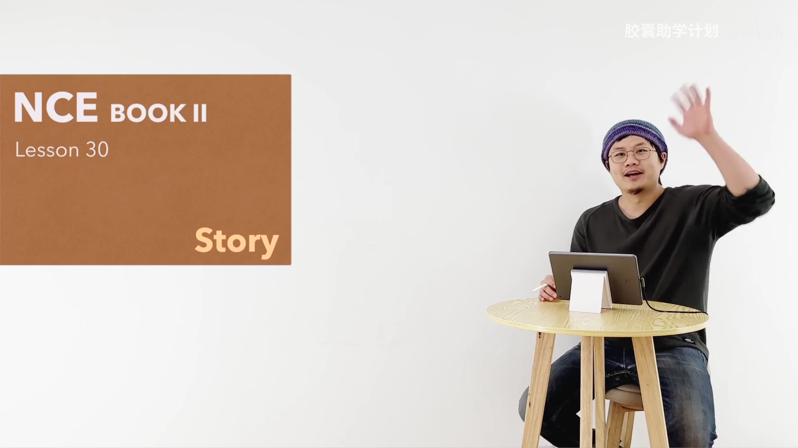

文字识别：NCE / BOOKⅡI / Lesson 30 / Story

### 画面 00:00:02

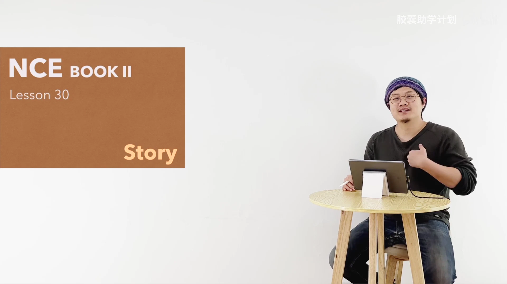

文字识别：NCE / BOOKⅡI / Lesson 30 / Story

### 画面 00:00:07

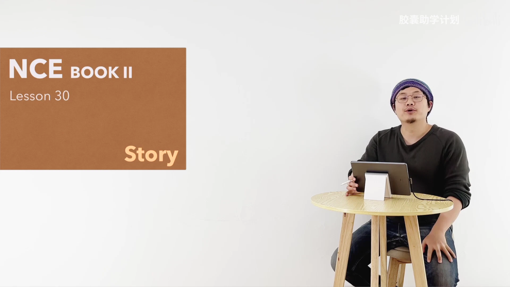

文字识别：NCE / BOOKⅡI / Lesson 30 / Story

### 画面 00:00:09

文字识别：胶囊助学计划bill / • / •

### 画面 00:00:12

文字识别：胶囊助学计划 / 胶囊助学计划

### 画面 00:00:14

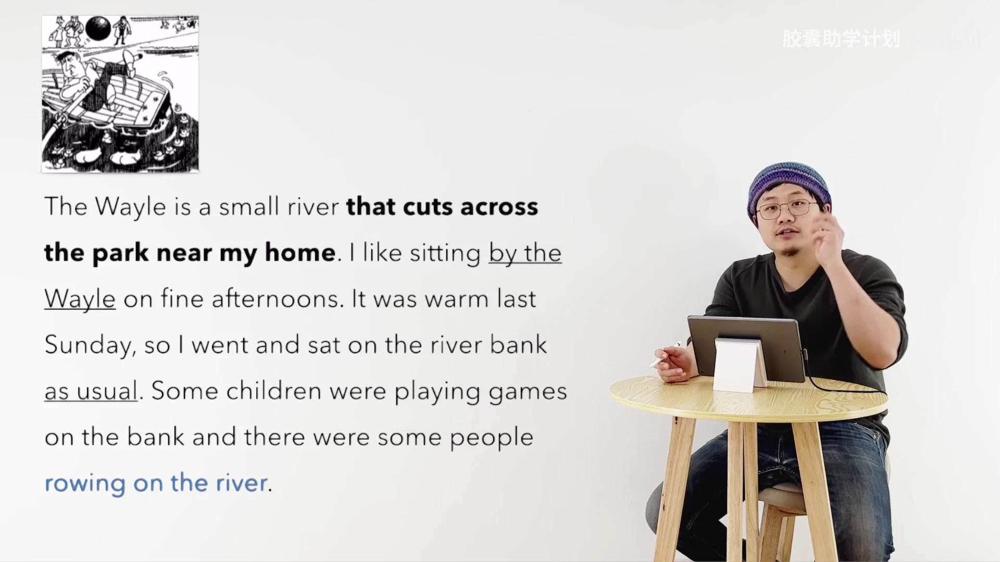

文字识别：The Wayle is a small river that cuts across / the park near my home. I like sitting by the / Wayle on fine afternoons. It was warm last / Sunday, so I went and sat on the river bank / as usual. Some children were playing games / on the bank and there were some people / rowing on the river.

### 画面 00:00:18

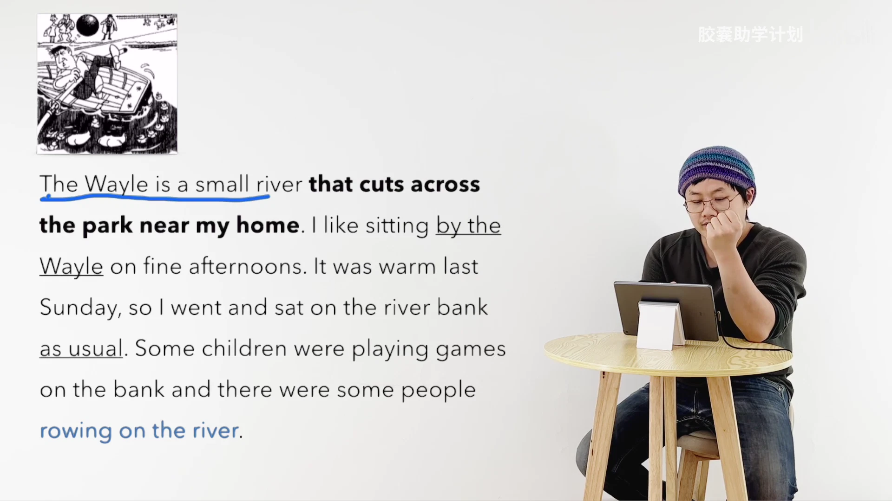

文字识别：The Wayle is a small river that cuts across / the park near my home. I like sitting by the / Wayle on fine afternoons. It was warm last / Sunday, so I went and sat on the river bank / as usual. Some children were playing games / on the bank and there were some people / rowing on the river.

### 画面 00:00:28

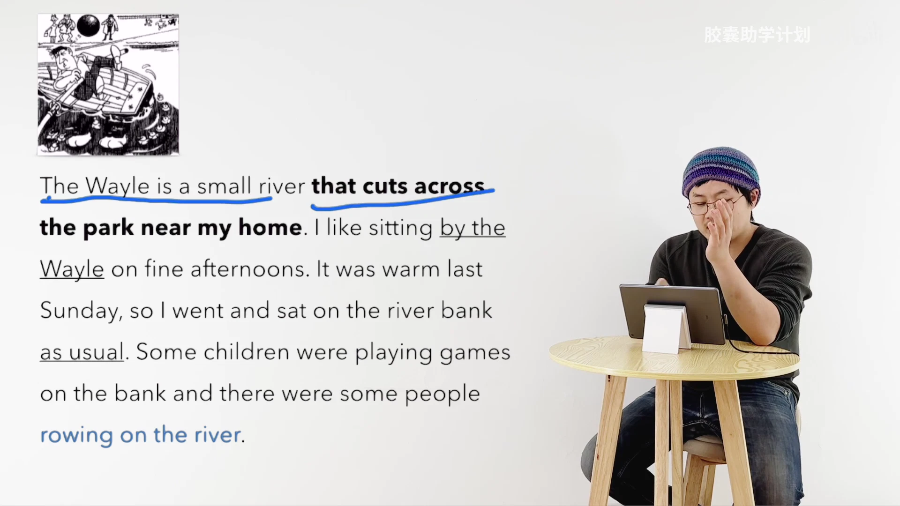

文字识别：The Wayle is a small river that cuts across / the park near my home. I like sitting by the / Wayle on fine afternoons. It was warm last / Sunday, so I went and sat on the river bank / as usual. Some children were playing games / on the bank and there were some people / rowing on the river.

## 00:00:30–00:01:00

park near my home. 后面这句话是英语从句，二十八课咱们刚学的。That替代的就是 the river. 所以我们把一句话拆成两句话。第一句话叫Will是一条小河。第二句话叫那条小河。That替代的是river，对吧？那条小河 cuts across the park. 哎，单词部分我们已经讲过了，对吧？流着穿过了这条小河。Near my啊啊，穿过了这个公园。Near my home叫在我家附近

### 画面 00:00:31

文字识别：The Wayle is a small river that cuts across / the park near my home. I like sitting by the / Wayle on fine afternoons. It was warm last / Sunday, so I went and sat on the river bank / as usual. Some children were playing games / on the bank and there were some people / rowing on the river.

### 画面 00:00:36

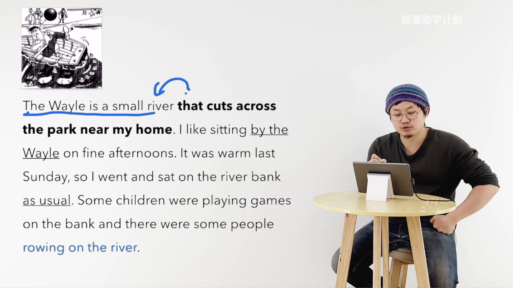

文字识别：The Wayle is a small river that cuts across / the park near my home. I like sitting by the / Wayle on fine afternoons. It was warm last / Sunday, so I went and sat on the river bank / as usual. Some children were playing games / on the bank and there were some people / rowing on the river.

### 画面 00:00:45

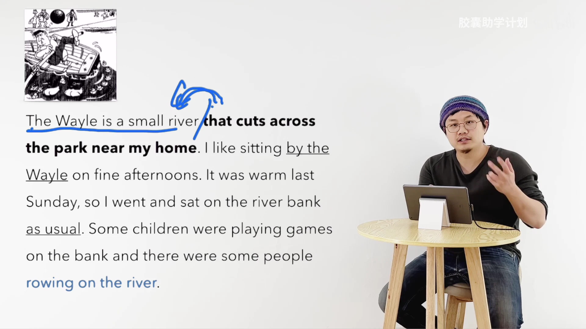

文字识别：The Wayle is a small river/that cuts across / the park near my home. I like sitting by the / Wayle on fine afternoons. It was warm last / Sunday, so I went and sat on the river bank / as usual. Some children were playing games / on the bank and there were some people / rowing on the river.

### 画面 00:00:49

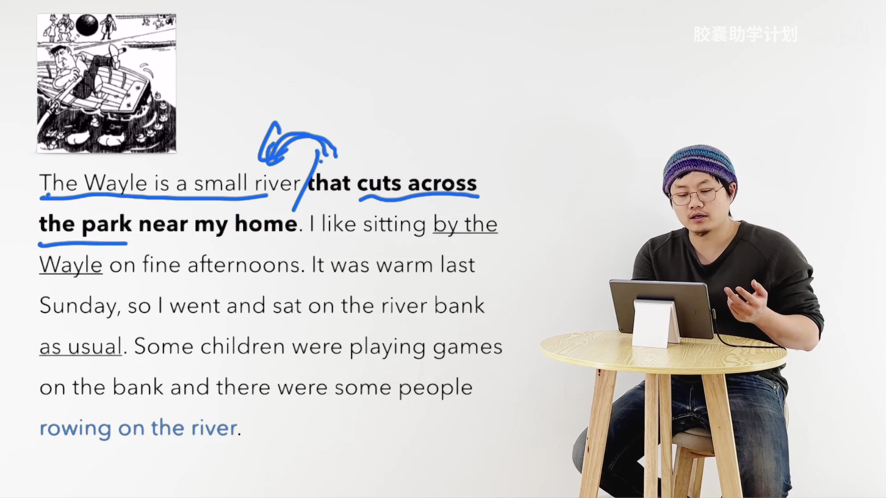

文字识别：The Wayle is a small river that cuts across / the park near my home. I like sitting by the / Wayle on fine afternoons. It was warm last / Sunday, so I went and sat on the river bank / as usual. Some children were playing games / on the bank and there were some people / rowing on the river.

## 00:01:00–00:01:30

这个公园。您可以看到，叫near my home，其实就是介词引导的短语去修饰这个park，指的是这个park在哪儿呢？哎，脑海当中你要形成这样一个画面感，就是比如说我家在这个地方，那在我家附近有一个叫park，然后这条小河流经了这个park，对吧？读完这句话，脑海当中形成这种画面感，这句话您就读懂了。玩一个，那你看是不是介词引导的短语就放在了park的后面呢？

### 画面 00:01:02

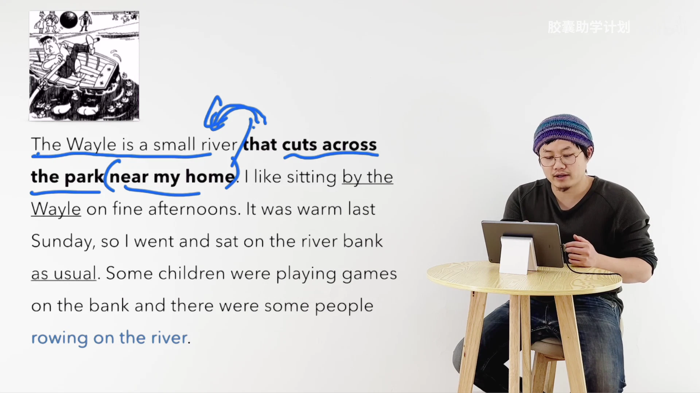

文字识别：The Wayle is a small river/that cuts across / the parknear my home. I like sitting by the / Wayle on fine afternoons. It was warm last / Sunday, so I went and sat on the river bank / as usual. Some children were playing games / on the bank and there were some people / rowing on the river.

### 画面 00:01:13

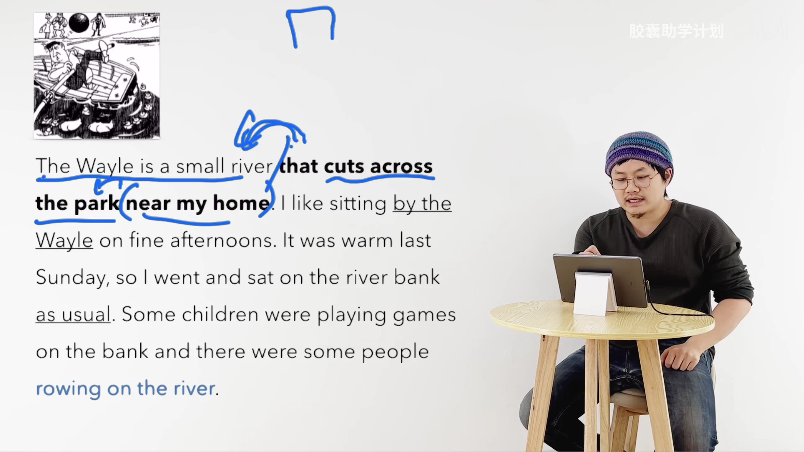

文字识别：The Wayle is a smallriver/that cuts across / the parknear my home.I like sitting by the / Wayle on fine afternoons. It was warm last / Sunday, so I went and sat on the river bank / as usual. Some children were playing games / on the bank and there were some people / rowing on the river.

### 画面 00:01:16

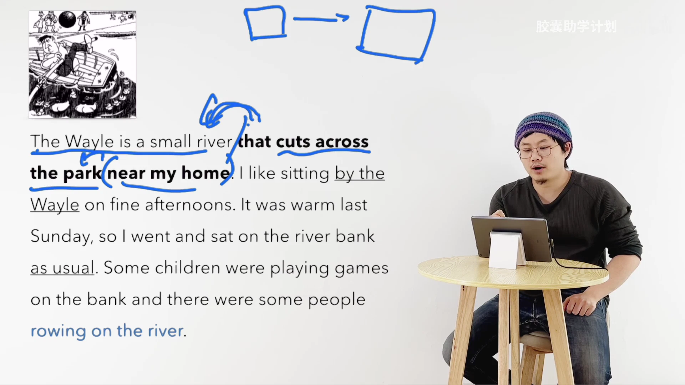

文字识别：The Wayle is a small river/that cuts across / the parknear my home I like sitting by the / Wayle on fine afternoons. It was warm last / Sunday, so I went and sat on the river bank / as usual. Some children were playing games / on the bank and there were some people / rowing on the river.

### 画面 00:01:18

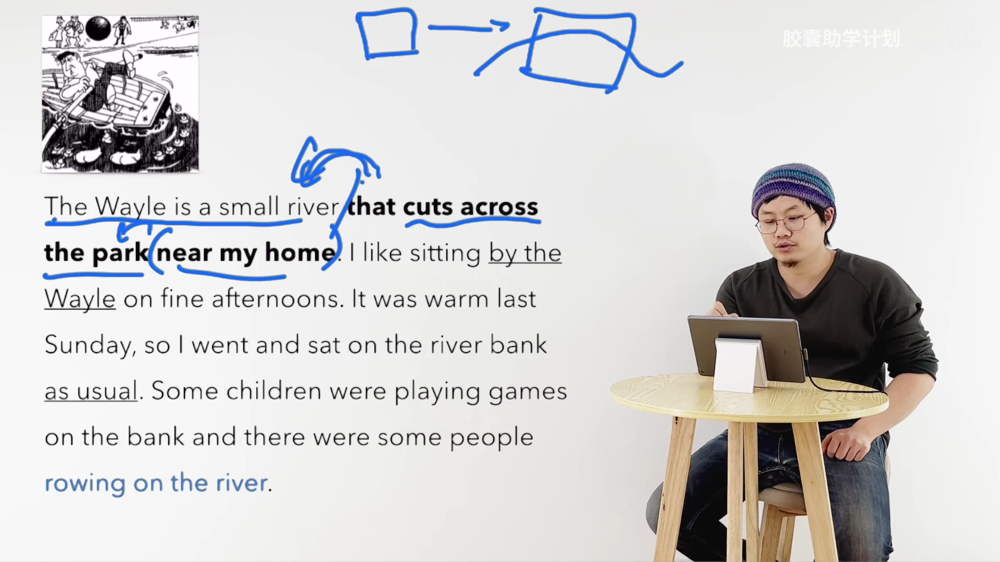

文字识别：The Wayle is a small river/that cuts across / the parknear my home I like sitting by the / Wayle on fine afternoons. It was warm last / Sunday, so I went and sat on the river bank / as usual. Some children were playing games / on the bank and there were some people / rowing on the river.

## 00:01:30–00:02:00

I like sitting. 我喜欢坐。哎，like doing something，之前咱们学过了，和 like to do something 含义一样。By the well，哎，注意这个地方的 by 是一个很有意思的小的小的 by 的用法。by 大多数情况下不会这样用，这是一个它比较边角的用法。就是当它去加上江河湖海的时候，它基本的含义就等同于 near 的感觉。OK，就 near the well，啊，喜欢在它附近去坐

### 画面 00:01:48

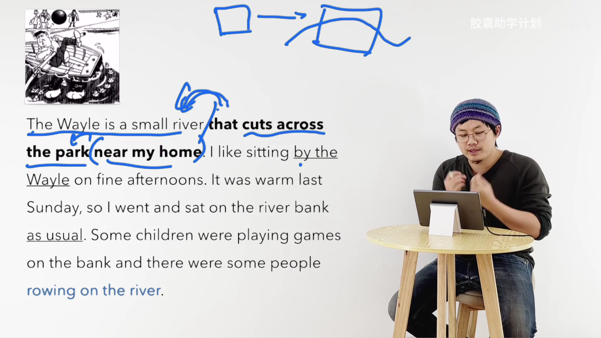

文字识别：The Wayle is a smallriver/that cuts across / the parknear my home.I like sitting by the / Wayle on fine afternoons. It was warm last / Sunday, so I went and sat on the river bank / as usual. Some children were playing games / on the bank and there were some people / rowing on the river.

## 00:02:00–00:02:30

on particularly beautiful afternoons, on particularly beautiful afternoons, on particularly beautiful afternoons, on particularly beautiful afternoons, on particularly beautiful afternoons, on particularly beautiful afternoons, on particularly beautiful

### 画面 00:02:03

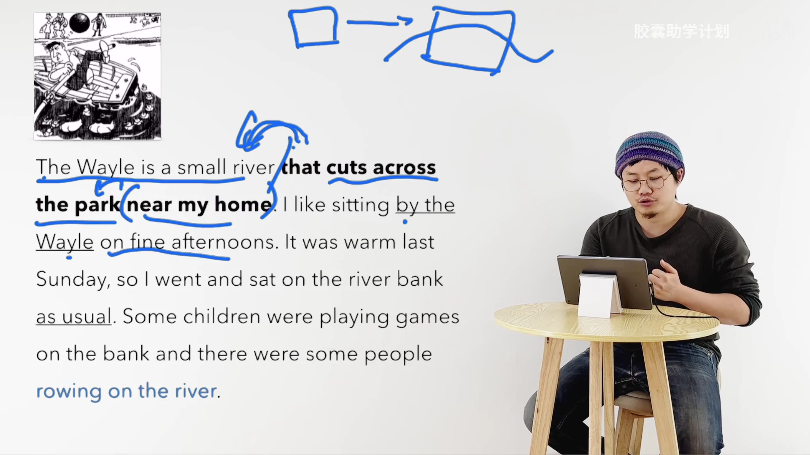

文字识别：The Wayle is a small river/that cuts across / the parknear my home.I like sitting by the / Wayle on fine afternoons. It was warm last / Sunday, so I went and sat on the river bank / as usual. Some children were playing games / on the bank and there were some people / rowing on the river.

### 画面 00:02:18

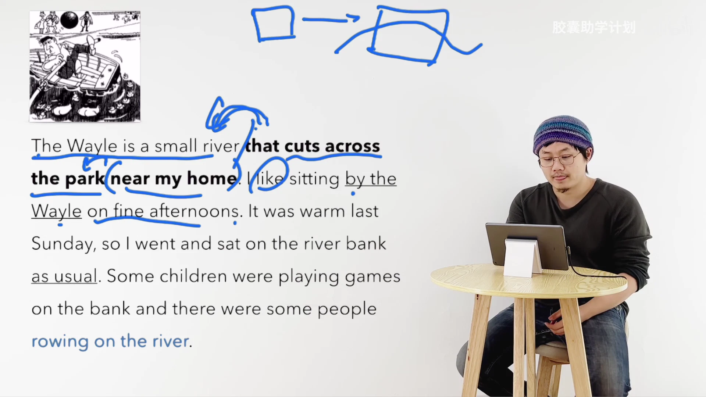

文字识别：The Wayle is a small river/that cuts across / the parknear my home. like sitting by the / Wayle on fine afternoons. It was warm last / Sunday, so I went and sat on the river bank / as usual. Some children were playing games / on the bank and there were some people / rowing on the river.

## 00:02:30–00:03:00

对吧？然后哪有一个公园儿，我们家在它的附近。然后我喜欢周呃这个下午的时候去那个地方坐一坐。然后呢，上周日特别的温暖，所以就时态立刻转换成一般过去时了。于是 so 二十五课咱们学的 I went and sat on the river bank as usual. Went and sat. 我去了，然后坐在 river bank，坐在河岸上。 As usual，之前学过叫做像通常一样，像往常

### 画面 00:02:48

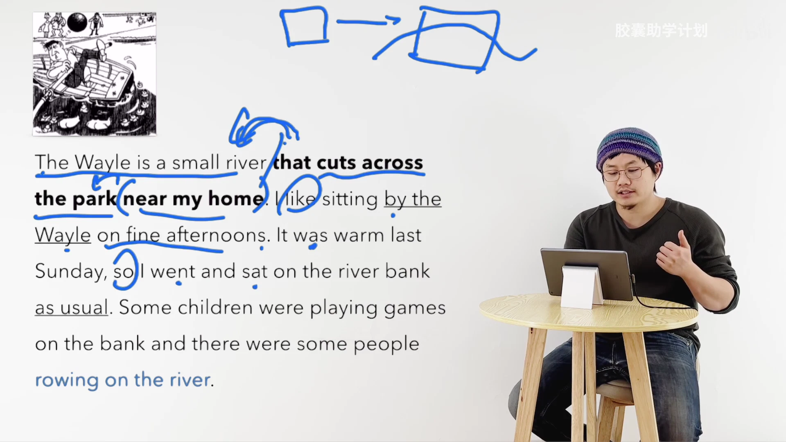

文字识别：The Wayle is a small river/that cuts across / the parknear my home Vike sitting by the / Wayle on fine afternoons. It was warm last / Sunday, so / went and sat on the river bank / as usual. Some children were playing games / on the bank and there were some people / rowing on the river.

## 00:03:00–00:03:30

一样啊，应该是咱们十三课学的是吧？各位可以去看一下，就是绿林少年那一课啊，Greenwood Boys那一课。Some children说有一些孩子were playing games on the bank，有一些孩子当时正在岸边玩耍，river bank，对吧？Bank那bank其实还有另一个很常见的意思，指的是银行，在这个地方指的是河岸啊。And there were some people，然后还有一些人，注意看后边叫做rowing

### 画面 00:03:10

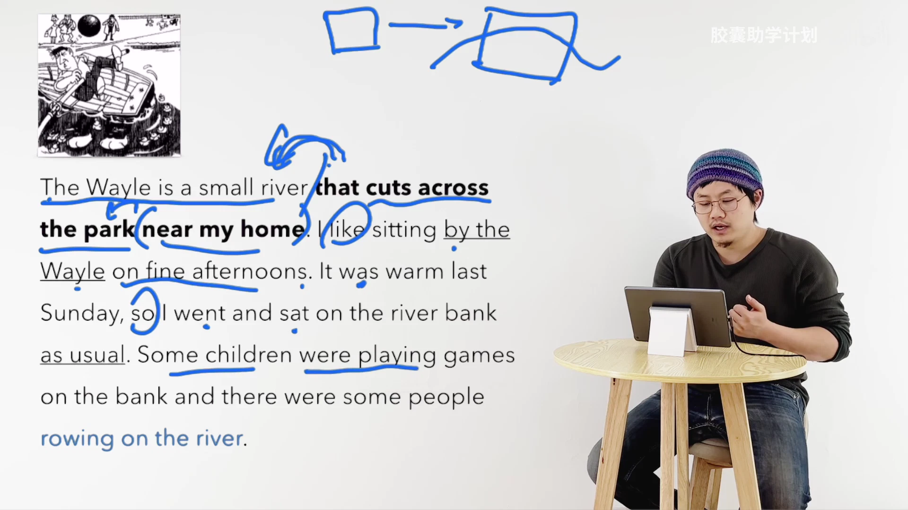

文字识别：The Wayle is a small river/that cuts across / the parknear my home. / Wikesitting by the / Wayle on fine afternoons. It was warm last / Sunday, / went and sat on the river bank / SO / as usual. Some children were playing games / on the bank and there were some people / rowing on the river.

### 画面 00:03:27

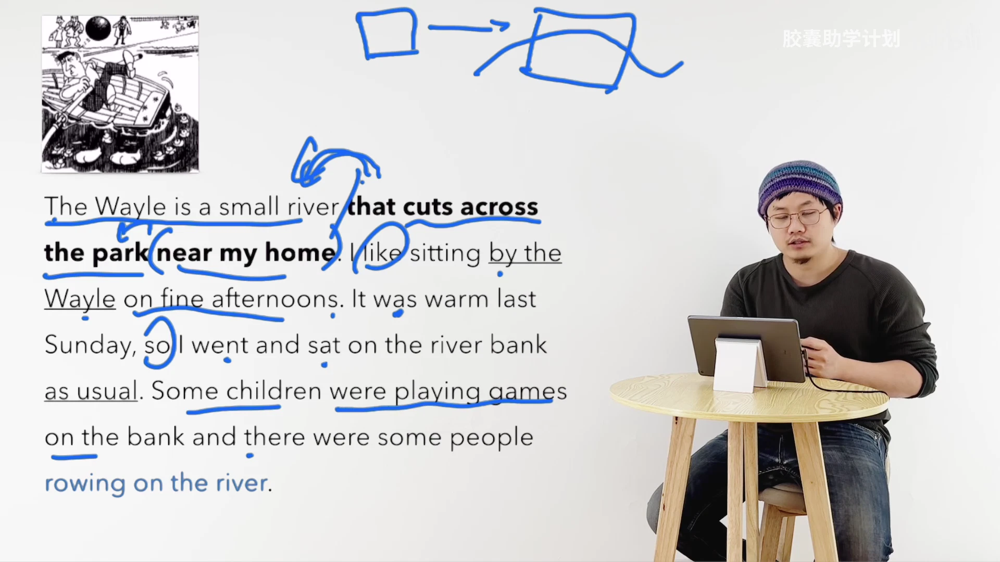

文字识别：The Wayle is a small river/that cuts across / the parknear my home. Vike sitting by the / Wayle on fine afternoons. It was warm last / Sunday, / went and sat on the river bank / SO / as usual. Some children were playing games / on the bank and there were some people / rowing on the river.

## 00:03:30–00:04:00

on the river。我们刚刚学到了 row 是动词，指的是划船的意思。那字面意思 rowing on the river 指的叫做在河上划船，很容易理解。我们如果不管语法，就看就看每个单词，叫有一些人在河上划船，哎，非常舒服的，我就能翻译出来，对吧？但我们要知其然知其所以然，我们要明白这个 rowing on the river 其实是我们刚刚上一个视频当

### 画面 00:03:57

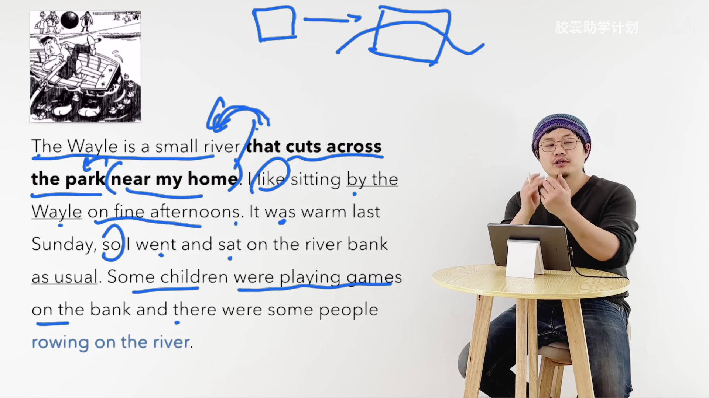

文字识别：The Wayle is a small river/that cuts across / the parknear my home. Vike sitting by the / Wayle on fine afternoons. It was warm last / Sunday, / went and sat on the river bank / $O / as usual. Some children were playing qames / on the bank and there were some people / rowing on the river.

## 00:04:00–00:04:30

中讲过的，叫做由 doing 现在分词引导的短语去做定语的时候，后置放在 people 这个名词的后面，于是翻译成了叫做有一些在河上划船的人，看见了吧？哎，其实类似于起到了一个形容词的作用，并且是后置的。Suddenly，突然间，One of the children kicked a ball very

### 画面 00:04:23

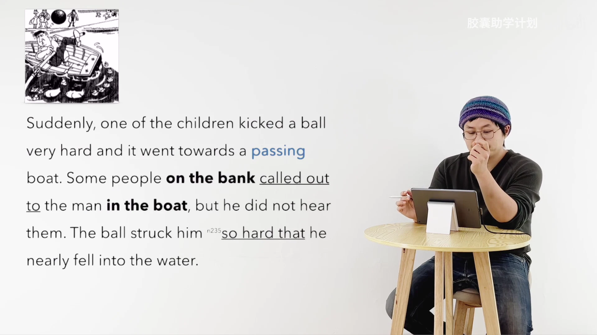

文字识别：Suddenly, one of the children kicked a ball / very hard and it went towards a passing / boat. Some people on the bank called out / to the man in the boat, but he did not hear / them. The ball struck him n235so hard that he / nearly fell into the water.

## 00:04:30–00:05:00

原文我们已经在单词部分讲过了啊。有这么一个孩子踢这个球，非常的使劲儿啊，很大力的踢了一下这个球。And然后呢，it went. It指的肯定是这个球嘛。Went叫做走 towards a passing boat. 好，先不管passing went towards a boat，叫做这个球船在这里，这个球冲着这个船就过来了，对吧？那passing boat passing

### 画面 00:04:52

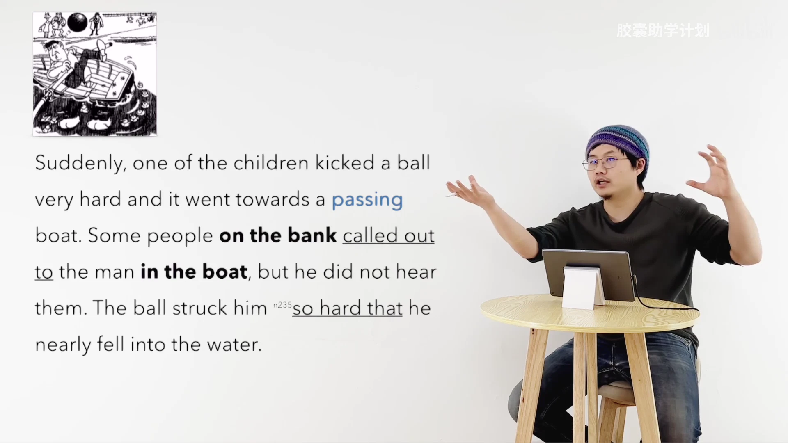

文字识别：Suddenly, one of the children kicked a ball / very hard and it went towards a passing / boat. Some people on the bank called out / to the man in the boat, but he did not hear / them. The ball struck him n23so hard that he / nearly fell into the water.

### 画面 00:04:57

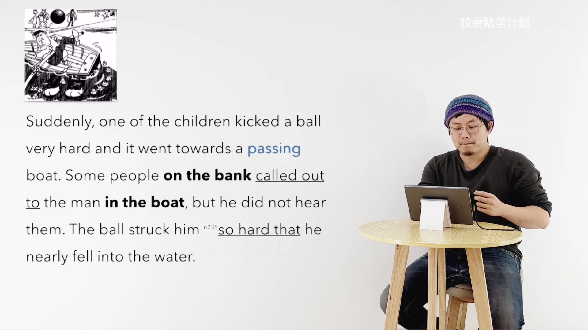

文字识别：Suddenly, one of the children kicked a ball / very hard and it went towards a passing / boat. Some people on the bank called out / to the man in the boat, but he did not hear / them. The ball struck him n23so hard that he / nearly fell into the water.

## 00:05:00–00:05:30

是什么意思？Pass叫做过，那passing就是我们刚刚学过的，叫现在分词做定语，放在了名词的前面，看见了吧？A passing boat，对吧？叫做一个正在经过的船，主动进行翻译成OK，并且是名词啊，并且是单词放在了boat这个单词的前面。OK，想一下定语的位置啊。Some people on the bank called out to the man in the boat.

### 画面 00:05:27

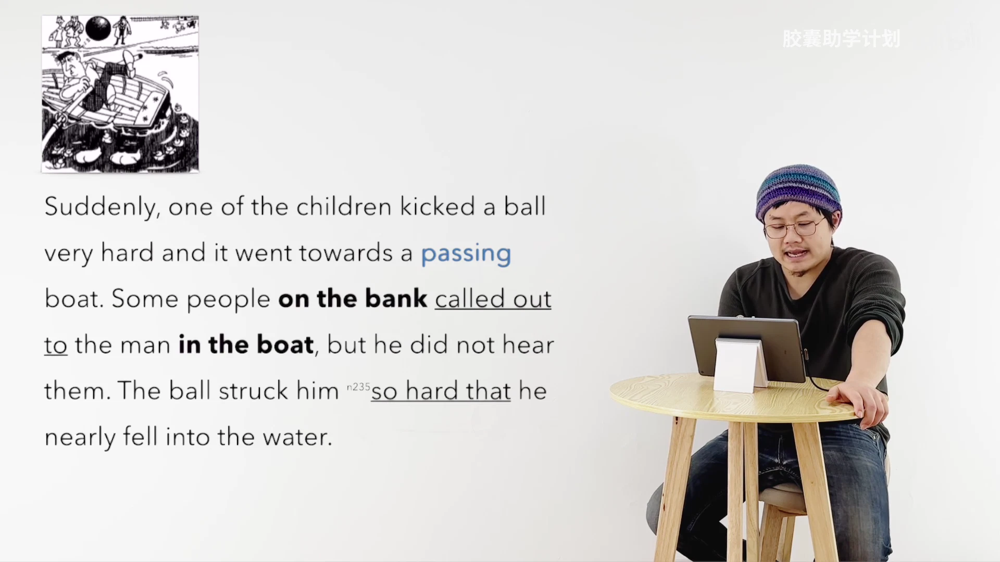

文字识别：Suddenly, one of the children kicked a ball / very hard and it went towards a passing / boat. Some people on the bank called out / to the man in the boat, but he did not hear / them. The ball struck him n235so hard that he / nearly fell into the water.

## 00:05:30–00:06:00

好，我们先看 some people on the bank. On the bank叫做在河岸上，some people叫一些人。这句话翻译成汉语叫在河岸上的一些人。汉语是这个语序，英语是 some people on the bank. on是介词，由介词引导的短语 on the bank放在了people的后面去做了一个后置，对吧？所以跟汉语正好是反着的。岸上的一些人 called out to the

### 画面 00:05:57

文字识别：Suddenly, one of the children kicked a ball / very hard and it went towards a passing / boat. Some people on the bank called out / to the man in the boat, but he did not hear / them. The ball struck him n23so hard that he / nearly fell into the water.

## 00:06:00–00:06:30

man. So this place has a habit usage, called out to somebody. Called out to somebody,叫冲某人大声喊叫，类似于shout这个单词的意思，对吧？冲某人大声的喊叫，冲这个男人，这个男人什么样的男人呢？In the boat,你不是冲随便一个男人，是in the boat的这个男人，对不对？哎，in介词引导的短语in the boat去修饰the man，放在了他的后面。各位看明白了哈？

### 画面 00:06:27

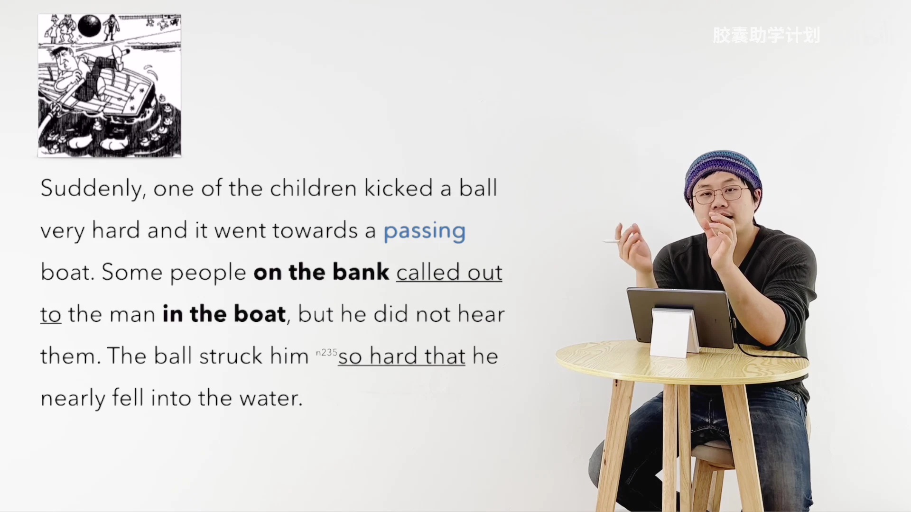

文字识别：Suddenly, one of the children kicked a ball / very hard and it went towards a passing / boat. Some people on the bank called out / to the man in the boat, but he did not hear / them. The ball struck him n235so hard that he / nearly fell into the water.

## 00:06:30–00:07:00

OK. But但是 he did not hear the. 但是他没听见. The ball struck him. 说这个球啊 struck him. Struck之前我们学过，在第九课啊 strike the clock in twenty minutes time. 叫做打击撞击，对吧？那这个球撞了。你想一下，这个球很努很用力的踢了过来，然后飞着就冲这个船上的男人过来了，就很用力的撞了他一下，struck him就撞到了他. So

### 画面 00:06:57

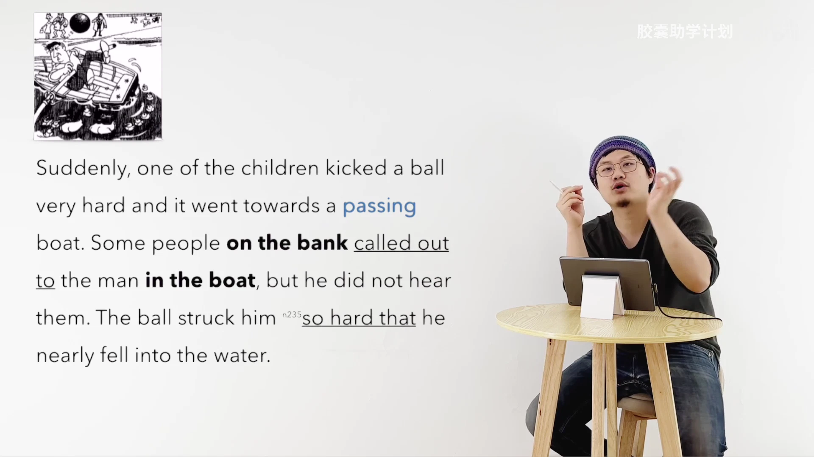

文字识别：Suddenly, one of the children kicked a ball / very hard and it went towards a passing / boat. Some people on the bank called out / to the man in the boat, but he did not hear / them. The ball struck him n235so hard that he / nearly fell into the water.

## 00:07:00–00:07:30

hard that这是我们三十五课要学的语法。今天我只告诉各位什么意思，先不讲这个语法。三十五课咱们一起去讲such that和so that啊，是如此的用力撞他，撞的是如此的狠啊，以至于什么呢？哎，he nearly fell into the water.他几乎就差点掉进水里面去了，对吧？撞他撞的太狠了，差点掉进湖里面去啊，掉进这个河里面

### 画面 00:07:27

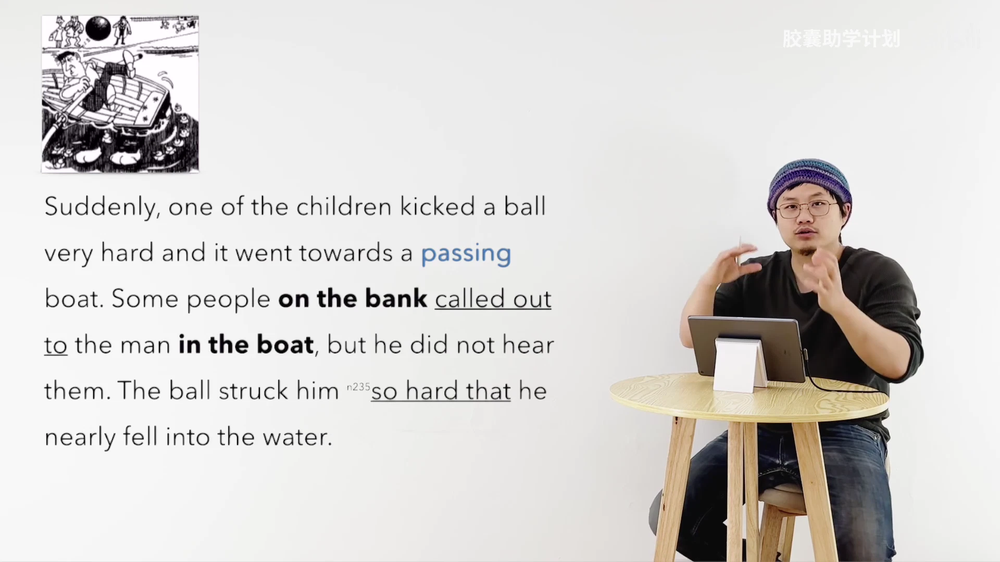

文字识别：Suddenly, one of the children kicked a ball / very hard and it went towards a passing / boat. Some people on the bank called out / to the man in the boat, but he did not hear / them. The ball struck him n235so hard that he / nearly fell into the water.

## 00:07:30–00:08:00

去。Okay, continue. I turned to look at the children. Turn to, I turned around.第一节课咱们就学了turn to，转身啊，转头去看这些孩子们。But there weren't any inside.但是没有，there weren't any叫没有任何。其实这地方省略了一个单词叫做children，对吧？Inside叫在视野范围之内了。They had all ran away.他们都已经ran away了，对

### 画面 00:07:30

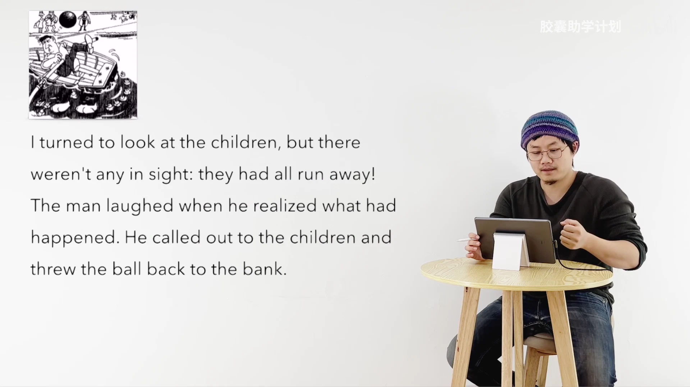

文字识别：I turned to look at the children, but there / weren't any in sight: they had all run away! / The man laughed when he realized what had / happened. He called out to the children and / threw the ball back to the bank.

## 00:08:00–00:08:30

吧？A be away,我们之前学过啊，叫做离开。Run away就是跑开，他们都已经跑开了。The man laughed,啊，这个男的笑了。When he realized what had happened,当他当他意识到刚刚发生了什么。好，realize what had happened实际上是一个宾语从句，这个我们应该是在三十九课会去讲到啊，不要着急啊。He counted

### 画面 00:08:00

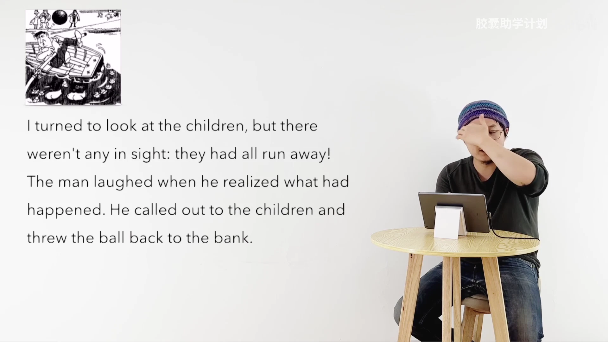

文字识别：I turned to look at the children, but there / weren't any in sight: they had all run away! / The man laughed when he realized what had / happened. He called out to the children and / threw the ball back to the bank.

## 00:08:30–00:09:00

out ah.当然我们新概念一册一百三十九课也学过是吧？如果您着急，可以先翻看一下那个视频。He called out to the children.刚刚说过叫冲谁大喊，冲着孩子们大喊。And threw the ball back to the bank.然后扔这个球 back to the bank.看我们先不管 back through the ball to the bank，就扔这个球扔到了河岸上，对吧？那 back to the bank back 就是返回到，他是从河岸过来的，再给他返回

### 画面 00:08:30

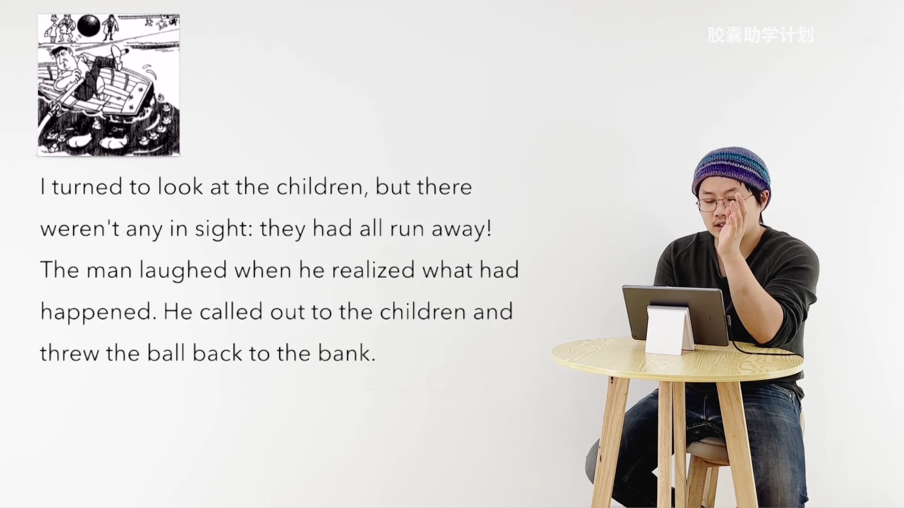

文字识别：I turned to look at the children, but there / weren't any in sight: they had all run away! / The man laughed when he realized what had / happened. He called out to the children and / threw the ball back to the bank.

### 画面 00:08:51

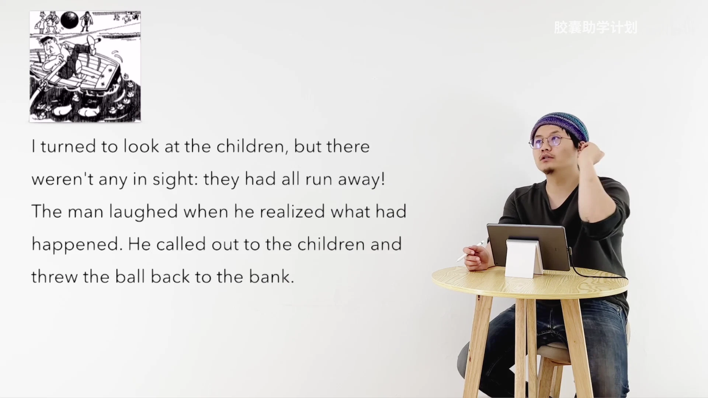

文字识别：I turned to look at the children, but there / weren't any in sight: they had all run away! / The man laughed when he realized what had / happened. He called out to the children and / threw the ball back to the bank.

## 00:09:00–00:09:30

扔回去，对吧？叫做 back， OK。那本课呢，就这么一个习惯用法，叫 call out to somebody，也并不难。我们直接造一个句子，比如说 he called out to that girl，他对那个姑娘大声喊喊。什么样的姑 girl 呢？ Who sat on the river bank？我加了一个小的定语从句，叫做坐在河岸上的那个姑娘。您看啊，其实对于各位来说，在这地方给各位一个小的家庭作业

### 画面 00:09:03

文字识别：习惯用法造句 / call out to sb.

### 画面 00:09:05

文字识别：习惯用法造句 / call out to sb.

### 画面 00:09:07

文字识别：习惯用法造句 / call out to sb.

### 画面 00:09:09

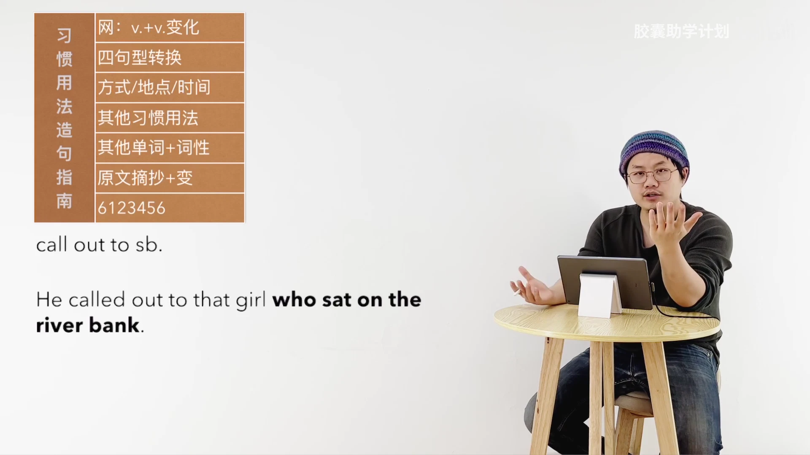

文字识别：网：v.+v.变化 / 习惯用法造句指南 / 四句型转换 / 方式/地点/时间 / 其他习惯用法 / 其他单词+词性 / 原文摘抄+变 / 6123456 / call out to sb. / He called out to that girl who sat on the / river bank.

### 画面 00:09:11

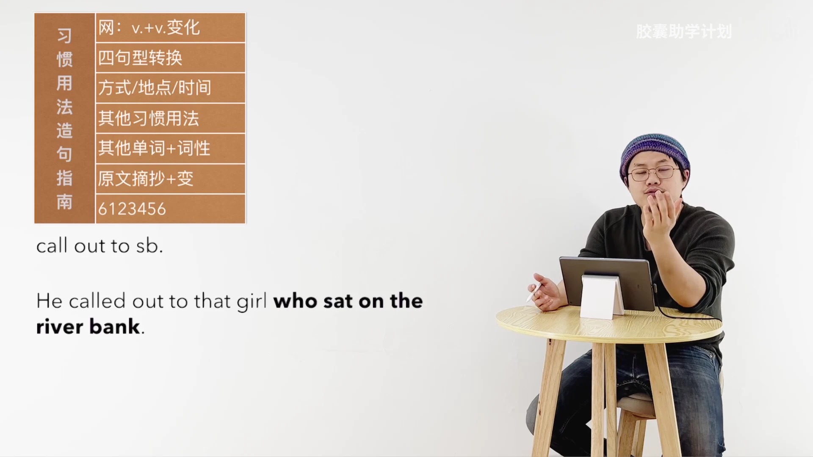

文字识别：网：v.+v.变化 / 习惯用法造句指南 / 四句型转换 / 方式/地点/时间 / 其他习惯用法 / 其他单词+词性 / 原文摘抄+变 / 6123456 / call out to sb. / He called out to that girl who sat on the / river bank.

### 画面 00:09:14

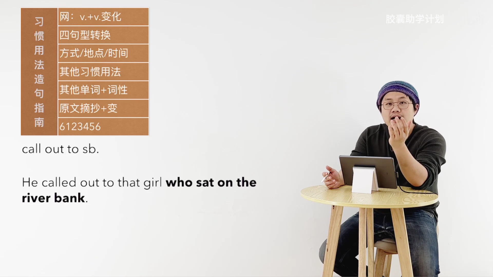

文字识别：网：v.+v.变化 / 习惯用法造句指南 / 四句型转换 / 方式/地点/时间 / 其他习惯用法 / 其他单词+词性 / 原文摘抄+变 / 6123456 / call out to sb. / He called out to that girl who sat on the / river bank.

### 画面 00:09:16

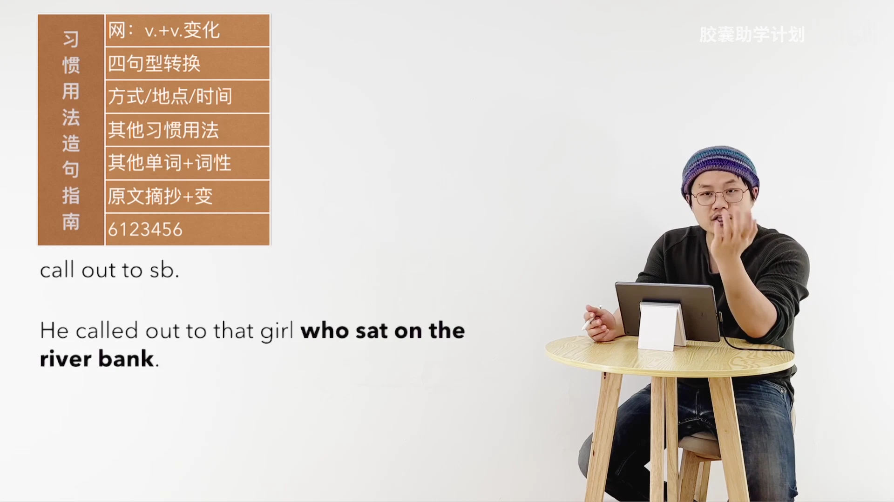

文字识别：网：v.+v.变化 / 习惯用法造句指南 / 四句型转换 / 方式/地点/时间 / 其他习惯用法 / 其他单词+词性 / 原文摘抄+变 / 6123456 / call out to sb. / He called out to that girl who sat on the / river bank.

### 画面 00:09:19

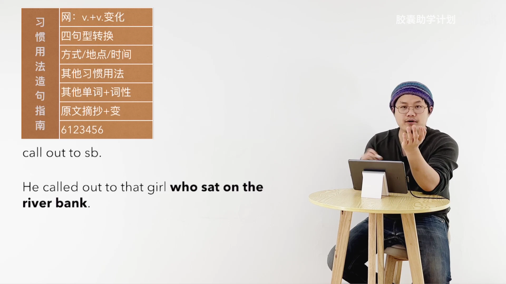

文字识别：网：v.+v.变化 / 习惯用法造句指南 / 四句型转换 / 方式/地点/时间 / 其他习惯用法 / 其他单词+词性 / 原文摘抄+变 / 6123456 / call out to sb. / He called out to that girl who sat on the / river bank.

### 画面 00:09:21

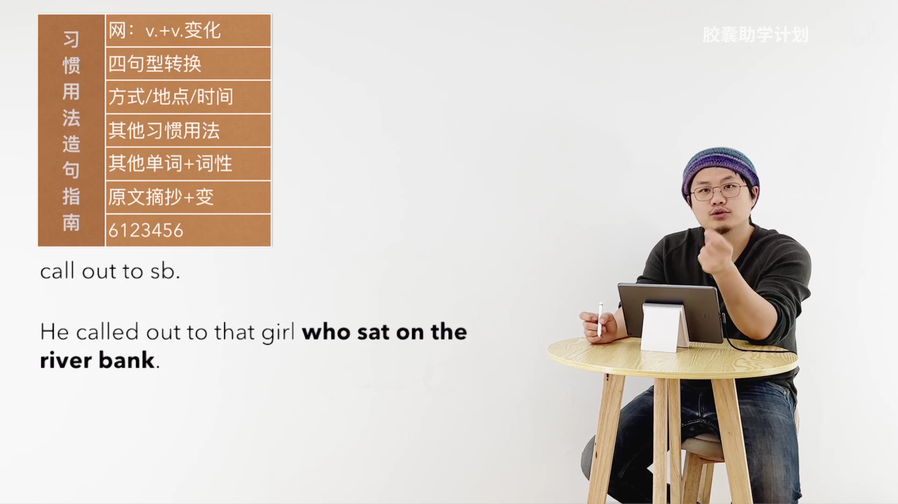

文字识别：网：v.+v.变化 / 习惯用法造句指南 / 四句型转换 / 方式/地点/时间 / 其他习惯用法 / 其他单词+词性 / 原文摘抄+变 / 6123456 / call out to sb. / He called out to that girl who sat on the / river bank.

### 画面 00:09:24

文字识别：网：v.+v.变化 / 习惯用法造句指南 / 四句型转换 / 方式/地点/时间 / 其他习惯用法 / 其他单词+词性 / 原文摘抄+变 / 6123456 / call out to sb. / He called out to that girl who sat on the / river bank.

### 画面 00:09:26

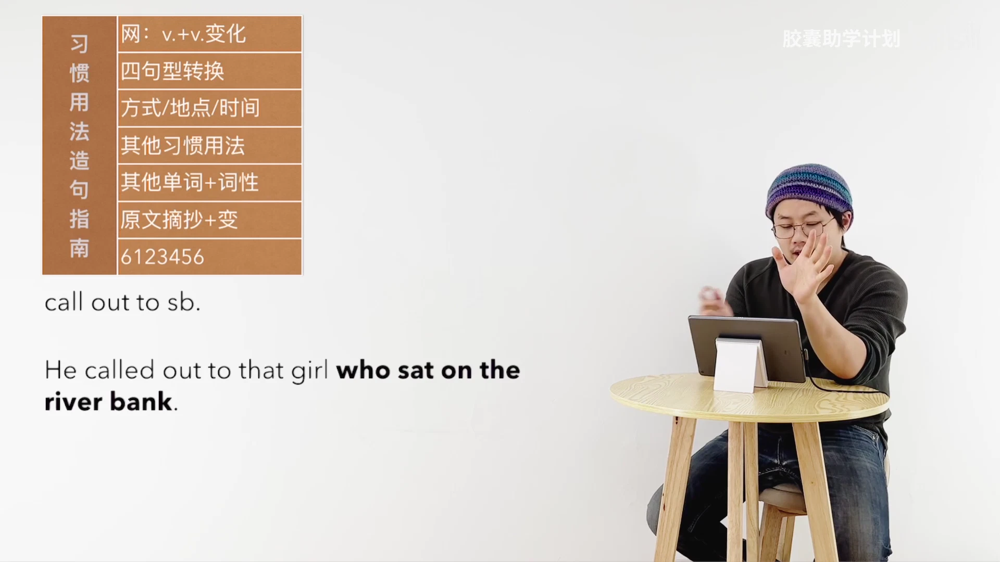

文字识别：网：v.+v.变化 / 习惯用法造句指南 / 四句型转换 / 方式/地点/时间 / 其他习惯用法 / 其他单词+词性 / 原文摘抄+变 / 6123456 / call out to sb. / He called out to that girl who sat on the / river bank.

## 00:09:30–00:10:00

啊，习惯用法造句的时候，您不用变前面这句话。He called out to that girl，您甭变了，您就变 who 后边这个定语从句，就他对不同的姑娘大声吼叫，对吧？有的姑娘是正在那儿听音乐呢，有的姑娘是正坐在河岸上了，有的姑娘是正在干什么呢？您就变定语从句，正好我们复习一下定语从句。OK，好，那当然了，您也可以把这句话变成一般疑问句。您想一下变一般疑问句是用

### 画面 00:09:30

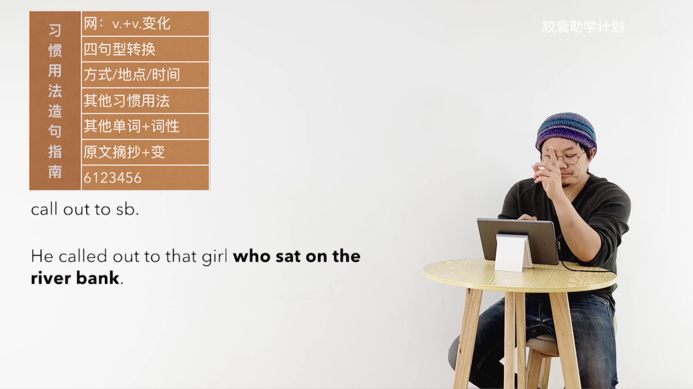

文字识别：网：v.+v.变化 / 习惯用法造句指南 / 四句型转换 / 方式/地点/时间 / 其他习惯用法 / 其他单词+词性 / 原文摘抄+变 / 6123456 / call out to sb. / He called out to that girl who sat on the / river bank.

### 画面 00:09:35

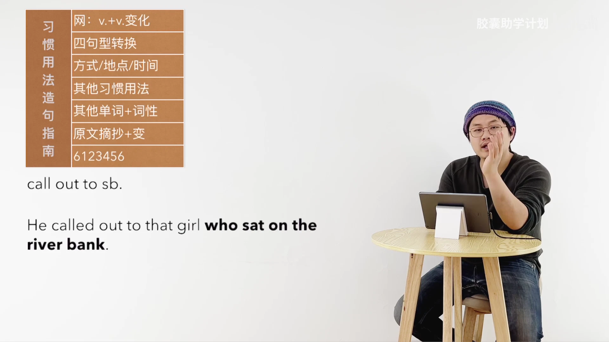

文字识别：网：v.+v.变化 / 习惯用法造句指南 / 四句型转换 / 方式/地点/时间 / 其他习惯用法 / 其他单词+词性 / 原文摘抄+变 / 6123456 / call out to sb. / He called out to that girl who sat on the / river bank.

### 画面 00:09:40

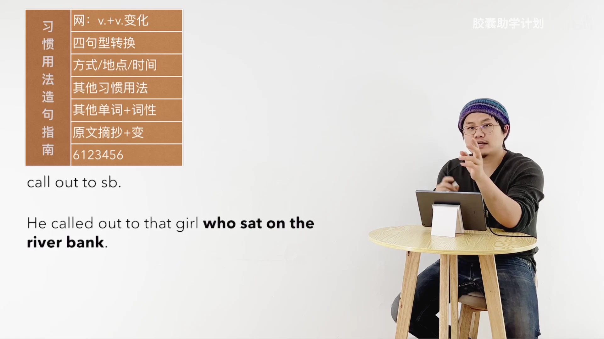

文字识别：网：v.+v.变化 / 习惯用法造句指南 / 四句型转换 / 方式/地点/时间 / 其他习惯用法 / 其他单词+词性 / 原文摘抄+变 / 6123456 / call out to sb. / He called out to that girl who sat on the / river bank.

### 画面 00:09:45

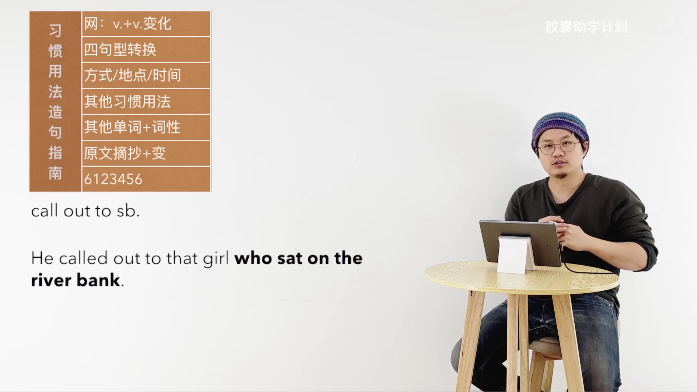

文字识别：网：v.+v.变化 / 习惯用法造句指南 / 四句型转换 / 方式/地点/时间 / 其他习惯用法 / 其他单词+词性 / 原文摘抄+变 / 6123456 / call out to sb. / He called out to that girl who sat on the / river bank.

### 画面 00:09:50

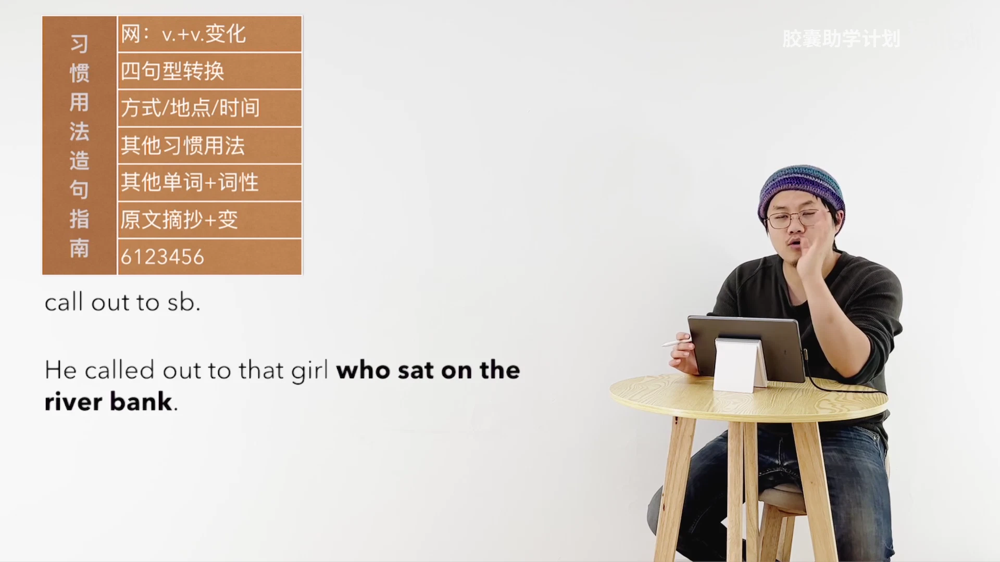

文字识别：网：v.+v.变化 / 习惯用法造句指南 / 四句型转换 / 方式/地点/时间 / 其他习惯用法 / 其他单词+词性 / 原文摘抄+变 / 6123456 / call out to sb. / He called out to that girl who sat on the / river bank.

### 画面 00:09:53

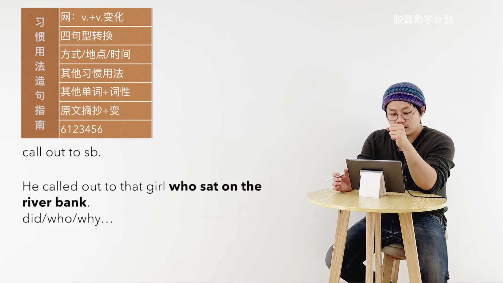

文字识别：网：v.+v.变化 / 习惯用法造句指南 / 四句型转换 / 方式/地点/时间 / 其他习惯用法 / 其他单词+词性 / 原文摘抄+变 / 6123456 / call out to sb. / He called out to that girl who sat on the / river bank. / did/who/why...

### 画面 00:09:55

文字识别：网：v.+v.变化 / 习惯用法造句指南 / 四句型转换 / 方式/地点/时间 / 其他习惯用法 / 其他单词+词性 / 原文摘抄+变 / 6123456 / call out to sb. / He called out to that girl who sat on the / river bank. / did/who/why...

## 00:10:00–00:10:30

谁去变，对吧？我其实答案已经写在这里了，对吧？但你想一下，是由它决定的呢，还是后边这个 set 决定的呢？ OK，好，然后各种特殊疑问句，这对于各位来说就够了啊。 OK，那 recap 本课除了文章熟读以外， call out to somebody 这个习惯用法，各位要通过单词造句的形式把它拿住。好，我们看一下家庭作业，习惯用法造句，然后文章跟读至熟读成诵。好，以上呢就是本

### 画面 00:10:00

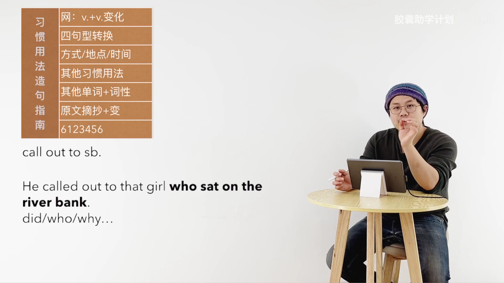

文字识别：网：v.+v.变化 / 习惯用法造句指南 / 四句型转换 / 方式/地点/时间 / 其他习惯用法 / 其他单词+词性 / 原文摘抄+变 / 6123456 / call out to sb. / He called out to that girl who sat on the / river bank. / did/who/why...

### 画面 00:10:05

文字识别：网：v.+v.变化 / 习惯用法造句指南 / 四句型转换 / 方式/地点/时间 / 其他习惯用法 / 其他单词+词性 / 原文摘抄+变 / 6123456 / call out to sb. / He called out to that girl who at on the / river bank. / did/who/why...

### 画面 00:10:09

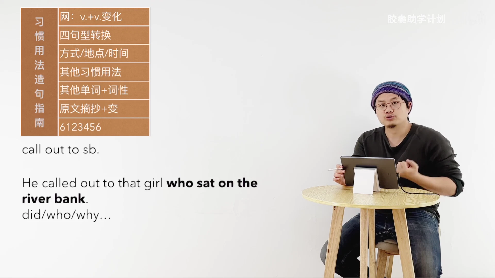

文字识别：网：v.+v.变化 / 习惯用法造句指南 / 四句型转换 / 方式/地点/时间 / 其他习惯用法 / 其他单词+词性 / 原文摘抄+变 / 6123456 / call out to sb. / He called out to that girl who sat on the / river bank. / did/who/why...

### 画面 00:10:11

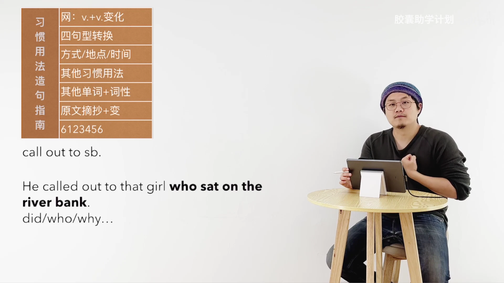

文字识别：网：v.+v.变化 / 习惯用法造句指南 / 四句型转换 / 方式/地点/时间 / 其他习惯用法 / 其他单词+词性 / 原文摘抄+变 / 6123456 / call out to sb. / He called out to that girl who sat on the / river bank. / did/who/why...

### 画面 00:10:13

文字识别：Recap / Expression / call out to sb.

### 画面 00:10:15

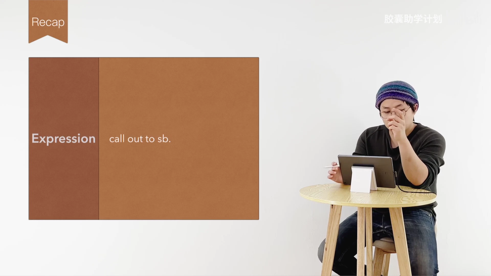

文字识别：Recap / Expression / call out to sb.

### 画面 00:10:17

文字识别：Recap / Expression / call out to sb.

### 画面 00:10:20

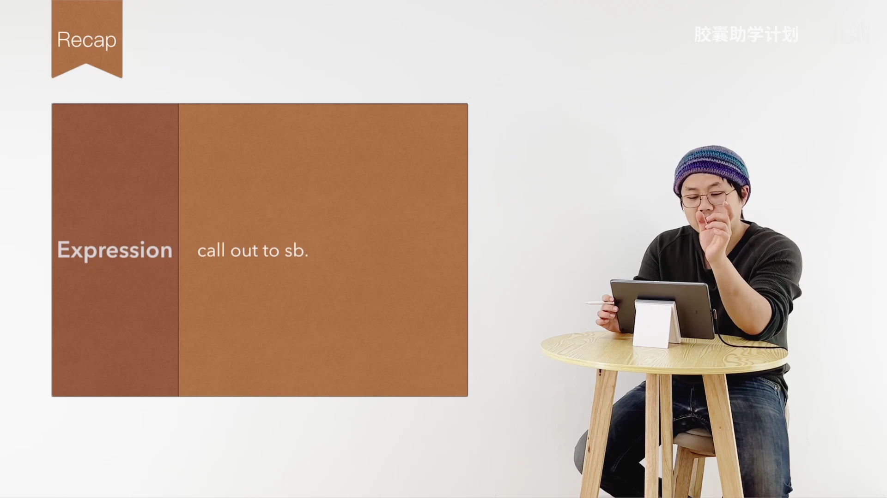

文字识别：Recap / Expression / call out to sb.

### 画面 00:10:22

文字识别：1. / 习惯用法造句/对话 / 【习惯用法造句指南】 / 每个5句

### 画面 00:10:24

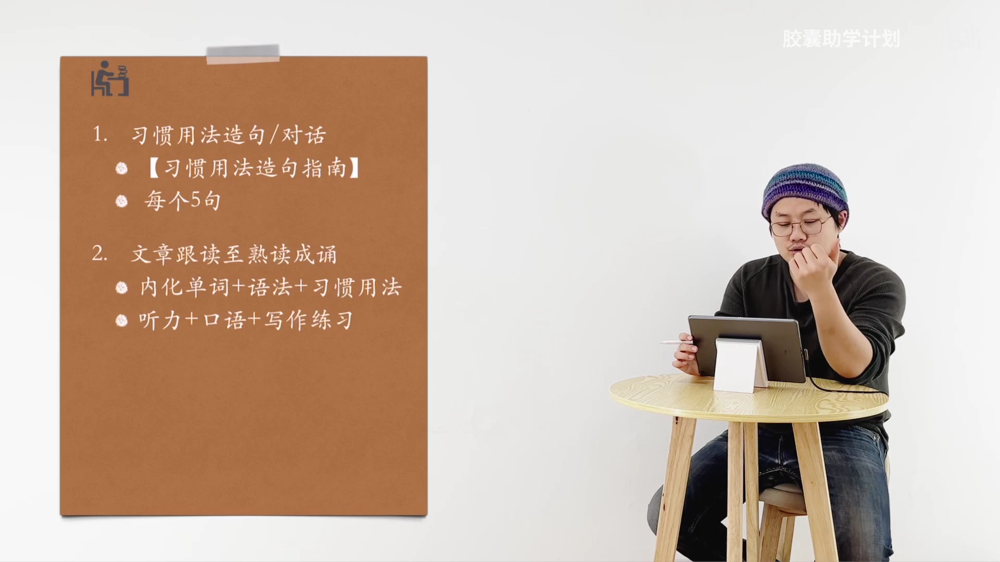

文字识别：1. / 习惯用法造句/对话 / 【习惯用法造句指南】 / 每个5句 / 文章跟读至熟读成诵 / 内化单词+语法+习惯用法 / 听力+口语+写作练习

### 画面 00:10:26

文字识别：1. / 习惯用法造句/对话 / 【习惯用法造句指南】 / 每个5句 / 文章跟读至熟读成诵 / 内化单词+语法+习惯用法 / 听力+口语+写作练习

### 画面 00:10:28

文字识别：👍

## 00:10:30–00:10:53

期视频的全部内容了。如果各位喜欢我们的课程呢，欢迎各位关注、订阅、一键三连，分享给那些需要的朋友，来帮助我们快速成长。See you next time.

### 画面 00:10:40

### 画面 00:10:42

文字识别：CAPSULEACADEMY / 胶囊助学计划 / 小红书 / Lecturer / Leo / OE

### 画面 00:10:45

文字识别：CAPSULEACADEMY / 胶囊助学计划 / 『 / 小红书 / OE

### 画面 00:10:48

文字识别：CAPSULEACADEMY / 胶囊助学计划 / 小红书 / Creator / Leo & Berlin

### 画面 00:10:50

文字识别：bilbili / 胶囊助学计划 / CAPSULEACADEMY / 胶囊助学计划 / 小红书 / OE

### 画面 00:10:52

文字识别：bilibili / 胶囊助学计划

