# L030 听说读写复述练习

快速机器解析：语音为单模型转写，未进行独立交叉校对或人工复核；画面每秒采样并按变化选帧，短时文字和标记可能遗漏。截图时间约有 1 秒误差。图片有损压缩；遇到疑点请按时间查看 Google Drive 原视频。

## 00:00:00–00:00:30

Hello everyone, welcome to Capsule Academy. This is Leo. Today we're going to learn new concept English Book Two Lesson Thirty Practices.那老习惯进行如下练习，唯一的前提就是您文章一定要跟读至熟读成诵，否则请勿开始。Hope you can enjoy it.好，那我们先来看第一道题，Comprehension。它的目的就是让各位听懂一般疑问句和特殊疑问句。我问您答，

### 画面 00:00:00

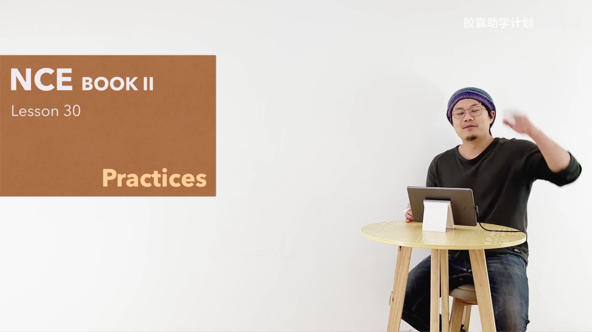

文字识别：NCE / BOOKI"I / Lesson 30 / Practices

### 画面 00:00:02

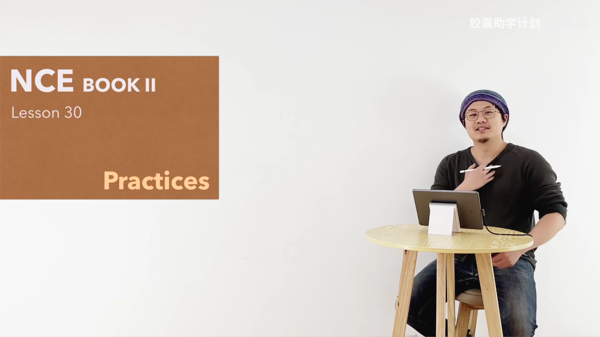

文字识别：NCE / BOOKI"I / Lesson 30 / Practices

### 画面 00:00:05

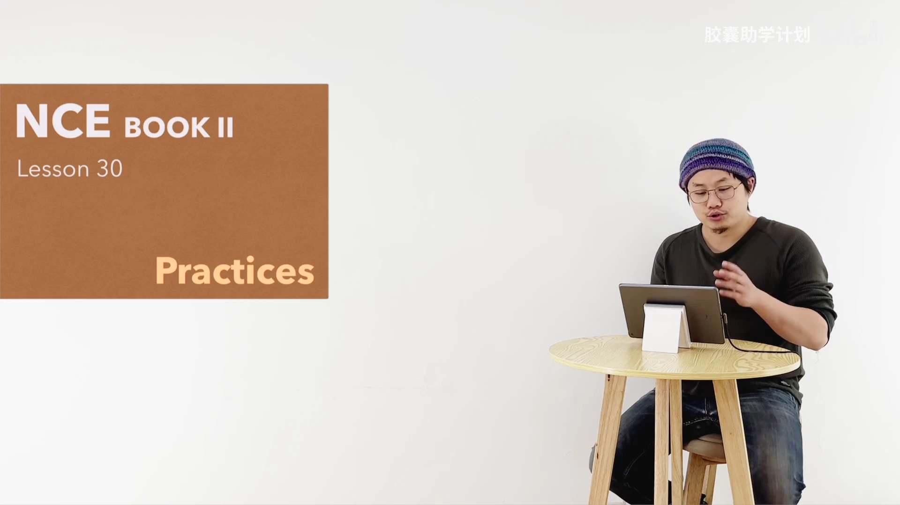

文字识别：NCE / BOOKII / Lesson 30 / Practices

### 画面 00:00:08

文字识别：进行如下练习唯一前提 / 文章跟读至熟读成诵 / 否则请勿开始

### 画面 00:00:17

文字识别：胶囊助学计划 bilbl

### 画面 00:00:21

文字识别：胶囊助学计划

### 画面 00:00:23

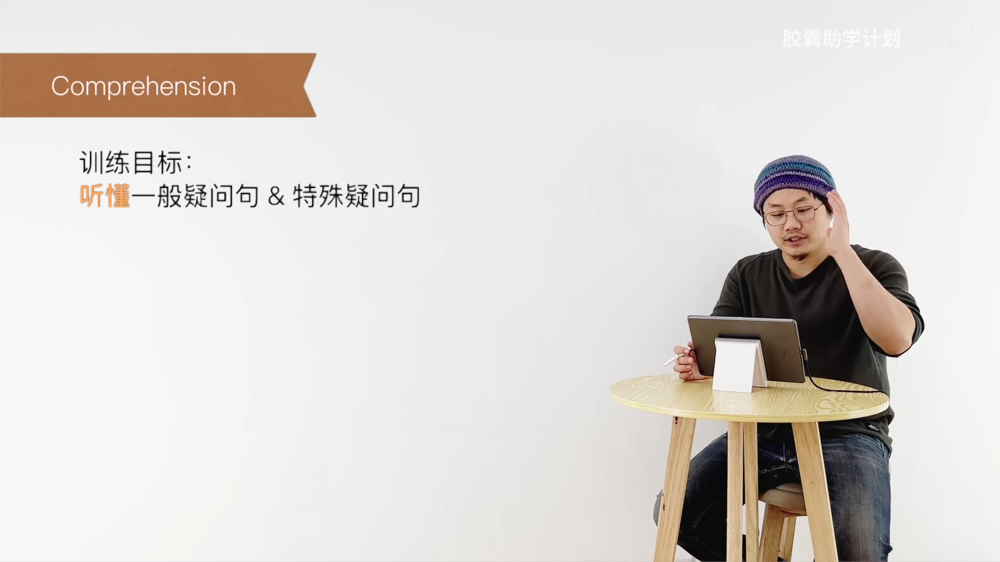

文字识别：Comprehension / 训练目标： / 听懂一般疑问句＆特殊疑问句

## 00:00:30–00:01:00

尽量不要看着我这里的问题，好吧？好，第一题，Is there a park near your home？答案 Yes, there is. Next one, What is the whale？ A small river. Next one, Does it cut across the park？ Yes, it does. Next one, What do you like doing on fine afternoons？答案 Sitting by the whale.

### 画面 00:00:33

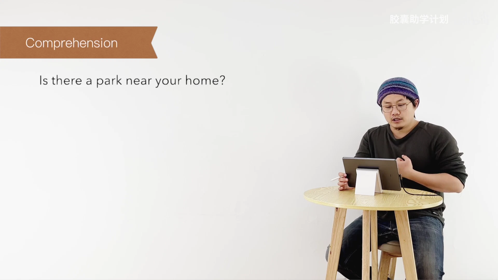

文字识别：Comprehension / Is there a park near your home?

### 画面 00:00:40

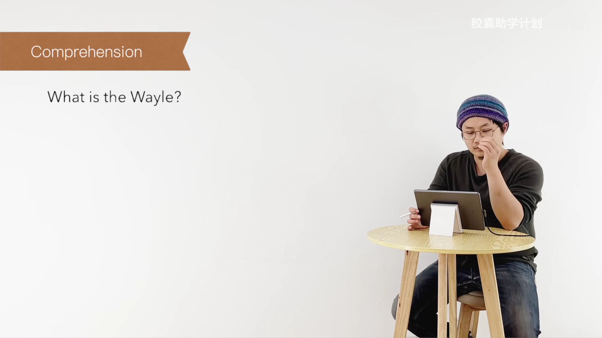

文字识别：Comprehension / What is the Wayle?

### 画面 00:00:54

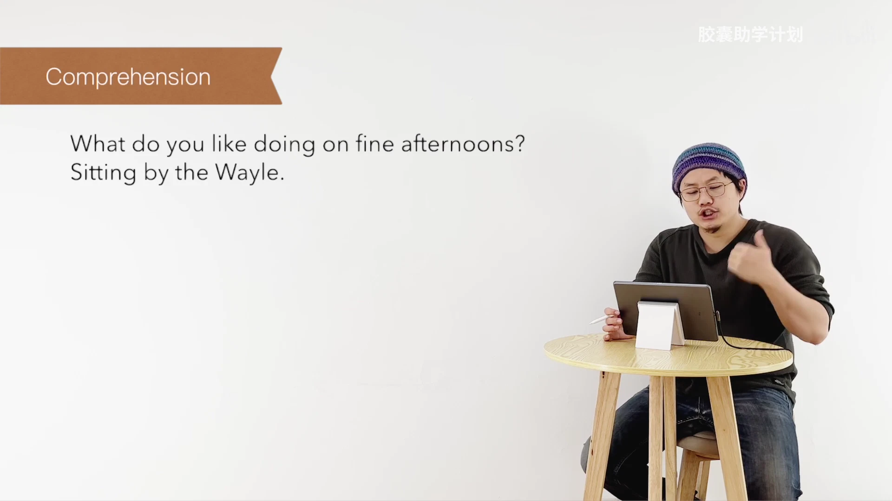

文字识别：Comprehension / What do you like doing on fine afternoons? / Sitting by the Wayle.

## 00:01:00–00:01:30

Next one: What did you do last Sunday? I went and sat on the riverbank, as usual, right? Next one: It was a warm day, wasn't it? Yes, it was. Next one: What were some children doing? Playing games. Next one: Who was rowing on the river? We don't know. We we only know some people, right?

### 画面 00:01:01

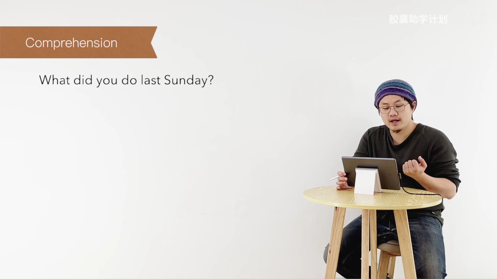

文字识别：Comprehension / What did you do last Sunday?

## 00:01:30–00:02:00

我们只知道是有这么一些人啊。Next one, what did one of the children do? He kicked a ball very hard. Next one, where did the ball go? It went towards a passing boat. Next one, who shouted at the man in the boat? Some people on the bank. Next one, did the man in the

### 画面 00:01:31

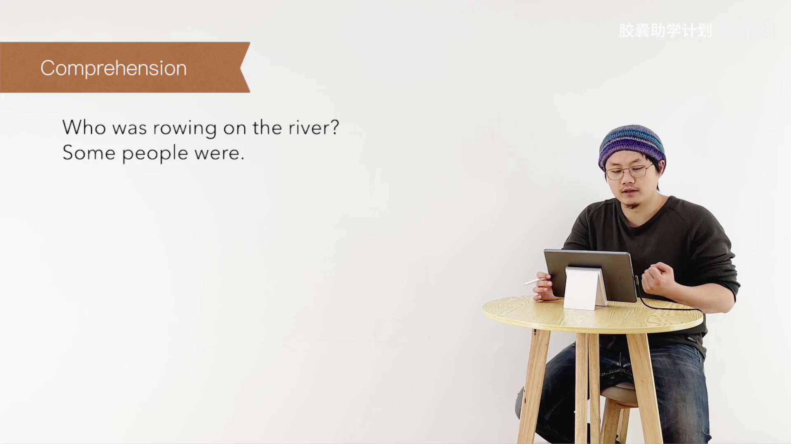

文字识别：Comprehension / Who was rowing on the river? / Some people were.

### 画面 00:01:36

文字识别：Comprehension / What did one of the children do? / He kicked the ball very hard.

### 画面 00:01:44

文字识别：Comprehension / Where did the ball go?

### 画面 00:01:54

文字识别：Comprehension / Who shouted at the man in the boat? / Some people on the bank did.

### 画面 00:01:58

文字识别：Comprehension / Did he hear them?

## 00:02:00–00:02:30

boat hear them? No, he didn't. Next one, why did he nearly fall into the water? Because the ball struck him so hard. Next one, why did you turn? Answer很简单, to look at the children. Next one, where were the children? They were not inside.

### 画面 00:02:10

文字识别：Comprehension / Why did he nearly fall into the water / Because the ball struck him hard.

### 画面 00:02:22

文字识别：Comprehension / Why did you turn? / To look at the children.

## 00:02:30–00:03:00

Okay, very good. Asking questions. 那我们训练的目标就是会说一般疑问句和特殊疑问句。我们上来还是老习惯，先给各位一个例子，叫 Ask me if there is a park near my home. Okay, 那对于各位来说，这就是一个非常简单的 there be 句型，is 提前就可以了。Is there a park near your home? 如果这个语法您不是特别熟悉，新概念一册二十五课、二十七课，您回去一定要再看一下，好吧？

### 画面 00:02:31

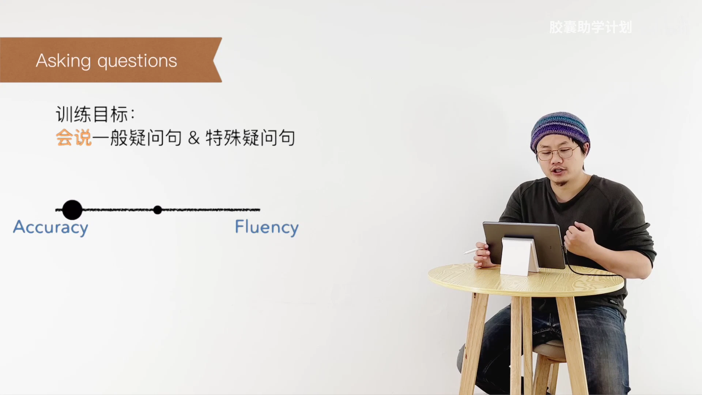

文字识别：Asking questions / 训练目标： / 会说一般疑问句＆特殊疑问句 / Accuracy / Fluency

### 画面 00:02:40

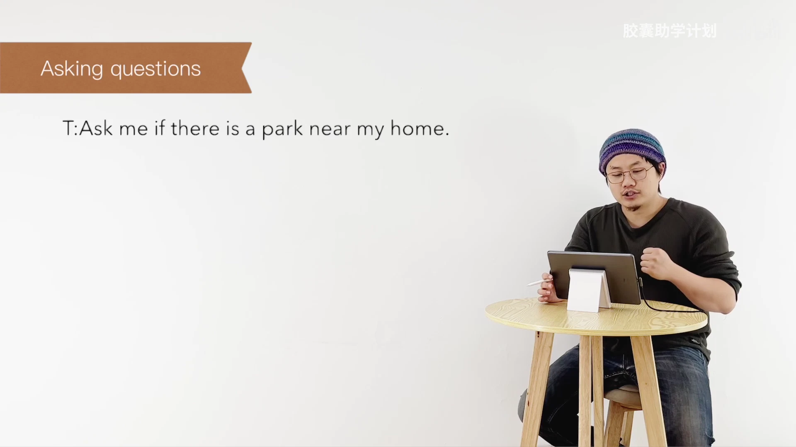

文字识别：Asking questions / T:Ask me if there is a park near my home.

## 00:03:00–00:03:30

Okay, where? That's near my home,就行了。叫做Where is there a park?接下来老习惯啊，我们还是给各位说思路，各位自己去写下来。The whale cuts across it. Does提前What? What?在这个地方，您要先想一下，it指的是什么？那个park对不对？那What既可以对the whale提问，也可以对it提问，可以有两个答案啊。Next one说The whale

### 画面 00:03:02

文字识别：Asking questions / T:Ask me if there is a park near my home. / S:ls there a park near your home? / T:Where…? / S:Where is there a park?

### 画面 00:03:06

文字识别：Asking questions

### 画面 00:03:08

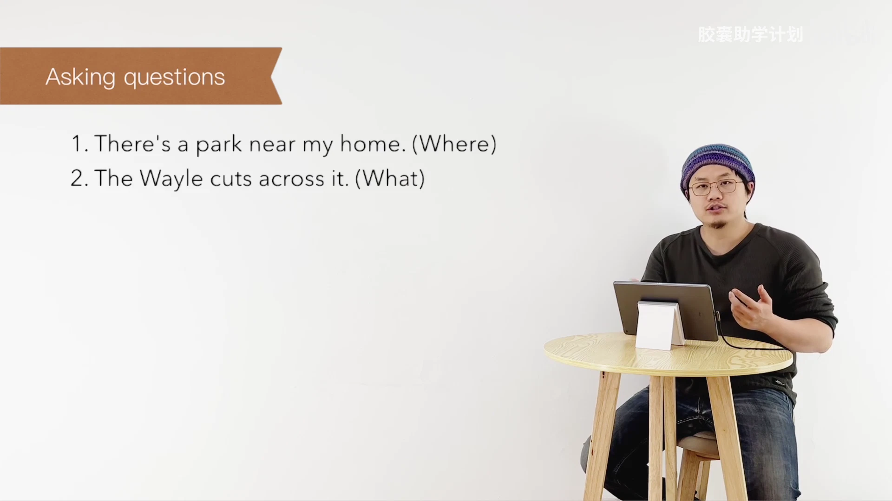

文字识别：Asking questions / 1.There's a park near my home. (Where) / 2. The Wayle cuts across it. (What)

## 00:03:30–00:04:00

a small river.一般疑问句很简单, is提前, how big肯定是对small提问,对吧? Next one, I like sitting by the well on fine afternoons. Do提前, when对时间提问,不多说了. Where对by the well提问, who对主语提问,只不过对主语提问的时候不要忘记别变一般疑问句. Okay, next one, I went to the park last Sunday. Did提前, when对last Sunday提问,答案就是When did you go to the park?

### 画面 00:03:36

文字识别：Asking questions / 1. There's a park near my home. (Where) / 2. The Wayle cuts across it. (What) / 3. The Wayle is a smallriver. (How big) / 4.I like sitting by the Wayle on fine / afternoons. (When)(Where) (Who)

### 画面 00:03:51

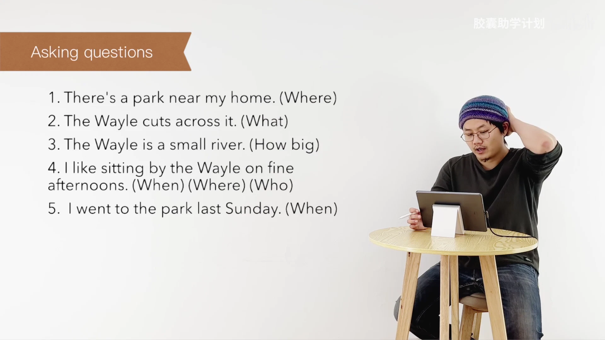

文字识别：Asking questions / 1. There's a park near my home. (Where) / 2. The Wayle cuts across it. (What) / 3. The Wayle is a small river. (How big) / 4.I like sitting by the Wayle on fine / afternoons.(When) (Where) (Who) / 5. I went to the park last Sunday.(When)

## 00:04:00–00:04:30

Okay. Next one. I sat on the river bank. Did提前 Where对 On the river bank提问 When对整句提问 Okay. 七说 Some children were playing games on the bank. Were提前就可以了 Where对 On the bank提问 What对 Games啊对吧 What were they playing? Okay. 那 Who对主语提问 One of the children kicked a ball very hard. Okay. 好注意这有一个小的 typo 这有一个小的 typo 我们给它

### 画面 00:04:01

文字识别：Asking questions

### 画面 00:04:09

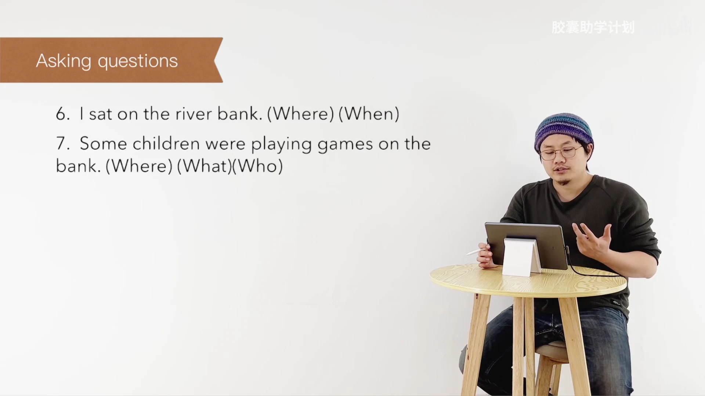

文字识别：Asking questions / 6. I sat on the river bank. (Where) (When) / 7. Some children were playing games on the / bank. (Where)(What)(Who)

### 画面 00:04:22

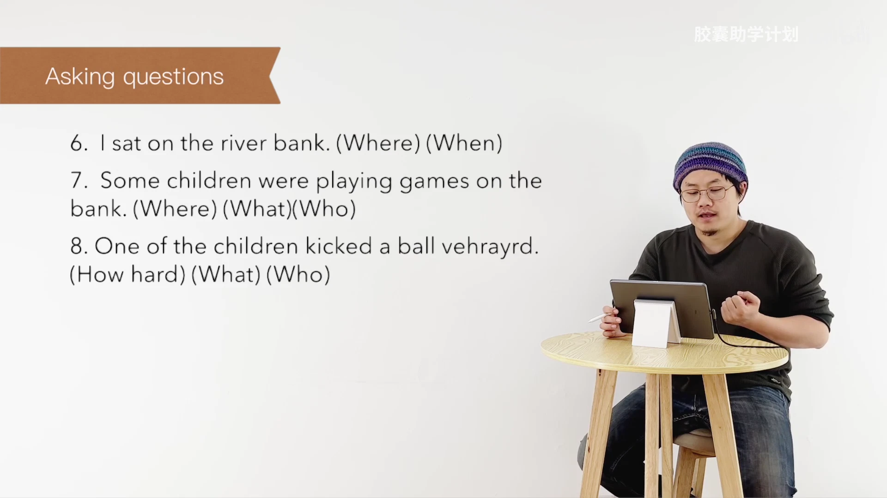

文字识别：Asking questions / 6. I sat on the river bank. (Where) (When) / 7. Some children were playing games on the / bank.(Where)(What)(Who) / 8. One of the children kicked a ball vehrayrd. / (How hard) (What) (Who)

## 00:04:30–00:05:00

稍微改一下，叫做very hard, OK？那把did提前就可以了。How hard对very hard提问，What对about提问，Who对主语提问，不要变一般疑问句。Who对one of the children提问，OK？It went towards a passing boat. Did提前，Where？哎，各位想一下这里的where是什么？您在视频下方留言告诉我，对吧？它的答案是什么？OK？

### 画面 00:04:31

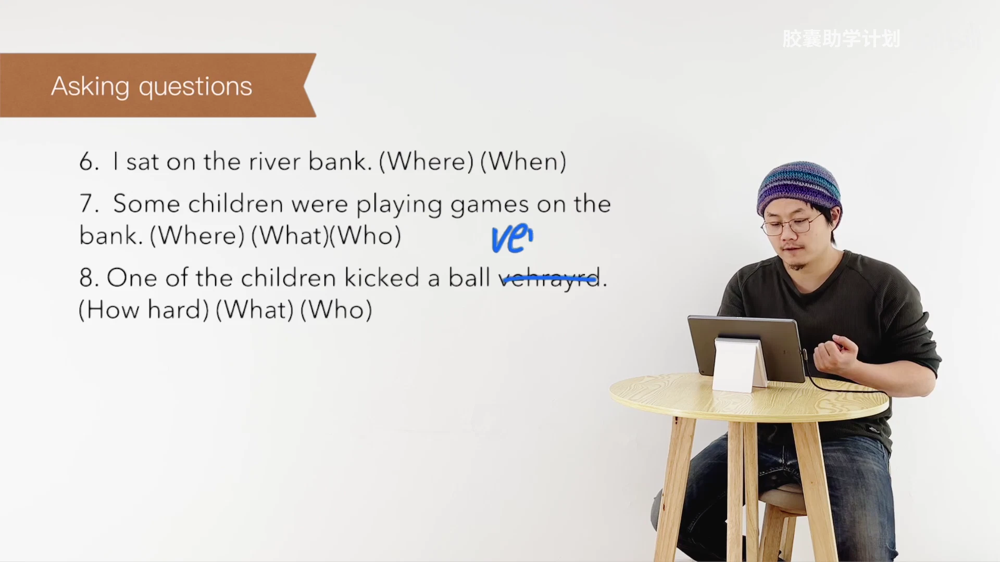

文字识别：Asking questions / 6. I sat on the river bank. (Where) (When) / 7. Some children were playing games on the / bank.(Where)(What)(Who) / ve / 8. One of the children kicked a ball vehrayrd. / (How hard) (What) (Who)

### 画面 00:04:33

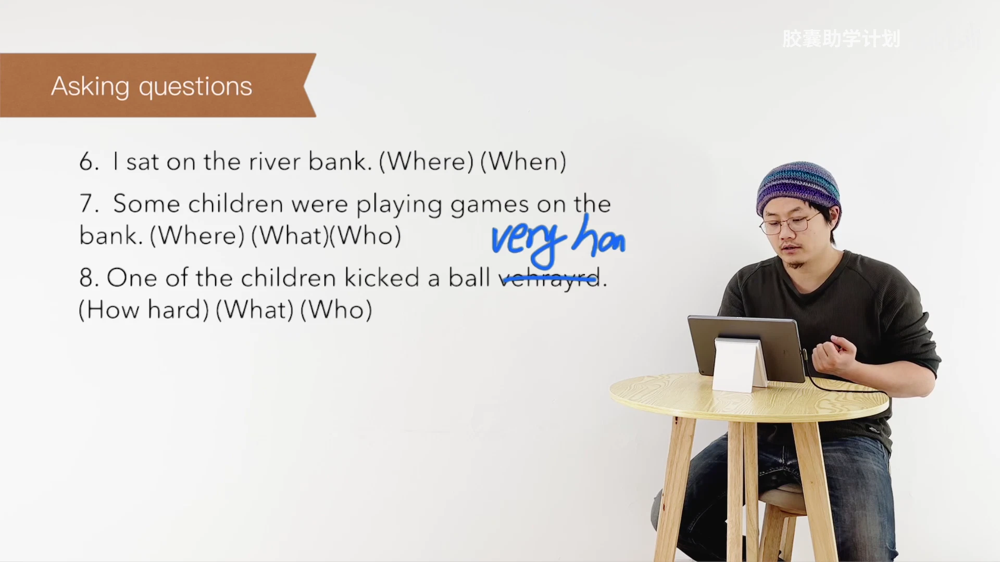

文字识别：Asking questions / 6. I sat on the river bank. (Where) (When) / 7. Some children were playing games on the / veryhan / bank.(Where)(What)(Who) / 8. One of the children kicked a ball / (How hard) (What) (Who)

### 画面 00:04:35

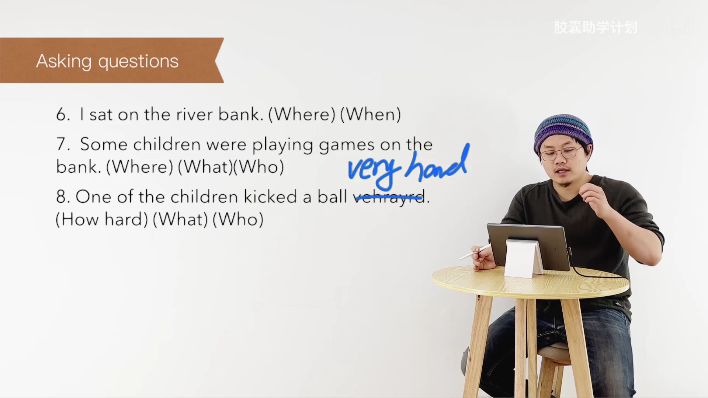

文字识别：Asking questions / 6. I sat on the river bank. (Where) (When) / 7. Some children were playing games on the / veryhand / bank. (Where)(What)(Who) / 8. One of the children kicked a ball / (How hard) (What) (Who)

### 画面 00:04:56

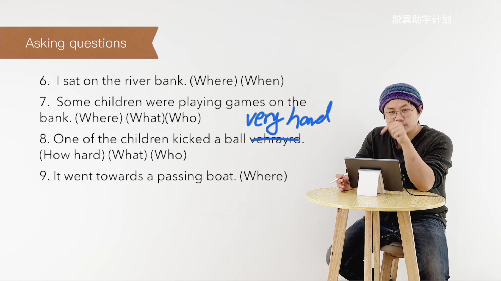

文字识别：Asking questions / 6. | sat on the river bank.(Where) (When) / 7. Some children were playing games on the / bank. (Where)(What)(Who) / veryhand / 8. One of the children kicked a ball / vehr / (How hard) (What) (Who) / 9. Ilt went towards a passing boat. (Where)

## 00:05:00–00:05:30

好啊，给各位一个自己小，这个给各位自己一个机会去判断一下这句话应该怎么说啊？OK，第十题说，Some people called out to the man. Did提前，What点点do？那就是标准答案。What did some people do？对吧？Why对整句话，Who点点点to？那您Who就对the man提问吧？好吧？OK，Tell the story练习的是我们fluency啊，就是流利性。

### 画面 00:05:07

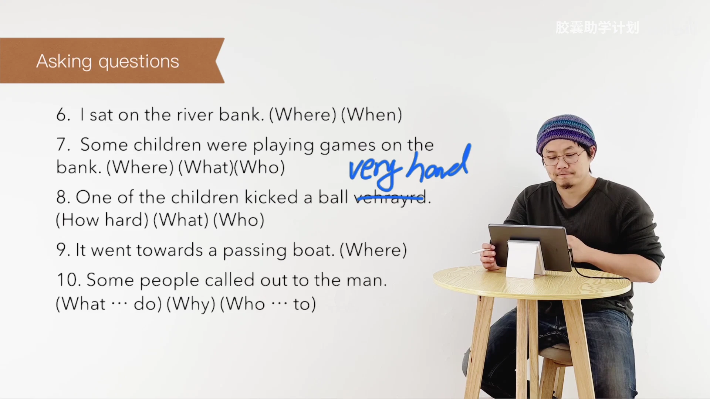

文字识别：Asking questions / 6. I sat on the river bank.(Where)(When) / 7. Some children were playing games on the / bank. (Where)(What)(Who) / veryhand / 8. One of the children kicked a ball / (How hard) (What) (Who) / 9. It went towards a passing boat. (Where) / 10. Some people called out to the man. / (What … do) (Why) (Who … to)

### 画面 00:05:24

文字识别：Tell the story / 训练目标： / 口语复述能力 / Accuracy / Fluency

### 画面 00:05:28

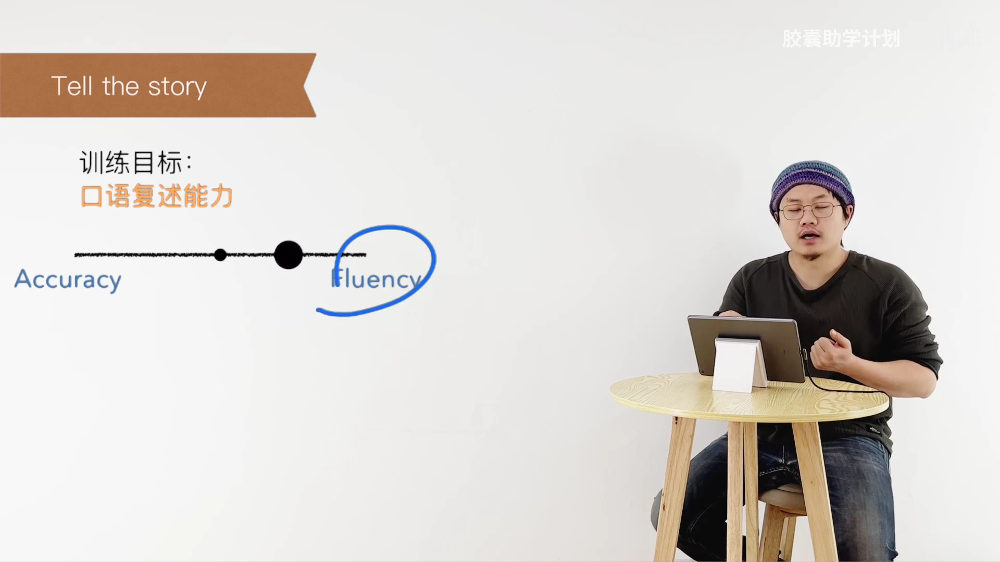

文字识别：Tell the story / 训练目标： / 口语复述能力 / Accuracy / fluency

## 00:05:30–00:06:00

您可以错，不用管 accuracy 准确性，可以错一点点，对吧？没有问题，但不能太慢啊！所以文章一定要读得很熟。您再去看这个，比如说 The Well is a small river which cut across the park near my home. I like sailing by the well on fine afternoons. 大概是这样一个感觉。 OK，好。然后 summary writing 呢，对于各位来说要做的事情就是先去写摘要写作，然后来这里对一下答案就可以了，非常的简单。

### 画面 00:05:31

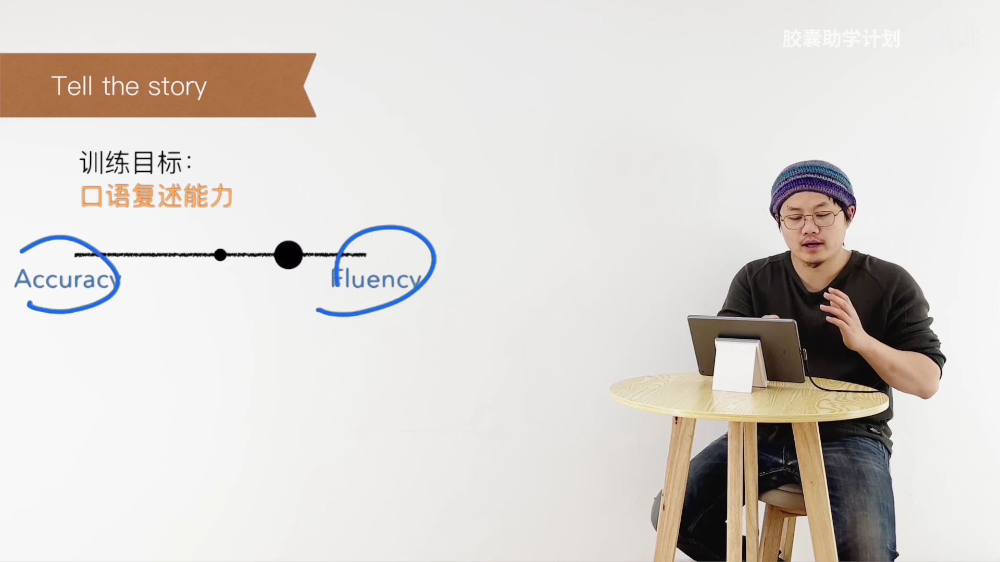

文字识别：Tell the story / 训练目标： / 口语复述能力 / Accuracy / Fluency

### 画面 00:05:38

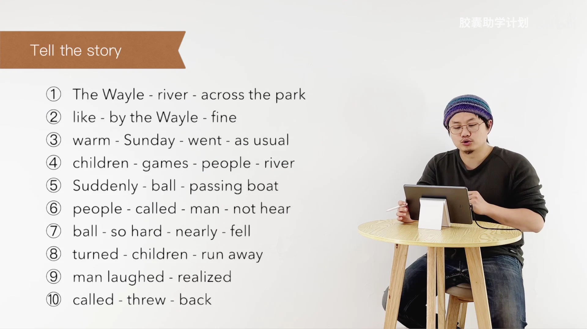

文字识别：Tell the story / The Wayle - river - across the park / 1 / like - by the Wayle - fine / warm - Sunday - went - as usual / children - games - people - river / ⑤ Suddenly - ball - passing boat / 6 /  people - called - man - not hear / ⑦ ball- so hard - nearly - fell / turned - children - run away / 8 / ) / ⑨ man laughed - realized / 1⑩ called - threw - back

### 画面 00:05:50

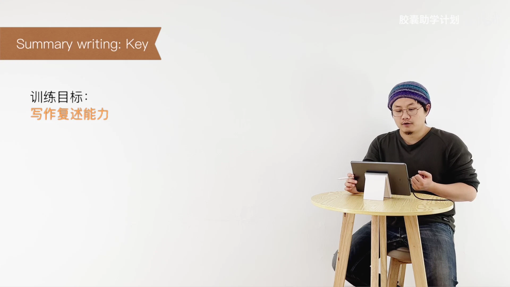

文字识别：Summary writing: Key / 训练目标： / 写作复述能力

### 画面 00:05:54

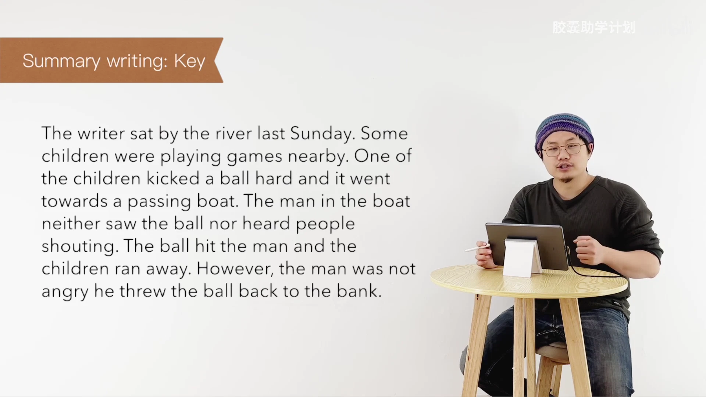

文字识别：Summary writing: Key / The writer sat by the river last Sunday. Some / children were playing games nearby. One of / the children kicked a ball hard and it went / towards a passing boat. The man in the boat / neither saw the ball nor heard people / shouting. The ball hit the man and the / children ran away. However, the man was not / angry he threw the ball back to the bank.

## 00:06:00–00:06:30

最后一道题，topic for discussion，这是我们所有练习的最终目的，就是能完全自由的和别人就一个话题去展开对话。那我们看一下这些话题吧。第一个，Imagine the following situation: the man in the story thought the children had kicked the ball towards him on purpose. Retell the rest of the story. 就是让你去假想这样一个场景，就是故事当中这名男子啊，认为这些

### 画面 00:06:00

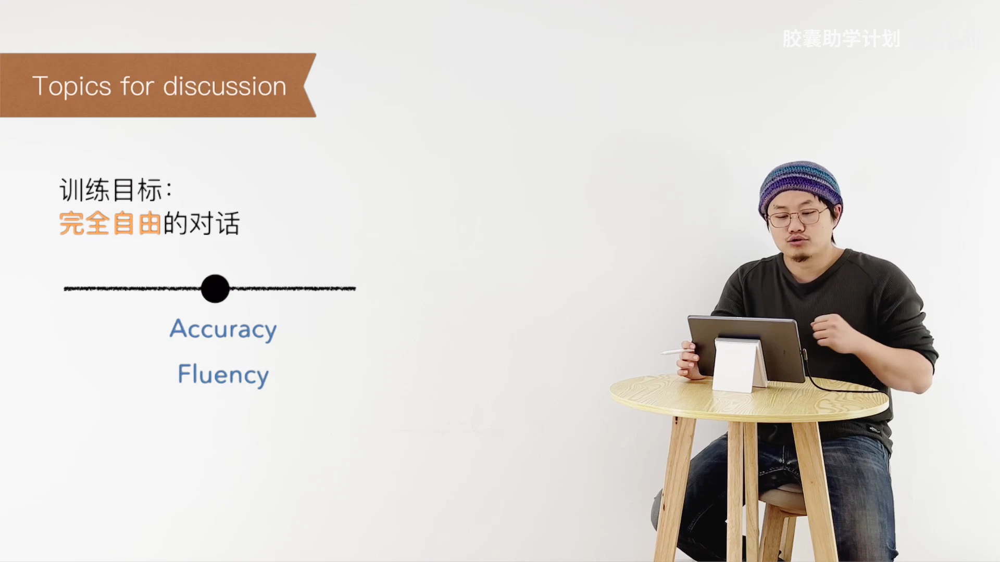

文字识别：Topics for discussion / 训练目标： / 完全自由的对话 / Accuracy / Fluency

### 画面 00:06:10

文字识别：Topics for discussion

### 画面 00:06:12

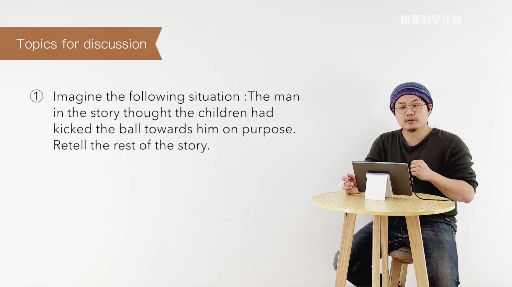

文字识别：Topics for discussion / Imagine the following situation :The man / in the story thought the children had / kicked the ball towards him on purpose. / Retell the rest of the story.

## 00:06:30–00:07:00

孩子是故意拿球去踢他的，让你重新讲一下这个故事啊。OK，再接下来说What kind of games do you like playing？你喜欢玩什么样的？哎，喜欢进行什么样的运动活动呢？为什么？告诉我们讲一讲，对吧？给我们讲一下你最喜欢的这个运动。OK，好，家庭作业Ask me if先写，再大声朗读。这要写作先写，然后来这对答案。Tell the story文章跟

### 画面 00:06:36

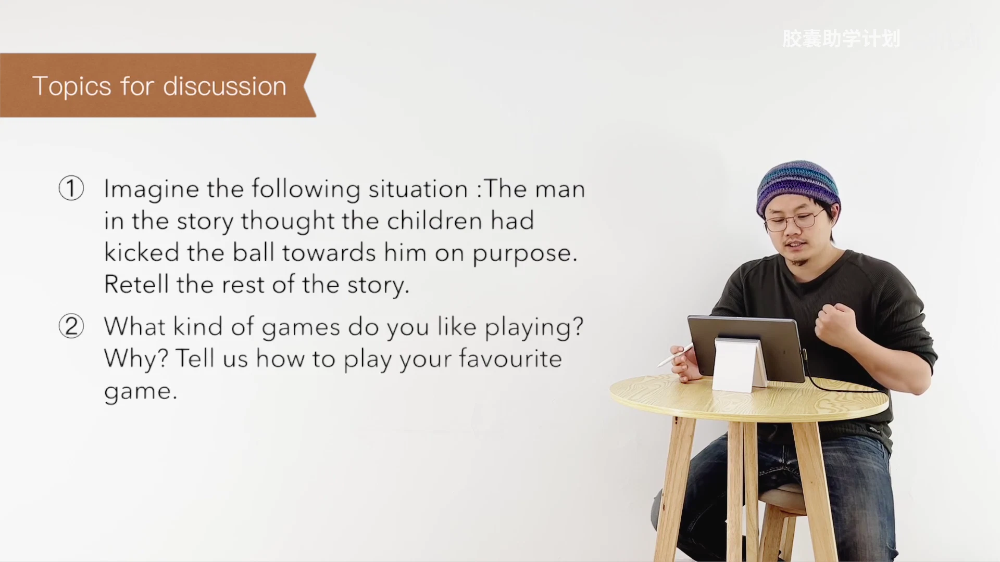

文字识别：Topics for discussion / Imagine the following situation :The man / in the story thought the children had / kicked the ball towards him on purpose. / Retell the rest of the story. / What kind of games do you like playing? / Why? Tell us how to play your favourite / game.

### 画面 00:06:51

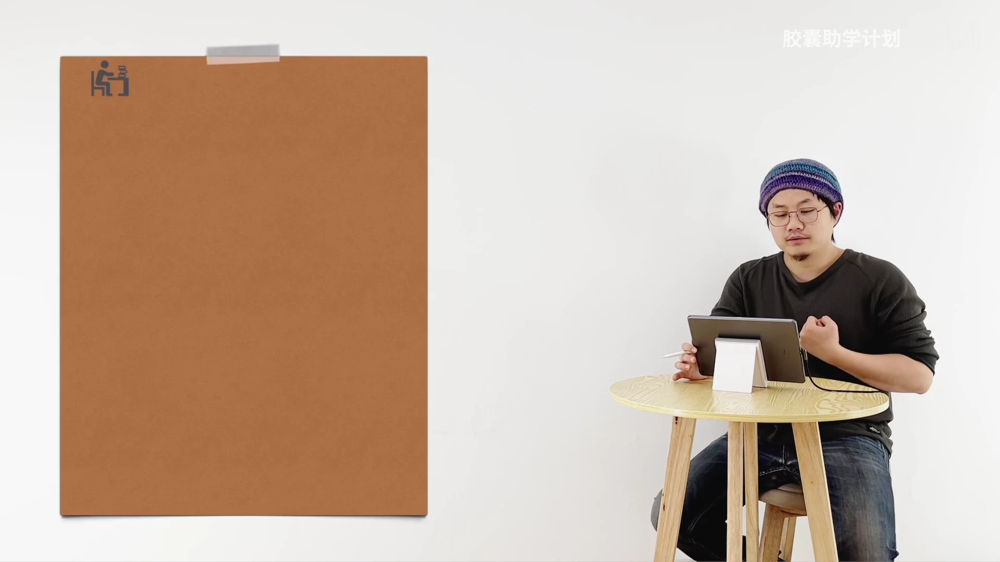

### 画面 00:06:54

文字识别：1.Ask me if写&朗读 / 2. / 摘要写作写&答案

### 画面 00:06:56

文字识别：1.Ask me if写&朗读 / 摘要写作写&答案 / 3.Tell the story 口语复述

### 画面 00:06:59

文字识别：1.Ask me if写&朗读 / 摘要写作写&答案 / 3.Tell the story 口语复述

## 00:07:00–00:07:30

读至熟读成诵之后，来这儿进行口语复述，非常重要的练习。专栏当中都可以找得到。以上就是本期视频的全部内容了。如果各位喜欢我们的课程呢，欢迎各位关注、订阅、一键三连，分享给那些需要的朋友，来帮助我们快速成长。See you next time.

### 画面 00:07:01

文字识别：1.Ask me if写&朗读 / 摘要写作写&答案 / 3.Tell the story 口语复述

### 画面 00:07:04

文字识别：1.Ask me if写&朗读 / 2. / 摘要写作写&答案 / 3.Tell the story 口语复述 / 专栏 / 4.

### 画面 00:07:06

### 画面 00:07:19

文字识别：￥

### 画面 00:07:21

文字识别：CAPSULEACADEMY / 胶囊助学计划 / 小红书 / Lecturer / Leo / OE

### 画面 00:07:24

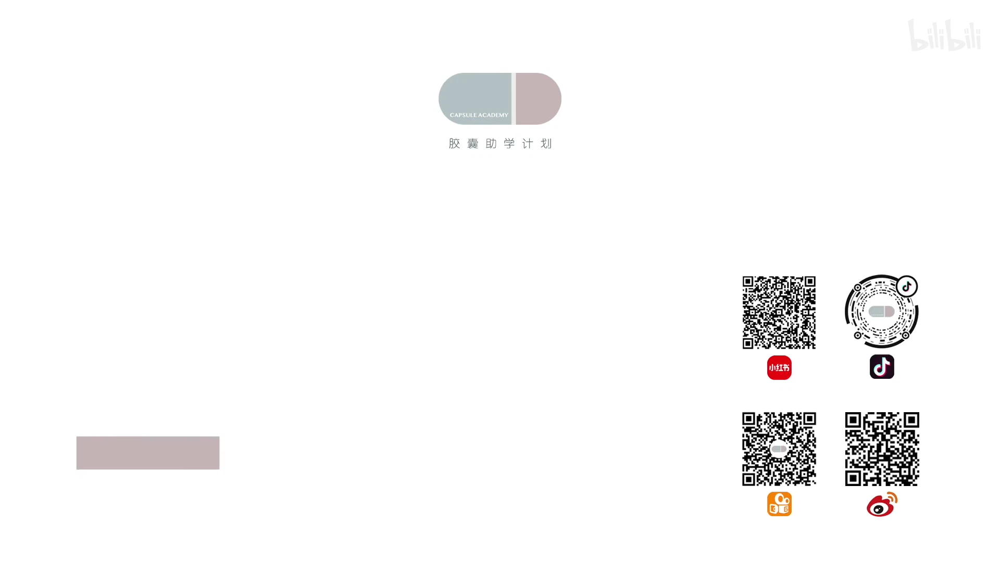

文字识别：CAPSULEACADEMY / 胶囊助学计划 / 小红书 / 品 / OE

### 画面 00:07:27

文字识别：CAPSULEACADEMY / 胶囊助学计划 / 小红书 / Creator / Leo & Berlin / OE

### 画面 00:07:29

文字识别：bilbili / 胶囊助学计划 / CAPSULEACADEMY / 胶囊助学计划 / 小红书 / OE

## 00:07:30–00:07:32

### 画面 00:07:31

文字识别：bilibili / 胶囊助学计划

