# L031 单词

快速机器解析：语音为单模型转写，未进行独立交叉校对或人工复核；画面每秒采样并按变化选帧，短时文字和标记可能遗漏。截图时间约有 1 秒误差。图片有损压缩；遇到疑点请按时间查看 Google Drive 原视频。

## 00:00:00–00:00:30

Hello everyone, welcome to Capsule Academy. This is Leo. Today we're going to learn New Concept English Book Two, Lesson Thirty One Words. 那老习惯进入正式课程之前，我们先看两个问题。那首先，如何表达骑自行车？接下来呢，如何表达救了某人的命？OK，那带着这两个问题，Hope you gonna enjoy it. 好，那我们先看第一个小组单词。这个单词我们在新一

### 画面 00:00:00

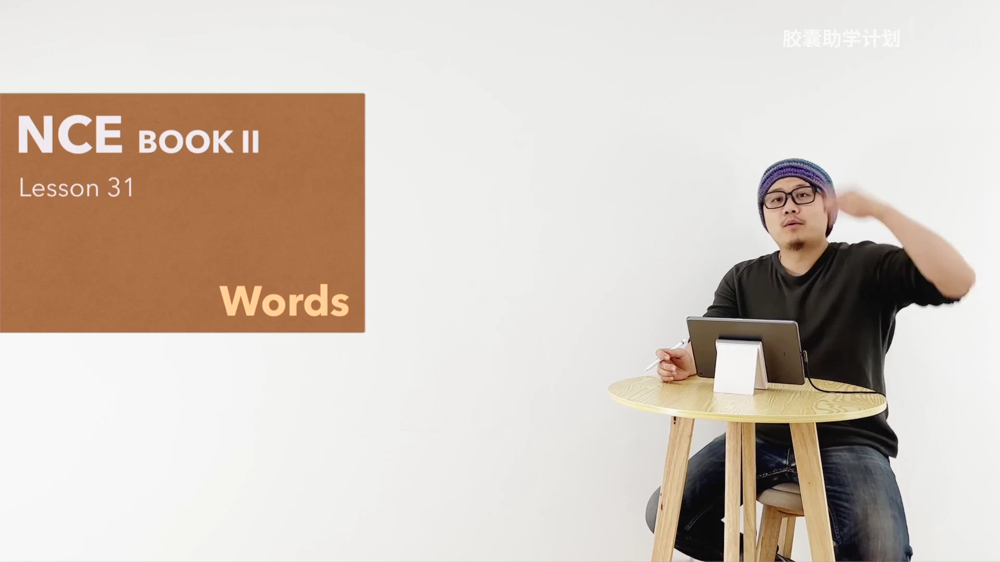

文字识别：NCE / BOOKII / Lesson 31 / Words

### 画面 00:00:02

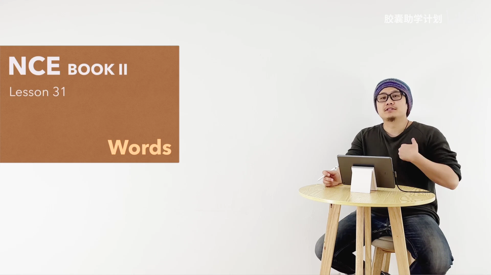

文字识别：NCE / BOOKⅡI / Lesson 31 / Words

### 画面 00:00:05

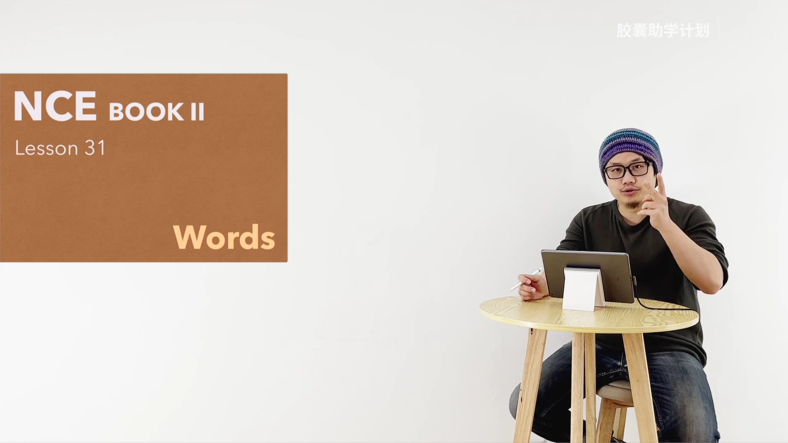

文字识别：NCE / BOOKII / Lesson 31 / Words

### 画面 00:00:09

### 画面 00:00:11

文字识别：①如何表达“骑自行车”？

### 画面 00:00:14

文字识别：①如何表达“骑自行车”？ / 如何表达“救某人的命”?

### 画面 00:00:16

文字识别：①如何表达“骑自行车”？ / 如何表达“救某人的命”

### 画面 00:00:21

文字识别：胶囊助学计划bill / • / •

### 画面 00:00:24

文字识别：胶囊助学计划 / 胶囊助学计划

### 画面 00:00:26

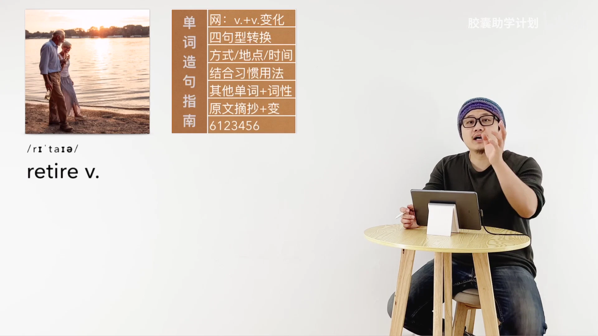

文字识别：单词造句指南 / 网：v.+v.变化 / 四句型转换 / 方式/地点/时间 / 结合习惯用法 / 其他单词+词性 / 原文摘抄+变 / 6123456 / /ri'taia/ / retire v.

### 画面 00:00:28

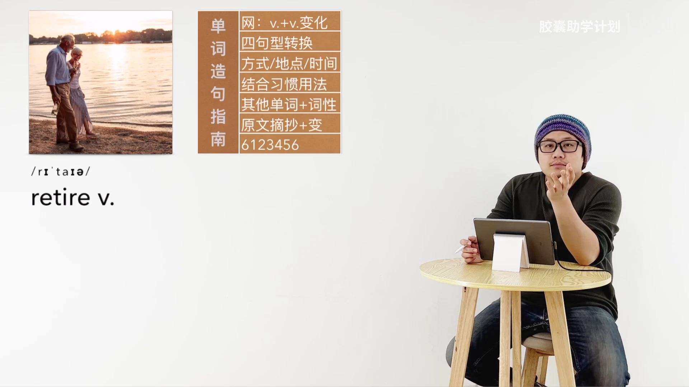

文字识别：单词造句指南 / 网：v.+v.变化 / 四句型转换 / 方式/地点/时间 / 结合习惯用法 / 其他单词+词性 / 原文摘抄+变 / 6123456 / /ri'taia/ / retire v.

## 00:00:30–00:01:00

呃八十九课应该就见过了，是吧？跟我一起读一下，叫做 retire，retire，OK，叫退休的意思。那你要注意，首先要判断它是这个动词的词性，对吧？那接下来我们再去造句的时候，就要想一想，那动词最关键的就是动词的变化，对不对？比如说 the man who retired last year，OK，那你看我在这儿有 last year，所以有一个动词的变化叫一般过去时，对吧？叫做这个去年退休的这

### 画面 00:00:30

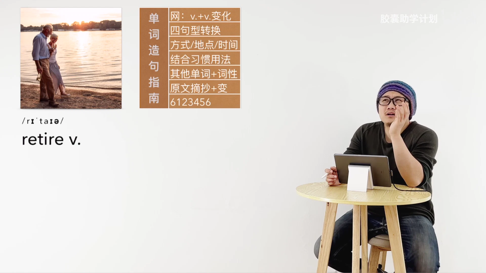

文字识别：单词造句指南 / 网：v.+v.变化 / 四句型转换 / 方式/地点/时间 / 结合习惯用法 / 其他单词+词性 / 原文摘抄+变 / 6123456 / /ri'taia/ / retire V.

### 画面 00:00:35

文字识别：单词造句指南 / 网：v.+v.变化 / 四句型转换 / 方式/地点/时间 / 结合习惯用法 / 其他单词+词性 / 原文摘抄+变 / 6123456 / /ri'taia/ / retire v.

### 画面 00:00:38

文字识别：单词造句指南 / 网：v.+v.变化 / 四句型转换 / 方式/地点/时间 / 结合习惯用法 / 其他单词+词性 / 原文摘抄+变 / 6123456 / /ri'taia/ / retire v.

### 画面 00:00:40

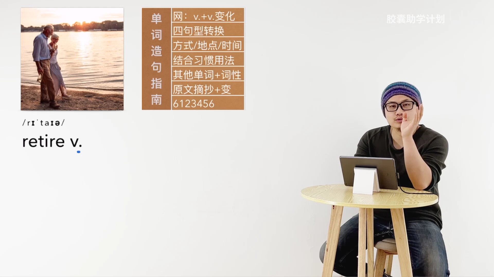

文字识别：单词造句指南 / 网：v.+v.变化 / 四句型转换 / 方式/地点/时间 / 结合习惯用法 / 其他单词+词性 / 原文摘抄+变 / 6123456 / /ri'taia/ / retire v.

### 画面 00:00:45

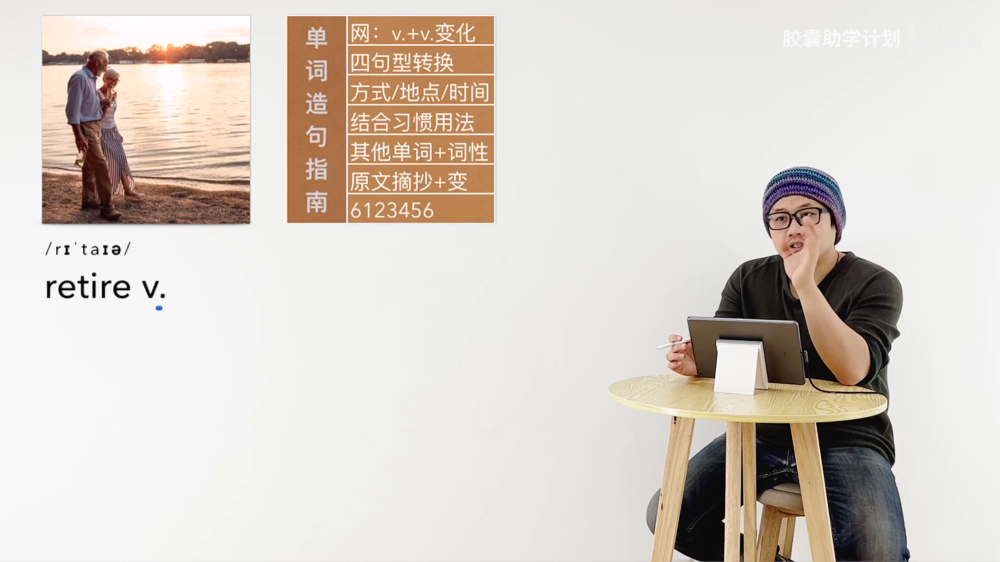

文字识别：单词造句指南 / 网：v.+v.变化 / 四句型转换 / 方式/地点/时间 / 结合习惯用法 / 其他单词+词性 / 原文摘抄+变 / 6123456 / /ri'taia/ / retire v.

### 画面 00:00:49

文字识别：单词造句指南 / 网：v.+v.变化 / 四句型转换 / 方式/地点/时间 / 结合习惯用法 / 其他单词+词性 / 原文摘抄+变 / 6123456 / /ri'taia/ / retire v. / ① The man who retired last year likes walking with bi / wife along the river bank on fine afternoons. L28

### 画面 00:00:51

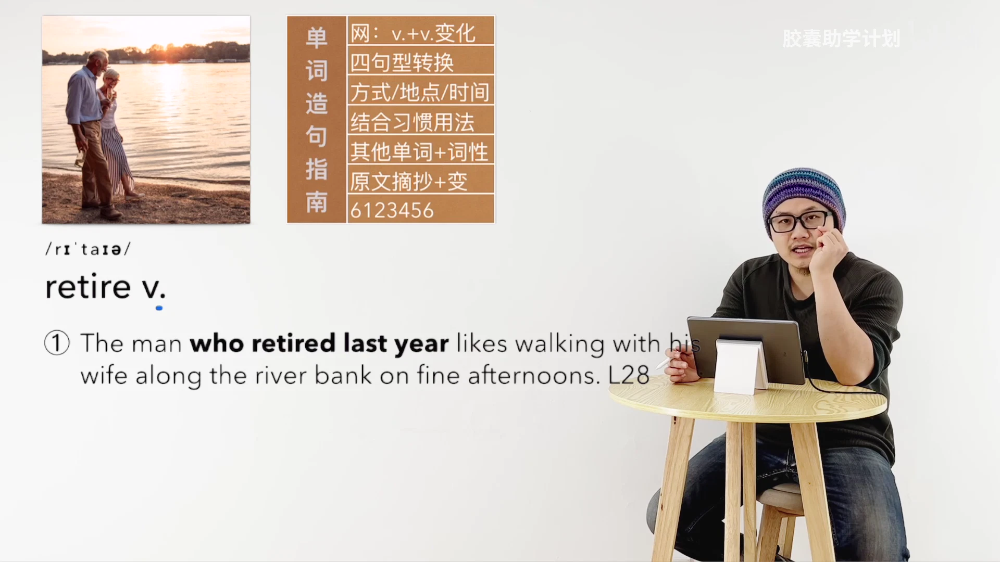

文字识别：单词造句指南 / 网：v.+v.变化 / 四句型转换 / 方式/地点/时间 / 结合习惯用法 / 其他单词+词性 / 原文摘抄+变 / 6123456 / /ri'taia/ / retire v. / ① The man who retired last year likes walking with hi / wife along the river bank on fine afternoons. L28

### 画面 00:00:53

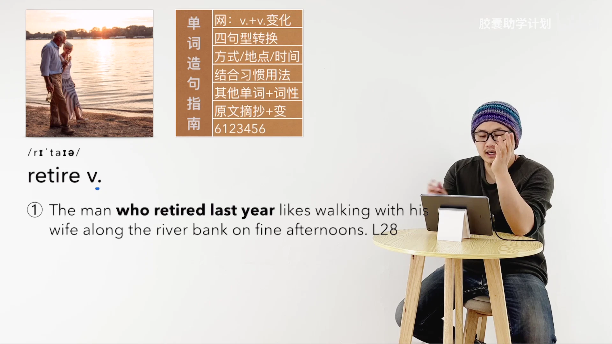

文字识别：单词造句指南 / 网：v.+v.变化 / 四句型转换 / 方式/地点/时间 / 结合习惯用法 / 其他单词+词性 / 原文摘抄+变 / 6123456 / /ri'taia/ / retire v. / ① The man who retired last year likes walking with his / wife along the river bank on fine afternoons. L28

### 画面 00:00:55

文字识别：单词造句指南 / 网：v.+v.变化 / 四句型转换 / 方式/地点/时间 / 结合习惯用法 / 其他单词+词性 / 原文摘抄+变 / 6123456 / /ri'taia/ / retire v. / ① The man who retired last year likes walking with his / wife along the river bank on fine afternoons. L28

## 00:01:00–00:01:30

个男人，这结合了我们二十八课学过的定语从句。我们现在句子在造句的时候变长了，开始啊，likes walking, like doing something,喜欢走路with his wife和他的妻子along the river bank,哎，沿着河岸on fine afternoons，在特别美好的周日下午。注意，这是啊周周呃这个呃呃下午是吧？没有周日下午，下午。注意，你看on fine afternoons, as这个一出来就提供了一个东西，

### 画面 00:01:00

文字识别：单词造句指南 / 网：v.+v.变化 / 四句型转换 / 方式/地点/时间 / 结合习惯用法 / 其他单词+词性 / 原文摘抄+变 / 6123456 / /ri'taia/ / retire V. / ① The man who retired last year likes walking with his / wife along the river bank on fine afternoons. L28

### 画面 00:01:04

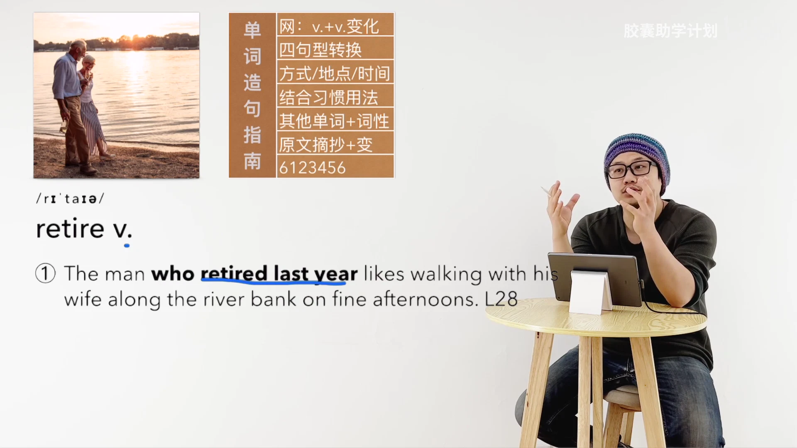

文字识别：单词造句指南 / 网：v.+v.变化 / 四句型转换 / 方式/地点/时间 / 结合习惯用法 / 其他单词+词性 / 原文摘抄+变 / 6123456 / /ri'taia/ / retire V. / ① The man who retired last year likes walking with his / wife along the river bank on fine afternoons. L28

### 画面 00:01:06

文字识别：单词造句指南 / 网：v.+v.变化 / 四句型转换 / 方式/地点/时间 / 结合习惯用法 / 其他单词+词性 / 原文摘抄+变 / 6123456 / /ri'taia/ / retire v. / ① The man who retired last year likes walking with his / wife along the river bank on fine afternoons. L28

### 画面 00:01:10

文字识别：单词造句指南 / 网：v.+v.变化 / 四句型转换 / 方式/地点/时间 / 结合习惯用法 / 其他单词+词性 / 原文摘抄+变 / 6123456 / /ri'taia/ / retire V. / ① The man who retired last year likes walking with his / wife along the river bank on fine afternoons. L28

### 画面 00:01:13

文字识别：单词造句指南 / 网：v.+v.变化 / 四句型转换 / 方式/地点/时间 / 结合习惯用法 / 其他单词+词性 / 原文摘抄+变 / 6123456 / /ri'taia/ / retire V. / ① The man who retired last year likes walking with his / wife along the river bank on fine afternoons. L28

### 画面 00:01:15

文字识别：单词造句指南 / 网：v.+v.变化 / 四句型转换 / 方式/地点/时间 / 结合习惯用法 / 其他单词+词性 / 原文摘抄+变 / 6123456 / /ri'taia/ / retire v. /  The man who retired last year likes walking with his / 1 / wife along the river bank on fine afternoons. L28

### 画面 00:01:20

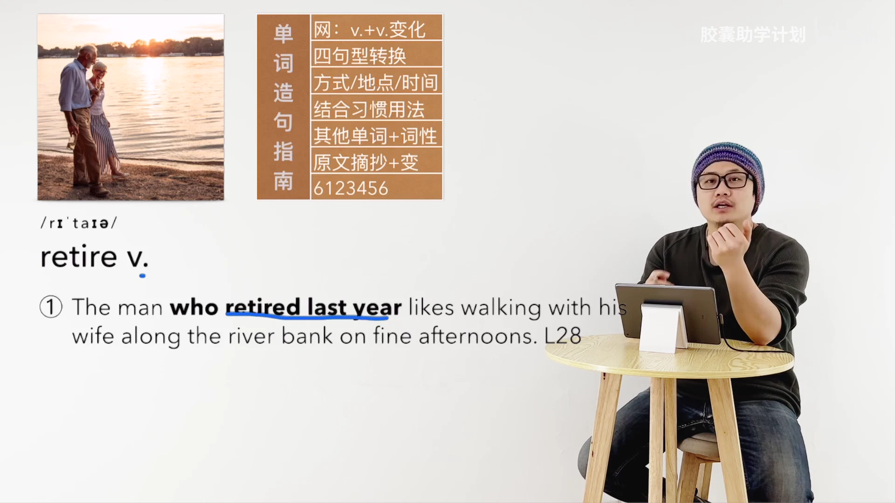

文字识别：单词造句指南 / 网：v.+v.变化 / 四句型转换 / 方式/地点/时间 / 结合习惯用法 / 其他单词+词性 / 原文摘抄+变 / 6123456 / /ri'taia/ / retire v. / ① The man who retired last year likes walking with his / wife along the river bank on fine afternoons. L28

### 画面 00:01:25

文字识别：单词造句指南 / 网：v.+v.变化 / 四句型转换 / 方式/地点/时间 / 结合习惯用法 / 其他单词+词性 / 原文摘抄+变 / 6123456 / /ri'taia/ / retire V. /  The man who retired last year likes walking with his / 1 / wife along the river bank on fine afternoons. L28

## 00:01:30–00:02:00

叫做时态，叫做一般现在时。Okay,好，Next one说The man rowing on the river has just retired. Okay, rowing on the river是我们刚刚学过的，对吧？现在分词做定语，然后它引导了一个短语，甚至我们直接就用的是原文的那个东西叫做rowing on the river，是吧？There are a lot of people rowing on the river.我呃印象当中这是我们课文的原话。那我们把rowing on the river拿过来，分词引导的

### 画面 00:01:30

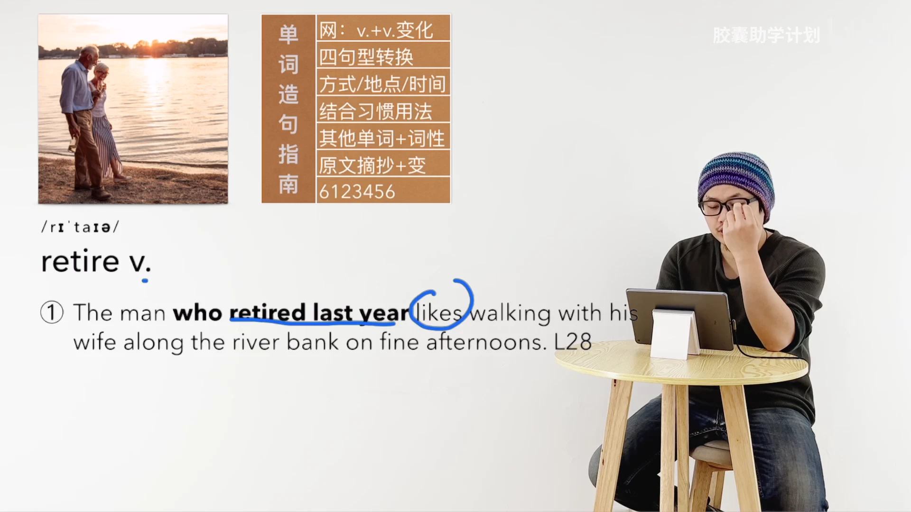

文字识别：单词造句指南 / 网：v.+v.变化 / 四句型转换 / 方式/地点/时间 / 结合习惯用法 / 其他单词+词性 / 原文摘抄+变 / 6123456 / /ri'taia/ / retire v. /  The man who retired last vearlikes walking with his / wife along the river bank on fine afternoons. L28

### 画面 00:01:34

文字识别：单词造句指南 / 网：v.+v.变化 / 四句型转换 / 方式/地点/时间 / 结合习惯用法 / 其他单词+词性 / 原文摘抄+变 / 6123456 / /ri'taia/ / retire v. / ① The man who retired last yearlikeswalking with his / wife along the river bank on fine afternoons. L28 / The man rowing on the river has just retired. L30

### 画面 00:01:36

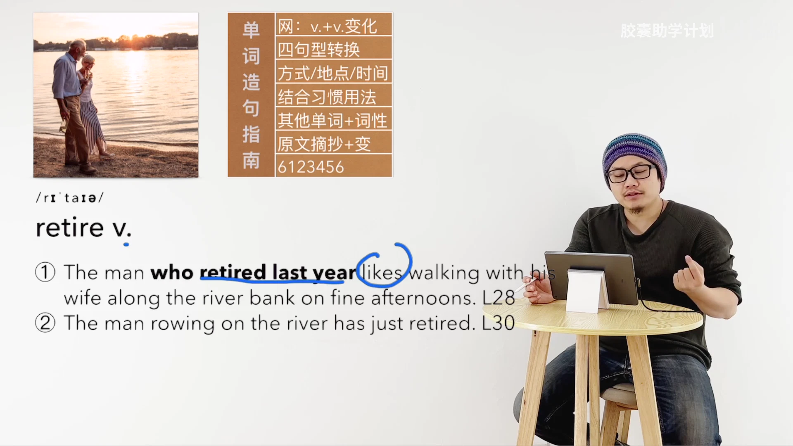

文字识别：单词造句指南 / 网：v.+v.变化 / 四句型转换 / 方式/地点/时间 / 结合习惯用法 / 其他单词+词性 / 原文摘抄+变 / 6123456 / /ri'taia/ / retire v. / ① The man who retired last yearlikes walking with his / wife along the river bank on fine afternoons. L28 / The man rowing on the river has just retired. L30

### 画面 00:01:39

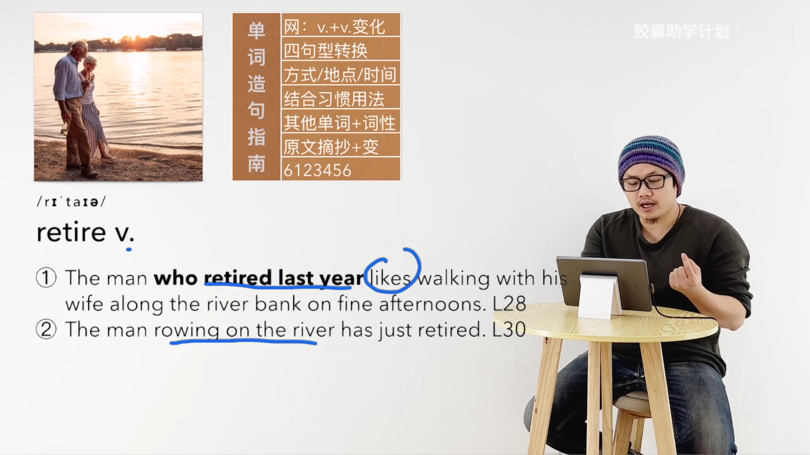

文字识别：单词造句指南 / 网：v.+v.变化 / 四句型转换 / 方式/地点/时间 / 结合习惯用法 / 其他单词+词性 / 原文摘抄+变 / 6123456 / /ri'taia/ / retire v. / ① The man who retired last yearlikeswalking with his / wife along the river bank on fine afternoons. L28 / The man rowing on the river has just retired. L30

### 画面 00:01:41

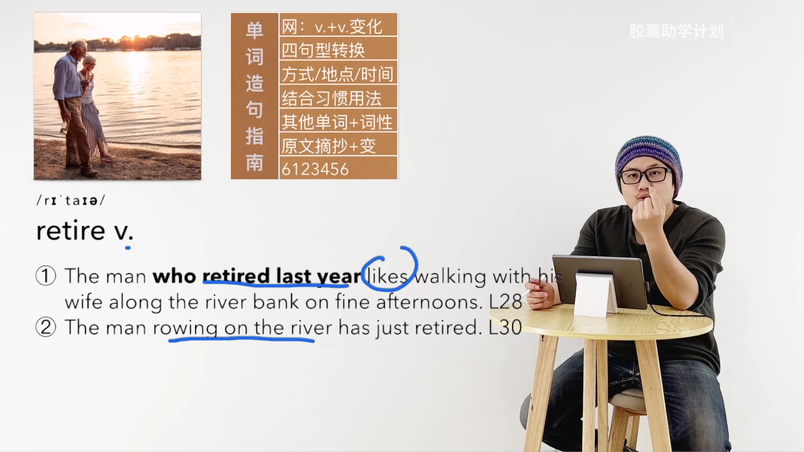

文字识别：单词造句指南 / 网：v.+v.变化 / 四句型转换 / 方式/地点/时间 / 结合习惯用法 / 其他单词+词性 / 原文摘抄+变 / 6123456 / /ri'taia/ / retire v. / ① The man who retired last yearlikeswalking with his / wife along the river bank on fine afternoons. L28 / The man rowing on the river has just retired. L30

### 画面 00:01:45

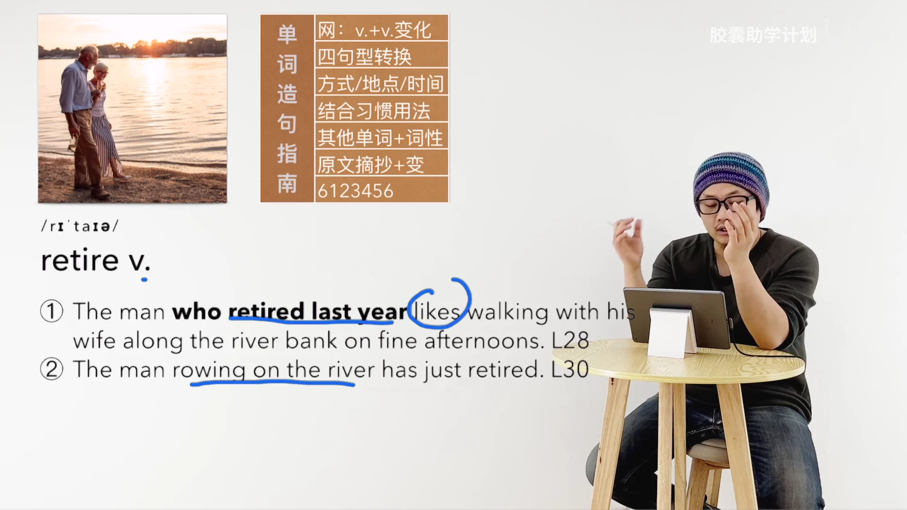

文字识别：单词造句指南 / 网：v.+v.变化 / 四句型转换 / 方式/地点/时间 / 结合习惯用法 / 其他单词+词性 / 原文摘抄+变 / 6123456 / /ri'taia/ / retire V. / ① The man who retired last yearlikesWalking with his / wife along the river bank on fine afternoons. L28 / The man rowing on the river has just retired. L30

### 画面 00:01:50

文字识别：单词造句指南 / 网：v.+v.变化 / 四句型转换 / 方式/地点/时间 / 结合习惯用法 / 其他单词+词性 / 原文摘抄+变 / 6123456 / /ri'taia/ / retire V. / ① The man who retired last vearlikeswalking with his / wife along the river bank on fine afternoons. L28 / The man rowing on the river has just retired. L30

### 画面 00:01:55

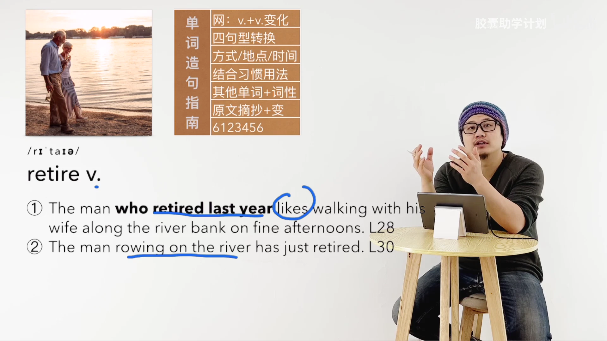

文字识别：单词造句指南 / 网：v.+v.变化 / 四句型转换 / 方式/地点/时间 / 结合习惯用法 / 其他单词+词性 / 原文摘抄+变 / 6123456 / /ri'taia/ / retire v. / ① The man who retired last yearlikesWalking with his / wife along the river bank on fine afternoons. L28 / The man rowing on the river has just retired. L30

## 00:02:00–00:02:30

短语做定语后置，对吧？OK，The man rowing the river has just retired. Next one，那我们再来一个叫做The man putting up the tent retired last summer. 好，put up the tent实际上是我们之前有一课啊，专门去学到的二十七课啊，我们去学说一帮小孩在田野当中put up the tent支起这个帐篷。那你看我们现在把那个动词短语啊put put up the tent变成了

### 画面 00:02:00

文字识别：单词造句指南 / 网：v.+v.变化 / 四句型转换 / 方式/地点/时间 / 结合习惯用法 / 其他单词+词性 / 原文摘抄+变 / 6123456 / /ri'taia/ / retire v. / ① The man who retired last vearlikeswalking with his / wife along the river bank on fine afternoons. L28 / The man rowing on the river has just retired. L30

### 画面 00:02:04

文字识别：单词造句指南 / 网：v.+v.变化 / 四句型转换 / 方式/地点/时间 / 结合习惯用法 / 其他单词+词性 / 原文摘抄+变 / 6123456 / /ri'taia/ / retire v. / ① The man who retired last yearlikesWalking with his / wife along the river bank on fine afternoons. L28 / The man rowing on the river has just retired. L30

### 画面 00:02:06

文字识别：单词造句指南 / 网：v.+v.变化 / 四句型转换 / 方式/地点/时间 / 结合习惯用法 / 其他单词+词性 / 原文摘抄+变 / 6123456 / /ri'taia/ / retire v. / ① The man who retired last yearlikeswalking with bis / wife along the river bank on fine afternoons. L28 / The man rowing on the river has just retired. L30 / The man putting up the tent retired last summer. L30

### 画面 00:02:10

文字识别：单词造句指南 / 网：v.+v.变化 / 四句型转换 / 方式/地点/时间 / 结合习惯用法 / 其他单词+词性 / 原文摘抄+变 / 6123456 / /ri'taia/ / retire v. / ① The man who retired last yearlikeswalking with his / wife along the river bank on fine afternoons. L28 / The man rowing on the river has just retired. L30 / The man putting up the tent retired last summer. L30

### 画面 00:02:15

文字识别：单词造句指南 / 网：v.+v.变化 / 四句型转换 / 方式/地点/时间 / 结合习惯用法 / 其他单词+词性 / 原文摘抄+变 / 6123456 / /ri'taia/ / retire v. / ① The man who retired last vearlikeswalking with his / wife along the river bank on fine afternoons. L28 / The man rowing on the river has just retired. L30 / The man putting up the tent retired last summer. L30

### 画面 00:02:20

文字识别：单词造句指南 / 网：v.+v.变化 / 四句型转换 / 方式/地点/时间 / 结合习惯用法 / 其他单词+词性 / 原文摘抄+变 / 6123456 / /ri'taia/ / retire v. / ① The man who retired last vearlikeswalking with his / wife along the river bank on fine afternoons. L28 / The man rowing on the river has just retired. L30 / The man putting up the tent retired last summer. L30

### 画面 00:02:23

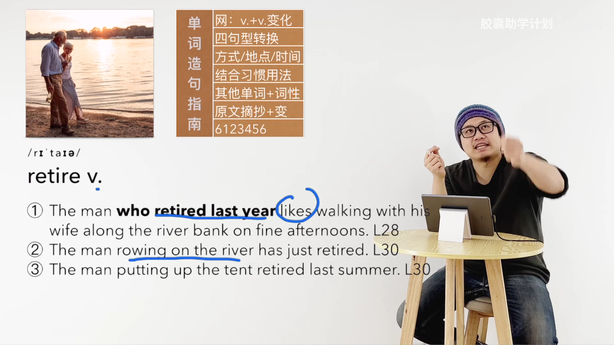

文字识别：单词造句指南 / 网：v.+v.变化 / 四句型转换 / 方式/地点/时间 / 结合习惯用法 / 其他单词+词性 / 原文摘抄+变 / 6123456 / /ri'taia/ / retire V. / ① The man who retired last vearlikeswalking with his / wife along the river bank on fine afternoons. L28 / The man rowing on the river has just retired. L30 / The man putting up the tent retired last summer. L30

### 画面 00:02:25

文字识别：单词造句指南 / 网：v.+v.变化 / 四句型转换 / 方式/地点/时间 / 结合习惯用法 / 其他单词+词性 / 原文摘抄+变 / 6123456 / /ri'taia/ / retire v. / ① The man who retired last yearlikeswalking with his / wife along the river bank on fine afternoons. L28 / The man rowing on the river has just retired. L30 / The man putting up the tent retired last summer. L30

### 画面 00:02:28

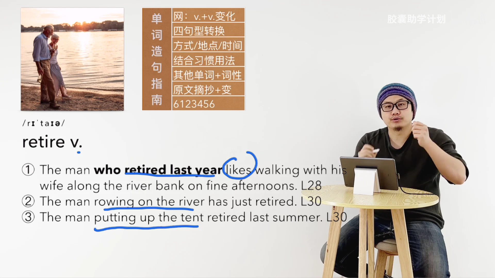

文字识别：单词造句指南 / 网：v.+v.变化 / 四句型转换 / 方式/地点/时间 / 结合习惯用法 / 其他单词+词性 / 原文摘抄+变 / 6123456 / /ri'taia/ / retire V. / ① The man who retired last yearlikeswalking with his / wife along the river bank on fine afternoons. L28 / The man rowing on the river has just retired. L30 / The man puting up the tent retired last summer. L30

## 00:02:30–00:03:00

一个形容词的作用，然后后置到这个the man的后面。我们就回顾了一下三十课分词现在分词引导的短语作定语后置，对吧？正在搭帐篷的那个人去年夏天就退休了，所以是一般过去式。OK，好，there you go. Next one，下一个单词跟我读一下，叫做company. Company啊，是公司的意思。OK，然后呢，我们造句说He has worked for this business company for ten years.那我们

### 画面 00:02:30

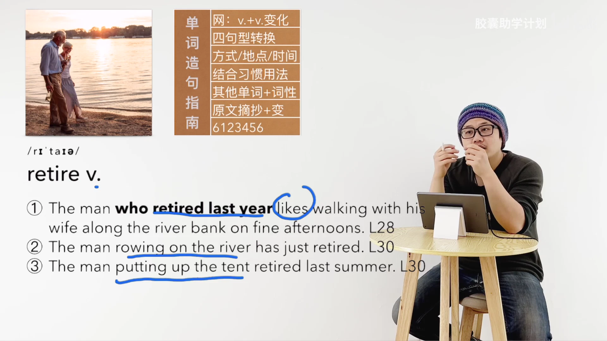

文字识别：单词造句指南 / 网：v.+v.变化 / 四句型转换 / 方式/地点/时间 / 结合习惯用法 / 其他单词+词性 / 原文摘抄+变 / 6123456 / /ri'taia/ / retire v. / ① The man who retired last yearlikeswalking with his / wife along the river bank on fine afternoons. L28 / The man rowing on the river has just retired. L30 / The man putting up the tent retired last summer. L30

### 画面 00:02:35

文字识别：单词造句指南 / 网：v.+v.变化 / 四句型转换 / 方式/地点/时间 / 结合习惯用法 / 其他单词+词性 / 原文摘抄+变 / 6123456 / /ri'taia/ / retire V. / ① The man who retired last yearlikeswalking with his / wife along the river bank on fine afternoons. L28 / The man rowing on the river has just retired. L30 / The man putting up the tent retired last summer. L30

### 画面 00:02:40

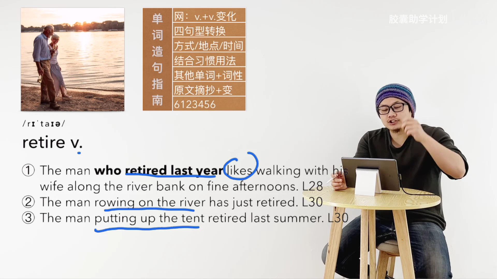

文字识别：单词造句指南 / 网：v.+v.变化 / 四句型转换 / 方式/地点/时间 / 结合习惯用法 / 其他单词+词性 / 原文摘抄+变 / 6123456 / /ri'taia/ / retire v. / ① The man who retired last yearlikeswalking with hi / wife along the river bank on fine afternoons. L28 / The man rowing on the river has just retired. L30 / The man putting up the tent retired last summer. L30

### 画面 00:02:45

文字识别：单词造句指南 / 网：v.+v.变化 / 四句型转换 / 方式/地点/时间 / 结合习惯用法 / 其他单词+词性 / 原文摘抄+变 / 6123456 / /ri'taia/ / retire v. / ① The man who retired last yearlikeswalking with his / wife along the river bank on fine afternoons. L28 / The man rowing on the river has just retired. L30 / The man putting up the tentfetired ast summer. L30

### 画面 00:02:47

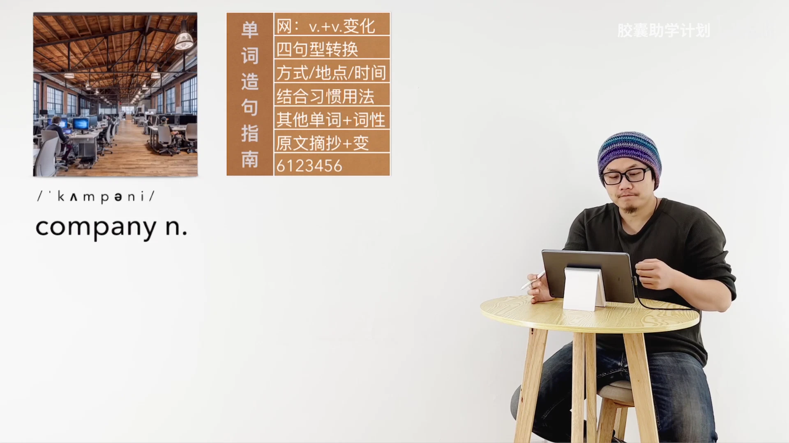

文字识别：单词造句指南 / 网：v.+v.变化 / 四句型转换 / 方式/地点/时间 / 结合习惯用法 / 其他单词+词性 / 原文摘抄+变 / 6123456 / / 'kΛmpani/ / company n.

### 画面 00:02:49

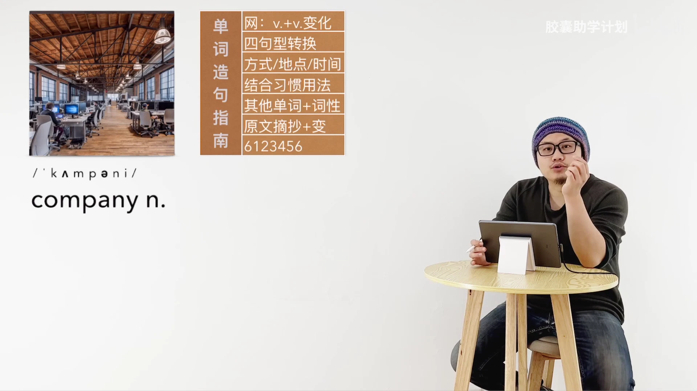

文字识别：单词造句指南 / 网：v.+v.变化 / 四句型转换 / 方式/地点/时间 / 结合习惯用法 / 其他单词+词性 / 原文摘抄+变 / 6123456 / / 'kΛmpani/ / company n.

### 画面 00:02:51

文字识别：单词造句指南 / 网：v.+v.变化 / 四句型转换 / 方式/地点/时间 / 结合习惯用法 / 其他单词+词性 / 原文摘抄+变 / 6123456 / / 'kΛmpani/ / company n.

### 画面 00:02:55

文字识别：单词造句指南 / 网：v.+v.变化 / 四句型转换 / 方式/地点/时间 / 结合习惯用法 / 其他单词+词性 / 原文摘抄+变 / 6123456 / / 'kΛmpani / / company n. / ① He has worked for this business company / for ten years. L4

### 画面 00:02:59

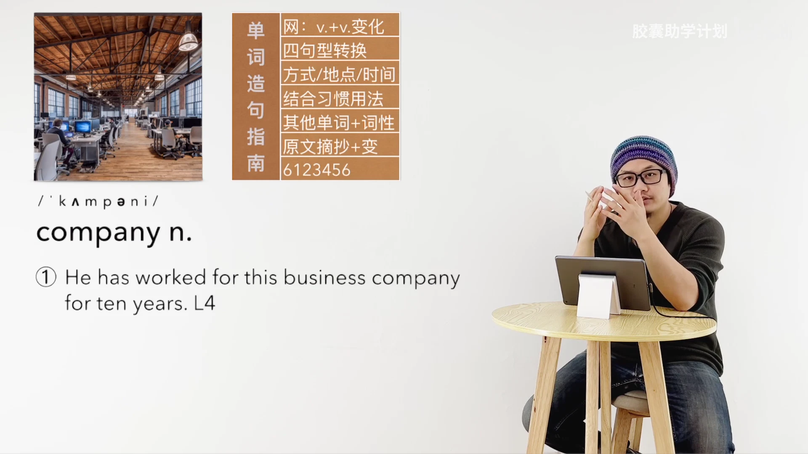

文字识别：单词造句指南 / 网：v.+v.变化 / 四句型转换 / 方式/地点/时间 / 结合习惯用法 / 其他单词+词性 / 原文摘抄+变 / 6123456 / / 'kΛmpani / / company n. / ① He has worked for this business company / for ten years. L4

## 00:03:00–00:03:30

结合了第十四课我们学过的叫 worked for，对吧？为什么什么而工作？他为这个呃大的商业公司工作，已经到今年是第十个年头了。然后注意我们选择了一个动词加动词的变化，对吧？所谓在这儿是时态，那用的是现在完成时，从过去持续到现在。OK，肯定句给您了，四句型转换，您可以自己试一下啊。再来说，When he was still working for that company, he liked

### 画面 00:03:01

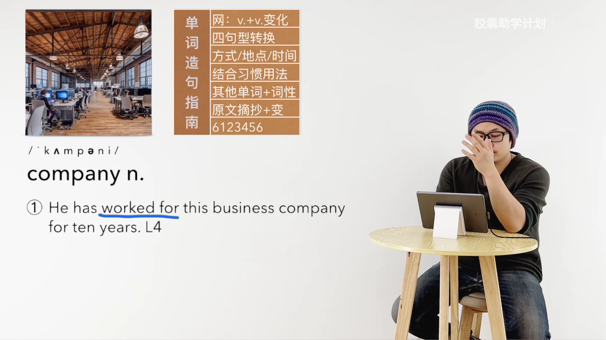

文字识别：单词造句指南 / 网：v.+v.变化 / 四句型转换 / 方式/地点/时间 / 结合习惯用法 / 其他单词+词性 / 原文摘抄+变 / 6123456 / / 'kΛmp ani / / company n. / ① He has worked for this business company / for ten years. L4

### 画面 00:03:05

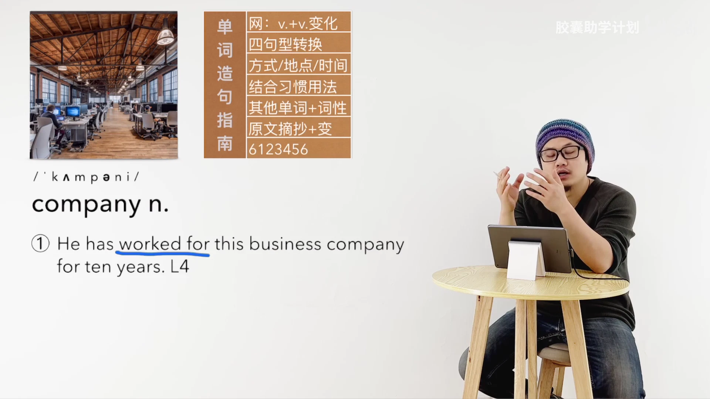

文字识别：单词造句指南 / 网：v.+v.变化 / 四句型转换 / 方式/地点/时间 / 结合习惯用法 / 其他单词+词性 / 原文摘抄+变 / 6123456 / / 'kΛmpani / / company n. / ① He has worked for this business company / for ten years. L4

### 画面 00:03:09

文字识别：单词造句指南 / 网：v.+v.变化 / 四句型转换 / 方式/地点/时间 / 结合习惯用法 / 其他单词+词性 / 原文摘抄+变 / 6123456 / / 'kΛmpani/ / company n. / ① He has worked for this business company / for ten years. L4

### 画面 00:03:11

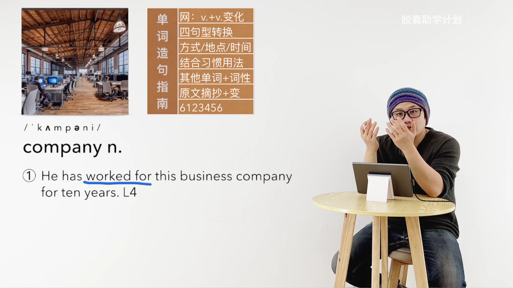

文字识别：单词造句指南 / 网：v.+v.变化 / 四句型转换 / 方式/地点/时间 / 结合习惯用法 / 其他单词+词性 / 原文摘抄+变 / 6123456 / / 'k Λmp ani / / company n. / ① He has worked for this business company / for ten years. L4

### 画面 00:03:13

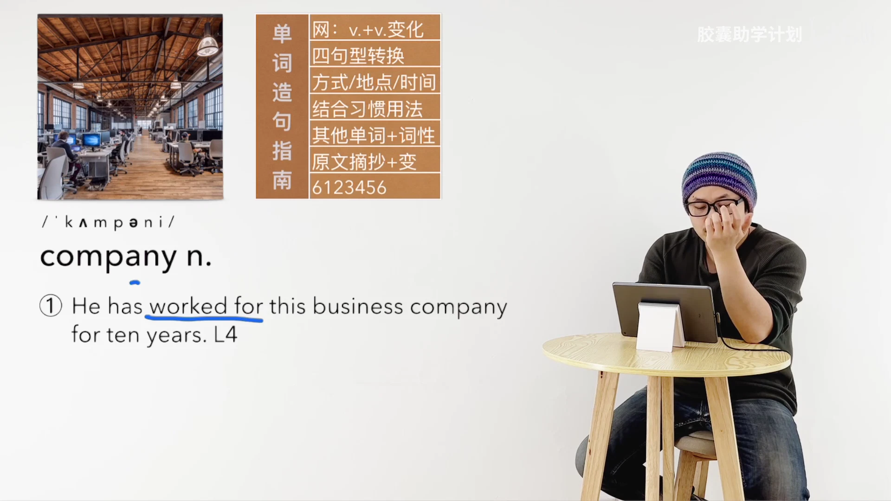

文字识别：单词造句指南 / 网：v.+v.变化 / 四句型转换 / 方式/地点/时间 / 结合习惯用法 / 其他单词+词性 / 原文摘抄+变 / 6123456 / / 'kΛmp ani / / company n. / ① He has worked for this business company / for ten years. L4

### 画面 00:03:15

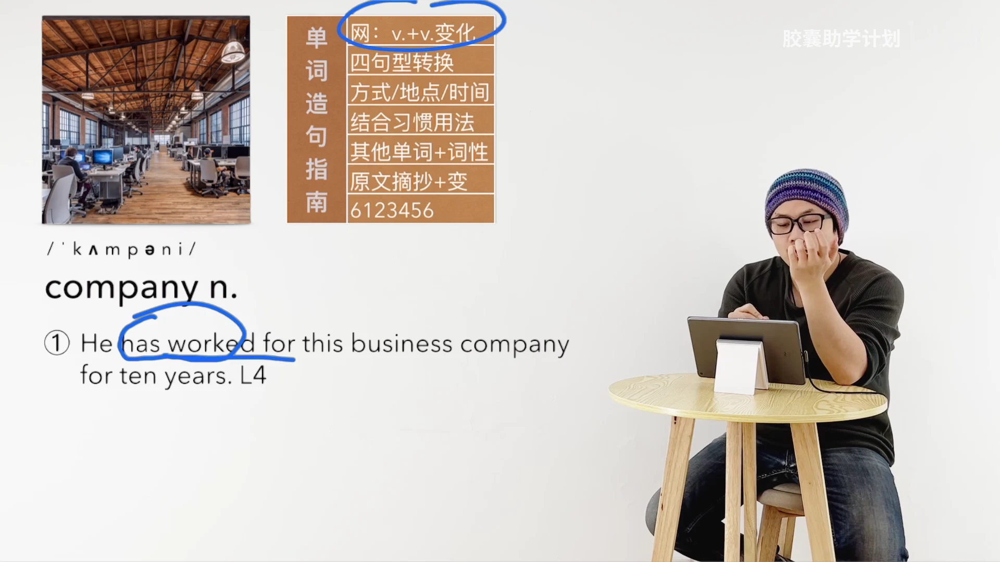

文字识别：单词造句指南 / 网：v.+v.变化 / 四句型转换 / 方式/地点/时间 / 结合习惯用法 / 其他单词+词性 / 原文摘抄+变 / 6123456 / / 'kΛmpani / / company n. / 1 / ) He / has worked for this business company / for ten years. L4

### 画面 00:03:20

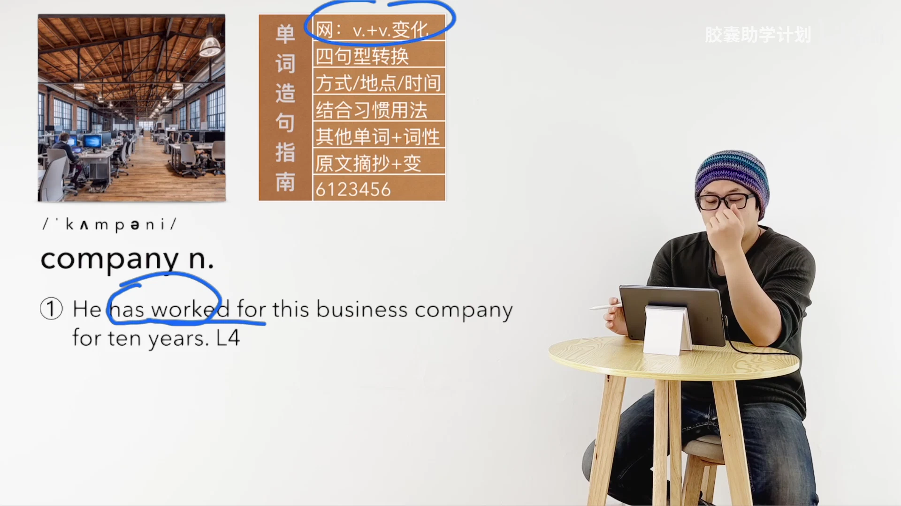

文字识别：单词造句指南 / 网：v.+v.变化 / 四句型转换 / 方式/地点/时间 / 结合习惯用法 / 其他单词+词性 / 原文摘抄+变 / 6123456 / / 'kΛmpani / / company n. / 1 / He / has worked for this business company / for ten years. L4

### 画面 00:03:22

文字识别：单词造句指南 / 网：v.+v.变化 / 四句型转换 / 方式/地点/时间 / 结合习惯用法 / 其他单词+词性 / 原文摘抄+变 / 6123456 / /'kampani / / company n. / ① Hehas worked for this business company / for ten years. L4 / When he was still working for that / company, he liked walking in the park near / his company. L7

### 画面 00:03:24

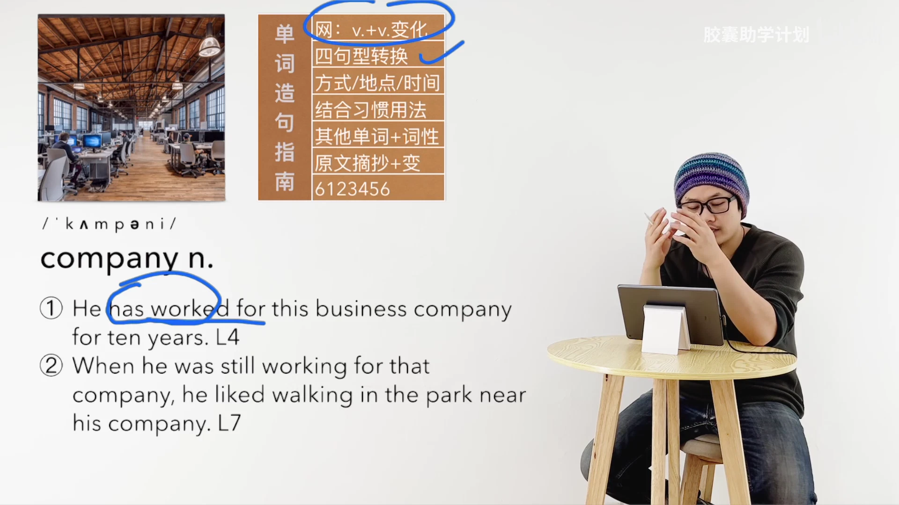

文字识别：单词造句指南 / 网：v.+v.变化 / 四句型转换 / 方式/地点/时间 / 结合习惯用法 / 其他单词+词性 / 原文摘抄+变 / 6123456 / / 'kampani/ / company n. / ① He has worked for this business company / for ten years. L4 / When he was still working for that / company, he liked walking in the park near / his company. L7

### 画面 00:03:26

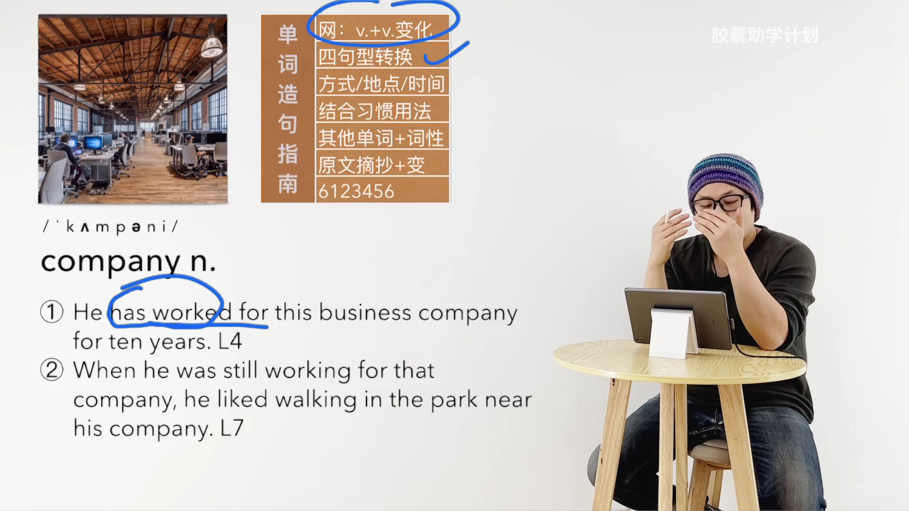

文字识别：单词造句指南 / 网：v.+v.变化 / 四句型转换 / 方式/地点/时间 / 结合习惯用法 / 其他单词+词性 / 原文摘抄+变 / 6123456 / / 'kampani/ / company n. / ① Hehas worked for this business company / for ten years. L4 / When he was still working for that / company, he liked walking in the park near / his company. L7

### 画面 00:03:28

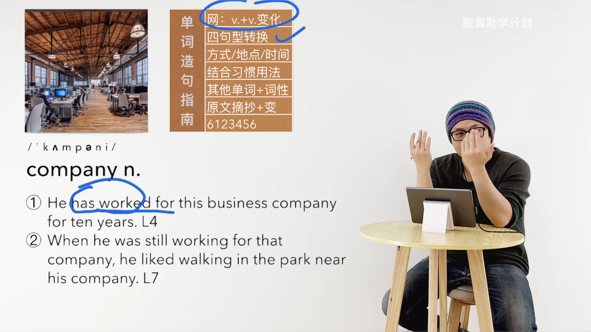

文字识别：单词造句指南 / 网：v.+v.变化 / 四句型转换 / 方式/地点/时间 / 结合习惯用法 / 其他单词+词性 / 原文摘抄+变 / 6123456 / / 'kampani/ / company n. / ① Hehas worked for this business company / for ten years. L4 / When he was still working for that / company, he liked walking in the park near / his company. L7

## 00:03:30–00:04:00

walking in the park near his company. Okay,好，那在这稍微有一点重复，但我故意的把 company 用了两遍，对吧？我们造一句话用两遍，哪怕有点重复啊，也这个应该是可以去做的啊。哎，When he was still working for was working过去进行时，也是本课要复习的一个语法点啊。本课是第二单元第七课了嘛，对不对？Next one,说This is the biggest company I've ever worked

### 画面 00:03:30

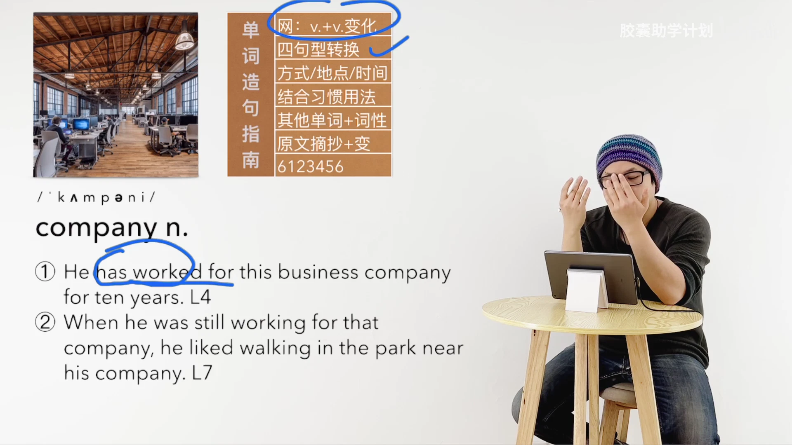

文字识别：单词造句指南 / 网：v.+v.变化 / 四句型转换 / 方式/地点/时间 / 结合习惯用法 / 其他单词+词性 / 原文摘抄+变 / 6123456 / /'kampani/ / company n. / ① Hehas worked for this business company / for ten years. L4 / When he was still working for that / company, he liked walking in the park near / his company. L7

### 画面 00:03:34

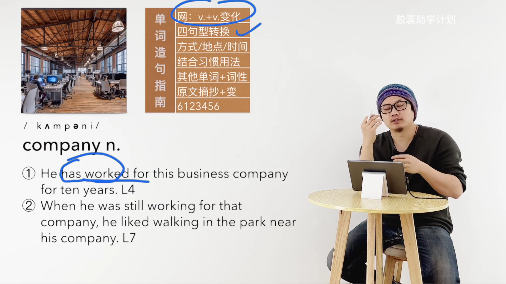

文字识别：单词造句指南 / 网：v.+v.变化 / 四句型转换 / 方式/地点/时间 / 结合习惯用法 / 其他单词+词性 / 原文摘抄+变 / 6123456 / / 'kampani/ / company n. / ① Hehas worked for this business company / for ten years. L4 / When he was still working for that / company, he liked walking in the park near / his company. L7

### 画面 00:03:36

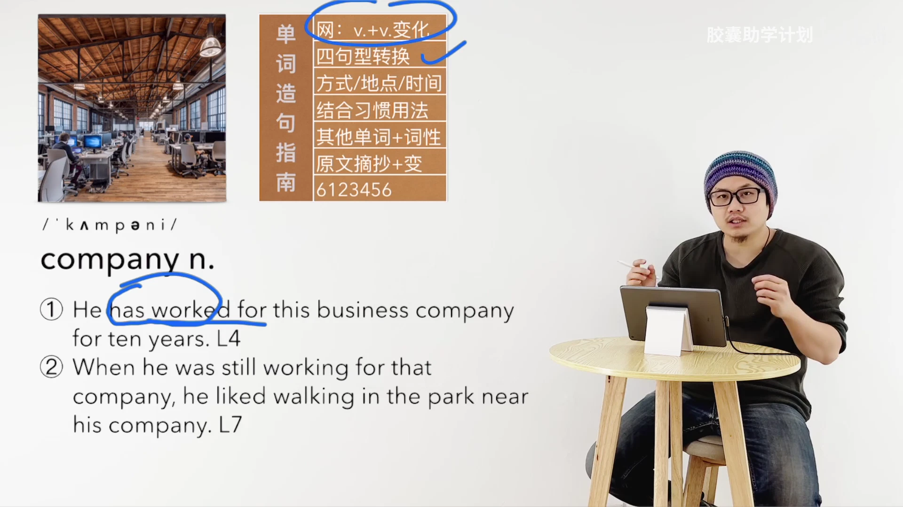

文字识别：单词造句指南 / 网：v.+v.变化 / 四句型转换 / 方式/地点/时间 / 结合习惯用法 / 其他单词+词性 / 原文摘抄+变 / 6123456 / / 'kampani/ / company n. / ① Hehas worked for this business company / for ten years. L4 / When he was still working for that / company, he liked walking in the park near / his company. L7

### 画面 00:03:41

文字识别：单词造句指南 / 网：v.+v.变化 / 四句型转换 / 方式/地点/时间 / 结合习惯用法 / 其他单词+词性 / 原文摘抄+变 / 6123456 / /'kΛmpani/ / company n. / ① Hehas worked for this business company / for ten years. L4 / When he was still working for that / company, he liked walking in the park near / his company. L7

### 画面 00:03:45

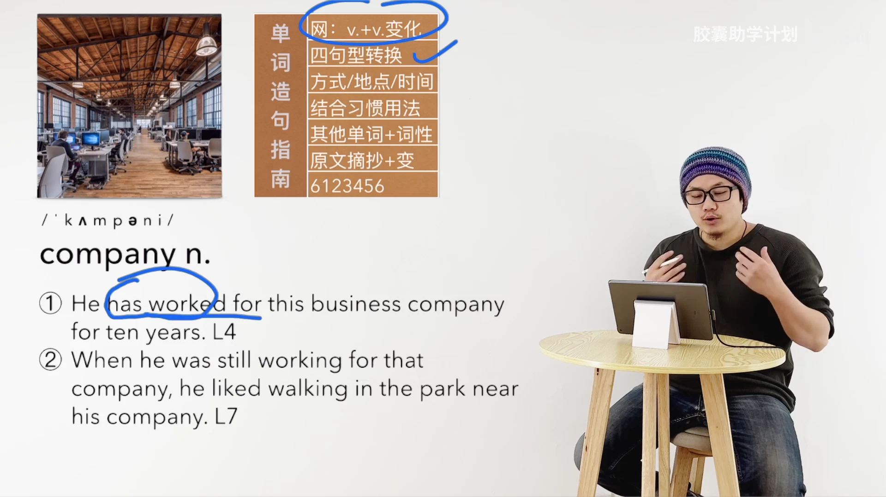

文字识别：单词造句指南 / 网：v.+v.变化 / 四句型转换 / 方式/地点/时间 / 结合习惯用法 / 其他单词+词性 / 原文摘抄+变 / 6123456 / / 'kΛmpani / / company n. / ① Hehas worked for this business company / for ten years. L4 / When he was still working for that / company, he liked walking in the park near / his company. L7

### 画面 00:03:49

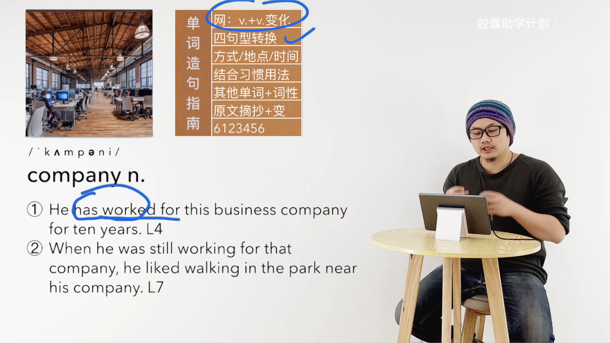

文字识别：单词造句指南 / 网：v.+v.变化 / 四句型转换 / 方式/地点/时间 / 结合习惯用法 / 其他单词+词性 / 原文摘抄+变 / 6123456 / / 'kampani / / company n. / ① Hehas worked for this business company / for ten years. L4 / When he was still working for that / company, he liked walking in the park near / his company. L7

### 画面 00:03:51

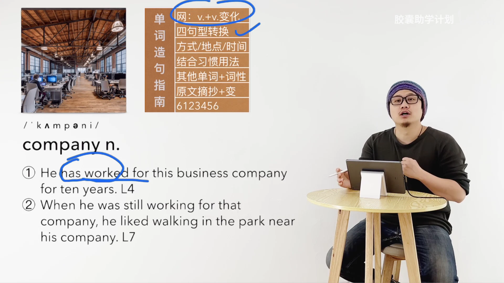

文字识别：单词造句指南 / 网：v.+v.变化 / 四句型转换 / 方式/地点/时间 / 结合习惯用法 / 其他单词+词性 / 原文摘抄+变 / 6123456 / / 'kampani/ / company n. / ① He has worked for this business company / for ten years. L4 / When he was still working for that / company, he liked walking in the park near / his company. L7

### 画面 00:03:55

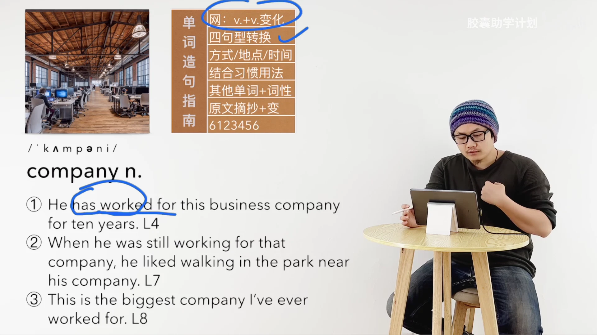

文字识别：单词造句指南 / 网：v.+v.变化 / 四句型转换 / 方式/地点/时间 / 结合习惯用法 / 其他单词+词性 / 原文摘抄+变 / 6123456 / / 'kΛmpan i / / company n. / ① He has worked for this business company / for ten years. L4 / When he was still working for that / company, he liked walking in the park near / his company. L7 / This is the biggest company I've ever / worked for. L8

### 画面 00:03:57

文字识别：单词造句指南 / 网：v.+v.变化 / 四句型转换 / 方式/地点/时间 / 结合习惯用法 / 其他单词+词性 / 原文摘抄+变 / 6123456 / / ' kΛ mpan i / / company n. / ① He has worked for this business company / for ten years. L4 / When he was still working for that / company, he liked walking in the park near / his company. L7 / This is the biggest company I've ever / worked for. L8

### 画面 00:03:59

文字识别：单词造句指南 / 网：v.+v.变化 / 四句型转换 / 方式/地点/时间 / 结合习惯用法 / 其他单词+词性 / 原文摘抄+变 / 6123456 / / 'kΛmpani / / company n. / ① Hehas worked for this business company / for ten years. L4 / When he was still working for that / company, he liked walking in the park near / his company. L7 / This is the biggest company I've ever / worked for. L8

## 00:04:00–00:04:30

for,哎，这是第八课这一个关键句型，我们时不时就拿出来让各位去回顾一下，没什么可说的啊。说这是我呃所工作过的所有公司当中最大的一个公司。Okay, next one，我们一起读叫做 bicycle bicycle，叫自行车，对吧？好，那我们造句说 he might have been riding a bicycle。哎，第十九课他之前可能是一直在骑自行车。那骑自行车叫做 ride a bicycle。

### 画面 00:04:01

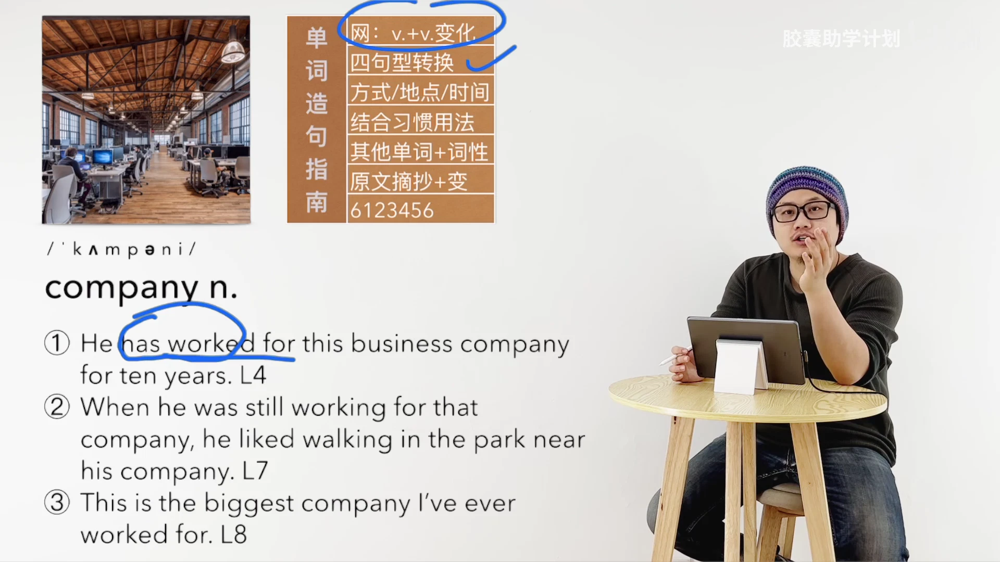

文字识别：单词造句指南 / 网：v.+v.变化 / 四句型转换 / 方式/地点/时间 / 结合习惯用法 / 其他单词+词性 / 原文摘抄+变 / 6123456 / / 'kΛmpan i / / company n. / ① Hehas worked for this business company / for ten years. L4 / When he was still working for that / company, he liked walking in the park near / his company. L7 / This is the biggest company I've ever / worked for. L8

### 画面 00:04:05

文字识别：单词造句指南 / 网：v.+v.变化 / 四句型转换 / 方式/地点/时间 / 结合习惯用法 / 其他单词+词性 / 原文摘抄+变 / 6123456 / / 'k Λ mpan i / / company n. / ① He has worked for this business company / for ten years. L4 / When he was still working for that / company, he liked walking in the park near / his company. L7 / This is the biggest company I've ever / worked for. L8

### 画面 00:04:08

文字识别：单词造句指南 / 网：v.+v.变化 / 四句型转换 / 方式/地点/时间 / 结合习惯用法 / 其他单词+词性 / 原文摘抄+变 / 6123456 / / 'k Λ mpani / / company n. / ① He has worked for this business company / for ten years. L4 / When he was still working for that / company, he liked walking in the park near / his company. L7 / This is the biggest company I've ever / worked for. L8

### 画面 00:04:10

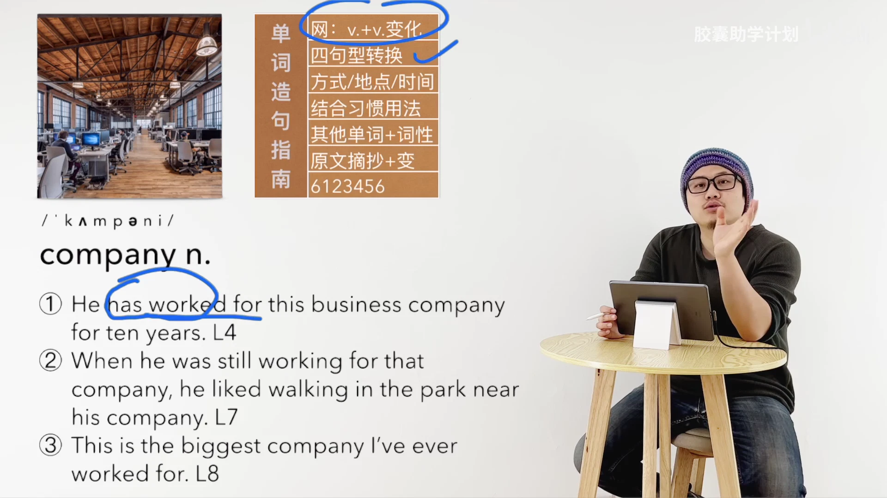

文字识别：单词造句指南 / 网：v.+v.变化 / 四句型转换 / 方式/地点/时间 / 结合习惯用法 / 其他单词+词性 / 原文摘抄+变 / 6123456 / / 'kΛmpan i / / company n. / ① Hehas worked for this business company / for ten years. L4 / When he was still working for that / company, he liked walking in the park near / his company. L7 / This is the biggest company I've ever / worked for. L8

### 画面 00:04:12

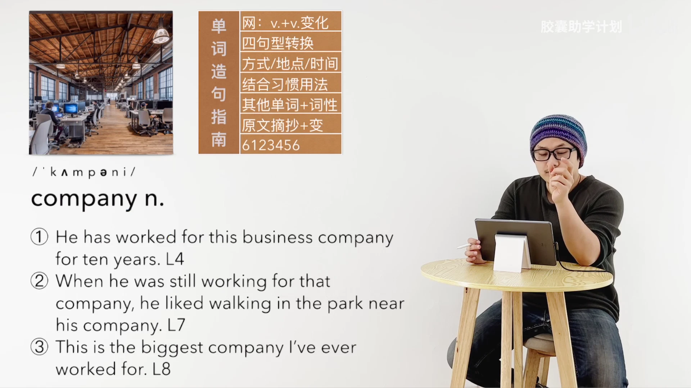

文字识别：单词造句指南 / 网：v.+v.变化 / 四句型转换 / 方式/地点/时间 / 结合习惯用法 / 其他单词+词性 / 原文摘抄+变 / 6123456 / / ' kΛmpani / / company n. / ① He has worked for this business company / for ten years. L4 / When he was still working for that / company, he liked walking in the park near / his company. L7 / This is the biggest company I've ever / worked for. L8

### 画面 00:04:14

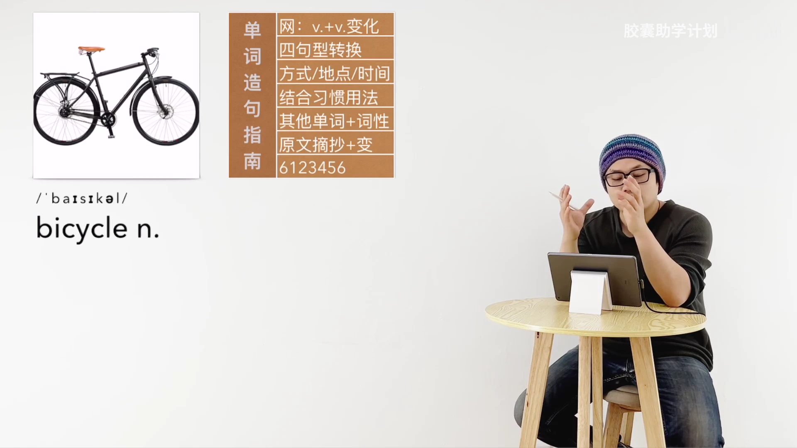

文字识别：单词造句指南 / 网：v.+v.变化 / 四句型转换 / 方式/地点/时间 / 结合习惯用法 / 其他单词+词性 / 原文摘抄+变 / 6123456 / /'baisikal/ / bicycle n.

### 画面 00:04:16

文字识别：单词造句指南 / 网：v.+v.变化 / 四句型转换 / 方式/地点/时间 / 结合习惯用法 / 其他单词+词性 / 原文摘抄+变 / 6123456 / /'baisikal/ / bicycle n.

### 画面 00:04:20

文字识别：单词造句指南 / 网：v.+v.变化 / 四句型转换 / 方式/地点/时间 / 结合习惯用法 / 其他单词+词性 / 原文摘抄+变 / 6123456 / /'baisikal/ / bicycle n. / ① He might have been riding a bicycle. L19

### 画面 00:04:25

文字识别：单词造句指南 / 网：v.+v.变化 / 四句型转换 / 方式/地点/时间 / 结合习惯用法 / 其他单词+词性 / 原文摘抄+变 / 6123456 / /'baisikal/ / bicycle n. / ① He might have been riding a bicycle. L19

## 00:04:30–00:05:00

That只不过我们要加上动词的变化，在这儿叫 might have been doing，叫当时可能是正在做某件事情。Next one，二十课一个习惯用法叫做，哎，这是我们叫单词造句结合之前的习惯用法，对吧？He is really interested in riding a bicycle. Okay，他对这件事情特别的感兴趣。然后我们也可以说，二十五课叫做 both and，说 both my father and my brother。二十六课 pretend，假装

### 画面 00:04:30

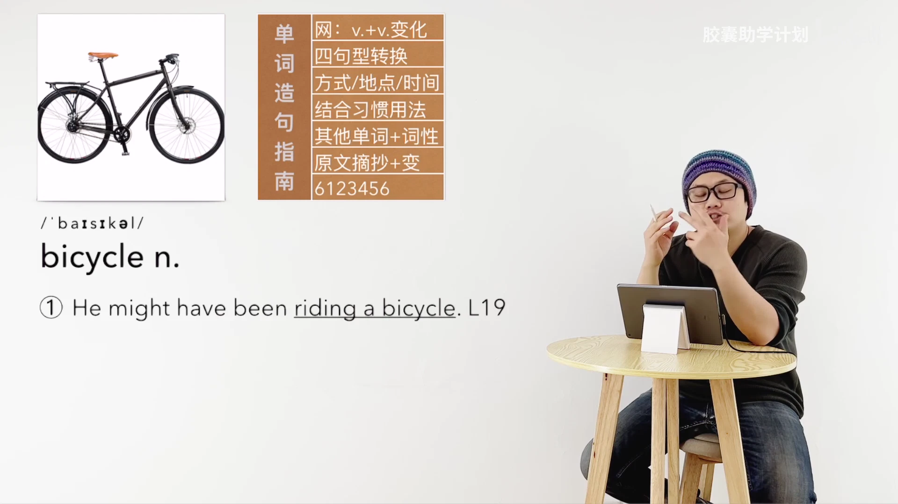

文字识别：单词造句指南 / 网：v.+v.变化 / 四句型转换 / 方式/地点/时间 / 结合习惯用法 / 其他单词+词性 / 原文摘抄+变 / 6123456 / /'baisikal/ / bicycle n. / ① He might have been riding a bicycle. L19

### 画面 00:04:35

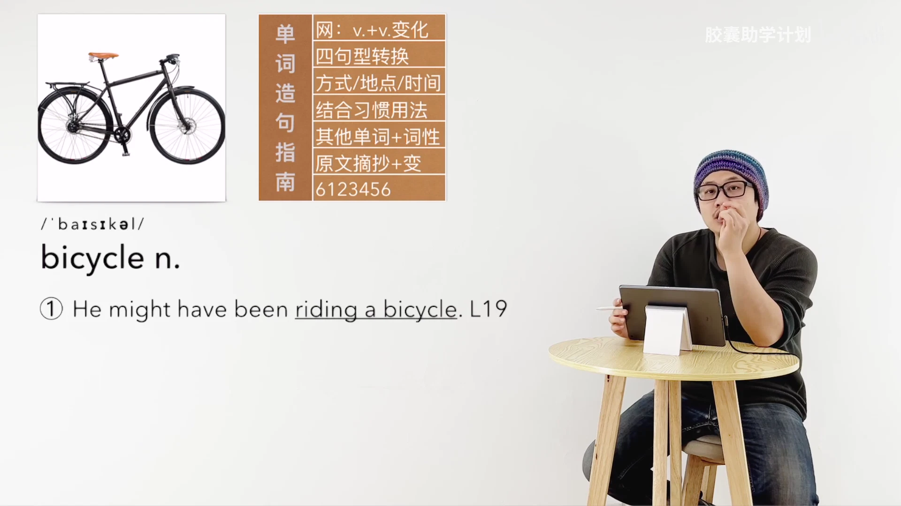

文字识别：单词造句指南 / 网：v.+v.变化 / 四句型转换 / 方式/地点/时间 / 结合习惯用法 / 其他单词+词性 / 原文摘抄+变 / 6123456 / /'baisikal/ / bicycle n. / ① He might have been riding a bicycle. L19

### 画面 00:04:37

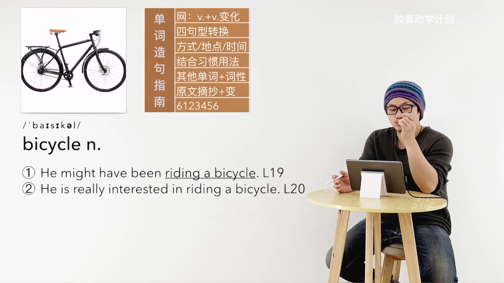

文字识别：单词造句指南 / 网：v.+v.变化 / 四句型转换 / 方式/地点/时间 / 结合习惯用法 / 其他单词+词性 / 原文摘抄+变 / 6123456 / /'baisikal/ / bicycle n. / ① He might have been riding a bicycle. L19 / He is really interested in riding a bicycle. L20

### 画面 00:04:40

文字识别：单词造句指南 / 网：v.+v.变化 / 四句型转换 / 方式/地点/时间 / 结合习惯用法 / 其他单词+词性 / 原文摘抄+变 / 6123456 / /'baisikal/ / bicycle n. / ① He might have been riding a bicycle. L19 / He is really interested in riding a bicycle. L20

### 画面 00:04:43

文字识别：单词造句指南 / 网：v.+v.变化 / 四句型转换 / 方式/地点/时间 / 结合习惯用法 / 其他单词+词性 / 原文摘抄+变 / 6123456 / /'baisikal/ / bicycle n. / ① He might have been riding a bicycle. L19 / He is really interested in riding a bicycle. L20

### 画面 00:04:45

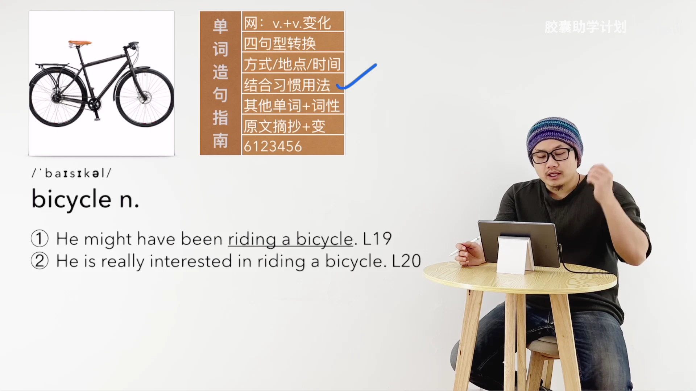

文字识别：单词造句指南 / 网：v.+v.变化 / 四句型转换 / 方式/地点/时间 / 结合习惯用法 / 其他单词+词性 / 原文摘抄+变 / 6123456 / /'baisikal/ / bicycle n. / ① He might have been riding a bicycle. L19 / He is really interested in riding a bicycle. L20

### 画面 00:04:50

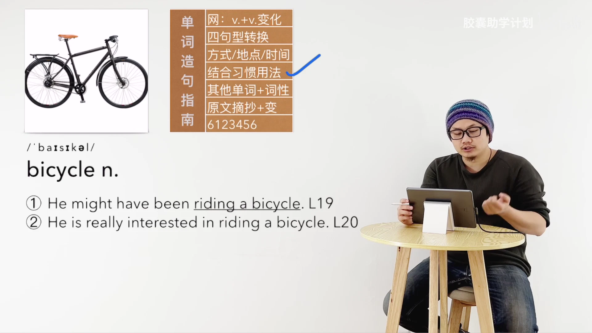

文字识别：单词造句指南 / 网：v.+v.变化 / 四句型转换 / 方式/地点/时间 / 结合习惯用法 / 其他单词+词性 / 原文摘抄+变 / 6123456 / /baisikal/ / bicycle n. / ① He might have been riding a bicycle. L19 / He is really interested in riding a bicycle. L20

### 画面 00:04:52

文字识别：单词造句指南 / 网：v.+v.变化 / 四句型转换 / 方式/地点/时间 / 结合习惯用法 / 其他单词+词性 / 原文摘抄+变 / 6123456 / /'baisikal/ / bicycle n. / ① He might have been riding a bicycle. L19 / He is really interested in riding a bicycle. L20 / Both my father and my brother pretend that / they like bicycle. L25 L26

### 画面 00:04:55

文字识别：单词造句指南 / 网：v.+v.变化 / 四句型转换 / 方式/地点/时间 / 结合习惯用法 / 其他单词+词性 / 原文摘抄+变 / 6123456 / /'baisikal/ / bicycle n. / ① He might have been riding a bicycle. L19 / He is really interested in riding a bicycle. L20 / Both my father and my brother pretend that / they like bicycle. L25 L26

## 00:05:00–00:05:30

they like bicycle.啊，假装他们喜欢自行车，其实他们并不喜欢。OK, next one,下一个单词我们一起读，叫做 save, save.啊，那它最基本就有存钱的意思，对吧？比如说原文给了一句话叫 He saved money for years.啊，他们存钱存了很多年。OK,那肯定句，你看我们从原文摘抄后边还有一个关键的字叫做变，变的一般就是四句型啊，四句型的转换或

### 画面 00:05:00

文字识别：单词造句指南 / 网：v.+v.变化 / 四句型转换 / 方式/地点/时间 / 结合习惯用法 / 其他单词+词性 / 原文摘抄+变 / 6123456 / /'baisikal/ / bicycle n. / ① He might have been riding a bicycle. L19 / He is really interested in riding a bicycle. L20 / Both my father and my brother pretend that / they like bicycle. L25 L26

### 画面 00:05:05

文字识别：单词造句指南 / 网：v.+v.变化 / 四句型转换 / 方式/地点/时间 / 结合习惯用法 / 其他单词+词性 / 原文摘抄+变 / 6123456 / /selvl / save v.

### 画面 00:05:07

文字识别：单词造句指南 / 网：v.+v.变化 / 四句型转换 / 方式/地点/时间 / 结合习惯用法 / 其他单词+词性 / 原文摘抄+变 / 6123456 / /seivl / save v.

### 画面 00:05:10

文字识别：单词造句指南 / 网：v.+v.变化 / 四句型转换 / 方式/地点/时间 / 结合习惯用法 / 其他单词+词性 / 原文摘抄+变 / 6123456 / /seiv/ / save v. / ① [Story]: He saved money for years.

### 画面 00:05:15

文字识别：单词造句指南 / 网：v.+v.变化 / 四句型转换 / 方式/地点/时间 / 结合习惯用法 / 其他单词+词性 / 原文摘抄+变 / 6123456 / /seiv/ / save v. / ① [Story]: He saved money for years.

### 画面 00:05:20

文字识别：单词造句指南 / 网：v.+v.变化 / 四句型转换 / 方式/地点/时间 / 结合习惯用法 / 其他单词+词性 / 原文摘抄+变 / 6123456 / /seivl / save v. / ① [Story]: He saved money for years.

### 画面 00:05:23

文字识别：单词造句指南 / 网：v.+v.变化 / 四句型转换 / 方式/地点/时间 / 结合习惯用法 / 其他单词+词性 / 原文摘抄+变 / 6123456 / /seiv/ / save v. / ① [Story]: He saved money for years.

### 画面 00:05:25

文字识别：单词造句指南 / 网：v.+v.变化 / 四句型转换 / 方式/地点/时间 / 结合习惯用法 / 其他单词+词性 / 原文摘抄+变 / 6123456 / /selvl / save v. / ① [Story]: He saved money for years.

### 画面 00:05:27

文字识别：单词造句指南 / 网：v.+v.变化 / 四句型转换 / 方式/地点/时间 / 结合习惯用法 / 其他单词+词性 / 原文摘抄+变 / 6123456 / /selvl / save v. / ① [Story]: He saved money for years.

### 画面 00:05:29

文字识别：单词造句指南 / 网：v.+v.变化 / 四句型转换 / 方式/地点/时间 / 结合习惯用法 / 其他单词+词性 / 原文摘抄+变 / 6123456 / /seivl / save v. / ① [Story]: He saved money for years.

## 00:05:30–00:06:00

者是这个时态的改变，对吧？比如说他存钱存了很多年啊，那你如果想说他有存钱的习惯，是不是把很多年去掉啊？比如说换成每一天啊，或者说每年每月，对吧？就变成了一种习惯，于是时态就变成了动一般现在时啊。这是我们造句的一些思路。然后四句型转换呢，在这个地方给大家提供了一些关键的词啊，放到这儿，各位可以暂停屏幕去做这样的练习。然后呢，说 the man who

### 画面 00:05:31

文字识别：单词造句指南 / 网：v.+v.变化 / 四句型转换 / 方式/地点/时间 / 结合习惯用法 / 其他单词+词性 / 原文摘抄+变 / 6123456 / /seivl / save v. / ① [Story]: He saved money for years.

### 画面 00:05:34

文字识别：单词造句指南 / 网：v.+v.变化 / 四句型转换 / 方式/地点/时间 / 结合习惯用法 / 其他单词+词性 / 原文摘抄+变 / 6123456 / /seiv/ / save v. / ① [Story]: He saved money for years.

### 画面 00:05:36

文字识别：单词造句指南 / 网：v.+v.变化 / 四句型转换 / 方式/地点/时间 / 结合习惯用法 / 其他单词+词性 / 原文摘抄+变 / 6123456 / /seiv/ / save v. / ① [Story]: He saved money for years.

### 画面 00:05:40

文字识别：单词造句指南 / 网：v.+v.变化 / 四句型转换 / 方式/地点/时间 / 结合习惯用法 / 其他单词+词性 / 原文摘抄+变 / 6123456 / /seiv/ / save v. / ① [Story]: He saved money for years.

### 画面 00:05:45

文字识别：单词造句指南 / 网：v.+v.变化 / 四句型转换 / 方式/地点/时间 / 结合习惯用法 / 其他单词+词性 / 原文摘抄+变 / 6123456 / /seiv/ / save v. / ① [Story]: He saved money for years.

### 画面 00:05:50

文字识别：单词造句指南 / 网：v.+v.变化 / 四句型转换 / 方式/地点/时间 / 结合习惯用法 / 其他单词+词性 / 原文摘抄+变 / 6123456 / /seiv/ / save v. / ① [Story]: He saved money for years. / did/how long/why/who...

### 画面 00:05:53

文字识别：单词造句指南 / 网：v.+v.变化 / 四句型转换 / 方式/地点/时间 / 结合习惯用法 / 其他单词+词性 / 原文摘抄+变 / 6123456 / /seiv/ / save v. / ① [Story]: He saved money for years. / did/how long/why/who...

### 画面 00:05:55

文字识别：单词造句指南 / 网：v.+v.变化 / 四句型转换 / 方式/地点/时间 / 结合习惯用法 / 其他单词+词性 / 原文摘抄+变 / 6123456 / /seiv/ / save v. / ① [Story]: He saved money for years. / did/how long/why/who...

### 画面 00:05:57

文字识别：单词造句指南 / 网：v.+v.变化 / 四句型转换 / 方式/地点/时间 / 结合习惯用法 / 其他单词+词性 / 原文摘抄+变 / 6123456 / /seiv/ / save v. / ① [Story]: He saved money for years. / did/how long/why/who... / The man who saved money for years had / trouble finding his bank card. L28

### 画面 00:05:59

文字识别：单词造句指南 / 网：v.+v.变化 / 四句型转换 / 方式/地点/时间 / 结合习惯用法 / 其他单词+词性 / 原文摘抄+变 / 6123456 / lseiv/ / save v. / ① [Story]: He saved money for years. / did/how long/why/who... / The man who saved money for years had / trouble finding his bank card. L28

## 00:06:00–00:06:30

saved money for years had trouble finding his bank card. 啊，这个就很悲催，是吧？存了很多年前，然后呢？Have trouble doing something. 就是二十八课咱们学的，说找到他的银行卡有困难，是吧？找不到银行卡了。那然后定语从句 who saved money for years，在这儿我需要各位自己去思考一个问题，就是这里的 who 到底能不能被省略掉？能不能说 the man saved money for years？是吧？听上去好像没有问题啊。英语的语法注

### 画面 00:06:01

文字识别：单词造句指南 / 网：v.+v.变化 / 四句型转换 / 方式/地点/时间 / 结合习惯用法 / 其他单词+词性 / 原文摘抄+变 / 6123456 / /seivl / save v. / ① [Story]: He saved money for years. / did/how long/why/who... / The man who saved money for years had / trouble finding his bank card. L28

### 画面 00:06:05

文字识别：单词造句指南 / 网：v.+v.变化 / 四句型转换 / 方式/地点/时间 / 结合习惯用法 / 其他单词+词性 / 原文摘抄+变 / 6123456 / /seiv/ / save v. / ① [Story]: He saved money for years. / did/how long/why/who... / The man who saved money for years had / trouble finding his bank card. L28

### 画面 00:06:10

文字识别：单词造句指南 / 网：v.+v.变化 / 四句型转换 / 方式/地点/时间 / 结合习惯用法 / 其他单词+词性 / 原文摘抄+变 / 6123456 / /seivl / save v. / ① [Story]: He saved money for years. / did/how long/why/who... / The man who saved money for years had / trouble finding his bank card. L28

### 画面 00:06:15

文字识别：单词造句指南 / 网：v.+v.变化 / 四句型转换 / 方式/地点/时间 / 结合习惯用法 / 其他单词+词性 / 原文摘抄+变 / 6123456 / /seiv/ / save v. / ① [Story]: He saved money for years. / did/how lang/why/who... / The man who saved money for years had / trouble finding his bank card. L28

### 画面 00:06:18

文字识别：单词造句指南 / 网：v.+v.变化 / 四句型转换 / 方式/地点/时间 / 结合习惯用法 / 其他单词+词性 / 原文摘抄+变 / 6123456 / /seiv/ / save v. / ① [Story]: He saved money for years. / did/how lgng/why/who... / The man who saved money for years / had / trouble finding his bank card. L28

### 画面 00:06:20

文字识别：单词造句指南 / 网：v.+v.变化 / 四句型转换 / 方式/地点/时间 / 结合习惯用法 / 其他单词+词性 / 原文摘抄+变 / 6123456 / /seivl / save v. / ① [Story]: He saved money for years. / did/how lgng/why/who... / The man who saved money for years / had / trouble finding his bank card. L28

### 画面 00:06:23

文字识别：单词造句指南 / 网：v.+v.变化 / 四句型转换 / 方式/地点/时间 / 结合习惯用法 / 其他单词+词性 / 原文摘抄+变 / 6123456 / lseivl / save v. / ① [Story]: He saved money for years. / did/how lgng/why/who... / The man who saved money for years / had / trouble finding his bank card. L28

### 画面 00:06:25

文字识别：单词造句指南 / 网：v.+v.变化 / 四句型转换 / 方式/地点/时间 / 结合习惯用法 / 其他单词+词性 / 原文摘抄+变 / 6123456 / /seiv/ / save v. / ① [Story]: He saved money for years. / did/how lgng/why/who... / The man who saved money for years / had / trouble finding his bank card. L28

## 00:06:30–00:07:00

意啊，不是你汉语翻译过来没有问题就行了的，对不对？还是要满足人家英文的规则的啊。Next one，注意 save 还有一个非常常用的意思，刚才是存钱啊，现在跟存就没有任何关系了，叫 save somebody's life，叫做拯救某人的生命，救了某人一命，对吧？那我们接下来看一个小的电影片段，这个电影片段当中就出现了叫 save my life，叫救了我一命，对吧？Ghost man.

### 画面 00:06:30

文字识别：单词造句指南 / 网：v.+v.变化 / 四句型转换 / 方式/地点/时间 / 结合习惯用法 / 其他单词+词性 / 原文摘抄+变 / 6123456 / lseivl / save v. / ① [Story]: He saved money for years. / did/how lgng/why/who... / The man who saved money for years / had / trouble finding his bank card. L28

### 画面 00:06:35

文字识别：单词造句指南 / 网：v.+v.变化 / 四句型转换 / 方式/地点/时间 / 结合习惯用法 / 其他单词+词性 / 原文摘抄+变 / 6123456 / /seiv/ / save v. / ① [Story]: He saved money for years. / did/how lgng/why/who... / The man who saved money for years / had / trouble finding his bank card. L28

### 画面 00:06:38

文字识别：单词造句指南 / 网：v.+v.变化 / 四句型转换 / 方式/地点/时间 / 结合习惯用法 / 其他单词+词性 / 原文摘抄+变 / 6123456 / /seiv/ / save v. / ① [Story]: He saved money for years. / did/how lgng/why/who... / The man who saved money for years / had / trouble finding his bank card. L28 / save sb's life

### 画面 00:06:40

文字识别：单词造句指南 / 网：v.+v.变化 / 四句型转换 / 方式/地点/时间 / 结合习惯用法 / 其他单词+词性 / 原文摘抄+变 / 6123456 / /seiv/ / save v. / ① [Story]: He saved money for years. / did/how long/why/who... / The man who saved money for years / had / trouble finding his bank card. L28 / save sb's life

### 画面 00:06:45

文字识别：单词造句指南 / 网：v.+v.变化 / 四句型转换 / 方式/地点/时间 / 结合习惯用法 / 其他单词+词性 / 原文摘抄+变 / 6123456 / /seivl / save v. / ① [Story]: He saved money for years. / did/how long/why/who... / The man who saved money for years / had / trouble finding his bank card. L28 / save sb's life

### 画面 00:06:50

文字识别：单词造句指南 / 网：v.+v.变化 / 四句型转换 / 方式/地点/时间 / 结合习惯用法 / 其他单词+词性 / 原文摘抄+变 / 6123456 / /seivl / save v. / ① [Story]: He saved money for years. / did/how long/why/who... / The man who saved money for years / had / trouble finding his bank card. L28 / save sb's life

### 画面 00:06:52

文字识别：save my life / 您是个好人 / 辛德勒的名单 / You are a good man. / Schindler's List / (1993)

### 画面 00:06:59

文字识别：save my life / 您是个好人 / 辛德勒的名单 / You are a good man. / Schindler's List / (1993)

## 00:07:00–00:07:30

he saved my life. This is the God bless him. No, God bless you. Okay, save my life啊，救了我一命啊。这个小短语各位可以记一下。Saving常见的意思也有拯救的意

### 画面 00:07:01

文字识别：save my life / 您是个好人 / 辛德勒的名单 / You are a good man. / Schindler's List/ / (1993)

### 画面 00:07:03

文字识别：save my life / SNIA / 辛德勒的名单 / Schindler's List) / (1993)

### 画面 00:07:05

文字识别：save my life / 他救了我的命 / 没错 / 辛德勒的名单 / Hesaved my life. / Yes, he did. / Schindler's List / (1993)

### 画面 00:07:07

文字识别：save my life / SN / 愿神保佑他 / 是的走吧 / 辛德勒的名单 / God bless him. / Yeah. Come on. / Schindler's List / (1993)

### 画面 00:07:09

文字识别：save my life / 愿神保佑他 / 是的走吧 / 辛德勒的名单 / God bless him. / Yeah. Come on. / Schindler's List / (1993)

### 画面 00:07:11

文字识别：save my life / 辛德勒的名单 / Schindler's List / (1993)

### 画面 00:07:13

文字识别：save my life / 愿神保佑您 / 辛德勒的名单 / God bless you! / Schindler's List / (1993)

### 画面 00:07:15

文字识别：save my life / 辛德勒的名单 / Schindler's List / (1993)

### 画面 00:07:17

文字识别：save my life / ROTYEIO / 辛德勒的名单 / Schindler's List/ / (1993)

### 画面 00:07:19

文字识别：save my life / OTEO / 辛德勒的名单 / Schindler's List / (1993)

### 画面 00:07:21

文字识别：save my life / SOTYE / 辛德勒的名单 / Schindler's List / (1993)

### 画面 00:07:25

文字识别：单词造句指南 / 网：v.+v.变化 / 四句型转换 / 方式/地点/时间 / 结合习惯用法 / 其他单词+词性 / 原文摘抄+变 / 6123456 / / w3 :k∫Dρ / / workshop n.

### 画面 00:07:27

文字识别：单词造句指南 / 网：v.+v.变化 / 四句型转换 / 方式/地点/时间 / 结合习惯用法 / 其他单词+词性 / 原文摘抄+变 / 6123456 / / w3 :k∫Dρ / / workshop n.

### 画面 00:07:29

文字识别：单词造句指南 / 网：v.+v.变化 / 四句型转换 / 方式/地点/时间 / 结合习惯用法 / 其他单词+词性 / 原文摘抄+变 / 6123456 / / ·w3 :k∫Dρ / / workshop n.

## 00:07:30–00:08:00

啊。Next one，下一个单词我们一起读，叫做 workshop。Workshop，你看这两个单词你好像都认的，工作的商店是吧？工作 work，商店 shop，workshop。那 workshop 本身是什么意思呢？我找了一段英文，我们一起看一下啊。这段英文是有超纲的语法和单词的，可能那我们尝试去理解一下。说 a room or building，说它可能是一个房间或者是一个建筑啊，都可

### 画面 00:07:31

文字识别：单词造句指南 / 网：v.+v.变化 / 四句型转换 / 方式/地点/时间 / 结合习惯用法 / 其他单词+词性 / 原文摘抄+变 / 6123456 / / 'w3 :k∫Dρ / / workshop n.

### 画面 00:07:35

文字识别：单词造句指南 / 网：v.+v.变化 / 四句型转换 / 方式/地点/时间 / 结合习惯用法 / 其他单词+词性 / 原文摘抄+变 / 6123456 / / ·w3 :k∫Dρ / / workshop n.

### 画面 00:07:40

文字识别：单词造句指南 / 网：v.+v.变化 / 四句型转换 / 方式/地点/时间 / 结合习惯用法 / 其他单词+词性 / 原文摘抄+变 / 6123456 / / ·w3 :k∫Dρ / / workshop n.

### 画面 00:07:43

文字识别：单词造句指南 / 网：v.+v.变化 / 四句型转换 / 方式/地点/时间 / 结合习惯用法 / 其他单词+词性 / 原文摘抄+变 / 6123456 / / ·w3 :k∫Dρ / / workshop n.

### 画面 00:07:45

文字识别：单词造句指南 / 网：v.+v.变化 / 四句型转换 / 方式/地点/时间 / 结合习惯用法 / 其他单词+词性 / 原文摘抄+变 / 6123456 / / w 3 :k ∫D ρ / / workshop n. / a room or building where things are made / or repaired using machines and/or tools

### 画面 00:07:50

文字识别：单词造句指南 / 网：v.+v.变化 / 四句型转换 / 方式/地点/时间 / 结合习惯用法 / 其他单词+词性 / 原文摘抄+变 / 6123456 / / w 3 :k ∫D ρ / / workshop n. / a room or building where things are made / or repaired using machines and/or tools

### 画面 00:07:54

文字识别：单词造句指南 / 网：v.+v.变化 / 四句型转换 / 方式/地点/时间 / 结合习惯用法 / 其他单词+词性 / 原文摘抄+变 / 6123456 / / w 3 :k ∫D ρ / / workshop n. / a room or buildinalwhere things are made / or repaired using machines and/or tools

### 画面 00:07:56

文字识别：单词造句指南 / 网：v.+v.变化 / 四句型转换 / 方式/地点/时间 / 结合习惯用法 / 其他单词+词性 / 原文摘抄+变 / 6123456 / / ·w 3 :k ∫Dρ / / workshop n. / a room or buildinav / Jwhere things are made / or repaired using machines and/or tools

## 00:08:00–00:08:30

以，你注意，所以这判断了它不是个动作，是吧？它是个名词啊。反正首先它是个房间，它不是瓜果梨桃啊，是一个房间或者一个建筑。Where things are made or repaired，好，注意这个 where 是以后五十五课啊，我印象当中我们会学到的叫 where 引导的定语从句啊的，在那里啊，哎，在那里 things 事情呢被制作啊，东西呢被制作或被修理，这是个笔袋，咱们学过对吧？说这样一个房间或

### 画面 00:08:00

文字识别：单词造句指南 / 网：v.+v.变化 / 四句型转换 / 方式/地点/时间 / 结合习惯用法 / 其他单词+词性 / 原文摘抄+变 / 6123456 / / 'w 3 :k ∫Dρ / / workshop n. / a room or buildinal / Jwhere things are made / or repaired using machines and/or tools

### 画面 00:08:05

文字识别：单词造句指南 / 网：v.+v.变化 / 四句型转换 / 方式/地点/时间 / 结合习惯用法 / 其他单词+词性 / 原文摘抄+变 / 6123456 / /  w 3 :k ∫D ρ / / workshop n. / a room or buildina where things are made / or repaired using machines and/or tools

### 画面 00:08:10

文字识别：单词造句指南 / 网：v.+v.变化 / 四句型转换 / 方式/地点/时间 / 结合习惯用法 / 其他单词+词性 / 原文摘抄+变 / 6123456 / / 'w 3 :k ∫Dρ / / workshop n. / a room or buildinal / where things are made / or repaired using machines and/or tools

### 画面 00:08:12

文字识别：单词造句指南 / 网：v.+v.变化 / 四句型转换 / 方式/地点/时间 / 结合习惯用法 / 其他单词+词性 / 原文摘抄+变 / 6123456 / / 'w 3 :k ∫D ρ / / workshop n. / a room or buildina / where things are made / or repaired using machines and/or tools

### 画面 00:08:14

文字识别：单词造句指南 / 网：v.+v.变化 / 四句型转换 / 方式/地点/时间 / 结合习惯用法 / 其他单词+词性 / 原文摘抄+变 / 6123456 / / 'w 3 :k ∫Dρ / / workshop n. / a room or buildina where / things are made / or repaired using / machines and/or tools

### 画面 00:08:17

文字识别：单词造句指南 / 网：v.+v.变化 / 四句型转换 / 方式/地点/时间 / 结合习惯用法 / 其他单词+词性 / 原文摘抄+变 / 6123456 / / 'w 3 :k ∫Dρ / / workshop n. / a room or buildina where t /  things are made / or repaired using  / machines and/or tools

### 画面 00:08:20

文字识别：单词造句指南 / 网：v.+v.变化 / 四句型转换 / 方式/地点/时间 / 结合习惯用法 / 其他单词+词性 / 原文摘抄+变 / 6123456 / / 'w 3 :k ∫Dρ / / workshop n. / a room or buildina where /  things are made / or repaired using i / machines and/or tools

### 画面 00:08:25

文字识别：单词造句指南 / 网：v.+v.变化 / 四句型转换 / 方式/地点/时间 / 结合习惯用法 / 其他单词+词性 / 原文摘抄+变 / 6123456 / / 'w 3 :k ∫Dρ / / workshop n. / a room or buildina where / things are made / or repaired using / machines and/or tools

## 00:08:30–00:09:00

者这样一个建筑，在这里就是在这个房间或建筑物里，东西被制作出来了或者被修理了。然后 using machines or and或者or tools使用的是机器或者是一些工具啊。翻译成汉语我们就管它叫做车间，对吧？啊，OK。那我们现在知道了它的含义，接下来拿它去造句。比如说，the workshop which was stolen last night. OK，

### 画面 00:08:30

文字识别：单词造句指南 / 网：v.+v.变化 / 四句型转换 / 方式/地点/时间 / 结合习惯用法 / 其他单词+词性 / 原文摘抄+变 / 6123456 / / 'w 3 :k ∫Dρ / / workshop n. / a room or buildina where / things are made / or repaired using / machines and/or tools

### 画面 00:08:36

文字识别：单词造句指南 / 网：v.+v.变化 / 四句型转换 / 方式/地点/时间 / 结合习惯用法 / 其他单词+词性 / 原文摘抄+变 / 6123456 / / 'w 3 :k ∫Dρ / / workshop n. / a room or buildinawhere / things are made / or repaired using / machines and/or tools

### 画面 00:08:40

文字识别：单词造句指南 / 网：v.+v.变化 / 四句型转换 / 方式/地点/时间 / 结合习惯用法 / 其他单词+词性 / 原文摘抄+变 / 6123456 / / ·w 3 :k ∫Dρ / / workshop n. / a room or buildinawhere / things are made / or repairedusing / machines and/or tools

### 画面 00:08:45

文字识别：单词造句指南 / 网：v.+v.变化 / 四句型转换 / 方式/地点/时间 / 结合习惯用法 / 其他单词+词性 / 原文摘抄+变 / 6123456 / / w 3 : k ∫ D ρ / / workshop n. / a room or buildinawhere / things are made / or repaired / using / machines and/or tools

### 画面 00:08:50

文字识别：单词造句指南 / 网：v.+v.变化 / 四句型转换 / 方式/地点/时间 / 结合习惯用法 / 其他单词+词性 / 原文摘抄+变 / 6123456 / / w 3 : k ∫ D ρ / / workshop n. / a room or buildina where / things are made / or repaired / dusing / machines and/or tools

### 画面 00:08:52

文字识别：单词造句指南 / 网：v.+v.变化 / 四句型转换 / 方式/地点/时间 / 结合习惯用法 / 其他单词+词性 / 原文摘抄+变 / 6123456 / / 'w 3 :k ∫Dρ / / workshop n. / a room or buildinawhere / things are made / or repaired using / machines and/or tools

### 画面 00:08:54

文字识别：单词造句指南 / 网：v.+v.变化 / 四句型转换 / 方式/地点/时间 / 结合习惯用法 / 其他单词+词性 / 原文摘抄+变 / 6123456 / / ·w 3 :k ∫D p / / workshop n. / a room or building where things are made / or repaired using machines and/or tools

### 画面 00:08:56

文字识别：单词造句指南 / 网：v.+v.变化 / 四句型转换 / 方式/地点/时间 / 结合习惯用法 / 其他单词+词性 / 原文摘抄+变 / 6123456 / /·w3:k ∫Dρ / / workshop n. / D a room or building where things are made / 1 / or repaired using machines and/or tools / The workshop which was stolen last night / belongs to Leo. L28

## 00:09:00–00:09:30

叫做昨晚上被偷的那个车间belongs to Leo,属于Leo.好，然后这句话我们想变一般疑问句的时候，注意不用was stolen，这是定语从句当中的，我们要用主句当中的belongs to，所以是does体现，对吧？Okay, next one,说They put out the fire in the workshop in the end.好，说最终啊，他们把这个in the workshop they put out the fire.二十七课

### 画面 00:09:00

文字识别：单词造句指南 / 网：v.+v.变化 / 四句型转换 / 方式/地点/时间 / 结合习惯用法 / 其他单词+词性 / 原文摘抄+变 / 6123456 / / ·w 3 :k ∫Dρ / / workshop n. / ① a room or building where things are made / or repaired using machines and/or tools / The workshop which was stolen last night / belongs to Leo. L28

### 画面 00:09:05

文字识别：单词造句指南 / 网：v.+v.变化 / 四句型转换 / 方式/地点/时间 / 结合习惯用法 / 其他单词+词性 / 原文摘抄+变 / 6123456 / / ·w 3:k ∫Dρ / / workshop n. / D a room or building where things are made / ① / or repaired using machines and/or tools / The workshop which was stolen last night / belongs to Leo. L28

### 画面 00:09:08

文字识别：单词造句指南 / 网：v.+v.变化 / 四句型转换 / 方式/地点/时间 / 结合习惯用法 / 其他单词+词性 / 原文摘抄+变 / 6123456 / / ·w 3 :k ∫D ρ / / workshop n. / ① a room or building where things are made / pr repaired using machines and/or tools / The workshop which was stolen last night / belongs to Leo. L28

### 画面 00:09:10

文字识别：单词造句指南 / 网：v.+v.变化 / 四句型转换 / 方式/地点/时间 / 结合习惯用法 / 其他单词+词性 / 原文摘抄+变 / 6123456 / / ·w 3 :k ∫Dρ / / workshop n. / ① a room or building where things are made / pr repaired using machines and/or tools / The workshop which was stolen last night / belongs to Leo. L28

### 画面 00:09:12

文字识别：单词造句指南 / 网：v.+v.变化 / 四句型转换 / 方式/地点/时间 / 结合习惯用法 / 其他单词+词性 / 原文摘抄+变 / 6123456 / /·w3:k ∫Dρ / / workshop n. / ) a room or building where things are made / pr repaired using machines and/or tools / The workshop which was stoler last night / belongs to Leo. L28

### 画面 00:09:15

文字识别：单词造句指南 / 网：v.+v.变化 / 四句型转换 / 方式/地点/时间 / 结合习惯用法 / 其他单词+词性 / 原文摘抄+变 / 6123456 / / 'w3 :k∫Dρ / / workshop n. / a room or building where things are made / 1 / pr repaired using machines and/or tools / The workshop which / was stoler last night / belongsto Leo. L28

### 画面 00:09:18

文字识别：单词造句指南 / 网：v.+v.变化 / 四句型转换 / 方式/地点/时间 / 结合习惯用法 / 其他单词+词性 / 原文摘抄+变 / 6123456 / /·w3:k ∫Dρ / / workshop n. / ① a room or building where things are made / pr repaired using machines and/or tools / The workshop which / h Was stoler last night / belongs to Leo. 28 / They put out the fire in the workshop in the / end.L27

### 画面 00:09:20

文字识别：单词造句指南 / 网：v.+v.变化 / 四句型转换 / 方式/地点/时间 / 结合习惯用法 / 其他单词+词性 / 原文摘抄+变 / 6123456 / / ·w3:k ∫Dρ / / workshop n. / ① a room or building where things are made / pr repaired using machines and/or tools / The workshop which was stolen last night / belongs to Leo. L28 / They put out the fire in the workshop in the / end.L27

### 画面 00:09:22

文字识别：单词造句指南 / 网：v.+v.变化 / 四句型转换 / 方式/地点/时间 / 结合习惯用法 / 其他单词+词性 / 原文摘抄+变 / 6123456 / / 'w3 :k ∫Dρ / / workshop n. / ① a room or building where things are made / or repaired using machines and/or tools / The workshop which was stolen last night / belongs to Leo. L28 / They put out the fire in the workshop in the / end. L27

### 画面 00:09:25

文字识别：单词造句指南 / 网：v.+v.变化 / 四句型转换 / 方式/地点/时间 / 结合习惯用法 / 其他单词+词性 / 原文摘抄+变 / 6123456 / / 'w 3 :k ∫Dρ / / workshop n. / ① a room or building where things are made / or repaired using machines and/or tools / The workshop which was stolen last night / belongs to Leo. L28 / They put out the fire in the workshop in the / end. L27

## 00:09:30–00:10:00

咱们学的，对吧？哎，就是那个 camping 露营那一课说 put out the fire，叫做灭了这个火啊。他们把这个车间的火给灭了，最终把车间的火给灭掉了。OK，然后注意一个小点，这是一般过去时，是吧？然后要变一般疑问句，您要把 did 提前。OK，好，那不多说了。Workshop. OK, next one, 下一个单词跟我们一起读一下，叫做 helper, helper 啊，叫做助手啊，帮手助手 help。

### 画面 00:09:30

文字识别：单词造句指南 / 网：v.+v.变化 / 四句型转换 / 方式/地点/时间 / 结合习惯用法 / 其他单词+词性 / 原文摘抄+变 / 6123456 / / ·w 3 :k ∫Dρ / / workshop n. / ① a room or building where things are made / or repaired using machines and/or tools / The workshop which was stolen last night / belongs to Leo. L28 / They put out the fire in the workshop in the / end. L27

### 画面 00:09:36

文字识别：单词造句指南 / 网：v.+v.变化 / 四句型转换 / 方式/地点/时间 / 结合习惯用法 / 其他单词+词性 / 原文摘抄+变 / 6123456 / / ·w3:k ∫Dρ / / workshop n. / ① a room or building where things are made / or repaired using machines and/or tools / The workshop which was stolen last night / belongs to Leo. L28 / They put out the fire in the workshop in the / end. L27

### 画面 00:09:42

文字识别：单词造句指南 / 网：v.+v.变化 / 四句型转换 / 方式/地点/时间 / 结合习惯用法 / 其他单词+词性 / 原文摘抄+变 / 6123456 / / ·w3 :k ∫ρ / / workshop n. / ① a room or building where things are made / or repaired using machines and/or tools / The workshop which was stolen last night / belongs to Leo. L28 / They put out the fire in the workshop in the / end.L27

### 画面 00:09:45

文字识别：单词造句指南 / 网：v.+v.变化 / 四句型转换 / 方式/地点/时间 / 结合习惯用法 / 其他单词+词性 / 原文摘抄+变 / 6123456 / / ·w 3 :k ∫Dρ / / workshop n. / ① a room or building where things are made / or repaired using machines and/or tools / The workshop which was stolen last night / belongs to Leo. L28 / They 6utout the fire in the workshop in the / end. L27

### 画面 00:09:49

文字识别：单词造句指南 / 网：v.+v.变化 / 四句型转换 / 方式/地点/时间 / 结合习惯用法 / 其他单词+词性 / 原文摘抄+变 / 6123456 / / 'w 3 :k ∫Dρ / / workshop n. / ① a room or building where things are made / or repaired using machines and/or tools / The workshop which was stolen last night / belongs to Leo. L28 / They butout the fire in the workshop in the / end. L27

### 画面 00:09:51

文字识别：单词造句指南 / 网：v.+v.变化 / 四句型转换 / 方式/地点/时间 / 结合习惯用法 / 其他单词+词性 / 原文摘抄+变 / 6123456 / /'helpa/ / helper n.

### 画面 00:09:53

文字识别：单词造句指南 / 网：v.+v.变化 / 四句型转换 / 方式/地点/时间 / 结合习惯用法 / 其他单词+词性 / 原文摘抄+变 / 6123456 / /'helpa/ / helper n.

### 画面 00:09:55

文字识别：单词造句指南 / 网：v.+v.变化 / 四句型转换 / 方式/地点/时间 / 结合习惯用法 / 其他单词+词性 / 原文摘抄+变 / 6123456 / /'helpa/ / helper n.

## 00:10:00–00:10:30

你看您认的叫做帮忙，它是个动词，加 e r 表示做这件事的人，叫做帮忙的人，助手，对吧？好，那拿它造句也很简单。我们还是在这儿复习定语从句，说 the helper who I fired last winter 这儿多了一个小的课外单词啊。我给大家说一下，fire 叫做火的意思，对吧？好，就是我们就是打火机的火，做饭的火，所有的火都叫做 fire。OK，那 fire 当它去动词讲的时候，比如说 you are

### 画面 00:10:00

文字识别：单词造句指南 / 网：v.+v.变化 / 四句型转换 / 方式/地点/时间 / 结合习惯用法 / 其他单词+词性 / 原文摘抄+变 / 6123456 / /'helpa/ / helper n.

### 画面 00:10:05

文字识别：单词造句指南 / 网：v.+v.变化 / 四句型转换 / 方式/地点/时间 / 结合习惯用法 / 其他单词+词性 / 原文摘抄+变 / 6123456 / /'helpa/ / helper n.

### 画面 00:10:07

文字识别：单词造句指南 / 网：v.+v.变化 / 四句型转换 / 方式/地点/时间 / 结合习惯用法 / 其他单词+词性 / 原文摘抄+变 / 6123456 / /'helpa/ / helper n. / ① The helper who I fired last winter works / for a big company now. L28

### 画面 00:10:09

文字识别：单词造句指南 / 网：v.+v.变化 / 四句型转换 / 方式/地点/时间 / 结合习惯用法 / 其他单词+词性 / 原文摘抄+变 / 6123456 / /'helpa/ / helper n. / ① The helper who I fired last winter works / for a big company now. L28

### 画面 00:10:11

文字识别：单词造句指南 / 网：v.+v.变化 / 四句型转换 / 方式/地点/时间 / 结合习惯用法 / 其他单词+词性 / 原文摘抄+变 / 6123456 / /'helpa/ / helper n. / ① The helper who I fired last winter works / for a big company now. L28

### 画面 00:10:15

文字识别：单词造句指南 / 网：v.+v.变化 / 四句型转换 / 方式/地点/时间 / 结合习惯用法 / 其他单词+词性 / 原文摘抄+变 / 6123456 / /'helpa/ / helper n. / ① The helper who I fired last winter works / for a big company now. L28

### 画面 00:10:18

文字识别：单词造句指南 / 网：v.+v.变化 / 四句型转换 / 方式/地点/时间 / 结合习惯用法 / 其他单词+词性 / 原文摘抄+变 / 6123456 / /'helpa/ / helper n. /  The helper who I fired last winter works / for a big company now. L28

### 画面 00:10:20

文字识别：单词造句指南 / 网：v.+v.变化 / 四句型转换 / 方式/地点/时间 / 结合习惯用法 / 其他单词+词性 / 原文摘抄+变 / 6123456 / /'helpa/ / helper n. / ① The helper who I fired last winter works / for a big company now. L28

### 画面 00:10:22

文字识别：单词造句指南 / 网：v.+v.变化 / 四句型转换 / 方式/地点/时间 / 结合习惯用法 / 其他单词+词性 / 原文摘抄+变 / 6123456 / /'helpa/ / helper n. /  The helper who I fired last winter works / for a big company now. L28

### 画面 00:10:25

文字识别：单词造句指南 / 网：v.+v.变化 / 四句型转换 / 方式/地点/时间 / 结合习惯用法 / 其他单词+词性 / 原文摘抄+变 / 6123456 / /'helpa/ / helper n. / The helper who I fired last winter works / for a big company now. L28

## 00:10:30–00:11:00

fired，那指的是你被解雇了。那 who I fired last winter，就是我去年冬天把这个助手给 fire 给辞退了。 Okay，那同样的问题， who 能不能在这儿被省略呢？ Works for a big company now。现在他为一个大公司工作。不多说，很简单。 Next one，说 the helper put up the tent and started to tell stories。说这个助手啊，搭起了这个

### 画面 00:10:30

文字识别：单词造句指南 / 网：v.+v.变化 / 四句型转换 / 方式/地点/时间 / 结合习惯用法 / 其他单词+词性 / 原文摘抄+变 / 6123456 / /'helpa/ / helper n. /  The helper who I fired last winter works / 1 / for a big company now. L28

### 画面 00:10:35

文字识别：单词造句指南 / 网：v.+v.变化 / 四句型转换 / 方式/地点/时间 / 结合习惯用法 / 其他单词+词性 / 原文摘抄+变 / 6123456 / /'helpa/ / helper n. / ① The helper who I fired last winter works / for a big company now. L28

### 画面 00:10:40

文字识别：单词造句指南 / 网：v.+v.变化 / 四句型转换 / 方式/地点/时间 / 结合习惯用法 / 其他单词+词性 / 原文摘抄+变 / 6123456 / /'helpa/ / helper n. / ① The helper who I fired last winter works / for a big company now. L28

### 画面 00:10:42

文字识别：单词造句指南 / 网：v.+v.变化 / 四句型转换 / 方式/地点/时间 / 结合习惯用法 / 其他单词+词性 / 原文摘抄+变 / 6123456 / /'helpa/ / helper n. / The helper / ?I fired last winter works / 1 / whd / for a big company now. L28

### 画面 00:10:45

文字识别：单词造句指南 / 网：v.+v.变化 / 四句型转换 / 方式/地点/时间 / 结合习惯用法 / 其他单词+词性 / 原文摘抄+变 / 6123456 / /'helpa/ / helper n. / ① The helper / ? I fired last winter Works / whd / for a big company now. L28

### 画面 00:10:50

文字识别：单词造句指南 / 网：v.+v.变化 / 四句型转换 / 方式/地点/时间 / 结合习惯用法 / 其他单词+词性 / 原文摘抄+变 / 6123456 / /'helpa/ / helper n. / The helper / I fired last winter works / 1 / whd / for a big company now. L28

### 画面 00:10:52

文字识别：单词造句指南 / 网：v.+v.变化 / 四句型转换 / 方式/地点/时间 / 结合习惯用法 / 其他单词+词性 / 原文摘抄+变 / 6123456 / /'helpa/ / helper n. / ① The helper / whZI fired last winter works / for a big company now. L28 / The helper put up the tent and started to / tell stories. L27

### 画面 00:10:55

文字识别：单词造句指南 / 网：v.+v.变化 / 四句型转换 / 方式/地点/时间 / 结合习惯用法 / 其他单词+词性 / 原文摘抄+变 / 6123456 / /'helpa/ / helper n. / ① The helper / Wh2I fired last winter Works / for a big company now. L28 / The helper put up the tent and started to / tell stories. L27

### 画面 00:10:59

文字识别：单词造句指南 / 网：v.+v.变化 / 四句型转换 / 方式/地点/时间 / 结合习惯用法 / 其他单词+词性 / 原文摘抄+变 / 6123456 / /'helpa/ / helper n. / ① The helper / whZI fired last winter Works / for a big company now. L28 / The helper put up the tent and started to / tell stories. L27

## 00:11:00–00:11:30

帐篷，然后开始就去讲故事了。两个习惯用法，put up the tent和tell the stories啊。二十七课tell stories都是二十七课咱们学的。Next one说that guy complains about his helper every day，每天都抱怨他的这个助手。Complain about something，二十四课咱们学到的叫习惯用法，对吧？这是单词造句非常重要的一个点啊。好，next one下一个单词我们一起读一下，叫做employ，employ

### 画面 00:11:01

文字识别：单词造句指南 / 网：v.+v.变化 / 四句型转换 / 方式/地点/时间 / 结合习惯用法 / 其他单词+词性 / 原文摘抄+变 / 6123456 / /'helpa/ / helper n. / ① The helper / WhZI fired last winter works / for a big company now. L28 / The helper put up the tent and started to / tell stories. L27

### 画面 00:11:06

文字识别：单词造句指南 / 网：v.+v.变化 / 四句型转换 / 方式/地点/时间 / 结合习惯用法 / 其他单词+词性 / 原文摘抄+变 / 6123456 / /'helpa/ / helper n. / ① The helper / WhZI fired last winter Works / for a big company now. L28 / The helper put up the tent and started to / tell stories. L27 / That guy complains about his helper every / day. L24

### 画面 00:11:08

文字识别：单词造句指南 / 网：v.+v.变化 / 四句型转换 / 方式/地点/时间 / 结合习惯用法 / 其他单词+词性 / 原文摘抄+变 / 6123456 / /'helpa/ / helper n. / ① The helper / WhZI fired last winter Works / for a big company now. L28 / The helper put up the tent and started to / tell stories. L27 / That guy complains about his helper every / day. L24

### 画面 00:11:10

文字识别：单词造句指南 / 网：v.+v.变化 / 四句型转换 / 方式/地点/时间 / 结合习惯用法 / 其他单词+词性 / 原文摘抄+变 / 6123456 / /'helpa/ / helper n. / ① The helper / WhI fired last winter works / for a big company now. L28 / The helper put up the tent and started to / tell stories. L27 / That guy complains about his helper every / day. L24

### 画面 00:11:15

文字识别：单词造句指南 / 网：v.+v.变化 / 四句型转换 / 方式/地点/时间 / 结合习惯用法 / 其他单词+词性 / 原文摘抄+变 / 6123456 / /'helpa/ / helper n. / ① The helper / Wh2I fired last winter works / for a big company now. L28 / The helper put up the tent and started to / tell stories. L27 / That guy complains about his helper every / day. L24

### 画面 00:11:18

文字识别：单词造句指南 / 网：v.+v.变化 / 四句型转换 / 方式/地点/时间 / 结合习惯用法 / 其他单词+词性 / 原文摘抄+变 / 6123456 / /'helpa/ / helper n. / ① The helper / Wh2I fired last winter Works / for a big company now. L28 / The helper put up the tent and started to / tell stories. L27 / That guy complains about his helper every / day. L24

### 画面 00:11:20

文字识别：单词造句指南 / 网：v.+v.变化 / 四句型转换 / 方式/地点/时间 / 结合习惯用法 / 其他单词+词性 / 原文摘抄+变 / 6123456 / /'helpa/ / helper n. / ① The helper / whI fired last winter works / for a big company now. L28 / The helper put up the tent and started to / tell stories. L27 / That guy complains about his helper every / day. L24

### 画面 00:11:23

文字识别：单词造句指南 / 网：v.+v.变化 / 四句型转换 / 方式/地点/时间 / 结合习惯用法 / 其他单词+词性 / 原文摘抄+变 / 6123456 / /'helpa/ / helper n. / ① The helper / whZI fired last winter works / for a big company now. L28 / The helper put up the tent and started to / tell stories. L27 / That guy complains about his helper every / day. L24

### 画面 00:11:25

文字识别：单词造句指南 / 网：v.+v.变化 / 四句型转换 / 方式/地点/时间 / 结合习惯用法 / 其他单词+词性 / 原文摘抄+变 / 6123456 / /'helpa/ / helper n. / ① The helper / whZI fired last winter Works / for a big company now. L28 / The helper put up the tent and started to / tell stories. L27 / That guy complains about his helper every / day. L24

### 画面 00:11:27

文字识别：单词造句指南 / 网：v.+v.变化 / 四句型转换 / 方式/地点/时间 / 结合习惯用法 / 其他单词+词性 / 原文摘抄+变 / 6123456 / /Im'ploi/ / employ v.

## 00:11:30–00:12:00

啊，它动词的意思叫雇佣。我们新一还学过 employee 和 employer，是吧？这是我们新一前二十课学的，您还记得什么意思吗？如果您忘了，你看这两个单词啊，都首先都是名词，其次它都是在 employ 的后面加了个 e e 或者 e r，都表示人。但这两者呢，很容易搞混。我告诉各位，各位可能一闪而过就算了，对吧？那我不妨把这个当

### 画面 00:11:30

文字识别：单词造句指南 / 网：v.+v.变化 / 四句型转换 / 方式/地点/时间 / 结合习惯用法 / 其他单词+词性 / 原文摘抄+变 / 6123456 / /Im'ρlo1/ / employ v.

### 画面 00:11:35

文字识别：单词造句指南 / 网：v.+v.变化 / 四句型转换 / 方式/地点/时间 / 结合习惯用法 / 其他单词+词性 / 原文摘抄+变 / 6123456 / /Im'ploi/ / employ v. / ① employee n. employer n.

### 画面 00:11:40

文字识别：单词造句指南 / 网：v.+v.变化 / 四句型转换 / 方式/地点/时间 / 结合习惯用法 / 其他单词+词性 / 原文摘抄+变 / 6123456 / /Im'ρloi/ / employ v. / ① employee n. employer n.

### 画面 00:11:45

文字识别：单词造句指南 / 网：v.+v.变化 / 四句型转换 / 方式/地点/时间 / 结合习惯用法 / 其他单词+词性 / 原文摘抄+变 / 6123456 / /Im'ρloi/ / employ v. / ① employee Ω. employer n.

### 画面 00:11:50

文字识别：单词造句指南 / 网：v.+v.变化 / 四句型转换 / 方式/地点/时间 / 结合习惯用法 / 其他单词+词性 / 原文摘抄+变 / 6123456 / /Im'ρloi/ / employ v. / ① employeen. employer n.

### 画面 00:11:52

文字识别：单词造句指南 / 网：v.+v.变化 / 四句型转换 / 方式/地点/时间 / 结合习惯用法 / 其他单词+词性 / 原文摘抄+变 / 6123456 / /Im'ρloi/ / employ v. / ① employeen. employer n.

### 画面 00:11:55

文字识别：单词造句指南 / 网：v.+v.变化 / 四句型转换 / 方式/地点/时间 / 结合习惯用法 / 其他单词+词性 / 原文摘抄+变 / 6123456 / /Im'ρloi/ / employ v. / ① employeen. employer n.

## 00:12:00–00:12:30

做一个小的家庭作业，您把它记下来，然后视频下方留言告诉我们这两个单词分别什么意思，好吧？这样您印象是更深的。那我们造一个句，说 My boss employed five people。你看肯定句出来了，那我就不四句型转化，对吧？我把它同向转化，我直接给它变成了叫 My boss employs five people。您想一下这两句话的区别，一个是它曾经，一个指的

### 画面 00:12:00

文字识别：单词造句指南 / 网：v.+v.变化 / 四句型转换 / 方式/地点/时间 / 结合习惯用法 / 其他单词+词性 / 原文摘抄+变 / 6123456 / /Im'ρloi/ / employ v. / ① employeen. employer n.

### 画面 00:12:05

文字识别：单词造句指南 / 网：v.+v.变化 / 四句型转换 / 方式/地点/时间 / 结合习惯用法 / 其他单词+词性 / 原文摘抄+变 / 6123456 / /Im'ρloi/ / employ v. / ① employeen. employer n.

### 画面 00:12:10

文字识别：单词造句指南 / 网：v.+v.变化 / 四句型转换 / 方式/地点/时间 / 结合习惯用法 / 其他单词+词性 / 原文摘抄+变 / 6123456 / /Im'ρloi/ / employ v. / 1 / employeen. employern. / My boss employed five people.

### 画面 00:12:15

文字识别：单词造句指南 / 网：v.+v.变化 / 四句型转换 / 方式/地点/时间 / 结合习惯用法 / 其他单词+词性 / 原文摘抄+变 / 6123456 / /Im'ρloi/ / employ v. / 1 / employeen. employern. / My boss employed five people.

### 画面 00:12:18

文字识别：单词造句指南 / 网：v.+v.变化 / 四句型转换 / 方式/地点/时间 / 结合习惯用法 / 其他单词+词性 / 原文摘抄+变 / 6123456 / /Im'ρloi/ / employ v. / ① / employeen. employer n. / My boss employed five people.

### 画面 00:12:20

文字识别：单词造句指南 / 网：v.+v.变化 / 四句型转换 / 方式/地点/时间 / 结合习惯用法 / 其他单词+词性 / 原文摘抄+变 / 6123456 / /Im'ρloi/ / employ v. / ① / employeen. employer n. / My boss employed five people.

### 画面 00:12:23

文字识别：单词造句指南 / 网：v.+v.变化 / 四句型转换 / 方式/地点/时间 / 结合习惯用法 / 其他单词+词性 / 原文摘抄+变 / 6123456 / /Im'ρloi/ / employ v. / ① / employeen. employern. / My boss employed five people. / 2 / My boss employs five people. / 3

### 画面 00:12:25

文字识别：单词造句指南 / 网：v.+v.变化 / 四句型转换 / 方式/地点/时间 / 结合习惯用法 / 其他单词+词性 / 原文摘抄+变 / 6123456 / /Im'ρloi/ / employ v. / ① / employeen. employern. / My boss employed five people. / 2 / My boss employs five people. / 3

### 画面 00:12:27

文字识别：单词造句指南 / 网：v.+v.变化 / 四句型转换 / 方式/地点/时间 / 结合习惯用法 / 其他单词+词性 / 原文摘抄+变 / 6123456 / /Im'ρloi/ / employ v. / ① / employeen. employern. / My boss employed five people. / 2 / My boss employs five people. / 3

## 00:12:30–00:13:00

是现在的客观事实。这两句话您都可以做四进行转换，对不对？好，不多说了啊。OK，呃，接下来下一个单词，新义见过，直接跟我读，叫 grandson。好，那我们拿它造句吧。说 His grandson wakes up at six every day。啊，wakes up，习惯用法。Next one，说 I had a letter from my grandson yesterday。二十三课的习惯用法，这个 had 基本跟

### 画面 00:12:30

文字识别：单词造句指南 / 网：v.+v.变化 / 四句型转换 / 方式/地点/时间 / 结合习惯用法 / 其他单词+词性 / 原文摘抄+变 / 6123456 / /Im'ρloi/ / employ v. / ① / employeen. employern. / My boss employed five people. / 2 / My boss employs five people. / 3

### 画面 00:12:33

文字识别：单词造句指南 / 网：v.+v.变化 / 四句型转换 / 方式/地点/时间 / 结合习惯用法 / 其他单词+词性 / 原文摘抄+变 / 6123456 / /Im'ρloi/ / employ v. / ① / employeen. employern. / My boss employed five people. / 2 / My boss employs five people. / 3

### 画面 00:12:35

文字识别：单词造句指南 / 网：v.+v.变化 / 四句型转换 / 方式/地点/时间 / 结合习惯用法 / 其他单词+词性 / 原文摘抄+变 / 6123456 / /1m'ρlo1/ / employ v. / ① / employeen. employern. / My boss employed five people. / 2 / 2 / My boss employs five people. / 3

### 画面 00:12:37

文字识别：单词造句指南 / 网：v.+v.变化 / 四句型转换 / 方式/地点/时间 / 结合习惯用法 / 其他单词+词性 / 原文摘抄+变 / 6123456 / /Im'ploi/ / employ v. / ① / employeen. employern. / My boss employed five people. / 2 / 2 / My boss employs five people. / did/when/why...

### 画面 00:12:39

文字识别：单词造句指南 / 网：v.+v.变化 / 四句型转换 / 方式/地点/时间 / 结合习惯用法 / 其他单词+词性 / 原文摘抄+变 / 6123456 / /'grænsΛn / / grandson n.

### 画面 00:12:41

文字识别：单词造句指南 / 网：v.+v.变化 / 四句型转换 / 方式/地点/时间 / 结合习惯用法 / 其他单词+词性 / M / 原文摘抄+变 / 6123456 / / grænsΛn/ / grandson n.

### 画面 00:12:44

文字识别：单词造句指南 / 网：v.+v.变化 / 四句型转换 / 方式/地点/时间 / 结合习惯用法 / 其他单词+词性 / 原文摘抄+变 / 6123456 / /'grænsΛn / / grandson n.

### 画面 00:12:46

文字识别：单词造句指南 / 网：v.+v.变化 / 四句型转换 / 方式/地点/时间 / 结合习惯用法 / 其他单词+词性 / 原文摘抄+变 / 6123456 / / 'græns Λn / / grandson n. / ① His grandson wakes up at 6 everyday. L27

### 画面 00:12:50

文字识别：单词造句指南 / 网：v.+v.变化 / 四句型转换 / 方式/地点/时间 / 结合习惯用法 / 其他单词+词性 / M / 原文摘抄+变 / 6123456 / / 'grænsΛn / / grandson n. / ① His grandson wakes up at 6 everyday. L27

### 画面 00:12:54

文字识别：单词造句指南 / 网：v.+v.变化 / 四句型转换 / 方式/地点/时间 / 结合习惯用法 / 其他单词+词性 / M / 原文摘抄+变 / 6123456 / / grænsΛn / / grandson n. / ① His grandson wakes up at 6 everyday. L27 /  I had a letter from my grandson yesterday. L23

### 画面 00:12:56

文字识别：单词造句指南 / 网：v.+v.变化 / 四句型转换 / 方式/地点/时间 / 结合习惯用法 / 其他单词+词性 / M / 原文摘抄+变 / 6123456 / / 'grænsΛn / / grandson n. / ① His grandson wakes up at 6 everyday. L27 / ) I had a letter from my grandson yesterday. L23

## 00:13:00–00:13:30

receive something from somebody 的那个 receive 是一样的，叫收到，对吧？ OK，呃， recap 本课除了单词重要，对吧？以外多补了一个小的习惯用法，叫 save somebody's life。 OK，那家庭作业呢？单词造句还是老习惯，每个单词造五句话。然后呢，您反复听那个电影片段，直到能听出来关键的短语或者句子。那以上呢就是本期视频的全部内容了。

### 画面 00:13:00

文字识别：单词造句指南 / 网：v.+v.变化 / 四句型转换 / 方式/地点/时间 / 结合习惯用法 / 其他单词+词性 / 原文摘抄+变 / 6123456 / / 'græn s Λn / / grandson n. / ① His grandson wakes up at 6 everyday. L27 / ) I had a letter from my grandson yesterday. L23

### 画面 00:13:05

文字识别：Recap / Words / Expression / save sb's life

### 画面 00:13:07

文字识别：Recap / Words / Expression / save sb's life

### 画面 00:13:09

文字识别：Recap / Words / Expression / save sb's life

### 画面 00:13:11

文字识别：Recap / Words / Expression / save sb's life

### 画面 00:13:14

文字识别：Recap / Words / Expression / save sb's life

### 画面 00:13:16

文字识别：1. / 单词造句/对话 / 【单词造句指南】 / 每个5句

### 画面 00:13:18

文字识别：1. / 单词造句/对话 / 【单词造句指南】 / 每个5句

### 画面 00:13:20

文字识别：单词造句/对话 / 1. / 【单词造句指南】 / 每个5句

### 画面 00:13:22

文字识别：单词造句/对话 / 【单词造句指南】 / 每个5句 / 反复听电影片段，直到能 / 听出关键短语/句子

### 画面 00:13:25

文字识别：单词造句/对话 / 【单词造句指南】 / 每个5句 / 2.反复听电影片段，直到能 / 听出关键短语/句子

### 画面 00:13:27

## 00:13:30–00:13:51

如果各位喜欢我们的课程呢，欢迎各位关注、订阅、一键三连，分享给那些需要的朋友，来帮助我们快速成长。See you next time.

### 画面 00:13:39

### 画面 00:13:41

文字识别：CAPSULEACADEMY / 胶囊助学计划 / 小红书 / Lecturer / Leo / OE

### 画面 00:13:43

文字识别：CAPSULEACADEMY / 胶囊助学计划 / 小红书 / Photographer / Berlin / OE

### 画面 00:13:45

文字识别：CAPSULEACADEMY / 胶囊助学计划 / 小红书 / Editor / Berlin / OE

### 画面 00:13:48

文字识别：CAPSULEACADEMY / 胶囊助学计划 / 小红书

### 画面 00:13:50

文字识别：bilibili / 胶囊助学计划

