# L031 语法 used to do

快速机器解析：语音为单模型转写，未进行独立交叉校对或人工复核；画面每秒采样并按变化选帧，短时文字和标记可能遗漏。截图时间约有 1 秒误差。图片有损压缩；遇到疑点请按时间查看 Google Drive 原视频。

## 00:00:00–00:00:30

Hello everyone, welcome to Capsule Academy. This is Leo. Today we're going to learn New Concept English Book Two, Lesson Thirty One, Grammar. 那老习惯进入正式课程之前，我们先看一个问题，叫做如何用英文去表达过去常常怎么样？ OK，那带着这个问题，Hope you can enjoy it. OK，那我们直接看本课最关键的核心语法，叫做 used to do. 好，

### 画面 00:00:00

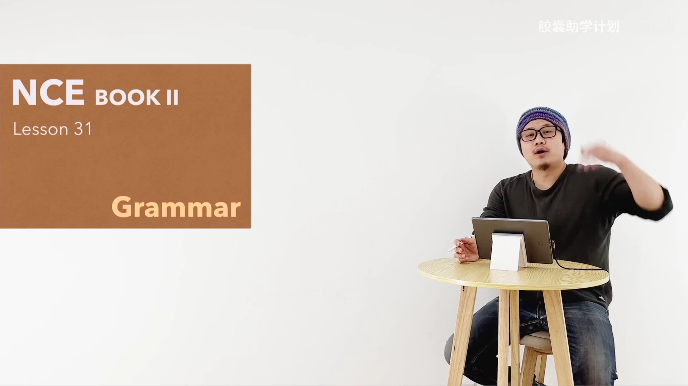

文字识别：NCE / BOOK I"I / Lesson 31 / Grammar

### 画面 00:00:02

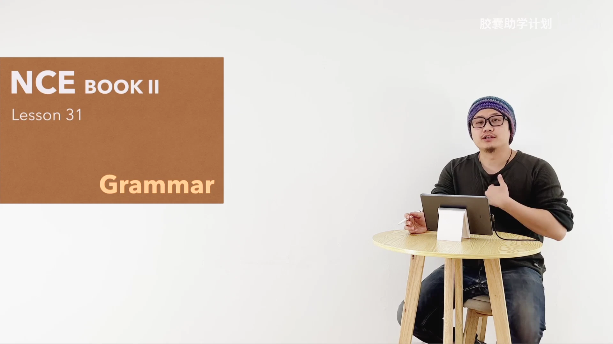

文字识别：NCE / BOOK I"I / Lesson 31 / Grammar

### 画面 00:00:05

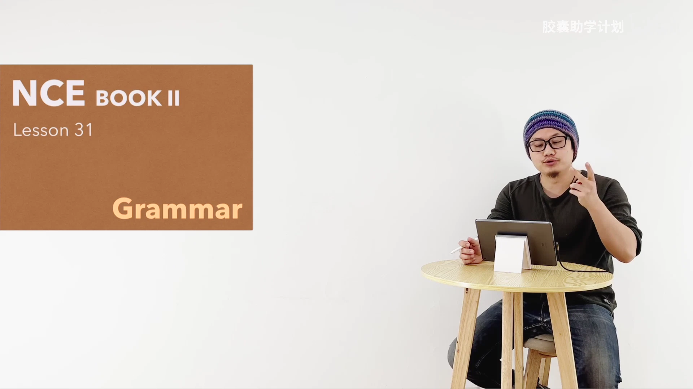

文字识别：NCE / BOOK"I / Lesson 31 / Grammar

### 画面 00:00:08

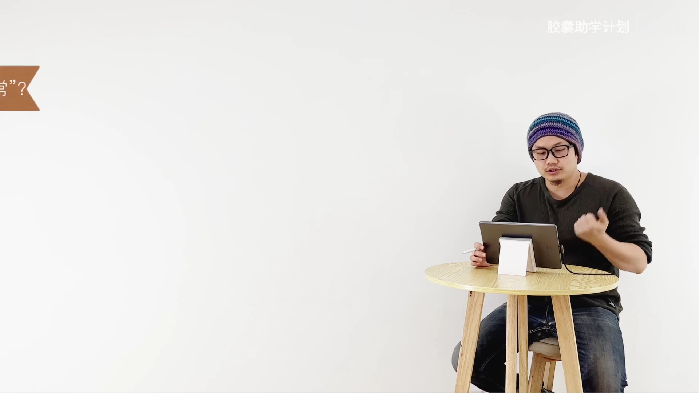

### 画面 00:00:10

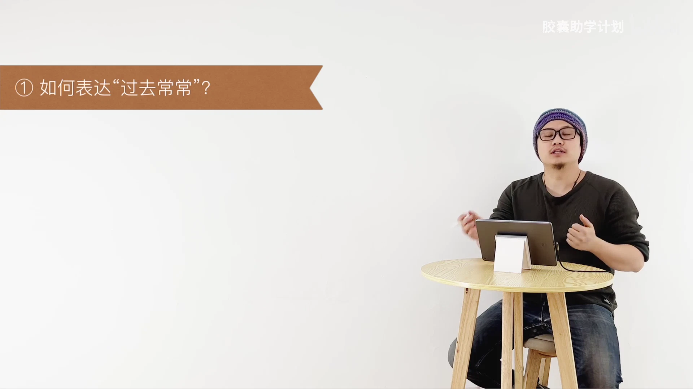

文字识别：①如何表达“过去常常”？

### 画面 00:00:18

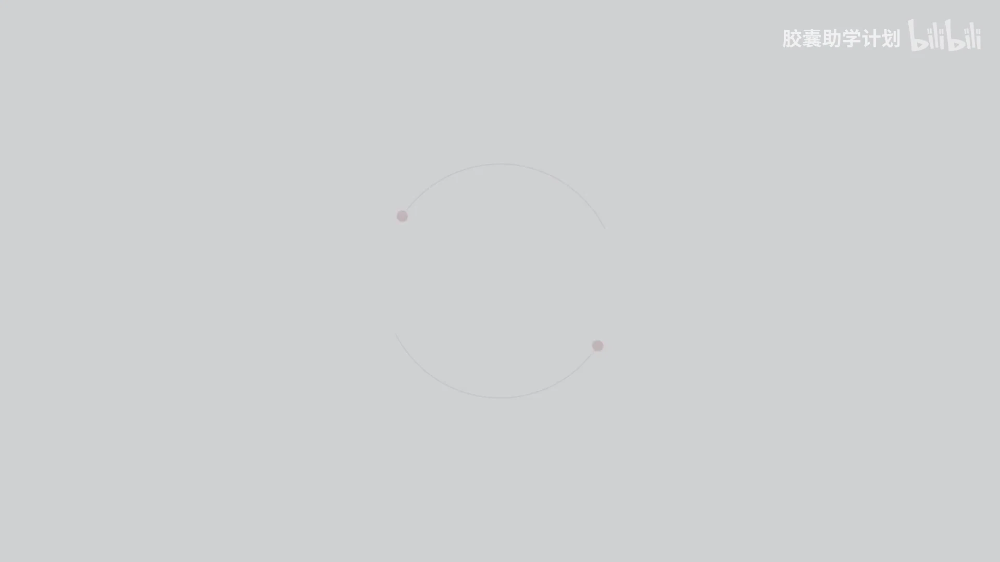

文字识别：胶囊助学计划 bilbl

### 画面 00:00:22

### 画面 00:00:24

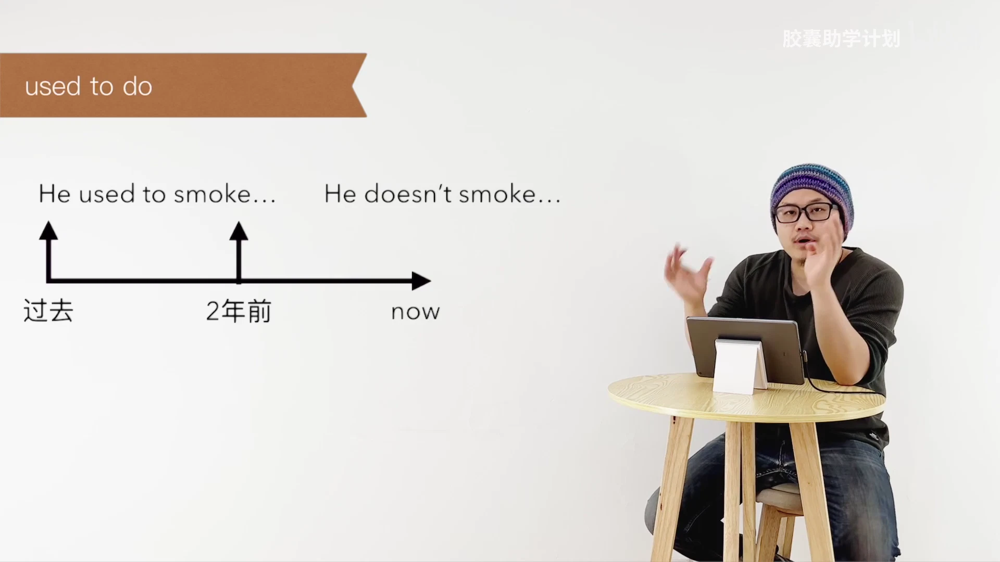

文字识别：used to do / He used to smoke... / He doesn't smoke.. / 过去 / 2年前 / now

### 画面 00:00:27

文字识别：used to do / He used to smoke... / He doesn't smoke.. / 过去 / 2年前 / now

## 00:00:30–00:01:00

呃，对于单词量比较大的同学，到这儿可能就会产生了一个小的问题，叫做use这个单词，我认的，它是动词的意思，叫做使用。然后后边再加了一个to do，去做某事儿，使用去做某事儿，是不是这个意思呢？注意，完全不是啊！在这个地方，各位一定要注意，我们不要把use翻译成叫使用，在这儿它不是使用的意思，它就是三个

### 画面 00:00:38

文字识别：use / used to do / He used to smoke... / He doesn't smoke.. / 过去 / 2年前 / now

### 画面 00:00:44

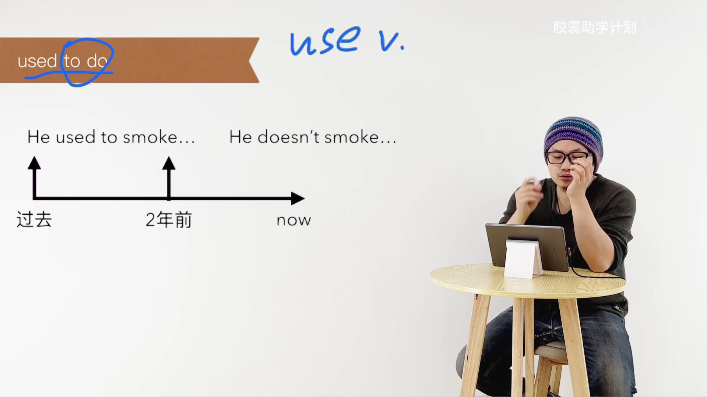

文字识别：use / V. / used to do / He used to smoke... / He doesn't smoke.. / 过去 / 2年前 / now

### 画面 00:00:51

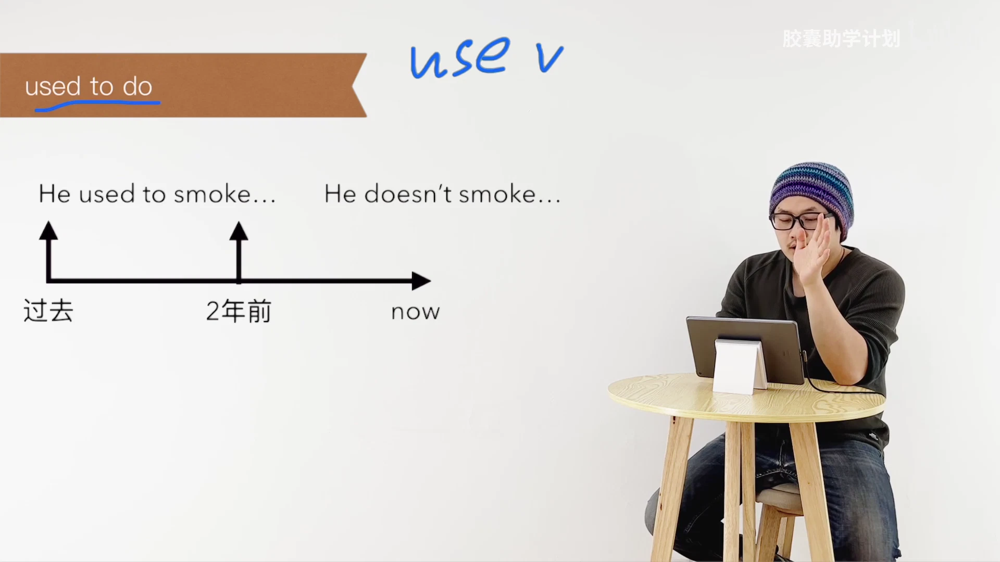

文字识别：use / V / used to do / He used to smoke... / He doesn't smoke.. / 过去 / 2年前 / now

### 画面 00:00:53

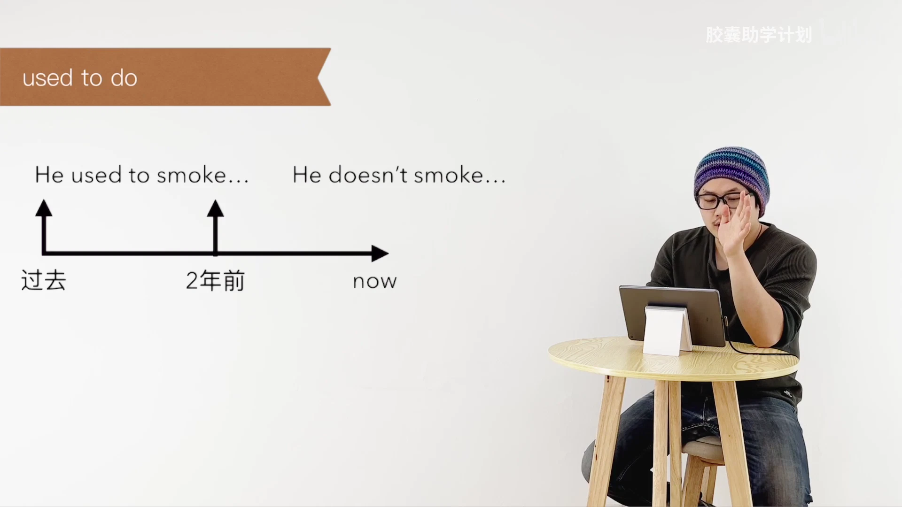

文字识别：used to do / He used to smoke... / He doesn't smoke... / 过去 / 2年前 / now

### 画面 00:00:59

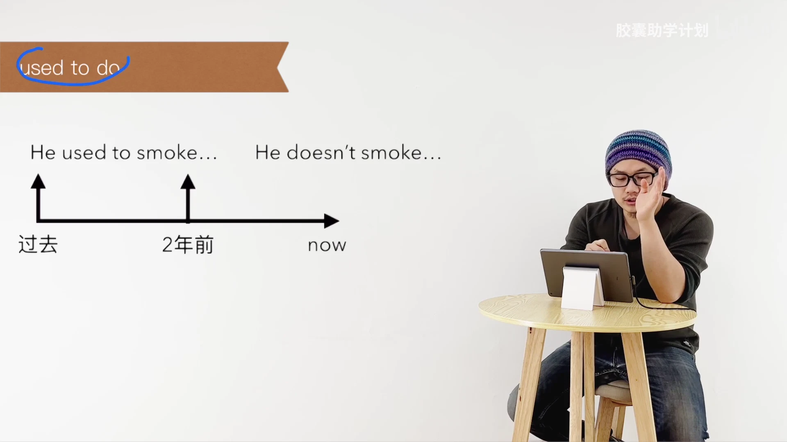

文字识别：used to do / He used to smoke... / He doesn't smoke... / 过去 / 2年前 / now

## 00:01:00–00:01:30

单词 used to do something 表示过去常常做某件事情，但现在往往不做了。比如说，我们直接看下图，说 he used to smoke 和 he doesn't smoke。我们先看底下的时间 now，是 he doesn't smoke now，指的是他现在不抽烟了。而过去一直到两年前，在很长过去

### 画面 00:01:09

文字识别：used to do / He used to smoke... / He doesn't smoke... / 过去 / 2年前 / now

### 画面 00:01:14

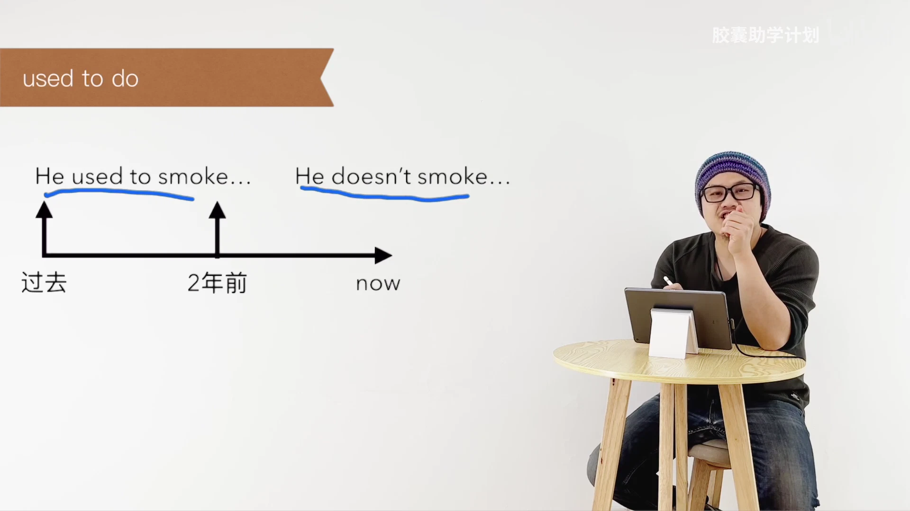

文字识别：used to do / He used to smoke... / He doesn't smoke... / 过去 / 2年前 / now

### 画面 00:01:21

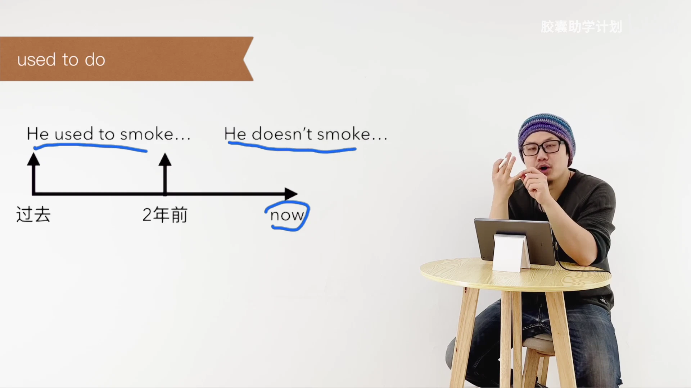

文字识别：used to do / He used to smoke... / He doesn't smoke... / 过去 / 2年前 / now

### 画面 00:01:27

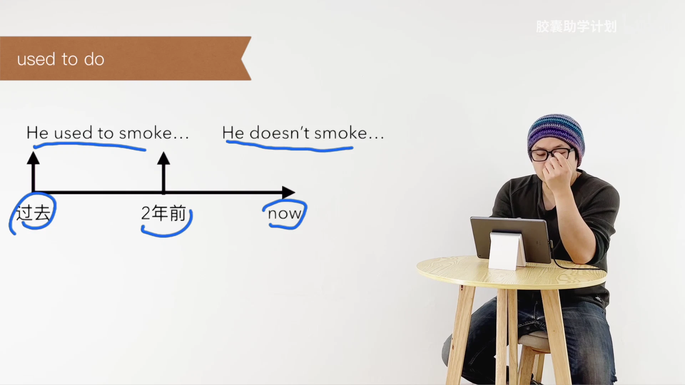

文字识别：used to do / He used to smoke... / He doesn't smoke... / 过去 / 2年前 / now

### 画面 00:01:29

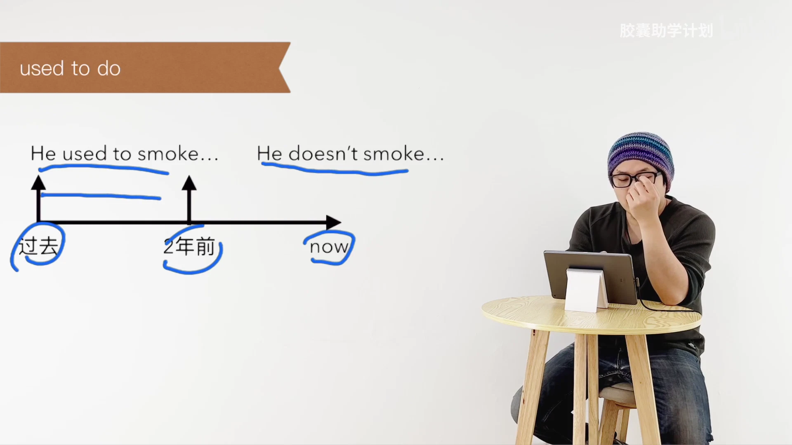

文字识别：used to do / He used to smoke... / He doesn't smoke.. / 过去 / 年前 / 2 / now

## 00:01:30–00:02:00

的一段时间内，他过去常常抽烟，用的结构叫做 he used to smoke，明白吧？所以只要这个结构一出来，您不用想 use 那个单词是什么意思，您只要见到 used to 后边加了一个动词原形，它表示的就是这个动词在过去常常发生，但是现在已经不发生了。OK，好，那我们把这个含义给大家写出来，叫做过去发生，现

### 画面 00:01:45

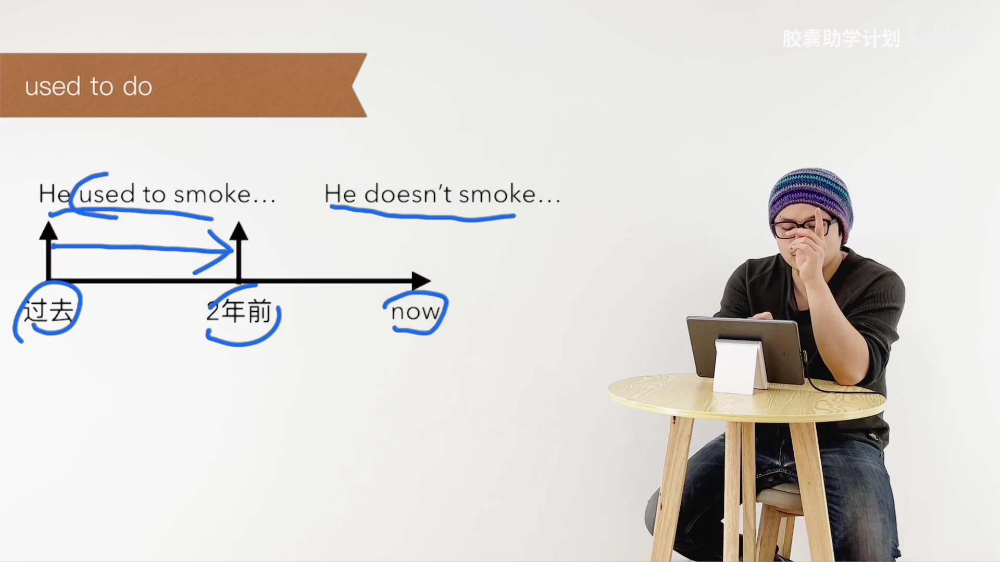

文字识别：used to do / Heused to smoke... / He doesn't smoke.. / 过去 / 年前 / 2 / now

### 画面 00:01:47

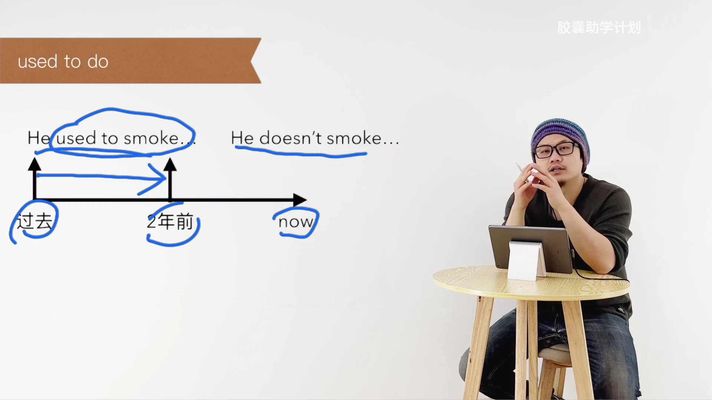

文字识别：used to do / Heused to smoke. / He doesn't smoke.. / 过去 / 年前 / 2 / now

### 画面 00:01:57

文字识别：used to do / 含义：过去发生，现在已经不发生了

## 00:02:00–00:02:30

在不发生了，非常的简单啊。如果要再稍微严谨一点，就是过去常常发生啊，是经常发生的一个动作，对吧？不是过去发生过一次啊。OK，比如说 I used to be a student，那就是我过去的身份是一个学生，但我现在已经不是一个学生了。OK，再来，比如说 I used to live in Auckland，那是我过去一直住在奥克兰，现在已经不发生了的意思，就是我现在不住在那里了，对不对？

### 画面 00:02:25

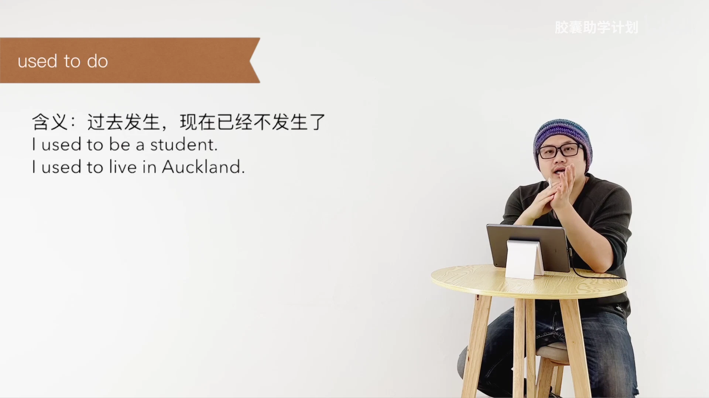

文字识别：used to do / 含义：过去发生，现在已经不发生了 / I used to be a student. / I used to live in Auckland.

## 00:02:30–00:03:00

再来，比如说 I used to play basketball. 它的意思提供的至少有两条信息。第一，你要看到这个结构，对吧？它提供的两条信息是：第一，这个动作在过去常常发生。我不是过去打过篮球，我是经常打篮球，对吧？第二，它提供的信息叫做现在我不打篮球了。 OK，好。比如说 I used to cook every day. 好，它表示的是两层面的信息啊，还是

### 画面 00:02:54

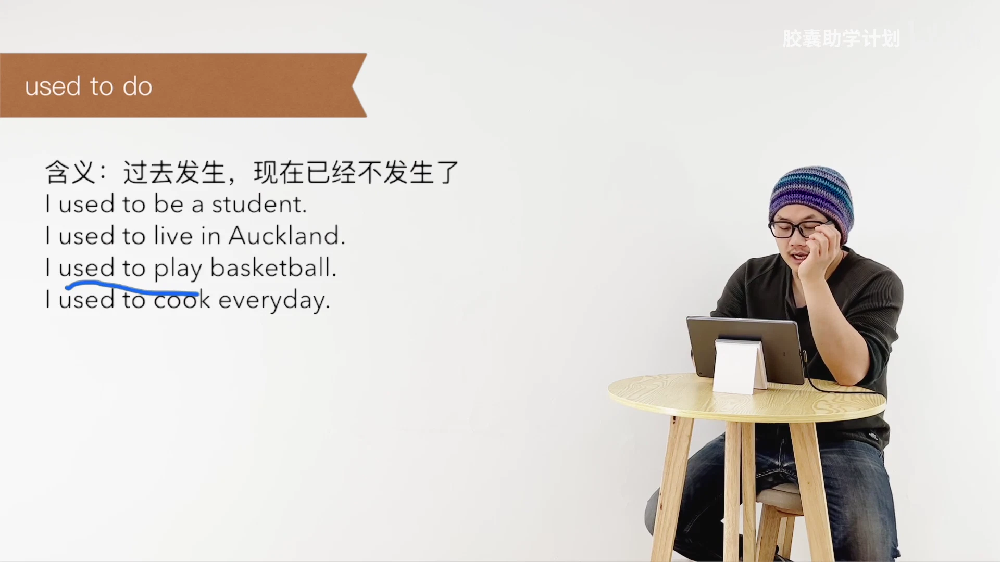

文字识别：used to do / 含义：过去发生，现在已经不发生了 / I used to be a student. / I used to live in Auckland. / I used to play basketball. / I used to cook everyday.

## 00:03:00–00:03:30

固定结构表达固定含义，这是英语的一个习惯。它表达的叫做过去，我总做饭，不是做过饭，因为做过饭可能指的是做过一次饭，对吧？您做过一次饭就叫做过饭了。但你说我过去常常做饭，同时第二层意思叫做我现在已经不做了，就这么简单。OK，好，那它的否定呢？注意一下，因为这个地方是一个好像类似于过去

### 画面 00:03:00

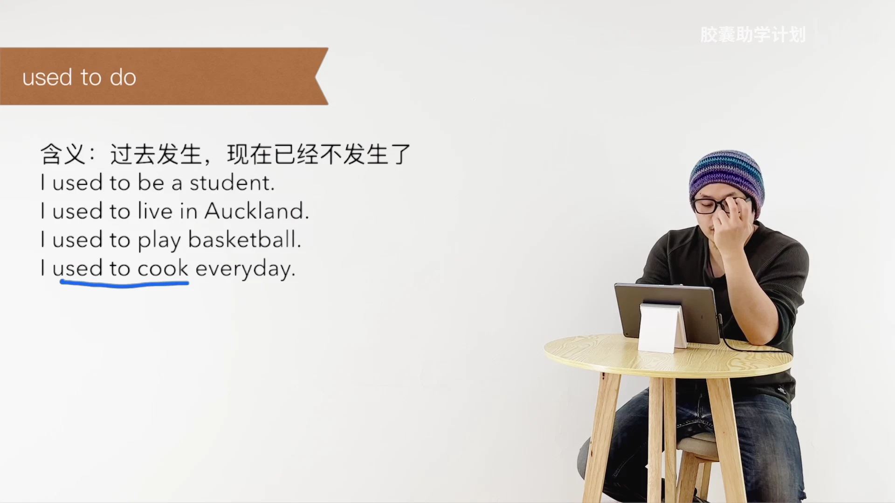

文字识别：used to do / 含义：过去发生，现在已经不发生了 / I used to be a student. / I used to live in Auckland. / I used to play basketball. / I used to cook everyday.

### 画面 00:03:27

文字识别：used to do / 含义：过去发生，现在已经不发生了 / I used to be a student. / I used to live in Auckland. / I used to play basketball. / I used to cook everyday. / 否定：didn't use to do...

## 00:03:30–00:04:00

式，对吧？所以它实际上啊，它表达的也是过去的事情，是吧？所以它的否定往往是叫做 didn't，然后注意这个地方叫做 use to do，是吧？你要把它换回原形，但依旧这里的 use 并不翻译成叫使用，就是 use to do 叫过去常常。那 didn't use to to do 呢？那就指的意思叫做过去不常常，对吧？你把它汉语否定了就行了。肯否定句告诉各位了，那一般疑问句其实

### 画面 00:03:41

文字识别：used to do / 含义：过去发生，现在已经不发生了 / I used to be a student. / I used to live in Auckland. / I used to play basketball. / I used to cook everyday. / 否定：didn't yse to do...

### 画面 00:03:50

文字识别：used to do / 含义：过去发生，现在已经不发生了 / I used to be a student. / I used to live in Auckland. / I used to play basketball. / I used to cook everyday. / 否定：didn'tuse to do.

### 画面 00:03:58

文字识别：used to do / 含义：过去发生，现在已经不发生了 / I used to be a student. / I used to live in Auckland. / I used to play basketball. / I used to cook everyday. / 否定： didn't use to do..

## 00:04:00–00:04:30

就很简单了，就是您把 did 提前，然后呢 used 还是 used 是吧，还是要换回原形 used，剩下就可以了啊，跟之前学的其实没有什么本质的区别。那这两者呢，我们不用专门去练，呃，出现他们的概率不会特别的高，大多数情况下 used to do 都是出现在肯定句当中啊，不是说您完全见不到，好吧？比如说呢，我们拿几个例子说，

### 画面 00:04:25

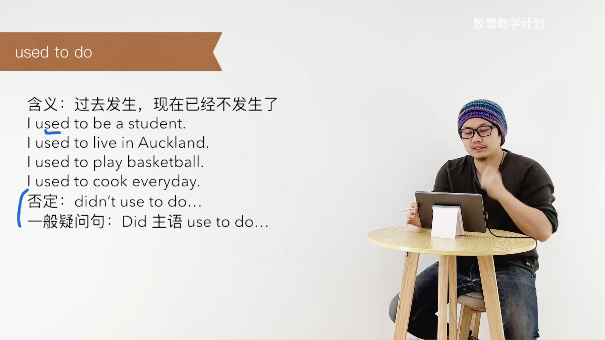

文字识别：used to do / 含义：过去发生，现在已经不发生了 / I used to be a student. / I used to live in Auckland. / I used to play basketball. / ! used to cook everyday. / 否定：didn't use to do... / 一般疑问句：Did 主语 use to do…..

### 画面 00:04:27

文字识别：used to do

## 00:04:30–00:05:00

this building is now a drug store 啊，或者说啊 pharmaceutical a pharmacy 是吧？呃，说这个建筑啊，现在是一个药店。注意，现在是一个药店，但 it used to be a cinema，叫过去常常，它过去曾经是一个这个呃呃这个电影院，对吧？但它现在变成了一个药店。OK，再来，比如说 she used to have long hair when she was a girl。当这句话告诉你

### 画面 00:04:30

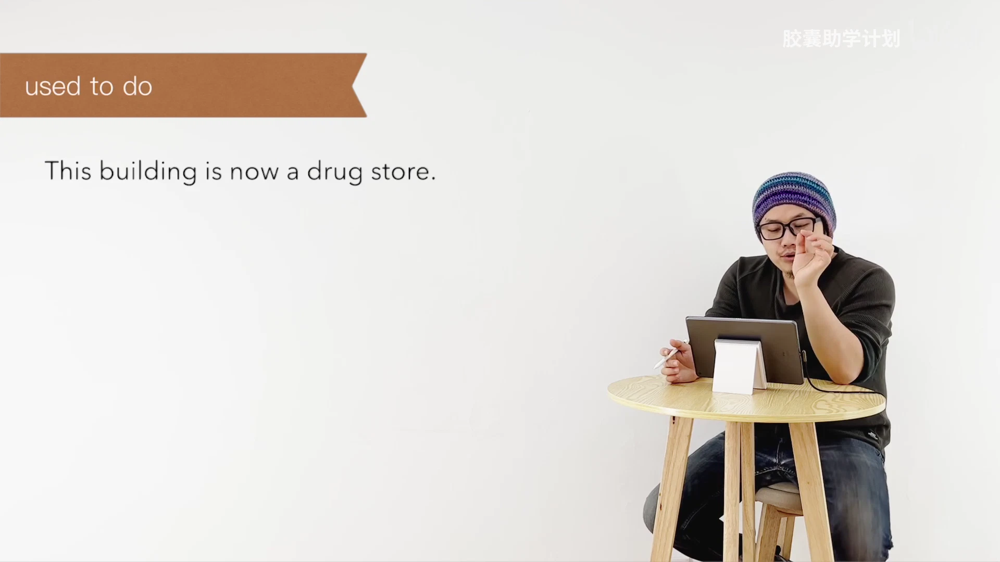

文字识别：used to do / This building is now a drug store.

### 画面 00:04:34

文字识别：used to do / This building is now a drug store

### 画面 00:04:53

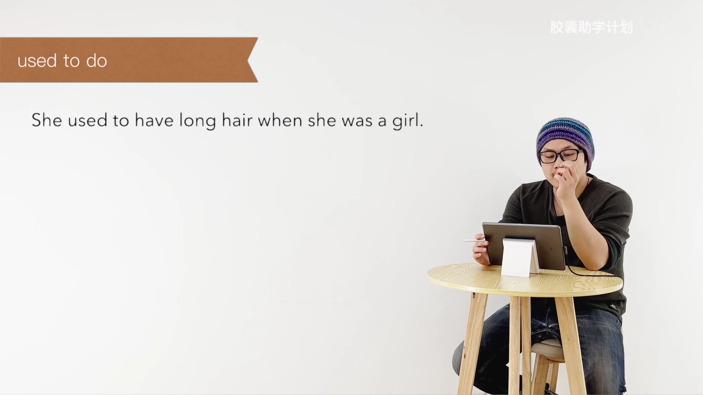

文字识别：used to do / She used to have long hair when she was a girl.

### 画面 00:04:59

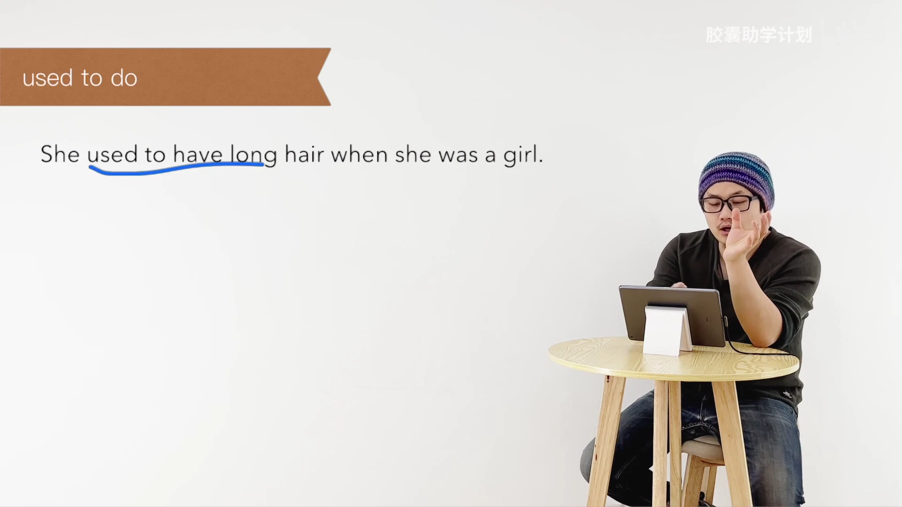

文字识别：used to do / She used to have long hair when she was a girl.

## 00:05:00–00:05:30

的时候，那你就明白，叫过去他留了很长一段时间的长头发，但往往指的是现在头发是短头发了，对不对？好，再来，比如说 I don't drink beer now，说我现在不喝啤酒了，But I used to drink it，说我现在不喝啤酒了，但我过去常常喝，对吧？所以 I used to do something，过去常常做，现在不做了啊。Okay，接下来我

### 画面 00:05:11

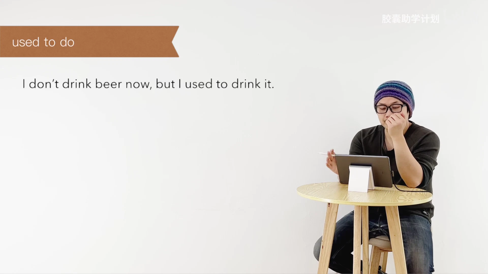

文字识别：used to do / I don't drink beer now, but I used to drink it.

### 画面 00:05:25

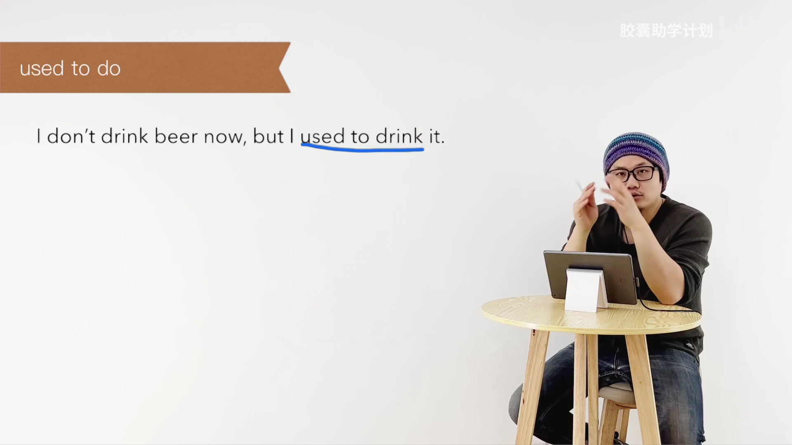

文字识别：used to do / I don't drink beer now, but I used to drink it.

### 画面 00:05:28

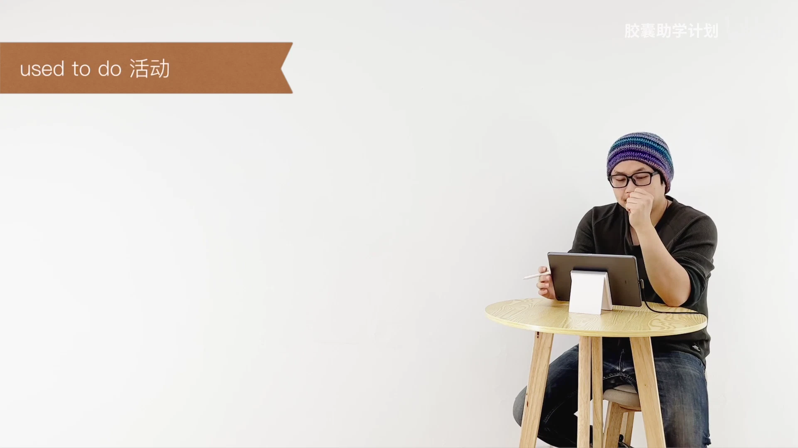

文字识别：used to do活动

## 00:05:30–00:06:00

做一个小的活动。当然，这个活动是您课下去完成的啊，非常简单，叫Talk about your life，叫讲一讲你自己曾经的生活，对吧？比如说，那我就说说I used to live in Beijing啊。比如说，我说我曾经住在北京啊。这里有一些是真的，有一些是虚构的啊，真真假假。比如说I used to be a bus driver，我原来是这样一个职业。I used to have long hair，我过去有长头发。I used to drink

### 画面 00:05:41

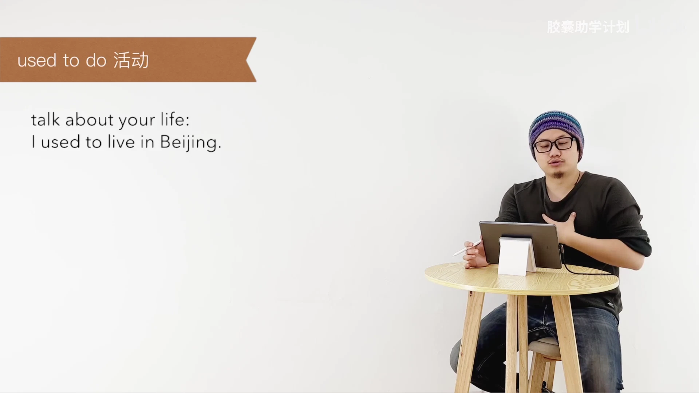

文字识别：used to do活动 / talk about your life: / I used to live in Beijing.

### 画面 00:05:49

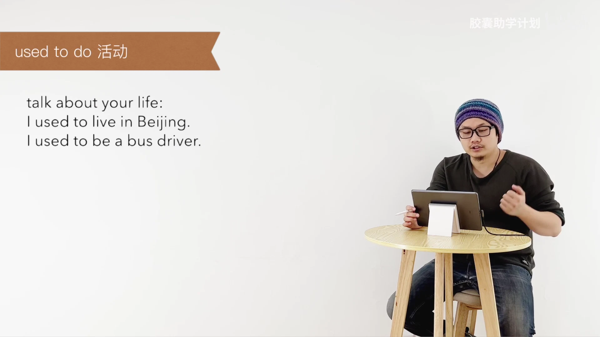

文字识别：used to do活动 / talk about your life: / I used to live in Beijing. / I used to be a bus driver.

### 画面 00:05:57

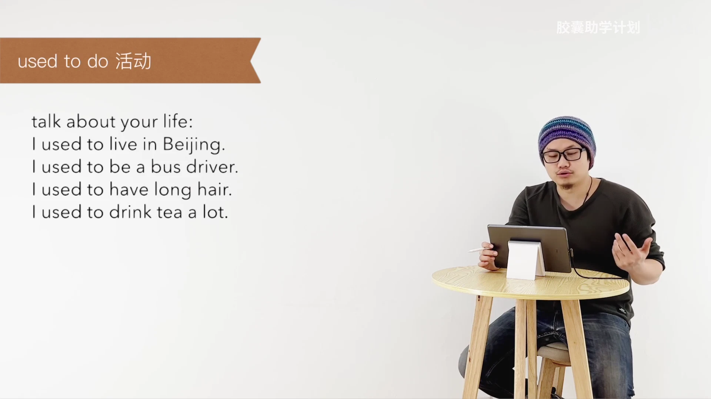

文字识别：used to do 活动 / talk about your life: / I used to live in Beijing. / I used to be a bus driver. / I used to have long hair. / I used to drink tea a lot.

## 00:06:00–00:06:30

tea a lot. 我过去经常喝茶，对不对？那各位要做的事情就是把这个东西换成您自己的情况，再补一些新的东西出来啊。这个就是您的家庭作业之一，在这里截图，好吧？接下来呢，我们简单看一下，我们现在知道了叫 used to do 在六一二三四五六当中的位置。每一个语法我们都要尝试判断它的位置啊。那它的位置就是谓语。 OK, there we go.

### 画面 00:06:07

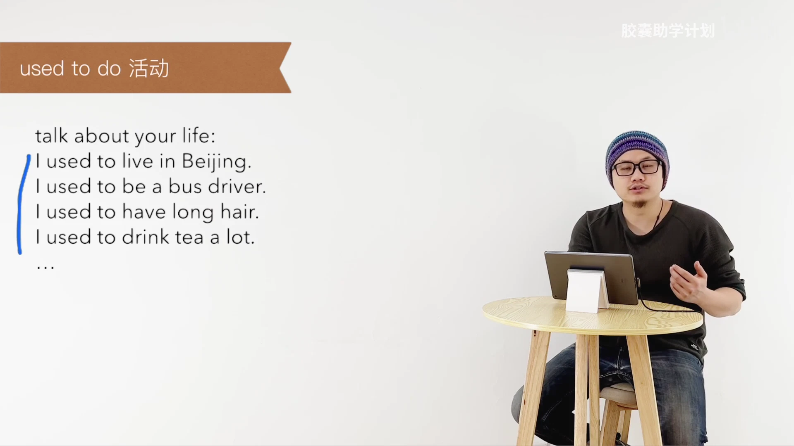

文字识别：used to do 活动 / talk about your life: / I used to live in Beijing. / I used to be a bus driver. / I used to have long hair. / I used to drink tea a lot.

### 画面 00:06:11

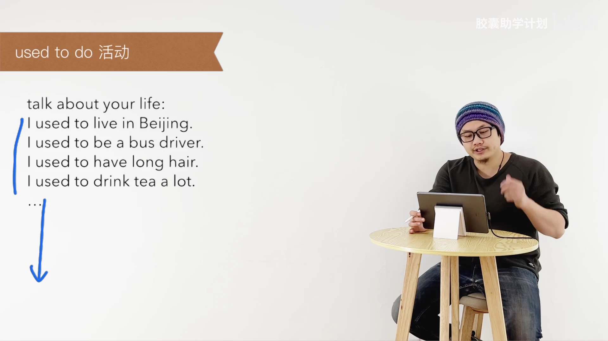

文字识别：used to do 活动 / talk about your life: / I used to live in Beijing. / I used to be a bus driver. / I used to have long hair. / I used to drink tea a lot.

### 画面 00:06:15

文字识别：used to do活动 / talk about your life: / I used to live in Beijing. / I used to be a bus driver. / I used to have long hair. / I used to drink tea a lot.

### 画面 00:06:17

文字识别：used to do sth. / 5地点 / here?

### 画面 00:06:19

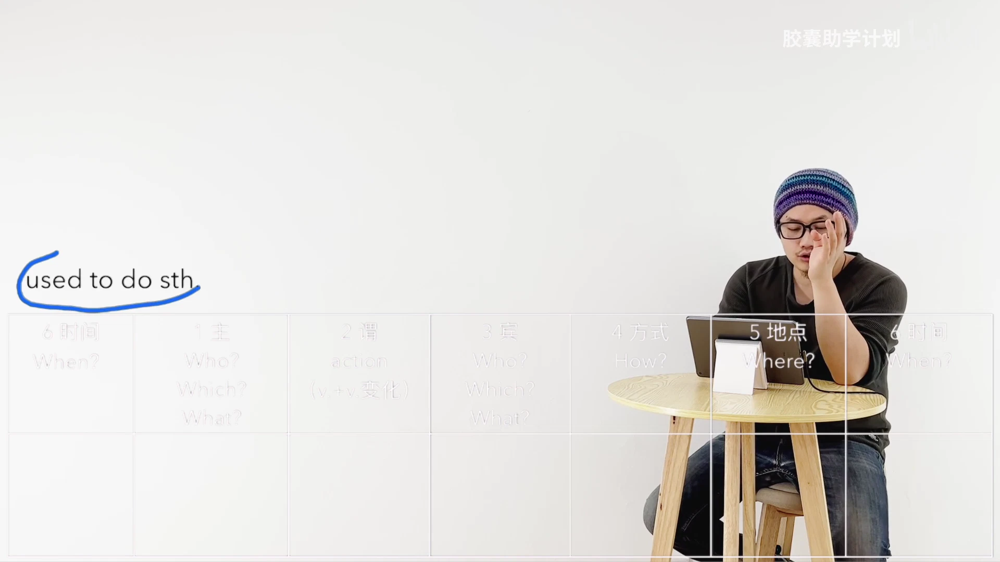

文字识别：used to do sth / 4方式 / 5地点 / here? / How?

### 画面 00:06:26

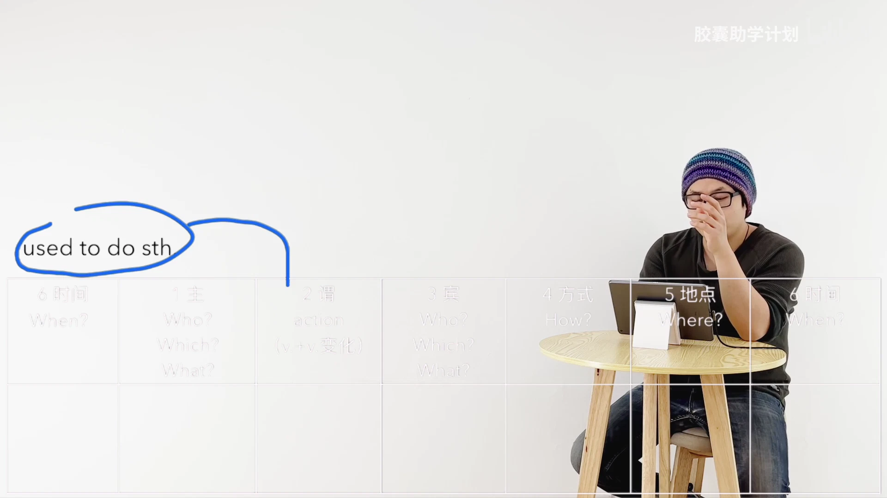

文字识别：used to do sth / 4方式 / 5地点 / here? / 1oW?

### 画面 00:06:29

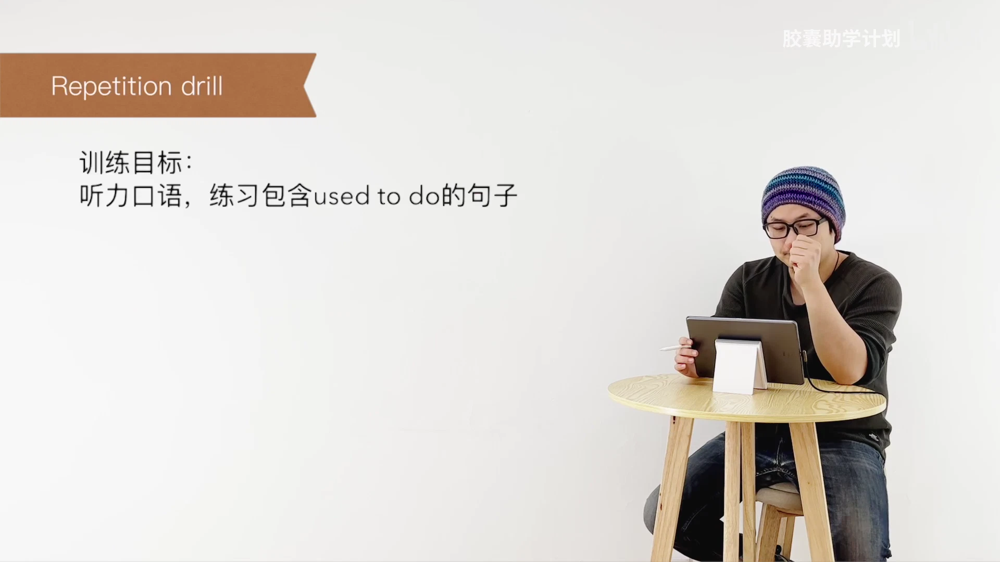

文字识别：Repetition drill / 训练目标： / 听力口语，练习包含used to do的句子

## 00:06:30–00:07:00

接下来我们做一些口语听力练习，这些口语听力练习全是练used to do的。我讲三个，剩下的就是我读您练就行了，好吧？哎，第一个，比如说Don't you smoke？叫做难道你不抽烟吗？注意，这是面对面问的，问的不是Didn't you smoke？ Didn't you smoke？指的是哎，我怎么记你原来抽烟啊，对吧？而Don't you smoke？说哎，你不是抽烟吗？问的是现在，对吧？那他的

### 画面 00:06:35

文字识别：Repetition drill / 训练目标： / 听力口语，练习包含used to do的句子

### 画面 00:06:41

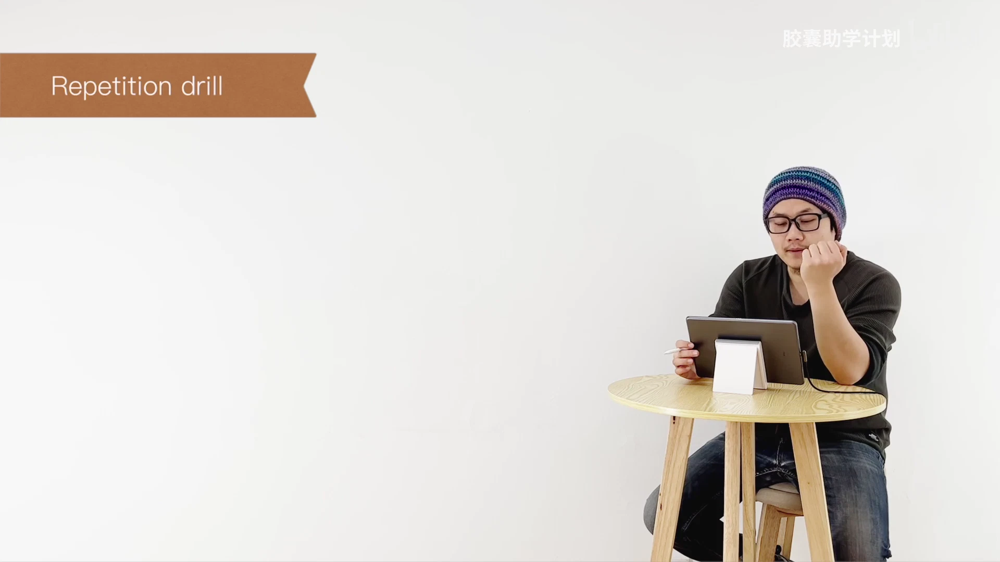

文字识别：Repetition drill

### 画面 00:06:47

文字识别：Repetition drill / 1T:Don't you smoke?

## 00:07:00–00:07:30

回答是，No，不，我不抽。I used to smoke，我过去常常抽烟，不是抽过一根，对吧？But I don't smoke anymore。好，注意一个小点，叫any more， not anymore，就是不在的意思。那I don't smoke anymore，就是我现在不在抽烟了。好，这是第一个。第二个说，Until a policeman，啊，说，哎，你不是个警察吗？说，No， I used to be a policeman， but I'm

### 画面 00:07:12

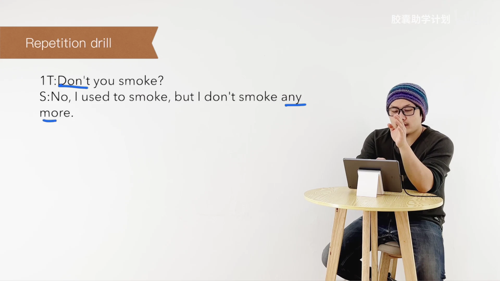

文字识别：Repetition drill / 1T:Don't you smoke? / S:No, I used to smoke, butI don't smoke any / more.

### 画面 00:07:16

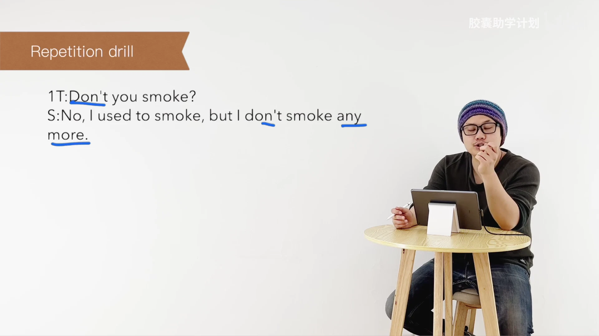

文字识别：Repetition drill / 1T:Don't you smoke? / S:No, I used to smoke, but I don't smoke any / more.

### 画面 00:07:21

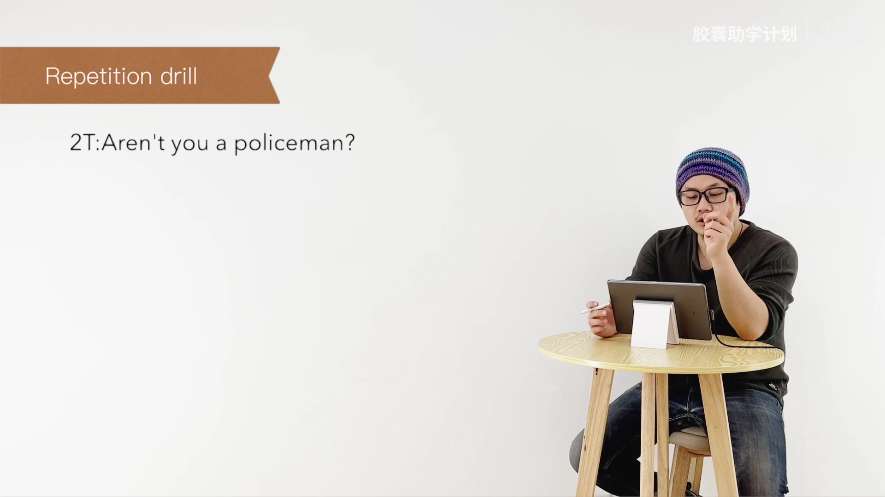

文字识别：Repetition drill / 2T:Aren't you a policeman?

### 画面 00:07:25

文字识别：Repetition drill / 2T:Aren't you a policeman? / S:No, I used to be a policeman, but I'm not a / policeman any more.

## 00:07:30–00:08:00

not a policeman anymore.是吧，我曾经是个警察，但我现在不是了，对吧？其实我提一个小点，后面这句话说不说是无所谓的，因为当你用到了 used to do 这个结构的时候，它自然而然的意思就是我过去这样，但现在不这样了，它自己本身就这个含义，好吧？我们再看一个，说 Isn't he your friend? 难道他不是你朋友吗？No, he used

### 画面 00:07:38

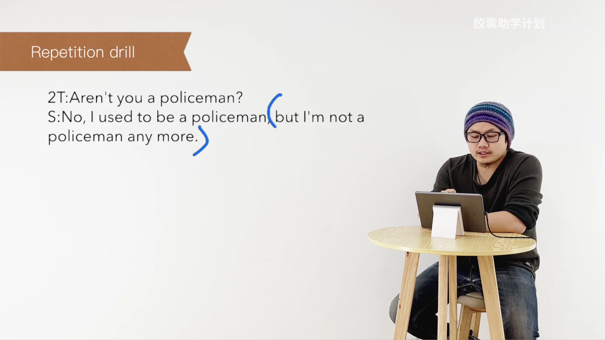

文字识别：Repetition drill / 2T:Aren't you a policeman? / S:No, I used to be a policeman(but I'm not a / policeman any more.

### 画面 00:07:42

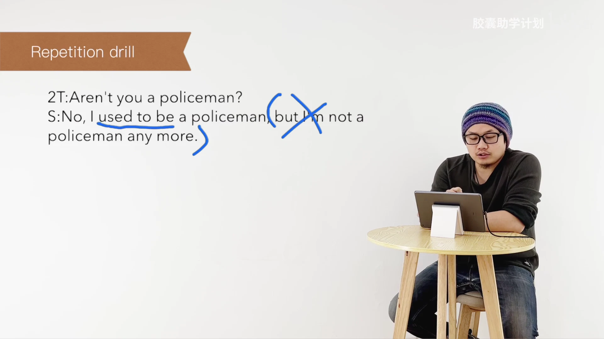

文字识别：Repetition drill / 2T:Aren't you a policeman? / S:No, I used to be a policeman but Xn not a / policeman any more.

### 画面 00:07:53

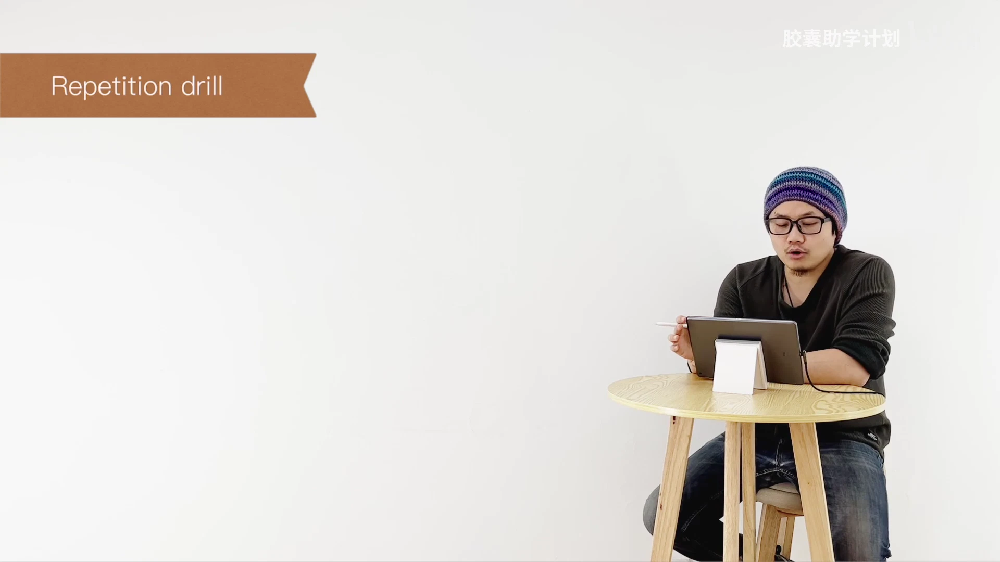

文字识别：Repetition drill

### 画面 00:07:58

文字识别：Repetition drill / 3T:Isn't he your friend? / S:No, he used to be my friend, but he isn't / my friend any more.

## 00:08:00–00:08:30

to be my friend, but he isn't my friend anymore.说他曾经是我朋友，但他现在不再是了。Okay,好，剩下的各位张嘴跟我读就好了啊。然后重点注意一下used to do. Don't you live in London? No, I used to live in London, but I don't live in London anymore. Next one, isn't he a businessman? No, he

### 画面 00:08:08

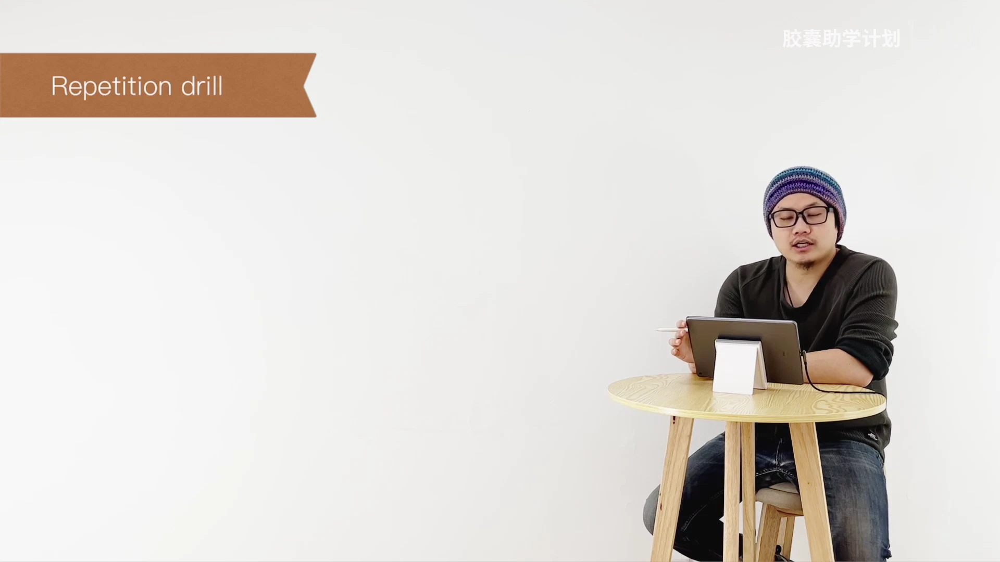

文字识别：Repetition drill

### 画面 00:08:17

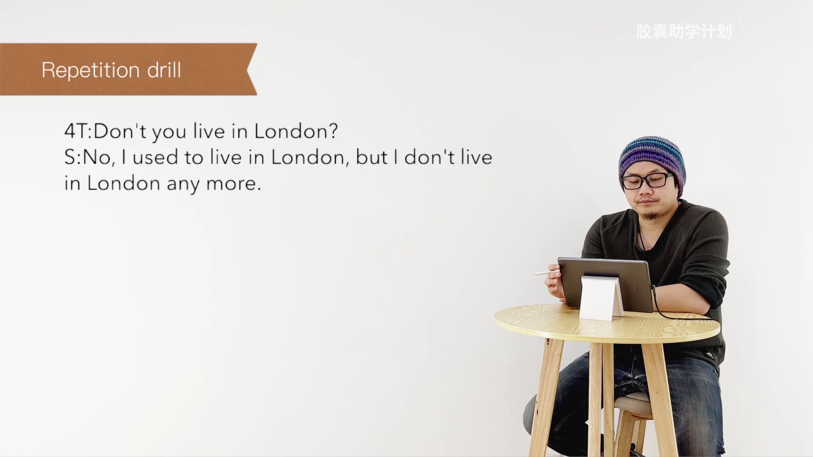

文字识别：Repetition drill / 4T:Don't you live in London? / S:No, I used to live in London, butI don't live / in London any more.

### 画面 00:08:25

文字识别：Repetition drill / 5T:lsn't he a businessman?

## 00:08:30–00:09:00

used to be a businessman, but he isn't a businessman anymore. Next one, don't they employ a hundred people? No, they used to employ a hundred people, but they don't employ a hundred people anymore. Next one, don't you have a car? No, I used to have a car, but I don't have a car

### 画面 00:08:41

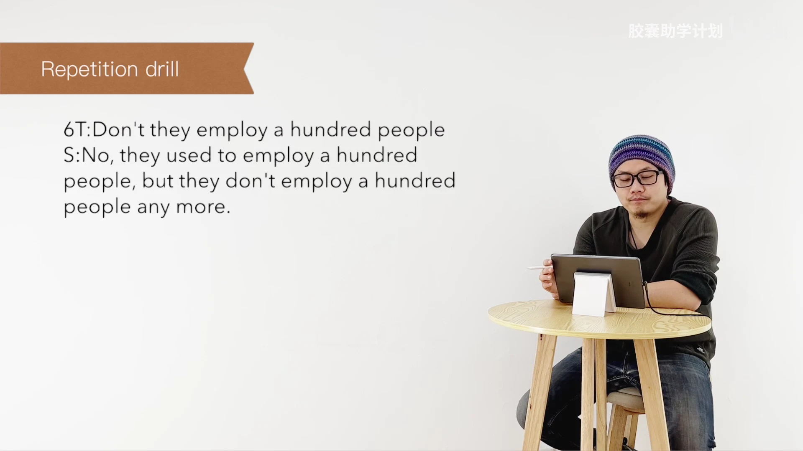

文字识别：Repetition drill / 6T:Don't they employ a hundred people / S:No, they used to employ a hundred / people, but they don't employ a hundred / people any more.

### 画面 00:08:52

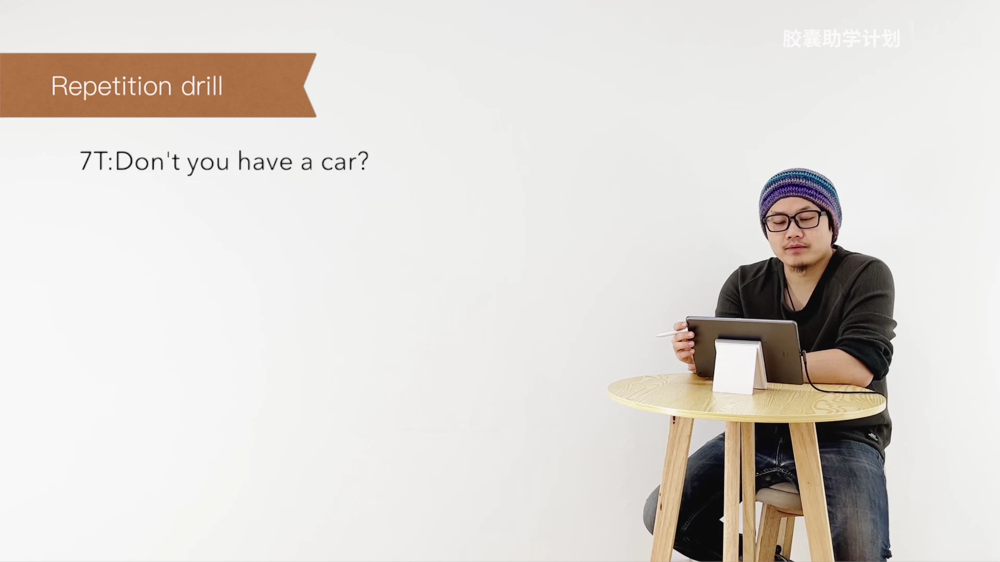

文字识别：Repetition drill / 7T:Don't you have a car?

## 00:09:00–00:09:30

anymore. Next one, doesn't he collect stamps? No, he used to collect stamps, but he doesn't collect stamps anymore. Next one, isn't this a village? No, it used to be a village, but it isn't a village anymore. Next one, isn't she a nurse?

### 画面 00:09:06

文字识别：Repetition drill / 8T:Doesn't he collect stamps? / S:No, he used to collect stamps, but he / doesn't collect stamps any more.

### 画面 00:09:14

文字识别：Repetition drill / 9T:Isn't this a village?

### 画面 00:09:29

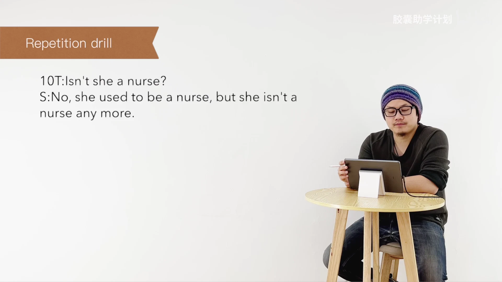

文字识别：Repetition drill / 10T:lsn't she a nurse? / S:No, she used to be a nurse, but she isn't a / nurse any more.

## 00:09:30–00:10:00

No, she used to be a nurse, but she isn't a nurse anymore. Okay,好，接下来又是 pattern drill 了。Pattern drill 要做的事情就是写作口语练习。那练习包含的是 what were doing, did 和 used to do，对吧？Okay，那今天我们新学的是 used to do。在第七课我们学到的是 what were doing 和 did，啊。那我们看第一题，在这里还是很简单。我要做的事情

### 画面 00:09:36

文字识别：Pattern drill / 训练目标： / 写作口语，练习包含 / was/were+doing / did / used to do / 的句子

### 画面 00:09:42

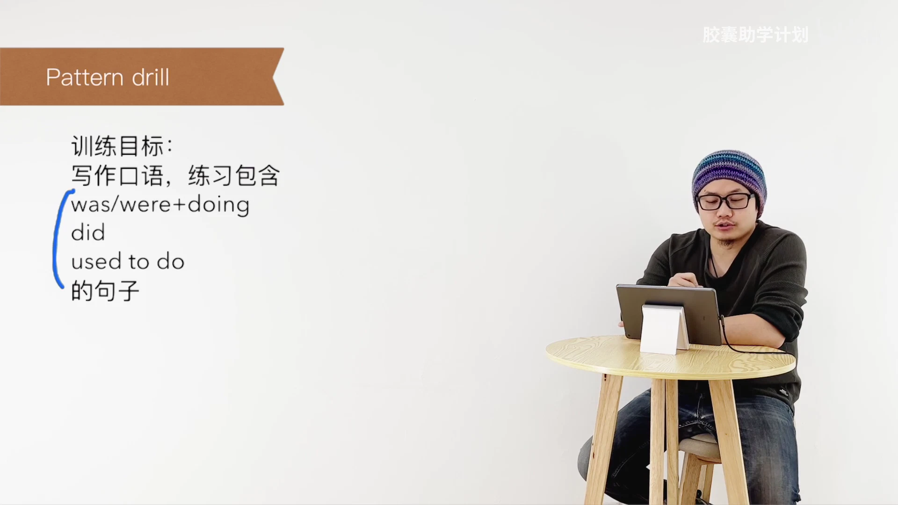

文字识别：Pattern drill / 训练目标： / 写作口语，练习包含 / was/were+doing / did / used to do / 的句子

### 画面 00:09:56

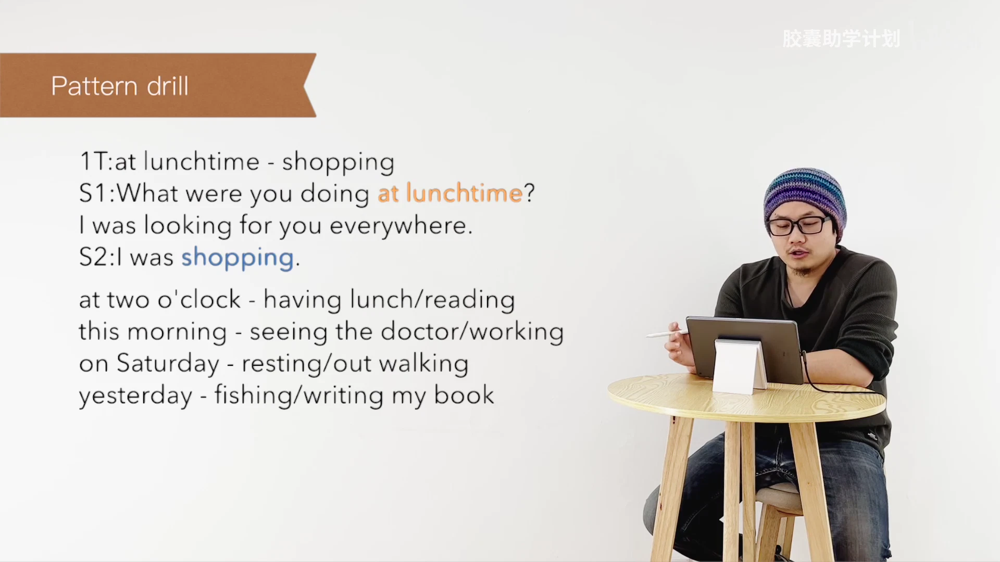

文字识别：Pattern drill / 1T:at lunchtime - shopping / S1:What were you doing / at lunchtime? / I was looking for you everywhere. / S2:I was shopping. / at two o'clock - having lunch/reading / this morning - seeing the doctor/working / on Saturday- resting/out walking / yesterday - fishing/writing my book

## 00:10:00–00:10:30

是把 S 一 S 二给各位讲清楚，教各位如何往里去带。您下课要做的事情是把它往里面去带，对吧？What were you doing at lunchtime? 午饭点的时候你正在做什么呢？I was looking for you everywhere. 我正四处找你。我当时四处找你。答案叫 I was shopping. 我当时正在购物。您看三句话出现了三句过去进行时，对吧？各位要做的事情就是把时间带到黄色里

### 画面 00:10:26

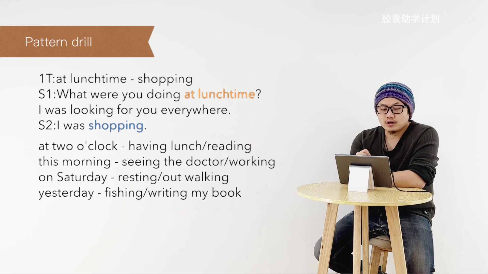

文字识别：Pattern drill / 1T:at lunchtime - shopping / S1:What were you doing / at lunchtime? / I was looking for you everywhere. / S2:I was shopping. / at two o'clock - having lunch/reading / this morning - seeing the doctor/working / on Saturday- resting/out walking / yesterday - fishing/writing my book

## 00:10:30–00:11:00

面，把这个动作带到蓝色里面就可以了。这一块全是时间，这一块全是动作啊。OK，这是第一题，练的是过去进行时。第二题，When did it begin to rain？什么时候开始下雨的呢？It was just beginning to rain。说正开刚刚开始下雨。When I returned from work，当我从工作回来的时候，其实第七课咱们就学过这个句型了，对不对？我们无非又是在复

### 画面 00:10:40

文字识别：Pattern drill / 2T:rain - returned from work / S1:When did it begin to rain? / S2:lt was just beginning to rain when I / returned from work. / snow - got up/went out this morning / get dark - came in/put the car away / rain - arrived home/left the office / get windy - finished work/phoned you

## 00:11:00–00:11:30

习一遍。那 return from work 这是一个动作，rain 这是一个动作。各位注意，不同颜色放到不同的地方，对吧？您把前面的这些带到黄色里面来，然后把后面的这些带到蓝色里面来就可以了。OK，这是第二题。第三题说，Do you collect stamps？说你收集邮票吗？注意，Do you 问的是现在，对吧？陈述客观事实，答案叫 I used to。这句话如果给它补全的话，

### 画面 00:11:10

文字识别：Pattern drill / 2T:rain - returned from work / S1:When did it begin tOain? / S2:lt was just beginning to rain when I / returned from work. / snow - got up/went out this morning / get dark - came in/put the car away / rain - arrived home/left the office / get windy - finished work/phoned you

### 画面 00:11:17

文字识别：Pattern drill / 3T:collect stamps / S1:Do you collect stamps? / S2:I used to, butI don't any longer. / ride a bicycle / travel a lot / make your own clothes watch television / like Mary / write poetry / go to concerts / use a typewriter

## 00:11:30–00:12:00

叫做 I used to collect stamps, 对吧？哎，我过去常常这样。But I don't any longer. 注意 any longer 和刚才的 any more 含义是几乎一样的，就是不再怎么怎么样了啊。各位可以注意一下这个小的短语叫 not any longer 啊。所以还是直接往里带就行了。练习的是 used to do。第四题说 I used to be a taxi driver. 说我过去是一个出租车司机。

### 画面 00:11:47

文字识别：Pattern drill / 3T:collect stamps / S1:Do you collect stamps? / S2: used to, but I doot any longer. / ride a bicycle / travel a lot / make your own clothes watch television / like Mary / write poetry / go to concerts / use a typewriter

### 画面 00:11:54

文字识别：Pattern drill / 4T:taxi driver / S1:I used to be a taxi driver. / S2:Did you really? I didn't even know you could drive! / part-time actor / professional dancer / good swimmer / tell the story / opera singer / art teacher

## 00:12:00–00:12:30

Did you really? Oh, you really? I don't even know you could drive.说，我甚至都我之前都不知道你能开车，更别提说你是一个taxi driver了，对吧？那各位要做的事情还是往里面去带。注意一个小点。首先，他练的是used to do，对吧？然后也有did啊。其次呢，taxi driver这是一个职业。那you could drive其实是这个职业要做的动作，对吧？比如说part

### 画面 00:12:24

文字识别：Pattern drill / 4T:taxi driver / S1:I used to be a taxi driver. / S2:Did you really? I didn't even know you could drive! / part-time actor / professional dancer / good swimmer / tell the story / opera singer / art teacher

## 00:12:30–00:13:00

actor 叫做兼职的演员，这个你直接带进去没问题。但是 I didn't even know you could，你就要想这个里面演员的动作是什么？其实就是 act，对吧？这儿就是 dance，这就是 swim。 OK，好，那就不多说了啊。好，家庭作业 recap 本课我们学到的新的语法就叫做 used to do something。好，注意一个小点，我们同时复习了第七课就学过

### 画面 00:12:49

文字识别：Recap / Patterns / ＆ / used to do / Grammar

### 画面 00:12:51

文字识别：Recap / Patterns / ＆ / used to do / Grammar

### 画面 00:12:54

文字识别：Recap / Patterns / ＆ / used to do / Grammar / 分

### 画面 00:12:59

文字识别：Recap / Patterns / ＆ / used to do / Grammar

## 00:13:00–00:13:30

的叫做 what were doing 和 did 啊，呃，家庭作业 pattern drill 老习惯先写专栏啊，先写啊，然后再大声朗读出来啊，四乘四对吧？然后呢就是四呃四一共四道题，每道题写四个至少啊，然后尝试回忆给自己讲解一遍今天的核心语法点，这个对于各位巩固这个语法点的记忆是有很有帮助的啊，比您反复听其实效果还要好。然后呢，尝试翻阅红皮书，

### 画面 00:13:03

### 画面 00:13:05

文字识别：1.f / Pattern Drill写&朗读 / 专栏 / 4X4

### 画面 00:13:09

文字识别：1.f / Pattern Drill 写&朗读 / 专栏 / 4X4

### 画面 00:13:12

文字识别：Pattern Drill写&朗读 / 专栏 / 4X4 / 尝试回忆并给自己讲解一 / 遍今天的核心语法 / Study-Test / Learning Pyramid

### 画面 00:13:14

文字识别：Pattern Drill写&朗读 / 1. / 专栏 / 4X4 / 尝试回忆并给自己讲解一 / 遍今天的核心语法 / Study-Test /  Learning Pyramid

### 画面 00:13:19

文字识别：Pattern Drill写&朗读 / 1. / 专栏 / 4X4 / 尝试回忆并给自己讲解一 / 遍今天的核心语法 / Study-Test / Learning Pyramid

### 画面 00:13:24

文字识别：Pattern Drill写&朗读 / 1. / 专栏 / 4X4 / 尝试回忆并给自己讲解一 / 遍今天的核心语法 / Study-Test /  Learning Pyramid

### 画面 00:13:26

文字识别：1.f / Pattern Drill写&朗读 / 专栏 / 4X4 / 尝试回忆并给自己讲解一 / 遍今天的核心语法 / Study-Test / Learning Pyramid / 尝试翻阅红皮书（中级） / 通过目录或索引(Index) / 查找到本课语法

### 画面 00:13:29

文字识别：1. f / Pattern Drill写&朗读 / 专栏 / 4X4 / 尝试回忆并给自己讲解一 / 遍今天的核心语法 / Study-Test / Learning Pyramid / 尝试翻阅红皮书（中级） / 通过目录或索引(Index) / 查找到本课语法

## 00:13:30–00:13:59

找到今天的这个语法啊，当然是终极红皮书了。好，那以上呢就是本期视频的全部内容了。如果各位喜欢我们的课程呢，欢迎各位关注、订阅、一键三连，分享给那些需要的朋友，来帮助我们快速成长。See you next time.

### 画面 00:13:34

文字识别：👍

### 画面 00:13:46

### 画面 00:13:48

文字识别：CAPSULEACADEMY / 胶囊助学计划 / 小红书 / Lecturer / Leo / OE

### 画面 00:13:51

文字识别：CAPSULEACADEMY / 胶囊助学计划 / 小红书 / OE

### 画面 00:13:54

文字识别：CAPSULEACADEMY / 胶囊助学计划 / 小红书 / Creator / Leo & Berlin

### 画面 00:13:56

文字识别：bilbili / 胶囊助学计划 / CAPSULEACADEMY / 胶囊助学计划 / 小红书 / OE

### 画面 00:13:58

文字识别：bilibili / 胶囊助学计划

