# L031 文章

快速机器解析：语音为单模型转写，未进行独立交叉校对或人工复核；画面每秒采样并按变化选帧，短时文字和标记可能遗漏。截图时间约有 1 秒误差。图片有损压缩；遇到疑点请按时间查看 Google Drive 原视频。

## 00:00:00–00:00:30

Hello everyone, welcome to Capsule Academy. This is Leo. Today we're going to learn New Concept English Book Two, Lesson Thirty One, Story. Hope you gonna enjoy it.好，那我们直接进入文章啊。首先前两个单词时间啊，我们又管它叫时间状语，对吧？叫 yesterday afternoon. 好，这个时间非常的重要，告诉你叫昨天下午。于是这就提出来一个点叫做时间，

### 画面 00:00:00

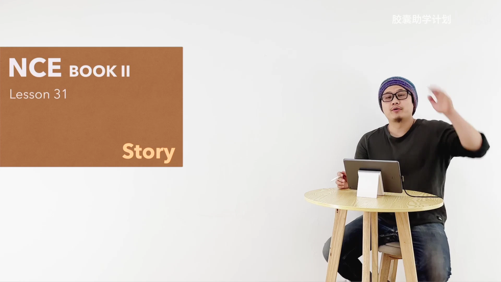

文字识别：NCE / BOOKII / Lesson 31 / Story

### 画面 00:00:02

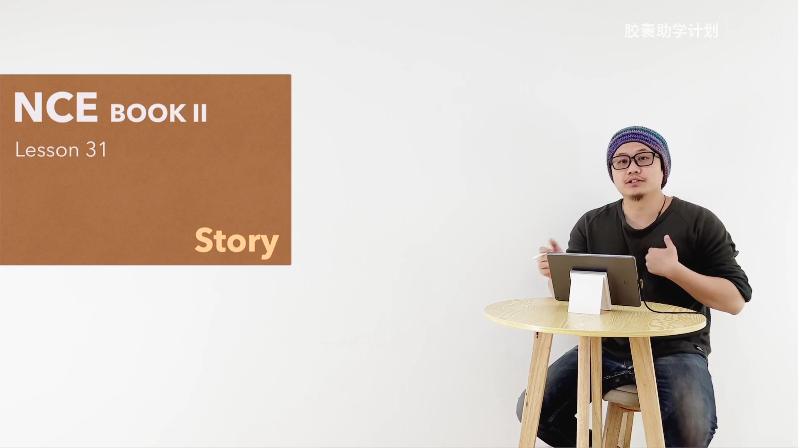

文字识别：NCE / BOOKⅡI / Lesson 31 / Story

### 画面 00:00:04

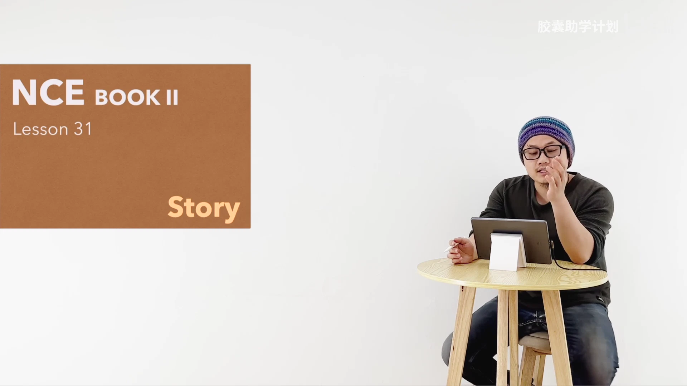

文字识别：NCE / BOOKⅡI / Lesson 31 / Story

### 画面 00:00:06

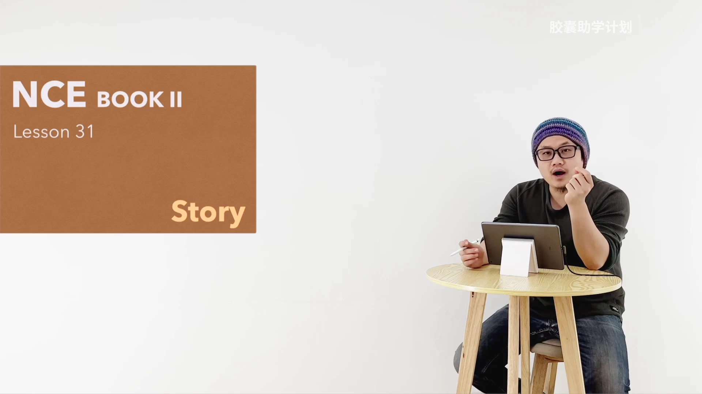

文字识别：NCE / BOOK"I / Lesson 31 / Story

### 画面 00:00:09

文字识别：胶囊助学计划bill / • / •

### 画面 00:00:13

### 画面 00:00:15

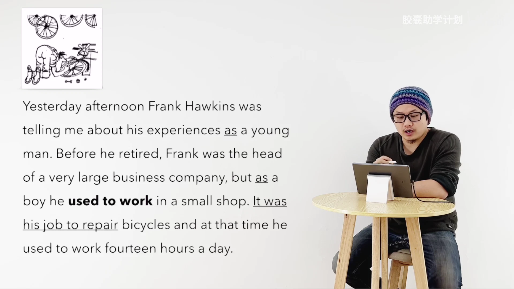

文字识别：Yesterday afternoon Frank Hawkins was / telling me about his experiences as a young / man. Before he retired, Frank was the head / of a very large business company, but as a / boy he used to work in a small shop.It was / his job to repair bicycles and at that time he / used to work fourteen hours a day.

## 00:00:30–00:01:00

告诉您接下来的文章要用到的时态，很可能是跟过去相关的。跟过去相关的，目前我们脑海当中有的，一般过去时、过去完成时和过去进行时，对吧？好，说 Frank Hawkins 就是一个人，不用管啊。Was telling me 当时正在告诉我 about 叫关于 his experiences 他的经验，他的一些经历 as a young man。注意这个地方的

### 画面 00:00:45

文字识别：Yesterday afternoon Frank Hawkins was / telling me about his experiences as a young / man. Before he retired, Frank was the head / of a very large business company, but as a / boy he used to work in a small shop.It was / his job to repair bicycles and at that time he / used to work fourteen hours a day.

## 00:01:00–00:01:30

as以后会经常出现as也有非常多的用法。您记住它第一个用法叫作为啊，当当他还是一个年轻人的时候，或者说作为一个年轻人而言，对吧？Before he retired，在他退休之前，一般过去时出来了。说Frank那说明什么？说明那个时候已经是过去了，对不对？不是将来的事儿。Frank was还是是一个什么呢？The head of a very large business company

### 画面 00:01:15

文字识别：Yesterday afternoon Frank Hawkins was / telling me about his experiences as a young / man. Before he retired, Frank was the head / of a very large business company, but as a / boy he used to work in a small shop.It was / his job to repair bicycles and at that time he / used to work fourteen hours a day.

## 00:01:30–00:02:00

Ah, we first one A of B出来，我们先把A弄明白，B弄明白。A the head，头，对吧？A very large business company，一个特别大的商业公司的，以后往前翻译，一个特别大的商业公司的头。哎，特别巧的是，汉语好像也会这样去表达。我们的头这个字，除了表示头，如果再给它换一个发音叫头，是不是就是是什么意思？就是老大的意思，是

### 画面 00:01:45

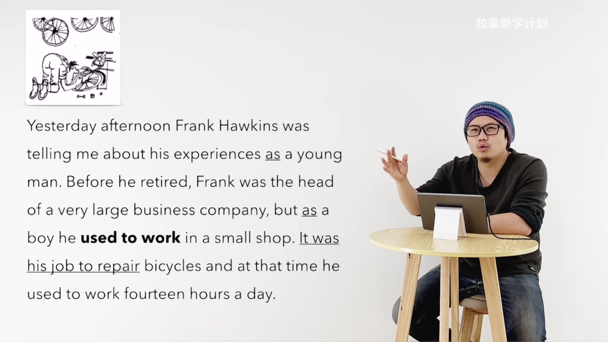

文字识别：Yesterday afternoon Frank Hawkins was / telling me about his experiences as a young / man. Before he retired, Frank was the head / of a very large business company, but as a / boy he used to work in a small shop.It was / his job to repair bicycles and at that time he / used to work fourteen hours a day.

### 画面 00:01:59

文字识别：Yesterday afternoon Frank Hawkins was / telling me about his experiences as a young / man. Before he retired, Frank was the head / of a very large business company, but as a / boy he used to work in a small shop.It was / his job to repair bicycles and at that time he / used to work fourteen hours a day.

## 00:02:00–00:02:30

吧？头啊，英语巧了，英语也有这个含义，head就可以表示这个公司的那个，比如说董事长啊，头，对吧？But但是呢，as a boy跟刚才的as是一样的，作为对吧？作为一个小男孩的时候，或者当他还是一个小男孩的时候，He used to work in a small shop.他过去曾经工作在哪儿呢？In a small shop，在一个小商店

### 画面 00:02:29

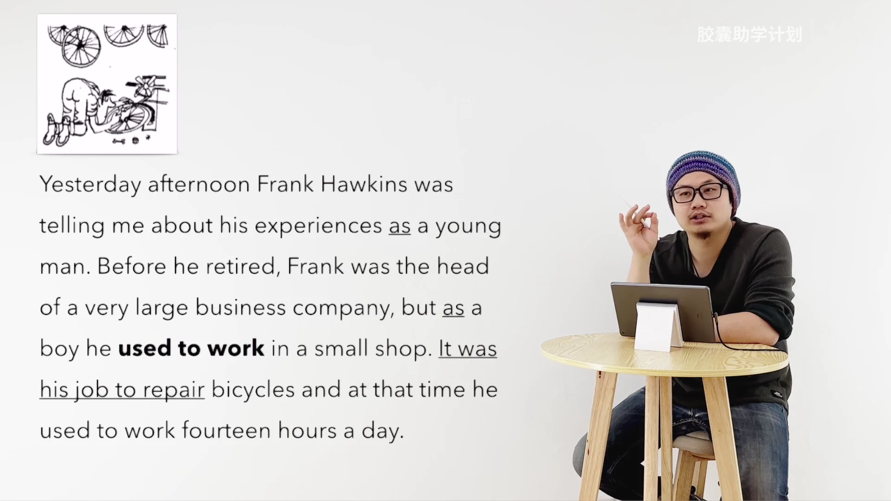

文字识别：Yesterday afternoon Frank Hawkins was / telling me about his experiences as a young / man. Before he retired, Frank was the head / of a very large business company, but as a / boy he used to work in a small shop.It was / his job to repair bicycles and at that time he / used to work fourteen hours a day.

## 00:02:30–00:03:00

### 画面 00:02:49

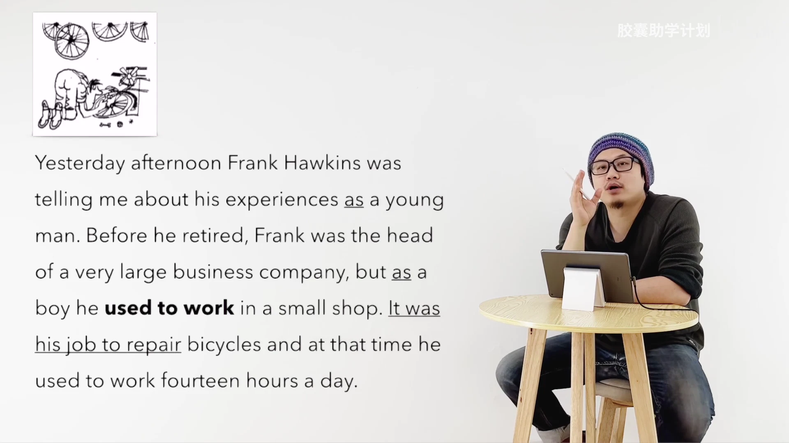

文字识别：Yesterday afternoon Frank Hawkins was / telling me about his experiences as a young / man. Before he retired, Frank was the head / of a very large business company, but as a / boy he used to work in a small shop.It was / his job to repair bicycles and at that time he / used to work fourteen hours a day.

### 画面 00:02:53

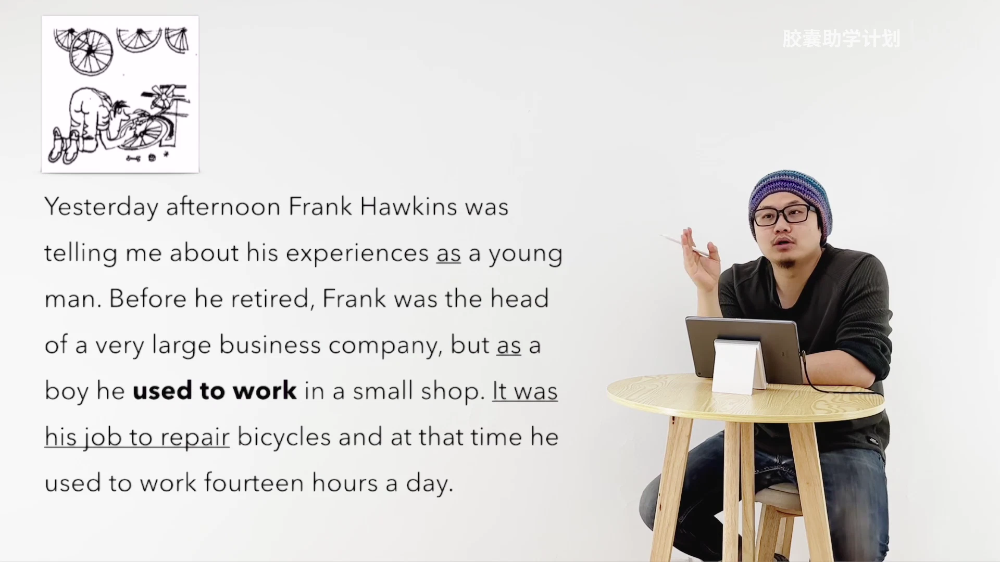

文字识别：Yesterday afternoon Frank Hawkins Was / telling me about his experiences as a young / man. Before he retired, Frank was the head / of a very large business company, but as a / boy he used to work in a small shop.It was / his job to repair bicycles and at that time he / used to work fourteen hours a day.

## 00:03:00–00:03:30

第一个宝盖儿，他。那于是听到这句汉语的时候，你可能自然而然想问我的问题叫做什么是他的工作？我只说他是他的工作。那你会想问我什么是他的工作？怎么办呢？对于各位来说，无非就是要么往前看，要么往后看。看这句话肯定是看不出来的，对吧？我们先往后看，叫 to repair bicycles，叫去修理自行车。这句话读完，你基本能明白，叫 it was his job to repair bicycles。你基本能明白的是，

### 画面 00:03:23

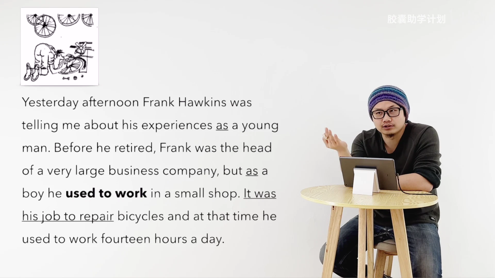

文字识别：Yesterday afternoon Frank Hawkins Was / telling me about his experiences as a young / man. Before he retired, Frank was the head / of a very large business company, but as a / boy he used to work in a small shop.It was / his job to repair bicycles and at that time he / used to work fourteen hours a day.

## 00:03:30–00:04:00

哦，修理自行车是他的工作，对吧？但是跟汉语语序好像不太一样。没问题，其实这也是一个好像有点难的语法。我们把一个比较难的语法给他习惯用法化。怎么去用呢？叫做It was somebody's job to do something. 叫做什么是某人的关键的一呃的的的工作，对吧？什么是某人的一个工作？比如说这句话就翻译成叫修理自行车是他的一个工作。当然

### 画面 00:03:53

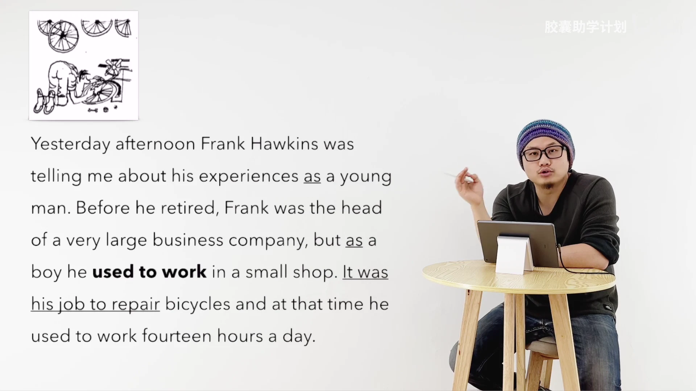

文字识别：Yesterday afternoon Frank Hawkins Was / telling me about his experiences as a young / man. Before he retired, Frank was the head / of a very large business company, but as a / boy he used to work in a small shop.It was / his job to repair bicycles and at that time he / used to work fourteen hours a day.

## 00:04:00–00:04:30

了，时态您也可以转变，was也可以换成is。叫It is his job to repair bicycles。那说的是他现在的工作，对吧？那这里的was指的是曾经。And然后呢？At that time，在那时，he used to work。他过去常常工作 fourteen hours a day。一天十四个小时啊，这很厉害了。He saved money for years。单词部分我们见过了，存钱存了很多年。And in

### 画面 00:04:23

文字识别：He saved money for years and in 1958 he / bought a small workshop of his own. In his / twenties Frank used to make spare parts for / aeroplanes. At that time he had two helpers. / In a few years the small workshop had / become a large factory which employed / seven hundred and twenty-eight people.

## 00:04:30–00:05:00

1958, 在一九五八年, 一九五八年怎么读呢? 先读十九, 再读五十八, 对吧? Nineteen, 五十八, fifty eight, 一九五八年. He bought a small workshop of his own. 好, 我们先看一下一个单词一个单词来, 他买了一个小的车间 of his own. 哎, 由后往前翻译, 对吧? His own, 叫他属于他自己的小车间, 其实就是

### 画面 00:04:53

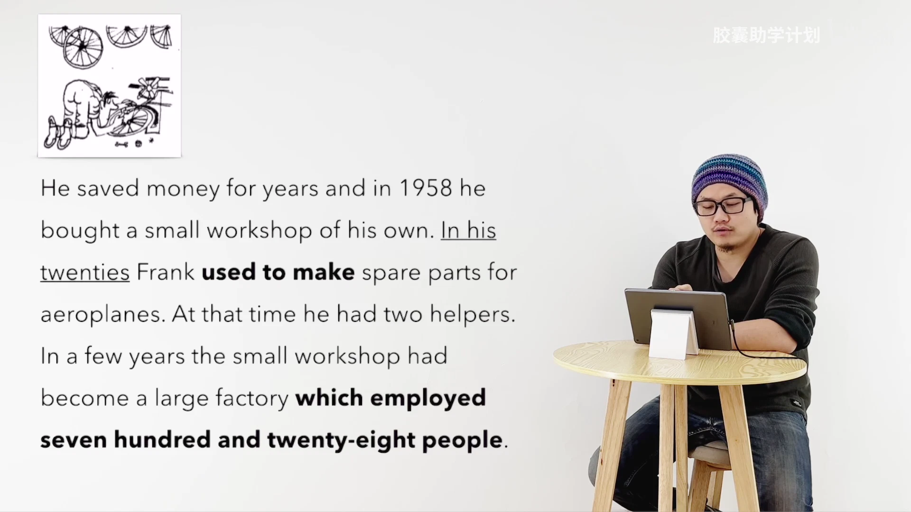

文字识别：八 / He saved money for years and in 1958 he / bought a small workshop of his own. In his / twenties Frank used to make spare parts for / aeroplanes. At that time he had two helpers. / In a few years the small workshop had / become a large factory which employed / seven hundred and twenty-eight people.

## 00:05:00–00:05:30

by himself a small workshop by somebody something, 对吧? Himself叫买给他自己的一个小车间啊，属于他自己的一个车间。 Next one, in his twenties叫在他二十多岁的时候，其实就可以理解为从二十到二十九的一个模糊范围，叫 in his twenties。那同理 in his thirties，您是不是就能明白它

### 画面 00:05:20

文字识别：He saved money for years and in 1958 he / bought a small workshop of his own. In his / twenties Frank used to make spare parts for / aeroplanes. At that time he had two helpers. / In a few years the small workshop had / become a large factory which employed / seven hundred and twenty-eight people.

## 00:05:30–00:06:00

表示的是在我们三十多岁的时候，这个翻译成汉语叫在二十多岁的时候。OK，这是一个习惯用法啊。Frank used to make spare parts for airplanes.说那个时候常常做的事情是制作备件，这是我们之前就学过的了啊。For airplanes叫做给飞机制作备件。At that time,在那时呢，he had two helpers.他有两个助手。

### 画面 00:05:50

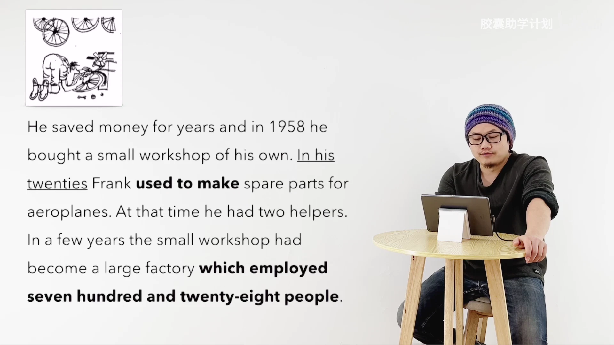

文字识别：He saved money for years and in 1958 he / bought a small workshop of his own. In his / twenties Frank used to make spare parts for / aeroplanes. At that time he had two helpers. / In a few years the small workshop had / become a large factory which employed / seven hundred and twenty-eight people.

## 00:06:00–00:06:30

In a few years,几年之后, the small workshop had become a large factory.很简单，这个小的车间had become过去完成时，对吧？已经变成了一个很大的工厂factory，工厂也算是本课的生词吧。您不妨把它也记下来。Factory工厂，后边紧跟了一个定语从句。什么样的工厂呢？这个工厂啊，which

### 画面 00:06:20

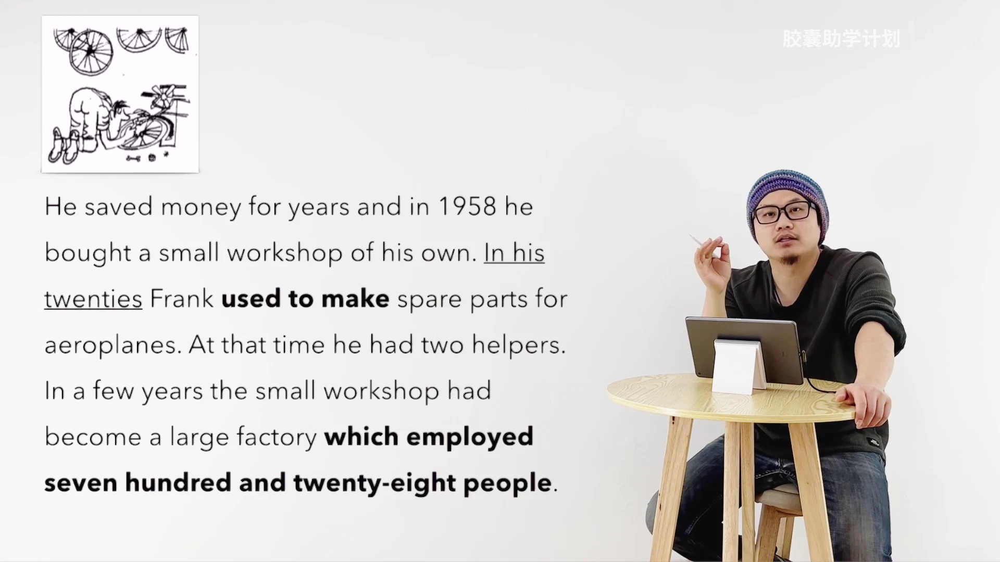

文字识别：He saved money for years and in 1958 he / bought a small workshop of his own. In his / twenties Frank used to make spare parts for / aeroplanes. At that time he had two helpers. / In a few years the small workshop had / become a large factory which employed / seven hundred and twenty-eight people.

## 00:06:30–00:07:00

employed seven hundred and twenty-eight people，说这个工厂雇佣了七百二十八个人。OK，很简单一个定语从句。那想问的问题依旧是 which 在这里能省略吗？判断标准很简单，替代主语不能省略，替代宾语可以省略啊。您就看后边那句话缺主语缺宾语嘛，对吧？就缺一缺三啊。Continue，Frank smiled.哎，笑了笑。

### 画面 00:06:50

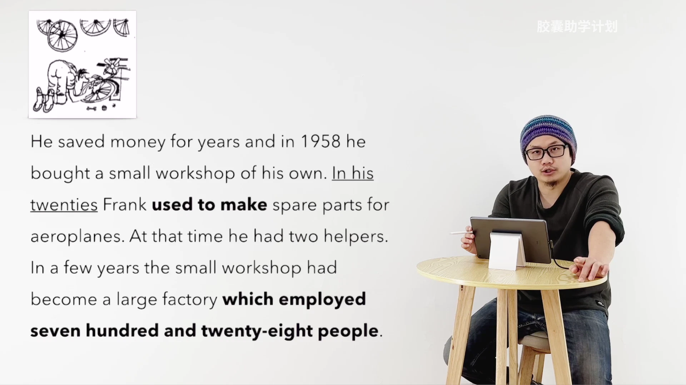

文字识别：He saved money for years and in 1958 he / bought a small workshop of his own. In his / twenties Frank used to make spare parts for / aeroplanes. At that time he had two helpers. / In a few years the small workshop had / become a large factory which employed / seven hundred and twenty-eight people.

### 画面 00:06:55

文字识别：Frank smiled when he remembered his hard / early years and the long road to success. He / was still smiling when the door opened and / his wife came in. She wanted him to repair / their grandson's bicycle!

## 00:07:00–00:07:30

When he remembered his hard early years,当他回忆起了他的艰苦的早年生活、早年岁月的时候，对吧？那些创业的岁啊创创业的岁月，and the long road to success.然后漫漫长路通向成功的这个漫漫长路。He was still smiling.他依旧正在笑。When

### 画面 00:07:25

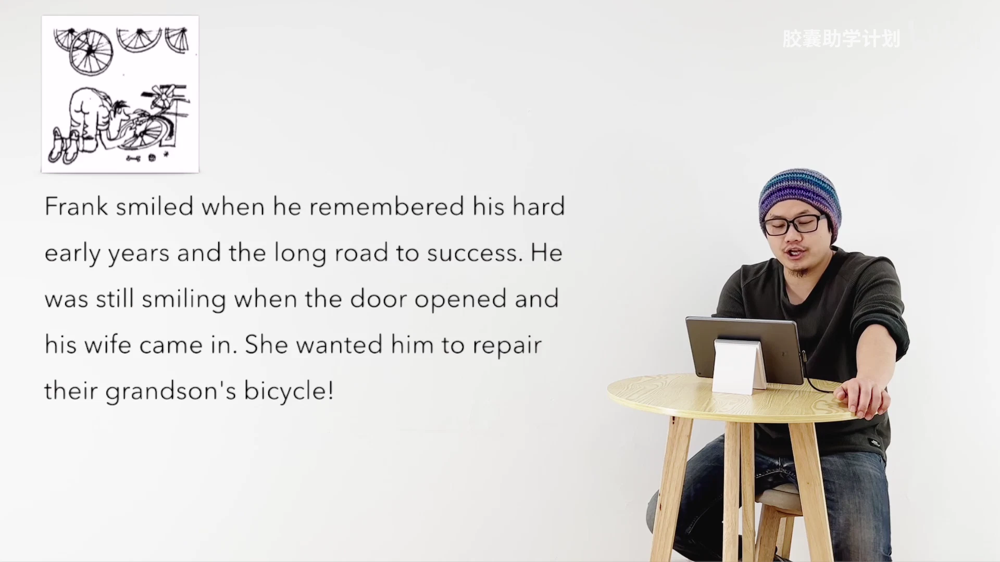

文字识别：Frank smiled when he remembered his hard / early years and the long road to success. He / was still smiling when the door opened and / his wife came in. She wanted him to repair / their grandson's bicycle!

## 00:07:30–00:08:00

当the door opened，当这个这个门啊打开的时候，and his wife came in。然后他的妻子进来了。She wanted him to repair their grandson's bicycle，是吧？这是英国人的小幽默，是吧？从修自行车开始发家，发家，发家，发到一个特别大的工厂，是吧？雇佣了七百多个人。然后他在回顾这段历史的过过过程当中，自己还很开心。然后呢，他老婆进来让

### 画面 00:07:46

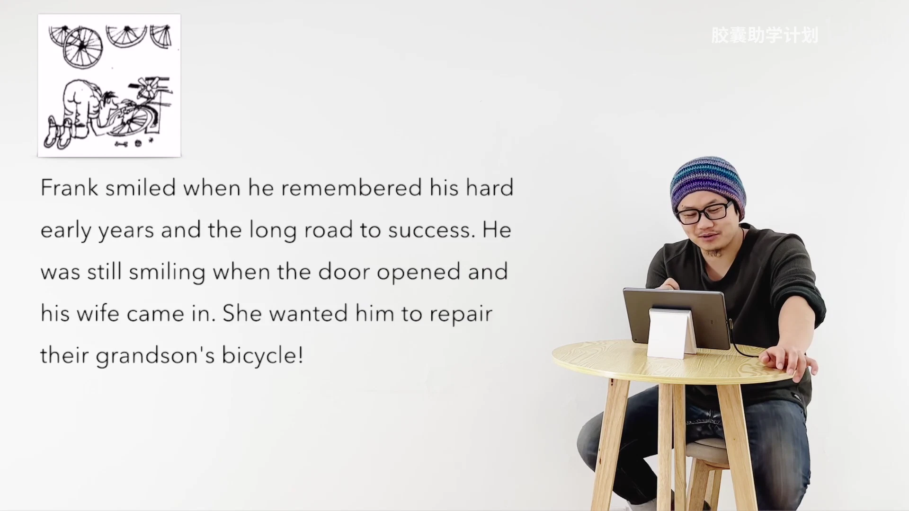

文字识别：Frank smiled when he remembered his hard / early years and the long road to success. He / was still smiling when the door opened and / his wife came in. She wanted him to repair / their grandson's bicycle!

### 画面 00:07:48

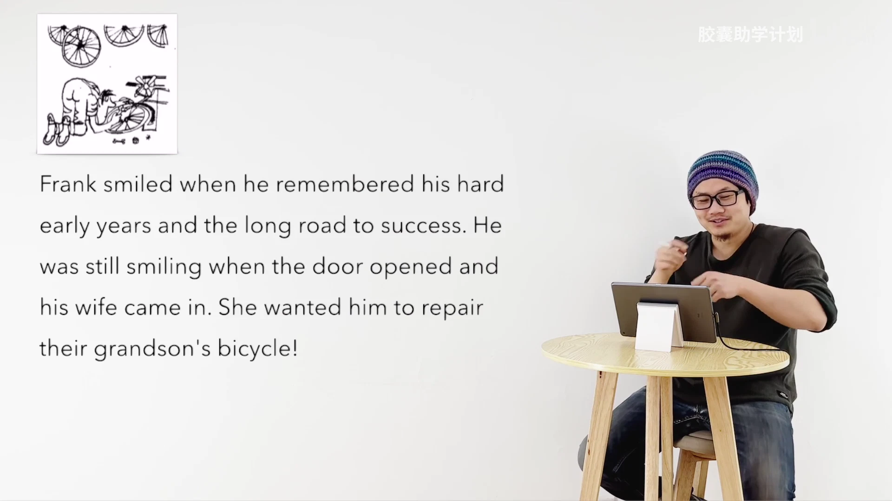

文字识别：Frank smiled when he remembered his hard / early years and the long road to success. He / was still smiling when the door opened and / his wife came in. She wanted him to repair / their grandson's bicycle!

### 画面 00:07:58

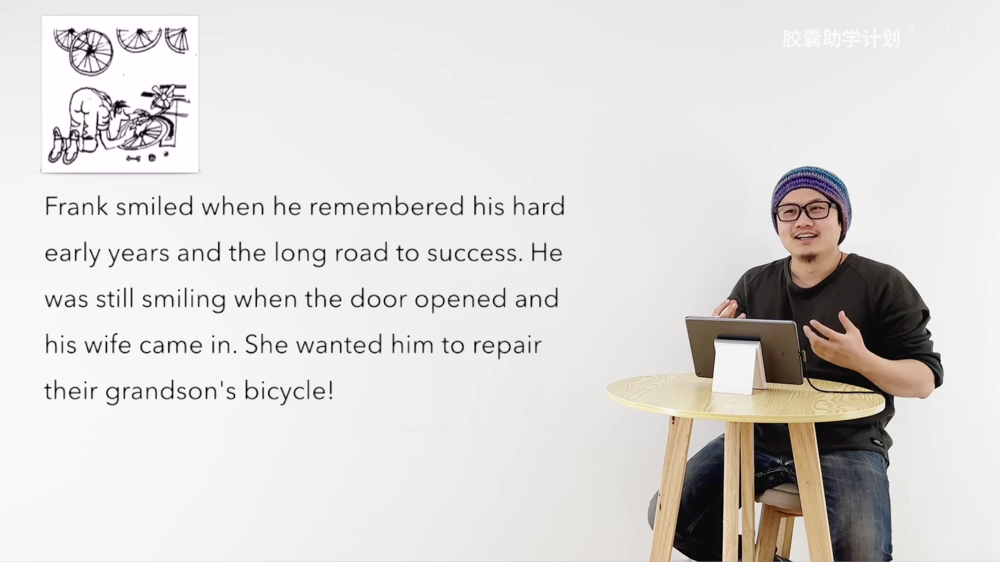

文字识别：1 / Frank smiled when he remembered his hard / early years and the long road to success. He / was still smiling when the door opened and / his wife came in. She wanted him to repair / their grandson's bicycle!

## 00:08:00–00:08:30

### 画面 00:08:03

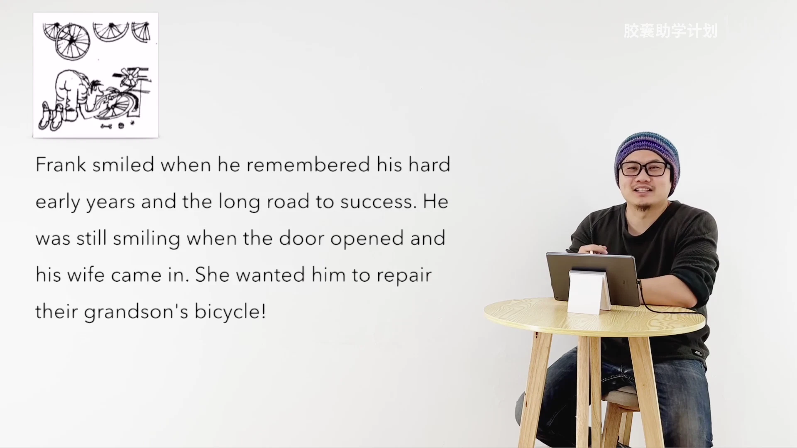

文字识别：Frank smiled when he remembered his hard / early years and the long road to success. He / was still smiling when the door opened and / his wife came in. She wanted him to repair / their grandson's bicycle!

### 画面 00:08:11

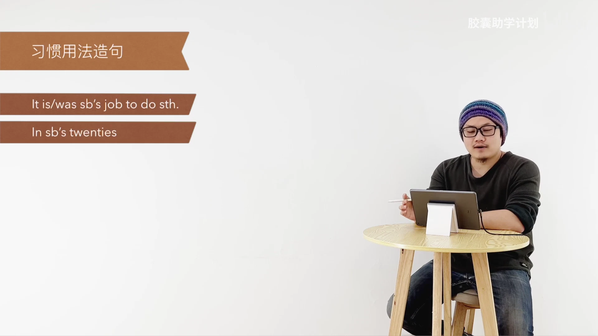

文字识别：习惯用法造句 / It is/was sb's job to do sth. / In sb's twenties

### 画面 00:08:13

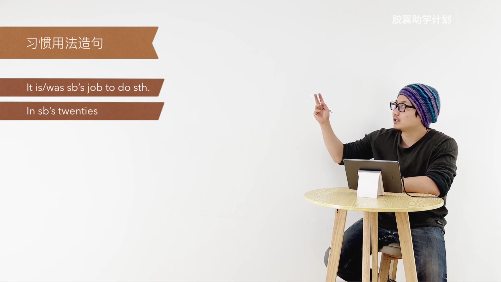

文字识别：习惯用法造句 / It is/was sb's job to do sth. / In sb's twenties

### 画面 00:08:15

文字识别：网：v.+v.变化 / 习惯用法造句指南 / 四句型转换 / 方式/地点/时间 / 其他习惯用法 / 其他单词+词性 / 原文摘抄+变 / 6123456 / It is/was sb's job to do sth.

### 画面 00:08:17

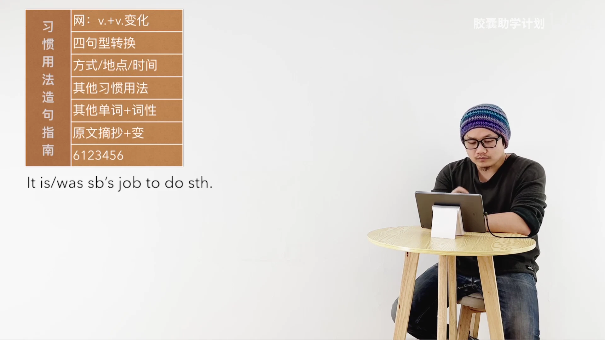

文字识别：网：v.+v.变化 / 习惯用法造句指南 / 四句型转换 / 方式/地点/时间 / 其他习惯用法 / 其他单词+词性 / 原文摘抄+变 / 6123456 / It is/was sb's job to do sth.

### 画面 00:08:19

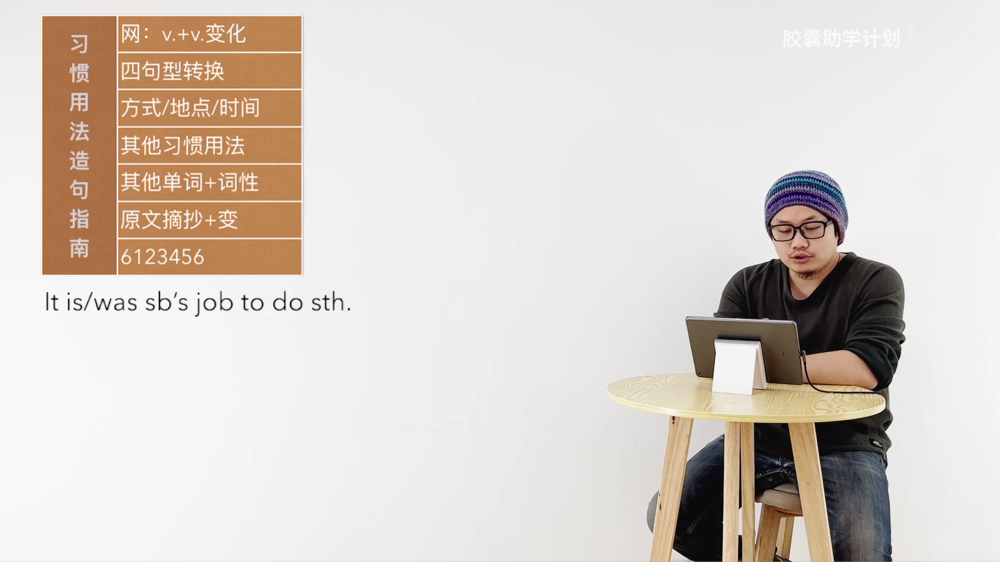

文字识别：网：v.+v.变化 / 习惯用法造句指南 / 四句型转换 / 方式/地点/时间 / 其他习惯用法 / 其他单词+词性 / 原文摘抄+变 / 6123456 / It is/was sb's job to do sth.

### 画面 00:08:21

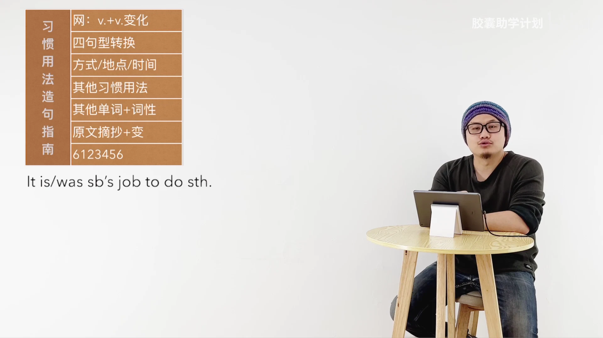

文字识别：网：v.+v.变化 / 习惯用法造句指南 / 四句型转换 / 方式/地点/时间 / 其他习惯用法 / 其他单词+词性 / 原文摘抄+变 / 6123456 / It is/was sb's job to do sth.

### 画面 00:08:24

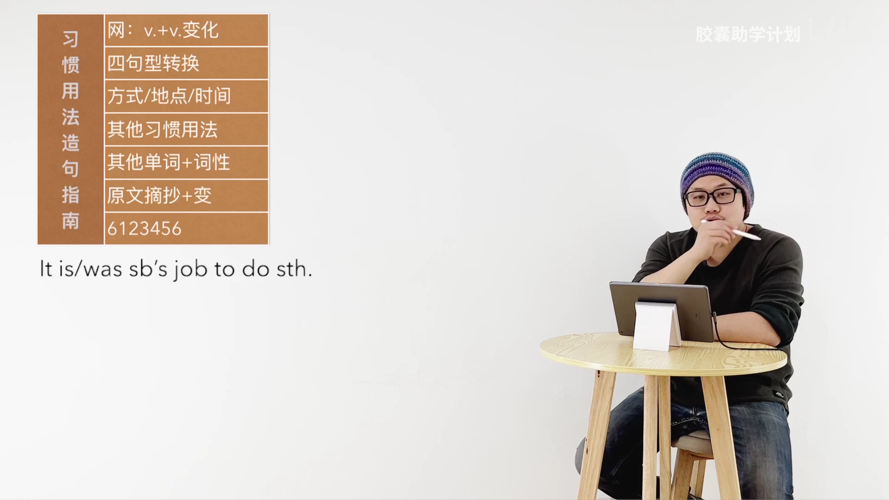

文字识别：网：v.+v.变化 / 习惯用法造句指南 / 四句型转换 / 方式/地点/时间 / 其他习惯用法 / 其他单词+词性 / 原文摘抄+变 / 6123456 / It is/was sb's job to do sth.

### 画面 00:08:26

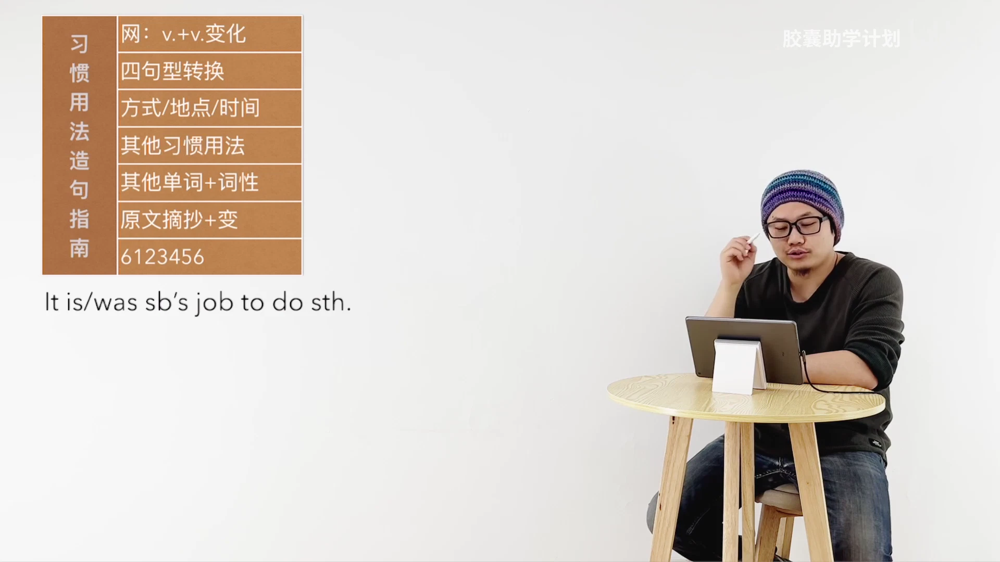

文字识别：网：v.+v.变化 / 习惯用法造句指南 / 四句型转换 / 方式/地点/时间 / 其他习惯用法 / 其他单词+词性 / 原文摘抄+变 / 6123456 / It is/was sb's job to do sth.

### 画面 00:08:28

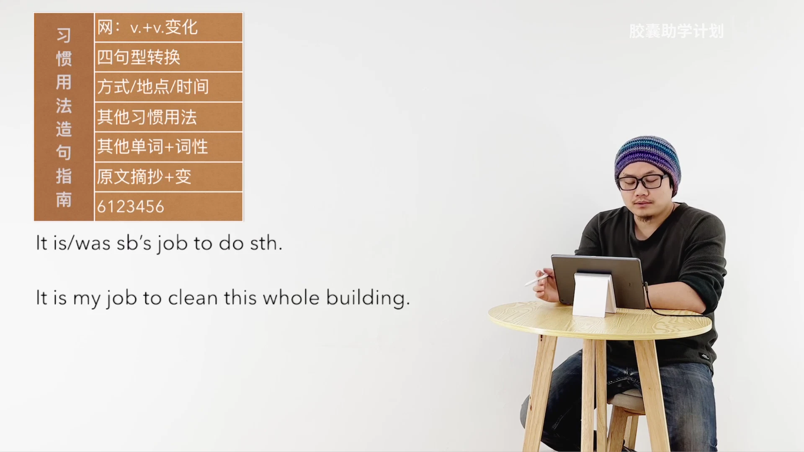

文字识别：网：v.+v.变化 / 习惯用法造句指南 / 四句型转换 / 方式/地点/时间 / 其他习惯用法 / 其他单词+词性 / 原文摘抄+变 / 6123456 / It is/was sb's job to do sth. / It is my job to clean this whole building.

## 00:08:30–00:09:00

job to do something to clean this whole building. 打扫整个建筑物是我的工作。肯定句，四句型转换一下吧。来，Is it your job to clean this whole building? 再来一个特殊疑问句，叫 Why 加整句话就可以了，对吧？那我们再来一个叫做 It was my job to teach English. 曾经教英语是我的工作，但现在我改行了，对不对？OK。那接下来呢，

### 画面 00:08:30

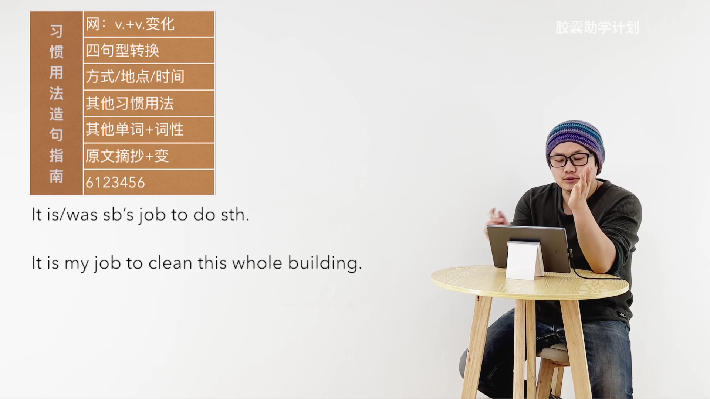

文字识别：网：v.+v.变化 / 习惯用法造句指南 / 四句型转换 / 方式/地点/时间 / 其他习惯用法 / 其他单词+词性 / 原文摘抄+变 / 6123456 / It is/was sb's job to do sth. / It is my job to clean this whole building.

### 画面 00:08:35

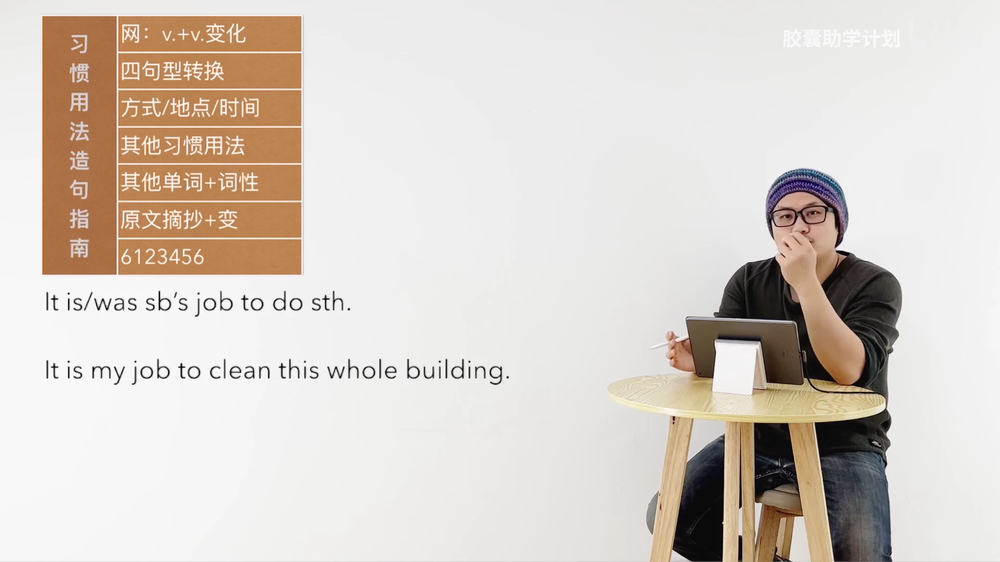

文字识别：网：v.+v.变化 / 习惯用法造句指南 / 四句型转换 / 方式/地点/时间 / 其他习惯用法 / 其他单词+词性 / 原文摘抄+变 / 6123456 / It is/was sb's job to do sth. / It is my job to clean this whole building.

### 画面 00:08:37

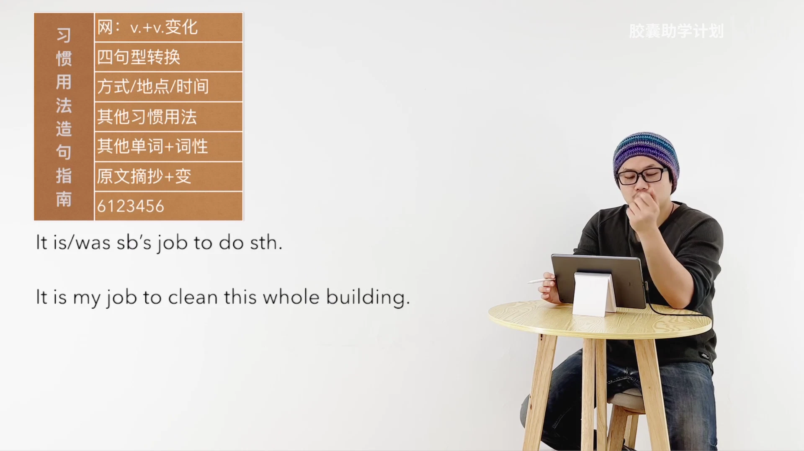

文字识别：网：v.+v.变化 / 习惯用法造句指南 / 四句型转换 / 方式/地点/时间 / 其他习惯用法 / 其他单词+词性 / 原文摘抄+变 / 6123456 / It is/was sb's job to do sth. / It is my job to clean this whole building.

### 画面 00:08:39

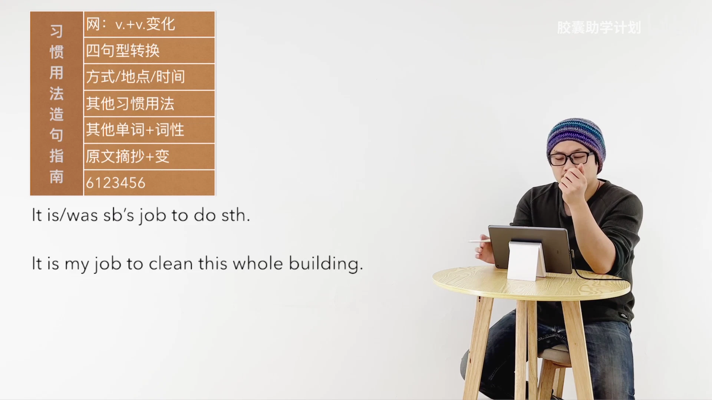

文字识别：网：v.+v.变化 / 习惯用法造句指南 / 四句型转换 / 方式/地点/时间 / 其他习惯用法 / 其他单词+词性 / 原文摘抄+变 / 6123456 / It is/was sb's job to do sth. / It is my job to clean this whole building.

### 画面 00:08:41

文字识别：网：v.+v.变化 / 习惯用法造句指南 / 四句型转换 / 方式/地点/时间 / 其他习惯用法 / 其他单词+词性 / 原文摘抄+变 / 6123456 / It is/was sb's job to do sth. / It is my job to clean this whole building. / Is it your job to clean this whole building?

### 画面 00:08:43

文字识别：网：v.+v.变化 / 习惯用法造句指南 / 四句型转换 / 方式/地点/时间 / 其他习惯用法 / 其他单词+词性 / 原文摘抄+变 / 6123456 / It is/was sb's job to do sth. / It is my job to clean this whole building. / Is it your job to clean this whole building?

### 画面 00:08:45

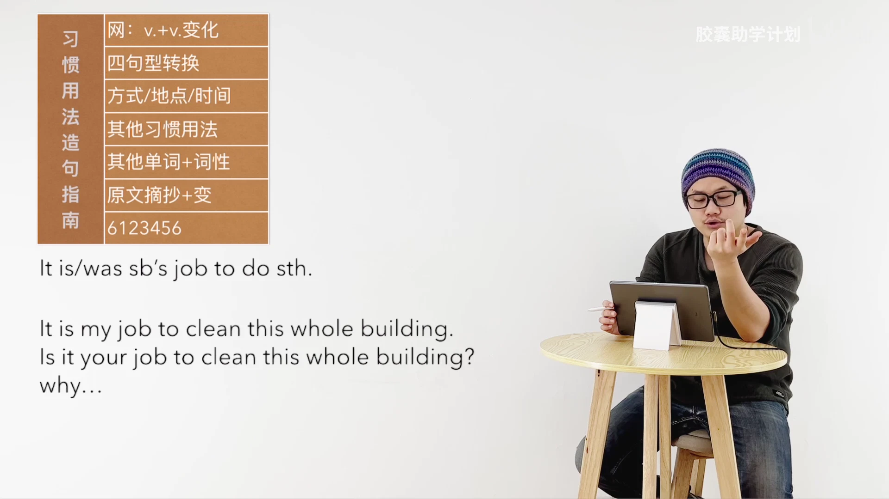

文字识别：网：v.+v.变化 / 习惯用法造句指南 / 四句型转换 / 方式/地点/时间 / 其他习惯用法 / 其他单词+词性 / 原文摘抄+变 / 6123456 / It is/was sb's job to do sth. / It is my job to clean this whole building. / Is it your job to clean this whole building? / why….

### 画面 00:08:47

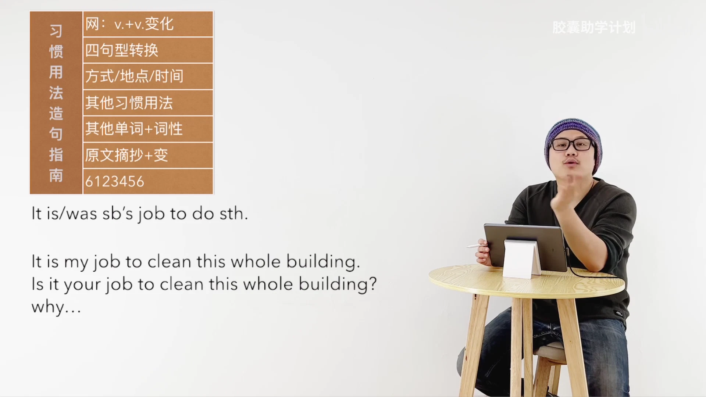

文字识别：网：v.+v.变化 / 习惯用法造句指南 / 四句型转换 / 方式/地点/时间 / 其他习惯用法 / 其他单词+词性 / 原文摘抄+变 / 6123456 / It is/was sb's job to do sth. / It is my job to clean this whole building. / Is it your job to clean this whole building? / why.

### 画面 00:08:49

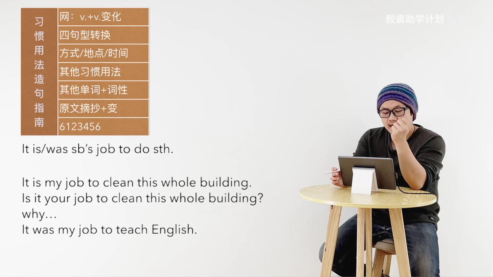

文字识别：网：v.+v.变化 / 习惯用法造句指南 / 四句型转换 / 方式/地点/时间 / 其他习惯用法 / 其他单词+词性 / 原文摘抄+变 / 6123456 / It is/was sb's job to do sth. / It is my job to clean this whole building. / Is it your job to clean this whole building? / why…. / It was my job to teach English.

### 画面 00:08:51

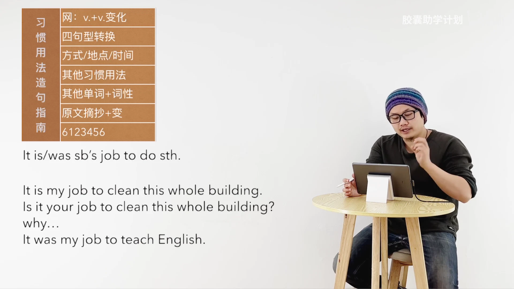

文字识别：网：v.+v.变化 / 习惯用法造句指南 / 四句型转换 / 方式/地点/时间 / 其他习惯用法 / 其他单词+词性 / 原文摘抄+变 / 6123456 / It is/was sb's job to do sth. / It is my job to clean this whole building. / Is it your job to clean this whole building? / why….. / It was my job to teach English.

### 画面 00:08:55

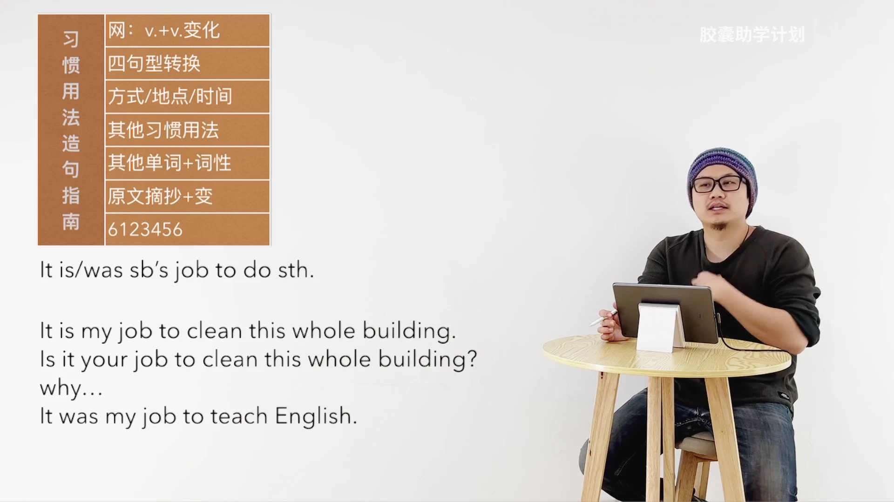

文字识别：网：v.+v.变化 / 习惯用法造句指南 / 四句型转换 / 方式/地点/时间 / 其他习惯用法 / 其他单词+词性 / 原文摘抄+变 / 6123456 / It is/was sb's job to do sth. / It is my job to clean this whole building. / Is it your job to clean this whole building? / why….. / It was my job to teach English.

### 画面 00:08:58

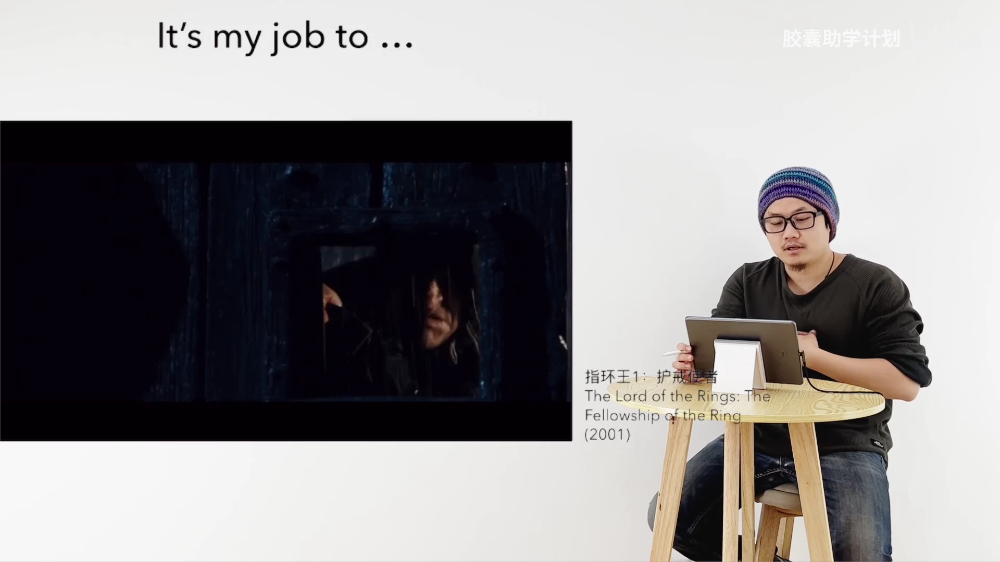

文字识别：It's my job to ... / 指环王1：护戒使者 / The Lord of the Rings: The / Fellowship of the Ring / (2001)

## 00:09:00–00:09:30

我们看一个小的电影片段。这个电影片段当中就出现了叫做 "Is my job to do something?" Okay. What do you want? Heading to the Prancing Pony. Am I? All right. All right. Is this child on your talk? My business brings you debris. We wish to stay at the inn. Our business is our own. All right, young sir. I meant no offense. My job has

### 画面 00:09:00

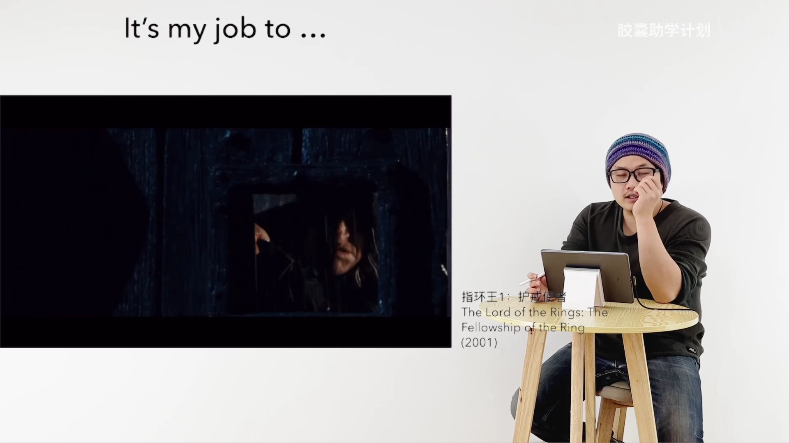

文字识别：It's my job to …. / 指环王1：护戒使者 / The Lord of the Rings: The / Fellowship of the Ring / (2001)

### 画面 00:09:08

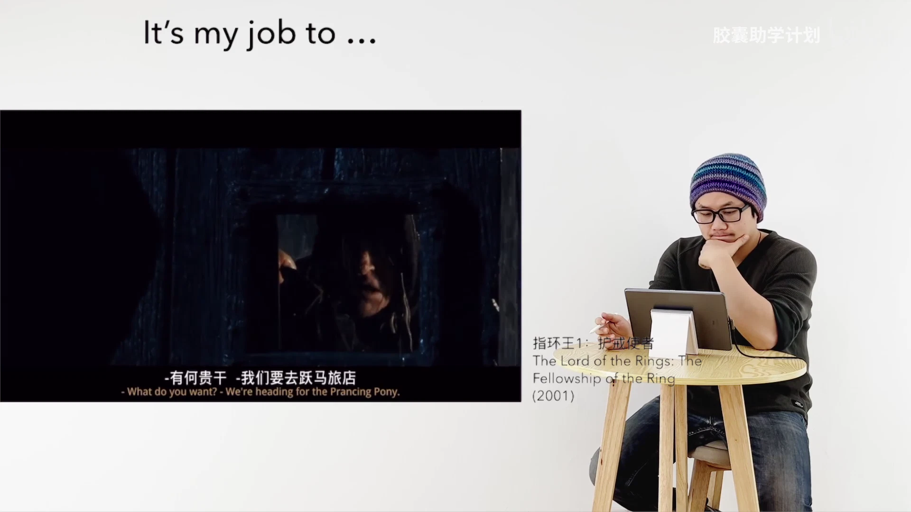

文字识别：It's my job to ... / 指环王1：护戒使者 / The Lord of the Rings: The / -有何贵干-我们要去跃马旅店 / Fellowship of the Ring / -What do you want?- We're heading for the Prancing Pony. / (2001)

### 画面 00:09:11

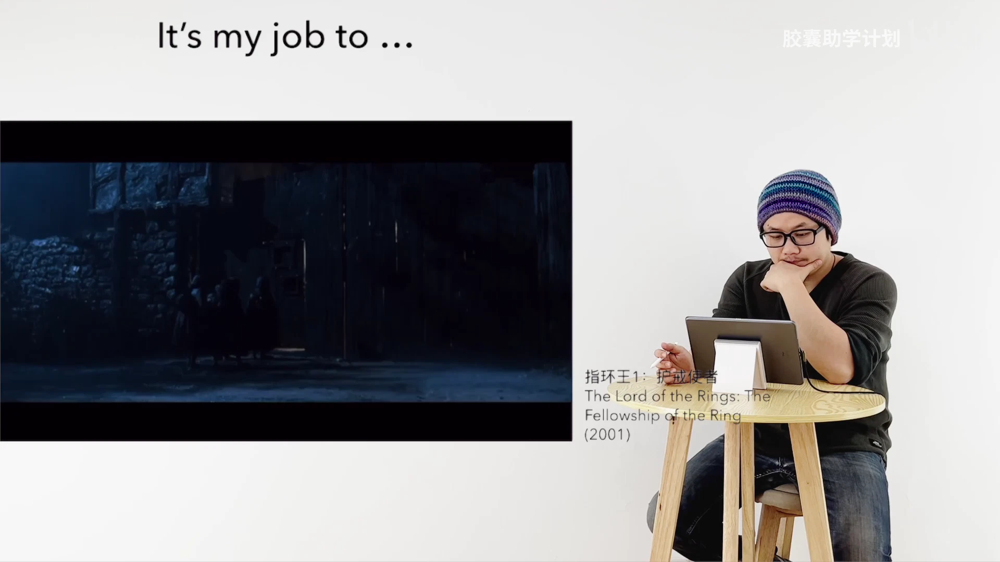

文字识别：It's my job to ... / 指环王1：护戒使者 / The Lord of the Rings: The / Fellowship of the Ring / (2001)

### 画面 00:09:13

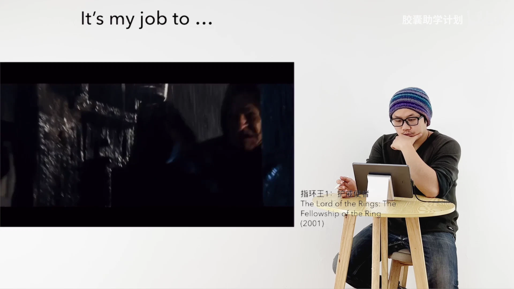

文字识别：It's my job to ... / 指环王1：护戒使者 / The Lord of the Rings: The / Fellowship of the Ring / (2001)

### 画面 00:09:16

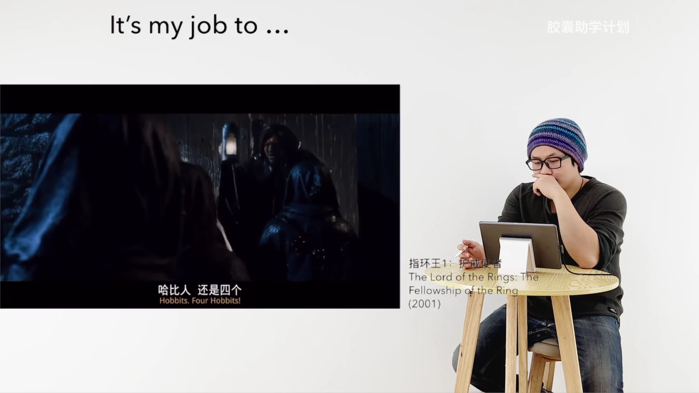

文字识别：It's my job to ... / 指环王1：护戒使者 / The Lord of the Rings: The / 哈比人还是四个 / Fellowship of the Ring / Hobbits.Four Hobbits! / (2001)

### 画面 00:09:18

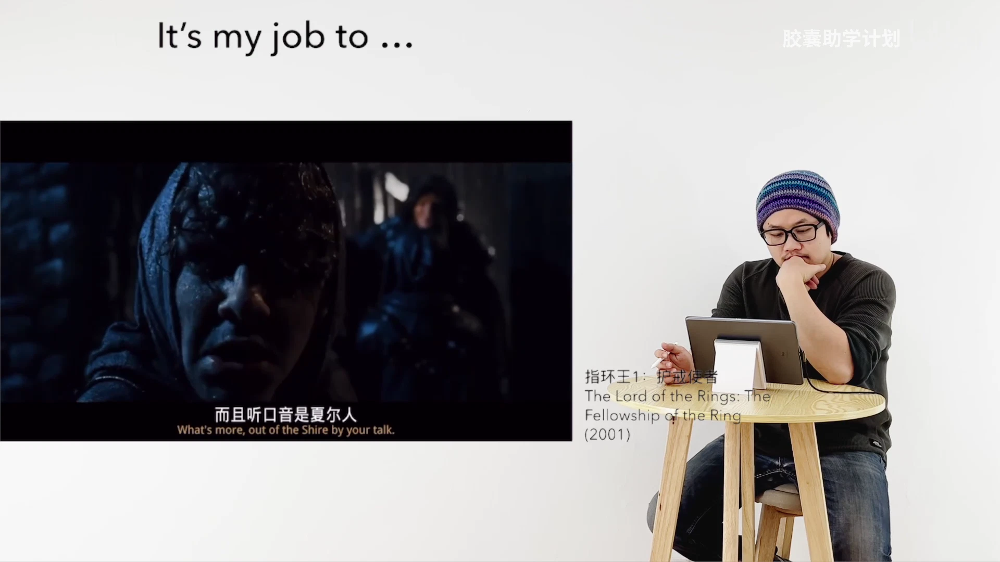

文字识别：It's my job to ... / 指环王1：护戒使者 / The Lord of the Rings: The / 而且听口音是夏尔人 / Fellowship of the Ring / What's more, out of the Shire by your talk. / (2001)

### 画面 00:09:20

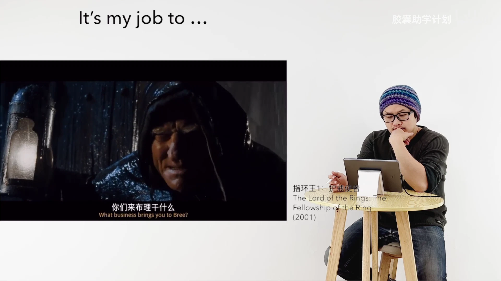

文字识别：It's my job to ... / 指环王1：护戒使者 / The Lord of the Rings: The / 你们来布理干什么 / Fellowship of the Ring / What business brings you to Bree? / (2001)

### 画面 00:09:22

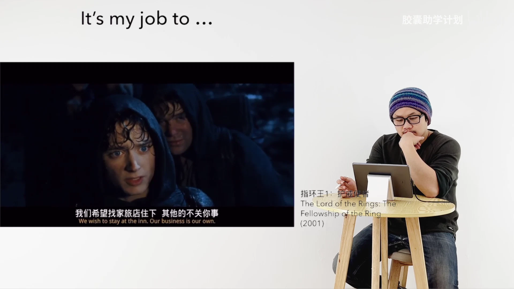

文字识别：It's my job to ... / 指环王1：护戒使者 / The Lord of the Rings: The / 我们希望找家旅店住下其他的不关你事 / Fellowship of the Ring / We wish to stay at the inn. Our business is our own. / (2001)

### 画面 00:09:25

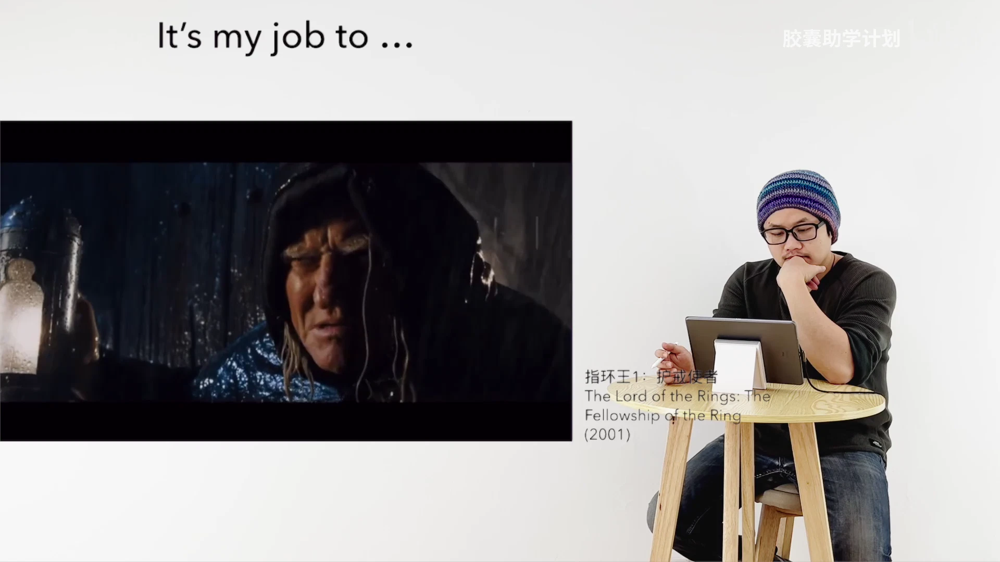

文字识别：It's my job to ... / 指环王1：护戒使者 / The Lord of the Rings: The / Fellowship of the Ring / (2001)

### 画面 00:09:27

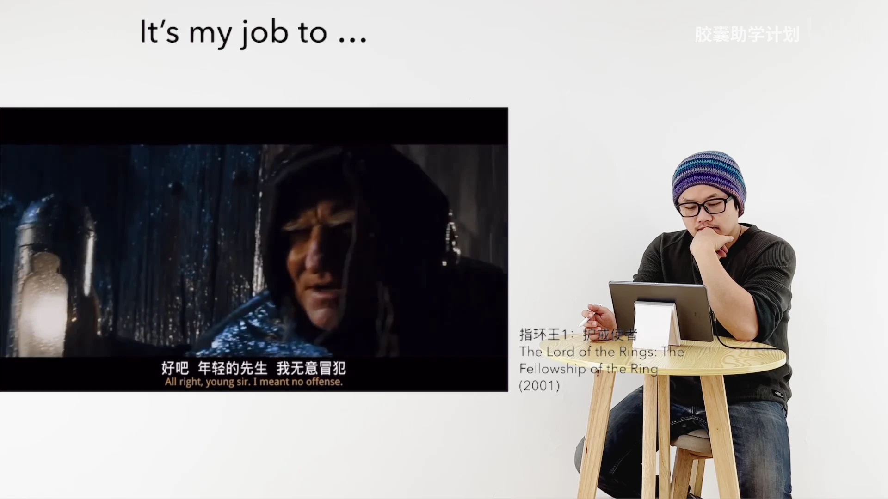

文字识别：It's my job to ... / 指环王1：护戒使者 / The Lord of the Rings: The / 好吧年轻的先生我无意冒犯 / Fellowship of the Ring / All right, young sir. I meant no offense. / (2001)

### 画面 00:09:29

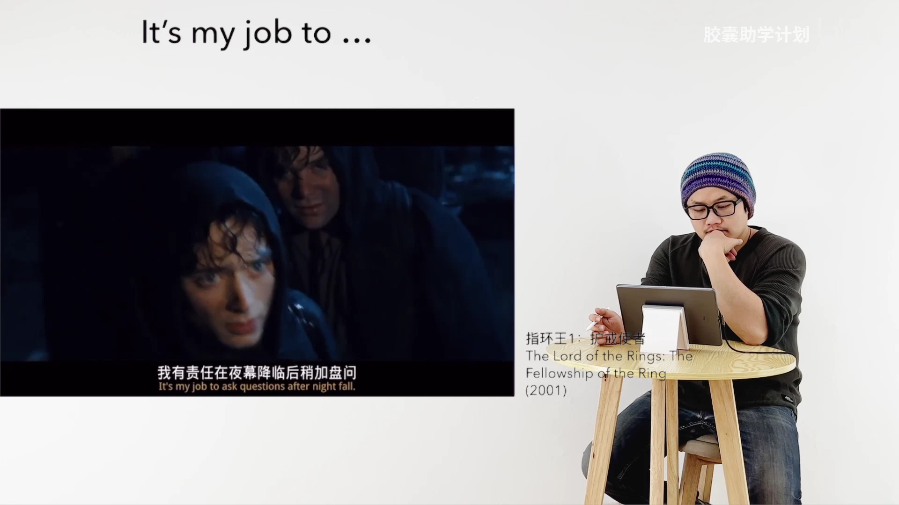

文字识别：It's my job to ... / 指环王1：护戒使者 / The Lord of the Rings: The / 我有责任在夜幕降临后稍加盘问 / Fellowship of the Ring / It's my job to ask questions after night fall. / (2001)

## 00:09:30–00:10:00

questions after nightfall. This talk of strange folklore. It's my job to ask questions,对吧？Okay,啊，是我的工作，我的职责去问一些问题。After nightfall,啊，在夜晚降临之后。下一个，下一个小的习惯用法叫In somebody's twenties,叫在某人二十多岁的时候。比如说，I used to play basketball in my twenties. Now I am in my thirties. Okay,说我现在三十多岁了，

### 画面 00:09:31

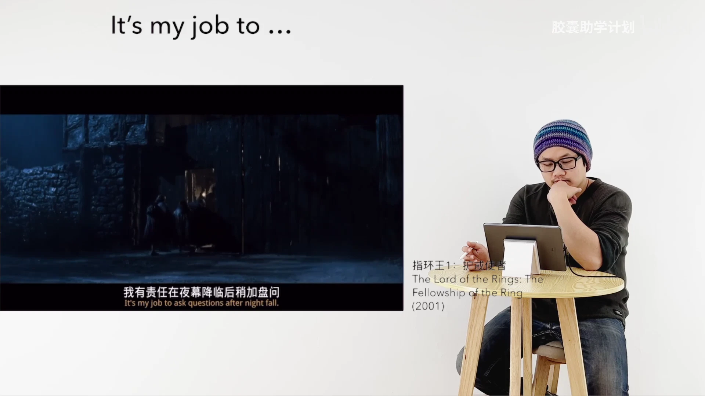

文字识别：It's my job to ... / 指环王1：护戒使者 / The Lord of the Rings: The / 我有责任在夜幕降临后稍加盘问 / Fellowship of the Ring / It's my job to ask questions after night fall. / (2001)

### 画面 00:09:33

文字识别：It's my job to ... / 指环王1：护戒使者 / The Lord of the Rings: The / 传言说最近有怪人在此游荡 / Fellowship of the Ring / There's talk of strange folk abroad. / (2001)

### 画面 00:09:35

文字识别：It's my job to ... / 指环王1：护戒使者 / The Lord of the Rings: The / Fellowship of the Ring / (2001)

### 画面 00:09:42

文字识别：It's my job to .. / 指环王1：护戒使者 / The Lord of the Rings: The / Fellowship of the Ring / (2001)

### 画面 00:09:45

文字识别：网：v.+v.变化 / 习惯用法造句指南 / 四句型转换 / 方式/地点/时间 / 其他习惯用法 / 其他单词+词性 / 原文摘抄+变 / 6123456 / In sb's twenties

### 画面 00:09:47

文字识别：网：v.+v.变化 / 习惯用法造句指南 / 四句型转换 / 方式/地点/时间 / 其他习惯用法 / 其他单词+词性 / 原文摘抄+变 / 6123456 / In sb's twenties

### 画面 00:09:49

文字识别：网：v.+v.变化 / 习惯用法造句指南 / 四句型转换 / 方式/地点/时间 / 其他习惯用法 / 其他单词+词性 / 原文摘抄+变 / 6123456 / In sb's twenties

### 画面 00:09:51

文字识别：网：v.+v.变化 / 习惯用法造句指南 / 四句型转换 / 方式/地点/时间 / 其他习惯用法 / 其他单词+词性 / 原文摘抄+变 / 6123456 / In sb's twenties / I used to play basketball in my twenties.

### 画面 00:09:53

文字识别：网：v.+v.变化 / 习惯用法造句指南 / 四句型转换 / 方式/地点/时间 / 其他习惯用法 / 其他单词+词性 / 原文摘抄+变 / 6123456 / In sb's twenties / I used to play basketball in my twenties.

### 画面 00:09:55

文字识别：网：v.+v.变化 / 习惯用法造句指南 / 四句型转换 / 方式/地点/时间 / 其他习惯用法 / 其他单词+词性 / 原文摘抄+变 / 6123456 / In sb's twenties / I used to play basketball in my twenties.

### 画面 00:09:57

文字识别：网：v.+v.变化 / 习惯用法造句指南 / 四句型转换 / 方式/地点/时间 / 其他习惯用法 / 其他单词+词性 / 原文摘抄+变 / 6123456 / In sb's twenties / I used to play basketball in my twenties.

## 00:10:00–00:10:30

但是我在我二十多岁的时候经常是去打篮球的。Okay,说she decided to go to New York in her twenties，在她二十多岁的时候，她决定了要去纽约。那您就可以问说她为什么呢？她什么时候呢？是吧？又是四句型的转换，您的造句又完成了。Okay, very good. Did where why? Okay, very good.当然了，这个地方我们也结合了之前学过的一个习惯用法，叫decide to do something.

### 画面 00:10:00

文字识别：网：v.+v.变化 / 习惯用法造句指南 / 四句型转换 / 方式/地点/时间 / 其他习惯用法 / 其他单词+词性 / 原文摘抄+变 / 6123456 / In sb's twenties / I used to play basketball in my twenties.

### 画面 00:10:04

文字识别：网：v.+v.变化 / 习惯用法造句指南 / 四句型转换 / 方式/地点/时间 / 其他习惯用法 / 其他单词+词性 / 原文摘抄+变 / 6123456 / In sb's twenties / I used to play basketball in my twenties. / She decided to go to New York in her twenties.

### 画面 00:10:06

文字识别：网：v.+v.变化 / 习惯用法造句指南 / 四句型转换 / 方式/地点/时间 / 其他习惯用法 / 其他单词+词性 / 原文摘抄+变 / 6123456 / In sb's twenties / I used to play basketball in my twenties. / She decided to go to New York in her twenties.

### 画面 00:10:10

文字识别：网：v.+v.变化 / 习惯用法造句指南 / 四句型转换 / 方式/地点/时间 / 其他习惯用法 / 其他单词+词性 / 原文摘抄+变 / 6123456 / In sb's twenties / I used to play basketball in my twenties. / She decided to go to New York in her twenties.

### 画面 00:10:13

文字识别：网：v.+v.变化 / 习惯用法造句指南 / 四句型转换 / 方式/地点/时间 / 其他习惯用法 / 其他单词+词性 / 原文摘抄+变 / 6123456 / In sb's twenties / I used to play basketball in my twenties. / She decided to go to New York in her twenties.

### 画面 00:10:15

文字识别：网：v.+v.变化 / 习惯用法造句指南 / 四句型转换 / 方式/地点/时间 / 其他习惯用法 / 其他单词+词性 / 原文摘抄+变 / 6123456 / In sb's twenties / I used to play basketball in my twenties. / She decided to go to New York in her twenties.

### 画面 00:10:17

文字识别：网：v.+v.变化 / 习惯用法造句指南 / 四句型转换 / 方式/地点/时间 / 其他习惯用法 / 其他单词+词性 / 原文摘抄+变 / 6123456 / In sb's twenties / I used to play basketball in my twenties. / She decided to go to New York in her twenties.

### 画面 00:10:20

文字识别：网：v.+v.变化 / 习惯用法造句指南 / 四句型转换 / 方式/地点/时间 / 其他习惯用法 / 其他单词+词性 / 原文摘抄+变 / 6123456 / In sb's twenties / I used to play basketball in my twenties. / She decided to go to New York in her twenties. / did/where/why...

### 画面 00:10:23

文字识别：网：v.+v.变化 / 习惯用法造句指南 / 四句型转换 / 方式/地点/时间 / 其他习惯用法 / 其他单词+词性 / 原文摘抄+变 / 6123456 / In sb's twenties / I used to play basketball in my twenties. / She decided to go to New York in her twenties. / did/where/why...

### 画面 00:10:25

文字识别：网：v.+v.变化 / 习惯用法造句指南 / 四句型转换 / 方式/地点/时间 / 其他习惯用法 / 其他单词+词性 / 原文摘抄+变 / 6123456 / In sb's twenties / I used to play basketball in my twenties. / She decided to go to New York in her twenties. / did/where/why...

### 画面 00:10:27

文字识别：网：v.+v.变化 / 习惯用法造句指南 / 四句型转换 / 方式/地点/时间 / 其他习惯用法 / 其他单词+词性 / 原文摘抄+变 / 6123456 / In sb's twenties / I used to play basketball in my twenties. / She decided to go to New York in her twenties. / did/where/why...

## 00:10:30–00:11:00

Okay,好，呃，recap本课除了文章以外，习惯用法有两个非常的重要老习惯。家庭作业各位要习惯用法去造句，每个造五个啊。Okay，当然如果更好，您可以尝试去造一些对话。文章呢老习惯要跟读，字熟读成诵啊。呃，以上呢就是本期视频的全部内容了。如果各位喜欢我们的课程呢，欢迎各位关注、订阅、一键三连，分享给那

### 画面 00:10:30

文字识别：网：v.+v.变化 / 习惯用法造句指南 / 四句型转换 / 方式/地点/时间 / 其他习惯用法 / 其他单词+词性 / 原文摘抄+变 / 6123456 / In sb's twenties / I used to play basketball in my twenties. / She decided to go to New York in her twenties. / did/where/why...

### 画面 00:10:32

文字识别：Recap / It is/was sb's job to do sth. / Expression / In sb's twenties

### 画面 00:10:34

文字识别：Recap / It is/was sb's job to do sth. / Expression / In sb's twenties

### 画面 00:10:36

文字识别：Recap / It is/was sb's job to do sth. / Expression / sb's twenties

### 画面 00:10:38

### 画面 00:10:40

文字识别：1. / 习惯用法造句/对话 / 【习惯用法造句指南】 / 每个5句

### 画面 00:10:42

文字识别：宁 / 1. / 习惯用法造句/对话 / 【习惯用法造句指南】 / 每个5句 / 文章跟读至熟读成诵 / 内化单词+语法+习惯用法 / 听力+口语+写作练习

### 画面 00:10:45

文字识别：1. / 习惯用法造句/对话 / 【习惯用法造句指南】 / 每个5句 / 文章跟读至熟读成诵 / 内化单词+语法+习惯用法 / 听力+口语+写作练习

### 画面 00:10:50

文字识别：1. / 习惯用法造句/对话 / 【习惯用法造句指南】 / 每个5句 / 文章跟读至熟读成诵 / 内化单词+语法+习惯用法 / 听力+口语+写作练习

### 画面 00:10:52

文字识别：👍

### 画面 00:10:54

## 00:11:00–00:11:15

些需要的朋友。See you next time.

### 画面 00:11:03

文字识别：CAPSULEACADEMY / 胶囊助学计划 / 小红书

### 画面 00:11:05

文字识别：CAPSULEACADEMY / 胶囊助学计划 / 小红书 / OE

### 画面 00:11:08

文字识别：CAPSULEACADEMY / 胶囊助学计划 / 小红书 / Editor / Berlin / OE

### 画面 00:11:10

文字识别：CAPSULEACADEMY / 胶囊助学计划 / 小红书 / Creator / □ / Leo & Berlin / OE

### 画面 00:11:12

文字识别：胶囊助学计划 bil出 / CAPSULEACADEMY / 胶囊助学计划 / 小红书 / OE

### 画面 00:11:14

文字识别：bilibili / 胶囊助学计划

