# L031 听说读写复述练习

快速机器解析：语音为单模型转写，未进行独立交叉校对或人工复核；画面每秒采样并按变化选帧，短时文字和标记可能遗漏。截图时间约有 1 秒误差。图片有损压缩；遇到疑点请按时间查看 Google Drive 原视频。

## 00:00:00–00:00:30

Hello everyone, welcome to Capsule Academy. This is Leo. Today we're going to learn the Concept English Book Two Lesson Thirty One Practices. 那各位注意，进行如下练习，唯一的前提就是文章一定要跟读至熟读成诵，否则请勿开始。 Hope you gonna enjoy it. 好，那我们先看第一题 Comprehension. 老习惯练习的，我们是听懂别人发问的能力，对吧？好，

### 画面 00:00:00

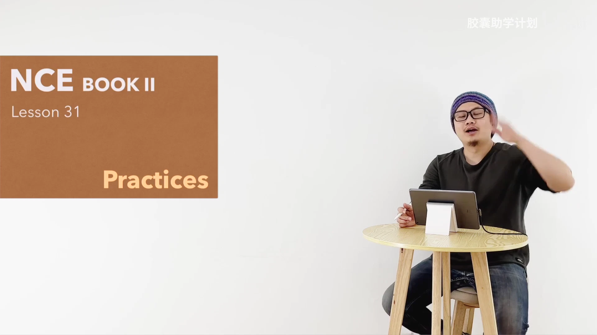

文字识别：NCE / BOOKII / Lesson 31 / Practices

### 画面 00:00:02

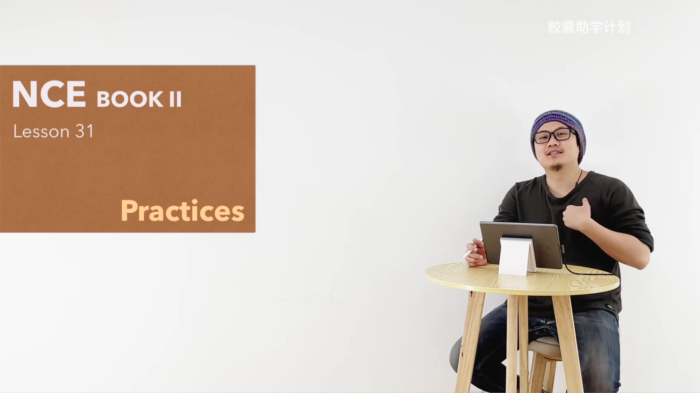

文字识别：NCE / BOOK"I / Lesson 31 / Practices

### 画面 00:00:05

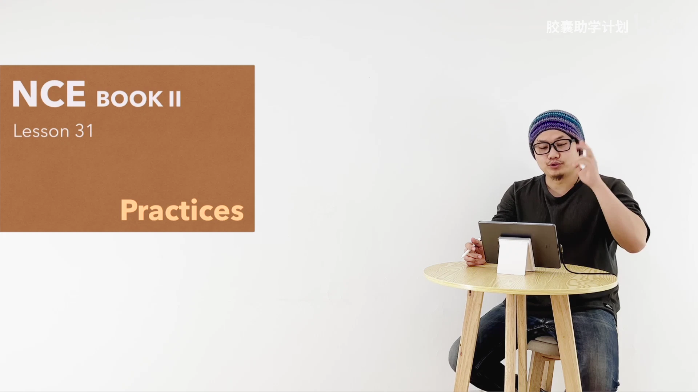

文字识别：NCE / BOOKII / Lesson 31 / Practices

### 画面 00:00:07

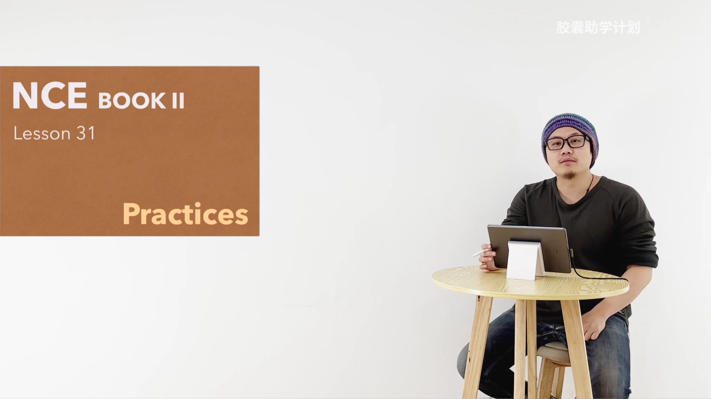

文字识别：NCE / BOOKII / Lesson 31 / Practices

### 画面 00:00:09

文字识别：进行如下练习唯一前提 / 文章跟读至熟读成诵 / 否则请勿开始

### 画面 00:00:15

文字识别：进行如下练习唯一前提 / 文章跟读至熟读成诵 / 否则请勿开始

### 画面 00:00:18

文字识别：胶囊助学计划bill / ••

### 画面 00:00:22

文字识别：胶囊助学计划

### 画面 00:00:24

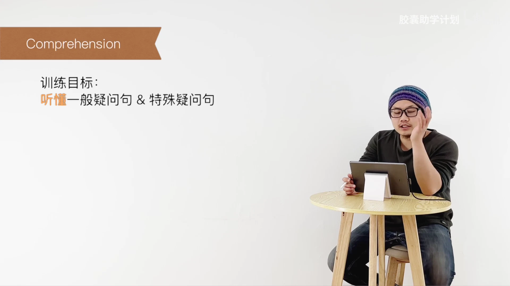

文字识别：Comprehension / 训练目标： / 听懂一般疑问句＆特殊疑问句

## 00:00:30–00:01:00

根据文章去进行练习。那我问您答，弟弟，Who were you talking to yesterday afternoon？背单词就可以了。Frank Hawkins。Next one, what was he telling you about his experience as a young man? Next one, what is Frank now head of? A very large business company. Next one, where did

### 画面 00:00:33

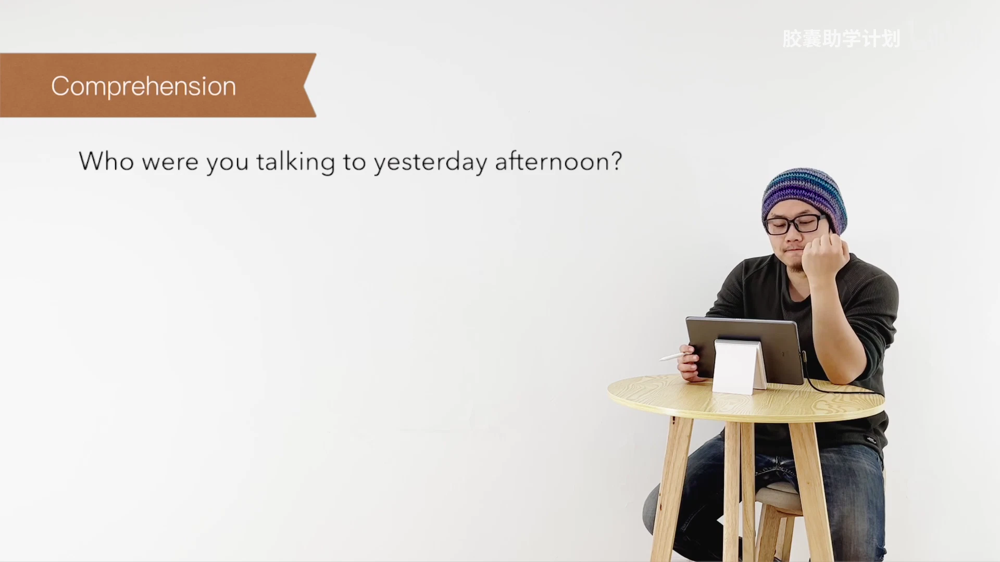

文字识别：Comprehension / Who were you talking to yesterday afternoon?

### 画面 00:00:45

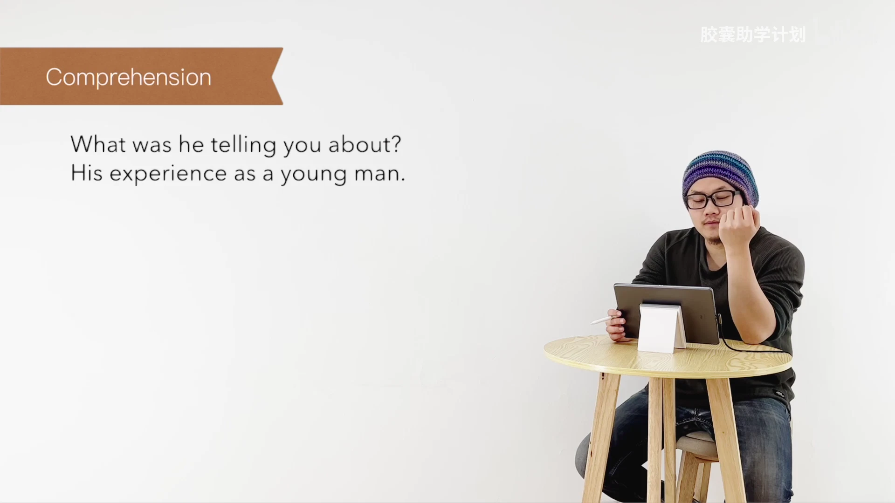

文字识别：Comprehension / What was he telling you about? / His experience as a young man.

### 画面 00:00:54

文字识别：Comprehension / What is Frank now head of? / A very large business company.

## 00:01:00–00:01:30

used to work as a boy? In a small shop. Next one, what was his job at that time? To repair bicycles. Next one, did he used to work long hours? Yes, he did. Next one, did he save his money or spend it? He saved it.

### 画面 00:01:03

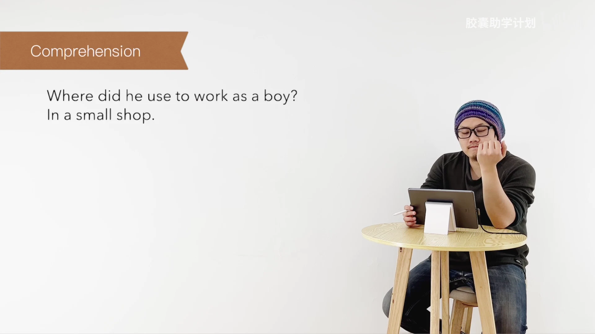

文字识别：Comprehension / Where did he use to work as a boy? / In a small shop.

### 画面 00:01:21

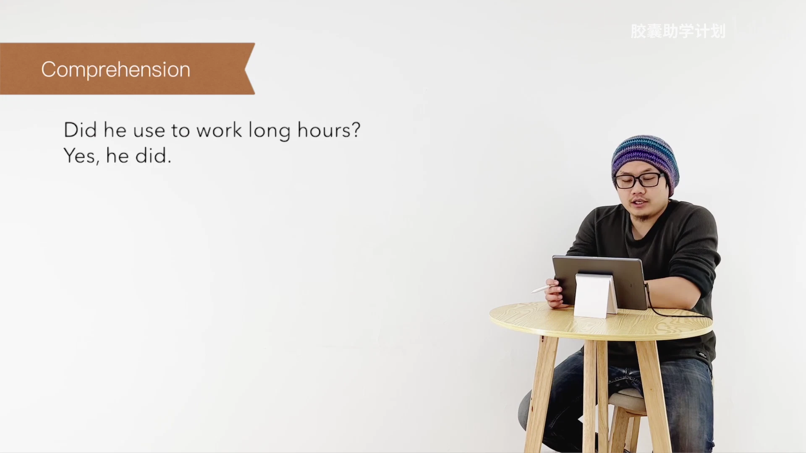

文字识别：Comprehension / Did he use to work long hours? / Yes, he did.

### 画面 00:01:25

文字识别：Comprehension / Did he save his money or spend it?

## 00:01:30–00:02:00

Next one. What did he buy with his money? A small workshop. Next one. When did he buy it? In 1958. Next one. What did he do in his twenties? He used to make spare parts for airplanes. Next one. How many helpers did he have at that time? Or then?

### 画面 00:01:35

文字识别：Comprehension / What did he buy with his money? / A small workshop.

### 画面 00:01:48

文字识别：Comprehension / What did he do in his twenties? / He used to make spare parts for aeroplanes.

### 画面 00:01:55

文字识别：Comprehension / How many helpers did he have then?

## 00:02:00–00:02:30

then. Two. Next one. How many people did he employ in a few years? Seven hundred and twenty-eight. Next one. What had his small workshop become? A large factory. Next one. Frank's been successful, hasn't he? Yes, he

### 画面 00:02:08

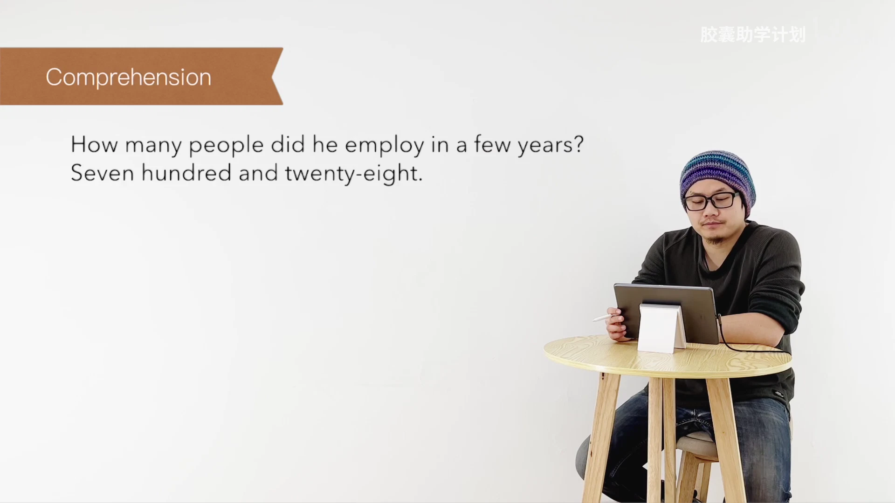

文字识别：Comprehension / How many people did he employ in a few years? / Seven hundred and twenty-eight.

### 画面 00:02:13

文字识别：Comprehension / What had his small workshop become?

### 画面 00:02:25

文字识别：Comprehension / Frank's been successful, hasn't he?

## 00:02:30–00:03:00

has.好，asking questions，老习惯，肯定句，一般疑问句，特殊疑问句，对吧？就是练习我们会说的能力啊。先来一个例子，比如说，Ask me if I was with Frank Hawkins yesterday afternoon.啊，Were you？提前就可以了，剩下的照抄。Who？您随便了，可以对I提问，可以对Frank Hawkins提问。那我们对Frank Hawkins提问，答案就是Who were you with yesterday afternoon？昨天下午你

### 画面 00:02:31

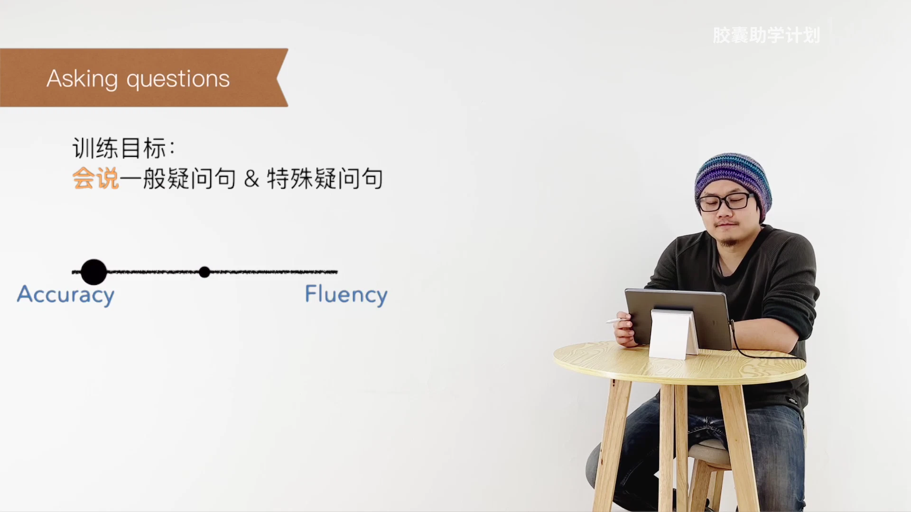

文字识别：Asking questions / 训练目标： / 会说一般疑问句＆特殊疑问句 / Accuracy / Fluency

### 画面 00:02:38

文字识别：Asking questions

### 画面 00:02:42

文字识别：Asking questions / T:Ask me if I was with Frank Hawkins yesterday afternoon.

### 画面 00:02:47

文字识别：Asking questions / T:Ask me if I was with Frank Hawkins yesterday afternoon. / S:Were you with Frank Hawkins yesterday afternoon? / T:Who…?

## 00:03:00–00:03:30

和谁在一起？好，呃，问对谁提问呢？Yesterday afternoon，对吧？没区别。He was describing his experience as a young man.好，describing可能是个生词，如果您新一学过，应该就不是个生词，叫做描述，对吧？过去进行时was提前就可以了。那what对什么提问呢？His experience as a young man，对吧？那when对什么提问呢？您想一下。

### 画面 00:03:01

文字识别：Asking questions

### 画面 00:03:06

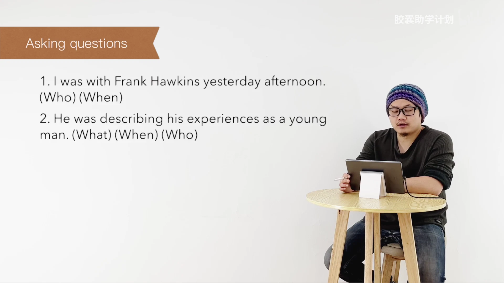

文字识别：Asking questions / 1.I was with Frank Hawkins yesterday afternoon. / (Who)(When) / 2. He was describing his experiences as a young / man.(What)(When)(Who)

## 00:03:30–00:04:00

好，这个问题我留给各位啊，各位去想一下。这里面没有出现明显的时间。Who对谁提问？Who直接就对主语提问就可以了，对吧？OK, next one. Say he is now head of a business company. Is提前就可以了。What对什么提问？A business company，对吧？Who对主语提问，不用变一般疑问句。Is very large.

### 画面 00:03:36

文字识别：Asking questions / 1.I was with Frank Hawkins yesterday afternoon. / (Who)(When) / 2. He was describing his experiences as a young / man.(What)(When)(Who)

### 画面 00:03:45

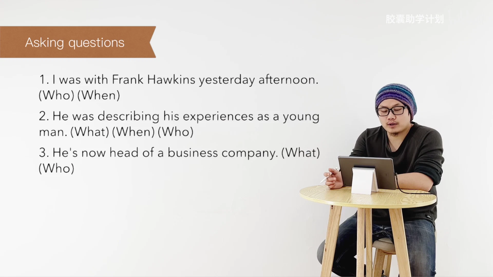

文字识别：Asking questions / 1.I was with Frank Hawkins yesterday afternoon. / (Who)(When) / 2. He was describing his experiences as a young / man.(What) (When)(Who) / 3. He's now head of a business company. (What) / (Who)

## 00:04:00–00:04:30

好，is提前就行了，这儿不用有一个逗号啊，这不需要一个逗号，我们把它去掉，我们把它去掉。Is very large. How big? That's how big is it,对吧？答案叫very large啊。那what对it提问，对吧？说He used to work in a small shop as a boy. Used to do something. Did提前，used换回原形use啊。那where对in a small shop提问，when

### 画面 00:04:15

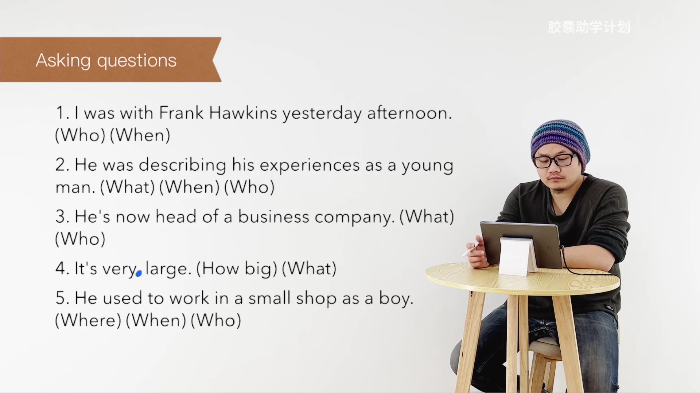

文字识别：Asking questions / 1.I was with Frank Hawkins yesterday afternoon. / (Who)(When) / 2. He was describing his experiences as a young / man.(What) (When)(Who) / 3. He's now head of a business company. (What) / (Who) / 4. It's very large.(How big)(What) / 5. He used to work in a small shop as a boy. / (Where) (When) (Who)

## 00:04:30–00:05:00

对什么提问？其实和这里是一样的。我们想一下，when是对时间提问。他什么时候在小店里面工作？所以答案其实就是 as a boy，对吧？OK，那 when 就是对 as a boy 提问啊。那后对主语提问，把 he 直接去掉，别变一般疑问句了啊。第六题，He repaired bicycles。一般过去时 did 提前，动词换回原形。What

### 画面 00:04:33

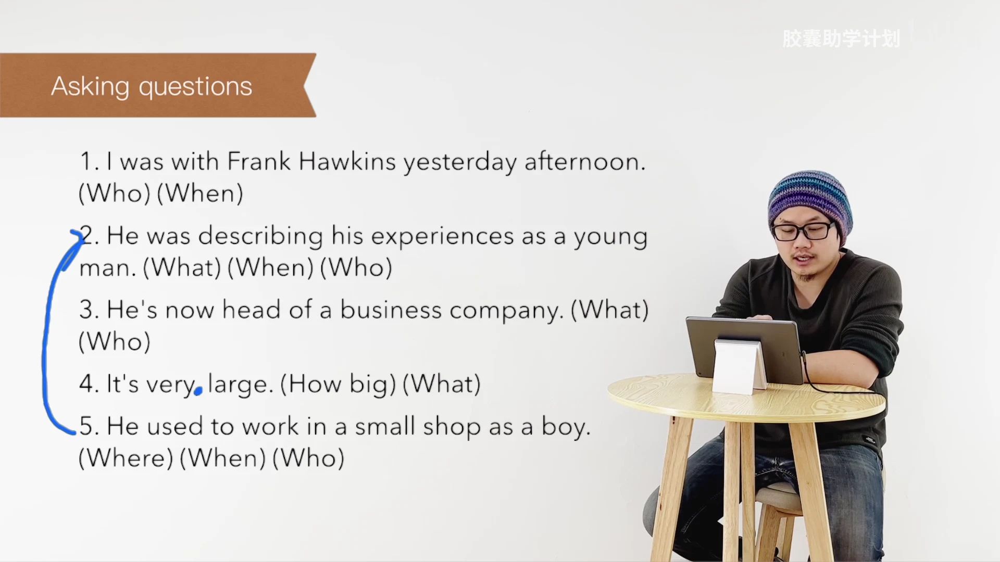

文字识别：Asking questions / 1.I was with Frank Hawkins yesterday afternoon. / (Who)(When) / 2. He was describing his experiences as a young / man.(What) (When)(Who) / 3. He's now head of a business company. (What) / (Who) / 4. It's very large. (How big)(What) / 5. He used to work in a small shop as a boy. / (Where) (When) (Who)

### 画面 00:04:53

文字识别：Asking questions

### 画面 00:04:56

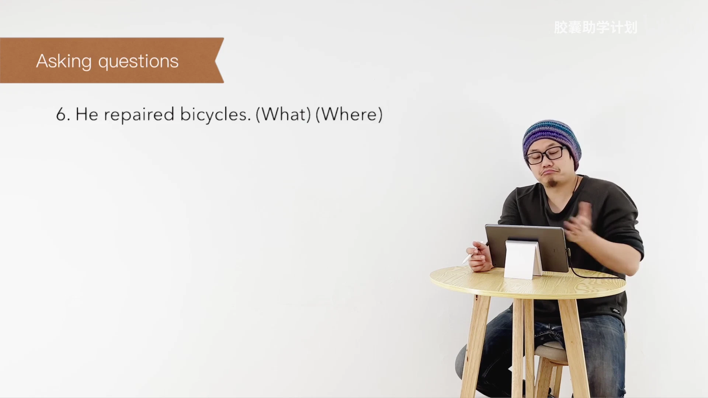

文字识别：Asking questions / 6. He repaired bicycles. (What) (Where)

### 画面 00:04:59

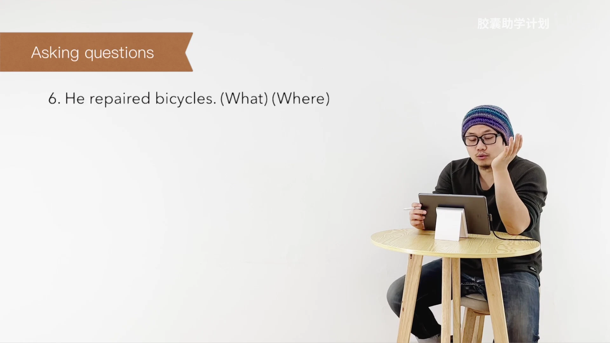

文字识别：Asking questions / 6. He repaired bicycles. (What) (Where)

## 00:05:00–00:05:30

对bicycles提问，答案叫What did he repair？啊，Where对整句话提问。He used to work fourteen hours a day. Did提前动词换原形。How many对fourteen提问，所以How many一定要带hours a day一起提前啊，叫How many hours a day did he used to work？好吧，Who对主语提问，直接变直接替代。He saved money for years. Did提前

### 画面 00:05:05

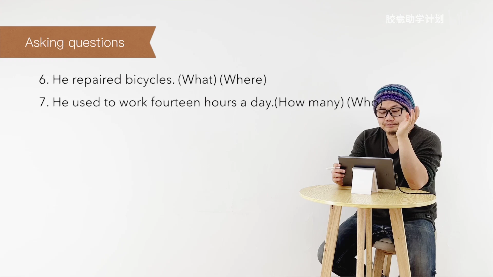

文字识别：Asking questions / 6. He repaired bicycles.(What) (Where) / 7. He used to work fourteen hours a day.(How many) (Whe

### 画面 00:05:15

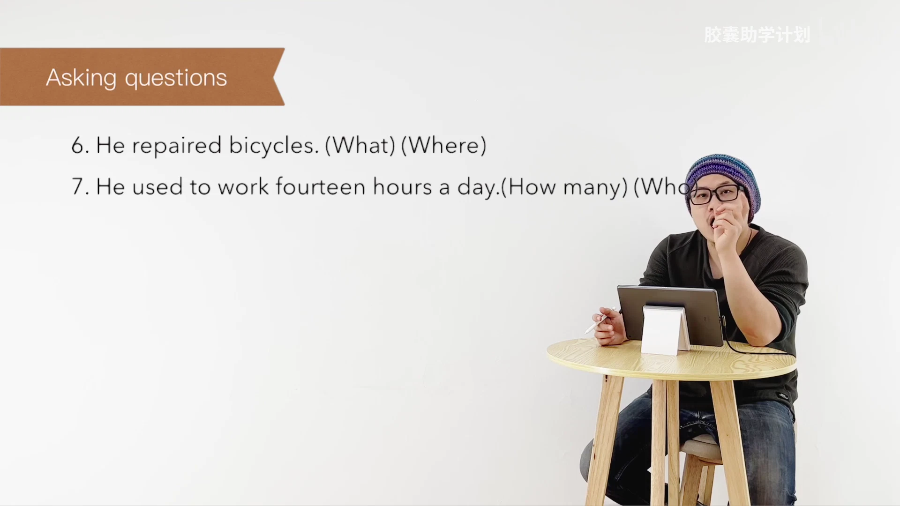

文字识别：Asking questions / 6. He repaired bicycles.(What) (Where) / 7. He used to work fourteen hours a day.(How many) (Whd

## 00:05:30–00:06:00

How long对For years提问He bought a small workshop. Did提前动词换回原形What对A small workshop提问OK好Tell the story练习我们口语复述能力。您看着这些关键词去把文章尽可能流利的复述出来就行了。OK好，然后呢，Summary writing就要写作。各位写完了之后呢，来这地方对一下答案。这练习的是我们写作的复述能力。OK再然后呢，完全自由的对

### 画面 00:05:32

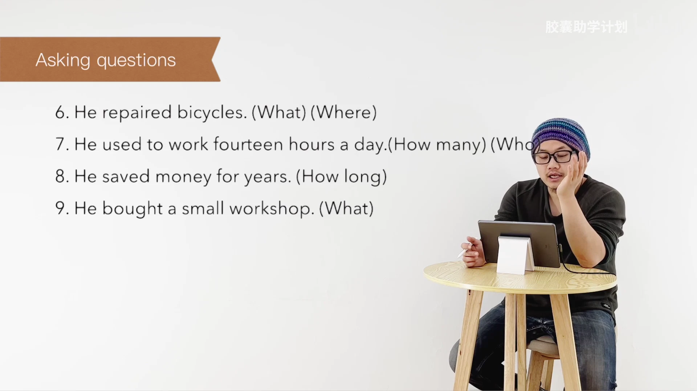

文字识别：Asking questions / 6. He repaired bicycles.(What) (Where) / 7. He used to work fourteen hours a day.(How many) (Whq / 8. He saved money for years. (How long) / 9. He bought a small workshop. (What)

### 画面 00:05:36

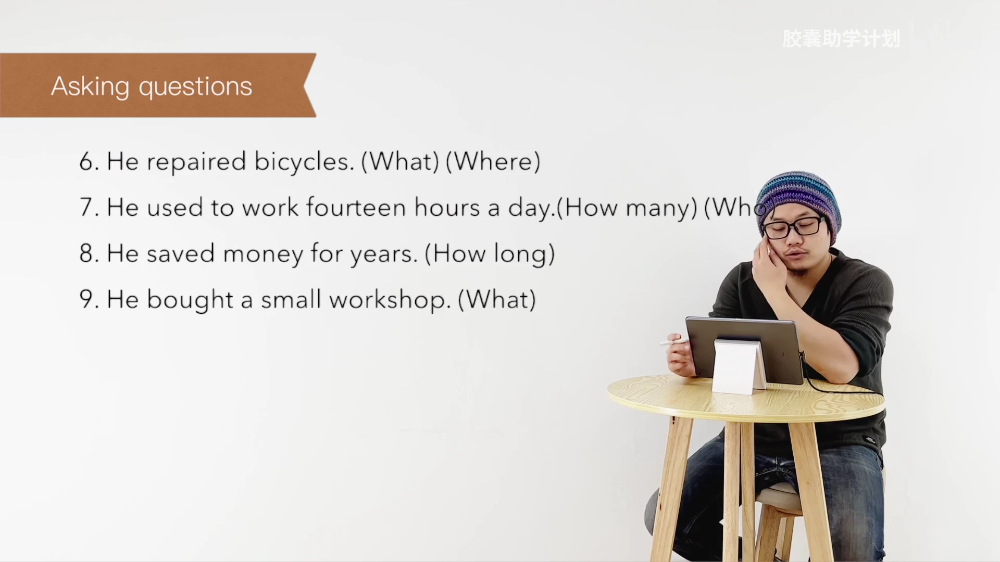

文字识别：Asking questions / 6. He repaired bicycles.(What) (Where) / 7. He used to work fourteen hours a day.(How many) (Wh / 8. He saved money for years. (How long) / 9. He bought a small workshop. (What)

### 画面 00:05:38

文字识别：Tell the story / 训练目标： / 口语复述能力 / Accuracy / Fluency

### 画面 00:05:40

文字识别：Tell the story / 训练目标： / 口语复述能力 / Accuracy / Fluency

### 画面 00:05:42

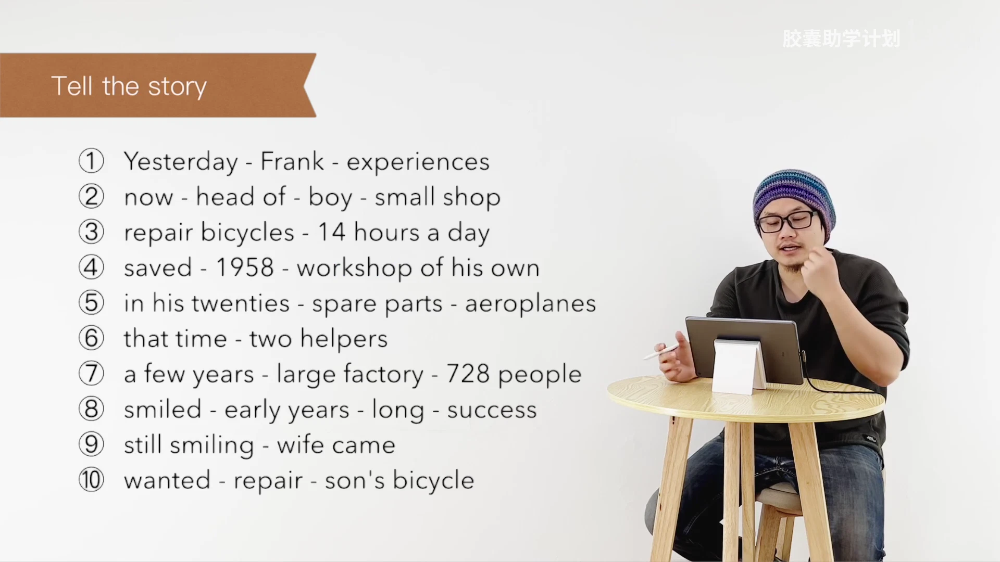

文字识别：Tell the story / ① Yesterday - Frank - experiences / 2 / now - head of - boy - small shop / repair bicycles - 14 hours a day / 3 / saved - 1958 - workshop of his own / 4 /  in his twenties - spare parts - aeroplanes / 5 / that time - two helpers /  a few years - large factory - 728 people / 7 / ⑧ smiled - early years - long - success / ⑨ still smiling - wife came / ① / wanted - repair - son's bicycle

### 画面 00:05:48

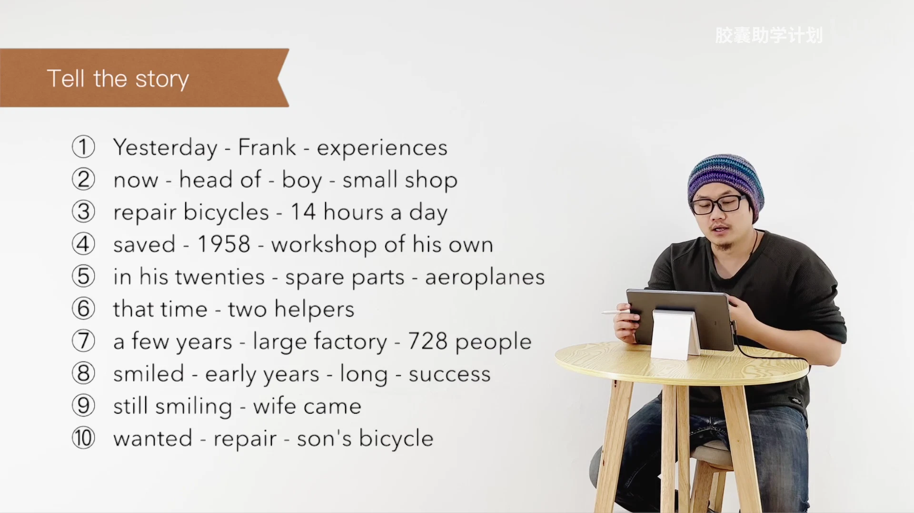

文字识别：Tell the story / ① Yesterday - Frank - experiences / 2 / now - head of - boy - small shop / repair bicycles - 14 hours a day / 3 / saved - 1958 - workshop of his own / 4 /  in his twenties - spare parts - aeroplanes / 5 / that time - two helpers / 6 / ⑦ a few years - large factory - 728 people / ⑧ smiled - early years - long - success / ⑨ still smiling - wife came / ① / wanted - repair - son's bicycle

### 画面 00:05:50

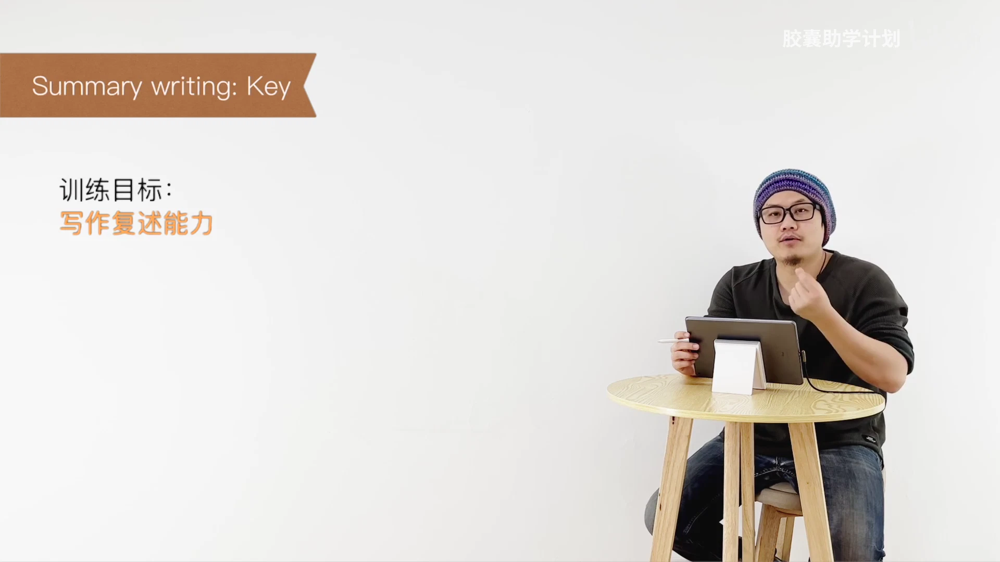

文字识别：Summary writing: Key / 训练目标： / 写作复述能力

### 画面 00:05:53

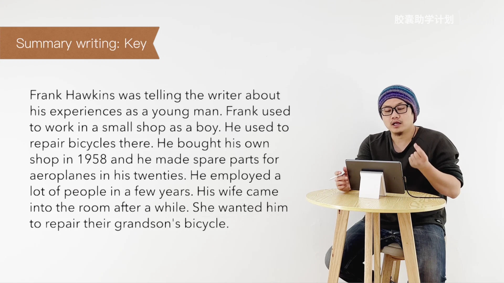

文字识别：Summary writing: Key / Frank Hawkins was telling the writer about / his experiences as a young man. Frank used / to work in a small shop as a boy. He used to / repair bicycles there. He bought his own / shop in 1958 and he made spare parts for / aeroplanes in his twenties. He employed a / lot of people in a few years. His wife came / into the room after a while. She wanted him / to repair their grandson's bicycle.

### 画面 00:05:56

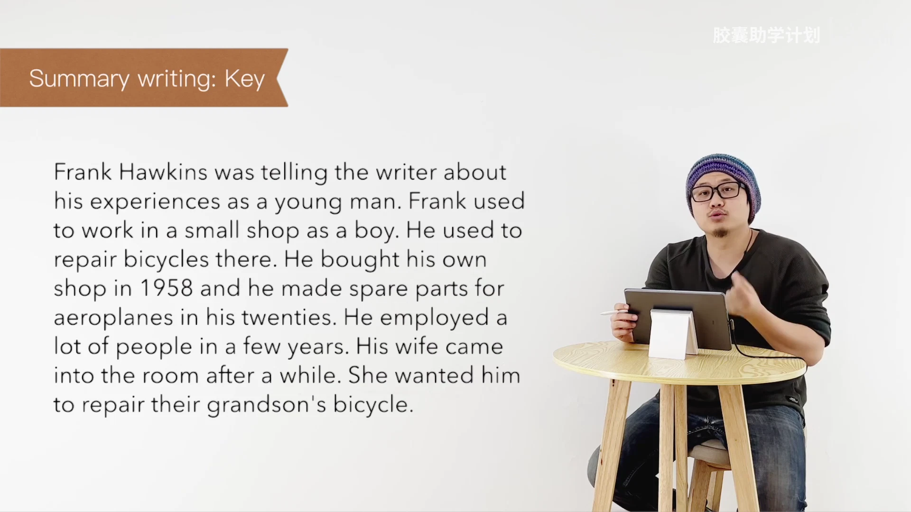

文字识别：Summary writing: Key / Frank Hawkins was telling the writer about / his experiences as a young man. Frank used / to work in a small shop as a boy. He used to / repair bicycles there. He bought his own / shop in 1958 and he made spare parts for / aeroplanes in his twenties. He employed a / lot of people in a few years. His wife came / into the room after a while. She wanted him / to repair their grandson's bicycle.

### 画面 00:05:58

文字识别：Topics for discussion / 训练目标： / 完全自由的对话 / Accuracy / Fluency

## 00:06:00–00:06:30

话，老习惯，我还是直接把题告诉各位。各位有时间可以自己去想一下。第一题，Describe some of the things you used to do when you were young. 哎，描述一下你年轻小的时候愿意做的一些事情，做的一些事情啊。第二题说，What qualities must a person have to build up a success? Have to build up a successful business? 说一个人需要有哪些品质才能建立起

### 画面 00:06:00

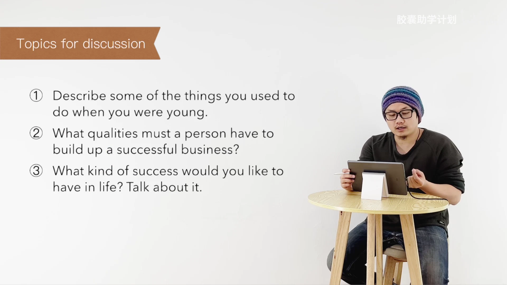

文字识别：Topics for discussion / Describe some of the things you used to / do when you were young. / What qualities must a person have to / build up a successful business? / What kind of success would you like to / have in life? Talk about it.

### 画面 00:06:03

文字识别：Topics for discussion / Describe some of the things you used to / do when you were young. / What qualities must a person have to / build up a successful business? / What kind of success would you like to / have in life? Talk about it.

### 画面 00:06:13

文字识别：Topics for discussion / Describe some of the things you used to / do when you were young. / What qualities must a person have to / build up a successful business? / What kind of success would you like to / have in life? Talk about it.

### 画面 00:06:20

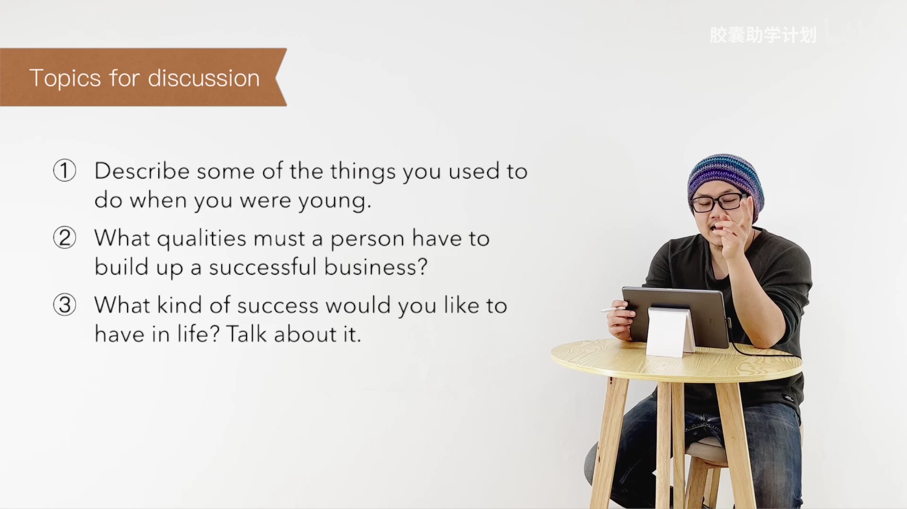

文字识别：Topics for discussion / Describe some of the things you used to / do when you were young. / What qualities must a person have to / build up a successful business? / What kind of success would you like to / have in life? Talk about it.

### 画面 00:06:28

文字识别：Topics for discussion / Describe some of the things you used to / do when you were young. / What qualities must a person have to / build up a successful business? / What kind of success would you like to / have in life? Talk about it.

## 00:06:30–00:07:00

来一个特别成功的事业啊！各位可以去想一下。第三题说，What kind of success would you like to have in life? Talk about it.说在你的生命当中，你想有什么样一种成功？聊一聊这件事儿。OK，好。那家庭作业，Ask me if老习惯先写，在大声朗读。摘要写作先写，来这儿对答案。Tell the story，来这里进行口语复述。专栏当中可以找得到。以上呢就是本期视频的全部内容了。如果

### 画面 00:06:34

文字识别：Topics for discussion / Describe some of the things you used to / do when you were young. / What qualities must a person have to / build up a successful business? / What kind of success would you like to / have in life? Talk about it.

### 画面 00:06:40

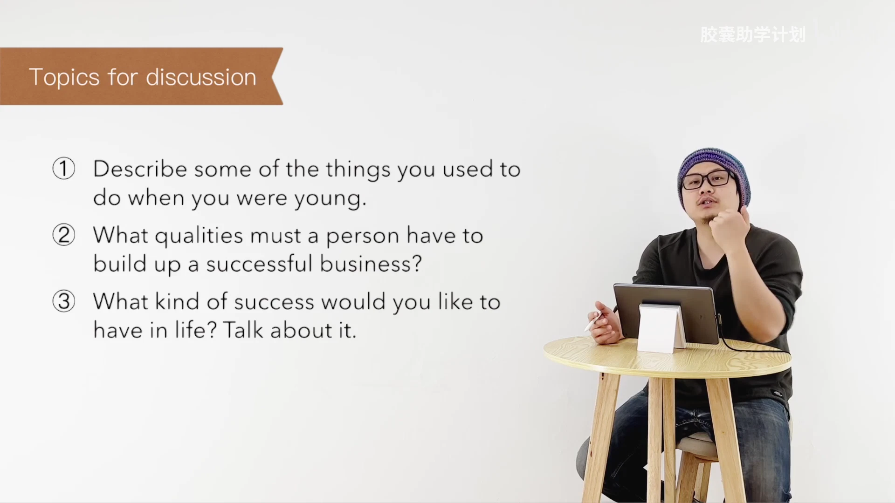

文字识别：Topics for discussion / Describe some of the things you used to / do when you were young. / What qualities must a person have to / build up a successful business? / What kind of success would you like to / have in life? Talk about it.

### 画面 00:06:42

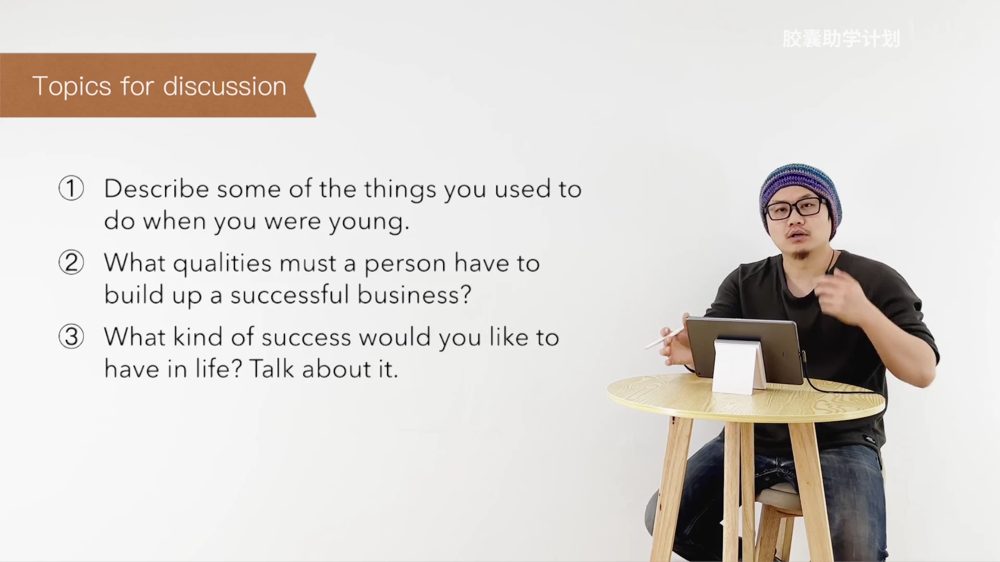

文字识别：Topics for discussion / Describe some of the things you used to / do when you were young. / What qualities must a person have to / build up a successful business? / What kind of success would you like to / have in life? Talk about it.

### 画面 00:06:44

### 画面 00:06:46

文字识别：1.Ask me if写&朗读

### 画面 00:06:49

文字识别：1.Ask me if写&朗读 / 2. / 摘要写作写&答案

### 画面 00:06:51

文字识别：1.Ask me if写&朗读 / 摘要写作写&答案 / 3.Tell the story 口语复述

### 画面 00:06:54

文字识别：1.Ask me if写&朗读 / 摘要写作写&答案 / 3.Tell the story 口语复述 / 4. / ·专栏

### 画面 00:06:56

### 画面 00:06:58

文字识别：🌟

## 00:07:00–00:07:19

果各位喜欢我们的课程呢，欢迎各位关注、订阅、一键三连，分享给那些需要的朋友。See you next time.

### 画面 00:07:04

文字识别：🌟

### 画面 00:07:07

### 画面 00:07:09

文字识别：CAPSULEACADEMY / 胶囊助学计划 / 小红书 / Lecturer / Leo / OE

### 画面 00:07:12

文字识别：CAPSULEACADEMY / 胶囊助学计划 / 小红书 / Editor / OE

### 画面 00:07:15

文字识别：CAPSULEACADEMY / 胶囊助学计划 / 小红书 / Creator / Leo & Berlin

### 画面 00:07:17

文字识别：bilibili / 胶囊助学计划 / 胶囊助学计划 / 小红书 / 品 / OE

### 画面 00:07:19

文字识别：bilibili / 胶囊助学计划

