# L032 单词

快速机器解析：语音为单模型转写，未进行独立交叉校对或人工复核；画面每秒采样并按变化选帧，短时文字和标记可能遗漏。截图时间约有 1 秒误差。图片有损压缩；遇到疑点请按时间查看 Google Drive 原视频。

## 00:00:00–00:00:30

Hello everyone, welcome to Capsule Academy. This is Leo. Today we're going to learn New Concept English Book Two, Lesson Thirty Two Words. 那老习惯进入正式课程之前呢，我们先看几个问题。那首先如何表达很久很久以前啊？接下来呢，如何去表达抵制诱惑？最后一个如何去表达把某个物品包起来？OK，那带着这三个问题，Hope you can enjoy. 好，那

### 画面 00:00:00

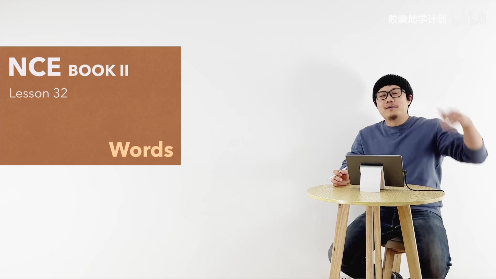

文字识别：NCE / BOOKII / Lesson 32 / Words

### 画面 00:00:02

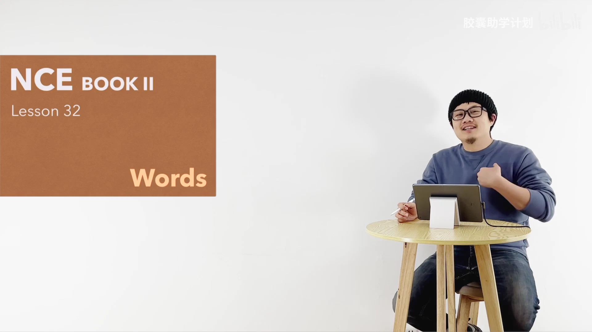

文字识别：NCE / BOOK I"I / Lesson 32 / Words

### 画面 00:00:04

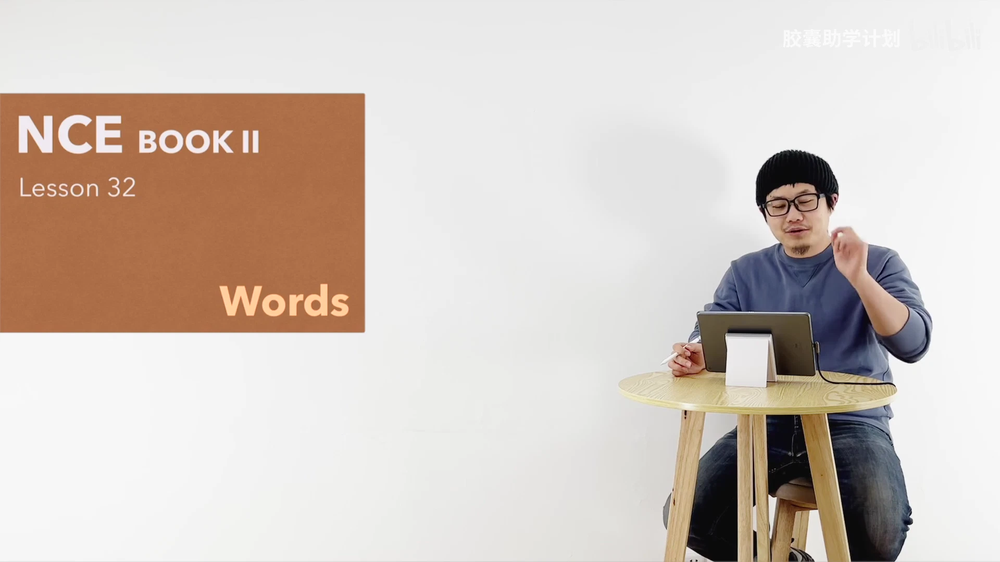

文字识别：NCE / BOOKI"I / Lesson 32 / Words

### 画面 00:00:06

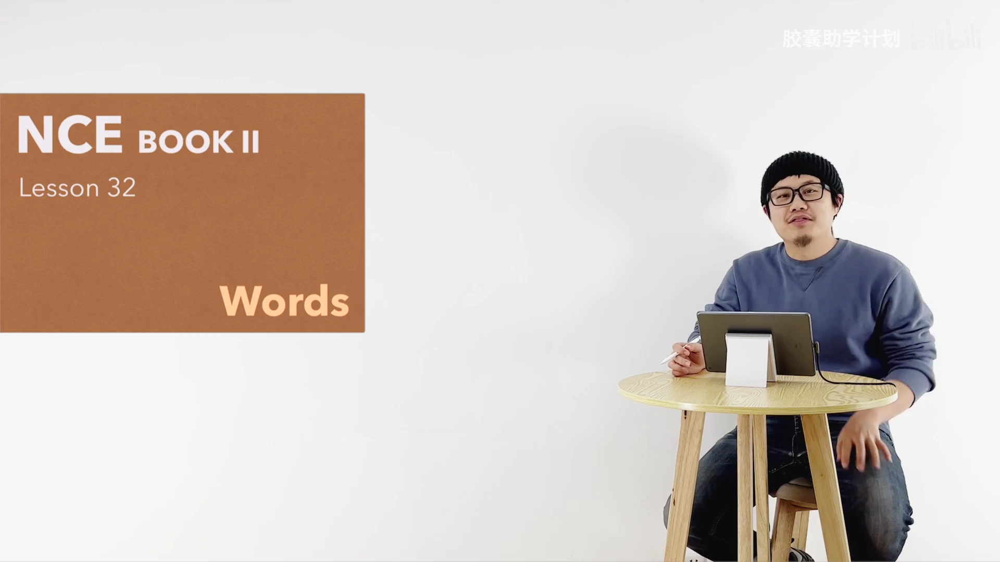

文字识别：NCE / BOOKI"I / Lesson 32 / Words

### 画面 00:00:08

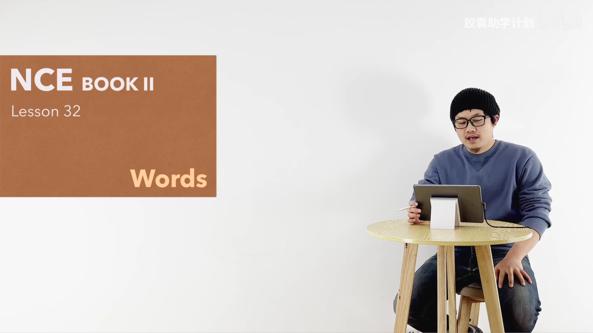

文字识别：NCE / BOOK"I / Lesson 32 / Words

### 画面 00:00:10

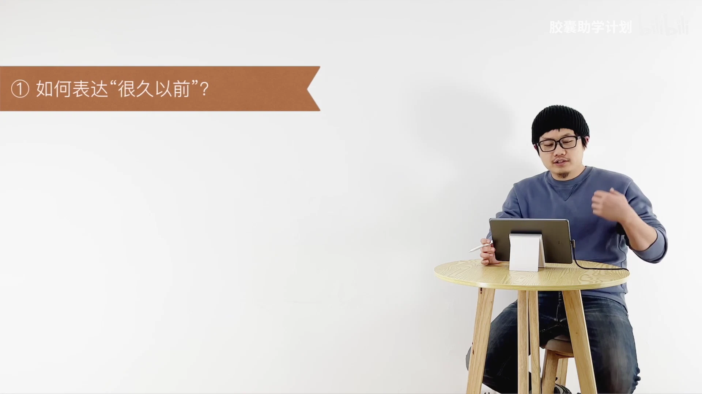

文字识别：① 如何表达“很久以前”？

### 画面 00:00:12

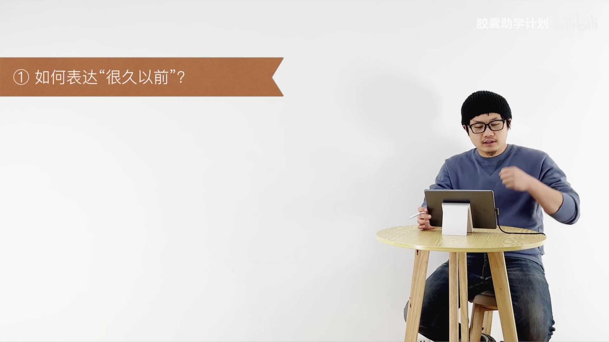

文字识别：①如何表达“很久以前”？

### 画面 00:00:15

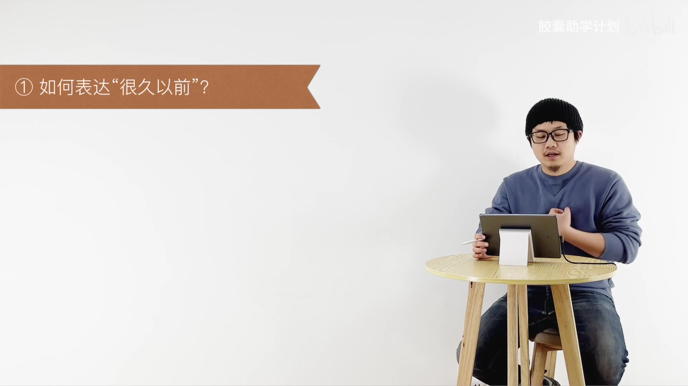

文字识别：①如何表达“很久以前”？

### 画面 00:00:17

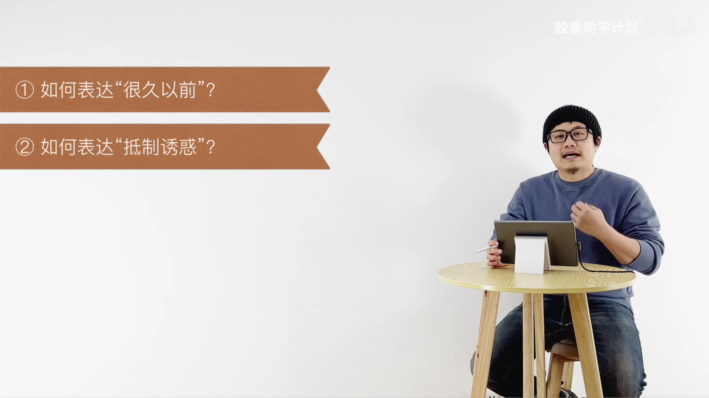

文字识别：① 如何表达“很久以前”？ / 如何表达“抵制诱惑

### 画面 00:00:19

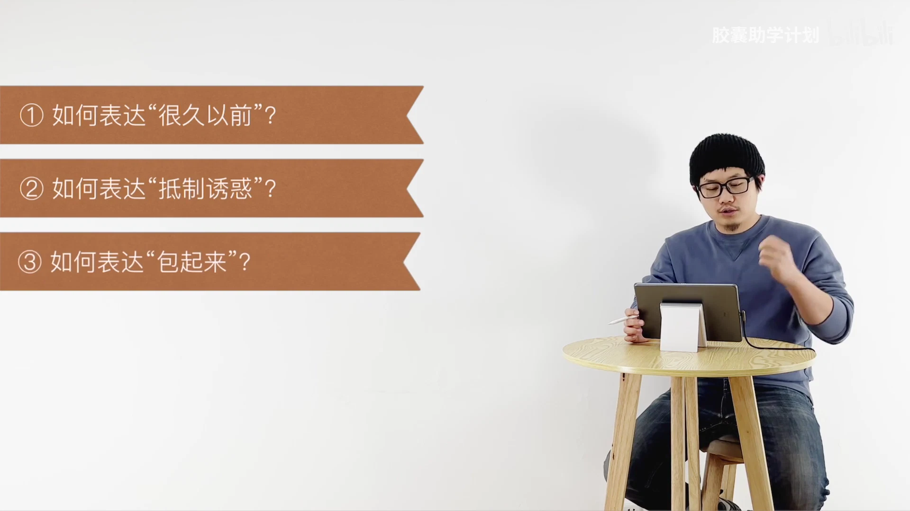

文字识别：① 如何表达“很久以前”？ / 如何表达“抵制诱惑 / 如何表达“包起来”?

### 画面 00:00:21

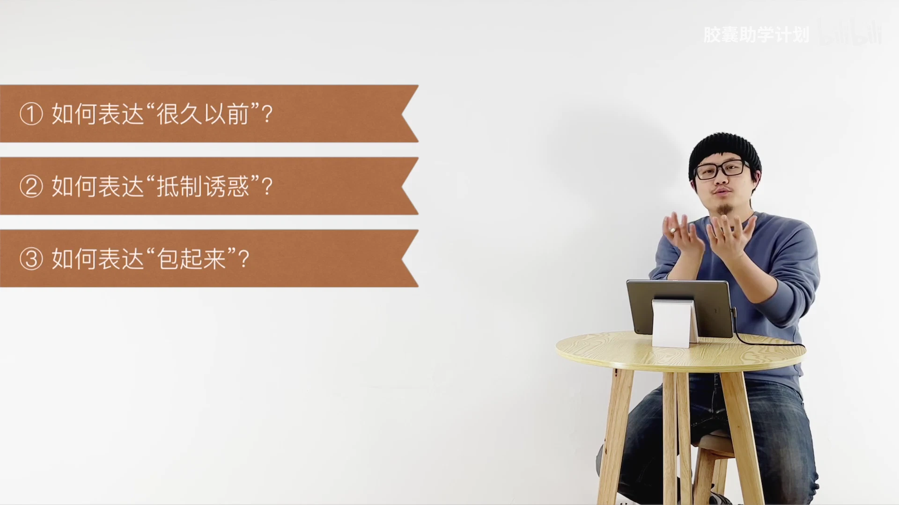

文字识别：① 如何表达“很久以前”？ / 如何表达“抵制诱惑' / 如何表达“包起来”?

### 画面 00:00:25

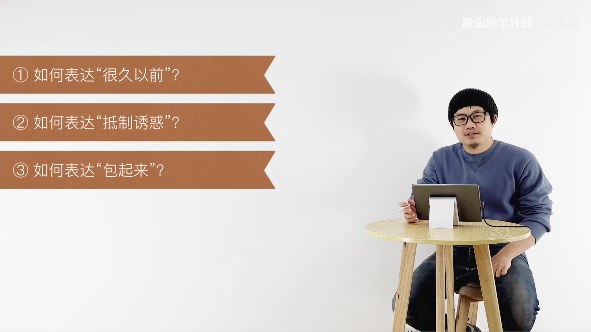

文字识别：① 如何表达“很久以前”？ / 如何表达“抵制诱惑' / 如何表达“包起来”?

### 画面 00:00:27

文字识别：胶囊助学计划 bilb出

## 00:00:30–00:01:00

那我们先说第一个单词啊。第一个单词我们不用拿它去造句了，它经常首先以前我们见过啊。我们先看一下这个单词的读音，跟我一起读一下，叫做 once，once。这个单词在各位脑海当中，新一我们学过啊，新二在本课之前我们也见过，比如说 at once 啊，立刻马上，对吧？还有比如说呃，这个 once a month，对吧？想一下什么意思啊？我们应该是

### 画面 00:00:30

### 画面 00:00:32

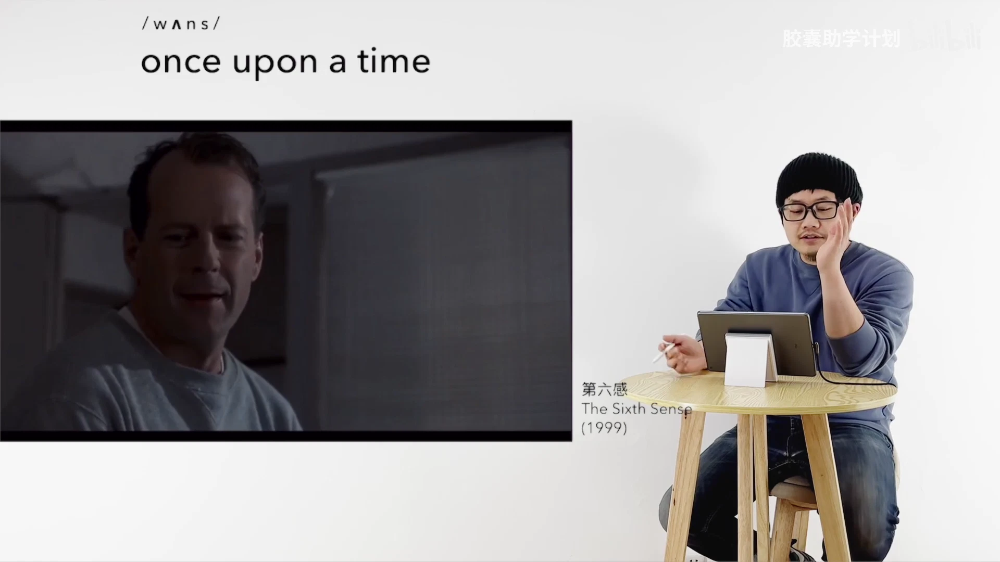

文字识别：/WΛns/ / once upon a time / 第六感 / The Sixth Sense / (1999)

## 00:01:00–00:01:30

在第六课学过的。然后呢，那在本课这个 once，它还有一个意思叫做以前啊，很久以前。比如说 once upon a time，就是很多的故事开头都讲啊，很久很久以前，什么在一个国家居住着一个什么公主，然后还有一个王子，然后怎么怎么样，对吧？然后叫做 once up a time。 OK，那接下来我们直接在电影当中看一下这个小的短语，然

### 画面 00:01:02

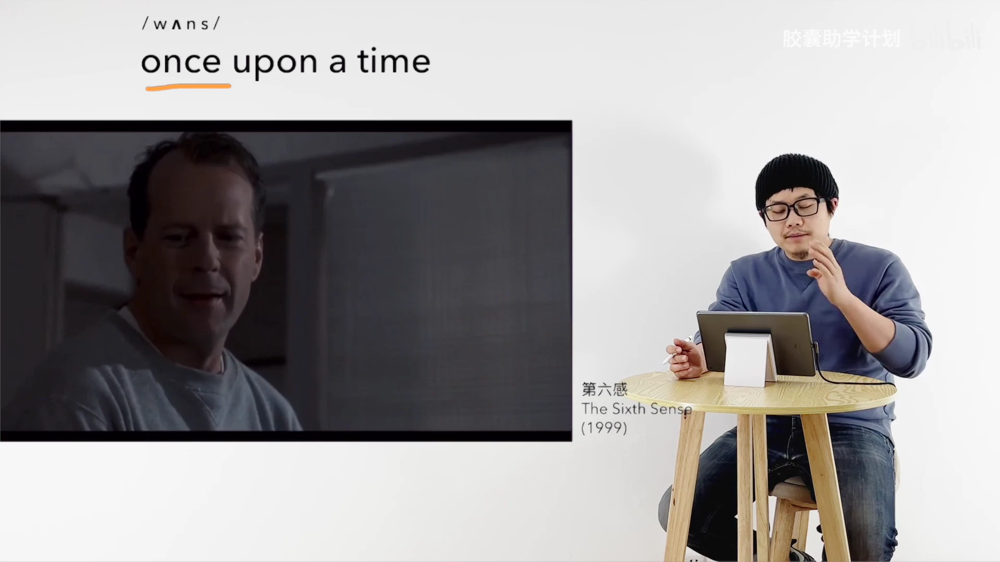

文字识别：/WΛns/ / once upon a time / 第六感 / The Sixth Sense / (1999)

## 00:01:30–00:02:00

后格外要注意一下的，就是在这个电影片段当中还出现了叫做 used to do 啊，叫做我们三十一课刚刚学过的，叫做过去常常怎么样的一般疑问句啊，注意力集中来了。 Your father used to tell you bedtime stories. Once upon a time, there was this young

### 画面 00:01:32

文字识别：/WΛns/ / once upon a time / 第六感 / The Sixth Sense / (1999)

### 画面 00:01:45

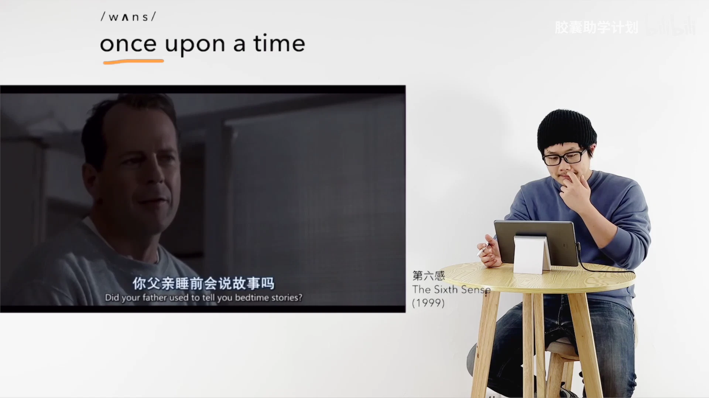

文字识别：/WΛns/ / once upon a time / 第六感 / 你父亲睡前会说故事吗 / The Sixth Sense / Did your father used to tell you bedtime stories? / (1999)

### 画面 00:01:48

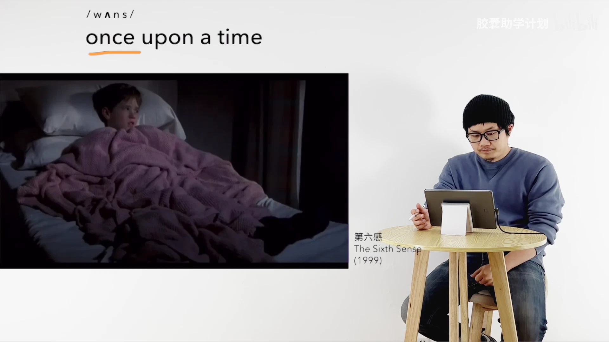

文字识别：/WΛns/ / once upon a time / 第六感 / The Sixth Sense / (1999)

### 画面 00:01:52

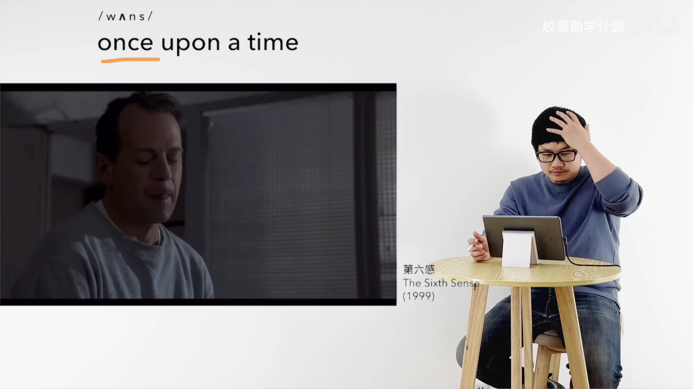

文字识别：/WΛns/ / once upon a time / 第六感 / The Sixth Sense / (1999)

### 画面 00:01:59

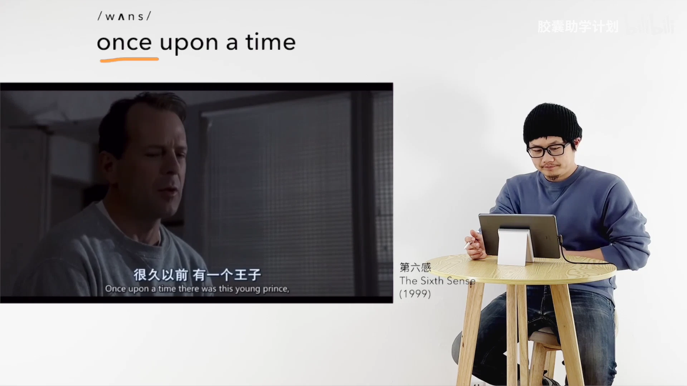

文字识别：/WΛns/ / once upon a time / 第六感 / 很久以前有一个王子 / The Sixth Sense / Once upon a time there was this young prince, / (1999)

## 00:02:00–00:02:30

prince, and he decided that he wanted to go for a drive. Okay,啊, once upon a time, okay,很久很久以前。那我们看第二个单词，来跟我一起读一下，叫做temptation, temptation, temptation. Okay,它的意思指的是诱惑，注意它不是动词，是名词，对吧？所以呢，我们肯定要找一个动词。我们在这儿给大家补一个动词，经常跟temptation放在一起去用的，叫抵

### 画面 00:02:02

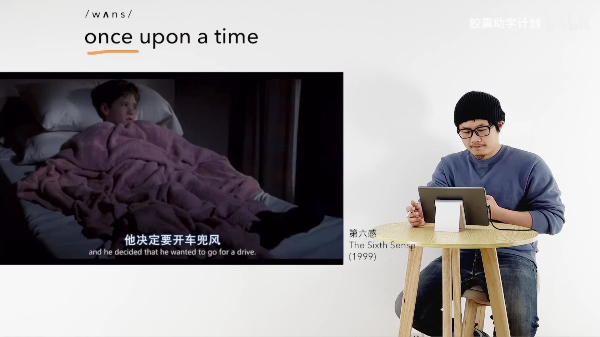

文字识别：/WΛns/ / once upon a time / 第六感 / 他决定要开车兜风 / The Sixth Sense / and he decided that he wanted to go for a drive. / (1999)

### 画面 00:02:10

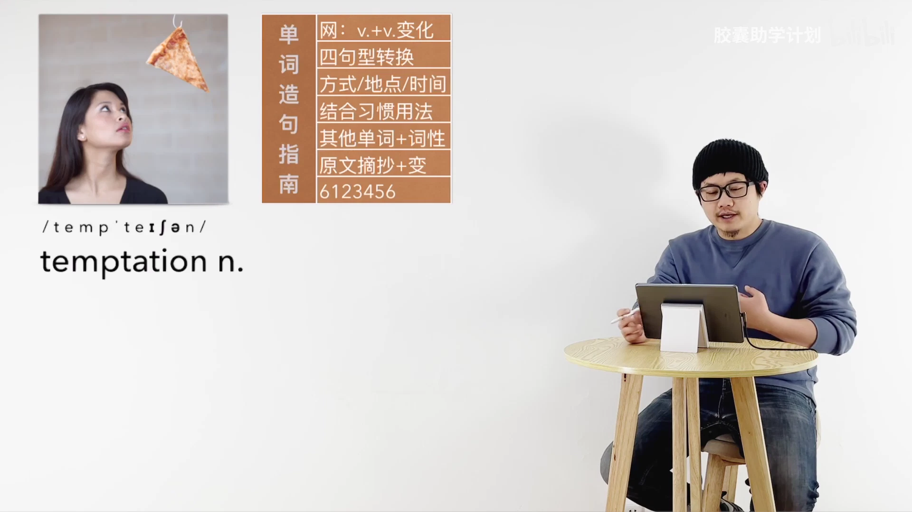

文字识别：单词造句指南 / 网：v.+v.变化 / 四句型转换 / 方式/地点/时间 / 结合习惯用法 / 其他单词+词性 / 原文摘抄+变 / 6123456 / /temp'teifan/ / temptation n.

### 画面 00:02:12

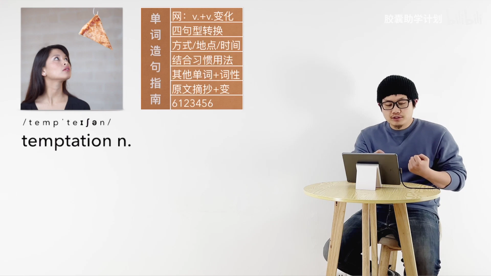

文字识别：单词造句指南 / 网：v.+v.变化 / 四句型转换 / 方式/地点/时间 / 结合习惯用法 / 其他单词+词性 / 原文摘抄+变 / 6123456 / /temp'tei∫an/ / temptation n.

### 画面 00:02:15

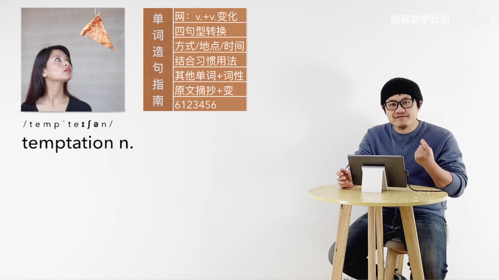

文字识别：单词造句指南 / 网：v.+v.变化 / 四句型转换 / 方式/地点/时间 / 结合习惯用法 / 其他单词+词性 / 原文摘抄+变 / 6123456 / /temp'tei ∫an/ / temptation n.

### 画面 00:02:25

文字识别：单词造句指南 / 网：v.+v.变化 / 四句型转换 / 方式/地点/时间 / 结合习惯用法 / 其他单词+词性 / 原文摘抄+变 / 6123456 / /temp'teifan/ / temptation n. / ①resist the temptation

## 00:02:30–00:03:00

制诱惑的这个抵制啊，叫 resist the temptation. Okay, 那这个短语我们现在有了之后，造句就容易多了。比如说三十一课, it is my job to do something. 比如说, it is my job to resist the temptation. 啊，我的工作啊就是要抵制这个诱惑，对吧？那再来，比如说 she has trouble resisting the temptation. 啊, have trouble doing something. 说她抵制这个诱惑啊遇到了一些困难和问题，对吧？

### 画面 00:02:30

文字识别：单词造句指南 / 网：v.+v.变化 / 四句型转换 / 方式/地点/时间 / 结合习惯用法 / 其他单词+词性 / 原文摘抄+变 / 6123456 / /temp'tei∫an/ / temptation n. / resist the temptation

### 画面 00:02:35

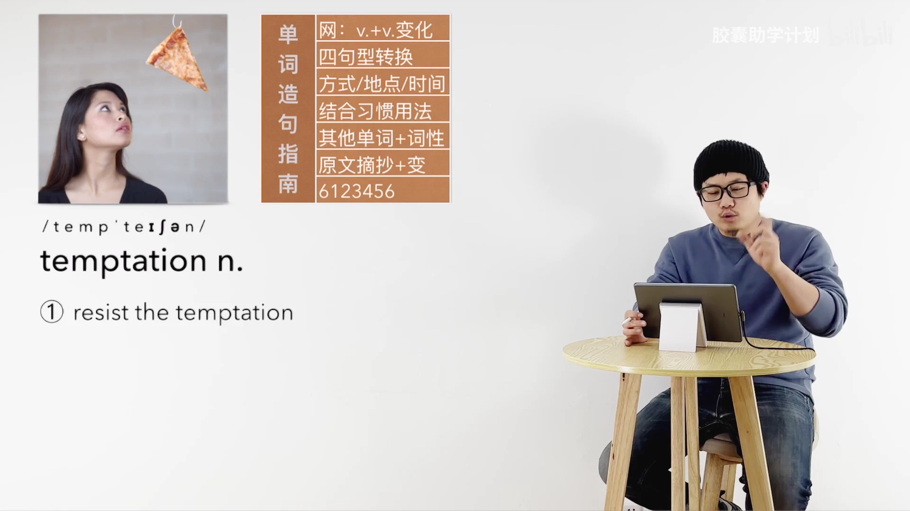

文字识别：单词造句指南 / 网：v.+v.变化 / 四句型转换 / 方式/地点/时间 / 结合习惯用法 / 其他单词+词性 / 原文摘抄+变 / 6123456 / /temp'teifan/ / temptation n. / resist the temptation / 1

### 画面 00:02:40

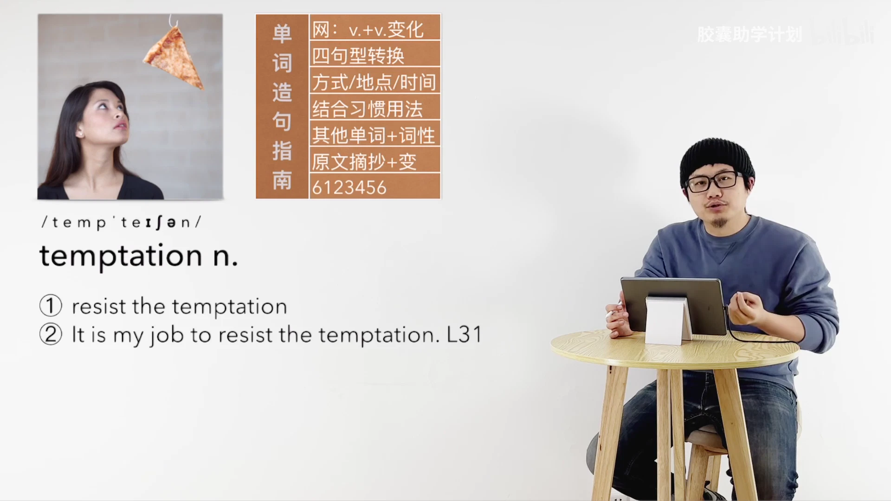

文字识别：单词造句指南 / 网：v.+v.变化 / 四句型转换 / 方式/地点/时间 / 结合习惯用法 / 其他单词+词性 / 原文摘抄+变 / 6123456 / /temp'teifan/ / temptation n. / 1 / resist the temptation /  It is my job to resist the temptation. L31

### 画面 00:02:50

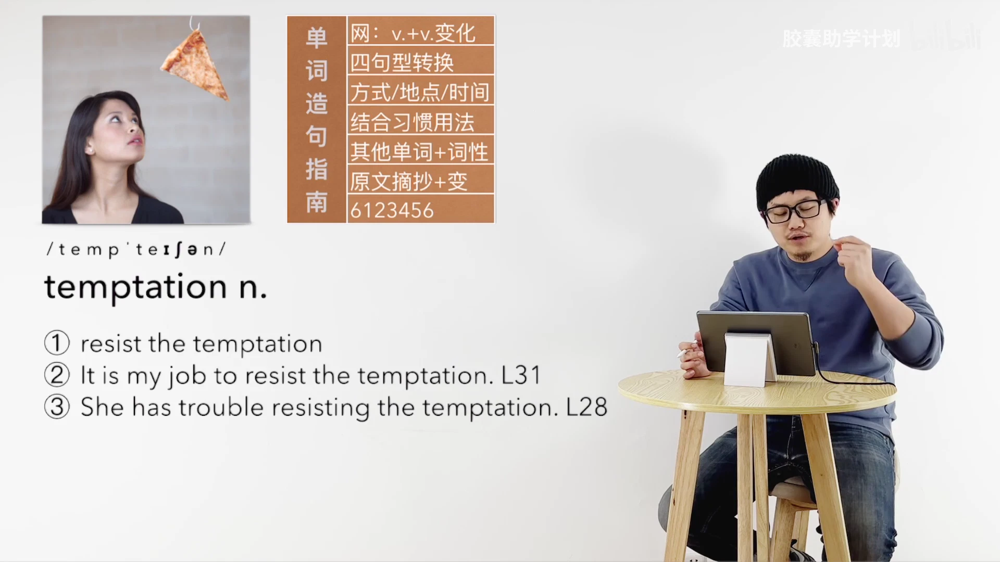

文字识别：单词造句指南 / 网：v.+v.变化 / 四句型转换 / 方式/地点/时间 / 结合习惯用法 / 其他单词+词性 / 原文摘抄+变 / 6123456 / /temp'teifan/ / temptation n. / ① / resist the temptation / It is my job to resist the temptation. L31 / She has trouble resisting the temptation. L28

### 画面 00:02:55

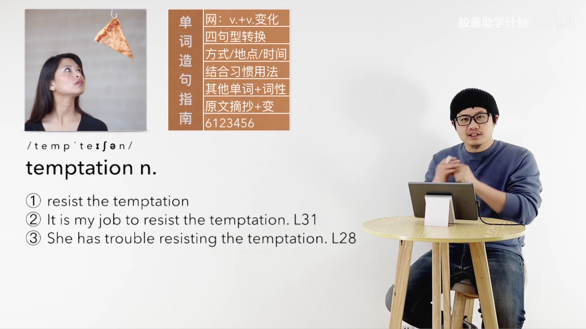

文字识别：单词造句指南 / 网：v.+v.变化 / 四句型转换 / 方式/地点/时间 / 结合习惯用法 / 其他单词+词性 / 原文摘抄+变 / 6123456 / /temp'tei∫an/ / temptation n. / ① / resist the temptation / It is my job to resist the temptation. L31 / She has trouble resisting the temptation. L28

## 00:03:00–00:03:30

再来说，I can't resist the temptation. She said in a big voice. 十五课 in a big voice，一个小的短语。OK，所以在这个地方，我们最主要用到的就是结合其他的一些习惯用法。Next one，跟我一起读一下，叫做 article， article， article，在文章当中的意思不是它最常用的意思，但是我们也要知道，只是一般指的是东西或者物品啊。那它还有另一个非常常用的意

### 画面 00:03:05

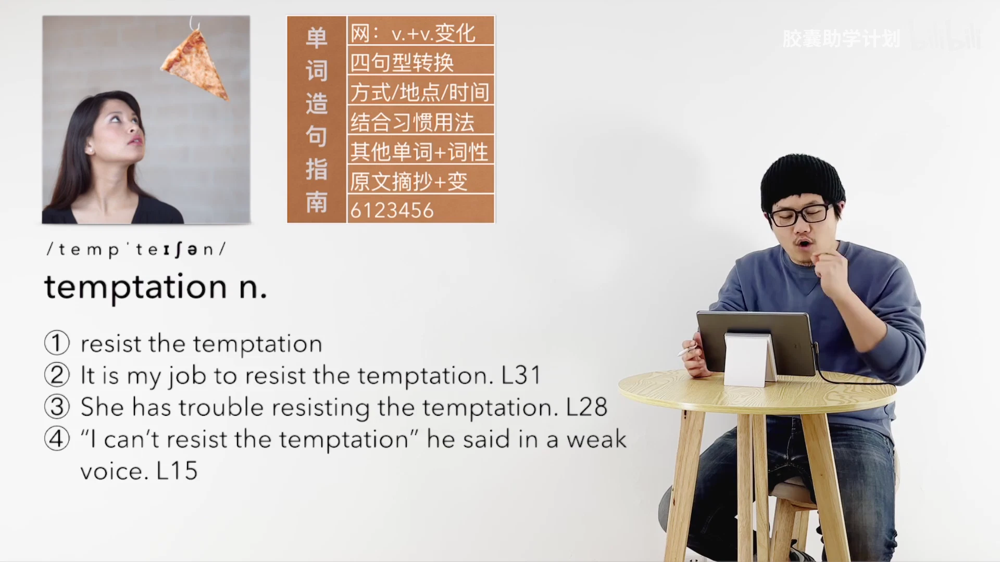

文字识别：单词造句指南 / 网：v.+v.变化 / 四句型转换 / 方式/地点/时间 / 结合习惯用法 / 其他单词+词性 / 原文摘抄+变 / 6123456 / /temp'tei∫an/ / temptation n. / ① resist the temptation / It is my job to resist the temptation. L31 / 2 / She has trouble resisting the temptation. L28 / 3 / )"I can't resist the temptation"he said in a weak / 4 / voice.L15

### 画面 00:03:12

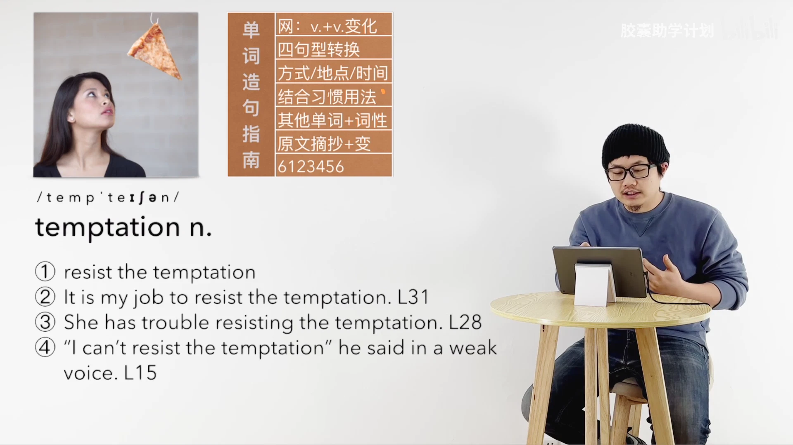

文字识别：单词造句指南 / 网：v.+v.变化 / 四句型转换 / 方式/地点/时间 / 结合习惯用法 / 其他单词+词性 / 原文摘抄+变 / 6123456 / /temp'tei∫an/ / temptation n. / ① resist the temptation / It is my job to resist the temptation. L31 / She has trouble resisting the temptation. L28 / 3 / )"I can't resist the temptation"he said in a weak / 4 / voice.L15

### 画面 00:03:15

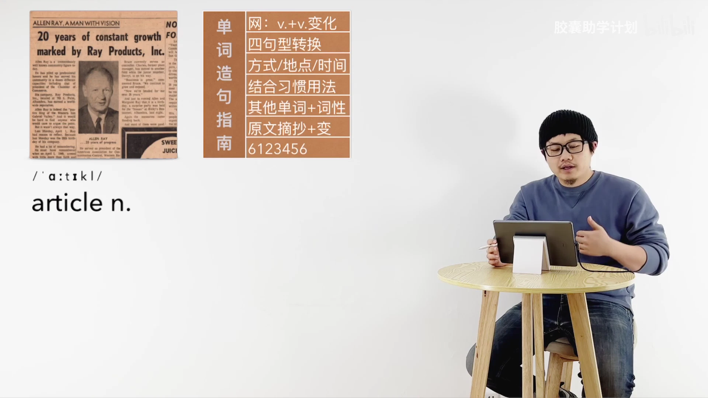

文字识别：ALLENRAY,AMANWITHVISION / NO / 单词造句指南 / 网：v.+v.变化 / 20 years of constant growth / FO / 四句型转换 / marked by Ray Products, Inc. / 方式/地点/时间 / 结合习惯用法 / 其他单词+词性 / 原文摘抄+变 / ALLEN KAY / SWEE / 6123456 / JUICI / /a:tikl/ / article n.

### 画面 00:03:21

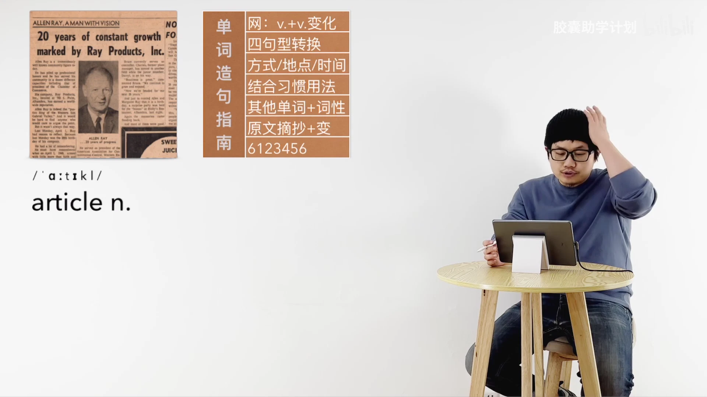

文字识别：ALLENRAY,AMANWITHVISION / NO / 单词造句指南 / 网：v.+v.变化 / 20 years of constant growth / FO / 四句型转换 / marked by Ray Products, Inc. / 方式/地点/时间 / 结合习惯用法 / 其他单词+词性 / 原文摘抄+变 / 10 / ALLEN RAY / yeans at / SWEE / 6123456 / JUICI / /a:tikl/ / article n.

### 画面 00:03:26

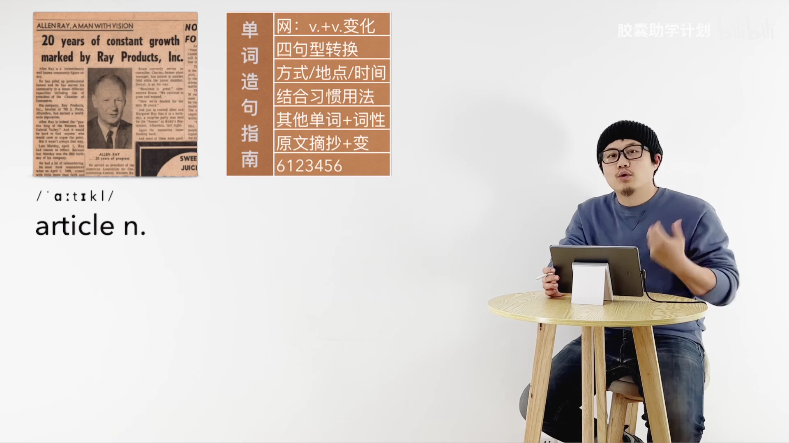

文字识别：ALLENRAY,AMANWITH VISION / NO / 单词造句指南 / 网：v.+v.变化 / 20 years of constant growth / FO / 四句型转换 / marked by Ray Products, Inc. / 方式/地点/时间 / 结合习惯用法 / 其他单词+词性 / 原文摘抄+变 / ALLEN RAY / SWEE / 6123456 / JUICI / /a:tikl/ / article n.

## 00:03:30–00:04:00

思，出现的频率要远远高于物品或东西，指的是文章啊，一篇文章。比如说，If you read the article, you will understand my words.说如果你读这篇文章啊，你就懂我在说什么了。Understand my words叫懂我说的话，对吧？OK，这是十六课if引导的一个条件状语从句。Next one，原文给了一句话，我觉得还不错，很简短，我们直接拿出来叫The woman first bought a

### 画面 00:03:31

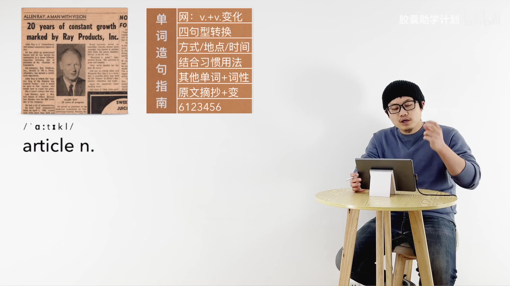

文字识别：ALLENRAY,AMANWITHVISION / NO / 单词造句指南 / 网：v.+v.变化 / 20 years of constant growth / FO / 四句型转换 / marked by Ray Products, Inc. / 方式/地点/时间 / 结合习惯用法 / 其他单词+词性 / 原文摘抄+变 / ALLEN RAY / SWEE / 6123456 / JUICI / /a:tikl/ / article n.

### 画面 00:03:37

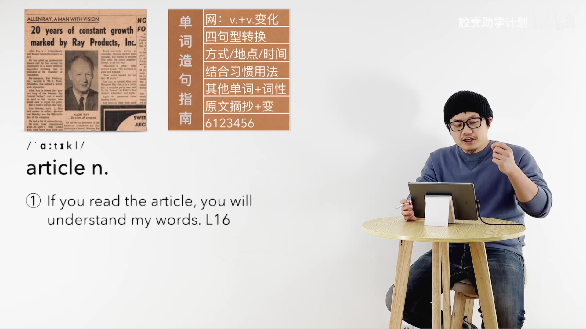

文字识别：ALLENRAY,AMANWITH VISION / NO / 单词造句指南 / 网：v.+v.变化 / 20 years of constant growth / FO / 四句型转换 / marked by Ray Products, Inc. / 方式/地点/时间 / 结合习惯用法 / 其他单词+词性 / 原文摘抄+变 / ALLEN RAY / SWEE / 6123456 / JUICI / /'a:tikl/ / article n. / ① If you read the article, you will / understand my words. L16

### 画面 00:03:40

文字识别：ALLENRAY,AMANWITHVISION / NO / 单词造句指南 / 网：v.+v.变化 / 20 years of constant growth / FO / 四句型转换 / marked by Ray Products, Inc. / 方式/地点/时间 / 结合习惯用法 / 其他单词+词性 / 原文摘抄+变 / ALLEN RAY / SWEE / 6123456 / JUICI / /'a:tikl/ / article n. / ① If you read the article, you will / understand my words. L16

### 画面 00:03:48

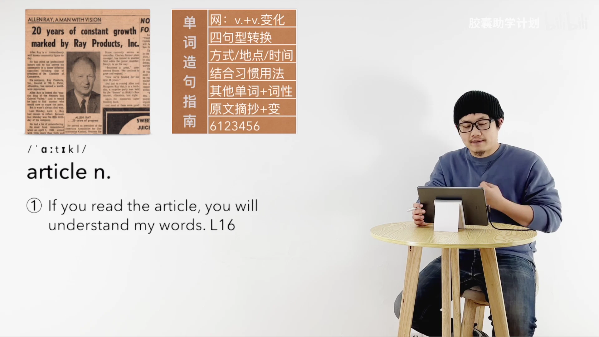

文字识别：ALLENRAY,AMANWITHVISION / NO / 单词造句指南 / 网：v.+v.变化 / 20 years of constant growth / FO / 四句型转换 / marked by Ray Products, Inc. / 方式/地点/时间 / 结合习惯用法 / 其他单词+词性 / 原文摘抄+变 / ALLEN RAY / SWEE / 6123456 / JUICI / /'a:tikl/ / article n. / ① If you read the article, you will / understand my words. L16

### 画面 00:03:53

文字识别：ALLENRAY,AMAN WITH VISION / NO / 单词造句指南 / 网：v.+v.变化 / 20 years of constant growth / FO / 四句型转换 / marked by Ray Products, Inc. / 方式/地点/时间 / 结合习惯用法 / 其他单词+词性 / 原文摘抄+变 / ALLEN RAY / SWEE / 6123456 / JUICI / /'a:tikl/ / article n. / ① If you read the article, you will / understand my words. L16 / [Story]: The woman first bought a few / small articles.

### 画面 00:03:55

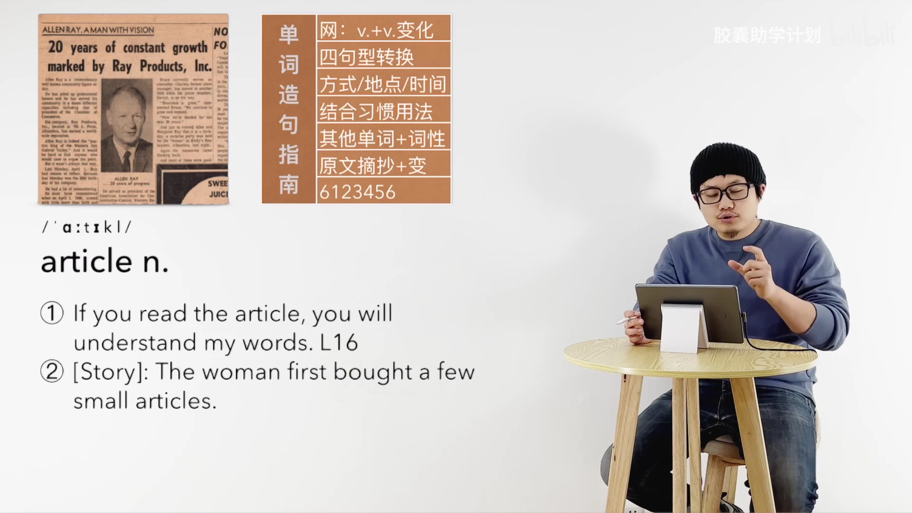

文字识别：ALLENRAY,AMAN WITH VISION / NO / 单词造句指南 / 网：v.+v.变化 / 20 years of constant growth / FO / 四句型转换 / marked by Ray Products, Inc. / 方式/地点/时间 / 结合习惯用法 / 其他单词+词性 / 原文摘抄+变 / ALLEN RAY / SWEE / 6123456 / JUICI / /'a:tikl/ / article n. / ① If you read the article, you will / understand my words. L16 / [Story]: The woman first bought a few / small articles.

## 00:04:00–00:04:30

few small articles.她首先啊，先买了一些小的物件。OK，好，然后呢，那我们就可以把它进行一些四句型的转换。所以，我们在这个地方其实结合了两个单词造句的思路。OK， next one，跟我一起读一下，叫做 wrap wrap。注意，它本身是一个动词啊。比如说，我们把某个东西包起来，对吧？或者说，给这个礼品打包啊，这个加上外包装，都叫做这个动词叫做 wrap。

### 画面 00:04:05

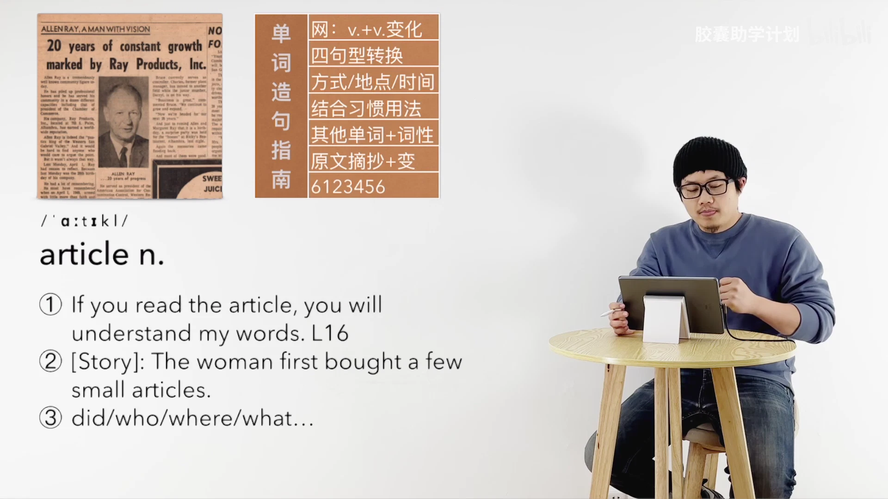

文字识别：ALLENRAY,AMANWITH VISION / NO / 单词造句指南 / 网：v.+v.变化 / 20 years of constant growth / FO / 四句型转换 / marked by Ray Products, Inc. / 方式/地点/时间 / 结合习惯用法 / 其他单词+词性 / 原文摘抄+变 / ALLEN RAY / SWEE / 6123456 / JUICI / /'a:tikl/ / article n. / ① If you read the article, you will / understand my words. L16 / [Story]: The woman first bought a few / small articles. / did/who/where/what...

### 画面 00:04:10

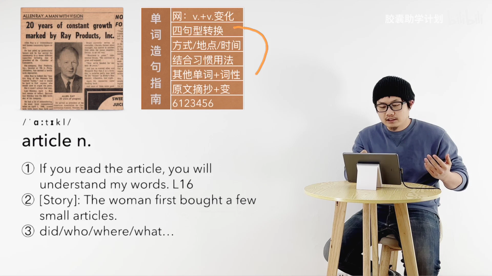

文字识别：ALLENRAY,AMANWITHVISION / NO / 单词造句指南 / 网：v.+v.变化 / 20 years of constant growth / FO / 四句型转换 / marked by Ray Products, Inc. / 方式/地点/时间 / 结合习惯用法 / 其他单词+词性 / 原文摘抄+变 / ALLEN RAY / SWEE / 6123456 / JUICI / /'a:tikl/ / article n. / ① If you read the article, you will / understand my words. L16 / [Story]: The woman first bought a few / small articles. / did/who/where/what...

### 画面 00:04:12

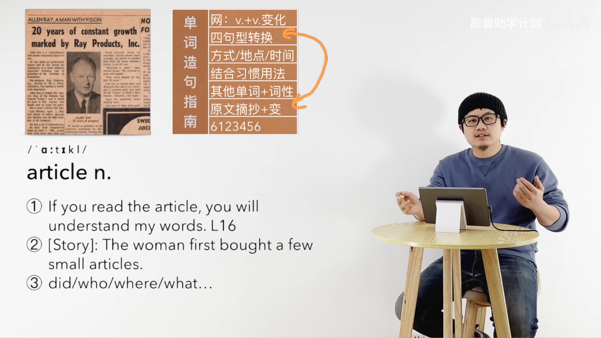

文字识别：ALLENRAY,AMANWITHVISION / NO / 单词造句指南 / 网：v.+v.变化 / 20 years of constant growth / FO / 四句型转换 / marked by Ray Products, Inc. / 方式/地点/时间 / 结合习惯用法 / 其他单词+词性 / 原文摘抄+变 / ALLEN RAY / SWEE / 6123456 / JUICI / /'a:tikl/ / article n. / ① If you read the article, you will / understand my words. L16 / [Story]: The woman first bought a few / small articles. / did/who/where/what...

### 画面 00:04:15

文字识别：单词造句指南 / 网：v.+v.变化 / 四句型转换 / 方式/地点/时间 / 结合习惯用法 / 其他单词+词性 / 原文摘抄+变 / 6123456 / / r æp / / wrap v.

### 画面 00:04:17

文字识别：单词造句指南 / 网：v.+v.变化 / 四句型转换 / 方式/地点/时间 / 结合习惯用法 / 其他单词+词性 / 原文摘抄+变 / 6123456 / I r æ p / / wrap v.

### 画面 00:04:20

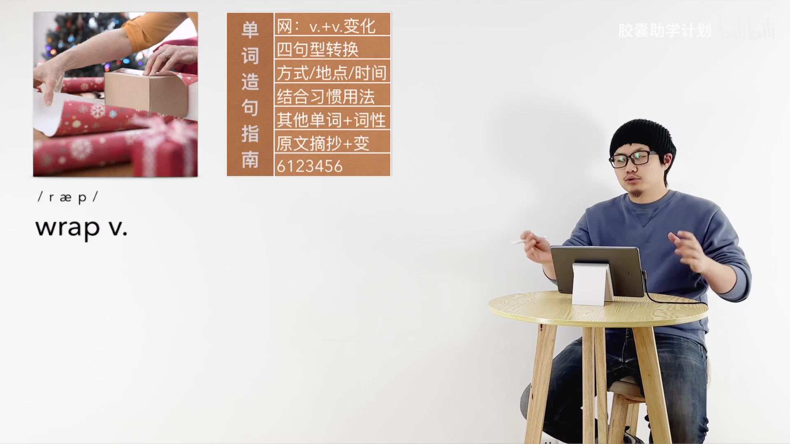

文字识别：单词造句指南 / 网：v.+v.变化 / 四句型转换 / 方式/地点/时间 / 结合习惯用法 / 其他单词+词性 / 原文摘抄+变 / 6123456 / / r æ p / / wrap v.

### 画面 00:04:25

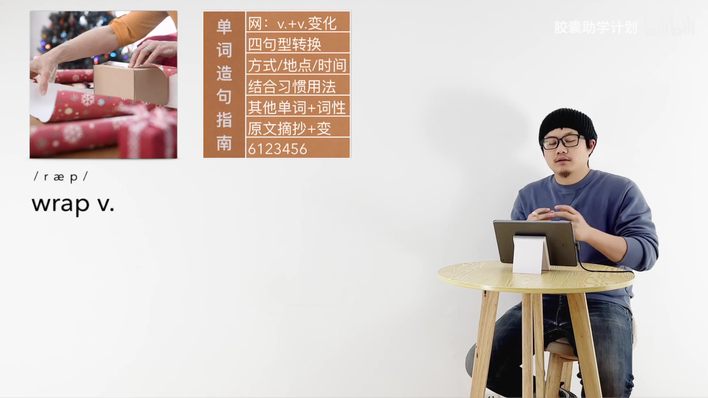

文字识别：单词造句指南 / 网：v.+v.变化 / 四句型转换 / 方式/地点/时间 / 结合习惯用法 / 其他单词+词性 / 原文摘抄+变 / 6123456 / / r æ p / / wrap v.

## 00:04:30–00:05:00

但它往往不自己去用，它跟 up 连起来去用，叫 wrap up。 OK，好，那我们比如说我们造一句话，说 she sat there and wrapped up presents for her children。她坐在那里，然后给她的孩子去打包这个礼物啊，包装起来。那各种各样的四句型转换，您就可以自己去做了，对吧？我给了各位一句肯定句，您这一句话您不知道我怎么造过来的，没问题。然后，但是您把我这句话变成不同的句型，这就

### 画面 00:04:30

文字识别：单词造句指南 / 网：v.+v.变化 / 四句型转换 / 方式/地点/时间 / 结合习惯用法 / 其他单词+词性 / 原文摘抄+变 / 6123456 / / r æ p / / wrap v.

### 画面 00:04:32

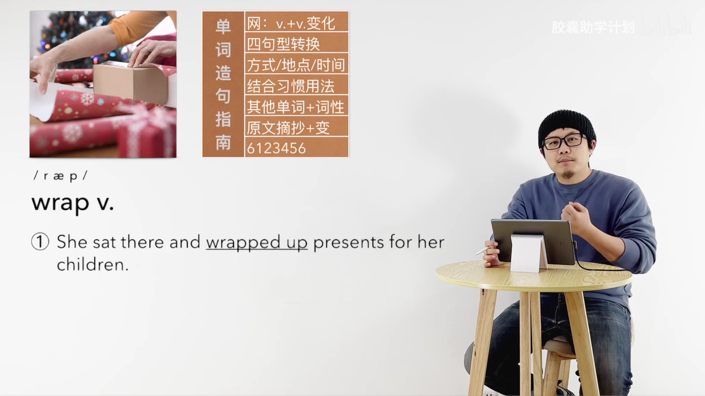

文字识别：单词造句指南 / 网：v.+v.变化 / 四句型转换 / 方式/地点/时间 / 结合习惯用法 / 其他单词+词性 / 原文摘抄+变 / 6123456 / / r æ p / / wrap v. / ① She sat there and wrapped up presents for her / children.

### 画面 00:04:35

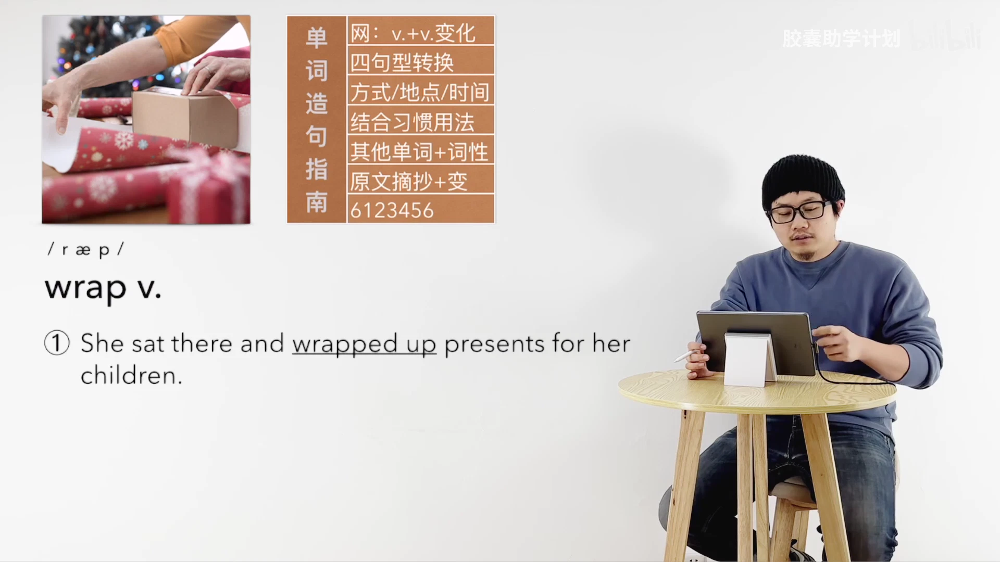

文字识别：单词造句指南 / 网：v.+v.变化 / 四句型转换 / 方式/地点/时间 / 结合习惯用法 / 其他单词+词性 / 原文摘抄+变 / 6123456 / / r æ p / / wrap v. / ① She sat there and wrapped up presents for her / children.

### 画面 00:04:40

文字识别：单词造句指南 / 网：v.+v.变化 / 四句型转换 / 方式/地点/时间 / 结合习惯用法 / 其他单词+词性 / 原文摘抄+变 / 6123456 / / r æ p / / wrap v. / ① She sat there and wrapped up presents for her / children.

### 画面 00:04:45

文字识别：单词造句指南 / 网：v.+v.变化 / 四句型转换 / 方式/地点/时间 / 结合习惯用法 / 其他单词+词性 / 原文摘抄+变 / 6123456 / / r æ p / / wrap v. /  She sat there and wrapped up presents for her / ① / children.

### 画面 00:04:50

文字识别：单词造句指南 / 网：v.+v.变化 / 四句型转换 / 方式/地点/时间 / 结合习惯用法 / 其他单词+词性 / 原文摘抄+变 / - / 6123456 / / r æ p / / wrap v. / ① She sat there and wrapped up presents for her / children. / did/who/when..

### 画面 00:04:56

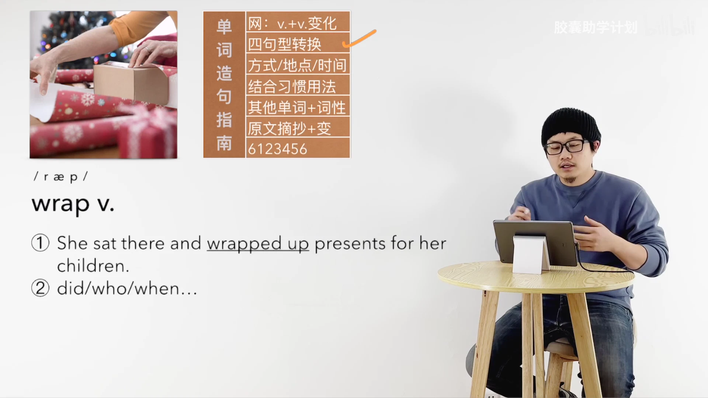

文字识别：单词造句指南 / 网：v.+v.变化 / 四句型转换 / 方式/地点/时间 / 结合习惯用法 / 其他单词+词性 / 原文摘抄+变 / 6123456 / / r æ p / / wrap v. / ① She sat there and wrapped up presents for her / children. / did/who/when...

## 00:05:00–00:05:30

是您自己的单词造句了。Next one，我们结合十七课 must be doing，说 it must be wrapping up the presents now。他现在一定是正在打包这个礼品啊，礼物。再来二十课，instead of doing something，说 instead of wrapping up the presents，代替打包了这个礼品，she just gave them to me。说她仅仅就是把这些礼物给我了，直接就给我了，没有再去打包了，对吧？Okay，very good。Next

### 画面 00:05:03

文字识别：单词造句指南 / 网：v.+v.变化 / 四句型转换 / 方式/地点/时间 / 结合习惯用法 / 其他单词+词性 / 原文摘抄+变 / 6123456 / / r æ p 1 / wrap V. / ① She sat there and wrapped up presents for her / children. / did/who/when... / He must be wrapping up the presents now. L17

### 画面 00:05:05

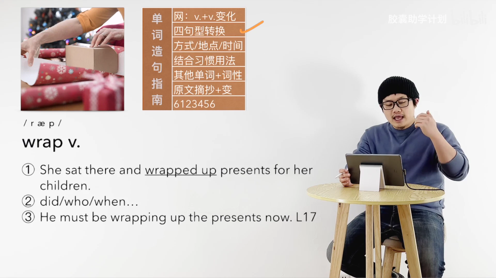

文字识别：单词造句指南 / 网：v.+v.变化 / 四句型转换 / 方式/地点/时间 / 结合习惯用法 / 其他单词+词性 / 原文摘抄+变 / 6123456 / / r æ p / / wrap V. / ① She sat there and wrapped up presents for her / children. / did/who/when... / He must be wrapping up the presents now. L17

### 画面 00:05:10

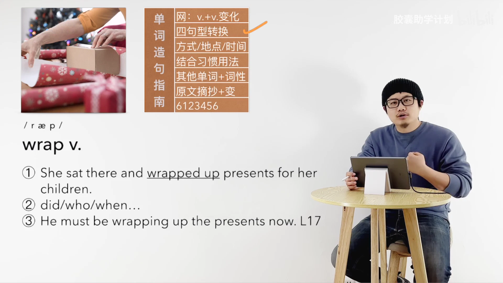

文字识别：单词造句指南 / 网：v.+v.变化 / 四句型转换 / 方式/地点/时间 / 结合习惯用法 / 其他单词+词性 / 原文摘抄+变 / - / 6123456 / / r æ p / / wrap v. / ① She sat there and wrapped up presents for her / children. / did/who/when... / He must be wrapping up the presents now. L17

### 画面 00:05:12

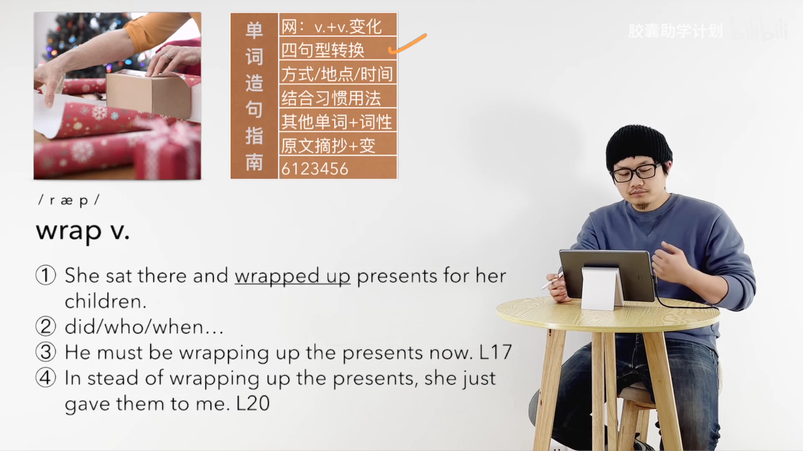

文字识别：单词造句指南 / 网：v.+v.变化 / 四句型转换 / 方式/地点/时间 / 结合习惯用法 / 其他单词+词性 / 原文摘抄+变 / 6123456 / / ræ p / / wrap v. / ① She sat there and wrapped up presents for her / children. / did/who/when... / He must be wrapping up the presents now. L17 / ) In stead of wrapping up the presents, she just / gave them to me. L20

### 画面 00:05:15

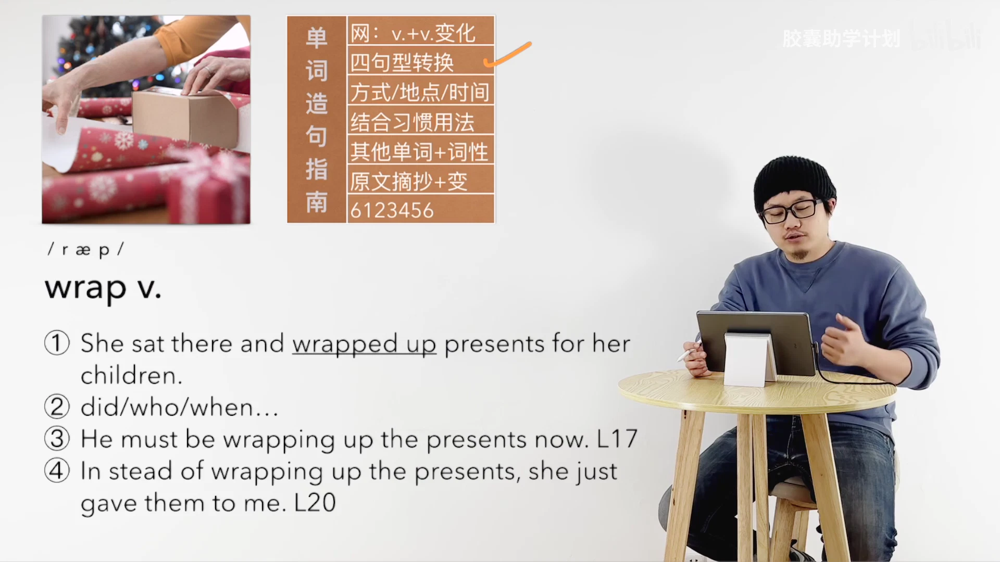

文字识别：单词造句指南 / 网：v.+v.变化 / 四句型转换 / 方式/地点/时间 / 结合习惯用法 / 其他单词+词性 / 原文摘抄+变 / 6123456 / / ræp / / wrap v. / ① She sat there and wrapped up presents for her / children. / did/who/when... / He must be wrapping up the presents now. L17 / ) In stead of wrapping up the presents, she just / gave them to me. L20

### 画面 00:05:20

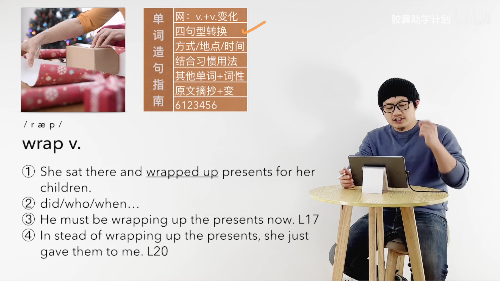

文字识别：单词造句指南 / 网：v.+v.变化 / 四句型转换 / 方式/地点/时间 / 结合习惯用法 / 其他单词+词性 / 原文摘抄+变 / 6123456 / / ræ p / / wrap v. / ① She sat there and wrapped up presents for her / children. / did/who/when... / He must be wrapping up the presents now. L17 / ) In stead of wrapping up the presents, she just / gave them to me. L20

### 画面 00:05:28

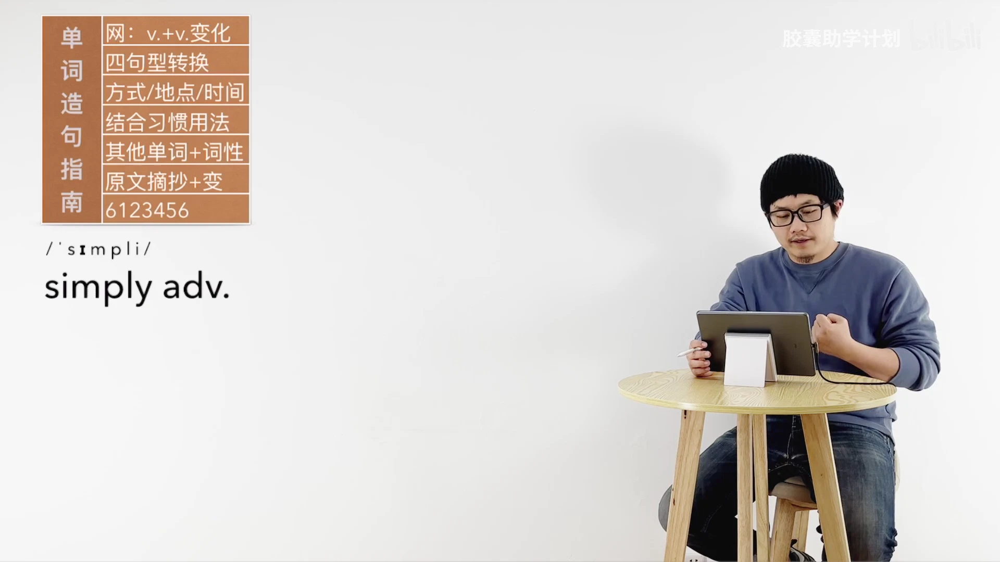

文字识别：单词造句指南 / 网：v.+v.变化 / 四句型转换 / 方式/地点/时间 / 结合习惯用法 / 其他单词+词性 / 原文摘抄+变 / 6123456 / /'simpli/ / simply adv.

## 00:05:30–00:06:00

one,下一个单词我们一起读一下，叫做 simply simply啊，那像它是副词，它就是仅仅啊。Okay，比如说 the old man simply took the parcel.原文的一句话，他就是单纯的仅仅就是拿了这个包裹。Okay，好，呃，然后四句型转换，比如说，那我们其实还可以造一些句子，说我们原来就会的句子叫做第二时刻学的叫做 she is interested in fishing，是吧？他就他对钓鱼感兴趣。那你说他仅

### 画面 00:05:30

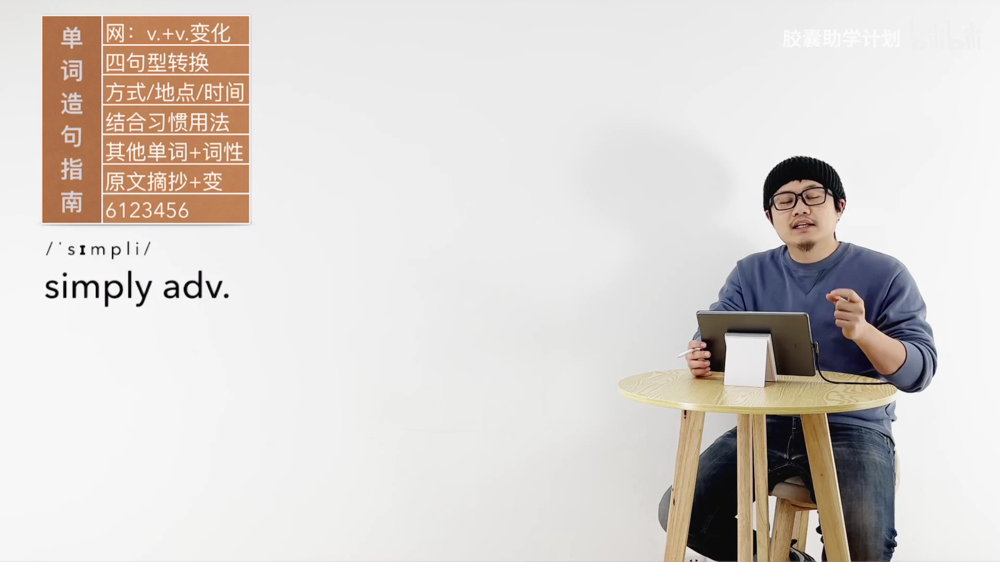

文字识别：单词造句指南 / 网：v.+v.变化 / 四句型转换 / 方式/地点/时间 / 结合习惯用法 / 其他单词+词性 / 原文摘抄+变 / 6123456 / /'simpli/ / simply adv.

### 画面 00:05:35

文字识别：单词造句指南 / 网：v.+v.变化 / 四句型转换 / 方式/地点/时间 / 结合习惯用法 / 其他单词+词性 / 原文摘抄+变 / 6123456 / /'simpli/ / simply adv.

### 画面 00:05:40

文字识别：单词造句指南 / 网：v.+v.变化 / 四句型转换 / 方式/地点/时间 / 结合习惯用法 / 其他单词+词性 / 原文摘抄+变 / 6123456 / /'simpli/ / simply adv. / ① [Story]: The woman simply took the parcel.

### 画面 00:05:46

文字识别：单词造句指南 / 网：v.+v.变化 / 四句型转换 / 方式/地点/时间 / 结合习惯用法 / 其他单词+词性 / 原文摘抄+变 / 6123456 / /'simpli/ / simply adv. / ① [Story]: The woman simply took the parcel. / did/who/why...

### 画面 00:05:50

文字识别：单词造句指南 / 网：v.+v.变化 / 四句型转换 / 方式/地点/时间 / 结合习惯用法 / 其他单词+词性 / 原文摘抄+变 / 6123456 / /'simpli/ / simply adv. / ① [Story]: The woman simply took the parcel. / did/who/why... / She is simply interested in fishing. L20

## 00:06:00–00:06:30

仅就是对钓鱼感兴趣这样一个小的程度副词，对吧？那叫做 she is simply interested in fishing，对吧？所以像 simply 这样的单词呢，您基本上见多了。我个人的感受是，几乎你不用专门花时间，就是大量的阅读和输入，见多了自然而然就会用了。有时候可以加，有时候也可以不加，它无非就是强调一个语气，对吧？OK，嗯，下一个单词一个动词，跟我一起读一下，叫做 arrest，

### 画面 00:06:01

文字识别：单词造句指南 / 网：v.+v.变化 / 四句型转换 / 方式/地点/时间 / 结合习惯用法 / 其他单词+词性 / 原文摘抄+变 / 6123456 / /'simpli/ / simply adv. / ① [Story]: The woman simply took the parcel. / did/who/why... / She is simply interested in fishing. L20

### 画面 00:06:06

文字识别：单词造句指南 / 网：v.+v.变化 / 四句型转换 / 方式/地点/时间 / 结合习惯用法 / 其他单词+词性 / 原文摘抄+变 / 6123456 / /'simpli/ / simply adv. / ① [Story]: The woman simply took the parcel. / did/who/why... / She is simply interested in fishing. L20

### 画面 00:06:11

文字识别：单词造句指南 / 网：v.+v.变化 / 四句型转换 / 方式/地点/时间 / 结合习惯用法 / 其他单词+词性 / 原文摘抄+变 / 6123456 / /'simpli/ / simply adv. / ① [Story]: The woman simply took the parcel. / did/who/why... / She is simply interested in fishing. L20

### 画面 00:06:15

文字识别：单词造句指南 / 网：v.+v.变化 / 四句型转换 / 方式/地点/时间 / 结合习惯用法 / 其他单词+词性 / 原文摘抄+变 / 6123456 / /'simpli/ / simply adv. / ① [Story]: The woman simply took the parcel. / did/who/why... / She is simply interested in fishing. L20

### 画面 00:06:20

文字识别：单词造句指南 / 网：v.+v.变化 / 四句型转换 / 方式/地点/时间 / 结合习惯用法 / 其他单词+词性 / 原文摘抄+变 / 6123456 / /'simpli/ / simply adv. / ① [Story]: The woman simply took the parcel. / did/who/why... / She is simply interested in fishing. L20

### 画面 00:06:25

文字识别：单词造句指南 / 网：v.+v.变化 / 四句型转换 / 方式/地点/时间 / 结合习惯用法 / 其他单词+词性 / 原文摘抄+变 / 6123456 / /a'rest/ / arrest v.

### 画面 00:06:28

文字识别：单词造句指南 / 网：v.+v.变化 / 四句型转换 / 方式/地点/时间 / 结合习惯用法 / 其他单词+词性 / 原文摘抄+变 / 6123456 / /a'rest/ / arrest v.

## 00:06:30–00:07:00

啊，叫做哎逮捕对吧？OK，比如说 he was arrested last night，第十课的被动 be 加 done，一般过去时的被动对吧？啊，昨晚被逮捕了。Next one 说 they must have been arrested last night，说他们昨晚一定是被逮捕了。你看这是二十一课咱们学的，各位非常容易忘的一个结构结构叫做 must have been done，叫当时一定是被怎么怎么样了。OK， next

### 画面 00:06:30

文字识别：单词造句指南 / 网：v.+v.变化 / 四句型转换 / 方式/地点/时间 / 结合习惯用法 / 其他单词+词性 / 原文摘抄+变 / 6123456 / /a'rest/ / arrest v.

### 画面 00:06:35

文字识别：单词造句指南 / 网：v.+v.变化 / 四句型转换 / 方式/地点/时间 / 结合习惯用法 / 其他单词+词性 / 原文摘抄+变 / 6123456 / /a'rest/ / arrest v. / ① He was arrested last night. L10

### 画面 00:06:40

文字识别：单词造句指南 / 网：v.+v.变化 / 四句型转换 / 方式/地点/时间 / 结合习惯用法 / 其他单词+词性 / 原文摘抄+变 / 6123456 / /a'rest/ / arrest v. / ① He was arrested last night. L10

### 画面 00:06:45

文字识别：单词造句指南 / 网：v.+v.变化 / 四句型转换 / 方式/地点/时间 / 结合习惯用法 / 其他单词+词性 / 原文摘抄+变 / 6123456 / /a'rest/ / arrest v. / ① He was arrested last night. L10 / They must have been arrested last night. L21

### 画面 00:06:50

文字识别：单词造句指南 / 网：v.+v.变化 / 四句型转换 / 方式/地点/时间 / 结合习惯用法 / 其他单词+词性 / 原文摘抄+变 / 6123456 / /a'rest/ / arrest v. / ① He was arrested last night. L10 / They must have been arrested last night. L21

### 画面 00:06:55

文字识别：单词造句指南 / 网：v.+v.变化 / 四句型转换 / 方式/地点/时间 / 结合习惯用法 / 其他单词+词性 / 原文摘抄+变 / 6123456 / /a'rest/ / arrest v. / ① He was arrested last night. L10 / They must have been arrested last night. L21

## 00:07:00–00:07:30

one. Say the man who was arrested last night has trouble resisting the temptation all his life. 28. Clause. This clause, I've already marked for you. I've marked it with this bold part, right? It means the man who was arrested last night has trouble resisting the temptation all his life. 28. Clause. This clause, I've already marked for you. I've marked it with this bold part, right? It means the man who was arrested last night has trouble resisting the temptation all

### 画面 00:07:00

文字识别：单词造句指南 / 网：v.+v.变化 / 四句型转换 / 方式/地点/时间 / 结合习惯用法 / 其他单词+词性 / 原文摘抄+变 / 6123456 / /a'rest/ / arrest v. / ① He was arrested last night. L10 / They must have been arrested last night. L21 / The man who was arrested last night has / trouble resisting the temptation all his life. L28

### 画面 00:07:05

文字识别：单词造句指南 / 网：v.+v.变化 / 四句型转换 / 方式/地点/时间 / 结合习惯用法 / 其他单词+词性 / 原文摘抄+变 / 6123456 / /a'rest/ / arrest v. / ① He was arrested last night. L10 / They must have been arrested last night. L21 / The man who was arrested last night has / trouble resisting the temptation all his life. L28

### 画面 00:07:11

文字识别：单词造句指南 / 网：v.+v.变化 / 四句型转换 / 方式/地点/时间 / 结合习惯用法 / 其他单词+词性 / 原文摘抄+变 / 6123456 / /a'rest/ / arrest v. / ① He was arrested last night. L10 / They must have been arrested last night. L21 / The man who was arrested last night has / trouble resisting the temptation all his life. L28

### 画面 00:07:15

文字识别：单词造句指南 / 网：v.+v.变化 / 四句型转换 / 方式/地点/时间 / 结合习惯用法 / 其他单词+词性 / 原文摘抄+变 / 6123456 / /a'rest/ / arrest v. / ① He was arrested last night. L10 / They must have been arrested last night. L21 / The man who was arrested last night has / trouble resisting the temptation all his life. L28

### 画面 00:07:25

文字识别：单词造句指南 / 网：v.+v.变化 / 四句型转换 / 方式/地点/时间 / 结合习惯用法 / 其他单词+词性 / 原文摘抄+变 / 6123456 / /a'rest/ / arrest v. / ① He was arrested last night. L10 / They must have been arrested last night. L21 / The man who was arrested last night has / trouble resisting the temptation all his life. L28

### 画面 00:07:29

文字识别：Recap / Words / once upon a time / Expression / resist the temptation / wrap up sth.

## 00:07:30–00:08:00

那Recap本视频当中，除了单词以外，给大家补了一些小的习惯用法，都是非常出现啊，经常出现的，对吧？你像最后一个Wrap up something在文章当中也出现了啊，然后像Once upon a time，基本上你可能去看Disneyland的很多动画，它都会出现。OK，好，呃，最开始都会出现啊。那我们看一下家庭作业：单词造句、老习惯、反复听电影片段啊，这练习我们一个听力

### 画面 00:07:31

文字识别：Recap / Words / once / eupon a time / Expression / resist the temptation / wrap up sth.

### 画面 00:07:33

文字识别：Recap / Words / once / eupon a time / Expression / resist the temptation / wrap up sth.

### 画面 00:07:35

文字识别：Recap / Words / once upon a time / Expression / resist the t / temptation / wrap up sth.

### 画面 00:07:37

文字识别：Recap / Words / once upon a time / Expression / resist the temptation / wrap up sth.

### 画面 00:07:40

文字识别：Recap / Words / once upon a time / Expression / resist the t / temptation / wrap up sth.

### 画面 00:07:42

文字识别：Recap / Words / once upon a time / Expression / resist the temptation / wrap up sth.

### 画面 00:07:45

文字识别：Recap / Words / once upon a time / Expression / resist the temptation / wrap up sth.

### 画面 00:07:48

文字识别：Recap / Words / once upon a time / Expression / resist the temptation / wrap up sth.

### 画面 00:07:50

文字识别：Recap / Words / once upon a time / Expression / resist the t / temptation / wrap up sth.

### 画面 00:07:52

### 画面 00:07:54

文字识别：单词造句/对话 / 1. / 【单词造句指南】 / 每个5句

### 画面 00:07:56

文字识别：单词造句/对话 / 【单词造句指南】 / 每个5句 / 2.反复听电影片段，直到能 / 听出关键短语/句子

### 画面 00:07:58

文字识别：单词造句/对话 / 【单词造句指南】 / 每个5句 / 2.反复听电影片段，直到能 / 听出关键短语/句子 / 生

## 00:08:00–00:08:22

的啊。那如果各位喜欢我们的课程呢，欢迎各位关注、订阅、一键三连，分享给那些需要的朋友，来帮助我们快速成长。See you next time.

### 画面 00:08:00

### 画面 00:08:10

文字识别：👍

### 画面 00:08:12

文字识别：CAPSULEACADEMY / 胶囊助学计划 / 小红书 / Lecturer / 口 / Leo / OE

### 画面 00:08:15

文字识别：CAPSULEACADEMY / 胶囊助学计划 / 小红书 / Editor / OE

### 画面 00:08:18

文字识别：CAPSULEACADEMY / 胶囊助学计划 / 小红书 / Creator / Leo & Berlin

### 画面 00:08:20

文字识别：bilibili / 胶囊助学计划 / 胶囊助学计划 / 小红书 / OE

### 画面 00:08:22

文字识别：bilibili / 胶囊助学计划

