# L032 听说读写复述练习

快速机器解析：语音为单模型转写，未进行独立交叉校对或人工复核；画面每秒采样并按变化选帧，短时文字和标记可能遗漏。截图时间约有 1 秒误差。图片有损压缩；遇到疑点请按时间查看 Google Drive 原视频。

## 00:00:00–00:00:30

Hello everyone, welcome to Capsule Academy. This is Leo. Today we're going to learn new concept English. Two lesson thirty two practices. 那老习惯，各位一定要注意进行如下练习。唯一的前提就是文章一定要跟读至熟读成诵，否则请勿开始。 Hope you can enjoy it. 好，那我们先看第一题 comprehension，练习到大家能听懂一般疑问句和特殊疑问

### 画面 00:00:00

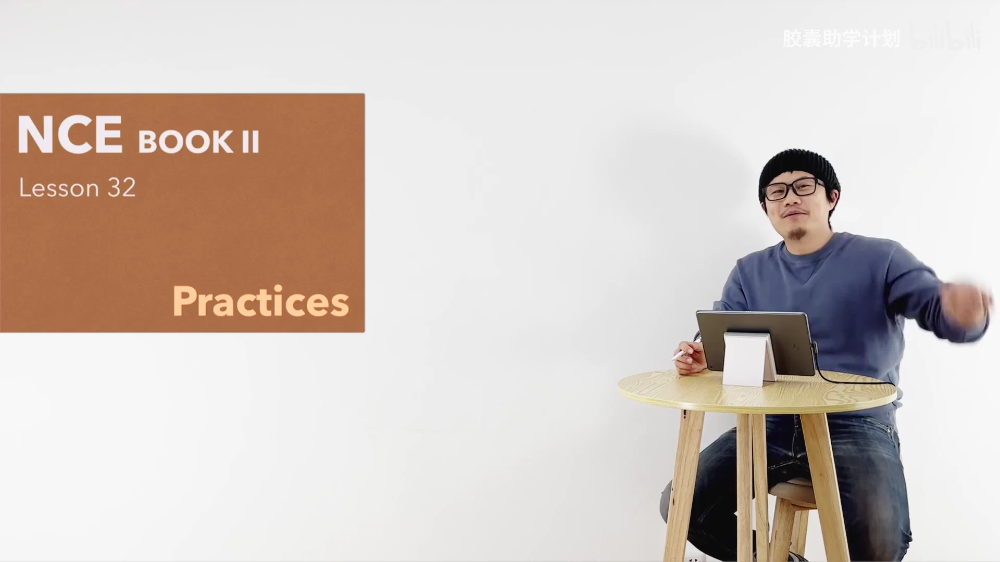

文字识别：NCE / BOOKII / Lesson 32 / Practices

### 画面 00:00:02

文字识别：NCE / BOOKII / Lesson 32 / Practices

### 画面 00:00:05

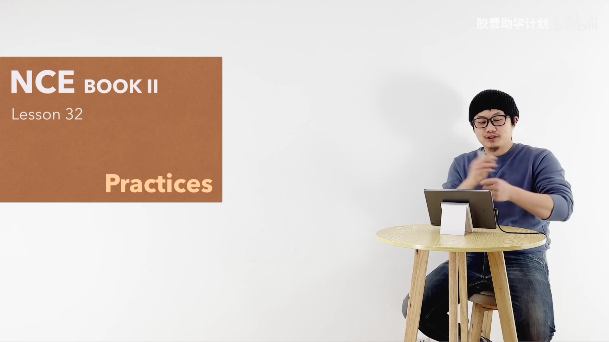

文字识别：NCE / BOOKI"I / Lesson 32 / Practices

### 画面 00:00:08

文字识别：进行如下练习唯一前提 / 文章跟读至熟读成诵 / 否则请勿开始

### 画面 00:00:10

文字识别：进行如下练习唯一前提 / 文章跟读至熟读成诵 / 否则请勿开始

### 画面 00:00:20

文字识别：胶囊助学计划b出l / • / •

### 画面 00:00:24

### 画面 00:00:26

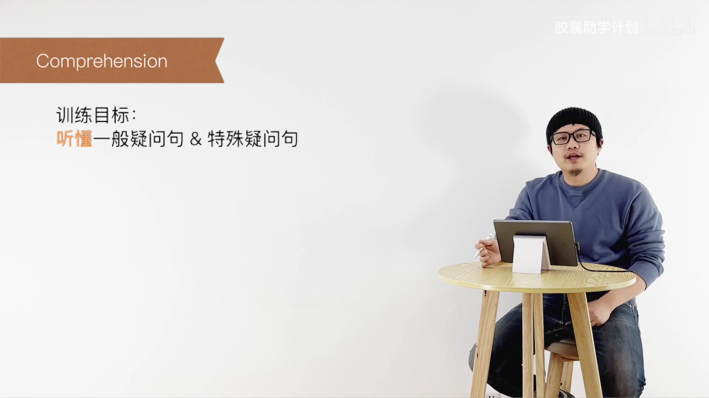

文字识别：Comprehension / 训练目标： / 听懂一般疑问句＆特殊疑问句

## 00:00:30–00:01:00

句的能力，我问您答啊，尽量不要看我这里啊。好，第一题，Are people more honest than they were? No, they aren't. Next one, What temptation is greater than ever before? To steal,或者the temptation to steal. Next one, Where are people especially tempted to steal?

### 画面 00:00:30

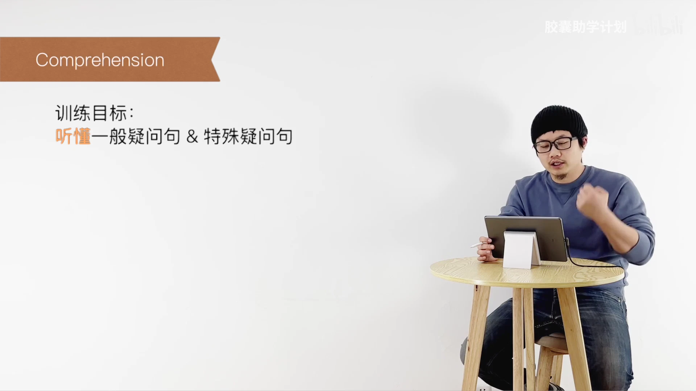

文字识别：Comprehension / 训练目标： / 听懂一般疑问句＆特殊疑问句

### 画面 00:00:34

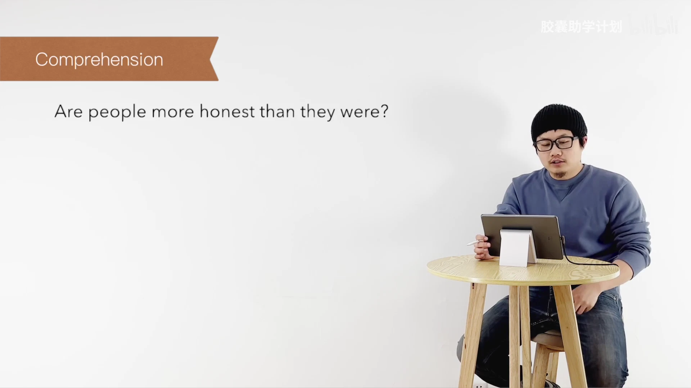

文字识别：Comprehension / Are people more honest than they were?

### 画面 00:00:42

文字识别：Comprehension / What temptation is greater than ever before?

## 00:01:00–00:01:30

In large shops. Next one, who did a detective watch recently? A well-dressed woman. Next one, where did she always go on Mondays? To a large store. Next one, why was it easier for the detective to watch her one Monday morning?

### 画面 00:01:00

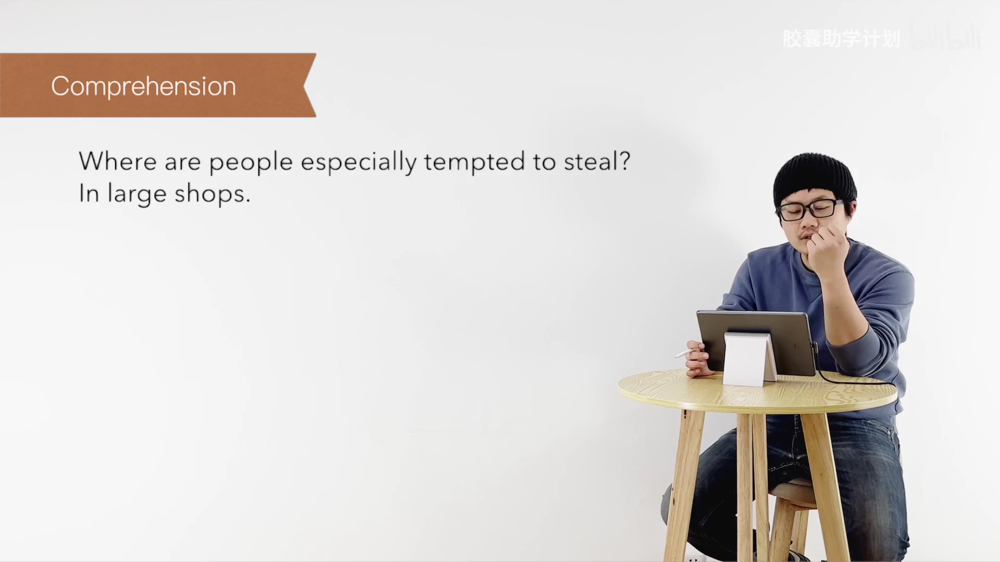

文字识别：Comprehension / Where are people especially tempted to steal? / In large shops.

### 画面 00:01:08

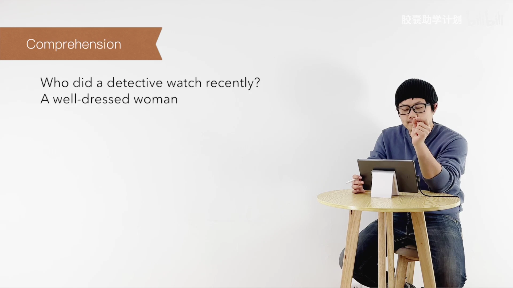

文字识别：Comprehension / Who did a detective watch recently? / A well-dressed woman

### 画面 00:01:21

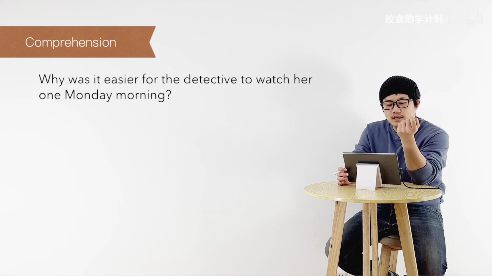

文字识别：Comprehension / Why was it easier for the detective to watch her / one Monday morning?

## 00:01:30–00:02:00

There were fewer people in the shop than usual. Next one. What did she do first? Ah, too fast. You just pause the screen. Ah, find the answer, say it out, and then check the answer. Okay. Answer. Ah, she bought a few small articles. Next one. What did she choose next? One of the most expensive dresses. Next one.

### 画面 00:01:32

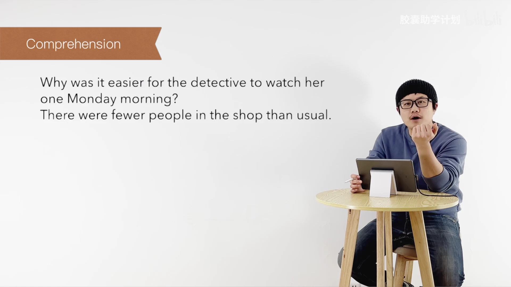

文字识别：Comprehension / Why was it easier for the detective to watch her / one Monday morning? / There were fewer people in the shop than usual.

### 画面 00:01:35

文字识别：Comprehension / What did she do first?

### 画面 00:01:46

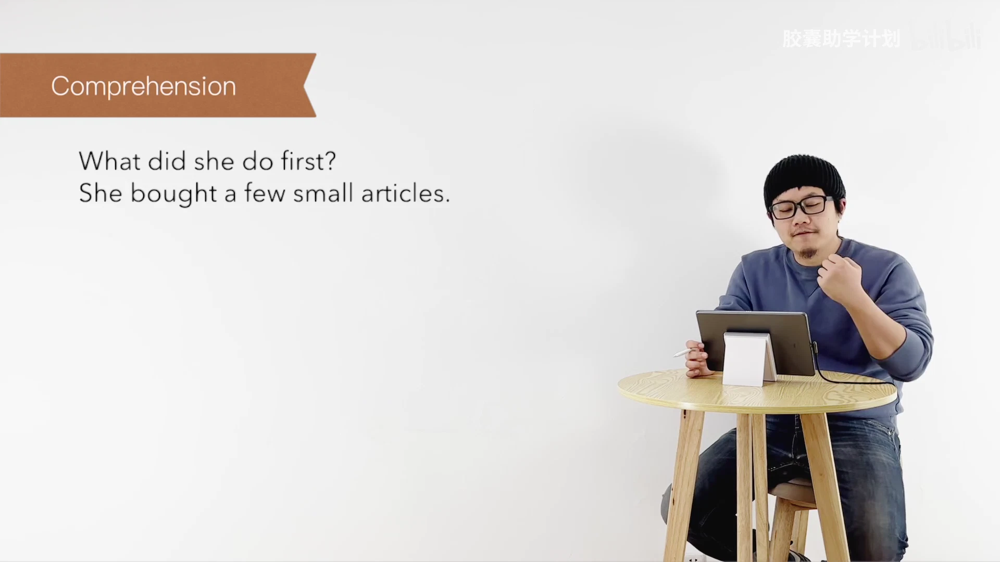

文字识别：Comprehension / What did she do first? / She bought a few small articles.

### 画面 00:01:58

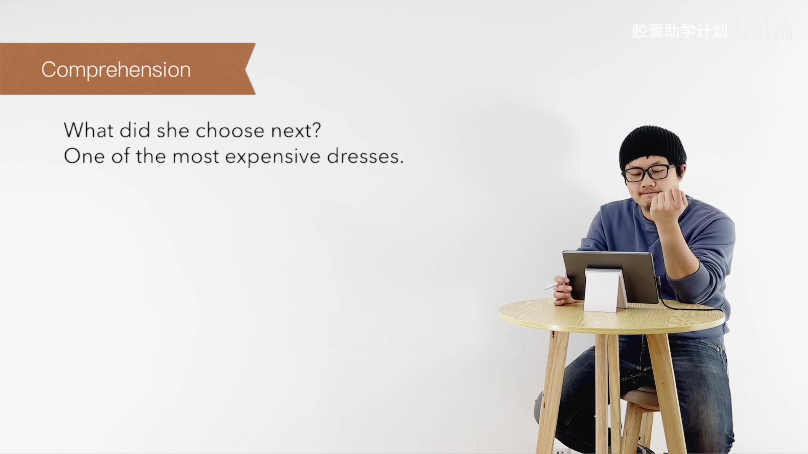

文字识别：Comprehension / What did she choose next? / One of the most expensive dresses.

## 00:02:00–00:02:30

did she hand it to an assistant? Yes, she did. Next one, what did the assistant do? She wrapped it up as quickly as possible. Next one, the woman took the parcel, didn't she? Yes, she did. Next one, had he paid for the dress? No,

### 画面 00:02:00

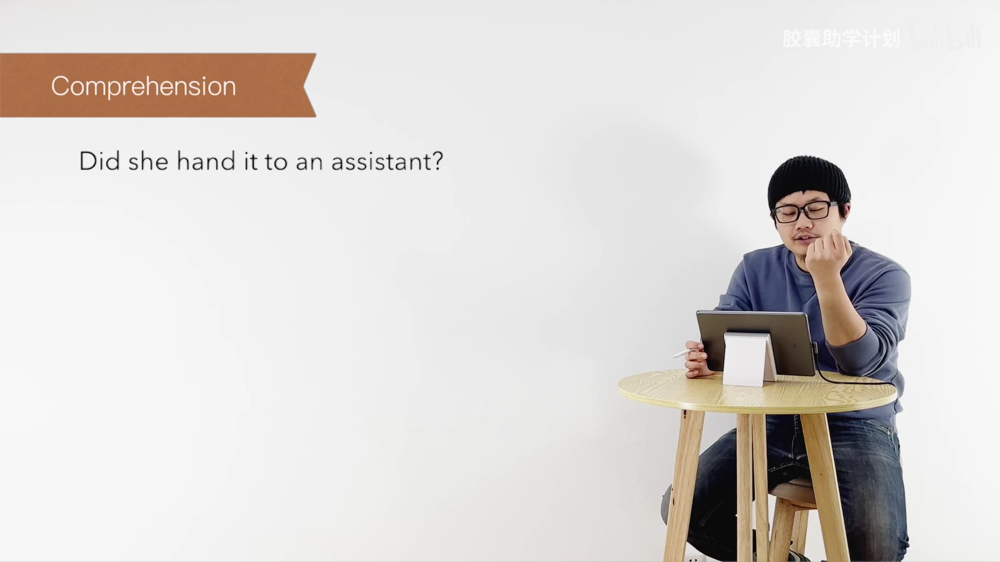

文字识别：Comprehension / Did she hand it to an assistant?

### 画面 00:02:05

文字识别：Comprehension / Did she hand it to an assistant? / Yes, she did.

### 画面 00:02:10

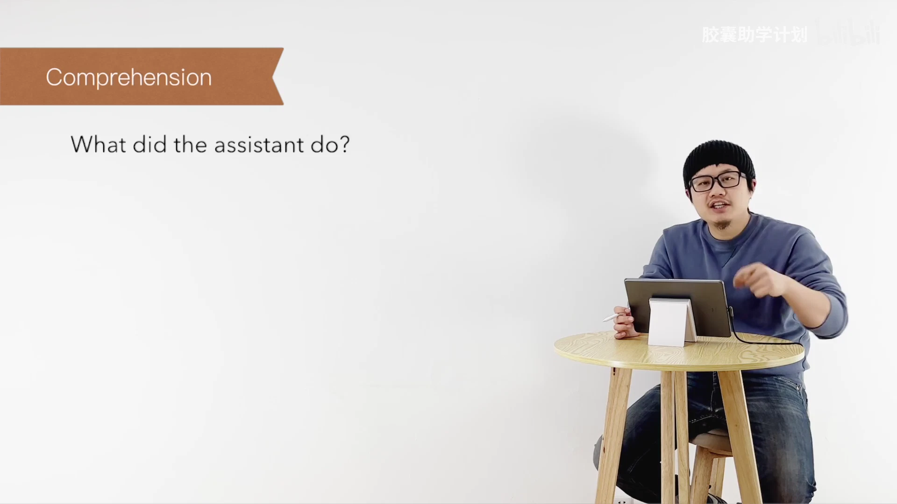

文字识别：Comprehension / What did the assistant do?

## 00:02:30–00:03:00

she hadn't.好, asking questions,肯定句,一般疑问句,特殊疑问句,老习惯,练锻炼大家能说出来是吧?那我们直接先看啊, ask me if people are less honest than they were.注意这里边要用 are,对吧?二提前, why直接加整句话,啊,非常的简单.那接下来呢,我们一个一个的看.第一个, who直接对主语提问就行了.然后第二题,

### 画面 00:02:32

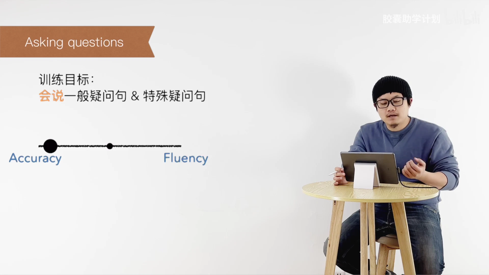

文字识别：Asking questions / 训练目标： / 会说一般疑问句＆特殊疑问句 / Accuracy / Fluency

### 画面 00:02:40

文字识别：Asking questions

### 画面 00:02:42

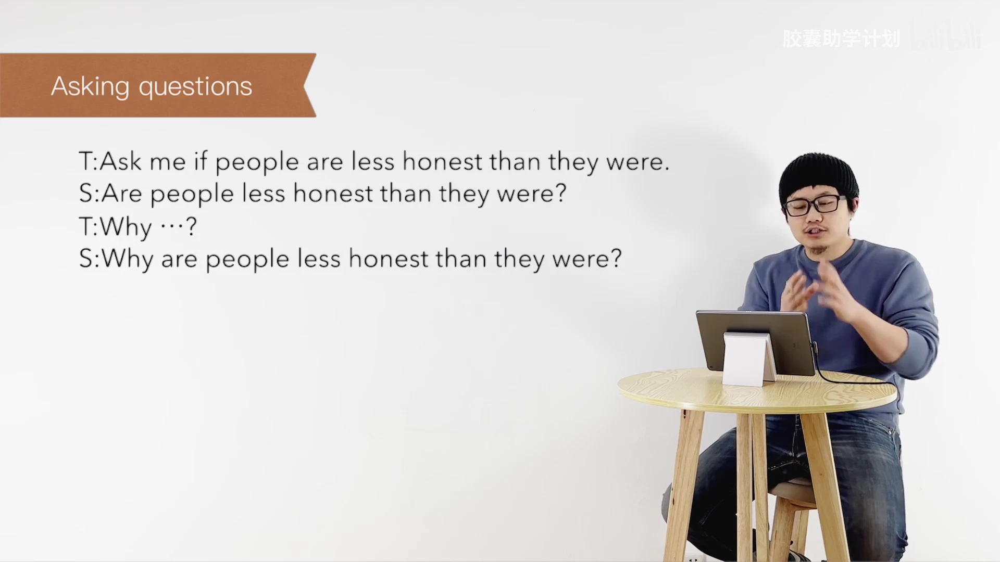

文字识别：Asking questions / T:Ask me if people are less honest than they were. / S:Are people less honest than they were? / T:Why…? / S:Why are people less honest than they were?

### 画面 00:02:53

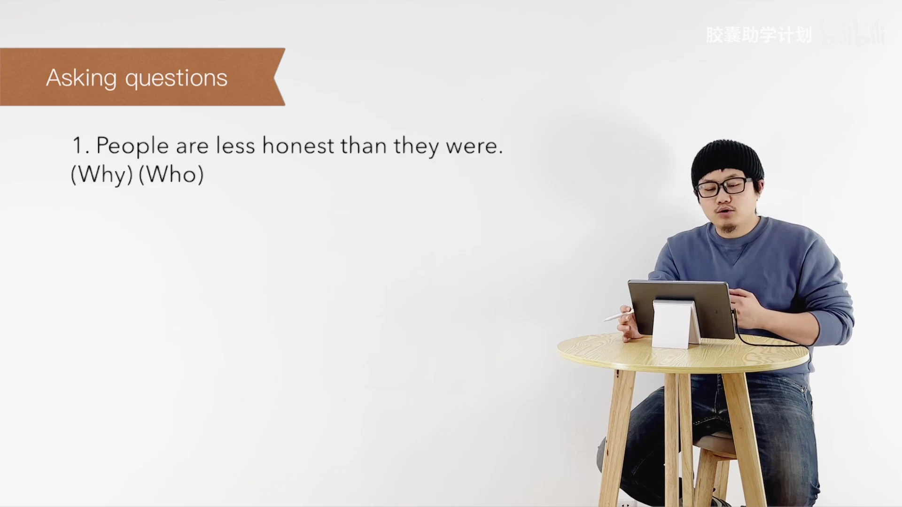

文字识别：Asking questions / 1. People are less honest than they were. / (Why)(Who)

### 画面 00:02:56

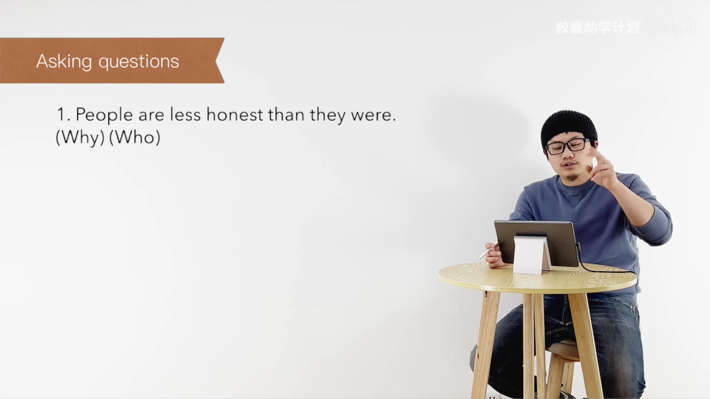

文字识别：Asking questions / 1. People are less honest than they were. / (Why)(Who)

## 00:03:00–00:03:30

The temptation to steal is greater than ever before. Is往前一提，What？好，注意在这个地方，What是对to steal提问。我直接给大家答案，叫What temptation is greater than ever before？各位想一下这句话什么意思？好吧，那Why就是整句话了啊。好，第三题，Was arrested recently？那Was提前，这是was呃呃一般过去时的被动。第十课咱们学的，怎么变一

### 画面 00:03:17

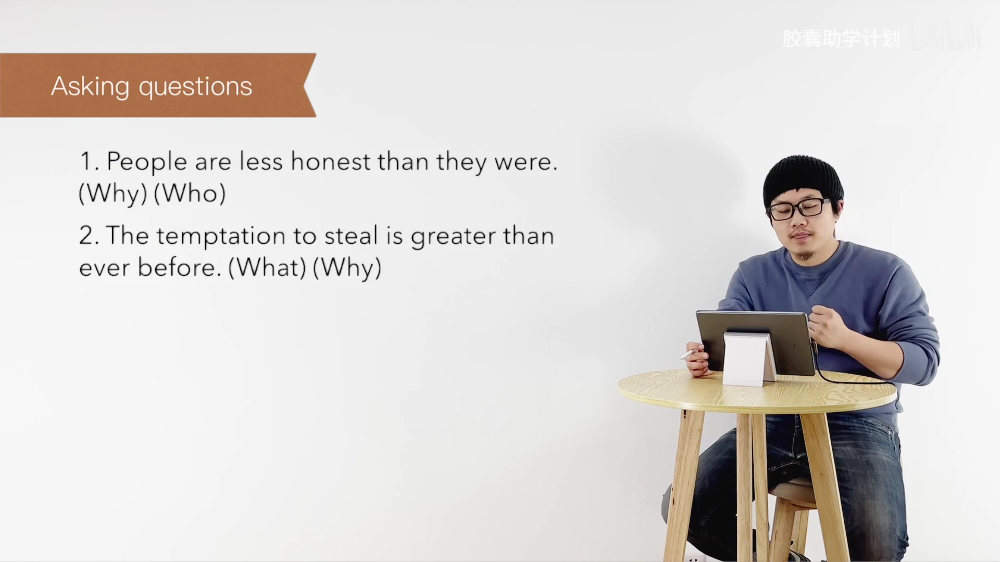

文字识别：Asking questions / 1. People are less honest than they were. / (Why)(Who) / 2. The temptation to steal is greater than / ever before.(What) (Why)

## 00:03:30–00:04:00

般疑问句 was提前对吧？那 who 对主语提问不用变一般疑问句了。A detective watched her in a large store. Watched 好看到那个地方啊，所以把 did 提前，动词换原形。Who 对主语提问不变一般疑问句。Where 对 in a large store 提问。第五题，She always went there on Monday mornings. Did 提前，动词换原形。When肯定是对 on Monday mornings 提问。Where

### 画面 00:03:34

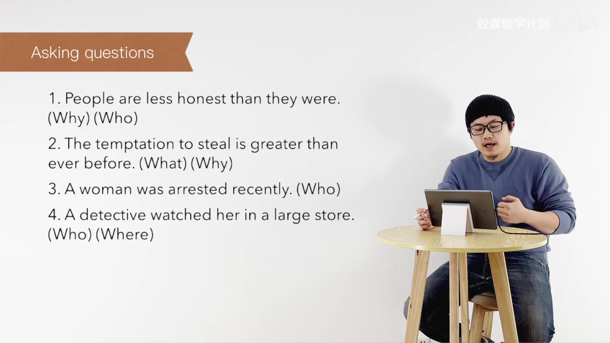

文字识别：Asking questions / 1. People are less honest than they were. / (Why)(Who) / 2. The temptation to steal is greater than / ever before.(What) (Why) / 3. A woman was arrested recently. (Who) / 4.A detective watched her in a large store. / (Who)(Where)

### 画面 00:03:50

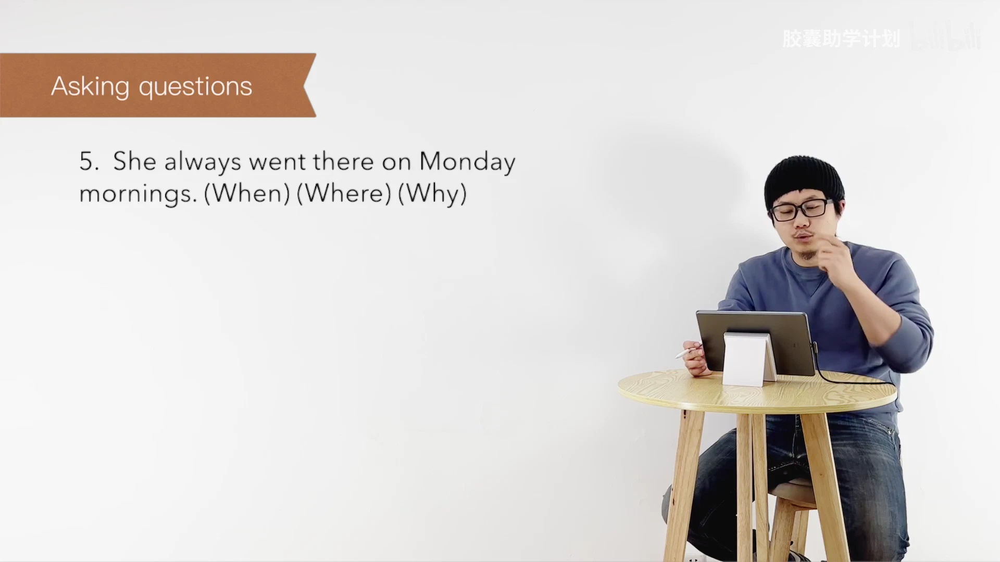

文字识别：Asking questions / 5. She always went there on Monday / mornings. (When) (Where) (Why)

### 画面 00:03:55

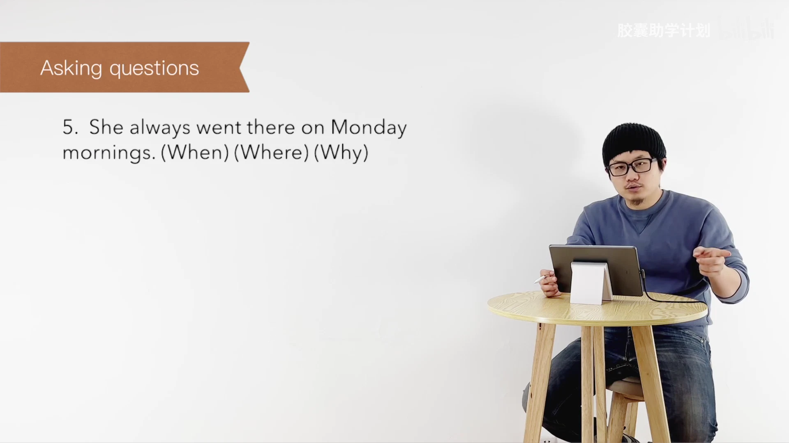

文字识别：Asking questions / 5. She always went there on Monday / mornings. (When) (Where) (Why)

## 00:04:00–00:04:30

there? 提问对吧 Why? 整句话。第六题 There were fewer people in the shop than usual. Were 提前 How many? 对 Fewer 提问对吧？所以答案就叫做 How many people were there in the shop than usual? 对吧？答案 Fewer Where? 那对 In the shop 对吧？OK。第七题说 It was easier to watch her. Was 往前一

### 画面 00:04:00

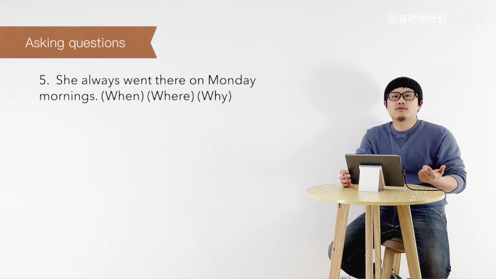

文字识别：Asking questions / 5. She always went there on Monday / mornings. (When) (Where) (Why)

### 画面 00:04:12

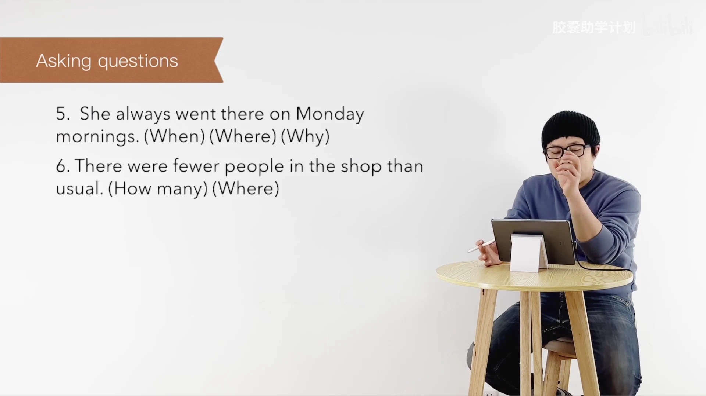

文字识别：Asking questions / 5. She always went there on Monday / mornings. (When) (Where) (Why) / 6. There were fewer people in the shop than / usual.(How many)(Where)

### 画面 00:04:16

文字识别：Asking questions / 5. She always went there on Monday / mornings.(When) (Where)(Why) / 6. There were fewer people in the shop than / usual.(How many)(Where)

### 画面 00:04:23

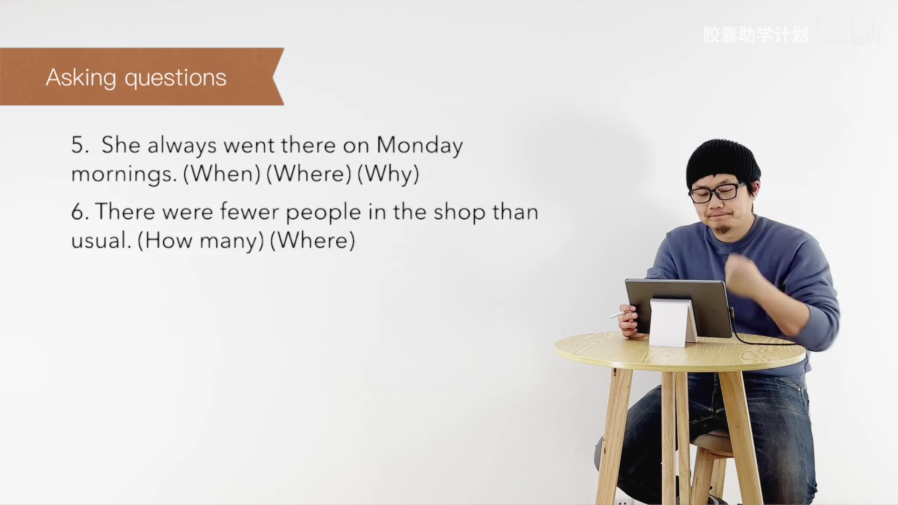

文字识别：Asking questions / 5. She always went there on Monday / mornings.(When)(Where) (Why) / 6. There were fewer people in the shop than / usual.(How many)(Where)

### 画面 00:04:25

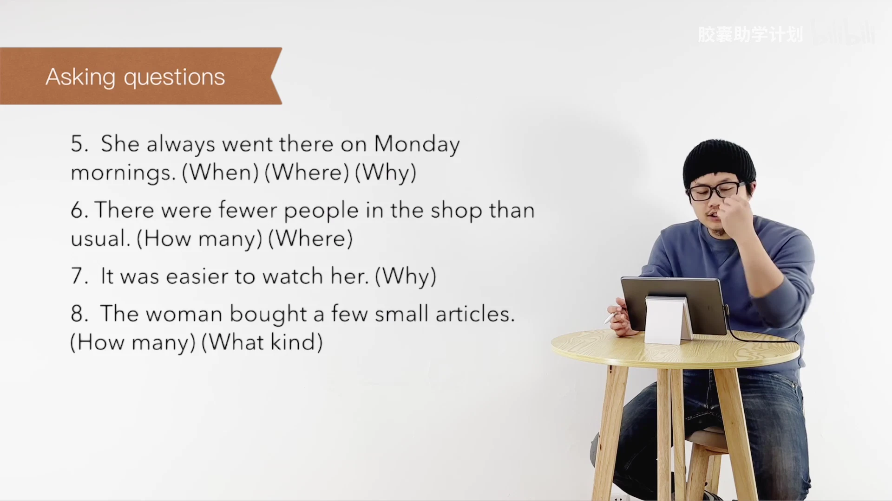

文字识别：Asking questions / 5. She always went there on Monday / mornings.(When)(Where) (Why) / 6. There were fewer people in the shop than / usual.(How many) (Where) / 7. It was easier to watch her. (Why) / 8. The woman bought a few small articles. / (How many) (What kind)

## 00:04:30–00:05:00

why整句话就行了。第八题，The woman bought a few small articles. Did往前提动词换回原形。How many对a few提问，那你要带着后边的名词，所以答案叫How many small articles did the woman buy?啊，她买了多少小物件？那What kind其实在这个地方对small提问，那我们把few也去掉，所以答案是我说一下啊，叫做What kind of

### 画面 00:04:55

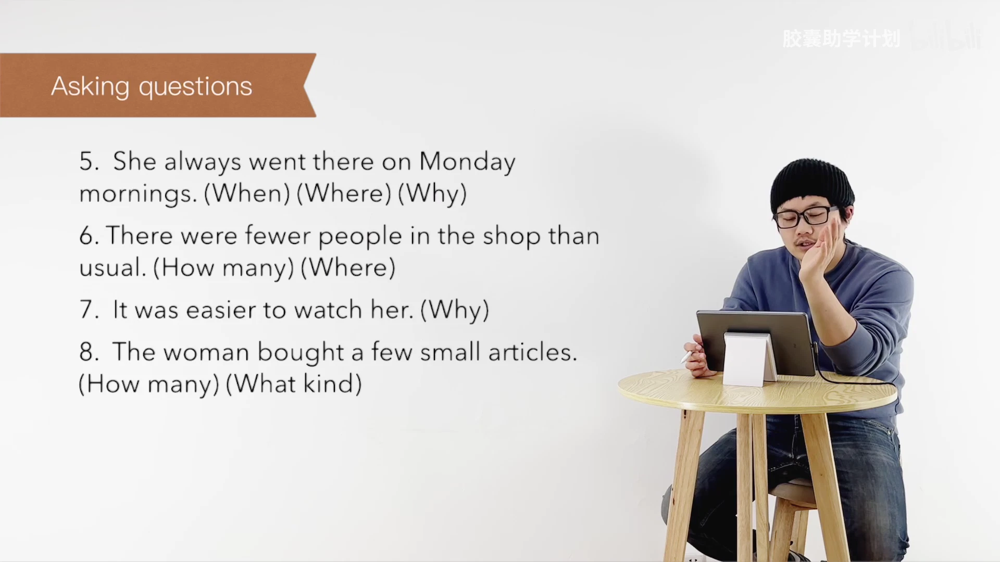

文字识别：Asking questions / 5. She always went there on Monday / mornings.(When)(Where) (Why) / 6. There were fewer people in the shop than / usual.(How many) (Where) / 7. It was easier to watch her. (Why) / 8. The woman bought a few small articles. / (How many) (What kind)

## 00:05:00–00:05:30

articles did the woman buy? Ah, she bought is what kind of small items? Ah, what kind of items? The answer is a few small articles. Okay. Uh, tell the story. Practice our oral repetition ability. Again, can be wrong a little bit, but can't be too slow. Ah, so in this place, the key words are given to you. Ah, you can compare these key words to try to repeat this article. Ah, for example, people are not so honest as they

### 画面 00:05:09

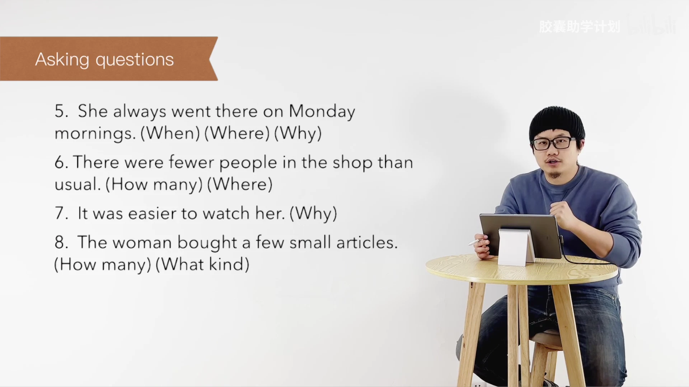

文字识别：Asking questions / 5. She always went there on Monday / mornings.(When)(Where) (Why) / 6. There were fewer people in the shop than / usual.(How many) (Where) / 7. It was easier to watch her. (Why) / 8. The woman bought a few small articles. / (How many) (What kind)

### 画面 00:05:11

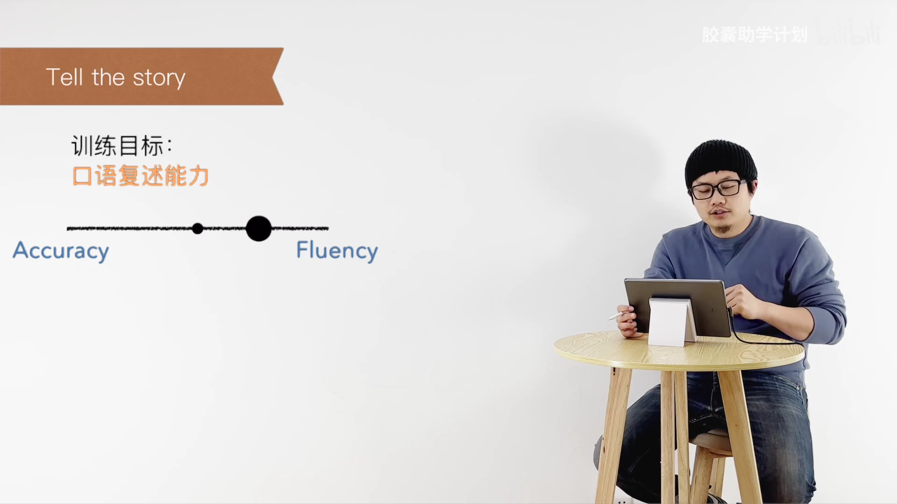

文字识别：Tell the story / 训练目标： / 口语复述能力 / Accuracy / Fluency

### 画面 00:05:16

文字识别：Tell the story / 训练目标： / 口语复述能力 / Accuracy / Fluency

### 画面 00:05:19

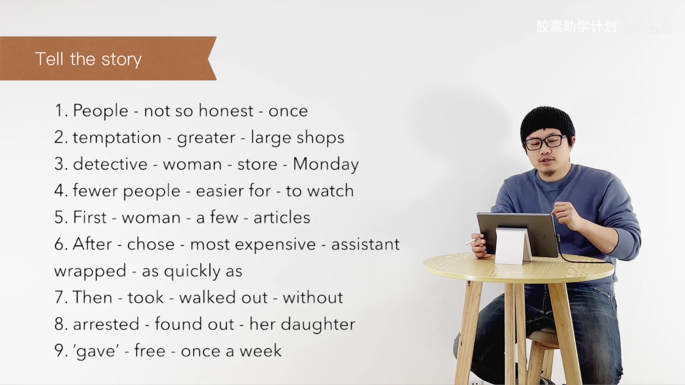

文字识别：Tell the story / 1. People - not so honest - once / 2.temptation - greater - large shops / 3.detective - woman - store - Monday / 4. fewer people - easier for - to watch / 5. First - woman - a few - articles / 6.After - chose - most expensive - assistant / wrapped - as quickly as / 7.Then - took - walked out - without / 8. arrested - found out - her daughter / 9.'gave' - free - once a week

## 00:05:30–00:06:00

once were, and the temptation to steal is greater than ever before, especially in large shops.等等等等啊，所以文章一定要读到非常的熟。Summary writing,摘要写作，各位先写，写完了之后来这里对答案就好了，好吧？Okay.那topic for discussion,老习惯，我们只给大家说一下这些题是什么。比如说第一个，Why do you think the temptation to steal is greater in a large store than a

### 画面 00:05:40

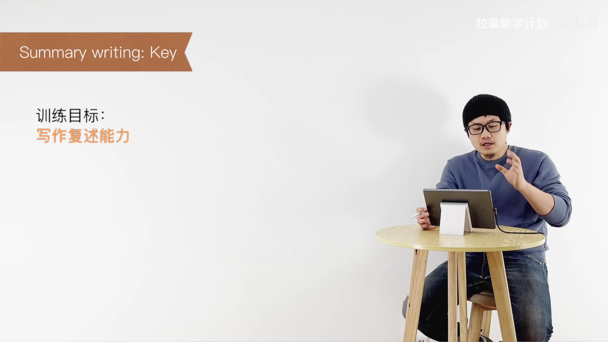

文字识别：Summary writing: Key / 训练目标： / 写作复述能力

### 画面 00:05:44

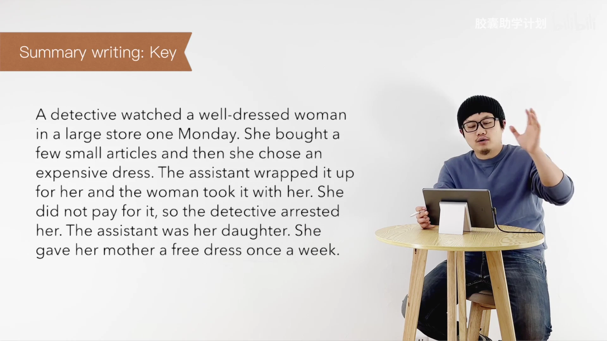

文字识别：Summary writing: Key / A detective watched a well-dressed woman / in a large store one Monday. She bought a / few small articles and then she chose an / expensive dress. The assistant wrapped it up / for her and the woman took it with her. She / did not pay for it, so the detective arrested / her. The assistant was her daughter. She / gave her mother a free dress once a week.

### 画面 00:05:47

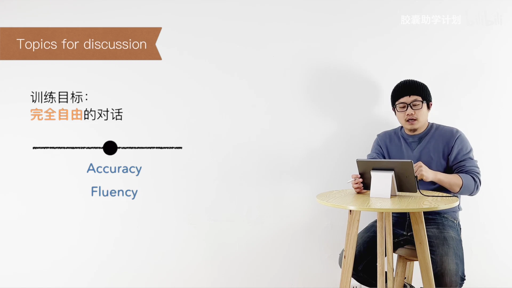

文字识别：Topics for discussion / 训练目标： / 完全自由的对话 / Accuracy / Fluency

### 画面 00:05:50

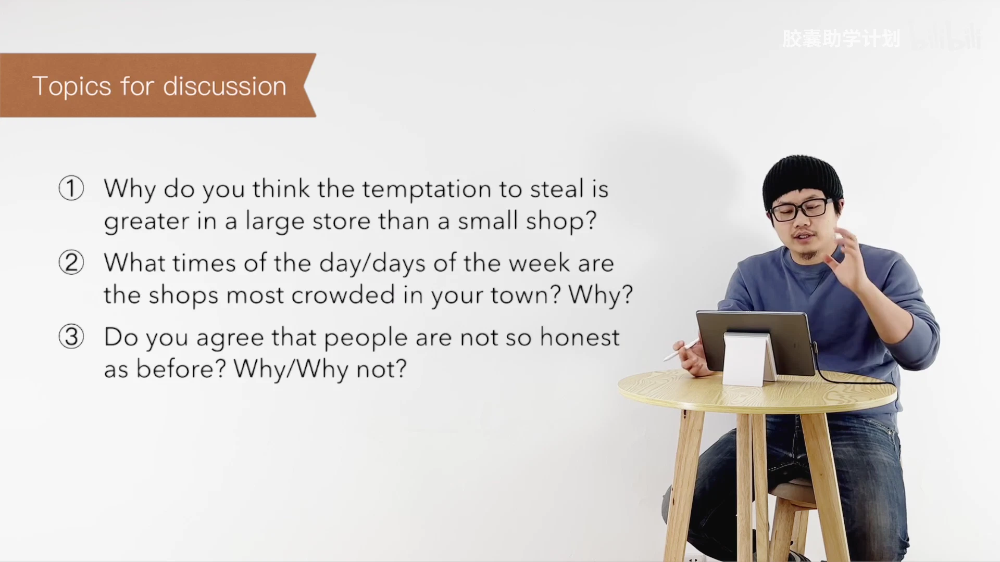

文字识别：Topics for discussion / Why do you think the temptation to steal is / greater in a large store than a small shop? / What times of the day/days of the week are / the shops most crowded in your town? Why? / Do you agree that people are not so honest / as before? Why/Why not?

### 画面 00:05:54

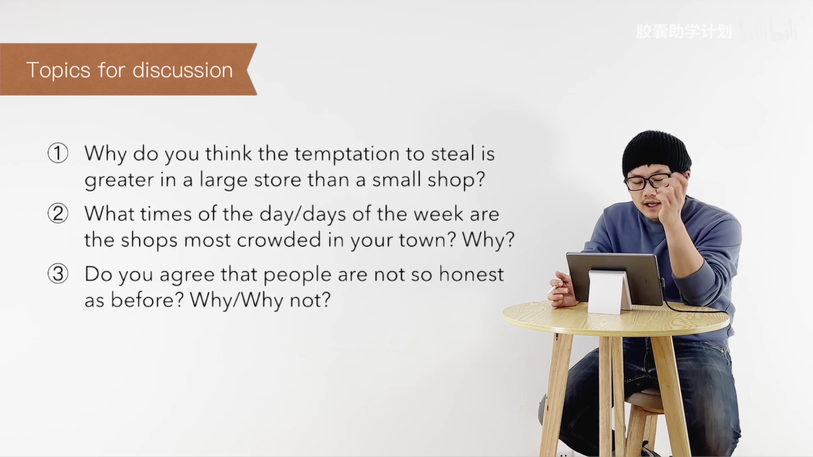

文字识别：Topics for discussion / Why do you think the temptation to steal is / greater in a large store than a small shop? / What times of the day/days of the week are / the shops most crowded in your town? Why? / Do you agree that people are not so honest / as before? Why/Why not?

### 画面 00:05:58

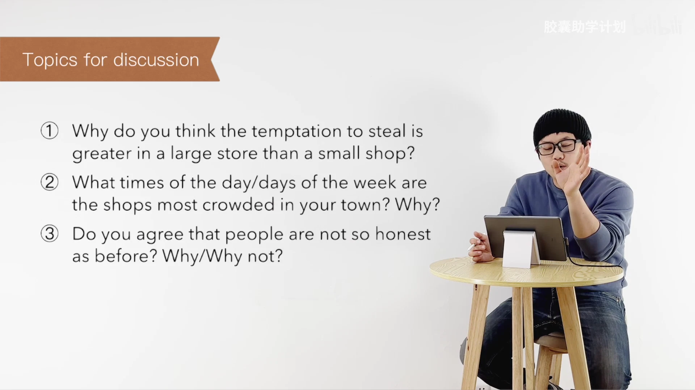

文字识别：Topics for discussion / Why do you think the temptation to steal is / greater in a large store than a smallshop? / What times of the day/days of the week are / the shops most crowded in your town? Why? / Do you agree that people are not so honest / 3 / as before? Why/Why not?

## 00:06:00–00:06:30

small shop.说你为什么会认为说偷窃的这个诱惑呀，在大店里面比小店里面要多，对吧？哎，您给一些原因。第二题说，What times of the day or days of the week啊，are the shops啊most crowded in your town? Why?简单来说，就是在你们小镇上啊，或者在你们村儿、在你们镇、在你们市啊，说一天当中或者一周

### 画面 00:06:01

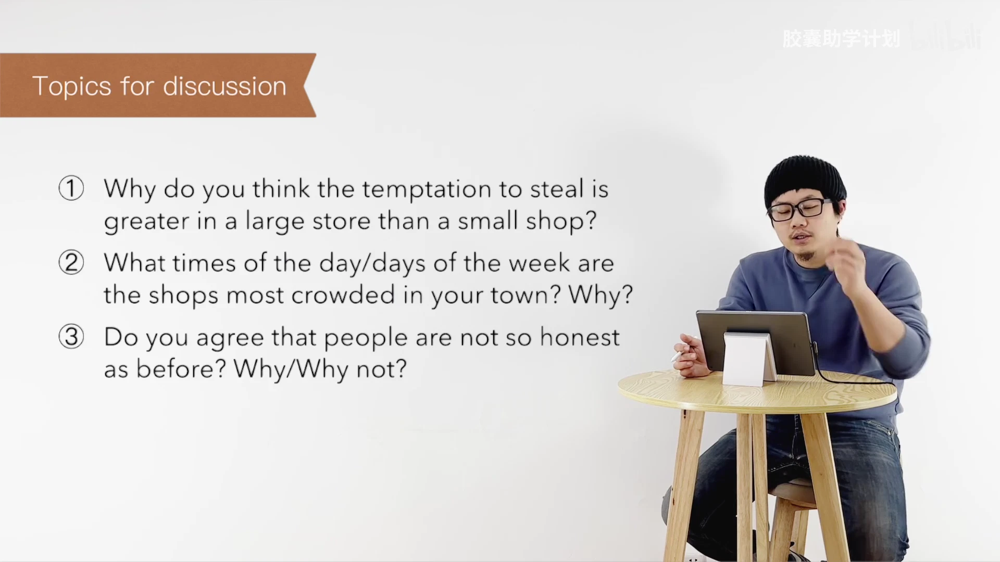

文字识别：Topics for discussion / Why do you think the temptation to steal is / greater in a large store than a small shop? / What times of the day/days of the week are / the shops most crowded in your town? Why? / Do you agree that people are not so honest / 3 / as before? Why/Why not?

### 画面 00:06:05

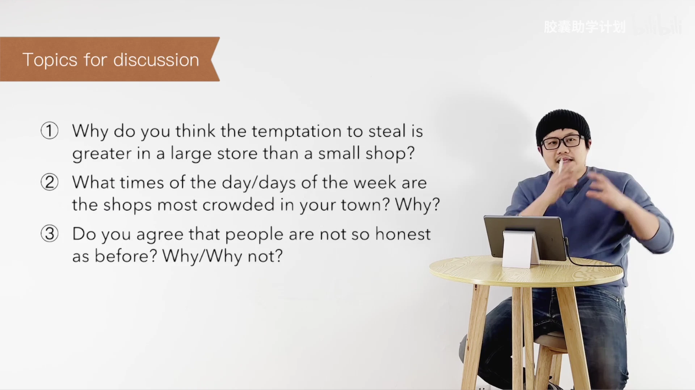

文字识别：Topics for discussion / Why do you think the temptation to steal is / greater in a large store than a small shop? / What times of the day/days of the week are / the shops most crowded in your town? Why? / Do you agree that people are not so honest / as before? Why/Why not?

## 00:06:30–00:07:00

当中的哪些时间段是最拥挤的？在这个店里面，对吧？以及为什么？比如说啊，晚上七八点钟一般人会多，为什么大家都下班了，对吧？下一题说，Do you agree that people are not so honest as before? Why or why not?说你认为是吧？人心不古了吗？对吧？是吧？现在的人没有过去那么诚实了吗？哎，为什么？对吧？Okay, very good.呃，加上作业，Ask me if先写大声朗

### 画面 00:06:35

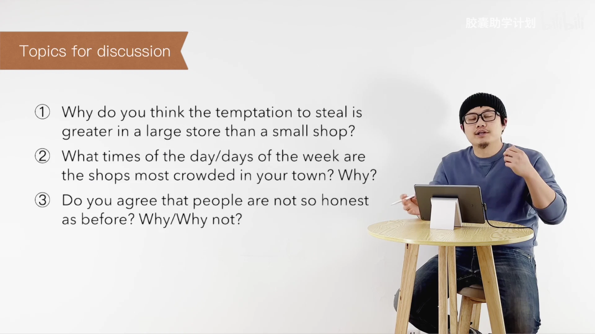

文字识别：Topics for discussion / Why do you think the temptation to steal is / greater in a large store than a smallshop? / What times of the day/days of the week are / the shops most crowded in your town? Why? / Do you agree that people are not so honest / 3 / as before? Why/Why not?

### 画面 00:06:44

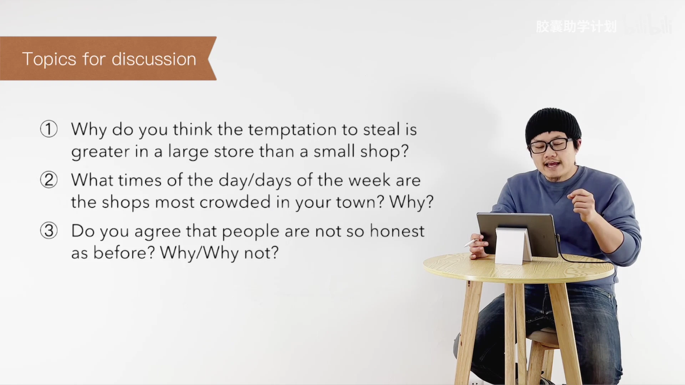

文字识别：Topics for discussion / Why do you think the temptation to steal is / greater in a large store than a smallshop? / What times of the day/days of the week are / the shops most crowded in your town? Why? / Do you agree that people are not so honest / as before? Why/Why not?

### 画面 00:06:57

文字识别：1.Ask me if写&朗读

### 画面 00:06:59

文字识别：1.Ask me if写&朗读 / 2. / 摘要写作写&答案

## 00:07:00–00:07:30

读。摘要写作先写，然后来这儿对答案。Tell the story. 要进行口语复述，还是文章一遍一遍读，读到足够通顺的时候，看着这些关键词，您一定能给它复述下来，好吧？呃，专栏当中可以找得到。那以上呢就是本期视频的全部内容了。如果各位喜欢我们的课程，欢迎各位关注、订阅、一键三连，分享给那些需要的朋友，来帮助我们快速成长。See you next time.

### 画面 00:07:01

文字识别：1.Ask me if写&朗读 / 2. / 摘要写作写&答案

### 画面 00:07:03

文字识别：1.Ask me if写&朗读 / 摘要写作写&答案 / 3.Tell the story 口语复述

### 画面 00:07:05

文字识别：1.Ask me if写&朗读 / 摘要写作写&答案 / 3.Tell the story 口语复述

### 画面 00:07:07

文字识别：1.Ask me if写&朗读 / 摘要写作写&答案 / 3.Tell the story 口语复述 / 全

### 画面 00:07:09

文字识别：1.Ask me if写&朗读 / 摘要写作写&答案 / 3.Tell the story 口语复述

### 画面 00:07:11

文字识别：1.Ask me if写&朗读 / 摘要写作写&答案 / 3.Tell the story 口语复述

### 画面 00:07:13

文字识别：1.Ask me if写&朗读 / 摘要写作写&答案 / 3.Tell the story 口语复述 / 4. / 专栏

### 画面 00:07:15

### 画面 00:07:28

## 00:07:30–00:07:40

### 画面 00:07:30

文字识别：CAPSULEACADEMY / 胶囊助学计划 / 小红书 / Lecturer / 口 / Leo / OE

### 画面 00:07:32

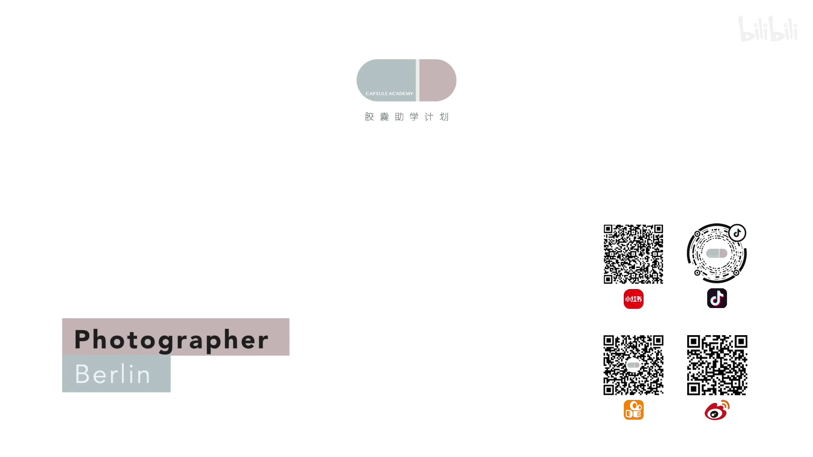

文字识别：CAPSULEACADEMY / 胶囊助学计划 / 小红书 / Photographer / □ / Berlin / OE

### 画面 00:07:35

文字识别：CAPSULEACADEMY / 胶囊助学计划 / 小红书 / Creator

### 画面 00:07:38

文字识别：bilibili / 胶囊助学计划

### 画面 00:07:40

文字识别：bilibili / 胶囊助学计划

