# L033 文章

快速机器解析：语音为单模型转写，未进行独立交叉校对或人工复核；画面每秒采样并按变化选帧，短时文字和标记可能遗漏。截图时间约有 1 秒误差。图片有损压缩；遇到疑点请按时间查看 Google Drive 原视频。

## 00:00:00–00:00:30

Hello everyone, welcome to Capsule Academy. This is Leo. Today we're going to learn New Concept English Book Two Lesson Thirty Three Story. Hope you guys enjoy it.好，那我们直接看文章啊。呃，注意一下，本课算是我们新概念二册九十六课当中略讲的一课，是吧？它理论上可以理解为没有太多新的语法，只有一些小的介词，我们打散到每一课

### 画面 00:00:00

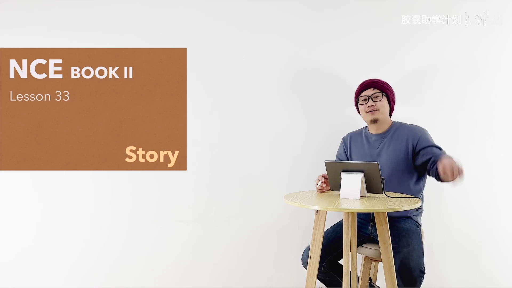

文字识别：胶囊助学计划 / NCE / BOOKⅡI / Lesson 33 / Story

### 画面 00:00:05

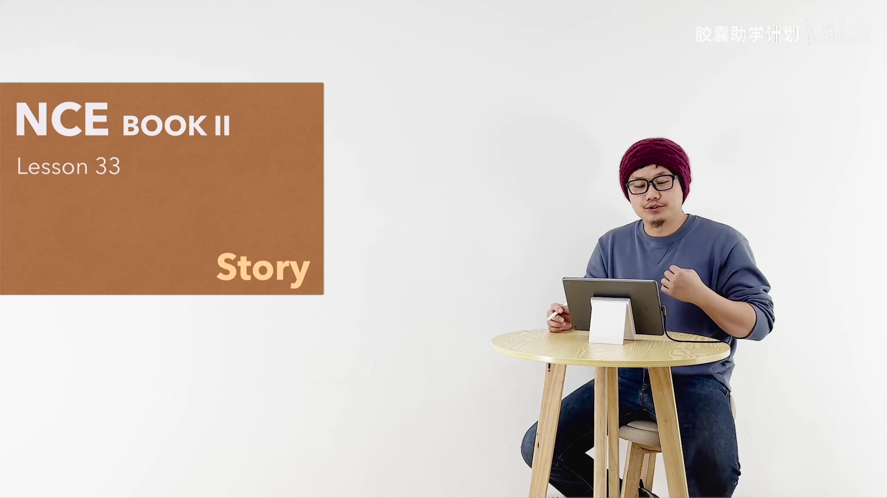

文字识别：胶囊助学计划 / NCE / BOOKII / Lesson 33 / Story

### 画面 00:00:09

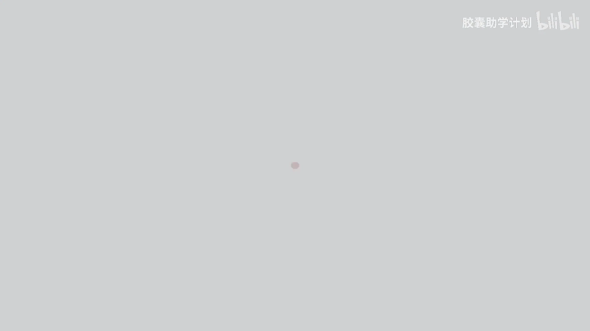

文字识别： Bitbii / 胶囊助学计划 / •

### 画面 00:00:13

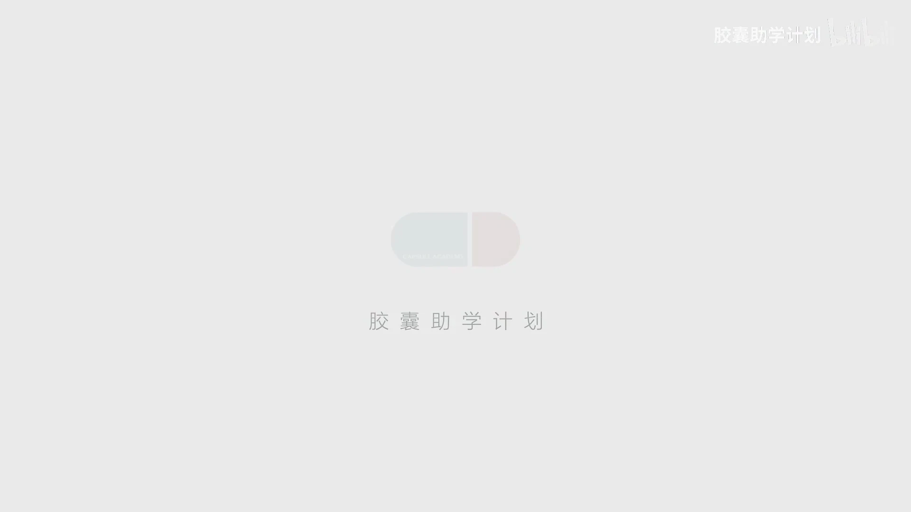

文字识别：胶囊助学计划 / 胶囊助学计划

### 画面 00:00:15

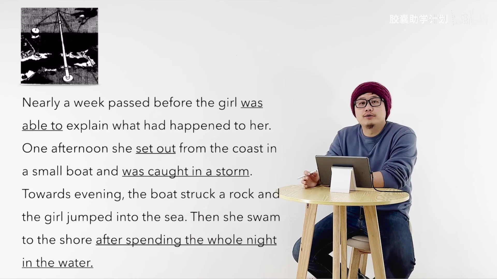

文字识别：胶囊助学计划 / Nearly a week passed before the girl was / able to explain what had happened to her. / One afternoon she set out from the coast in / a small boat and was caught in a storm. / Towards evening, the boat struck a rock and / the girl jumped into the sea. Then she swam / to the shore after spending the whole night / in the water.

## 00:00:30–00:01:00

当中去学习了。所以文章呢，我们简单的一起过一下就好了。OK，好来了啊，说Nearly a week passed. Nearly将近a week，你看就一个单词一个单词翻译，这句话一点问题没有。一周passed过去了，说将近一周过去了。Before在什么之前呢？在The girl was able to。这虽然是一个新的语法，但我们选择在四十三课我印象当中，

### 画面 00:00:45

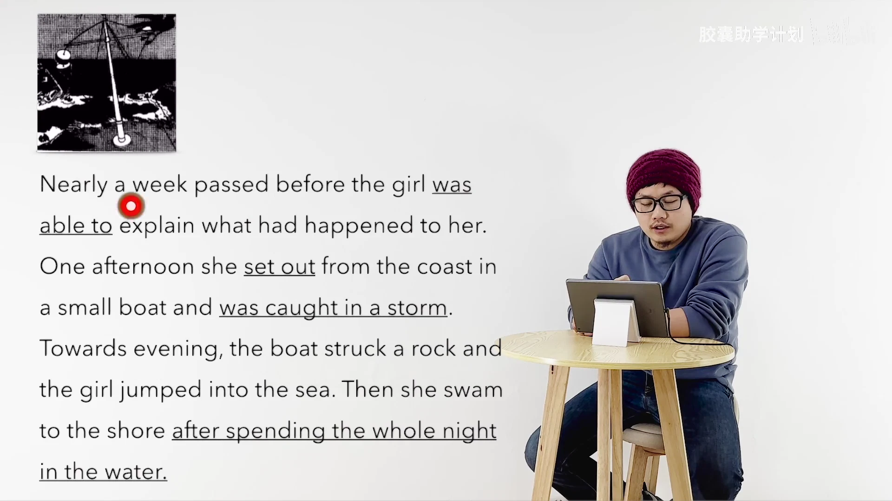

文字识别：胶囊助学计划 / Nearly a week passed before the girl was / able to explain what had happened to her. / One afternoon she set out from the coast in / a small boat and was caught in a storm. / Towards evening, the boat struck a rock and / the girl jumped into the sea. Then she swam / to the shore after spending the whole night / in the water.

## 00:01:00–00:01:30

咱们才去学啊。今天不用管它啊，只告诉各位它的意思叫能就可以了啊。说在这个姑娘能 explain 去解释 what had happened to her，这就非常简单了，叫发生在她身上的什么事情啊？我们再回顾一下这句话啊，说将近一周已经过去了，在这个姑娘能去解释在她身上发生了什么事情之前，是吧？已经过去一周

### 画面 00:01:15

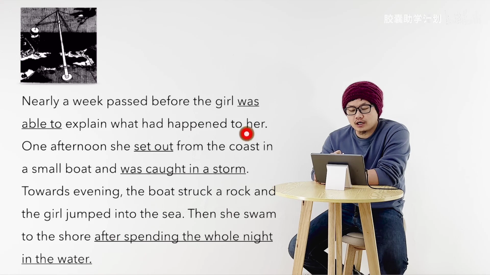

文字识别：胶囊助学计划 / Nearly a week passed before the girl was / able to explain what had happened to her. / One afternoon she set out from the coast in / a small boat and was caught in a storm. / Towards evening, the boat struck a rock and / the girl jumped into the sea. Then she swam / to the shore after spending the whole night / in the water.

## 00:01:30–00:02:00

对吧？过去一周，然后这个姑娘开始才能解释，在她身上发生了什么事情。Mary, one afternoon, 一天下午啊，开始说她身上发生了什么事儿。She set out from the coast. Set out是一个习惯用法，但不是本课咱们见过。之前咱就学过啊。呃，Captain Charles Ellison那一课咱们学的，就船长那一课啊。说他出发 from the coast，从这个岸边、

### 画面 00:01:45

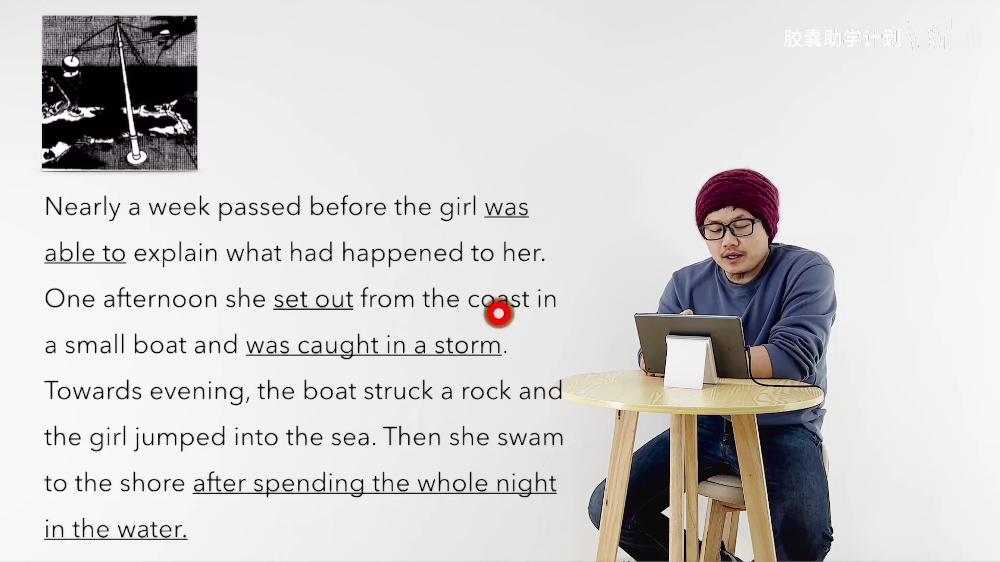

文字识别：胶囊助学计划 / Nearly a week passed before the girl was / able to explain what had happened to her. / One afternoon she set out from the coast in / a small boat and was caught in a storm. / Towards evening, the boat struck a rock and / the girl jumped into the sea. Then she swam / to the shore after spending the whole night / in the water.

## 00:02:00–00:02:30

海岸边, in a small boat,哎，在一个小船里出发了, and was caught in a storm.你看这故事非常紧凑。说一天下午，他在海岸边坐着小船出发了，然后就遭到了遇到了什么呢？暴风雨，对吧？Towards evening,快到晚上的时候，临近晚上的时候，the boat struck a rock,船撞到了岸礁, and

### 画面 00:02:15

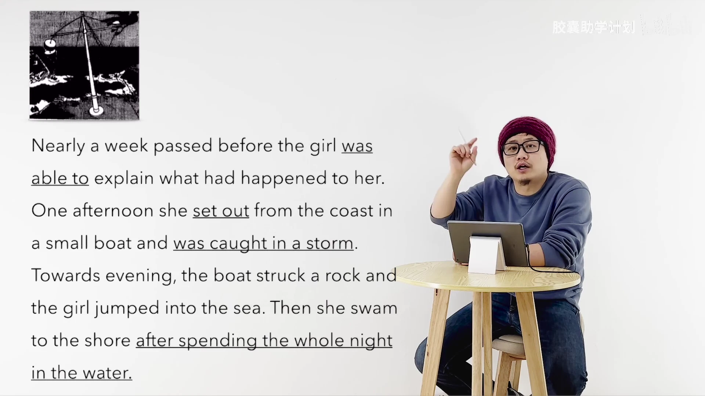

文字识别：胶囊助学计划 / Nearly a week passed before the girl was / able to explain what had happened to her. / One afternoon she set out from the coast in / a small boat and was caught in a storm. / Towards evening, the boat struck a rock and / the girl jumped into the sea. Then she swam / to the shore after spending the whole night / in the water.

## 00:02:30–00:03:00

the girl jumped into the sea.非常简单，姑娘跳进了海里，一般过去式，对吧？Then she swam to the shore.啊，其实这地方的 shore 和这里的 coast 在本文当中就是同义词，对吧？都指的是海岸啊。然后呢，她冲着这个海岸就游过去了。接下来这个语法叫 after spending the whole night in the water。各位从来应该是没见过 after 后边直接加 doing，对吧？首

### 画面 00:02:45

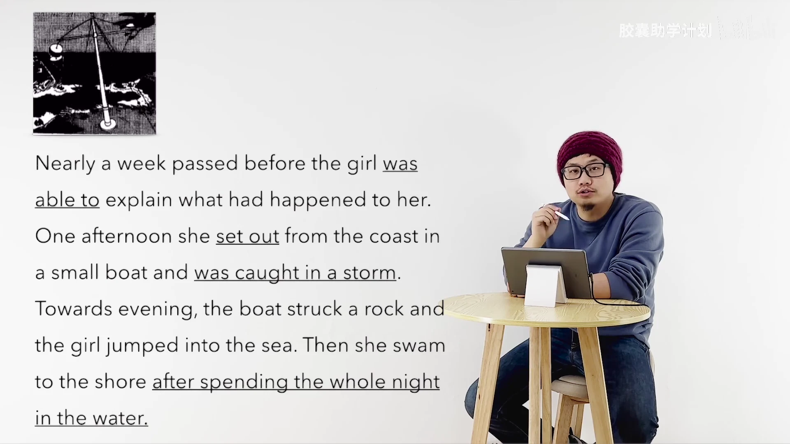

文字识别：胶囊助学计划 / Nearly a week passed before the girl was / able to explain what had happened to her. / One afternoon she set out from the coast in / a small boat and was caught in a storm. / Towards evening, the boat struck a rock and / the girl jumped into the sea. Then she swam / to the shore after spending the whole night / in the water.

## 00:03:00–00:03:30

先，这个语法我们要真正去学，它应该是已经到了二十四加二十四四十九课，咱们才能再去见，才能真正去学这个语法了。但是这个语法对于各位来说，它更像是写作语法，而不像是阅读语法。我怎么去解释这句话啊？就是说，如果你不懂这个语法，你写你很难能写出这样的句子，但你不懂这个语法不影响你读懂这个句

### 画面 00:03:15

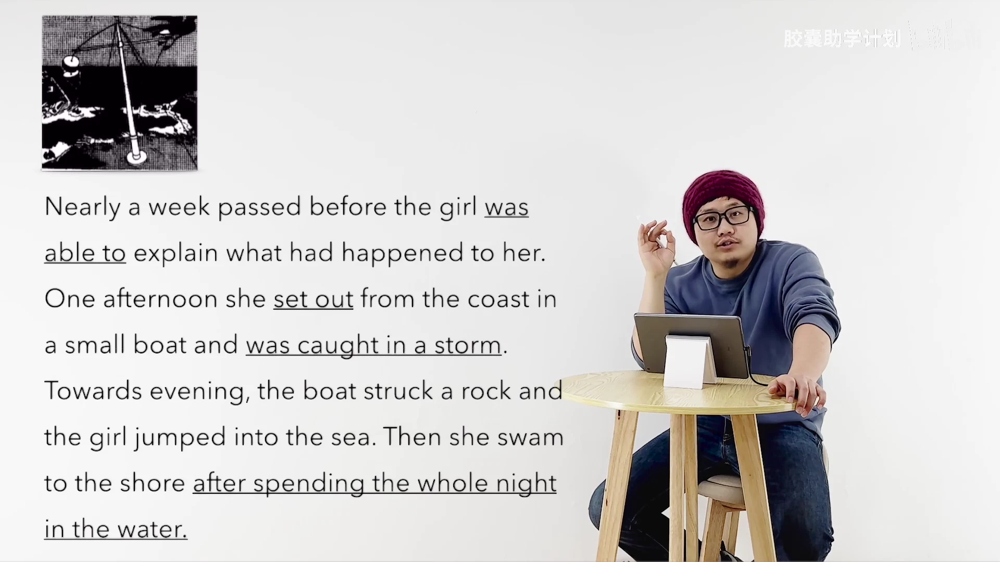

文字识别：胶囊助学计划 / Nearly a week passed before the girl was / able to explain what had happened to her. / One afternoon she set out from the coast in / a small boat and was caught in a storm. / Towards evening, the boat struck a rock and / the girl jumped into the sea. Then she swam / to the shore after spending the whole night / in the water.

## 00:03:30–00:04:00

子。我们看一下为什么我这么说。然后它游向了海岸，在什么之后呢？在 spending the whole night，度过了一整个晚上。In the water，在海水当中。Water 虽然是水，但是你要结合上下文，就是在海水当中，对吧？所以我们再翻译一下，叫做在它度过了在海水当中度过了整晚之后，它开始啊，然后它开始冲着这个河岸、海岸

### 画面 00:03:45

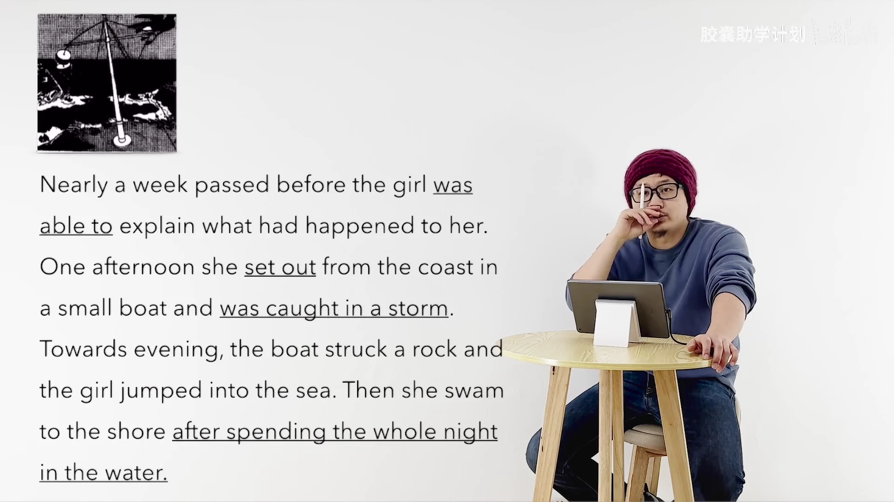

文字识别：胶囊助学计划 / Nearly a week passed before the girl was / able to explain what had happened to her. / One afternoon she set out from the coast in / a small boat and was caught in a storm. / Towards evening, the boat struck a rock and / the girl jumped into the sea. Then she swam / to the shore after spending the whole night / in the water.

## 00:04:00–00:04:30

游过去是吧？他在水当中啊，海水当中度过了一整晚，然后他冲着岸边游了过去。您看是不是一个单词一个单词翻译，完全不影响您对这句话的理解？即使各位不懂 after doing 这个语法，对吧？四十九课咱们见真小啊，不着急，接着往下走。During that time，说在那个期间，在他游的这个期间，对吧？She covered a distance of eight miles。

### 画面 00:04:15

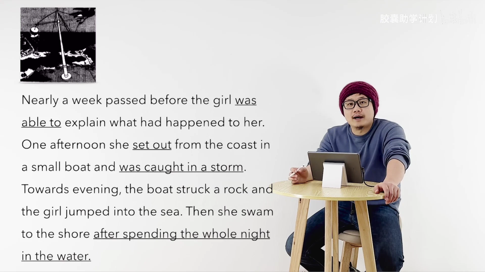

文字识别：胶囊助学计划 / Nearly a week passed before the girl was / able to explain what had happened to her. / One afternoon she set out from the coast in / a small boat and was caught in a storm. / Towards evening, the boat struck a rock and / the girl jumped into the sea. Then she swam / to the shore after spending the whole night / in the water.

### 画面 00:04:19

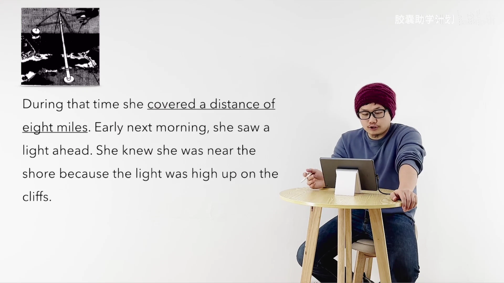

文字识别：胶囊助学计划 / During that time she covered a distance of / eight miles. Early next morning, she saw a / light ahead. She knew she was near the / shore because the light was high up on the / cliffs

## 00:04:30–00:05:00

This fifth lesson, we learned, right? About pigeon. That lesson, although it's also a habitual usage, but the fifth lesson we learned, called cover a distance, right? You see, that cover is called crossing a distance of eight miles, called eight miles of distance, right? It covered eight miles. Early next morning, the next morning, early next morning,

### 画面 00:04:49

文字识别：胶囊助学计划 / During that time she covered a distance of / eight miles. Early next morning, she saw a / light ahead. She knew she was near the / shore because the light was high up on the / cliffs

## 00:05:00–00:05:30

She knew，她知道，She was near the shore，她知道她在河岸附近。为什么呢？Because，因为，The light was high up on the cliff。一个单词一个单词翻译，还是没有任何问题。这里只是有一些小的介词，让各位自己去用，可能比较费劲啊。说这个灯光啊是怎么样的呢？High up，很高 up，在上方，很高

### 画面 00:05:19

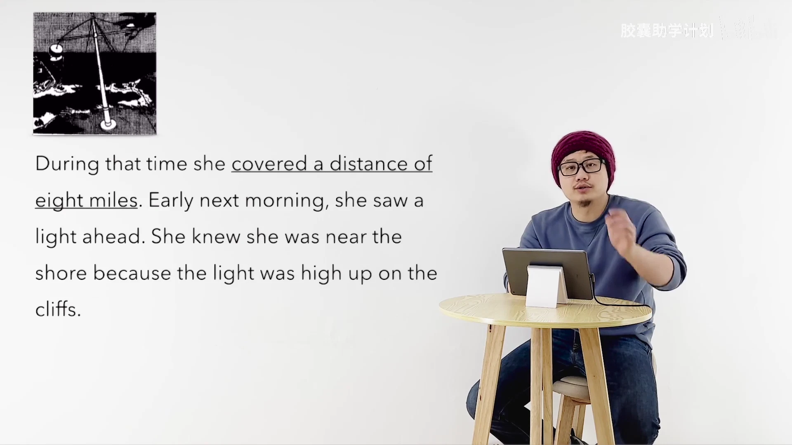

文字识别：胶囊助学计划 / During that time she covered a distance of / eight miles. Early next morning, she saw a / light ahead. She knew she was near the / shore because the light was high up on the / cliffs.

## 00:05:30–00:06:00

的上方，on the cliffs，在悬崖很高的上方，他看到的这个灯光，对吧？Okay. On arriving at the shore,这不算是一个语法，这算是一个小的习惯用法。当然也可以理解为是语法啊，但不用专门花时间去讲。很简单，on doing something，注意，如果是放在句首，那它基本上大多数情况下都

### 画面 00:05:39

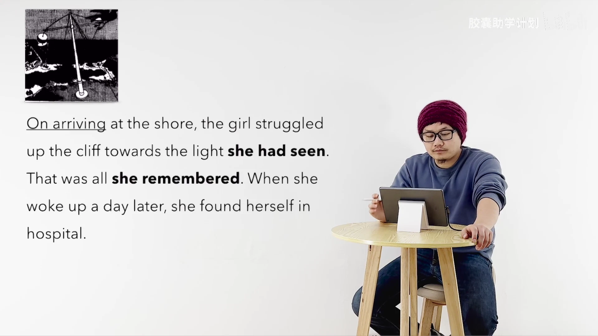

文字识别：胶囊助学计划 / On arriving at the shore, the girl struggled / up the cliff towards the light she had seen. / That was all she remembered. When she / woke up a day later, she found herself in / hospital.

## 00:06:00–00:06:30

于这个语法，咱们之前是不是学过叫 as soon as，叫一怎么怎么样就怎么怎么样，叫做一a就b，对吧？那我们看a是什么，叫做 arriving at the shore，叫一到达这个和啊海岸，对吧？The girls struggle up the cliff towards the light，说这个姑娘啊 struggle挣扎着 up the cliff 上去这个什么

### 画面 00:06:00

文字识别：胶囊助学计划 / As / Svon / On arriving at the shore, the girl struggled / up the cliff towards the light she had seen. / That was all she remembered. When she / woke up a day later, she found herself in / hospital.

### 画面 00:06:08

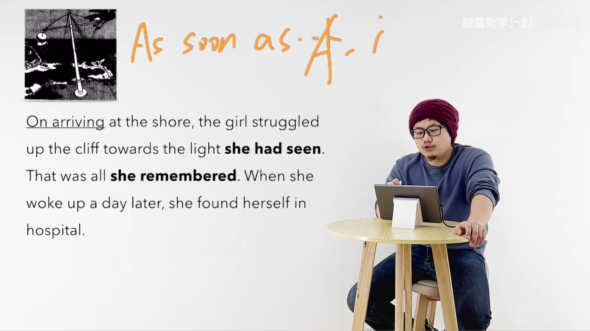

文字识别：胶囊助学计划 / As / soon as. / On arriving at the shore, the girl struggled / up the cliff towards the light she had seen. / That was all she remembered. When she / woke up a day later, she found herself in / hospital.

### 画面 00:06:10

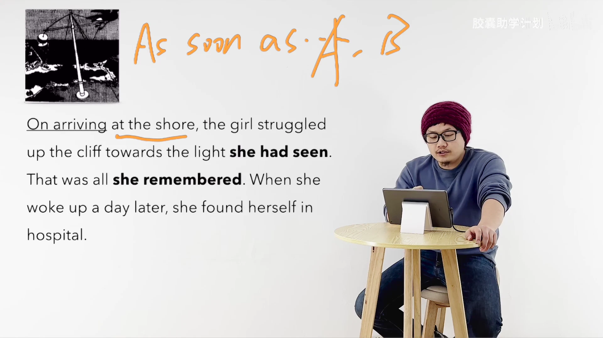

文字识别：胶囊助学计划 / As / soon as. / On arriving at the shore, the girl struggled / up the cliff towards the light she had seen. / That was all she remembered. When she / woke up a day later, she found herself in / hospital.

### 画面 00:06:12

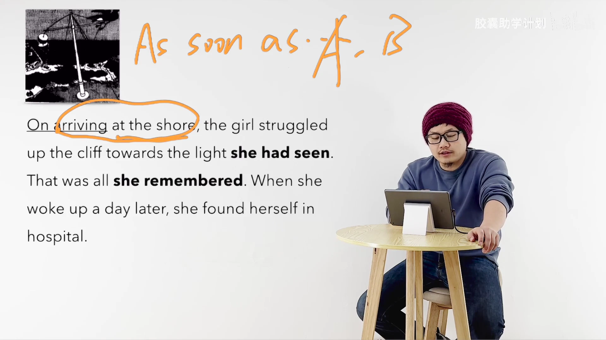

文字识别：胶囊助学计划 / As / soon as. / On rriving at the shore, the girl struggled / up the cliff towards the light she had seen. / That was all she remembered. When she / woke up a day later, she found herself in / hospital.

### 画面 00:06:19

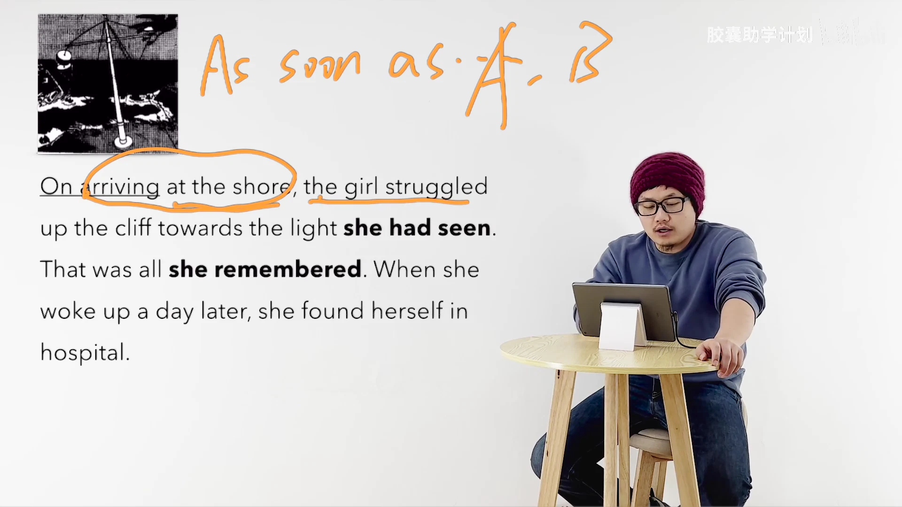

文字识别：胶囊助学计划 / As / soon as. / Onrriving at the shore, the girl struggled / up the cliff towards the light she had seen. / That was all she remembered. When she / woke up a day later, she found herself in / hospital.

### 画面 00:06:21

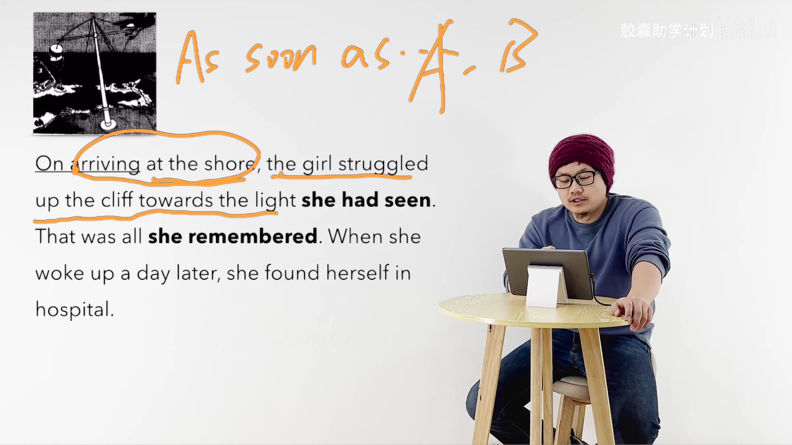

文字识别：胶囊助学计划 / As / soon as. / Onrriving at the shore, the girl struggled / up the cliff towards the light she had seen. / That was all she remembered. When she / woke up a day later, she found herself in / hospital.

## 00:06:30–00:07:00

礁石啊？上不上去这个悬崖对吧？然后 towards the light，冲着这个光上去悬崖，冲着光就挣扎过去了。然后后面连了一个小的定语从句，咱先暂时不管这三个单词啊。我们再回来看一下这句话，on arriving at the shore。好，刚才我提到了 on doing，如果放在句首，它基本上各位我把它习惯用法化了，虽然是个语法啊，它

### 画面 00:06:44

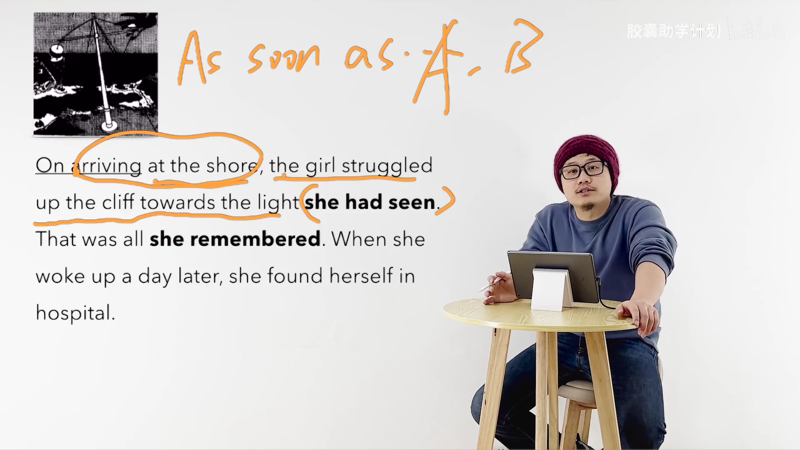

文字识别：胶囊助学计划 / As / soon as. / Onrriving at the shore, the girl struggled / up the cliff towards the lightshe had seen. / That was all she remembered. When she / woke up a day later, she found herself in / hospital.

## 00:07:00–00:07:30

基本等同于 as soon as a逗号 b叫一怎么怎么样就怎么怎么样，所以这句话翻译成叫做这个姑娘一到达一到达这个河海岸，她就挣扎着爬到了这个悬崖的上方，可能没那么高，对吧？你不要想它是一个特别高的啊，然后冲着这个灯过去了，后边有一个小的定语从句叫 she had seen，省略了一个

### 画面 00:07:14

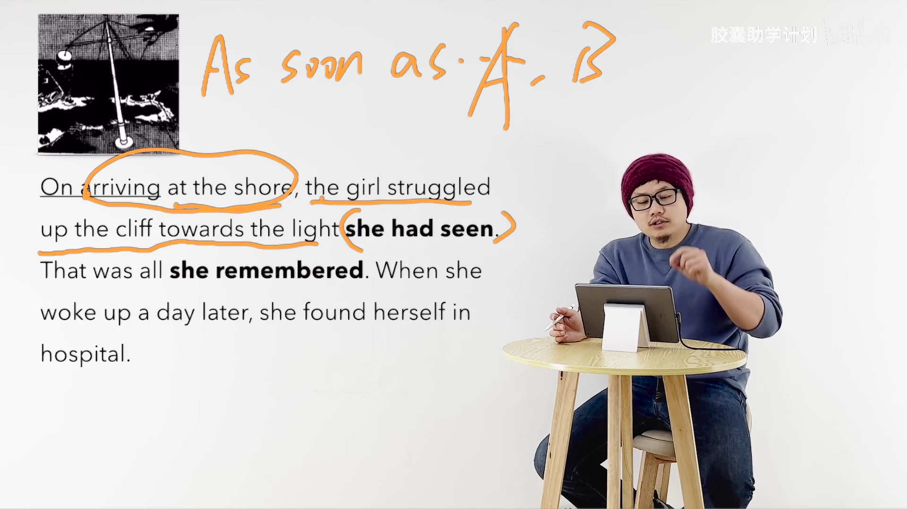

文字识别：胶囊助学计划 / As / soon as. / Onriving at the shore, the girl struggled / up the cliff towards the lightshe had seen. / That was all she remembered. When she / woke up a day later, she found herself in / hospital.

## 00:07:30–00:08:00

that嘛，对吧？或者which啊，which she had seen叫做她之前看到的那个灯。Okay, that was all she remembered.说那就是全部she remembered也是还是个定语从句嘛，叫that she remembered叫做那就是全部she remembered叫她记得的，也就是这句话我们翻译成叫那就是她记得的全部，对吧？She remembered定语从句。

### 画面 00:07:44

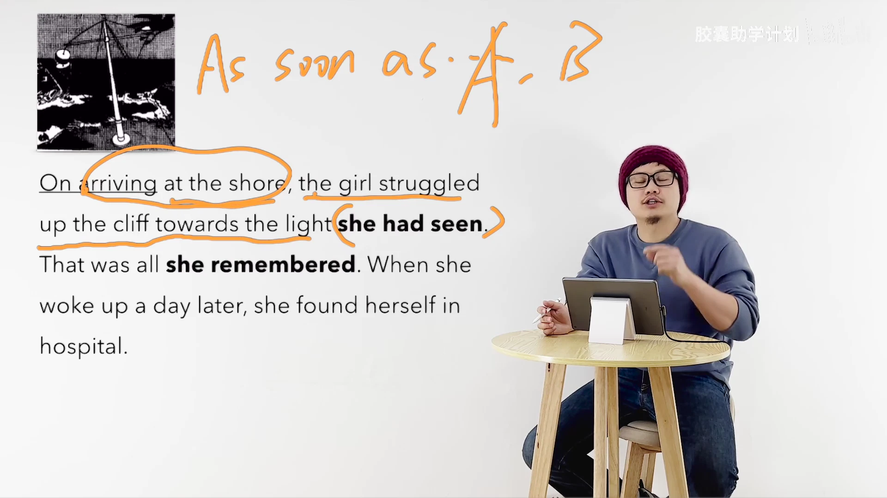

文字识别：胶囊助学计划 / As / soon as. / Onrriving at the shore, the girl struggled / up the cliff towards the lightshe had seen. / That was all she remembered. When she / woke up a day later, she found herself in / hospital.

## 00:08:00–00:08:30

When she woke up a day later, 说当她 woke up 醒了 a day later 一天之后, she found herself in hospital. 她发现她自己在医院当中了，已经，对吧？然后又过了可能六七天，她才能恢复过来，解释清楚说她之前发生了什么样的事情，对不对？OK，好，那文章我们讲完了。习惯用法虽然有几个零零散

### 画面 00:08:14

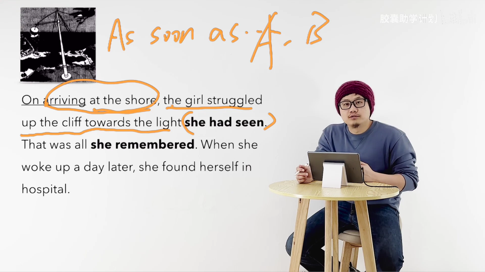

文字识别：胶囊助学计划 / As / soon as. / Onrriving at the shore, the girl struggled / up the cliff towards the lightshe had seen. / That was all she remembered. When she / woke up a day later, she found herself in / hospital.

### 画面 00:08:25

文字识别：胶囊助学计划 / 习惯用法造句 / On doing sth, 

### 画面 00:08:28

文字识别：胶囊助学计划 / 习惯用法造句 / On doing sth, .

## 00:08:30–00:09:00

散的，但大多数都是我们之前学过的，所以这课我们不再去讲解了啊。您如果忘了，就往前翻一翻。然后，und doing something算是这课的一个特殊的用法，我们把它造一些句子，比如说，on entering the room we saw her。非常简单的一句话啊，一般啊，我个人的语感是，大多数口语当中是不用的，写作当中出现的频率也

### 画面 00:08:30

文字识别：胶囊助学计划 / 习惯用法造句 / On doing sth, ….

### 画面 00:08:40

文字识别：胶囊助学计划 / 习惯用法造句 / On doing sth, ….

### 画面 00:08:42

文字识别：网：v.+v.变化 / 胶囊助学计划 / 习惯用法造句指南 / 四句型转换 / 方式/地点/时间 / 其他习惯用法 / 其他单词+词性 / 原文摘抄+变 / 6123456 / On doing sth, .. / On entering the room, we saw her.

### 画面 00:08:44

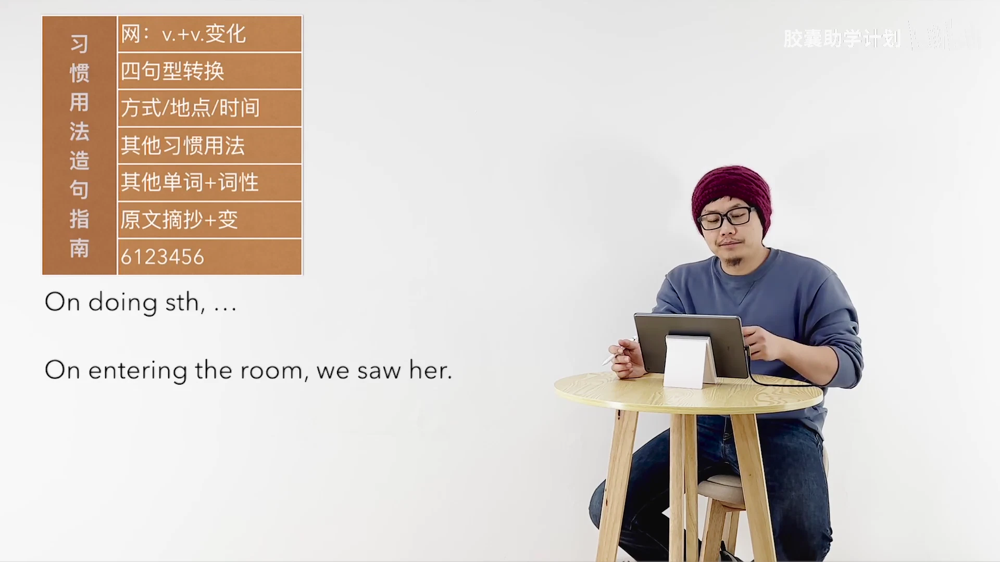

文字识别：网：v.+v.变化 / 胶囊助学计划 / 习惯用法造句指南 / 四句型转换 / 方式/地点/时间 / 其他习惯用法 / 其他单词+词性 / 原文摘抄+变 / 6123456 / On doing sth, .. / On entering the room, we saw her.

### 画面 00:08:46

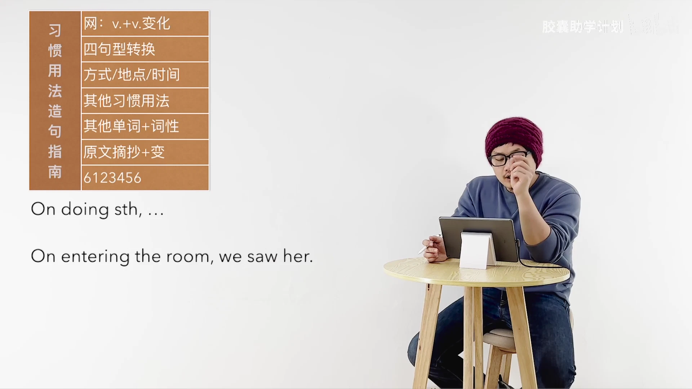

文字识别：网：v.+v.变化 / 胶囊助学计划 / 习惯用法造句指南 / 四句型转换 / 方式/地点/时间 / 其他习惯用法 / 其他单词+词性 / 原文摘抄+变 / 6123456 / On doing sth, .. / On entering the room, we saw her.

### 画面 00:08:50

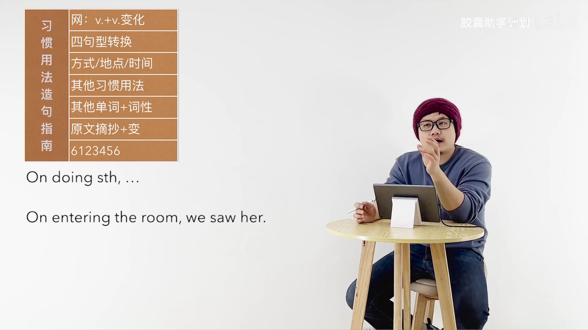

文字识别：网：v.+v.变化 / 胶囊助学计划 / 习惯用法造句指南 / 四句型转换 / 方式/地点/时间 / 其他习惯用法 / 其他单词+词性 / 原文摘抄+变 / 6123456 / On doing sth, .. / On entering the room, we saw her.

### 画面 00:08:55

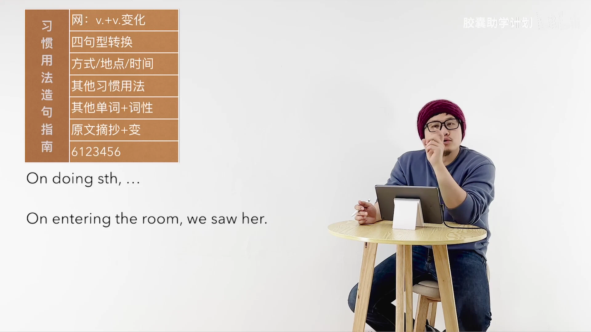

文字识别：网：v.+v.变化 / 胶囊助学计划 / 习惯用法造句指南 / 四句型转换 / 方式/地点/时间 / 其他习惯用法 / 其他单词+词性 / 原文摘抄+变 / 6123456 / On doing sth, .. / On entering the room, we saw her.

## 00:09:00–00:09:30

不是特别的高，虽然会出现，好吧。On entering the room，叫做一进入这个房间我们就看到了他，所以这句话和下边这句话基本是一个意思，叫As soon as we had entered the room， we saw her。OK，好。比如说我们再造一句话，叫做On arriving at the station， he found my parents。一到达车

### 画面 00:09:02

文字识别：网：v.+v.变化 / 胶囊助学计划 / 习惯用法造句指南 / 四句型转换 / 方式/地点/时间 / 其他习惯用法 / 其他单词+词性 / 原文摘抄+变 / 6123456 / On doing sth, .. / On entering the room, we saw her.

### 画面 00:09:05

文字识别：网：v.+v.变化 / 胶囊助学计划 / 习惯用法造句指南 / 四句型转换 / 方式/地点/时间 / 其他习惯用法 / 其他单词+词性 / 原文摘抄+变 / 6123456 / On doing sth, ….. / On entering the room, we saw her.

### 画面 00:09:10

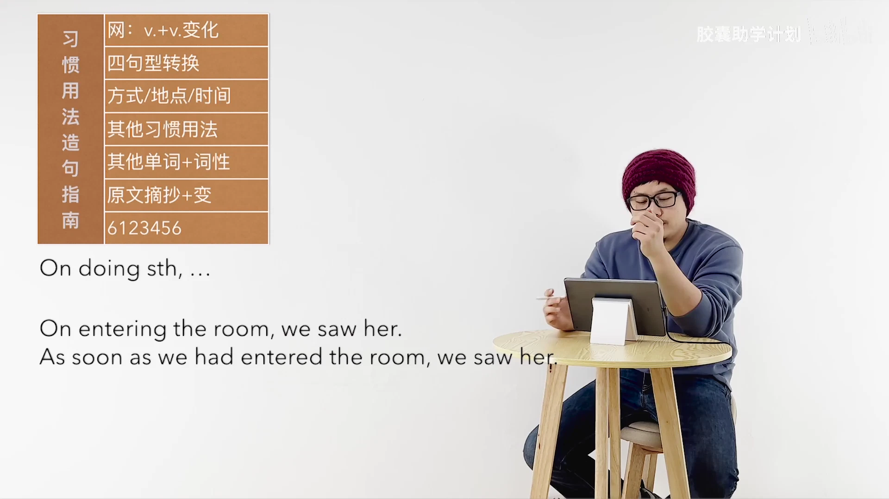

文字识别：网：v.+v.变化 / 胶囊助学计划 / 习惯用法造句指南 / 四句型转换 / 方式/地点/时间 / 其他习惯用法 / 其他单词+词性 / 原文摘抄+变 / 6123456 / On doing sth, ….. / On entering the room, we saw her. / As soon as we had entered the room, we saw her.

### 画面 00:09:13

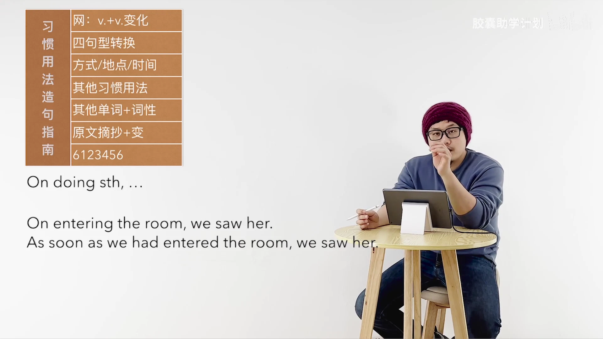

文字识别：网：v.+v.变化 / 胶囊助学计划 / 习惯用法造句指南 / 四句型转换 / 方式/地点/时间 / 其他习惯用法 / 其他单词+词性 / 原文摘抄+变 / 6123456 / On doing sth, .. / On entering the room, we saw her. / As soon as we had entered the room, we saw her.

### 画面 00:09:15

文字识别：网：v.+v.变化 / 胶囊助学计划 / 习惯用法造句指南 / 四句型转换 / 方式/地点/时间 / 其他习惯用法 / 其他单词+词性 / 原文摘抄+变 / 6123456 / On doing sth, .. / On entering the room, we saw her. / As soon as we had entered the room, we saw her.

### 画面 00:09:20

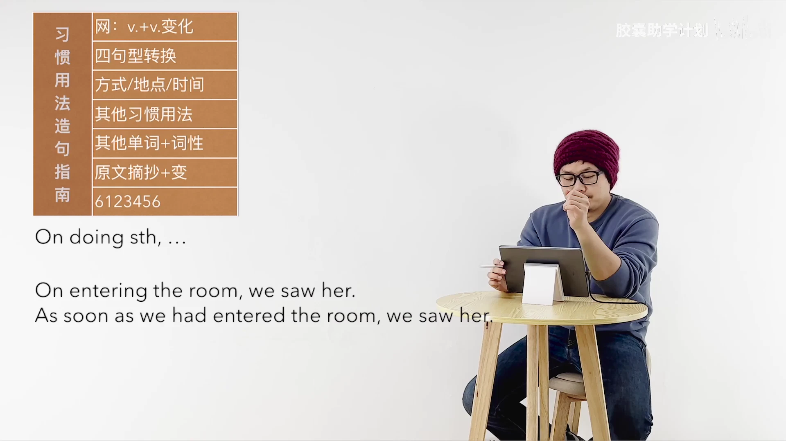

文字识别：网：v.+v.变化 / 胶囊助学计划 / 习惯用法造句指南 / 四句型转换 / 方式/地点/时间 / 其他习惯用法 / 其他单词+词性 / 原文摘抄+变 / 6123456 / On doing sth, …. / On entering the room, we saw her. / As soon as we had entered the room, we saw her.

### 画面 00:09:25

文字识别：网：v.+v.变化 / 胶囊助学计划 / 习惯用法造句指南 / 四句型转换 / 方式/地点/时间 / 其他习惯用法 / 其他单词+词性 / 原文摘抄+变 / 6123456 / On doing sth, .. / On entering the room, we saw her. / As soon as we had entered the room, we saw her. / On arriving at the station, he found my parents.

## 00:09:30–00:10:00

站，他就找到了我的父母，对吧？比如说我父母去接站接他，然后他一到车站，他就看见了我父母，他就发现了我的父母。OK，好，这个就是 on doing something，所以重点就是它等于 as soon as。OK，好，那 recap 本课没有什么，除了文章重要以外，就一个小的习惯用法叫 on doing something，啊，不多说了。家庭作业呢，习惯用法造句，这是咱们老习惯了。然后文章跟读至熟

### 画面 00:09:30

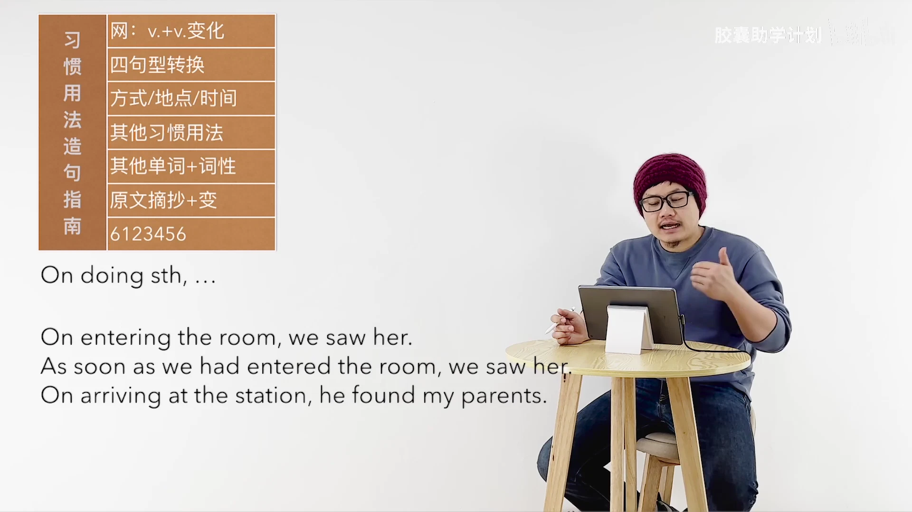

文字识别：网：v.+v.变化 / 胶囊助学计划 / 习惯用法造句指南 / 四句型转换 / 方式/地点/时间 / 其他习惯用法 / 其他单词+词性 / 原文摘抄+变 / 6123456 / On doing sth, ... / On entering the room, we saw her. / As soon as we had entered the room, we saw her. / On arriving at the station, he found my parents.

### 画面 00:09:35

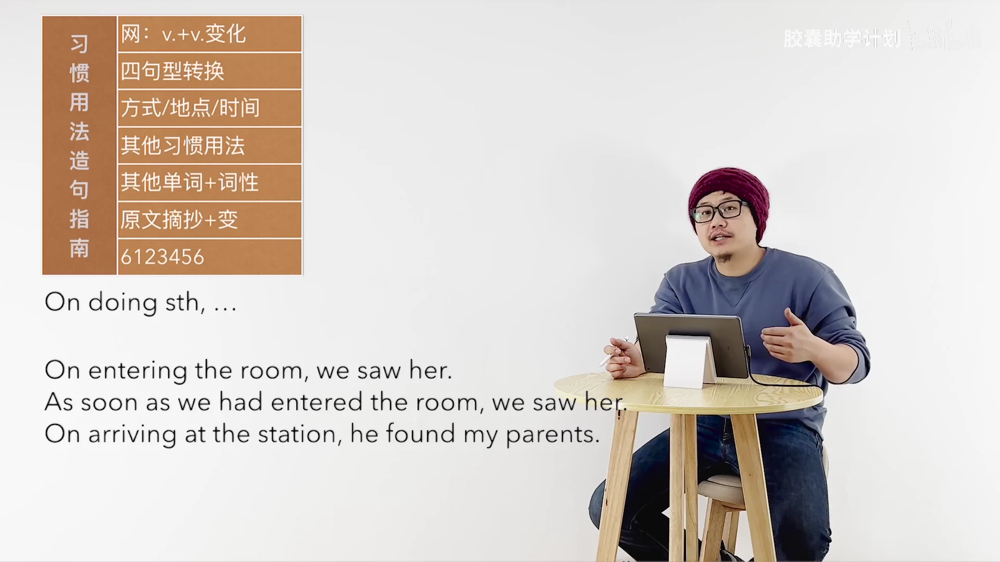

文字识别：网：v.+v.变化 / 胶囊助学计划 / 习惯用法造句指南 / 四句型转换 / 方式/地点/时间 / 其他习惯用法 / 其他单词+词性 / 原文摘抄+变 / 6123456 / On doing sth, .. / On entering the room, we saw her. / As soon as we had entered the room, we saw her. / On arriving at the station, he found my parents.

### 画面 00:09:40

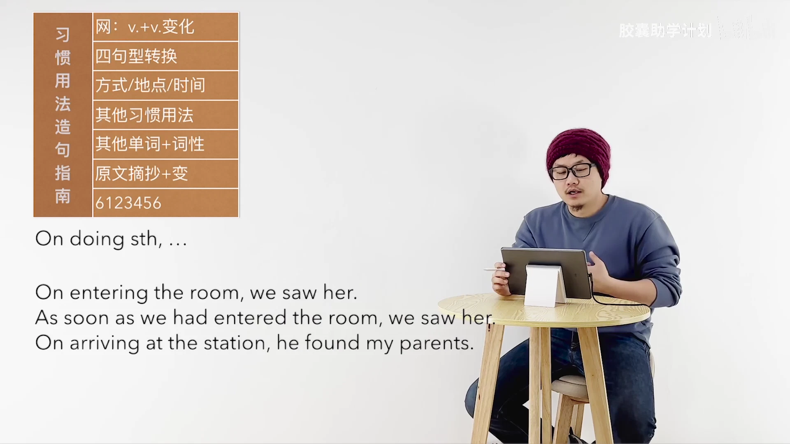

文字识别：网：v.+v.变化 / 胶囊助学计划 / 习惯用法造句指南 / 四句型转换 / 方式/地点/时间 / 其他习惯用法 / 其他单词+词性 / 原文摘抄+变 / 6123456 / On doing sth, .. / On entering the room, we saw her. / As soon as we had entered the room, we saw her. / On arriving at the station, he found my parents.

### 画面 00:09:44

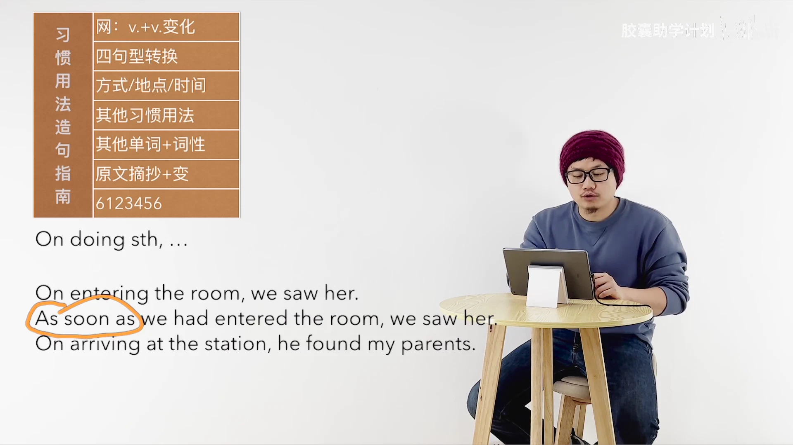

文字识别：网：v.+v.变化 / 胶囊助学计划 / 习惯用法造句指南 / 四句型转换 / 方式/地点/时间 / 其他习惯用法 / 其他单词+词性 / 原文摘抄+变 / 6123456 / On doing sth, .. / On entering the room, we saw her. / As soon as we had entered the room, we saw her. / On arriving at the station, he found my parents.

### 画面 00:09:46

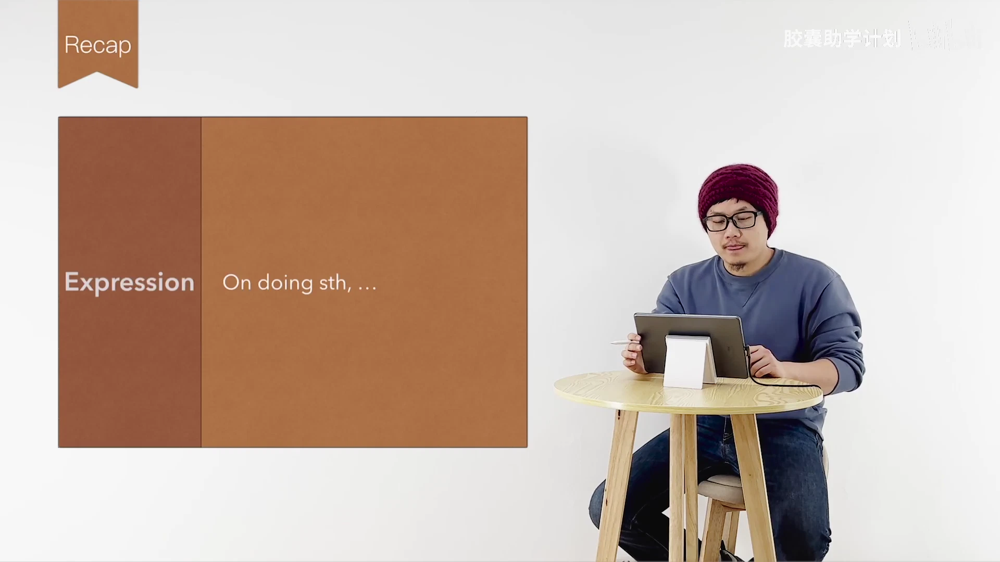

文字识别：胶囊助学计划 / Recap / Expression / On doing sth,

### 画面 00:09:48

文字识别：胶囊助学计划 / Recap / Expression / On doing sth, ..

### 画面 00:09:50

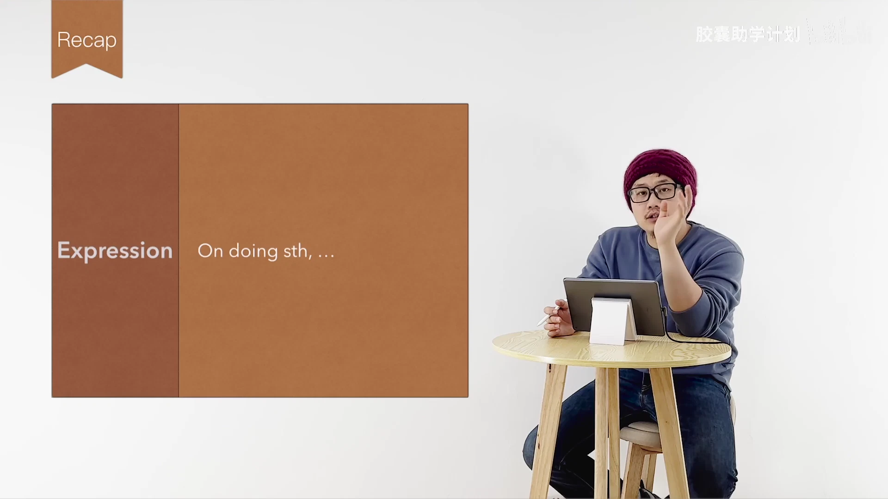

文字识别：胶囊助学计划 / Recap / Expression / On doing sth, .

### 画面 00:09:54

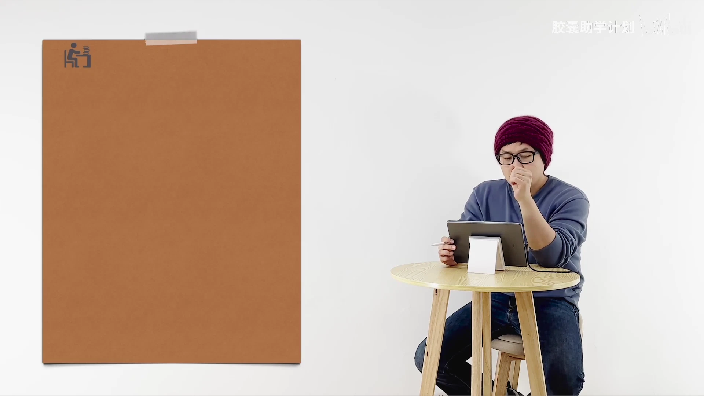

文字识别：胶囊助学计划

### 画面 00:09:56

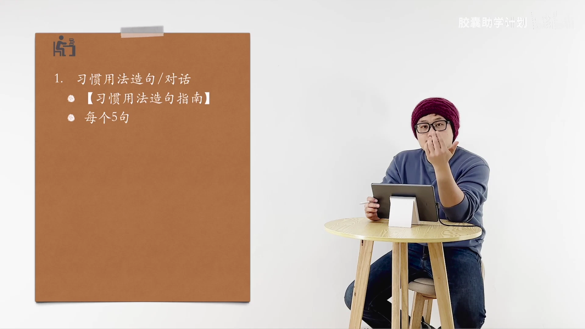

文字识别：胶囊助学计划 / 1.习惯用法造句/对话 / 【习惯用法造句指南】 / 每个5句

### 画面 00:09:58

文字识别：胶囊助学计划 / 1.习惯用法造句/对话 / 【习惯用法造句指南】 / 每个5句 / 文章跟读至熟读成诵 / 内化单词+语法+习惯用法 / 听力+口语+写作练习

## 00:10:00–00:10:30

读成诵，我们才去看下一个视频，对吧？好，那以上呢就是本期视频的全部内容了。如果各位喜欢我们的课程呢，欢迎各位关注啊、订阅、一键三连啊、呃长按这个喜欢啊、强烈推荐，对吧？啊，然后呢，如果您喜欢，也可以分享给那些需要的朋友，来帮助我们快速成长。See you next time.

### 画面 00:10:00

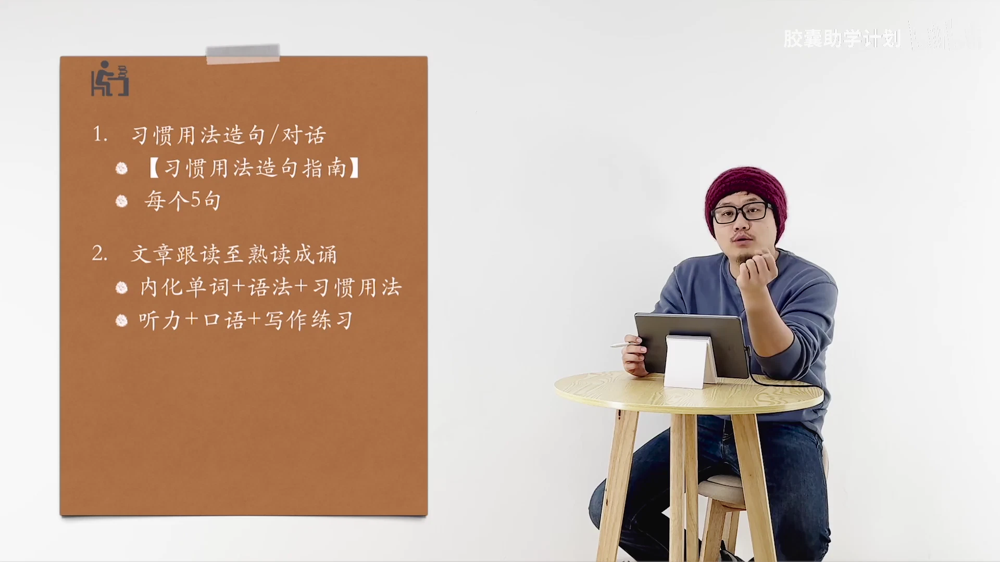

文字识别：胶囊助学计划 / 1. / 习惯用法造句/对话 / 【习惯用法造句指南】 / 每个5句 / 文章跟读至熟读成诵 / 内化单词+语法+习惯用法 / 听力+口语+写作练习

### 画面 00:10:04

文字识别：胶囊助学计划

### 画面 00:10:25

### 画面 00:10:27

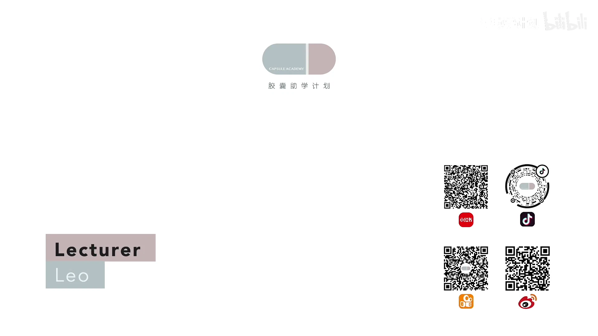

文字识别：CAPSULEACADEMY / 胶囊助学计划 / 小红书 / Lecturer / □ / Leo / OE

## 00:10:30–00:10:37

### 画面 00:10:30

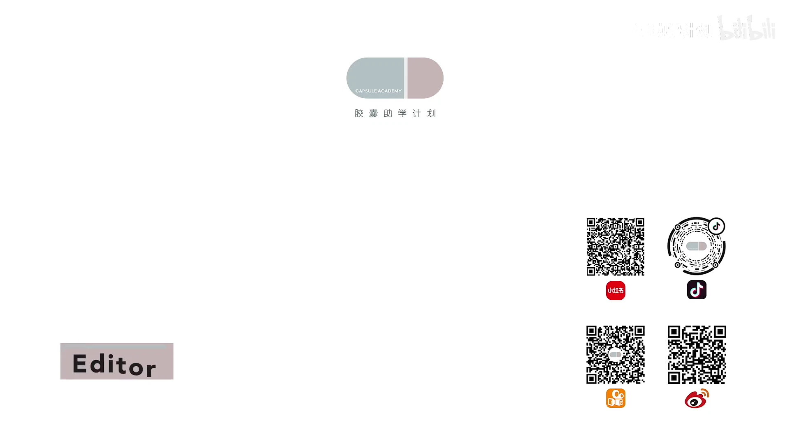

文字识别：CAPSULEACADEMY / 胶囊助学计划 / 小红书 / Editor / OE

### 画面 00:10:33

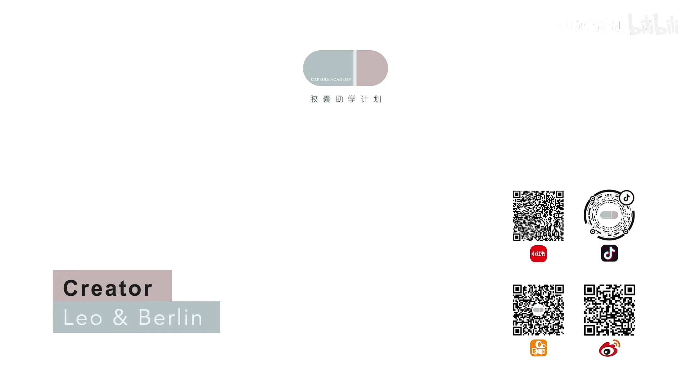

文字识别：CAPSULEACADEMY / 胶囊助学计划 / 小红书 / Creator / Leo & Berlin / OE

### 画面 00:10:35

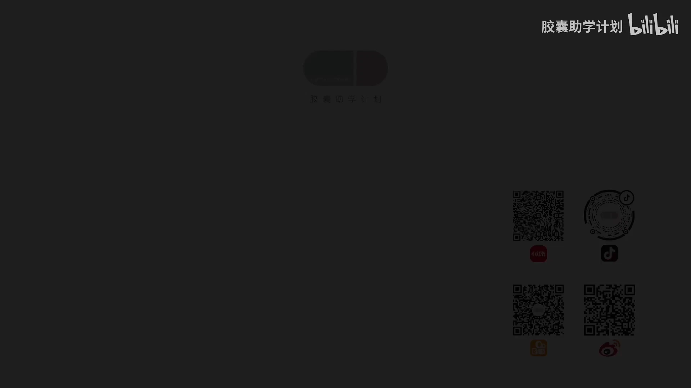

文字识别：Bilibili / 胶囊助学计划 / 小红粥

### 画面 00:10:37

文字识别：bilibili / 胶囊助学计划

