# L033 听说读写复述练习

快速机器解析：语音为单模型转写，未进行独立交叉校对或人工复核；画面每秒采样并按变化选帧，短时文字和标记可能遗漏。截图时间约有 1 秒误差。图片有损压缩；遇到疑点请按时间查看 Google Drive 原视频。

## 00:00:00–00:00:30

Hello everyone, welcome to Capsule Academy. This is Leo. Today we are going to learn New Concept English Book Two, Lesson Thirty Three Practices. 那注意，进行如下练习的一个唯一前提就是文章一定要跟读至熟读成诵，否则请勿开始。 Hope you gonna enjoy it. 好，那我们先看这道题啊，叫 comprehension，对吧？啊，练习的是我们能听懂一般疑问句

### 画面 00:00:00

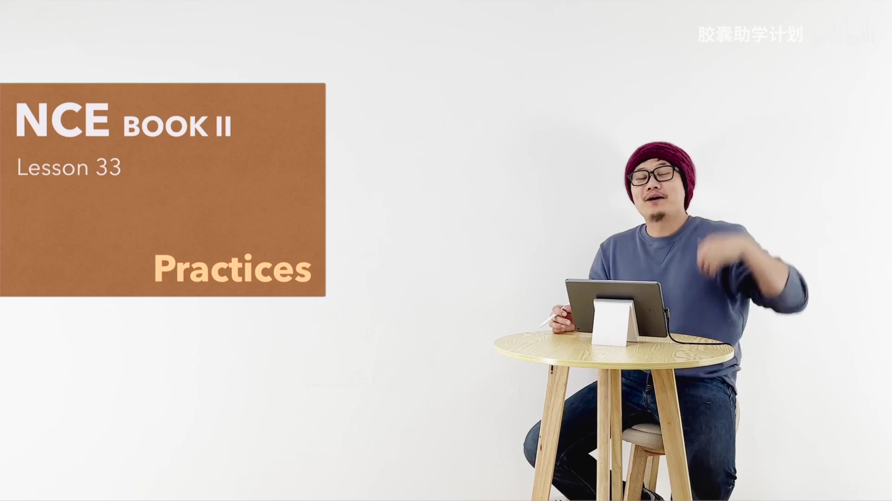

文字识别：NCE / BOOKII / Lesson 33 / Practices

### 画面 00:00:05

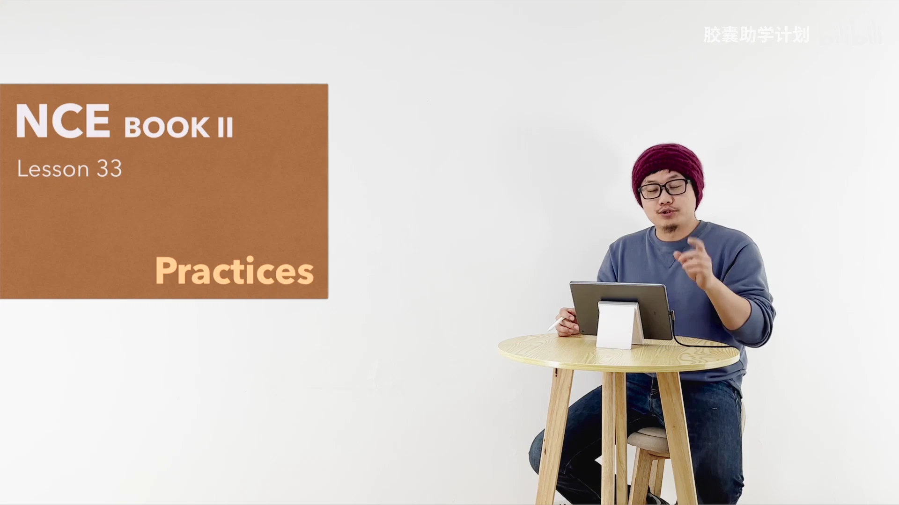

文字识别：NCE / BOOK"I / Lesson 33 / Practices

### 画面 00:00:08

文字识别：进行如下练习唯一前提 / 文章跟读至熟读成诵 / 否则请勿开始

### 画面 00:00:19

文字识别：胶囊助学计划bill

### 画面 00:00:23

### 画面 00:00:25

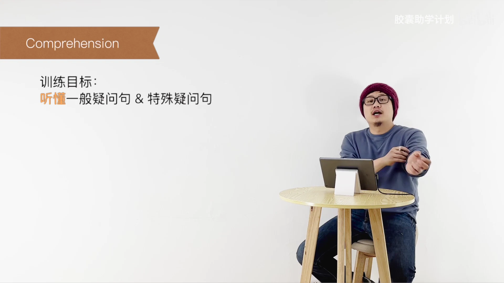

文字识别：Comprehension / 训练目标： / 听懂一般疑问句＆特殊疑问句

## 00:00:30–00:01:00

和特殊疑问句的一个能力啊。好，呃，那来了，我问您答啊，可以在文章当中找答案，但尽量不要看我这里的问题。第一题，Where did the girl set out from one afternoon？Sorry，再读一下，Where did the girl set out from one afternoon？应该是这样的断句，叫From the coast，对吧？Next one，Was she in a small boat or a large one？

### 画面 00:00:34

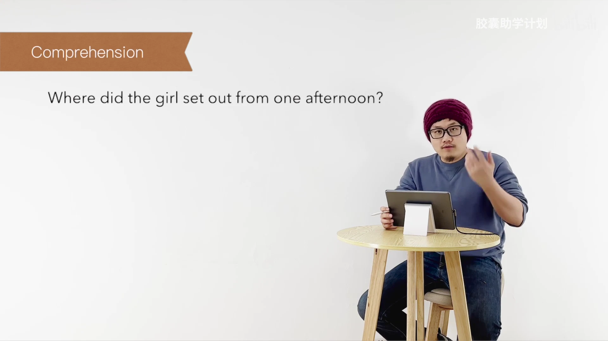

文字识别：Comprehension / Where did the girl set out from one afternoon?

## 00:01:00–00:01:30

ah, a small boat, right? Next one, say she was caught in a storm, wasn't he? Wasn't she? Yes, she was. Next one, what did her boat strike? A rock. Very good. Next one, what time of day was it? Evening, ah, or towards evening, right? Very good. Next one, say which way did she swim?

### 画面 00:01:00

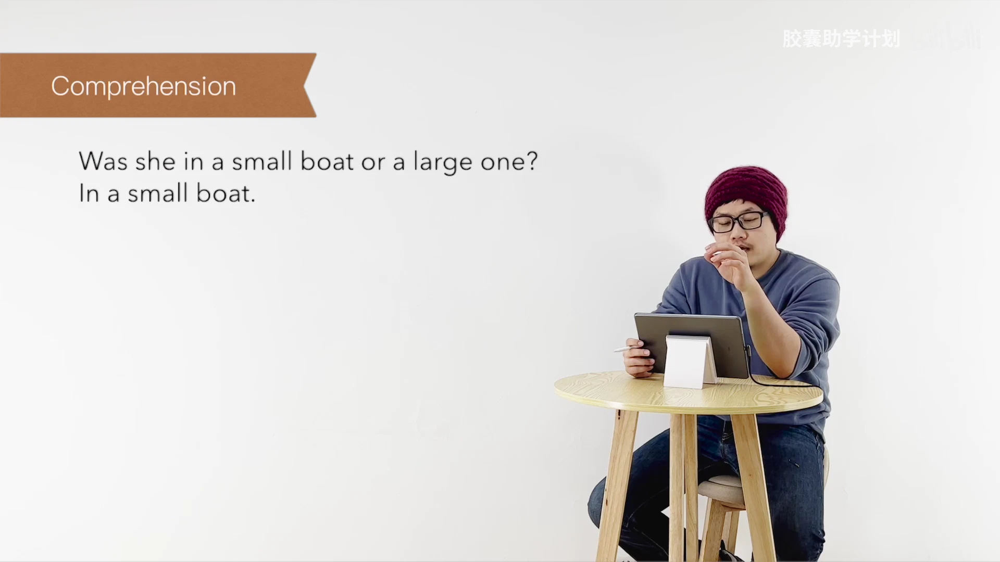

文字识别：Comprehension / Was she in a small boat or a large one? / In a small boat.

## 00:01:30–00:02:00

towards the shore? Next one, how long did she spend in the water? The whole night. Next one, how far did she swim? Eight miles. Next one, when did she see a light ahead of her? Early next morning. Very good. Continue.

### 画面 00:01:30

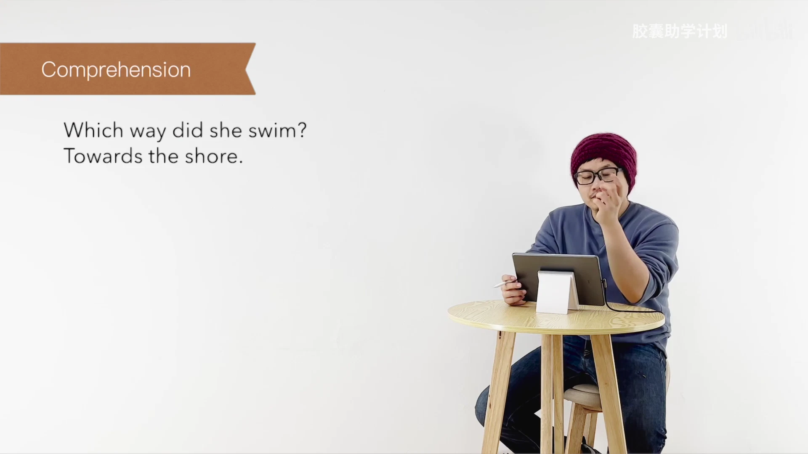

文字识别：Comprehension / Which way did she swim? / Towards the shore.

### 画面 00:01:55

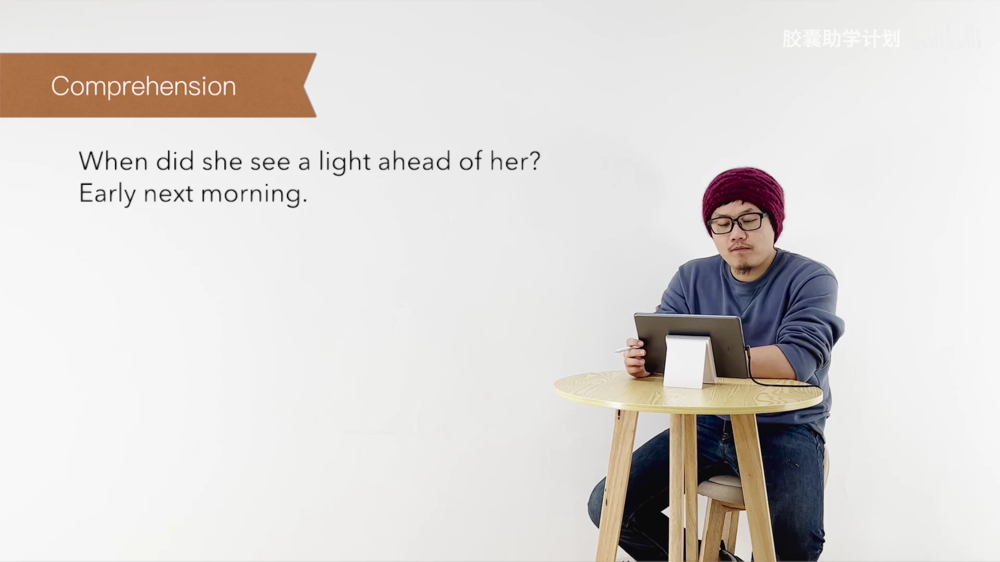

文字识别：Comprehension / When did she see a light ahead of her? / Early next morning.

## 00:02:00–00:02:30

How did she know she was near the shore? The light was high up on the cliffs. Next one. What did she climb up? Ah, the cliff, right? Next one. Where was she trying to get to? To the light. Good. Asking questions. Practice

### 画面 00:02:01

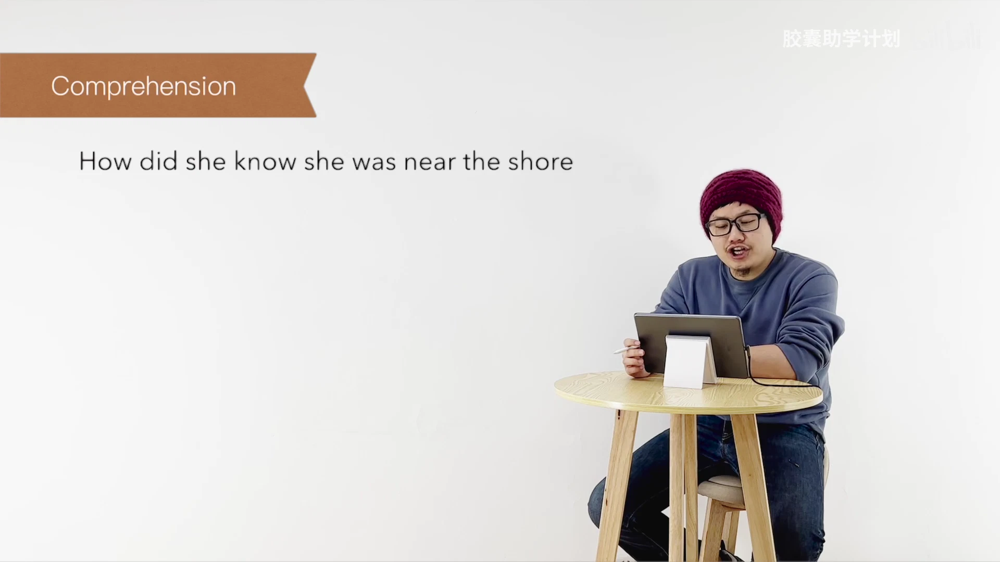

文字识别：Comprehension / How did she know she was near the shore

### 画面 00:02:27

文字识别：Asking questions / 训练目标： / 会说一般疑问句＆特殊疑问句 / Accuracy / Fluency

## 00:02:30–00:03:00

习的是我们会说一般疑问句和特殊疑问句的能力啊。我们先来一个例句，叫Ask me if it was afternoon. 很简单，was提前就行了。那What time of day?这句这个习惯，这个特殊疑问词真的是咱们第一次见到，叫做一天当中的哪个时间？那其实就是对afternoon提问嘛，所以叫What time of day was it? 叫做当时是一天当中的哪个时间？早中晚，对不对？非常简单啊。好了，

### 画面 00:02:33

文字识别：Asking questions

### 画面 00:02:43

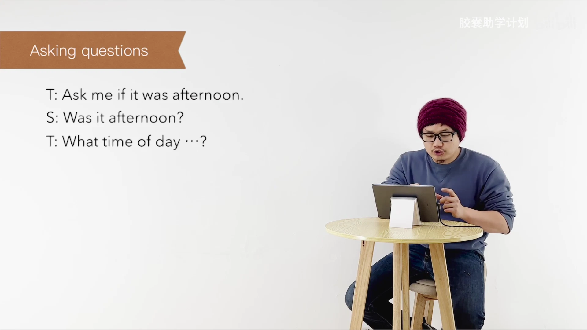

文字识别：Asking questions / T: Ask me if it was afternoon. / S: Was it afternoon? / T: What time of day …?

### 画面 00:02:59

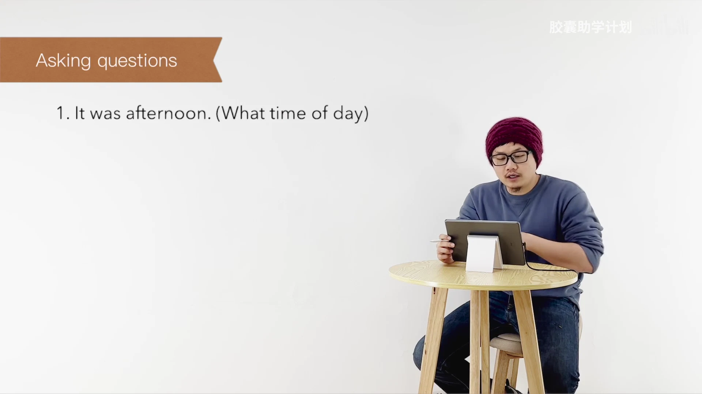

文字识别：Asking questions / 1. It was afternoon. (What time of day)

## 00:03:00–00:03:30

嗯，那我们一个一个来啊。说 A girl set out from the coast. 那肯定是一般过去时 did 提前。Where 对 from the coast 提问啊。Next one 说 She was in a small boat. Was 提前呗。What？那你想一下 What？在这儿我想问一个小的问题啊，各位不妨留言告诉我 What 跟 Where 在这儿去问的时候有什么区别？注意 What 问的是东

### 画面 00:03:09

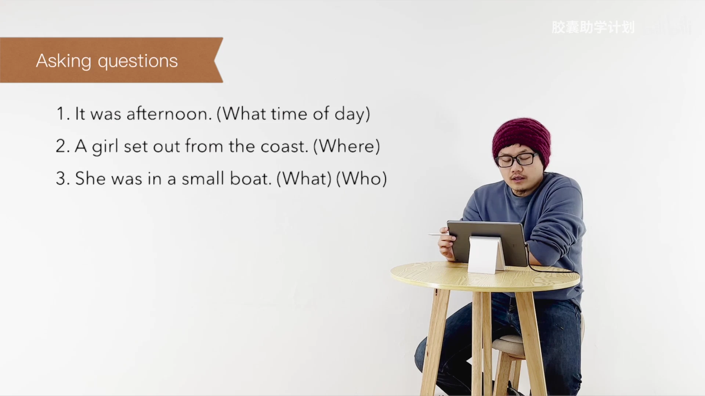

文字识别：Asking questions / 1. It was afternoon.(What time of day) / 2.A girl set out from the coast.(Where) / 3. She was in a small boat. (What) (Who)

### 画面 00:03:20

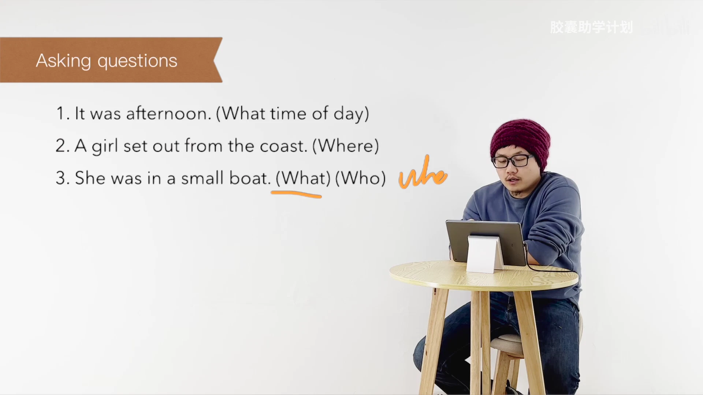

文字识别：Asking questions / 1. It was afternoon. (What time of day) / 2.A girl set out from the coast.(Where) / whe / 3. She was in a small boat. (What) (Who)

## 00:03:30–00:04:00

西，不是地点。Where问的是地点。然后我再多说一句，叫这个in叫在什么什么里。各位想一下，what跟where有什么区别？好吧，那who就很简单了，直接对主语提问啊。四说She was caught in a storm. Was提前非常的简单。What对a storm提问，问正句话对吧？The boat struck a rock. Did提

### 画面 00:03:50

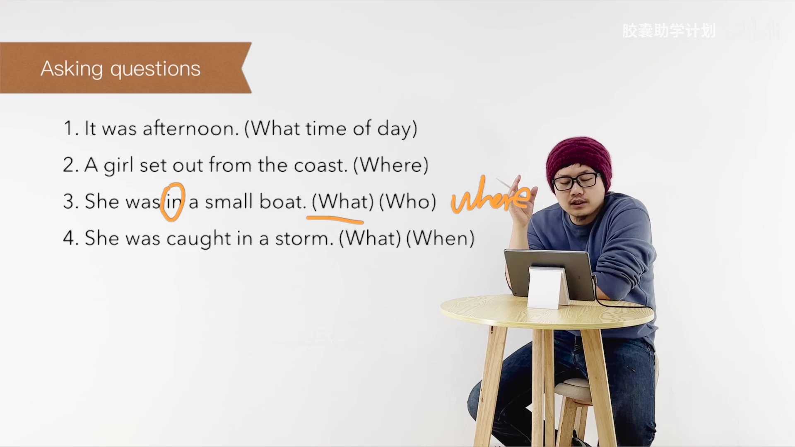

文字识别：Asking questions / 1. It was afternoon. (What time of day) / 2.A girl set out from the coast. (Where) / whekel / 3. She was / a small boat. (What) (Who) / Ir / 4. She was caught in a storm.(What) (When)

## 00:04:00–00:04:30

前. What呢对a rock提问. Why整句话.第六说this happened towards evening did提前动词换原形. When对towards evening提问对吧这个事儿什么时候发生的啊. When did this happen? 下一题did提前where对into the sea. She swam to the shore did提前动词换原形. Which way?其实which way跟where是有点像的，只不过where问的是具

### 画面 00:04:04

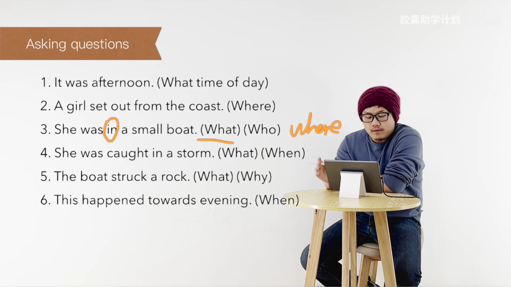

文字识别：Asking questions / 1. It was afternoon. (What time of day) / 2.A girl set out from the coast.(Where) / where / 3. She was / a small boat. (What) (Who) / ir / 4. She was caught in a storm.(What) (When) / 5. The boat struck a rock. (What) (Why) / 6. This happened towards evening. (When)

### 画面 00:04:14

文字识别：Asking questions / 1. It was afternoon. (What time of day) / 2.A girl set out from the coast.(Where) / 3. She was in a small boat. (What) (Who) / 4. She was caught in a storm.(What) (When) / 5. The boat struck a rock. (What) (Why) / 6. This happened towards evening. (When)

### 画面 00:04:16

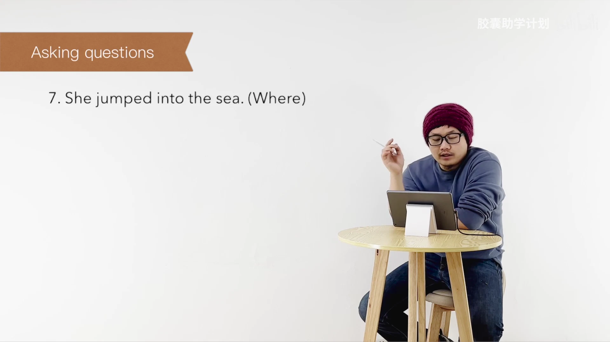

文字识别：Asking questions / 7. She jumped into the sea. (Where)

## 00:04:30–00:05:00

体啊，问的是呃这个哪里， which way 问的是哪哪往哪儿，对吧？哪条路是吧？最直接的含义叫哪条路，所以这地方我们可以这地方的答案叫 which way did she swim? Okay, 啊，她冲哪条路过去了？第九题说 she spent the whole night in the water, did 提前就可以了，对不对？然后 where 对什么提问？In the water 提问，那 how long 对 whole night 提问，对吧？

### 画面 00:04:46

文字识别：Asking questions / 7. She jumped into the sea.(Where) / 8. She swam to the shore.(Which way) / 9. She spent the whole night in the water. / (Where)(How long)

## 00:05:00–00:05:30

呃，She swam eight miles. Did提前 how far对 eight miles提问，都是很直接的。十一题 did提前 when时间提问，没什么可说的。What对 a light提问，对吧？Where那就对 ahead嘛，ahead叫前方，对不对？OK。呃，第十二个 was提前啊，然后 where对 near the shore提问。OK，好。呃，Tell the story啊，练的我们是一个叫做

### 画面 00:05:06

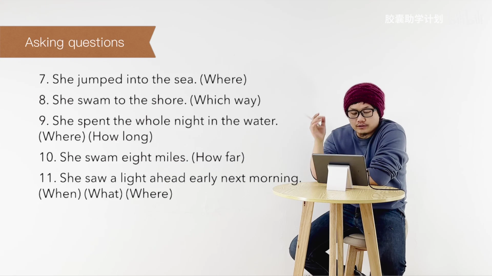

文字识别：Asking questions / 7. She jumped into the sea.(Where) / 8. She swam to the shore. (Which way) / 9. She spent the whole night in the water. / (Where)(How long) / 10. She swam eight miles. (How far) / 11. She saw a light ahead early next morning. / (When)(What) (Where)

### 画面 00:05:26

文字识别：Tell the story / 训练目标： / 口语复述能力 / Accuracy / Fluency

## 00:05:30–00:06:00

口语复述能力，准确性可以下降一点点，流利性必须要提升。所以这也是为什么我说文章您一定要读到非常的熟，您才有能力做到这个点，叫做看着这些东西就能把文章给复述出来。OK，好，那summary摘要写作是我们练习写作复述能力啊，这对于我们考试的写作和对于我们工作当中发邮件都非常有帮助。还是那句

### 画面 00:05:34

文字识别：Tell the story / 训练目标： / 口语复述能力 / Accuracy / Fluency

### 画面 00:05:41

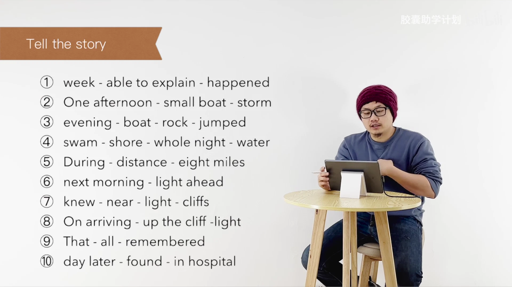

文字识别：Tell the story / ① / week - able to explain - happened / One afternoon - small boat - storm / 2） / ③ evening - boat- rock -jumped / 3 / swam - shore - whole night - water / During - distance - eight miles / 5 / 6 / next morning - light ahead / knew - near - light - cliffs / On arriving - up the cliff -light / That - all - remembered / ⑩ day later -found - in hospital

### 画面 00:05:48

文字识别：Summary writing: Key / 训练目标： / 写作复述能力

## 00:06:00–00:06:30

句话，您先写摘要写作，就在我们文章的下方啊。您找到摘要写作那几个汉字，写完来这儿对一下答案就可以了。有什么不懂的，您留言告诉我，我就给您回答了，好吧？然后呢，topic for discussion，这就是话题了。话题呢，我们只是每次给大家说一下这个话题啊，因为各位现在的水平，直接去做这个题稍微还是有一些难的。我们看一下题吧。说 Have you ever been out to the sea in a small boat? Tell us about it。

### 画面 00:06:06

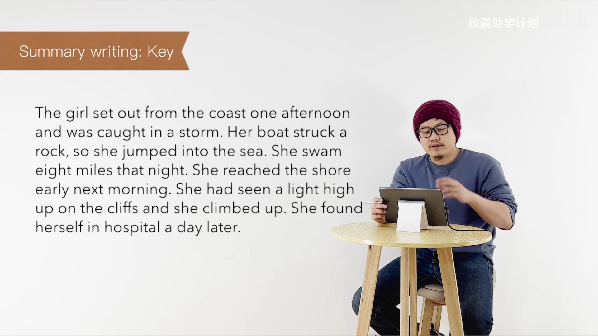

文字识别：Summary writing: Key / The girl set out from the coast one afternoon / and was caught in a storm. Her boat struck a / rock, so she jumped into the sea. She swam / eight miles that night. She reached the shore / early next morning. She had seen a light high / up on the cliffs and she climbed up. She found / herself in hospital a day later.

### 画面 00:06:13

文字识别：Topics for discussion / 训练目标： / 完全自由的对话 / Accuracy / Fluency

### 画面 00:06:17

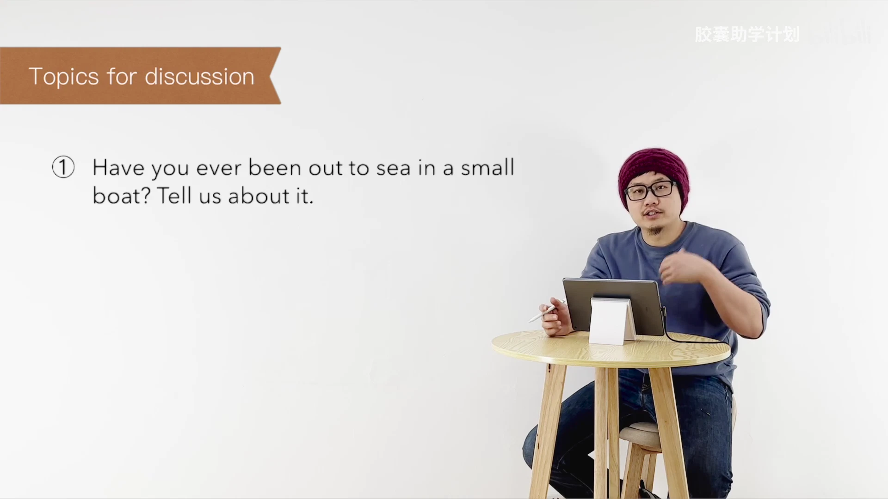

文字识别：Topics for discussion / Have you ever been out to sea in a small / boat? Tell us about it.

## 00:06:30–00:07:00

说你以前坐着小船出海过吗？给我们讲讲这个事儿，对吧？你就没出过海，就没啥可讲的了啊。下一题说，What do you think happened to the girl from the time she reached the shore to the time she woke up in the hospital？说你认为在两个时间段之内发生了什么事情？第一个时间段叫做这个姑娘到达了海岸，第二个姑娘叫做她在这个医院醒来。其实有点像让你补齐

### 画面 00:06:36

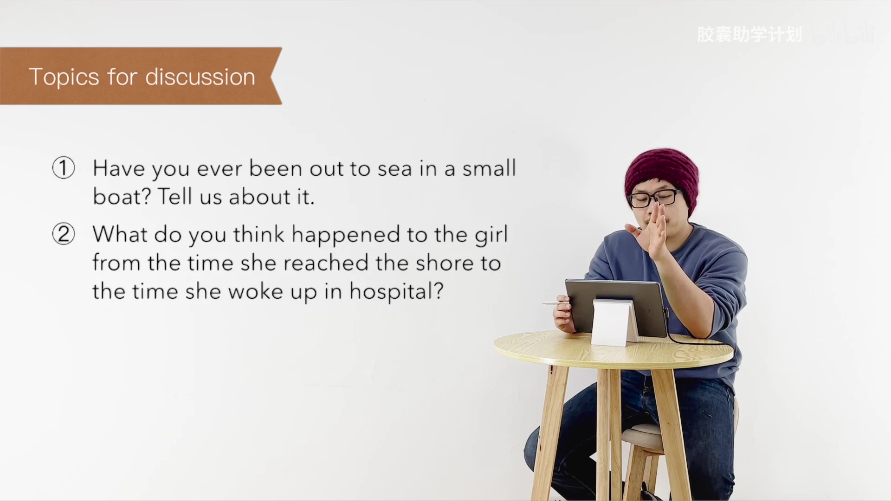

文字识别：Topics for discussion / Have you ever been out to sea in a small / boat? Tell us about it. / What do you think happened to the girl / from the time she reached the shore to / the time she woke up in hospital?

## 00:07:00–00:07:30

一下中间，比如说谁怎么发现了他，怎么比如说把他送到了医院，然后怎么去抢救他等等这样的一些事情啊。然后最后一道题叫 Imagine you are the girl, give your story to some newspaper reporters.说假设你现在就是这个故事当中的女主，然后呢讲你自己去讲一下这个故事，去给给谁听呢？给本地的这个新闻报道的记者，对吧？哎，这个这个

### 画面 00:07:06

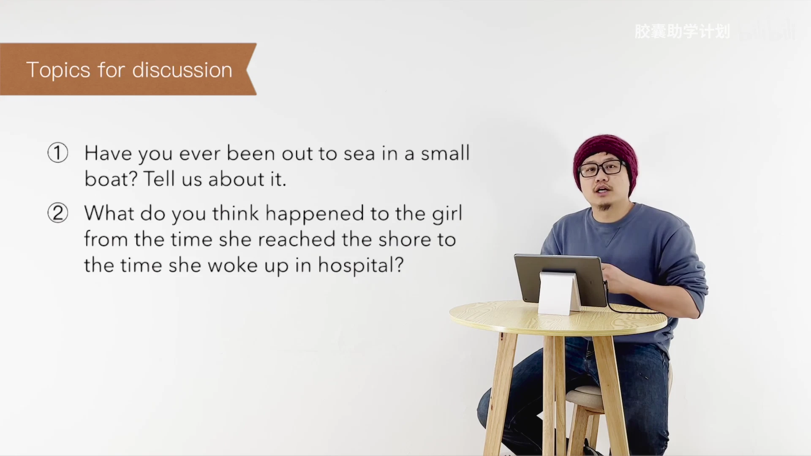

文字识别：Topics for discussion / Have you ever been out to sea in a small / boat? Tell us about it. / What do you think happened to the girl / from the time she reached the shore to / the time she woke up in hospital?

### 画面 00:07:09

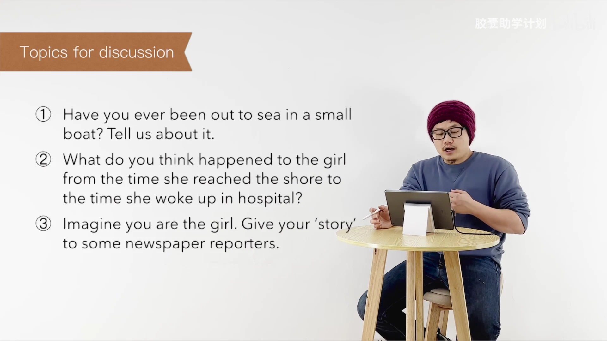

文字识别：Topics for discussion / Have you ever been out to sea in a small / boat? Tell us about it. / What do you think happened to the girl / from the time she reached the shore to / the time she woke up in hospital? / Imagine you are the girl. Give your'story' / to some newspaper reporters.

## 00:07:30–00:08:00

报纸的记者去听，就是这个感觉有点像，比如说《Life of Pi》啊当中那个口述故事的那个事情是吧？就呃《少年派的奇幻漂流》是吧？啊，各位可以这样尝试去理解。OK，好，那家庭作业呢？Ask me if各位先写，在大声朗读摘要写作写完了，然后给答案，然后Tell the story进行一个口语复述专栏当中都可以找得到。以上啊，就是本期视频的全部内容了。

### 画面 00:07:39

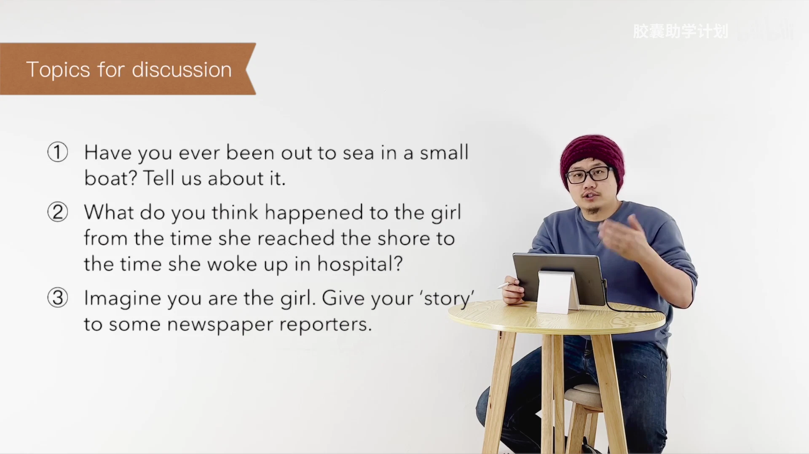

文字识别：Topics for discussion / Have you ever been out to sea in a small / boat? Tell us about it. / What do you think happened to the girl / from the time she reached the shore to / the time she woke up in hospital? / Imagine you are the girl. Give your'story' / to some newspaper reporters.

### 画面 00:07:44

### 画面 00:07:47

文字识别：1.Ask me if写&朗读 / 2. / 摘要写作写&答案

### 画面 00:07:50

文字识别：1.Ask me if写&朗读 / 2.摘要写作写&答案

### 画面 00:07:52

文字识别：1.Askme if写&朗读 / 摘要写作写&答案 / 3.Tell the story 口语复述

### 画面 00:07:54

文字识别：1.Ask me if写&朗读 / 摘要写作写&答案 / 3.Tell the story 口语复述 / 专栏 / 4.

### 画面 00:07:56

## 00:08:00–00:08:22

如果各位喜欢我们的课程呢，欢迎各位关注、订阅、一键三连，分享给那些需要的朋友，来帮助我们快速成长。See you next time.

### 画面 00:08:10

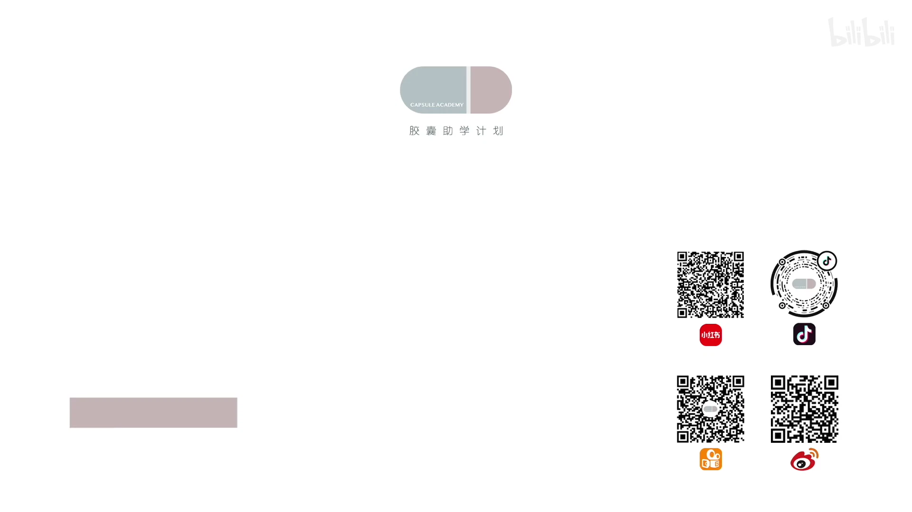

文字识别：CAPSULEACADEMY / 胶囊助学计划 / 小红书

### 画面 00:08:12

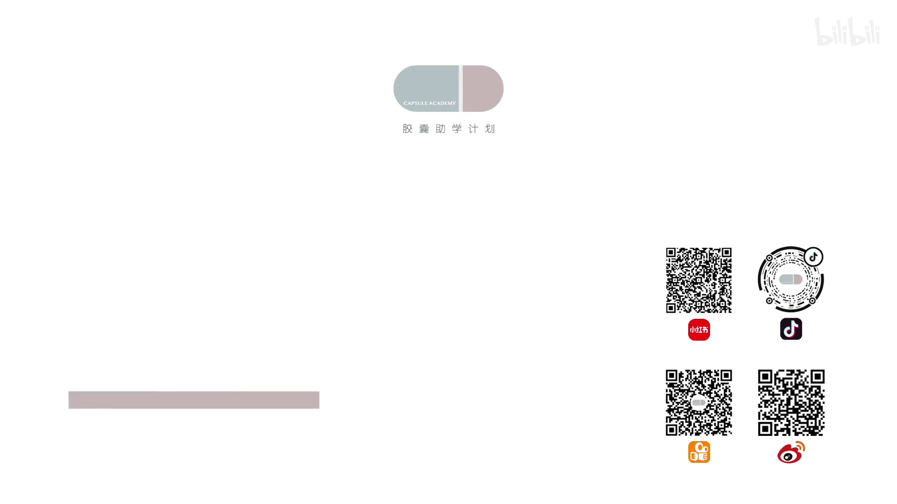

文字识别：CAPSULEACADEMY / 胶囊助学计划 / 小红书 / 品 / OE

### 画面 00:08:18

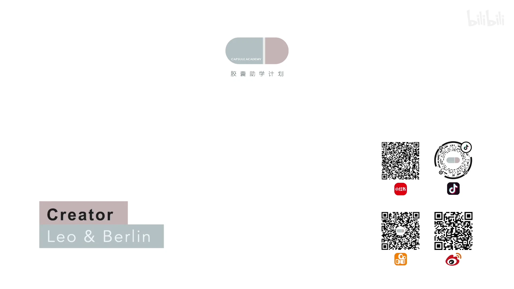

文字识别：CAPSULEACADEMY / 胶囊助学计划 / 小红书 / Creator / Leo & Berlin / OE

### 画面 00:08:20

文字识别：bilibili / 胶囊助学计划

### 画面 00:08:21

文字识别：bilibili / 胶囊助学计划

