# L034 文章

快速机器解析：语音为单模型转写，未进行独立交叉校对或人工复核；画面每秒采样并按变化选帧，短时文字和标记可能遗漏。截图时间约有 1 秒误差。图片有损压缩；遇到疑点请按时间查看 Google Drive 原视频。

## 00:00:00–00:00:30

Hello everyone, welcome to Capsule Academy. This is Leo. Today we're going to learn New Concept English Book Two, Lesson Thirty Four, Story. Hope you're gonna enjoy it.好，我们直接看文章啊。说 Dan Robinson，一个人不用管，has been worried all week. 好，这就出现了一个非常关键的问题。我们刚刚复习完叫 has been done 表示被动，那这个地方您可能就立刻把它翻译成

### 画面 00:00:00

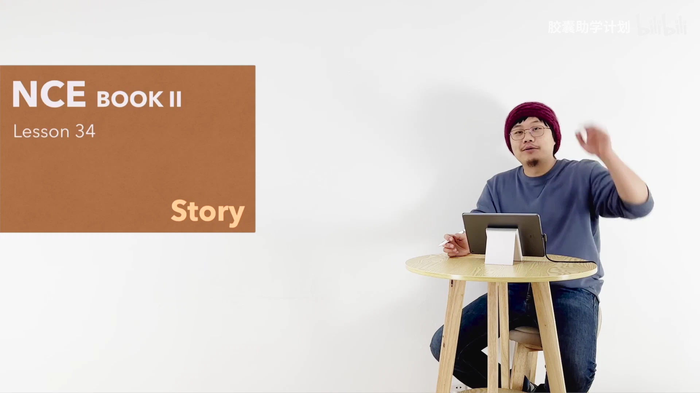

文字识别：NCE / BOOKⅡI / Lesson 34 / Story

### 画面 00:00:05

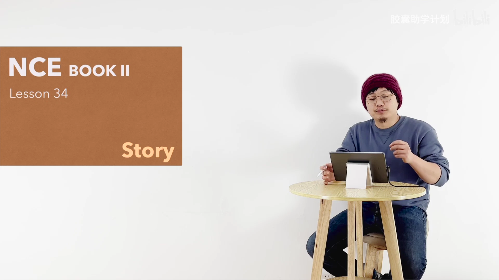

文字识别：NCE / BOOKⅡI / Lesson 34 / Story

### 画面 00:00:10

文字识别：胶囊助学计划b出l / •

### 画面 00:00:14

### 画面 00:00:16

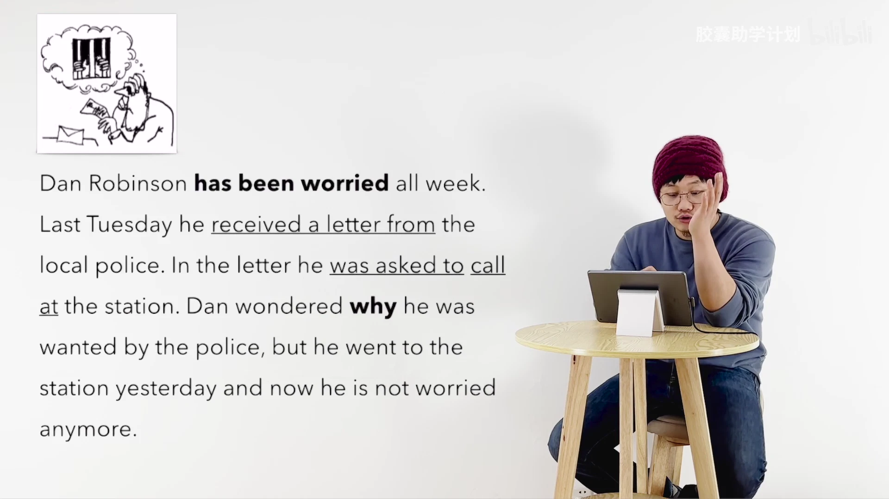

文字识别：Dan Robinson has been worried all week. / Last Tuesday he received a letter from the / local police. In the letter he was asked to call / at the station. Dan wondered why he was / wanted by the police, but he went to the / station yesterday and now he is not worried / anymore.

## 00:00:30–00:01:00

被动，叫做被担心一整周了，就别人担心他呗。不对，注意一个小点，这里的 worried 虽然是以 ed 结尾的，但它本身是一个形容词，这个点非常的重要，它本身是一个形容词，所以它的语法叫现在完成时的主动，叫 have 加 but，只不过 have 由人称变成了 has， but 呢，这里的动词就是 been，对吧？ OK， all week 从过去持续到

### 画面 00:00:43

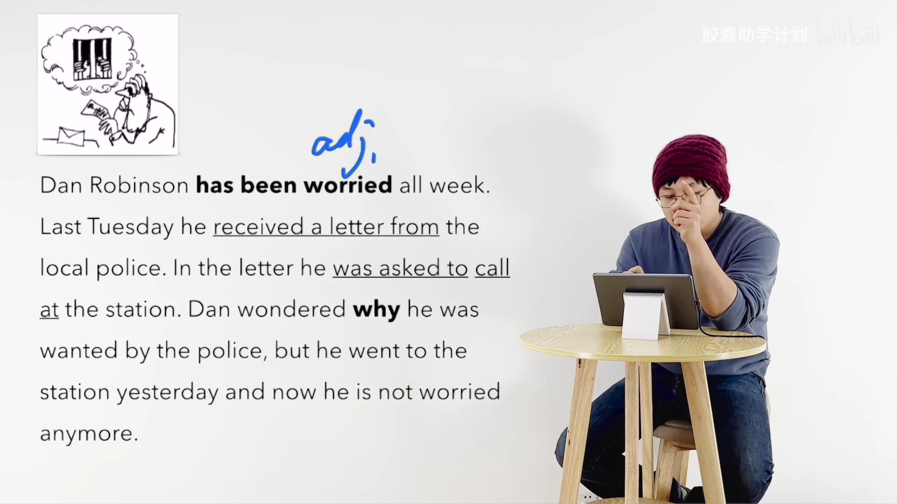

文字识别：Dan Robinson has been worried all week. / Last Tuesday he received a letter from the / local police. In the letter he was asked to call / at the station. Dan wondered why he was / wanted by the police, but he went to the / station yesterday and now he is not worried / anymore.

### 画面 00:00:48

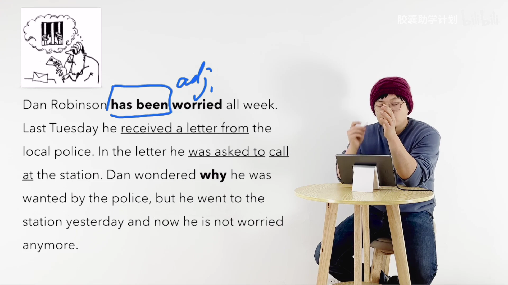

文字识别：Dan Robinson/has beenworried all week. / Last Tuesday he received a letter from the / local police. In the letter he was asked to call / at the station. Dan wondered why he was / wanted by the police, but he went to the / station yesterday and now he is not worried / anymore.

## 00:01:00–00:01:30

been worried. It's an active. If you're not sure, you can look at the new concept one hundred and forty-one lesson. That lesson has repeated excited, embarrassed, etc. Right? Several such, uh, ending in ed adjectives. This is actually quite common in English. So if you know a few, you're good. Okay. Last Tuesday. Okay, two words come out and tell you.

### 画面 00:01:18

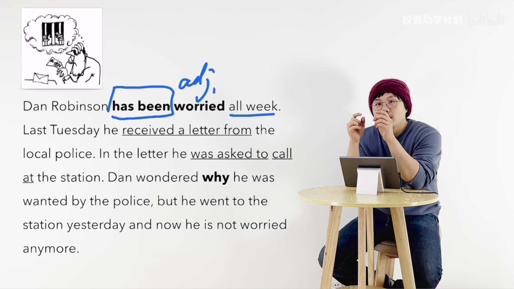

文字识别：Dan Robinsonhas beenworried all week. / Last Tuesday he received a letter from the / local police. In the letter he was asked to call / at the station. Dan wondered why he was / wanted by the police, but he went to the / station yesterday and now he is not worried / anymore.

## 00:01:30–00:02:00

两个单词一出来，告诉你了，这个事儿发生在过去。接下来很可能是跟过去相关的时态。我们看啊，说 he received a letter from the local police. Received something from somebody.我们早在前五课就学过了，不多说了。他收到了一封信，来自于 local police. Local，你可以单独记一下，local叫做本地的啊。那 local police 叫做本地的警察，对吧？他收到了本地警察的一封信。

### 画面 00:01:48

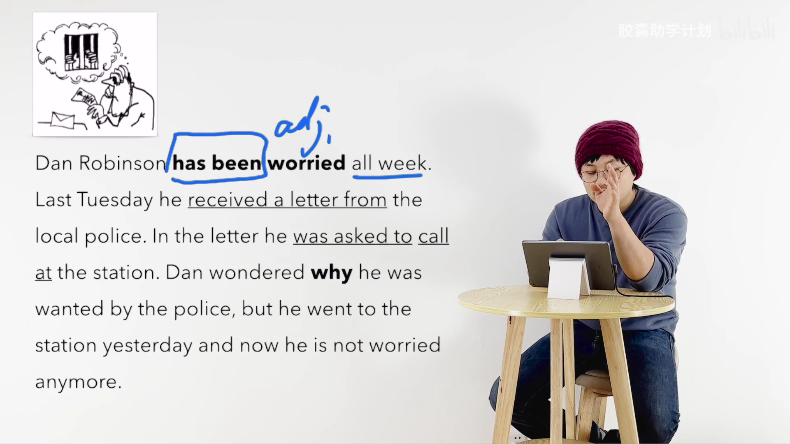

文字识别：Dan Robinsonhas beenworried all week. / Last Tuesday he received a letter from the / local police. In the letter he was asked to call / at the station. Dan wondered why he was / wanted by the police, but he went to the / station yesterday and now he is not worried / anymore.

## 00:02:00–00:02:30

In the letter, in this letter, he was asked to. He was asked to

### 画面 00:02:18

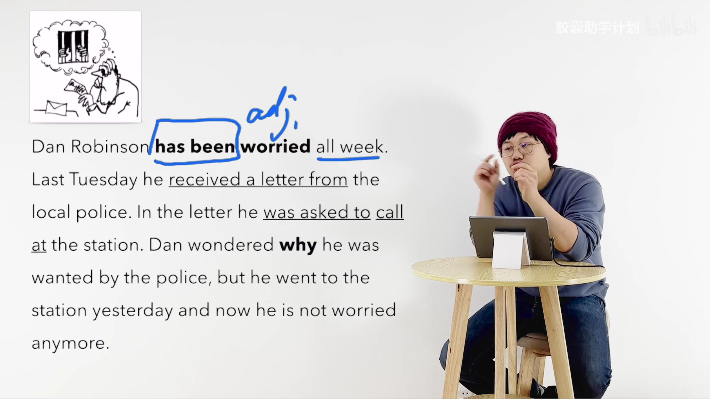

文字识别：Dan Robinsonhas beenworried all week. / Last Tuesday he received a letter from the / local police. In the letter he was asked to call / at the station. Dan wondered why he was / wanted by the police, but he went to the / station yesterday and now he is not worried / anymore.

### 画面 00:02:26

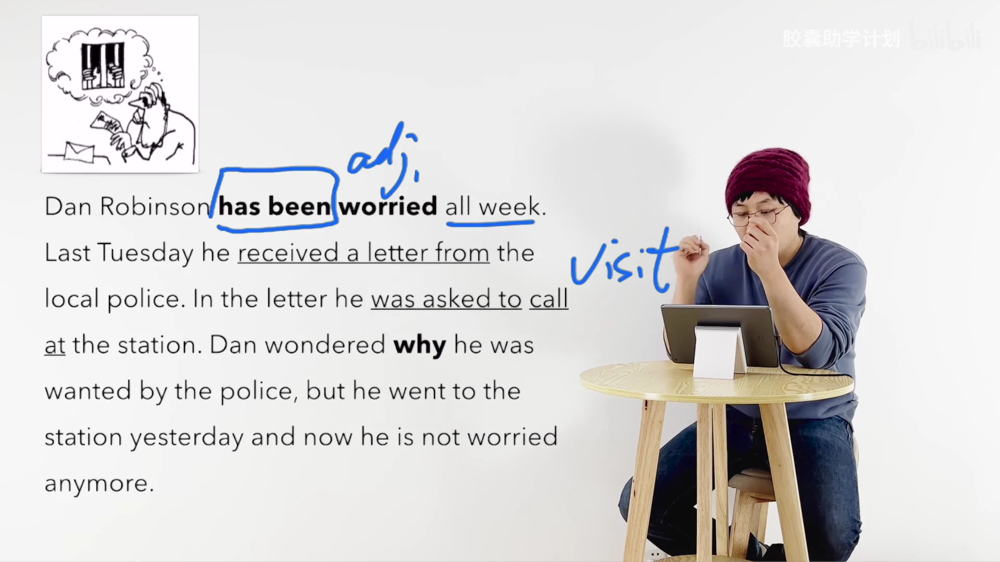

文字识别：Dan Robinsonhas beenworried all week. / Vis:t / Last Tuesday he received a letter from the / local police. In the letter he was asked to call / at the station. Dan wondered why he was / wanted by the police, but he went to the / station yesterday and now he is not worried / anymore.

## 00:02:30–00:03:00

啊，其实就是要他去，去哪儿呢？The station，那 police station 就让他去警察局。Dan wondered，他感觉到很好奇，Why he was wanted by the police？说为什么他 was wanted by the police？你看 want 在各位脑海当中最基本的意思就是想。那这儿我去翻译说 Dan 很好奇，说为什么他被想要？注意这还是个被动，

### 画面 00:02:46

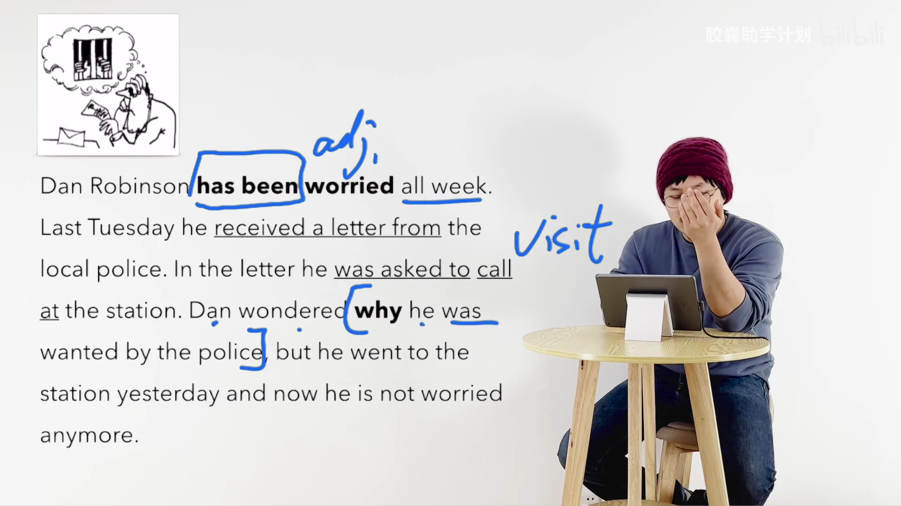

文字识别：Dan Robinsonhas beenworried all week. / Vis:t / Last Tuesday he received a letter from the / local police. In the letter he was asked to call / at the station. Dan wonderedwhy he was / wanted by the police / but he went to the / station yesterday and now he is not worried / anymore.

## 00:03:00–00:03:30

对吧？然后被警察，他被警察想要。我我个人感觉，如果你汉语感足够的好，你可能大概能有一个感觉。虽然这句话翻译出来，我说翻译出来叫被警察想要，你可能会有点懵，对吧？但是我感觉你可能隐隐约约大概知道它是什么意思啊。这个就是说，你只要知道 want 的一个意思，其实它很多的意思，大概你都能通过上下文去猜了。OK，那这里的

### 画面 00:03:16

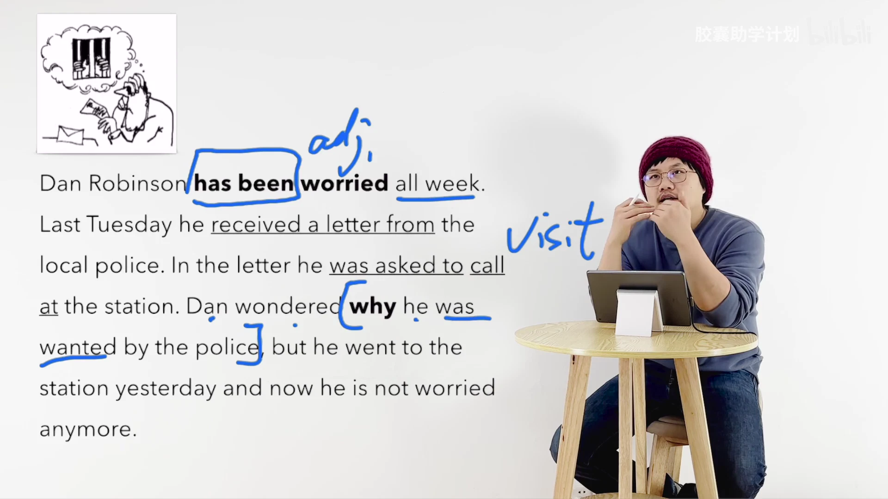

文字识别：Dan Robinson/has beenworried all week. / vis:t / Last Tuesday he received a letter from the / local police. In the letter he was asked to call / at the station. Dan wonderedwhy he was / wanted by the police / but he went to the / station yesterday and now he is not worried / anymore.

## 00:03:30–00:04:00

want是什么意思呢？尤其是跟place连起来的时候呢？你比如说，我印象当中，我拿不准了，也可能记混了。我去日本那个Seven Eleven是吧？去日本那个七幺幺的时候，我就看到它这个有一面那样一个呃board，类似于一个板，然后上面就写着通缉犯。然后呢，它就会一个大的章写着wanted，是吧？叫做wanted这个单词其实指的叫做通缉的意思。那在这儿，它肯定不是被通缉

### 画面 00:03:46

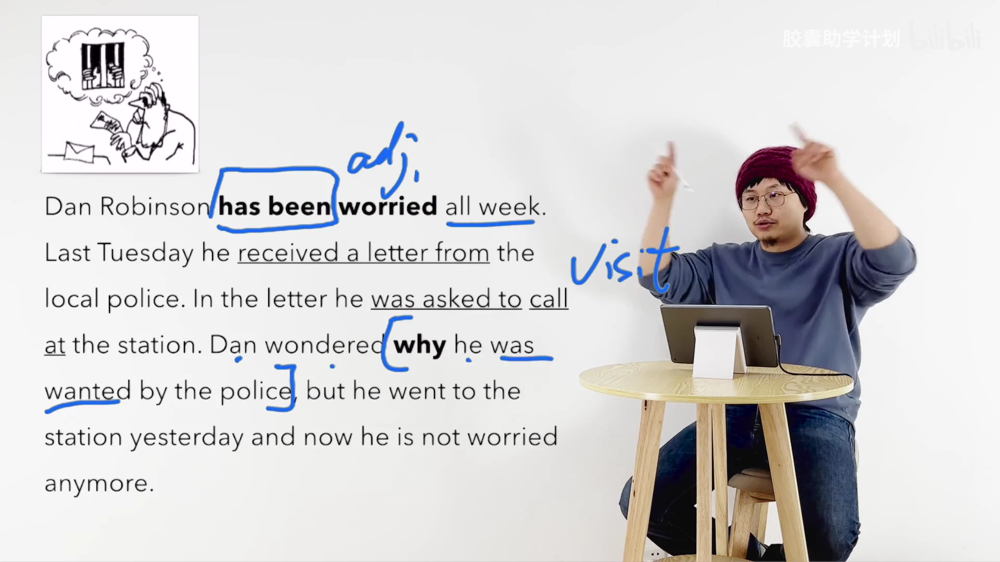

文字识别：Dan Robinson/has beenworried all week. / Vist / Last Tuesday he received a letter from the / local police. In the letter he was asked to call / at the station. Dan wonderedwhy he was / wanted by the police / but he went to the / station yesterday and now he is not worried / anymore.

## 00:04:00–00:04:30

了，写封信叫你被通缉了，这肯定不是。那你可以理解为就是想要找他，对吧？啊，被警察找了，他很好奇为什么自己被警察传唤了，是吧？你可以这样的去理解啊。我们不用“通缉”这么一个特别强烈的呃这个词放在这儿是不太合适的。继续啊，当然了，这儿还提一个小点，说 why 一直到结尾，这实际上是一个特殊疑问句做了宾语从句，这我们新二还没讲到，但是新

### 画面 00:04:16

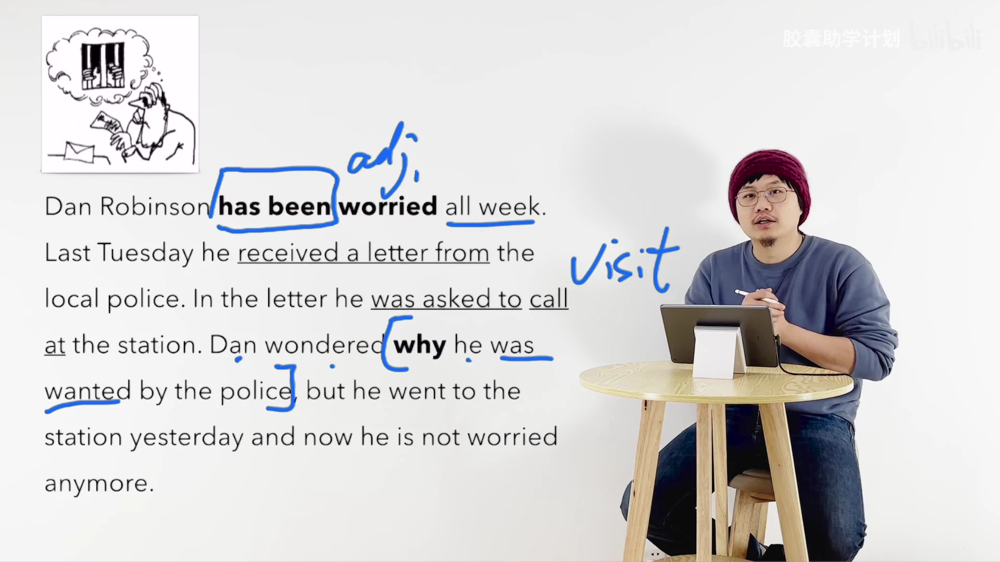

文字识别：Dan Robinson/has beenworried all week. / vis:t / Last Tuesday he received a letter from the / local police. In the letter he was asked to call / at the station. Dan wonderedwhy he was / wanted by the police / but he went to the / station yesterday and now he is not worried / anymore.

### 画面 00:04:23

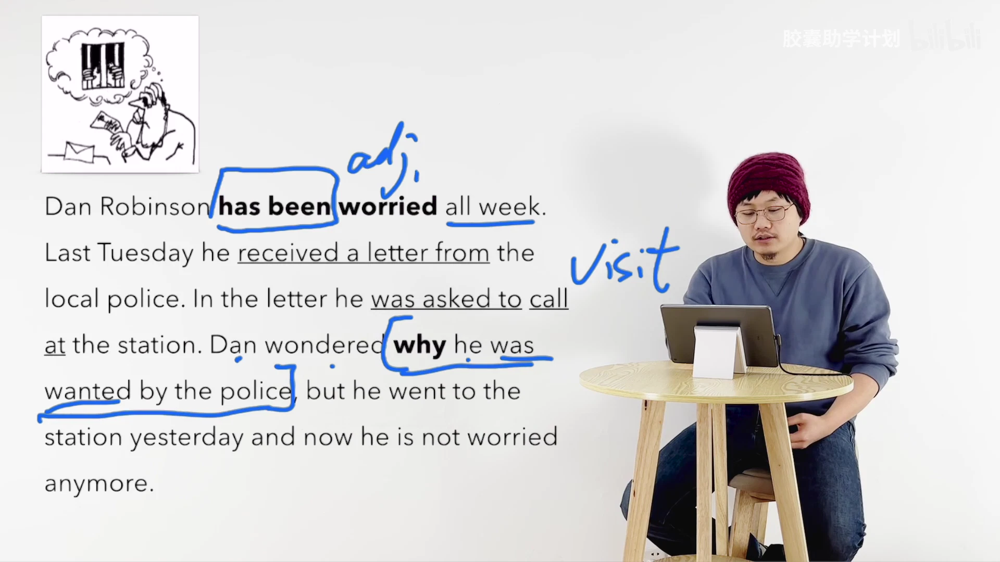

文字识别：Dan Robinson/has beenworried all week. / vis:t / Last Tuesday he received a letter from the / local police. In the letter he was asked to call / at the station. Dan wonderedwhy he was / wanted by the police / but he went to the / station yesterday and now he is not worried / anymore.

## 00:04:30–00:05:00

一一百三十九课我们已经讲到了。如果您着急呢，可以不妨翻过去先学一学。But但是 he went to the station yesterday.他昨天很简单一句话，昨天去了警察局。And now he's not worried anymore.你看 is not worried跟上面这句话基本不是一码事儿嘛，时态换了一下。主动啊，他现在不再担心了啊。Continue at the station.说

### 画面 00:04:48

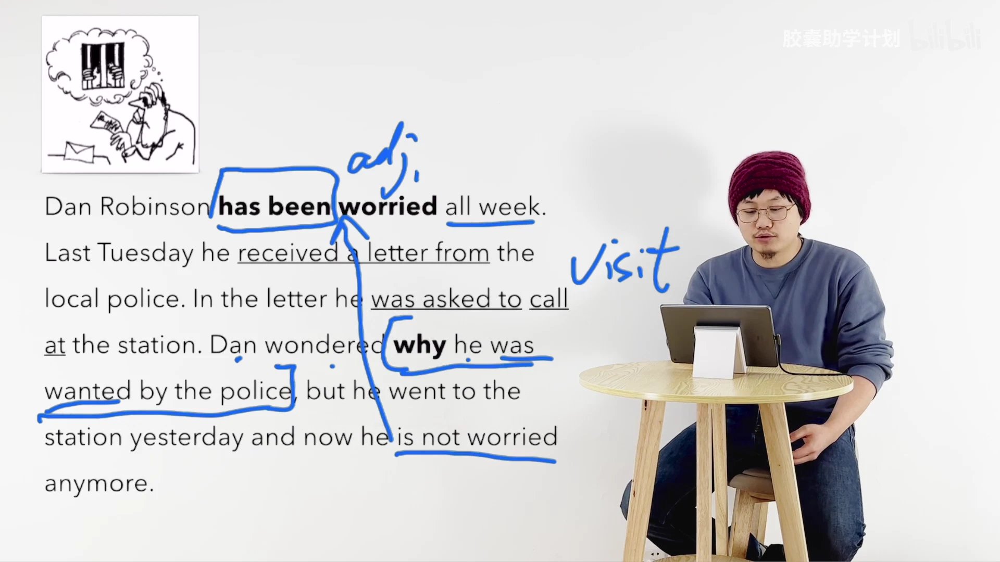

文字识别：Dan Robinson/has beenworried all week. / Visit / Last Tuesday he received letter from the / local police. In the letter hewas asked to call / at the station. Dan wonderedwhy he was / wanted by the police / but he went to the / station yesterday and now he is not worried / anymore.

### 画面 00:04:57

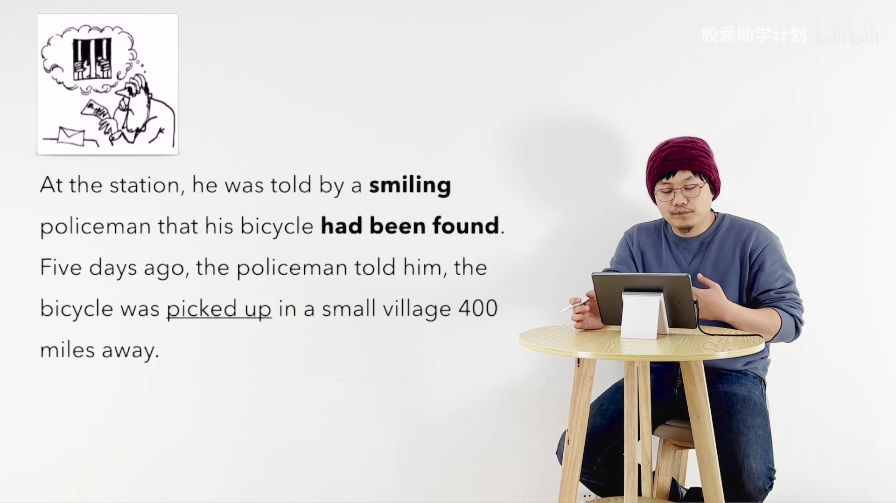

文字识别：At the station, he was told by a smiling / policeman that his bicycle had been found. / Five days ago, the policeman told him, the / bicycle was picked up in a smallvillage 400 / miles away.

## 00:05:00–00:05:30

在这个警局的时候呢, he was told他被告知啊被什么呢? By a smiling policeman,被一个smiling policeman. Smile,你认得叫笑, policeman叫警察。那这儿的笑为什么加了ing?你仔细去看一下这儿的smile放在了a和一个名词的中间，是不是特别像形容词的位置？注意啊，是不是特别像形容词的

### 画面 00:05:09

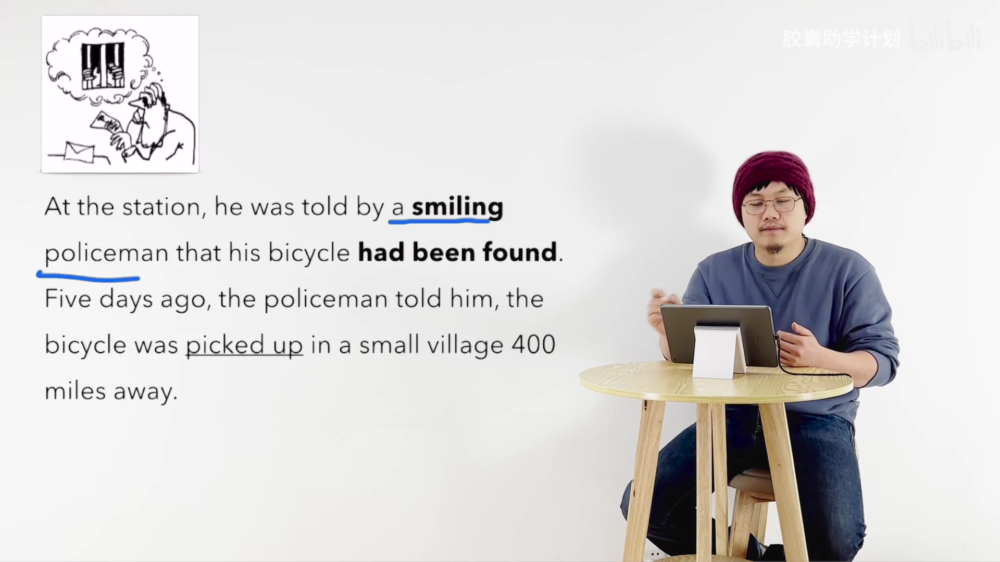

文字识别：At the station, he was told by a smiling / policeman that his bicycle had been found. / Five days ago, the policeman told him, the / bicycle was picked up in a smallvillage 400 / miles away.

### 画面 00:05:29

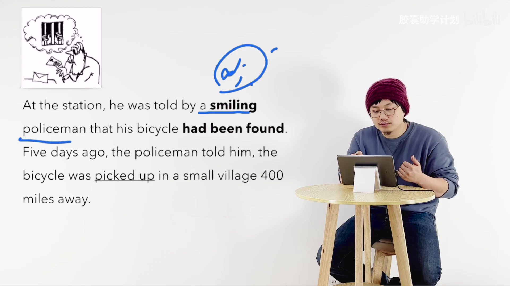

文字识别：At the station, he was told by a smiling / policeman that his bicycle had been found. / Five days ago, the policeman told him, the / bicycle was picked up in a small village 400 / miles away.

## 00:05:30–00:06:00

位置，对吧？这就是我们二十八、二十九、三十课那三课连着学过的分词跟定语相关的东西。这个就是一个叫现在分词做了一个定语，叫做面带微笑的啊，对吧？它是一个动词变成了一个类似于形容词的作用。面带微笑的警察告诉他一件事儿，什么事儿呢？His bicycle had been found，叫他的自行车已经

### 画面 00:05:57

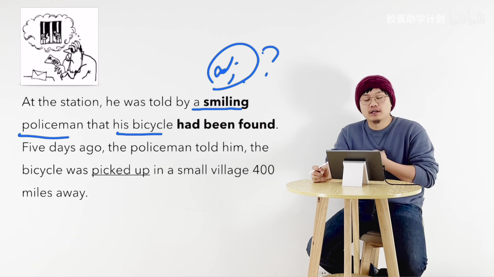

文字识别：At the station, he was told by a smiling / policeman that his bicycle had been found. / Five days ago, the policeman told him, the / bicycle was picked up in a small village 400 / miles away.

## 00:06:00–00:06:30

被找到了啊，这其实不是什么太大的事儿，对吧？Five days ago，五天前又往前倒了五天。The policeman told him说警察告诉他The bicycle was picked up in a small village four hundred miles away。再看一下，自行车was picked up。不管后面pick up什么意思，was加一个动词加ed，很可能就是被动，对吧？这儿确实

### 画面 00:06:27

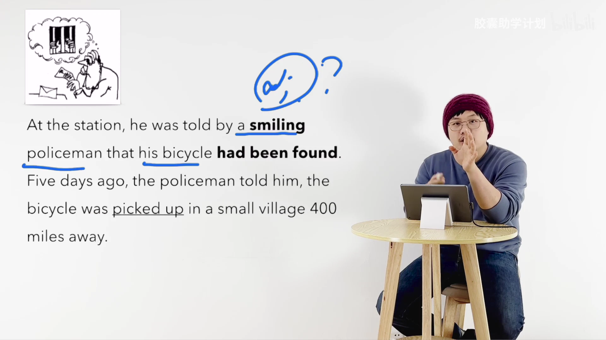

文字识别：At the station, he was told by a smiling / policeman that his bicycle had been found. / Five days ago, the policeman told him, the / bicycle was picked up in a small village 400 / miles away.

## 00:06:30–00:07:00

是被动啊。那 pick up 是什么意思呢？各位看，我这儿有一根笔，对吧？我用手把它捡起来，这个动作就叫 pick up，对吧？只不过在这里，你说自行车被捡起来了，稍微有点翻译不通。但 pick up 最基本、最常见的意思就是捡起某个东西。那在这里，可以理解为叫做被意外的发现了，对吧？但是大多数情况下，我们不要这么去呃用它，好吧？OK，你就知道它最基本的含义就

### 画面 00:06:57

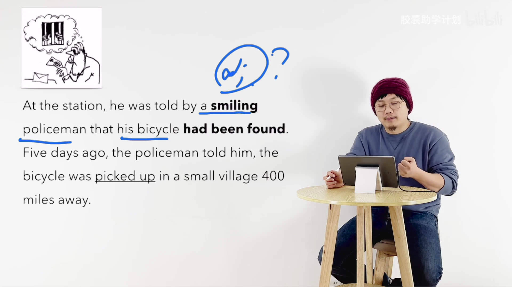

文字识别：At the station, he was told by a smiling / policeman that his bicycle had been found. / Five days ago, the policeman told him, the / bicycle was picked up in a small village 400 / miles away.

## 00:07:00–00:07:30

可以了，在这儿明白它是什么意思，好吧？但你用pick up的时候，你一般去把它用叫做捡起某个东西，对吧？比如说pick it up，对吧？把它捡起来啊！被意外发现了，被捡起来了。In a small village，在一个很小的村庄，four hundred miles away，四百英里以外，很远了。It is now being sent to his home by train。说呀，这个自行车

### 画面 00:07:23

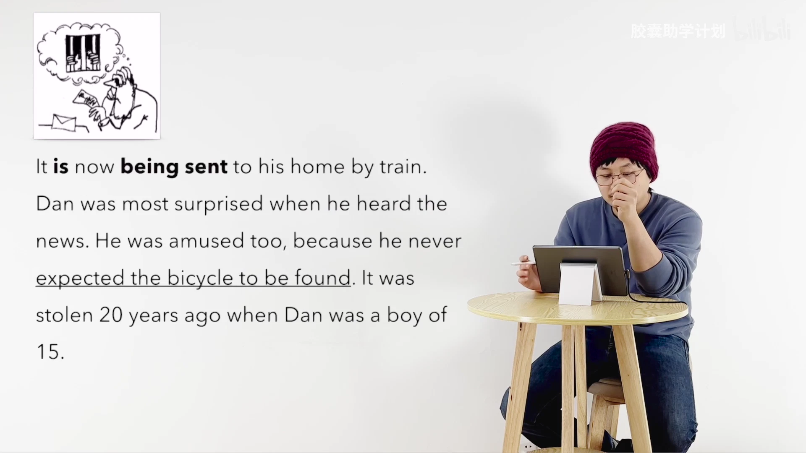

文字识别：It is now being sent to his home by train. / Dan was most surprised when he heard the / news. He was amused too, because he never / expected the bicycle to be found. Ilt was / stolen 20 years ago when Dan was a boy of / 15.

## 00:07:30–00:08:00

现在正在正在 is being done，正在被送往他家 by train，叫做用火车送往他家。Dan was most surprised when he heard the news.啊，其实我们讲单词的时候已经见过这句话了，叫做Dan怎么样呢？Very surprised，感到非常的诧异。当他听到这个消息的时候，he was amused too.哎，你看这个amused，如果你新一学

### 画面 00:07:53

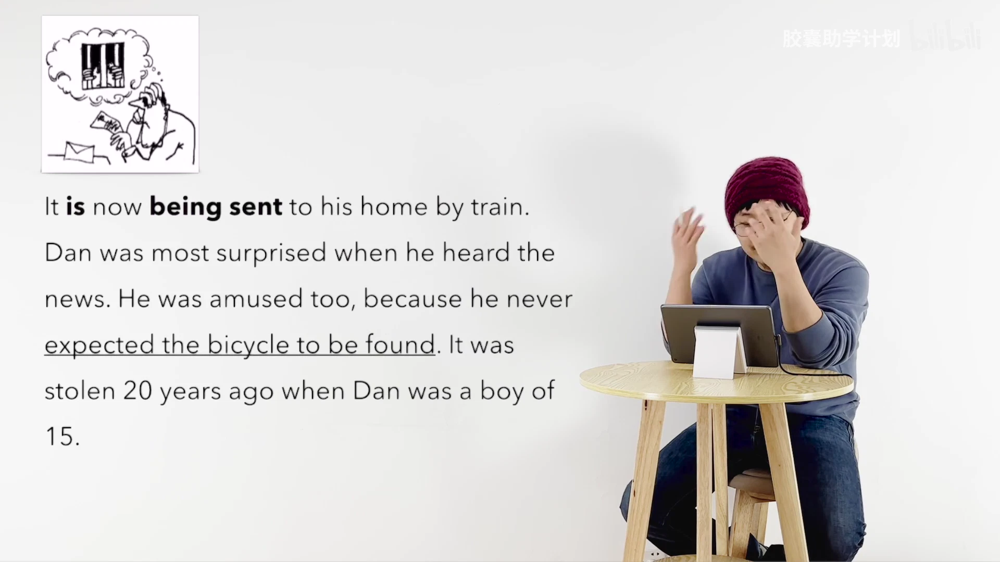

文字识别：It is now being sent to his home by train. / Dan was most surprised when he heard the / news. He was amused too, because he never / expected the bicycle to be found. Ilt was / stolen 20 years ago when Dan was a boy of / 15.

### 画面 00:07:58

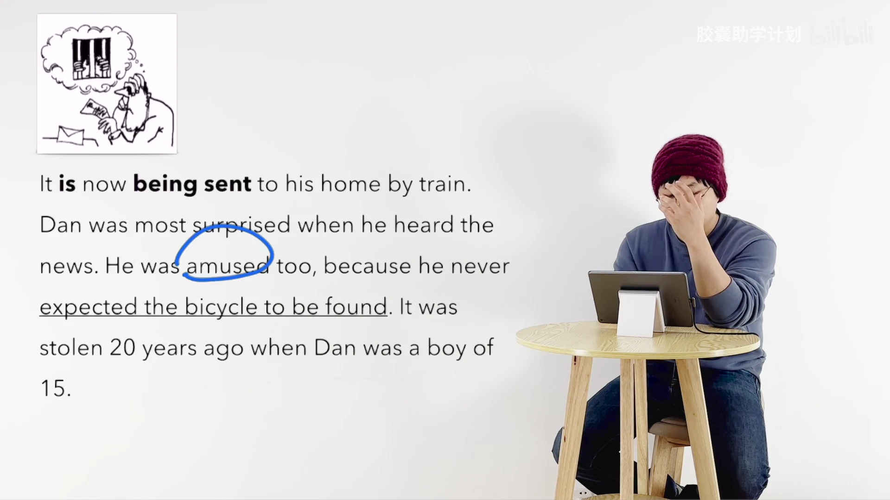

文字识别：It is now being sent to his home by train. / Dan was most surprised when he heard the / news. He was amused too, because he never / expected the bicycle to be found. It was / stolen 20 years ago when Dan was a boy of / 15.

## 00:08:00–00:08:30

过一百四十一课、一百四十三课，那这个单词你应该挺熟的，对吧？要他也感觉很有趣，不是一个被动，它是一个形容词啊。Because因为he never他从来就没有怎么样呢？Expected the bicycle to be found.好，如果我们真的从语法的角度，它其实是一个to do不定式的被动，叫to be done。但我们暂

### 画面 00:08:20

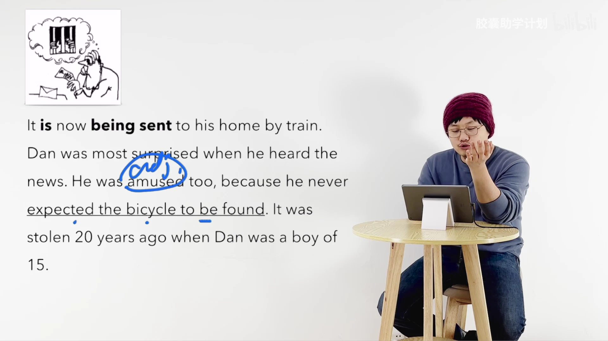

文字识别：It is now being sent to his home by train. / Dan was most s / rised when he heard the / news. He was amused too, because he never / expected the bicycle to be found. It was / stolen 20 years ago when Dan was a boy of / 15.

## 00:08:30–00:09:00

时先不这样去讲它，我们把它一个当当做一个习惯用法拉出来，叫做 expect something to be found，叫做期待某个东西被找到，对吧？我们把一个比较难的语法先给它变成一个习惯用法，我们先熟悉这个结构。而且我们在上一个视频当中的 pattern drill，我不知道您有没有印象啊？我们实际上已经练过了，叫 never expect something to be found 这样的一个小的结构。 OK，就是说，因

### 画面 00:08:41

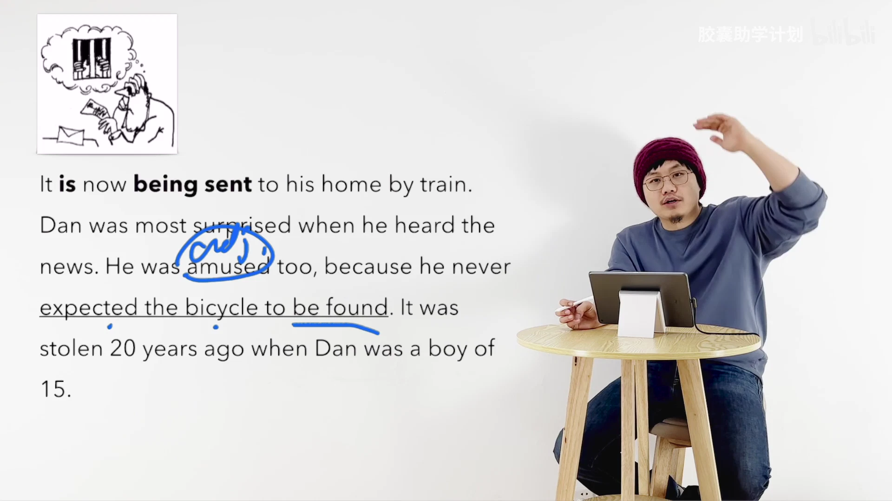

文字识别：It is now being sent to his home by train. / Dan was most sy / rised when he heard the / news. He was amused too, because he never / expected the bicycle to be found. It was / stolen 20 years ago when Dan was a boy of / 15.

## 00:09:00–00:09:30

为啊，他从来没有说期待着他的自行车能被找到。It was stolen，好，was加stolen，一般过去时的被动。Twenty years ago，二十年前被偷的。When当什么呢？Dan was a boy of fifteen，其实就是a fifteen years old boy，是吧？说当Dan还是一个十五岁男孩的时候，他的自行车被偷了。二十年之后破案了，是吧？OK，这

### 画面 00:09:00

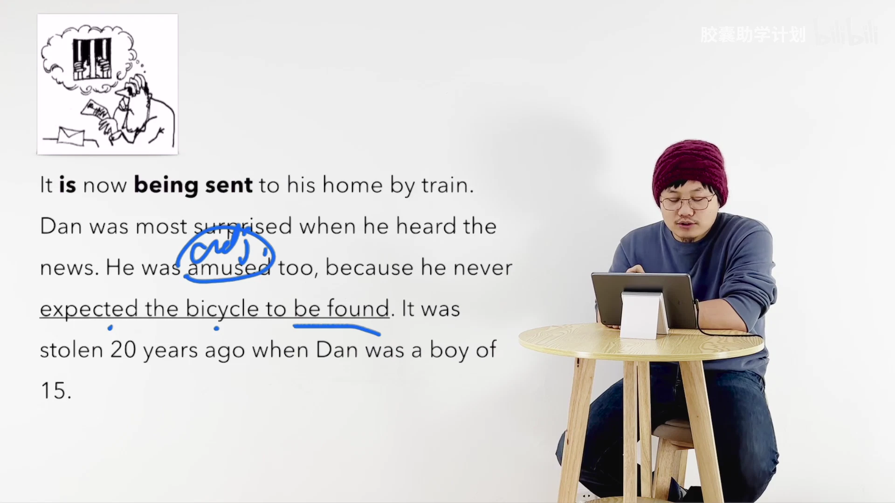

文字识别：It is now being sent to his home by train. / Dan was most sy / kised when he heard the / news. He was amused too, because he never / expected the bicycle to be found. It was / stolen 20 years ago when Dan was a boy of / 15.

### 画面 00:09:03

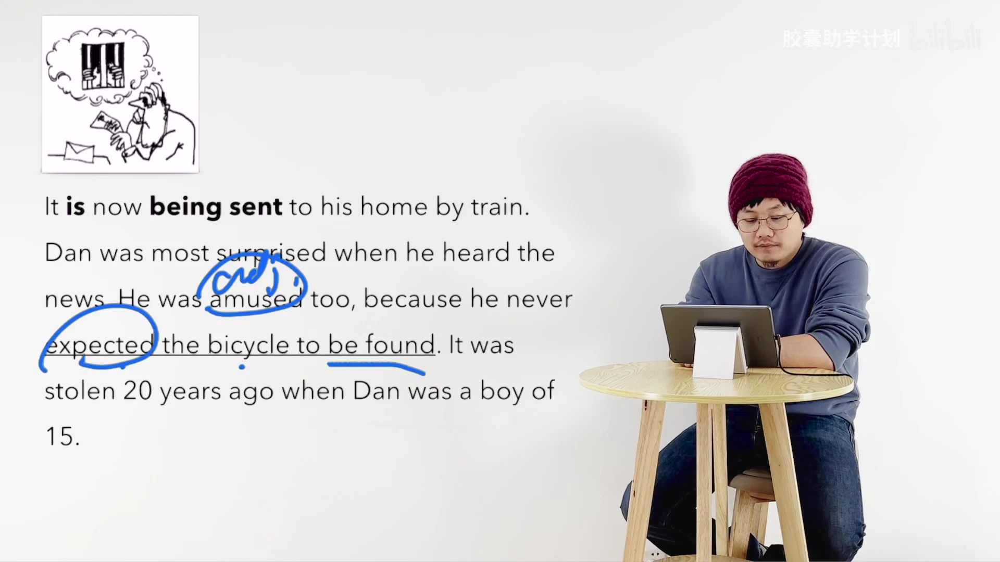

文字识别：It is now being sent to his home by train. / Dan was most s / rised when he heard the / news He was amused too, because he never / expected the bicycle to be found. It was / stolen 20 years ago when Dan was a boy of / 15.

### 画面 00:09:05

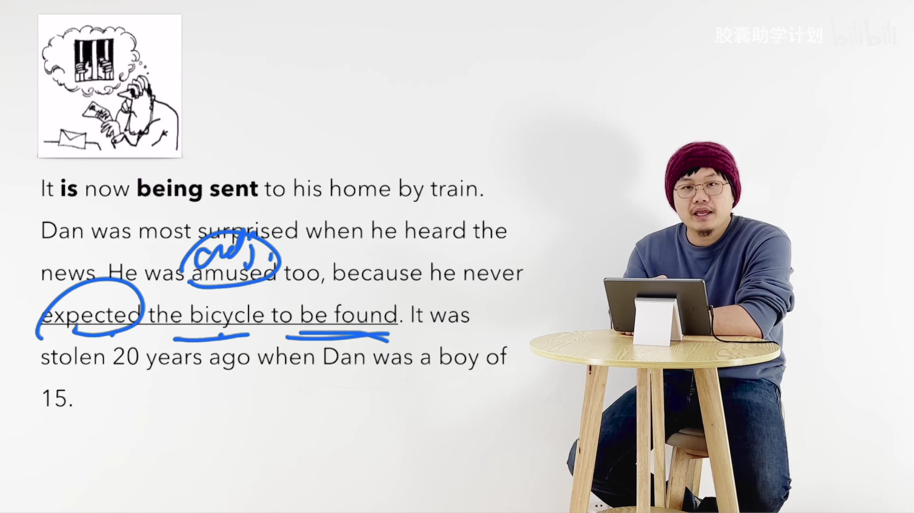

文字识别：It is now being sent to his home by train. / Dan was most sl / rised when he heard the / Itoo, because he never / news He was amusedt / expected the bicycle to be found. Ilt was / stolen 20 years ago when Dan was a boy of / 15.

## 00:09:30–00:10:00

是一个比较讽刺的小文章啊。那接下来呢，我们看一下本文的习惯用法。除了我们之前学过的，我们摘出来了两个，第一个叫 call at，第二个叫 expect something to be found。我们先看 call at， call at，刚才我们说了，就类似于去拜访，对吧？去参观，当然你要由后边的地点去决定，你翻译成参观还是拜访，它本质上就是 visit，就是 stop by，啊，就是去那儿停

### 画面 00:09:31

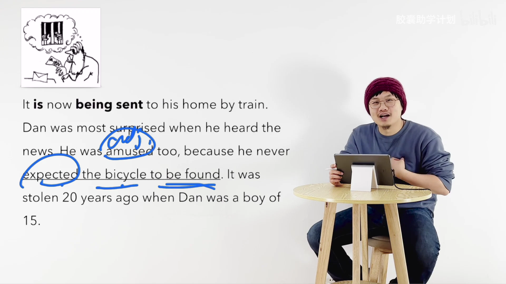

文字识别：It is now being sent to his home by train. / Dan was most sl / rised when he heard the / Itoo, because he never / news He was amusedt / expected the bicycle to be found. It was / stolen 20 years ago when Dan was a boy of / 15.

### 画面 00:09:33

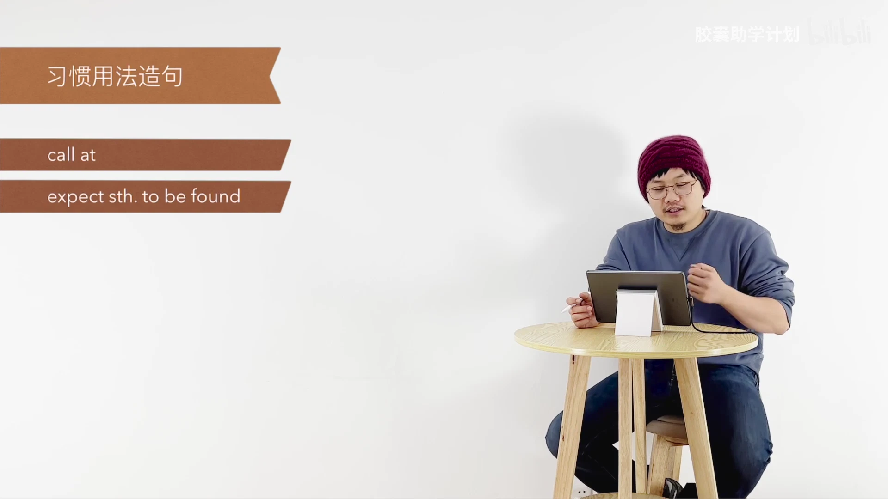

文字识别：习惯用法造句 / call at / expect sth. to be found

### 画面 00:09:35

文字识别：习惯用法造句 / call at / expect sth. to be found

### 画面 00:09:42

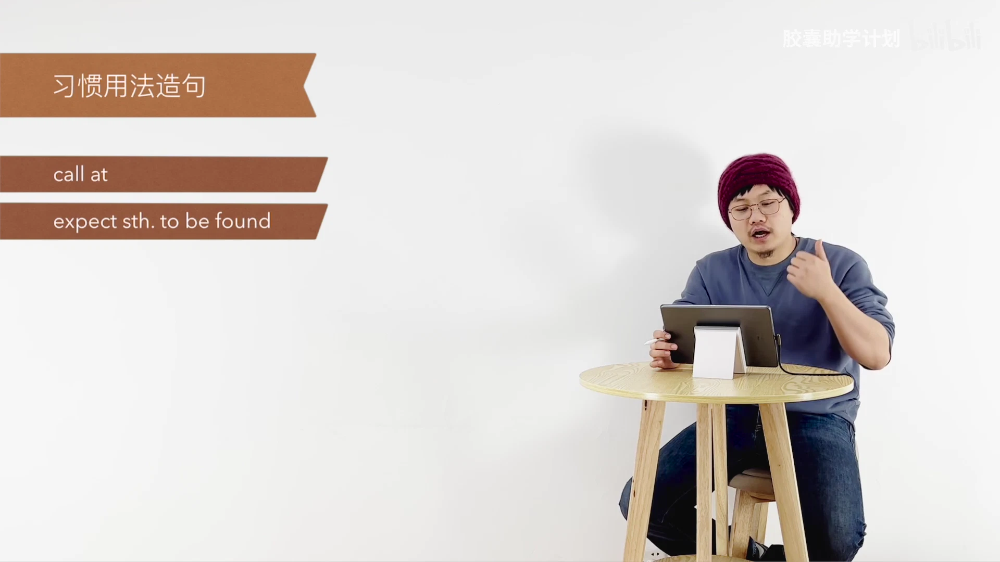

文字识别：习惯用法造句 / call at / expect sth. to be found

### 画面 00:09:46

文字识别：网：v.+v.变化 / 习惯用法造句指南 / 四句型转换 / 方式/地点/时间 / 其他习惯用法 / 其他单词+词性 / 原文摘抄+变 / 6123456 / call at

### 画面 00:09:48

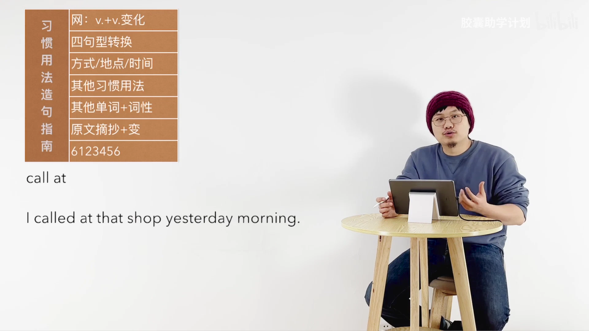

文字识别：网：v.+v.变化 / 习惯用法造句指南 / 四句型转换 / 方式/地点/时间 / 其他习惯用法 / 其他单词+词性 / 原文摘抄+变 / 6123456 / call at / I called at that shop yesterday morning.

### 画面 00:09:50

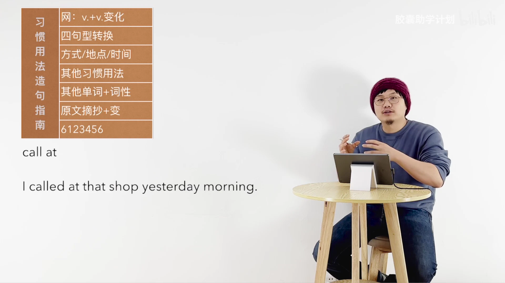

文字识别：网：v.+v.变化 / 习惯用法造句指南 / 四句型转换 / 方式/地点/时间 / 其他习惯用法 / 其他单词+词性 / 原文摘抄+变 / 6123456 / call at / I called at that shop yesterday morning.

## 00:10:00–00:10:30

留了一下，去路过了一下啊。比如说 I call at that shop yesterday morning，那就是说我昨天早晨去那个店里路过过了一下，对吧？哎，我去那里买了，比如说买了买了个口香糖，买了个汽水，对吧？哎，就是这个样子。肯定句给你了，各种句型转换，对吧？哎，这个地方单词造句啊，看一下。Next one，说 You must call at the station as quickly as possible。这实际上是我们三

### 画面 00:10:00

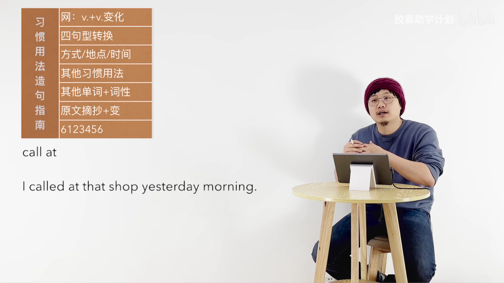

文字识别：网：v.+v.变化 / 习惯用法造句指南 / 四句型转换 / 方式/地点/时间 / 其他习惯用法 / 其他单词+词性 / 原文摘抄+变 / 6123456 / call at / I called at that shop yesterday morning.

### 画面 00:10:05

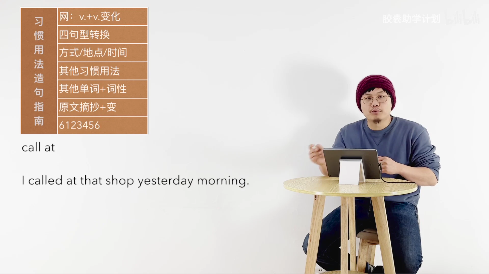

文字识别：网：v.+v.变化 / 习惯用法造句指南 / 四句型转换 / 方式/地点/时间 / 其他习惯用法 / 其他单词+词性 / 原文摘抄+变 / 6123456 / call at / I called at that shop yesterday morning.

### 画面 00:10:10

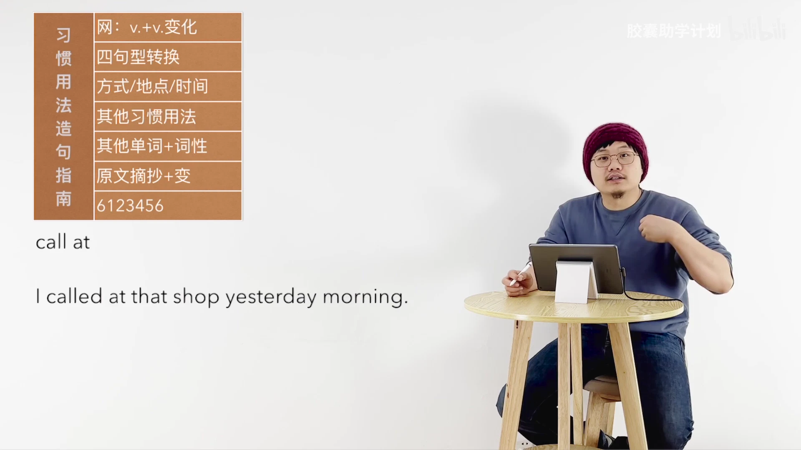

文字识别：网：v.+v.变化 / 习惯用法造句指南 / 四句型转换 / 方式/地点/时间 / 其他习惯用法 / 其他单词+词性 / 原文摘抄+变 / 6123456 / callat / I called at that shop yesterday morning.

### 画面 00:10:15

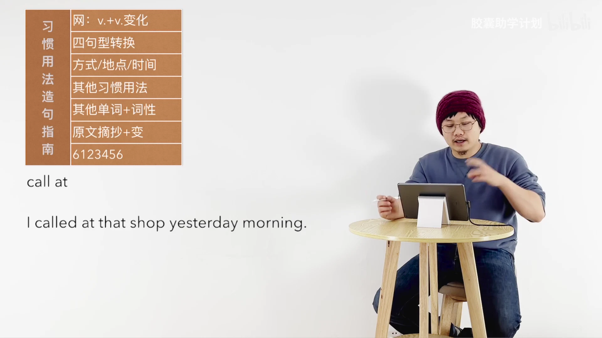

文字识别：网：v.+v.变化 / 习惯用法造句指南 / 四句型转换 / 方式/地点/时间 / 其他习惯用法 / 其他单词+词性 / 原文摘抄+变 / 6123456 / call at / I called at that shop yesterday morning.

### 画面 00:10:20

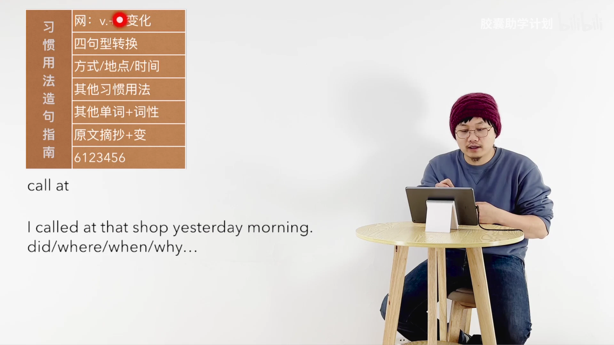

文字识别：网：v.-●变化 / 习惯用法造句指南 / 四句型转换 / 方式/地点/时间 / 其他习惯用法 / 其他单词+词性 / 原文摘抄+变 / 6123456 / call at / I called at that shop yesterday morning. / did/where/when/why...

### 画面 00:10:24

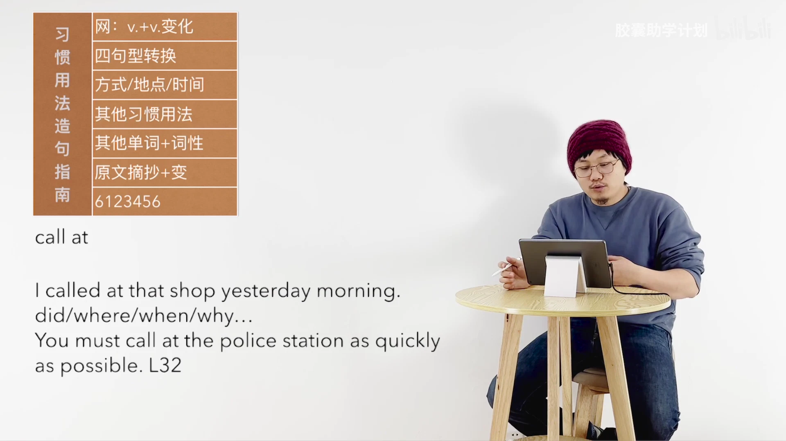

文字识别：网：v.+v.变化 / 习惯用法造句指南 / 四句型转换 / 方式/地点/时间 / 其他习惯用法 / 其他单词+词性 / 原文摘抄+变 / 6123456 / call at / I called at that shop yesterday morning. / did/where/when/why... / You must call at the police station as quickly / as possible. L32

### 画面 00:10:26

文字识别：网：v.+v.变化 / 习惯用法造句指南 / 四句型转换 / 方式/地点/时间 / 其他习惯用法 / 其他单词+词性 / 原文摘抄+变 / 6123456 / call at / I called at that shop yesterday morning. / did/where/when/why... / You must call at the police station as quickly / as possible. L32

## 00:10:30–00:11:00

十二课刚刚学的as as由它所引出来的一个常用的短语叫as quickly as possible，叫尽快，是吧？说你必须要尽快去警察局，对吧？Okay, very good. 不多说。Expect something to be found.比如说我造一句话叫I expected my wallet to be found by the police.至于前面那个never，您可加可不加，由含义去进行一个决定，对吧？这个我们也不多说了啊。然后

### 画面 00:10:30

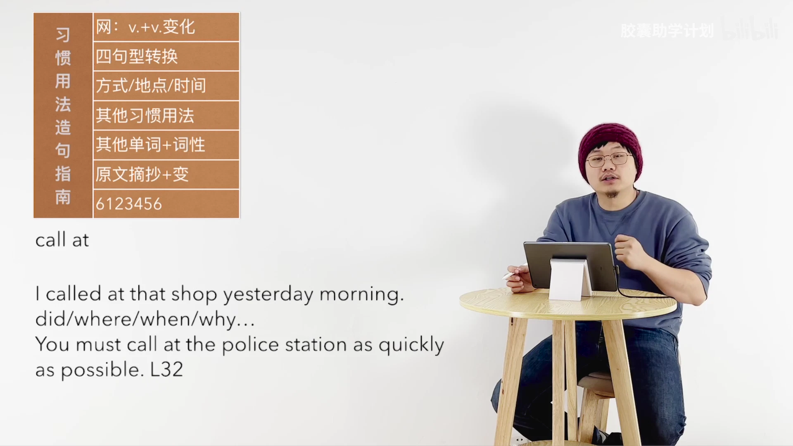

文字识别：网：v.+v.变化 / 习惯用法造句指南 / 四句型转换 / 方式/地点/时间 / 其他习惯用法 / 其他单词+词性 / 原文摘抄+变 / 6123456 / call at / I called at that shop yesterday morning. / did/where/when/why... / You must call at the police station as quickly / as possible. L32

### 画面 00:10:35

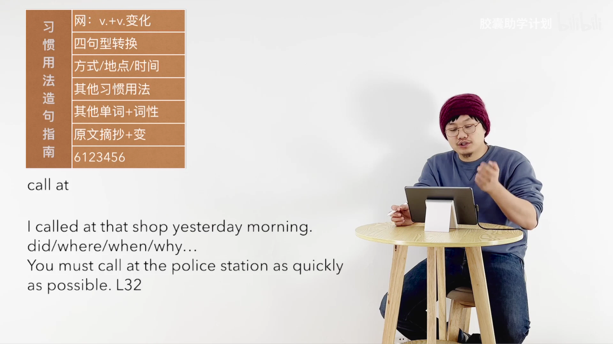

文字识别：网：v.+v.变化 / 习惯用法造句指南 / 四句型转换 / 方式/地点/时间 / 其他习惯用法 / 其他单词+词性 / 原文摘抄+变 / 6123456 / callat / I called at that shop yesterday morning. / did/where/when/why... / You must call at the police station as quickly / as possible. L32

### 画面 00:10:40

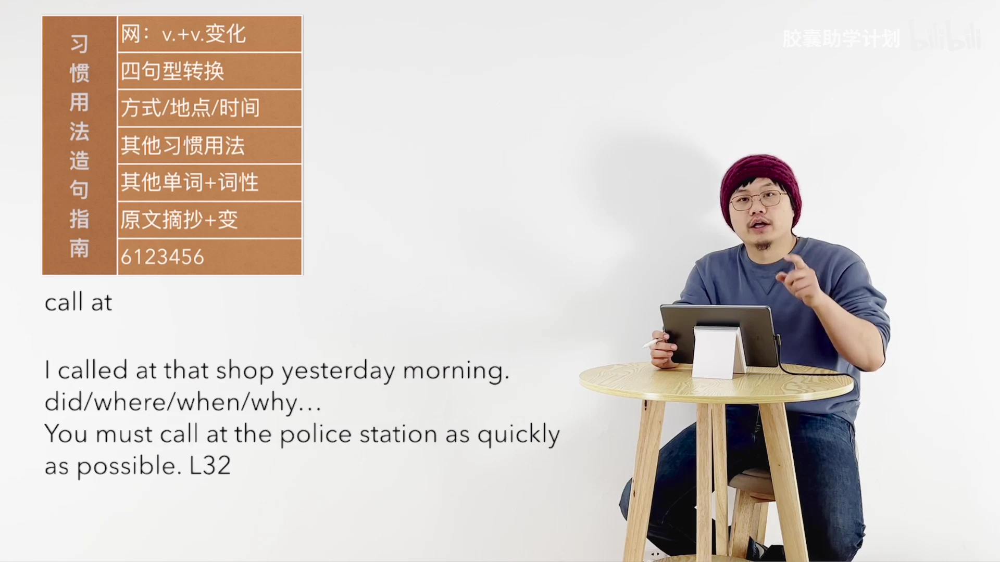

文字识别：网：v.+v.变化 / 习惯用法造句指南 / 四句型转换 / 方式/地点/时间 / 其他习惯用法 / 其他单词+词性 / 原文摘抄+变 / 6123456 / call at / I called at that shop yesterday morning. / did/where/when/why... / You must call at the police station as quickly / as possible. L32

### 画面 00:10:43

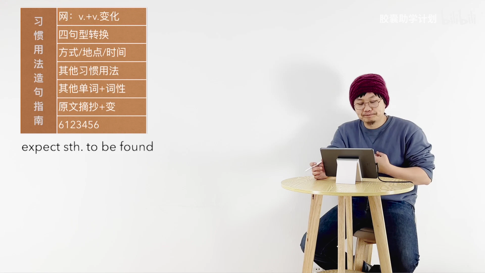

文字识别：网：v.+v.变化 / 习惯用法造句指南 / 四句型转换 / 方式/地点/时间 / 其他习惯用法 / 其他单词+词性 / 原文摘抄+变 / 6123456 / expect sth. to be found

### 画面 00:10:45

文字识别：网：v.+v.变化 / 习惯用法造句指南 / 四句型转换 / 方式/地点/时间 / 其他习惯用法 / 其他单词+词性 / 原文摘抄+变 / 6123456 / expect sth.to be found

### 画面 00:10:50

文字识别：网：v.+v.变化 / 习惯用法造句指南 / 四句型转换 / 方式/地点/时间 / 其他习惯用法 / 其他单词+词性 / 原文摘抄+变 / 6123456 / expect sth.to be found / I (never) expected my wallet to be found by the / police.

### 画面 00:10:55

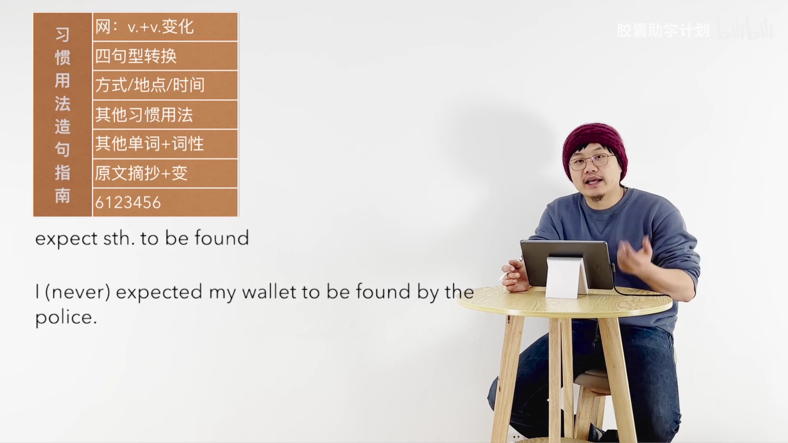

文字识别：网：v.+v.变化 / 习惯用法造句指南 / 四句型转换 / 方式/地点/时间 / 其他习惯用法 / 其他单词+词性 / 原文摘抄+变 / 6123456 / expect sth.to be found / I (never) expected my wallet to be found by the / police.

## 00:11:00–00:11:30

剩下的，其实对于各位来说，这个造句就很简单。我为什么就点点点了呢？因为我觉得您自己可以搞定了。这里面能替换的，其实我们现在就只替换这一个单词，叫做 my wallet，对吧？OK。呃，接下来呢，我们看一个小的电影片段。这个电影片段和刚才我们讲那个稍有不同，但基本差别不太大。比如说，我们看一下这句话，叫做 He didn't expect to be invited to the

### 画面 00:11:00

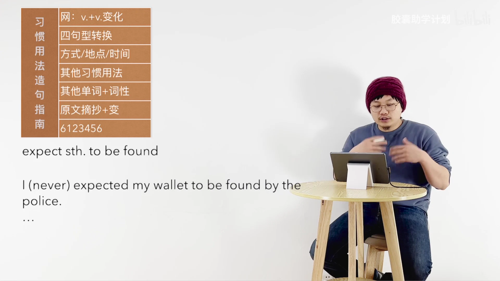

文字识别：网：v.+v.变化 / 习惯用法造句指南 / 四句型转换 / 方式/地点/时间 / 其他习惯用法 / 其他单词+词性 / 原文摘抄+变 / 6123456 / expect sth.to be found / I (never) expected my wallet to be found by the / police.

### 画面 00:11:03

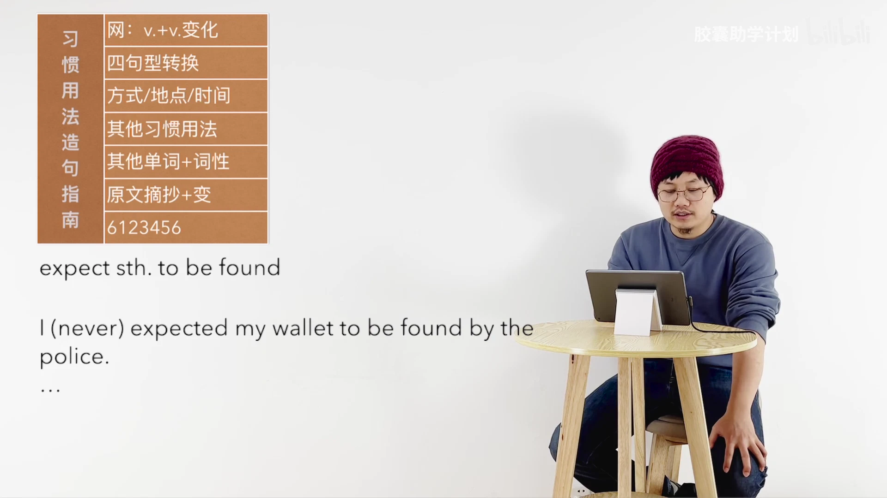

文字识别：网：v.+v.变化 / 习惯用法造句指南 / 四句型转换 / 方式/地点/时间 / 其他习惯用法 / 其他单词+词性 / 原文摘抄+变 / 6123456 / expect sth.to be found / I (never) expected my wallet to be found by the / police.

### 画面 00:11:05

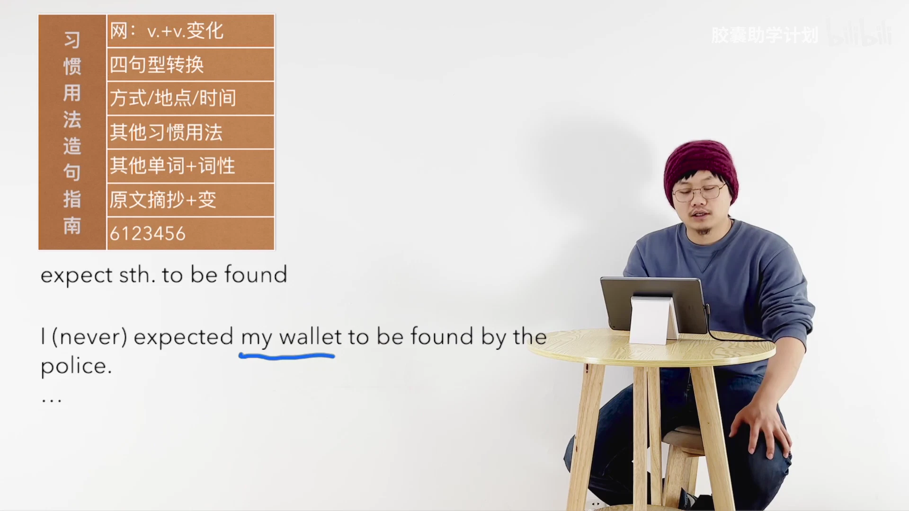

文字识别：网：v.+v.变化 / 习惯用法造句指南 / 四句型转换 / 方式/地点/时间 / 其他习惯用法 / 其他单词+词性 / 原文摘抄+变 / 6123456 / expect sth.to be found / I (never) expected my wallet to be found by the / police.

### 画面 00:11:07

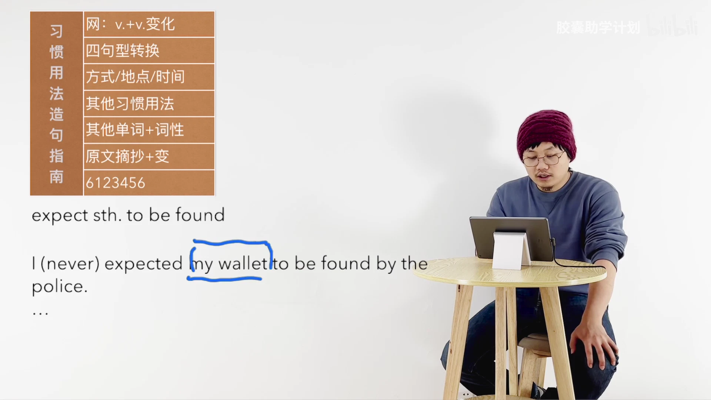

文字识别：网：v.+v.变化 / 习惯用法造句指南 / 四句型转换 / 方式/地点/时间 / 其他习惯用法 / 其他单词+词性 / 原文摘抄+变 / 6123456 / expect sth. to be found / I (never) expected / hy walletlto be found by the / police.

### 画面 00:11:09

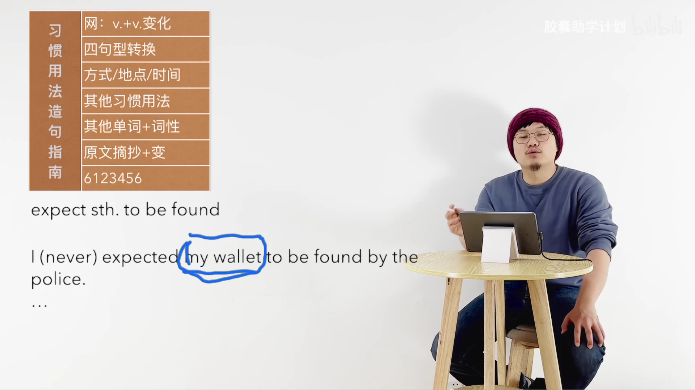

文字识别：网：v.+v.变化 / 习惯用法造句指南 / 四句型转换 / 方式/地点/时间 / 其他习惯用法 / 其他单词+词性 / 原文摘抄+变 / 6123456 / expect sth. to be found / I (never) expected / My walletto be found by the / police.

### 画面 00:11:11

文字识别：网：v.+v.变化 / 习惯用法造句指南 / 四句型转换 / 方式/地点/时间 / 其他习惯用法 / 其他单词+词性 / 原文摘抄+变 / 6123456 / expect sth. to be found / I (never) expected / ny walletto be found by the / police.

### 画面 00:11:14

文字识别：He didn't expect to be invited to / the wedding. / 教父 / The Godfather / (1972)

## 00:11:30–00:12:00

wedding, wedding叫婚礼啊。说他没有预期被邀请来参加婚礼。 Didn't expect to be invited. Okay, 那我们注意力集中来了啊。 He's not on the list, but Luca Brasi wants to see. Is this is this necessary? He didn't expect to be invited to the wedding, so he wanted to thank you.

### 画面 00:11:44

文字识别：He didn't expect to be invited to / the wedding. / 路卡布拉西不在名单上但他想要见你 / 教父 / He's not on the list, but Luca Brasi wants to see you. / The Godfather / (1972)

### 画面 00:11:46

文字识别：He didn't expect to be invited to / the wedding. / 路卡布拉西不在名单上但他想要见你 / 教父 / He's not on the list, but Luca Brasi wants to see you. / The Godfather / (1972)

### 画面 00:11:48

文字识别：He didn't expect to be invited to / the wedding. / 教父 / The Godfather / (1972)

### 画面 00:11:50

文字识别：He didn't expect to be invited to / the wedding. / 教父 / The Godfather / (1972)

### 画面 00:11:52

文字识别：He didn't expect to be invited to / the wedding. / 教父 / The Godfather / (1972)

### 画面 00:11:54

文字识别：He didn't expect to be invited to / the wedding. / 这个有这个必要吗？ / 教父 / Is this necessary? / The Godfather / (1972)

### 画面 00:11:56

文字识别：He didn't expect to be invited to / the wedding. / 他没料到会受邀参加婚礼所以要向你致谢 / 教父 / He didn't expect to be invited to the wedding..so he wanted to thank you. / The Godfather / (1972)

### 画面 00:11:59

文字识别：He didn't expect to be invited to / the wedding. / 他没料到会受邀参加婚礼所以要向你致谢 / 教父 / He didn't expect to be invited to the wedding..so he wanted to thank you. / The Godfather / (1972)

## 00:12:00–00:12:30

好了，那不多说了。Recap，本课除了文章以外，两个习惯用法啊，呃，加上作业习惯用法，我们要去造句。文章跟读制，熟读成诵，这是各位非常重要的作业之一，好吧？那以上呢就是本期视频的全部内容了。如果各位喜欢我们的课程呢，欢迎各位关注、订阅、一键三连，分享给那些需要的朋友，来帮助我们快速成长。

### 画面 00:12:01

文字识别：He didn't expect to be invited to / the wedding. / 好吧 / 教父 / All right. / The Godfather / (1972)

### 画面 00:12:03

文字识别：Recap / call at / Expression / expect sth. to be found

### 画面 00:12:05

文字识别：Recap / call at / Expression / expect sth. to be found

### 画面 00:12:08

### 画面 00:12:10

文字识别：习惯用法造句/对话 / 1. / 【习惯用法造句指南】 / 每个5句 / 文章跟读至熟读成诵 / 内化单词+语法+习惯用法 / 听力+口语+写作练习

### 画面 00:12:12

文字识别：1. / 习惯用法造句/对话 / 【习惯用法造句指南】 / 每个5句 / 文章跟读至熟读成诵 / 内化单词+语法+习惯用法 / 听力+口语+写作练习

### 画面 00:12:15

文字识别：1. / 习惯用法造句/对话 / 【习惯用法造句指南】 / 每个5句 / 文章跟读至熟读成诵 / 内化单词+语法+习惯用法 / 听力+口语+写作练习

### 画面 00:12:18

文字识别：👍

## 00:12:30–00:12:43

you next time.

### 画面 00:12:31

### 画面 00:12:33

文字识别：CAPSULEACADEMY / 胶囊助学计划 / 小红书 / Lecturer / Leo / OE

### 画面 00:12:35

文字识别：CAPSULEACADEMY / 胶囊助学计划 / 小红书 / Photographer / □ / Berlin / OE

### 画面 00:12:37

文字识别：CAPSULEACADEMY / 胶囊助学计划 / 小红书 / Editor / Berlin / OE

### 画面 00:12:40

文字识别：CAPSULEACADEMY / 胶囊助学计划 / 小红书

### 画面 00:12:42

文字识别：bilibili / 胶囊助学计划

