# L034 听说读写复述练习

快速机器解析：语音为单模型转写，未进行独立交叉校对或人工复核；画面每秒采样并按变化选帧，短时文字和标记可能遗漏。截图时间约有 1 秒误差。图片有损压缩；遇到疑点请按时间查看 Google Drive 原视频。

## 00:00:00–00:00:30

Hello everyone, welcome to Capsule Academy. This is Leo. Today we're going to learn New Concept English Book Two, Lesson Thirty Four Practices. 那注意，进行如下练习的唯一前提就是文章一定要跟读至熟读成诵，否则请勿开始。 Hope you gonna enjoy it. 好，那我们先看第一题 comprehension，练习大家能听懂别人发问的能力，对吧？基于文章您读到很

### 画面 00:00:00

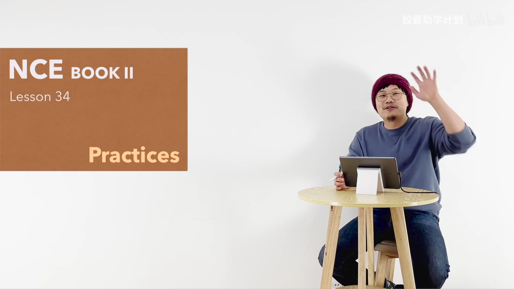

文字识别：NCE / BOOKⅡI / Lesson 34 / Practices

### 画面 00:00:02

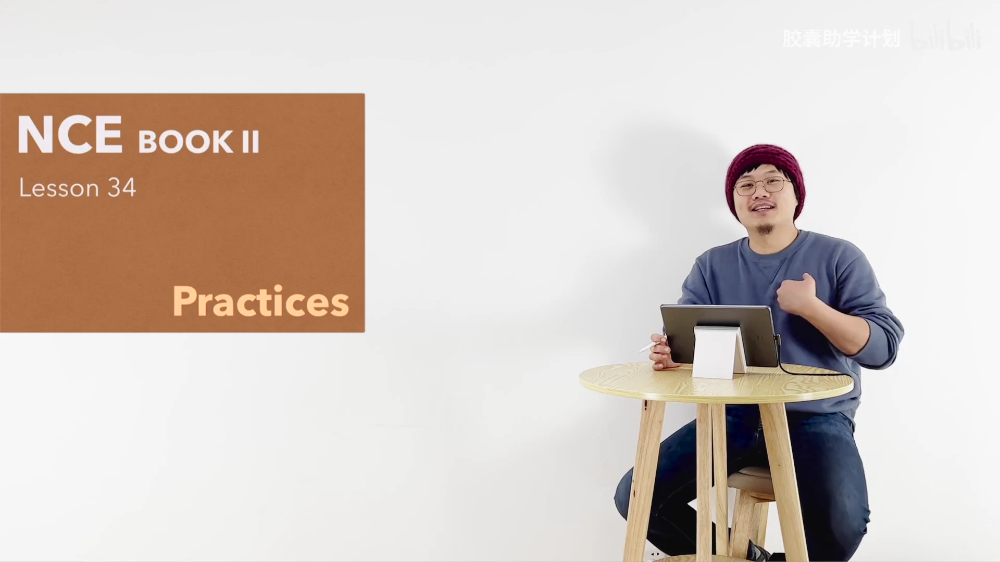

文字识别：NCE / BOOKII / Lesson 34 / Practices

### 画面 00:00:05

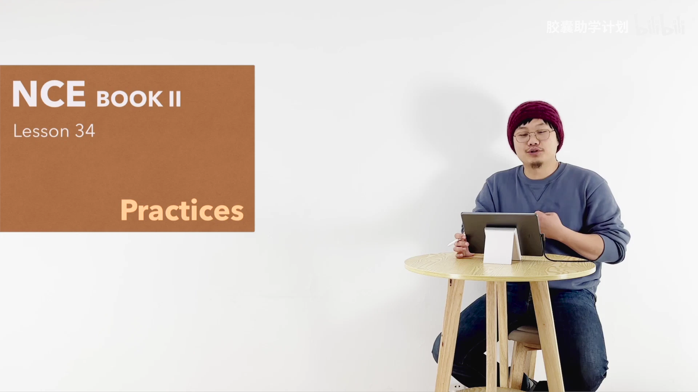

文字识别：NCE / BOOKII / Lesson 34 / Practices

### 画面 00:00:08

文字识别：进行如下练习唯一前提 / 文章跟读至熟读成诵 / 否则请勿开始

### 画面 00:00:18

文字识别：胶囊助学计划bill / •

### 画面 00:00:22

文字识别：胶囊助学计划

### 画面 00:00:24

文字识别：Comprehension / 训练目标： / 听懂一般疑问句＆特殊疑问句

## 00:00:30–00:01:00

熟了，来我问您答，不要看屏幕啊。第一题，Who has been worrying？啊，Dan Robinson对吧？Next one，How long has he been worried？A week。Next one，When did he receive a letter？Last Tuesday。Next one，Who was it from？A local

### 画面 00:00:33

文字识别：Comprehension / Who has been worrying?

## 00:01:00–00:01:30

Next one, what did Dan wonder? Why he was wanted by the police? When did he go to the station? Yesterday. Next one, what was he told at the station? His bicycle had been found. Next one, who told him this?

### 画面 00:01:03

文字识别：Comprehension / What did Dan wonder?

## 00:01:30–00:02:00

A smiling policeman. Next one. When was the bicycle picked up? Five days ago. Next one. How far from Dan's home was it? Was the bicycle, is right? Or was uh you know where they pick up the bicycle? Ah, four hundred miles away. Next one. Where is the bicycle being sent to?

### 画面 00:01:33

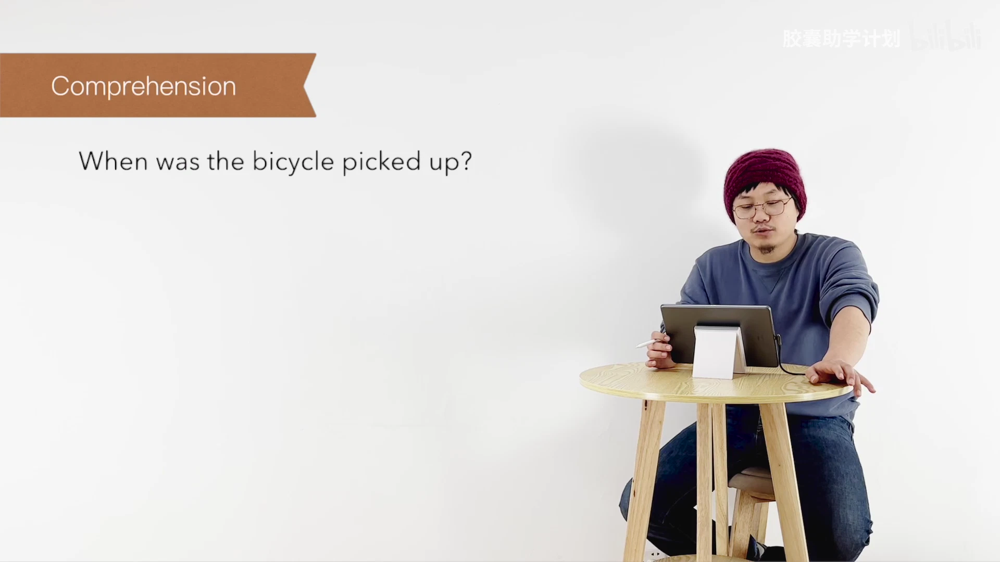

文字识别：Comprehension / When was the bicycle picked up?

## 00:02:00–00:02:30

to his home. Next one, how is it being sent by train? 好，asking questions练习我们能发问的能力。一般疑问句，特殊疑问句，老习惯。先看一个例子啊，说 Dan Robinson was worried. 很简单，was提前，who对Dan Robinson提问，对吧？叫Who was worried? OK. 好，那我们看接下来的题。那Why? 首先第一个加整句，一

### 画面 00:02:03

文字识别：Comprehension / How is it being sent?

### 画面 00:02:09

文字识别：Asking questions / 训练目标： / 会说一般疑问句＆特殊疑问句 / Accuracy / Fluency

### 画面 00:02:16

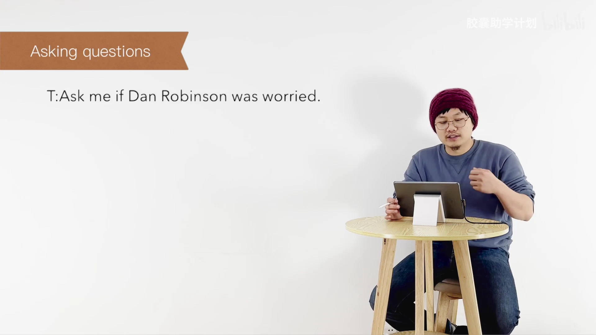

文字识别：Asking questions / T:Ask me if Dan Robinson was worried.

### 画面 00:02:27

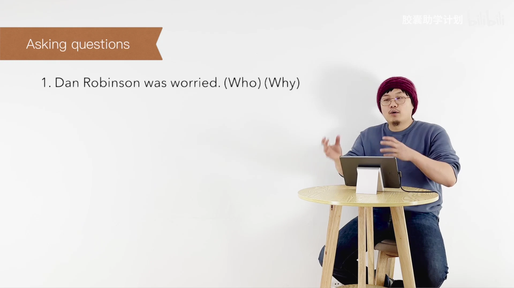

文字识别：Asking questions / 1. Dan Robinson was worried. (Who) (Why)

## 00:02:30–00:03:00

般疑问句就可以了啊。我们只说思路，不挨个对答案。您要自己去写啊。说 He received a letter last Tuesday. 很简单，一般过去时 did 一提前就行了。 When 对 last Tuesday 提问，What 对 a letter 提问啊？呃，It was from the police. Was 提前，Who 对 the police 提问。 He was asked to call at the station. Was 提前，Where 对呃 the station 提问，对吧？然后

### 画面 00:02:32

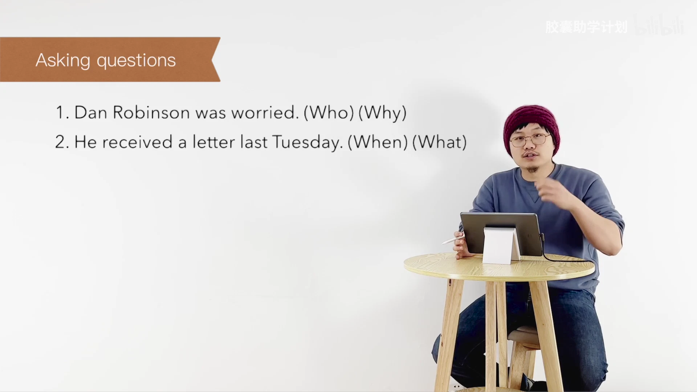

文字识别：Asking questions / 1. Dan Robinson was worried. (Who) (Why) / 2. He received a letter last Tuesday.(When) (What)

### 画面 00:02:51

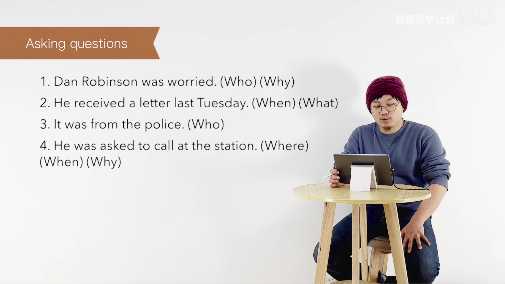

文字识别：Asking questions / 1. Dan Robinson was worried. (Who) (Why) / 2. He received a letter last Tuesday. (When) (What) / 3. It was from the police. (Who) / 4. He was asked to call at the station. (Where) / (When)(Why)

## 00:03:00–00:03:30

when 对整句话，why 对整句话，OK。第五个，He wondered why he was wanted by the police。这地方注意一个小点，wondered 和 was 貌似都能变一般疑问句，我们要用主句的，不要用宾语从句的，所以应该是 did 提前，对吧？那 what 就是直接对 why he was wanted by the police 提问，所以答案叫 what did he wonder？啊，他好奇，他感觉到什么？感觉到很奇怪

### 画面 00:03:03

文字识别：Asking questions

## 00:03:30–00:04:00

啊。Next one, he went to the station yesterday. Did提前where对the station提问when对yesterday啊。第七题，the policeman smiled at him. Did提前what点点do那就what did the policeman do呗，对吧？Okay,说he told him that his bicycle had been found. Told him did提前就完事儿了啊。What对整个宾语从句提问啊，叫What did he tell him? Who您可以

### 画面 00:03:31

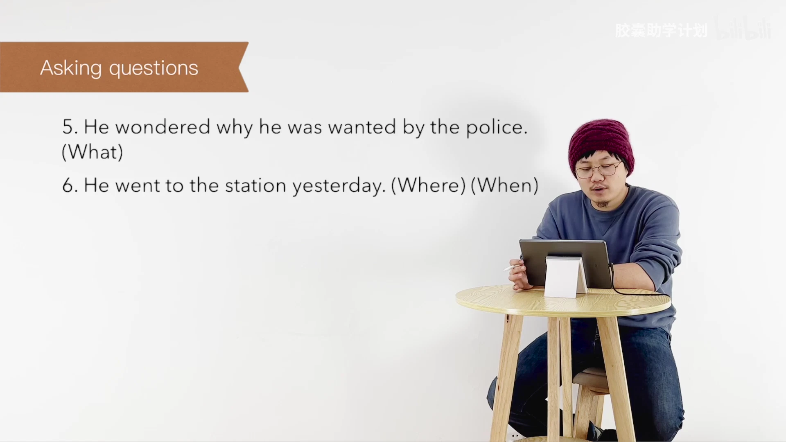

文字识别：Asking questions / 5. He wondered why he was wanted by the police. / (What) / 6. He went to the station yesterday. (Where) (When)

### 画面 00:03:46

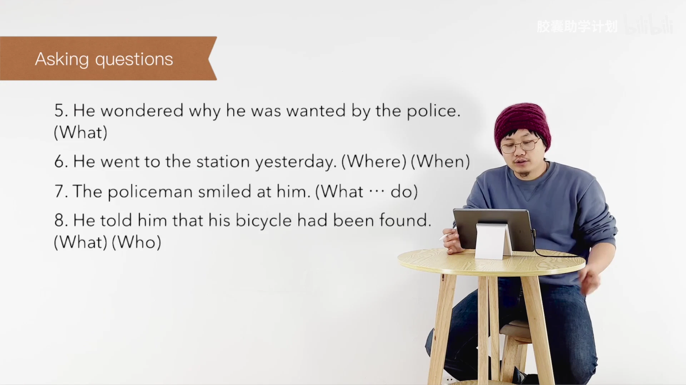

文字识别：Asking questions / 5. He wondered why he was wanted by the police. / (What) / 6. He went to the station yesterday. (Where) (When) / 7. The policeman smiled at him. (What … do) / 8. He told him that his bicycle had been found. / (What) (Who)

## 00:04:00–00:04:30

直接对主语提问，叫Who told him?巴拉巴拉巴拉巴拉，剩下照抄就OK了，好吧？好，最后一个，It had been picked up five days ago. Had提前，How long ago?肯定是对Five days ago提问。Where?整句What?对主语提问。It指的是那个The bicycle. OK，那不用变一般疑问句了，直接替代啊。OK, tell the story.练习的是我们fluency

### 画面 00:04:06

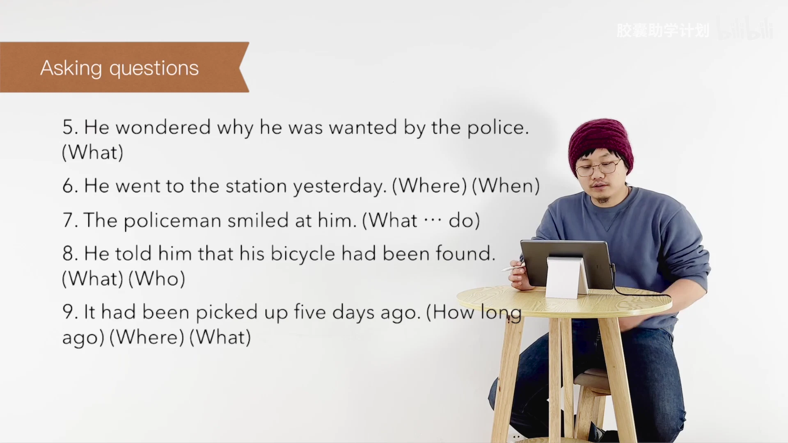

文字识别：Asking questions / 5. He wondered why he was wanted by the police. / (What) / 6. He went to the station yesterday. (Where) (When) / 7. The policeman smiled at him. (What … do) / 8. He told him that his bicycle had been found. / (What)(Who) / 9. It had been picked up five days ago. (How long / ago)(Where)(What)

### 画面 00:04:26

文字识别：Tell the story / 训练目标： / 口语复述能力 / Accuracy / Fluency

## 00:04:30–00:05:00

流利性，而不是 accuracy。您可以错，但不能太慢，对吧？所以文章一定要读的特别熟啊，就是你一定要读到很熟，你才能做到什么？Dan Robinson has been worried all week. Last Tuesday, he received a letter from the local policeman,是吧？你看我从来没背过这篇文章，但因为读的遍数太多了，所以张嘴也能把它说出来。OK，好，summer writing 要写作，各位先写，然后来这儿对答案。对于我们应

### 画面 00:04:35

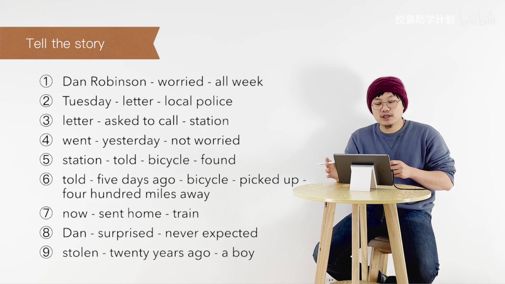

文字识别：Tell the story / ① Dan Robinson - worried - all week / Tuesday - letter - local police / letter - asked to call - station / went - yesterday - not worried / station - told - bicycle -found / told - five days ago - bicycle - picked up / four hundred miles away / now - sent home - train / ) Dan - surprised - never expected / 8 / stolen - twenty years ago - a boy / 9

### 画面 00:04:53

文字识别：Summary writing: Key / 训练目标： / 写作复述能力

### 画面 00:04:56

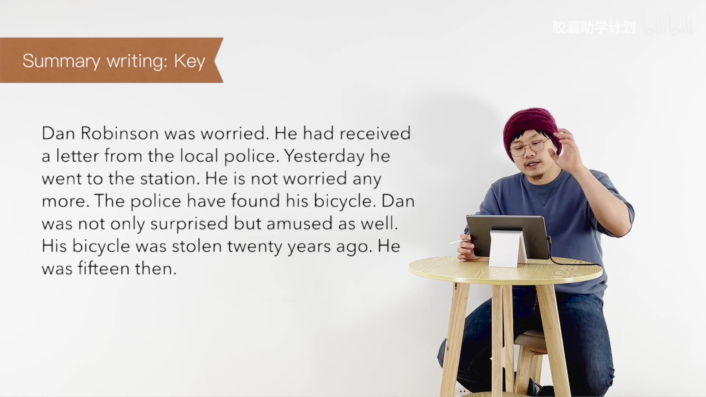

文字识别：Summary writing: Key / Dan Robinson was worried. He had received / a letter from the local police. Yesterday he / went to the station. He is not worried any / more. The police have found his bicycle. Dan / was not only surprised but amused as well. / His bicycle was stolen twenty years ago. He / was fifteen then.

## 00:05:00–00:05:30

试啊的这个写作，对吧？以及我们工作生活当中的发邮件都非常的有帮助啊。OK，那 topic for discussion，这是我们所有所有一切的练习，最终的唯一目的就是我们将来能完全自由的跟别人去对话。那我们呢，在这个地方现在能力还不够，我们简单带着各位看一下，他们都是什么题就可以了。第一个说，Have you ever been worried because you have lost something？说你有没有

### 画面 00:05:07

文字识别：Topics for discussion / 训练目标： / 完全自由的对话 / Accuracy / Fluency

### 画面 00:05:18

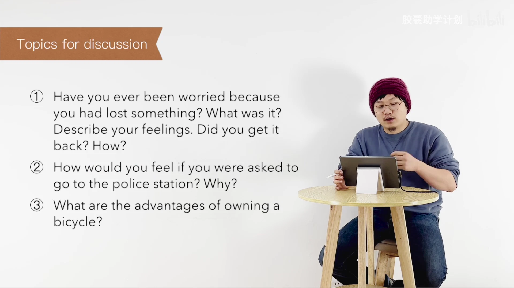

文字识别：Topics for discussion / Have you ever been worried because / you had lost something? What was it? / Describe your feelings. Did you get it / back? How? / How would you feel if you were asked to / go to the police station? Why? / What are the advantages of owning a / bicycle?

## 00:05:30–00:06:00

feelings. Describe your feelings. Describe your feelings. Describe your feelings. Describe your feelings. Describe your feelings. Describe your

### 画面 00:05:48

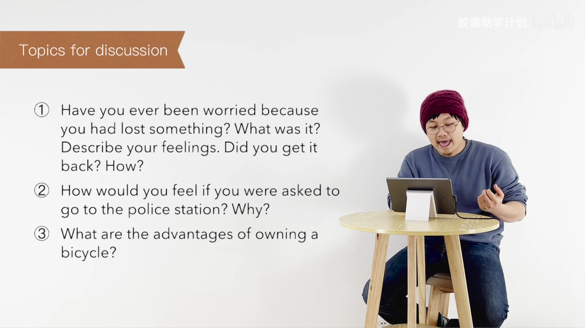

文字识别：Topics for discussion / Have you ever been worried because / you had lost something? What was it? / Describe your feelings. Did you get it / back? How? / How would you feel if you were asked to / go to the police station? Why? / What are the advantages of owning a / bicycle?

## 00:06:00–00:06:30

最后一个说What are the advantages of owning a bicycle？说你有一个自己的自行车，有哪些 advantages呢？有哪些优势呢？你能说一下吗？罗列一下，再详细讲解一下。哎，一个很好的口语话题或者写作话题就出来了啊！像托福、雅思，这是基本上必考的这种类型。OK，那不多说了，家庭作业，Ask me if先写再朗读，只要写作先写，然后来这对答案。

### 画面 00:06:18

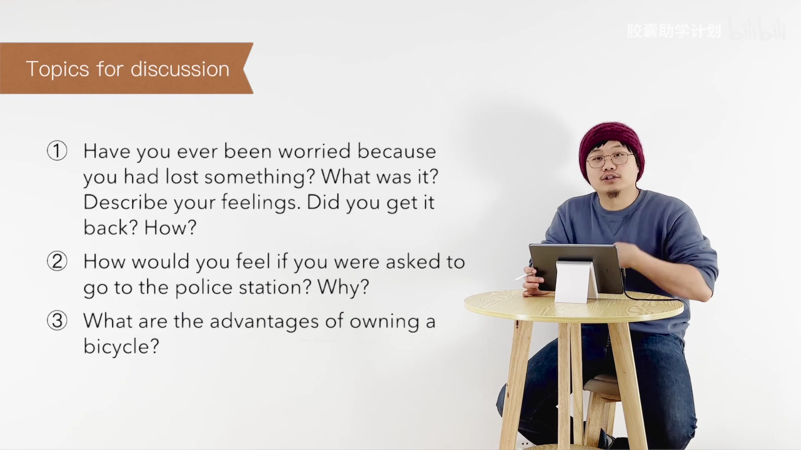

文字识别：Topics for discussion / Have you ever been worried because / you had lost something? What was it? / Describe your feelings. Did you get it / back? How? / How would you feel if you were asked to / go to the police station? Why? / What are the advantages of owning a / bicycle?

### 画面 00:06:23

### 画面 00:06:25

文字识别：1.Ask me if写&朗读

### 画面 00:06:27

文字识别：1.Ask me if写&朗读 / 2.摘要写作写&答案

### 画面 00:06:29

文字识别：1.Ask me if写&朗读 / 摘要写作写&答案 / 3.Tell the story 口语复述

## 00:06:30–00:07:00

Tell the story，口语复述到流利为止，对吧？然后专栏当中可以找得到。那以上呢就是本期视频的全部内容了。如果您喜欢我们的课程呢，欢迎各位关注、订阅、一键三连，分享给那些需要的朋友，来帮助我们快速成长。 See you next time.

### 画面 00:06:31

文字识别：1.Ask me if写&朗读 / 2. / 摘要写作写&答案 / 3.Tell the story 口语复述

### 画面 00:06:33

文字识别：1.Askme if写&朗读 / 摘要写作写&答案 / 3.Tell the story 口语复述 / 专栏 / 4.

### 画面 00:06:35

### 画面 00:06:48

文字识别：不

### 画面 00:06:50

文字识别：CAPSULEACADEMY / 胶囊助学计划 / 小红书 / Lecturer / □ / Leo / OE

### 画面 00:06:53

文字识别：CAPSULEACADEMY / 胶囊助学计划 / 小红书 / Editor / OE

### 画面 00:06:56

文字识别：CAPSULEACADEMY / 胶囊助学计划 / 小红书 / Creator / Leo & Berlin / OE

### 画面 00:06:58

文字识别：bilibili / 胶囊助学计划 / 胶囊助学计划 / □ / 小红书

## 00:07:00–00:07:00

### 画面 00:07:00

文字识别：bilibili / 胶囊助学计划

