# L035 语法

快速机器解析：语音为单模型转写，未进行独立交叉校对或人工复核；画面每秒采样并按变化选帧，短时文字和标记可能遗漏。截图时间约有 1 秒误差。图片有损压缩；遇到疑点请按时间查看 Google Drive 原视频。

## 00:00:00–00:00:30

Hello everyone, welcome to Capsule Academy. This is Leo. Today we're going to learn New Concept English Book Two, Lesson Thirty Five, Grammar. 老习惯进入正式课程之前，我们看一个问题：如何表达如此怎么怎么样，以至于怎么怎么样？OK，好，那带着这个问题，Hope you can enjoy. 好，那在讲本课语法之前，我先提一句啊，三十五课是我们

### 画面 00:00:00

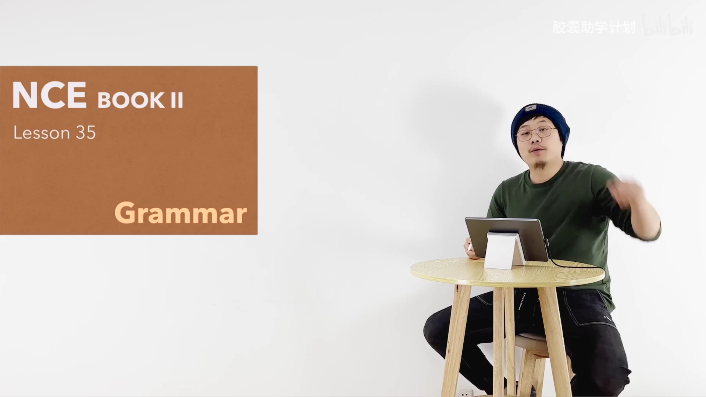

文字识别：NCE / BOOKII / Lesson 35 / Grammar

### 画面 00:00:04

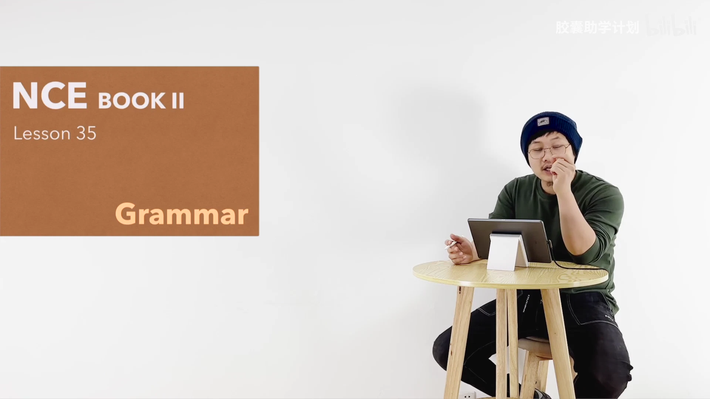

文字识别：NCE / BOOK"I / Lesson 35 / Grammar

### 画面 00:00:06

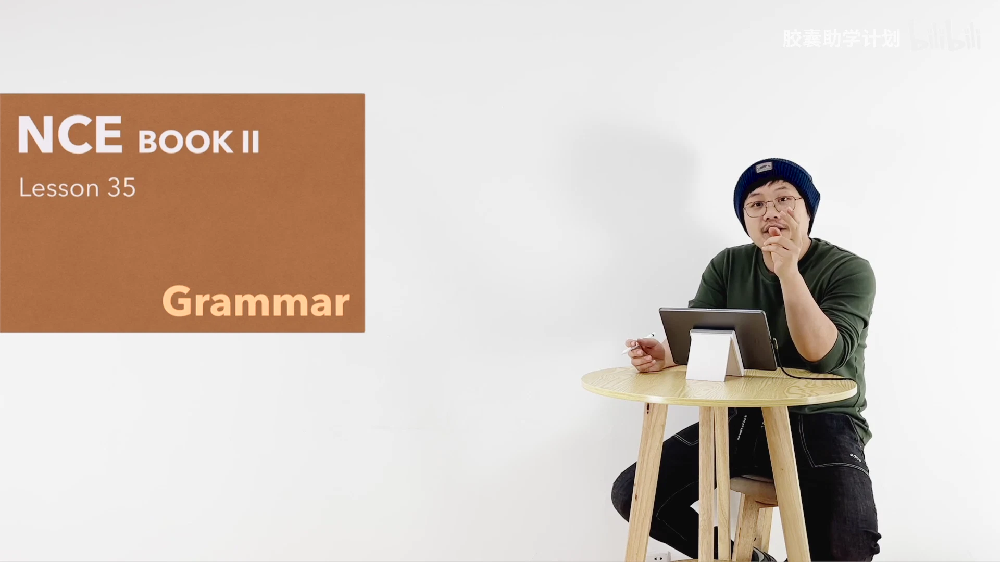

文字识别：NCE / BOOKII / Lesson 35 / Grammar

### 画面 00:00:09

文字识别：此..以至于”?

### 画面 00:00:11

文字识别：① 如何表达“如此..以至于”?

### 画面 00:00:19

文字识别：胶囊助学计划blbl / ••

### 画面 00:00:23

文字识别：胶囊助学计划

### 画面 00:00:25

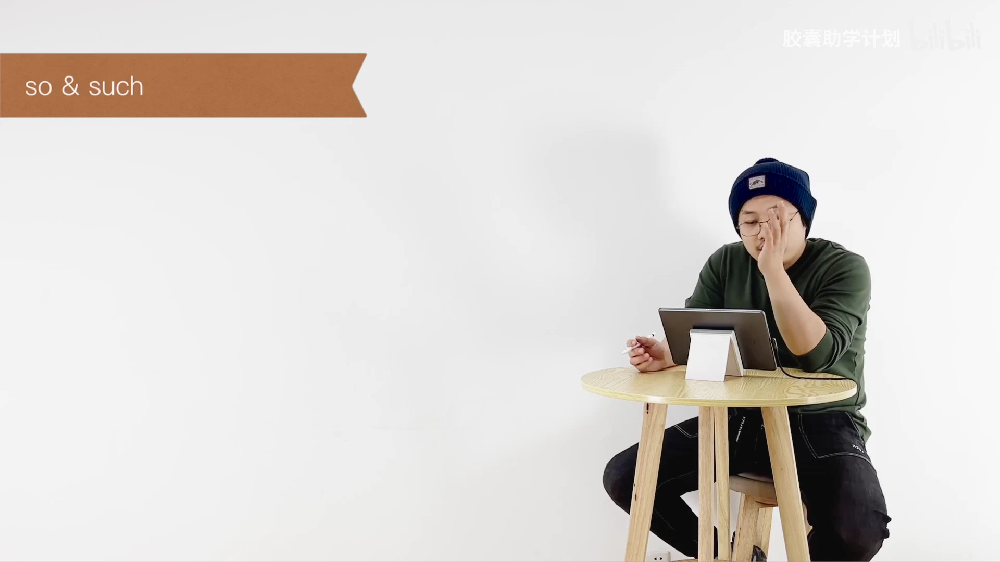

文字识别：so & such

## 00:00:30–00:01:00

第二单元从二十四课开始的第十一课。我不知道各位还记不记得我们在第一单元第十一课做了什么样的事情？其实没有讲新的语法，我们更多的是在复习前十课学的语法，对吧？所以新二的这个整本书的设置就是这样的啊，就是每个单元二十四课，每课啊，就每个单元的第十一课和第二十三课、第二十四课都是复习课。所以本课本

### 画面 00:00:55

文字识别：so ＆ such

## 00:01:00–00:01:30

本来是没有语法的，但是在文章当中出现了一个so点点啊，such点点that之前呢，呃，我们又学又见过一次叫so点点that，在那课的时候我就说，那我们把它放到本课来学，对吧？所以我们本课呢就出现了这个语法。首先我们先说so和such啊，他们其实就表示叫如此怎么怎么样啊，他们就可以翻译成如此。那他们俩有区别，我们在这儿先讲区别，说so

### 画面 00:01:25

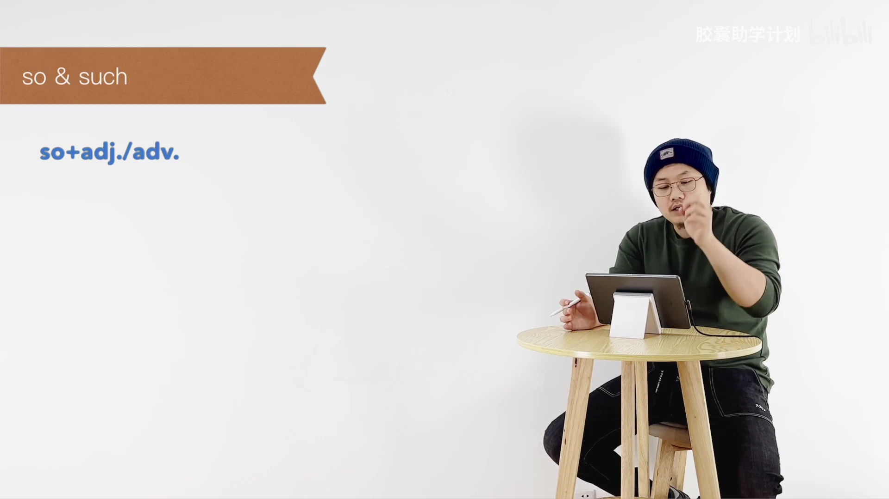

文字识别：so ＆ such / so+adj./adv.

## 00:01:30–00:02:00

它经常加的是形容词或副词，各位注意后边是不加名词的啊。比如说 I didn't enjoy the book. 我不太喜欢这个书，为什么呢？ The story was so stupid. 好，你注意，如果我们不管不要 so，只说 the story was stupid，可不可以？可以，它的意思叫做故事很蠢，对不对？那 was so stupid 说是如此的蠢，是特别特别的蠢啊，就是加上了一个程度的感觉，对

### 画面 00:01:44

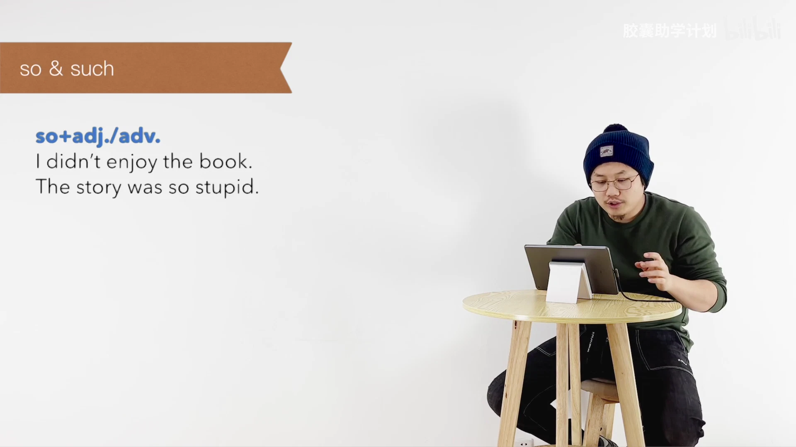

文字识别：so ＆ such / so+adj./adv. / I didn't enjoy the book. / The / story / was so / stupid.

### 画面 00:01:50

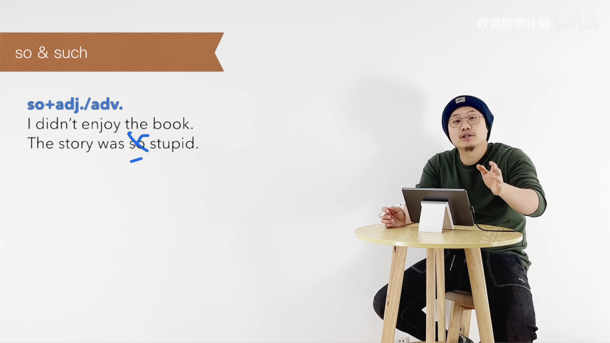

文字识别：so ＆ such / so+adj./adv. / I didn't enjoy t / the book. / The / story / 'was / stupid.

## 00:02:00–00:02:30

吧？OK，语气词某种程度上可以这样去理解，不准确啊，但是你可以这样去理解。好，那你so呢，还可以加so quick，对吧？你还可以说so nice，因为它可以加副词呢，你还可以说so quickly。但anyway不管怎么样，注意so后面加形容词副词的时候，后面不加名词了啊。而such后面的关键点叫一定要有一个名词，就如此怎么怎么

### 画面 00:02:01

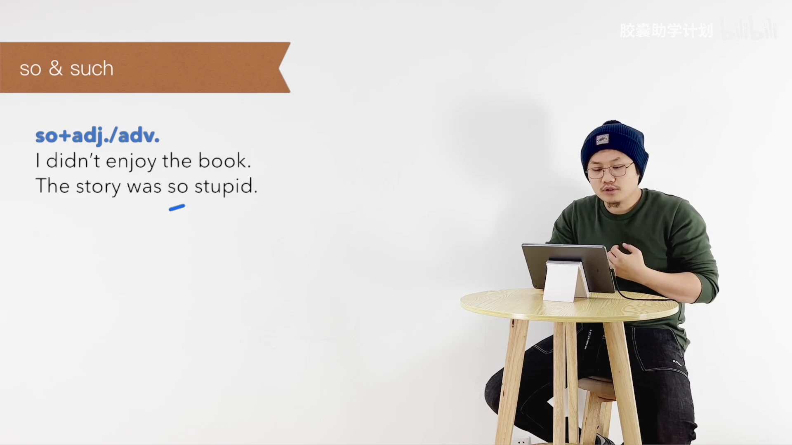

文字识别：so ＆ such / so+adj./adv. / I didn't enjoy the book. / The /  story was so stupid.

### 画面 00:02:16

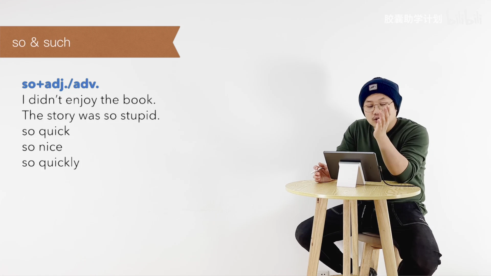

文字识别：so ＆ such / so+adj./adv. / I didn't enjoy t / ' the book. / The / story / was / sO / stupid. / SO / quick / SO / nice / quickly / SO

### 画面 00:02:18

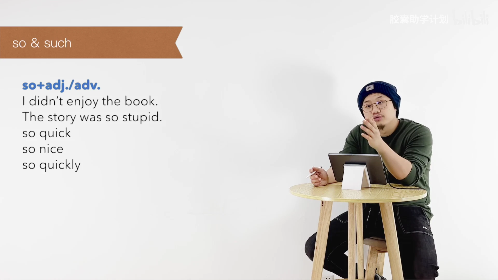

文字识别：so ＆ such / so+adj./adv. / I didn't enjoy t / ' the book. / The / story / was / sO / stupid. / SO / quick / SO / nice / quickly / SO

## 00:02:30–00:03:00

一定要有一个名词。而至于前面那个形容词有没有呢？都行，往往是有的。所以各位可以这样去理解，叫做so，它后面不要加名词，such后边要加名词。至于是形容词还是副词，您在这儿先不用管它，对吧？这就是核心点。我们举个例子，比如说It was such a stupid story。如果我们把such去掉，说It was a stupid story，就

### 画面 00:02:48

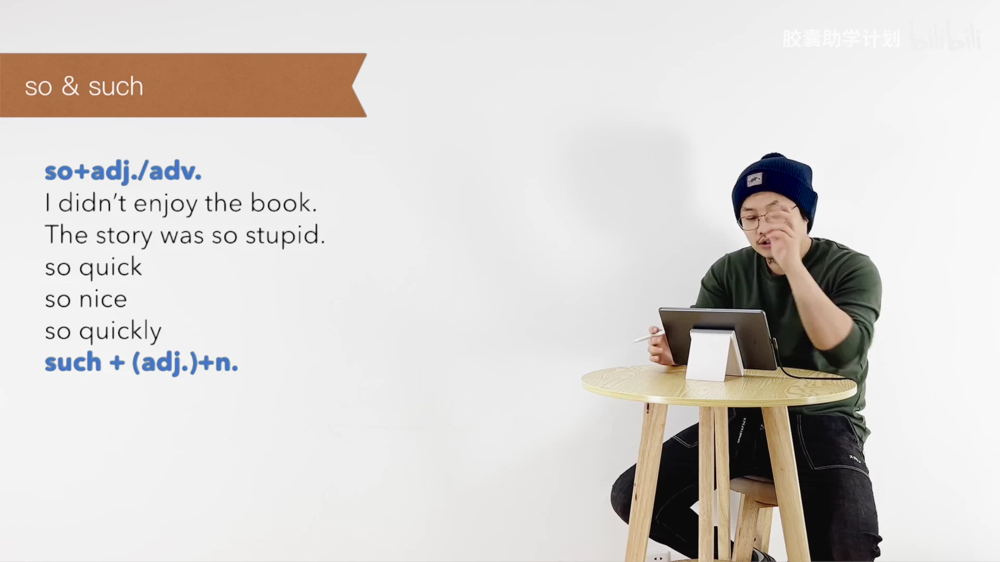

文字识别：so ＆ such / so+adj./adv. / I didn't / enjoy / the / book. / The / story / was / sO / stupid. / quick / SO / SO / nice / quickly / SO / such / n + (adj.)+n.

## 00:03:00–00:03:30

是说，哎，这是一个很蠢的故事。加上such了之后，多了一个什么含义呢？这是如此蠢的一个故事。听见了吧？语气程度改变了啊！这是如此蠢的一个故事。再来，比如说，such nice people啊，说如此好的人是吧？那你说nice people，说they are nice people啊，就是一个很平铺直叙的表达。说哎，他们人还不错。但你说，哦，they are such nice people。说哎，他们人

### 画面 00:03:18

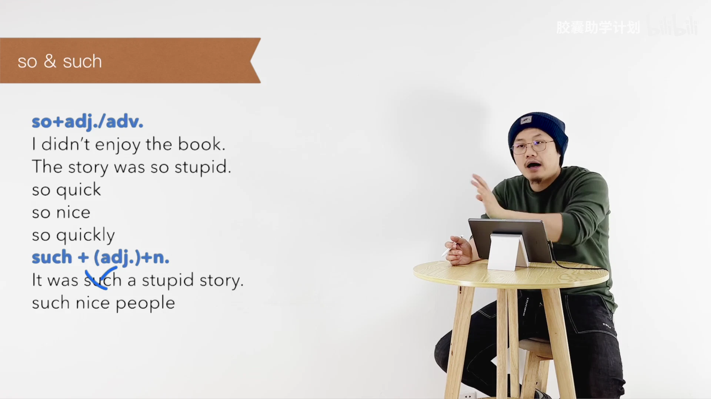

文字识别：so＆ such / so+adj./adv. / I didn't / enjoy / the / book. / The / story / was / SO / stupid. / quick / SO / SO / nice / quickly / SO / such / +(adj.)+n. / It was / scha / stupid / story. / such / nice / people

## 00:03:30–00:04:00

真好啊，真棒啊！"就是语气程度要提升一点点。所以在这儿呢，第一，我们要明白，在这一页K note当中啊，我们要明白，第一，我想给大家传达的知识是，so和such加上了之后，我们的语气程度提升了啊，对吧？感情更丰富了。第二，它们的区别是，so加形容词副词后边没有名词，such后边可以有形容词，但

### 画面 00:03:48

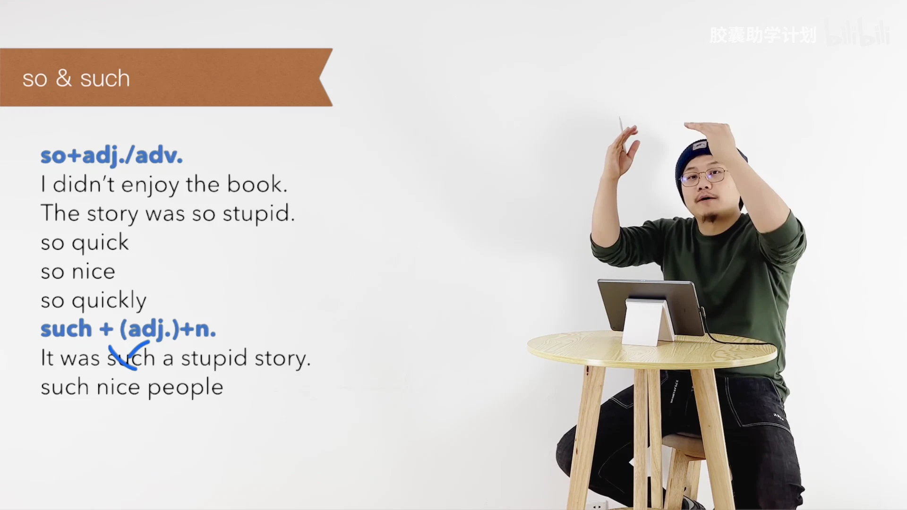

文字识别：so ＆ such / so+adj./adv. / I didn't / enjoy / the / book. / The / story / was / sO / stupid. / quick / SO / SO / nice / quickly / SO / such / +(adj.)+n. / It was / scha / stupid / story. / such / nice / people

## 00:04:00–00:04:30

是一定要有一个名词啊。那个形容词可以有，可以没有，我放在括弧当中了。但名词是核心，是必须要有的，好吧？好，那接下来我们在最开始的视频当中就问了一个问题，叫如此以至于，对吧？如此的怎么怎么样，以至于一件事情怎么怎么样，所以它后面肯定还有一句话。这句话由谁引导的呢？由 that 去引导的。我们造一个句子啊，这这个句子不是我造的，这个句子是我们三十课原文

### 画面 00:04:09

文字识别：SO / that

### 画面 00:04:25

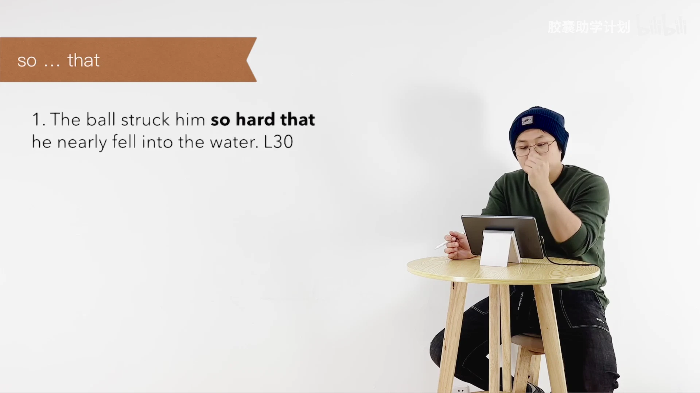

文字识别：... that / SO / 1. The ball struck him so hard that / he nearly fell into the water. L30

## 00:04:30–00:05:00

出现的，the ball struck him so hard，说这个球啊撞到了他是如此的狠啊，撞的是如此的狠。你看，如果不加so就是很啊，挺狠的是吧？So hard要如此的狠啊。That注意后边接的是一个完整的句子。那在这儿就要涉及到一个问题：我如何判断它是一个完整的句子呢？新概念二册

### 画面 00:04:51

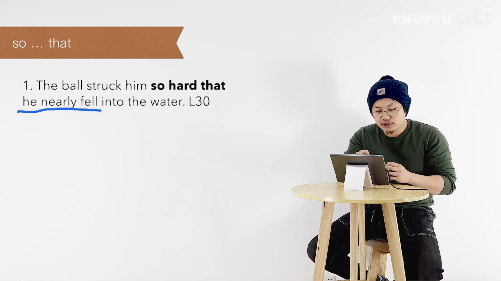

文字识别：.. that / SO / 1. The ball struck him so hard that / he nearly fell into the water. L30

### 画面 00:04:55

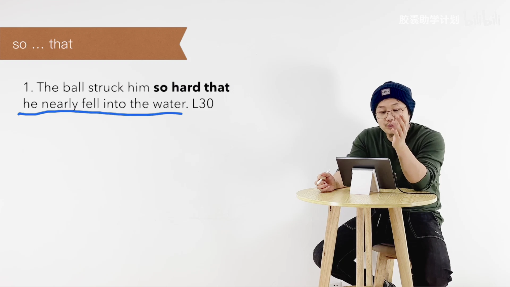

文字识别：..that / SO / 1. The ball struck him so hard that / he nearly fell into the water. L30

## 00:05:00–00:05:30

第一课的核心语法就是如何判断它是不是一个句子。很简单，只要有这两个单词，就已经能确定它是个句子了。有主语，有谓语，对吧？说它几乎就差点掉进水里面去了。所以你看，我们翻译一下这句话是这样翻译的，叫做 The ball struck him so hard。其实第一句就可以理解为结束了，叫做球撞他撞的如此的狠。从 that 一直到结尾啊，从 that 一直到结尾，我们可

### 画面 00:05:05

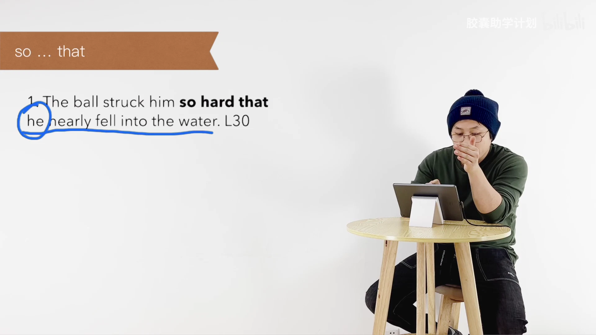

文字识别：SO / .that / The ball struck him so hard that / he / hearly fell into the water. L30

### 画面 00:05:07

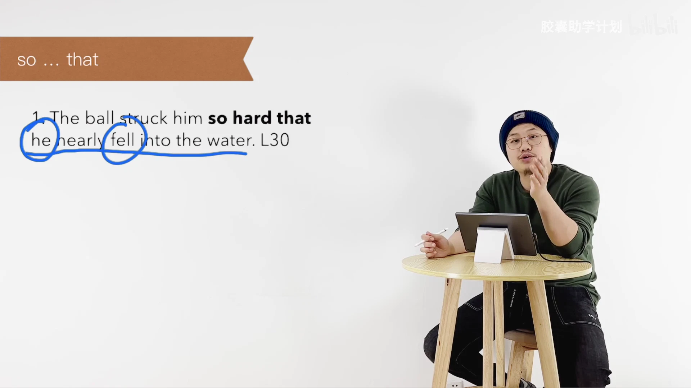

文字识别：SO / that / The ball struck him so hard that / he / hearlyfellihto the water. L30

### 画面 00:05:15

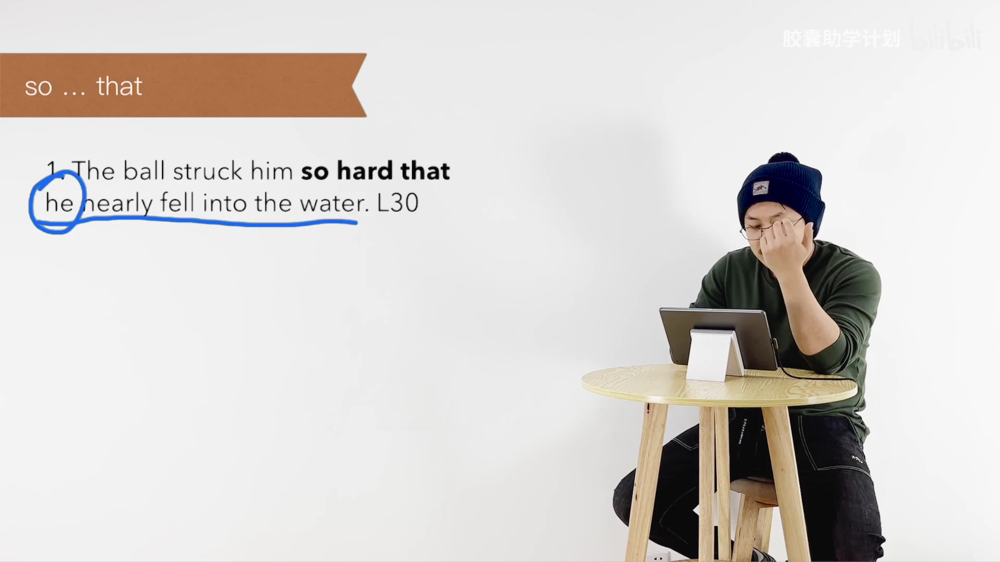

文字识别：.that / SO / The ball struck him so hard that / he / hearly fell into the water. L30

### 画面 00:05:17

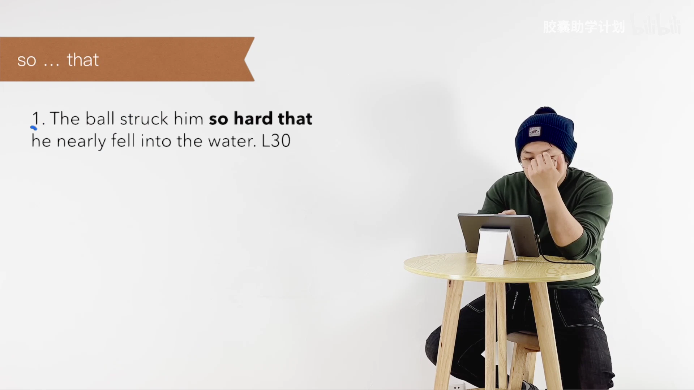

文字识别：..that / SO / 1. The ball struck him so hard that / he nearly fell into the water. L30

### 画面 00:05:19

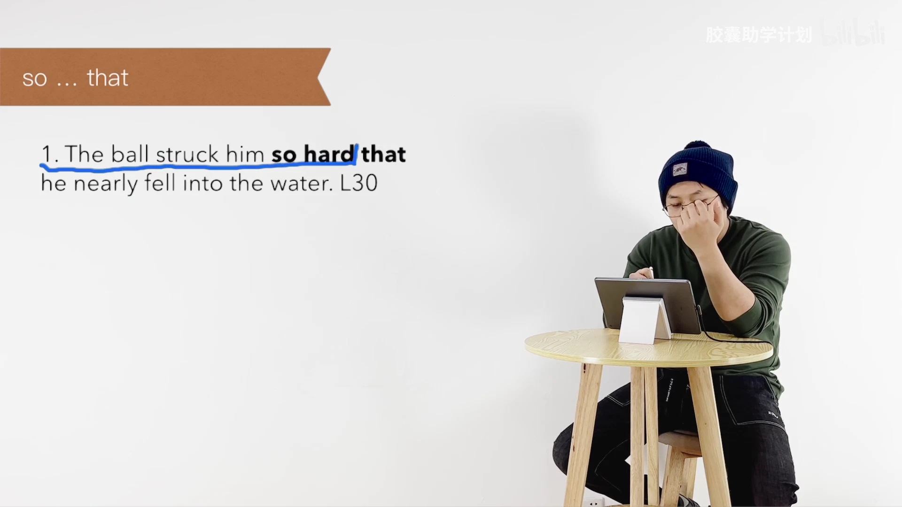

文字识别：..that / SO / 1. The ball struck him so hardthat / he nearly fell into the water. L30

### 画面 00:05:21

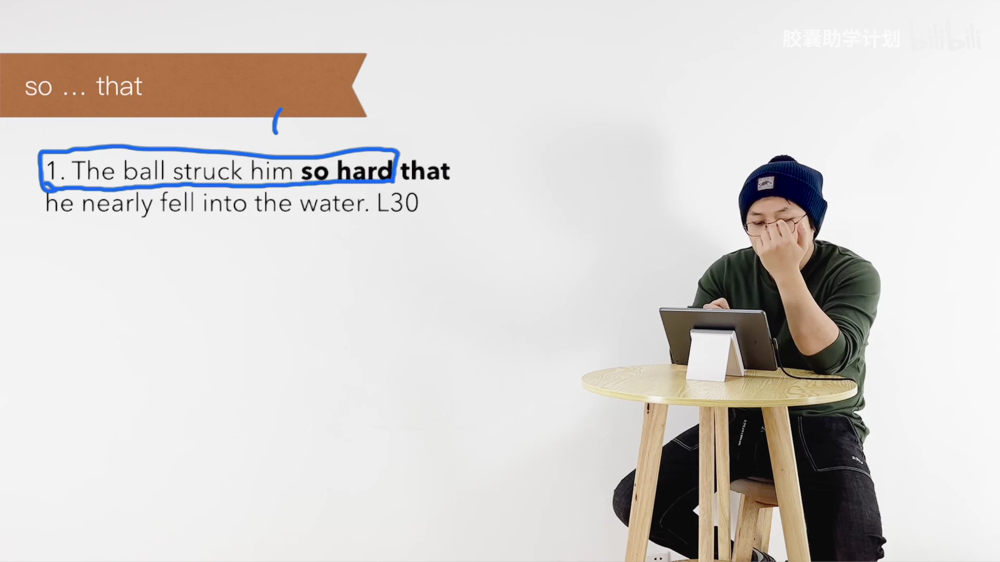

文字识别：..that / SO / 1. The ball struck him so hard / that / he nearly fell into the water. L30

### 画面 00:05:26

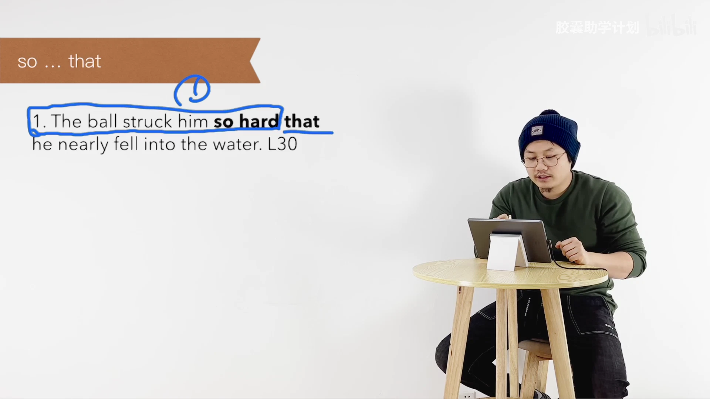

文字识别：..that / SO / 1.The ball struck him so hardthat / he nearly fell into the water. L30

## 00:05:30–00:06:00

以理解为它是第二句话，叫做以至于他差点掉进水里面去。好，我们看一下这里的 so，这里的 so 在形容的是 hard。那然后问题就是这里的 hard 要么是形容词，要么是副词。如果您能看出来更好，如果看不出来无所谓，你只要知道它这儿要么形容词，要么副词，并且 so hard hard 后面是没有名词的，这是关键点，对吧？ Okay， next one，我们再

### 画面 00:05:31

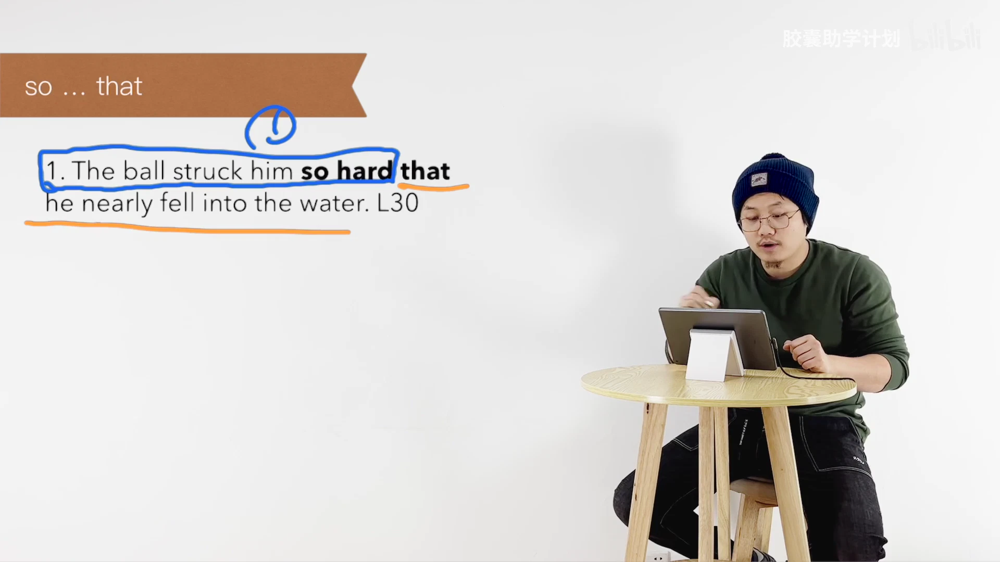

文字识别：.that / SO / 1. The ball struck him so hardthat / he nearly fell into the water. L30

### 画面 00:05:41

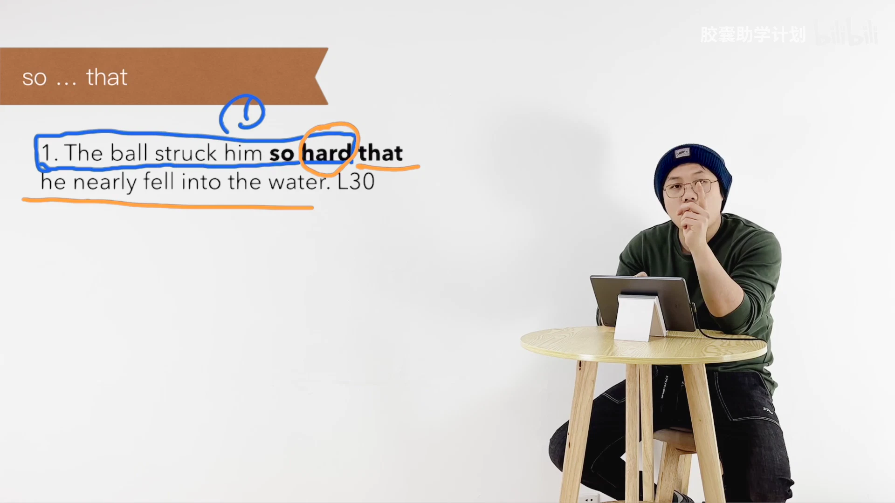

文字识别：SO / that / 1. The ball struck him so / 2hardt / that / he nearly fell into the water. L30

### 画面 00:05:59

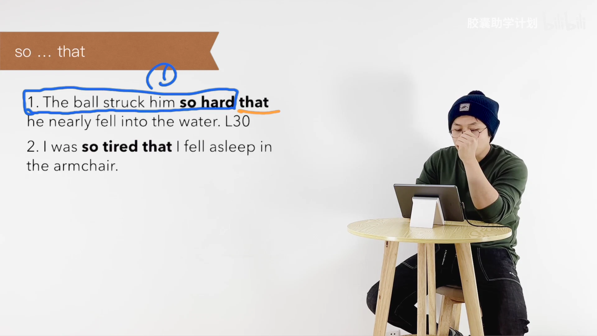

文字识别：..that / SO / 1. The ball struck him so hard that / he nearly fell into the water. L30 / 2.I was so tired that I fell asleep in / the armchair.

## 00:06:00–00:06:30

来说I was so tired that I was so tired.第一句话叫我是如此的累，that I fell asleep in the armchair.说以至于我在这个手扶椅当中就睡着了。我是如此的累，以至于我在这个椅子当中我就睡着了。OK，注意，你看so后边加了一个tired形容词，对吧？我是如此的累，that

### 画面 00:06:01

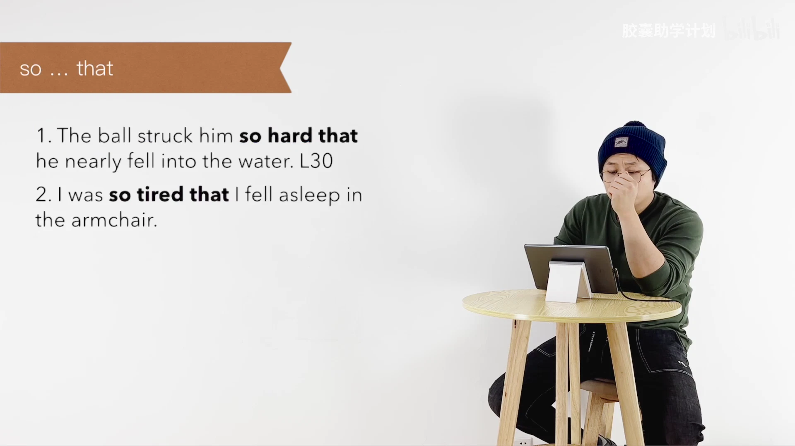

文字识别：so ... that / 1. The ball struck him so hard that / he nearly fell into the water. L30 / 2.I was so tired that I fell asleep in / the armchair.

### 画面 00:06:04

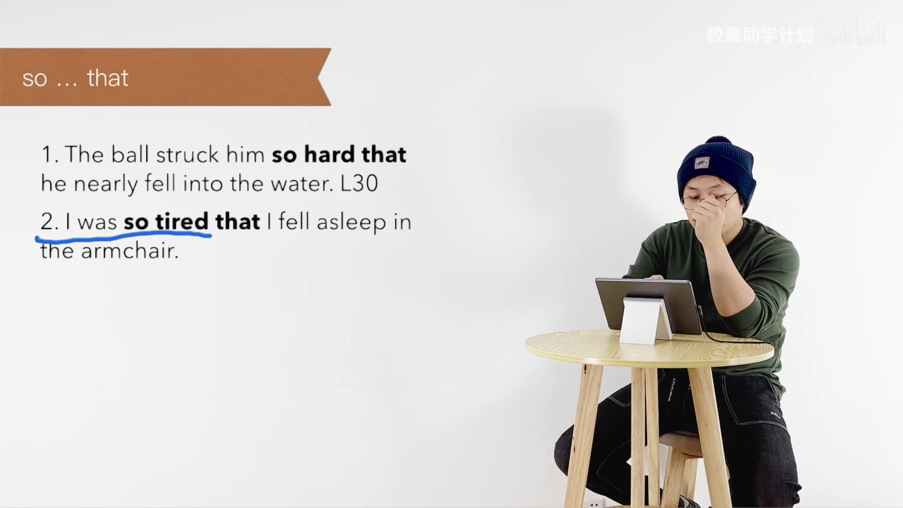

文字识别：...that / SO / 1. The ball struck him so hard that / he nearly fell into the water. L30 / 2.I was so tired that I fell asleep in / the armchair.

### 画面 00:06:06

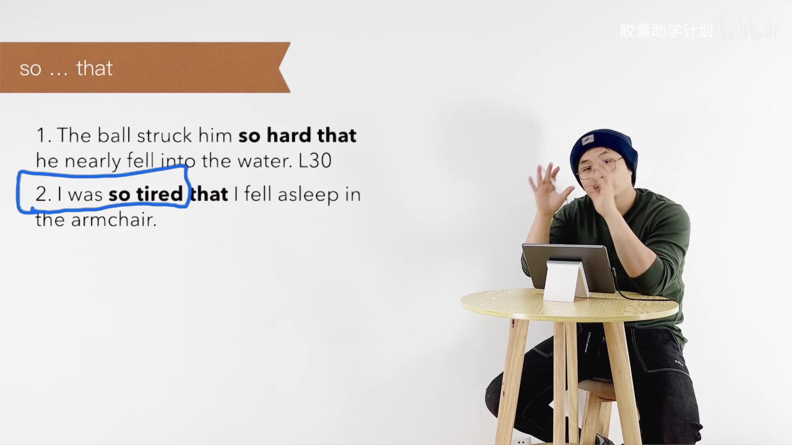

文字识别：SO / ..that / 1. The ball struck him so hard that / he nearly fell into the water. L30 / 2.I was so tired that I fell asleep in / the armchair.

### 画面 00:06:09

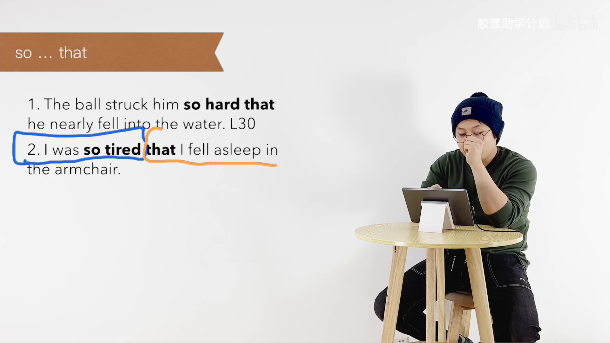

文字识别：.that / SO / 1. The ball struck him so hard that / he nearly fell into the water. L30 / 2.I was so tiredthat I fell asleep in / the armchair.

### 画面 00:06:11

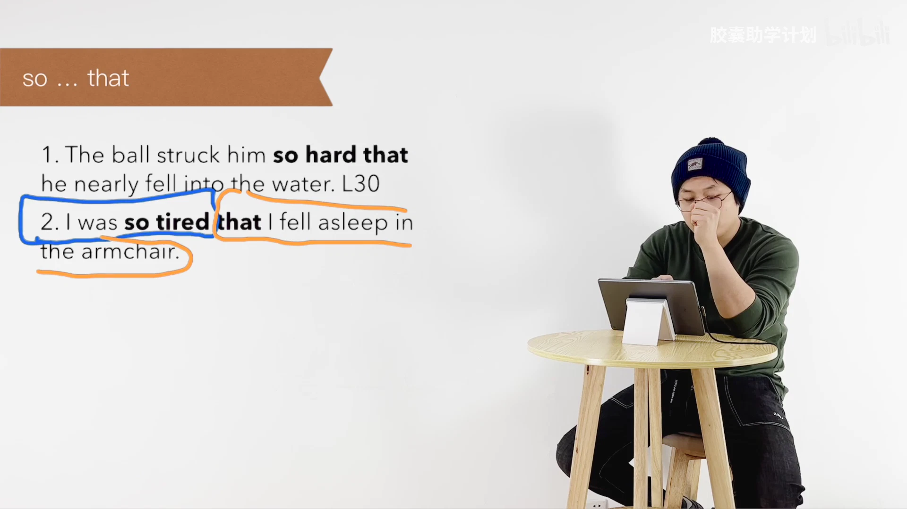

文字识别：SO / that / 1.The / ball / struck him so hard t / I that / he nearly / fell into the / e water. L30 / 2.I was so tired / that  fell asleep in / the / armchair.

## 00:06:30–00:07:00

后边那句话就是以至于发生了一件事情，后边必须是加一个注意叫做句子，OK，玩一个。第三个说，the book was so good that I couldn't put it down。说这个书是如此的好，以至于我没有办法把它放下，爱不释手，对吧？爱不释卷啊，一直想看，玩一个非常简单。所以不管怎么样，so后边就

### 画面 00:06:30

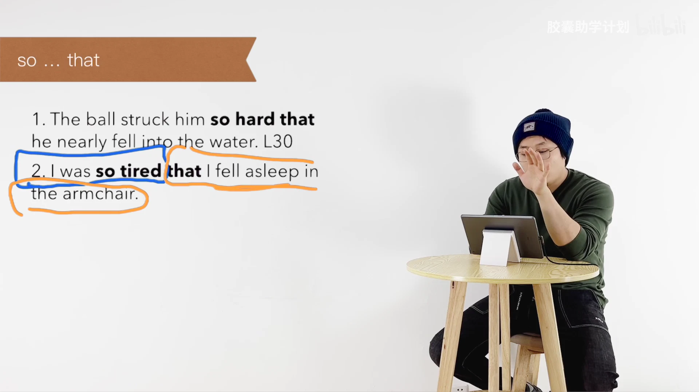

文字识别：SO / that / 1.The / ball / struck him so hard / that / he nearly / fell into the / water. L30 / 2.l was so tired / that l fell asleep in / the / armchair.

### 画面 00:06:34

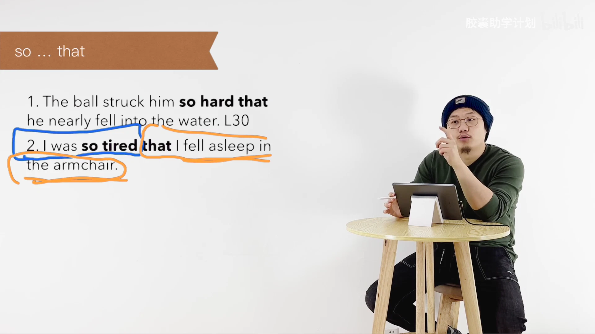

文字识别：SO / that / 1.The / ball / struck him so hard / that / he nearly / fell into the / water. L30 / 2.l was so tired / that l fell asleep in / the / armchair.

### 画面 00:06:38

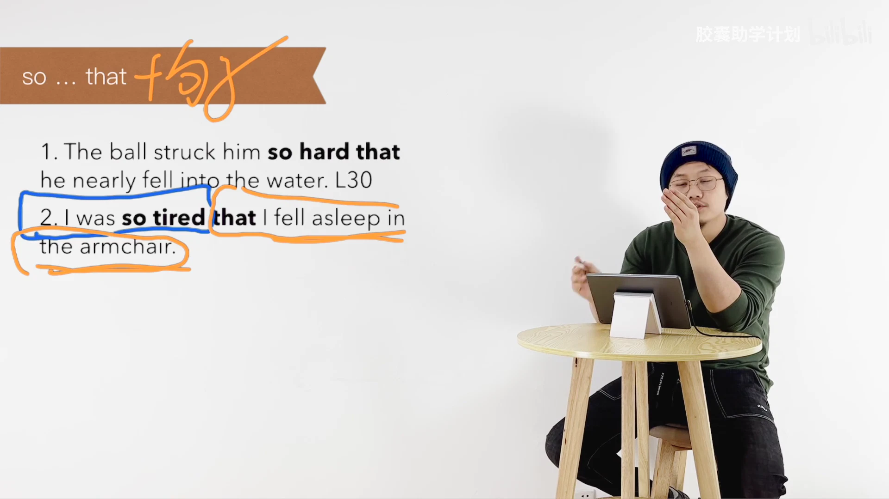

文字识别：句 / that / SO / 1.The / ball / struck him so l / hard / that / he nearly / fell into the / water. L30 / 2.l was so tired / that l fell asleep in / the / armchair.

### 画面 00:06:40

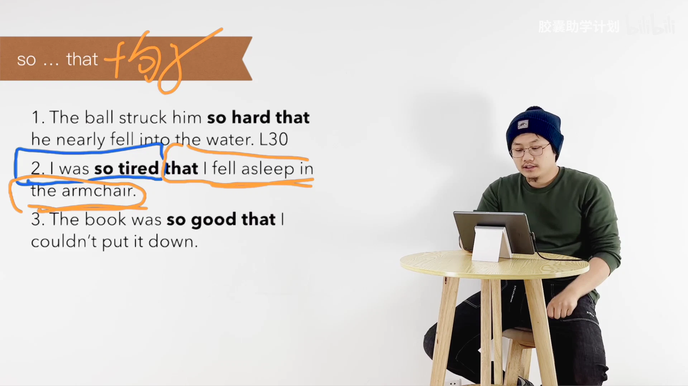

文字识别：句 / that / SO / 1.The / ball / struck him so hard / that / he nearly / fell into the water. L30 / 2.l was so tired / that l fell asleep in / the / armchair. / 3.The / book / was so good / 1 that I / couldn't put it down.

### 画面 00:06:42

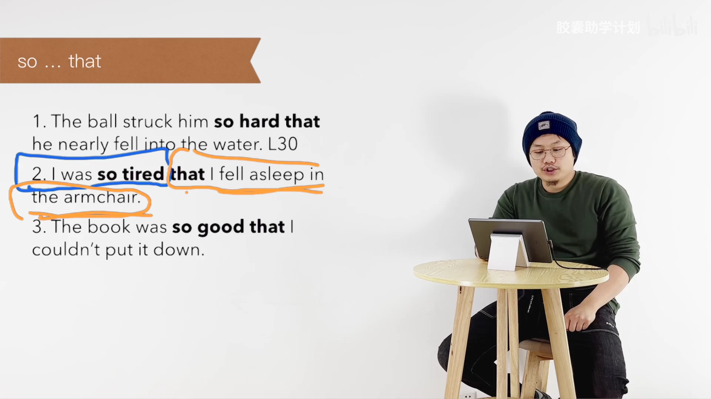

文字识别：SO / that / 1.The ball / struck him so hard that / he nearly f /  fell into the water. L30 / 2.l was so tired / that l fell asleep in / the / armchair. / 3.The / book /  Was so good that I / couldn't put it down.

### 画面 00:06:44

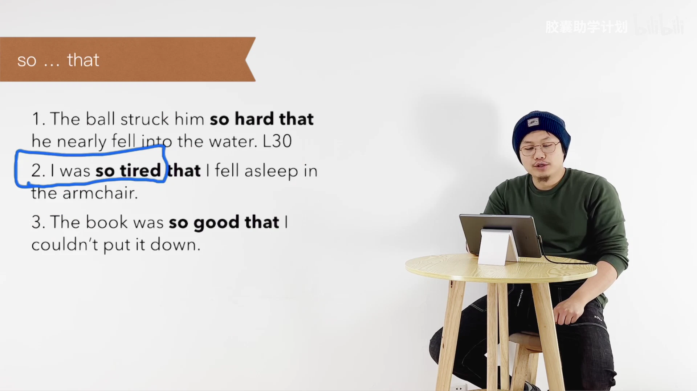

文字识别：.. that / SO / 1. The ball struck him so hard that / he nearly fell into the water. L30 / 2.I was so tired that I fell asleep in / the armchair. / 3. The book was so good that I / couldn't put it down.

### 画面 00:06:46

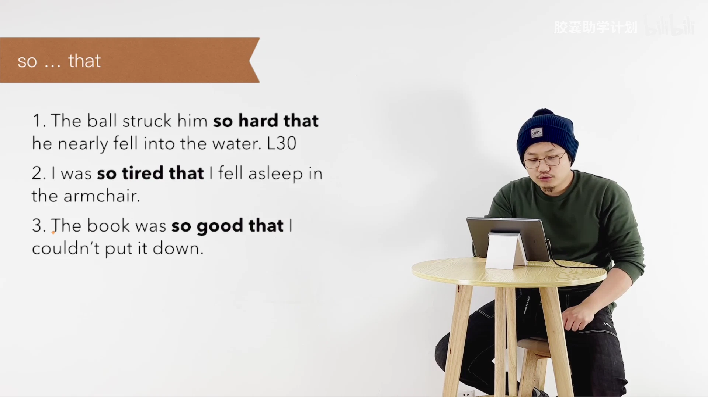

文字识别：so ... that / 1. The ball struck him so hard that / he nearly fell into the water. L30 / 2.I was so tired that I fell asleep in / the armchair. / 3. The book was so good that I / couldn't put it down.

### 画面 00:06:48

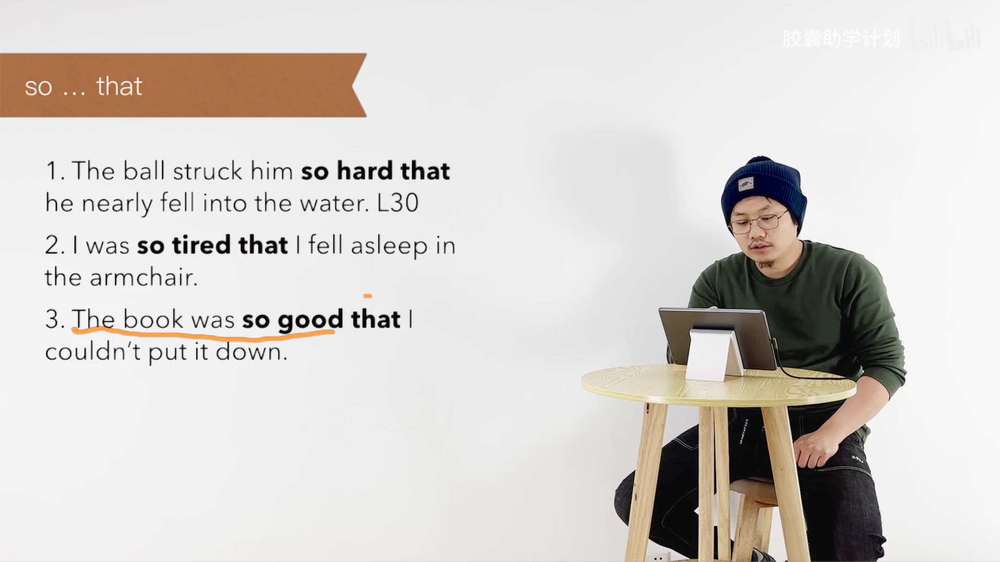

文字识别：so ... that / 1. The ball struck him so hard that / he nearly fell into the water. L30 / 2.I was so tired that I fell asleep in / the armchair. / 3. Jhe book was so good that I / couldn't put it down.

### 画面 00:06:59

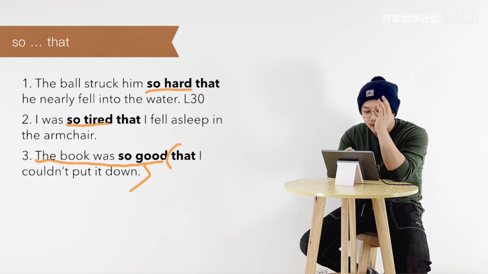

文字识别：so ... that / 1. The ball struck him so hard that / he nearly fell into the water. L30 / 2.I was so tired that I fell asleep in / the armchair. / 3. The book was so goodthat l / couldn't put it down.

## 00:07:00–00:07:30

没有再有名词了，对不对？那我们看一下such点点点that。我们先讲的前半部分，对吧？Such要加的是什么？嗯，形容词有没有无所谓，名词你必须得要有。所以你看，It was such a good book。看到这儿了吧？说它是如此棒的一本书。Such后面一定要有那个book。至于这个good有没有，由含义、由句子你想表达的含义去决

### 画面 00:07:02

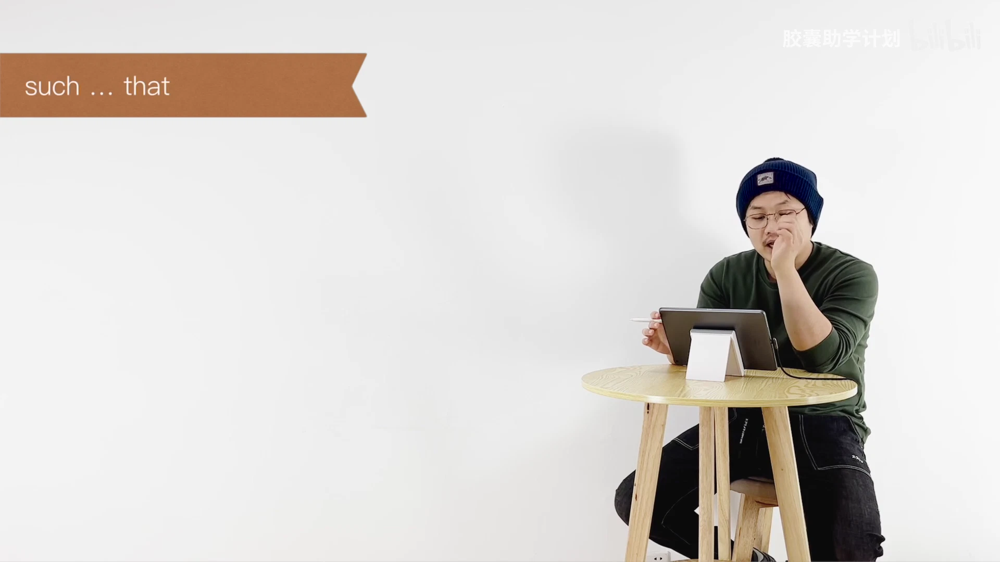

文字识别：such / that

### 画面 00:07:07

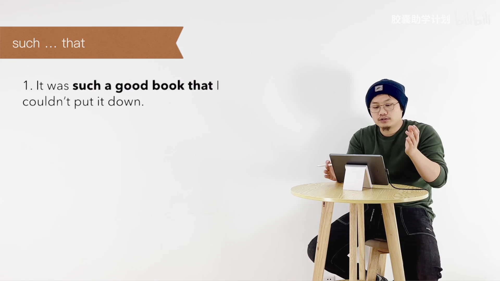

文字识别：such. / …. that / 1. It was such a good book that I / couldn't put it down.

### 画面 00:07:15

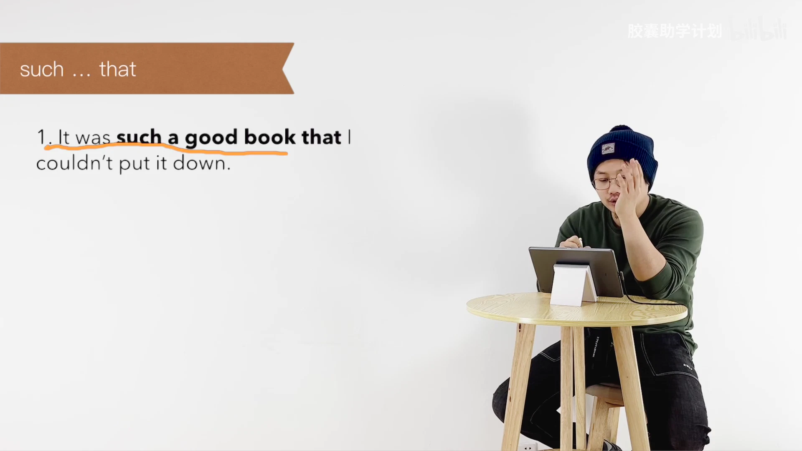

文字识别：such / that / 1. It was such a good book that I / couldn't put it down.

## 00:07:30–00:08:00

定，不是必须要有的。你像这句话，你如果没有 good，你说 such a book，对吧？是如此的一本书啊， that I couldn't put it down，以至于我没有办法把它放下，对吧？这个地方就可能要让人去猜，说啊，应该是如此的好吧，所以我才没办法放下，对吧？当然，你如果不说 good，我也可以理解为是如此的烂啊，以至于我想跟他较劲儿，是吧？我就必须把它看完，所以我没有办法把它放下，

### 画面 00:07:45

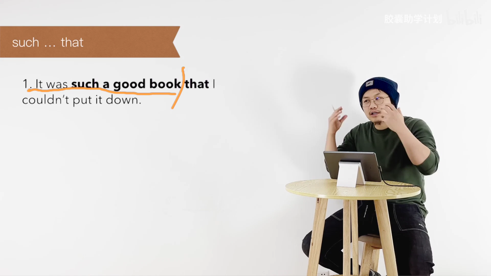

文字识别：such / that / 1. It was such a good bookthat I / couldn't put it down.

### 画面 00:07:49

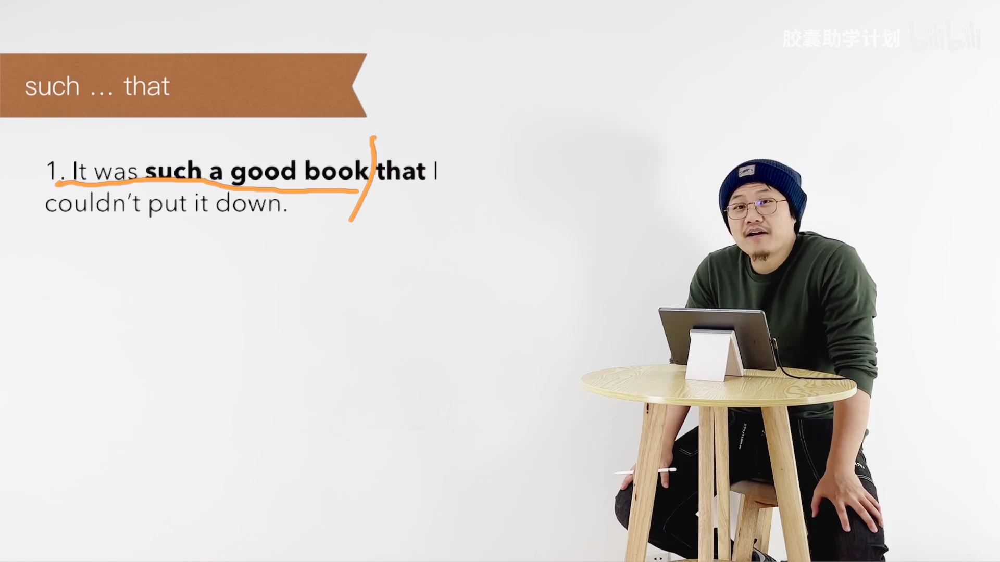

文字识别：such / that / 1. It was such a good bookthat I / couldn't put it down.

## 00:08:00–00:08:30

对吧？所以如果你把 good 删除也不是不行，只是含义会有一点点呃歧义。但是 book 这个单词一定不能删，这是它的核心点，叫 such 后边要加名词。我们再来一个句子，It was such nice weather that we spent the whole day on the beach。说它是如此棒的天气，以至于啊，我们花了一整天的时间在

### 画面 00:08:02

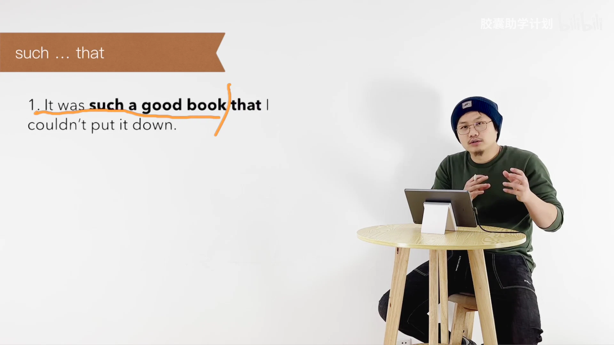

文字识别：such / that / 1. It was such a good bookthat I / couldn't put it down.

### 画面 00:08:13

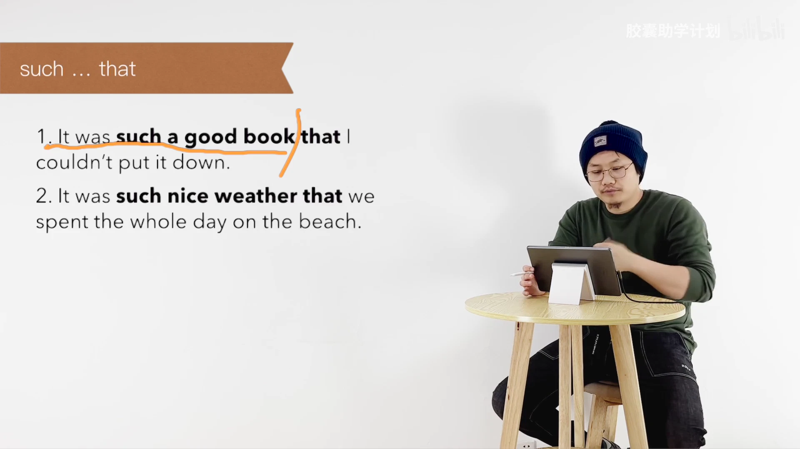

文字识别：such ... that / 1. It was such a good bookthat l / couldn't put it down. / 2. lt was such nice weather that we / spent the whole day on the beach.

## 00:08:30–00:09:00

啊，这个啊海海岸上，对吧？在沙滩上啊，注意 nice 有没有无所谓 weather 这个名词必须要放在这里。所以你看啊，it was such nice weather，天气如此的好，后面表示以至于是一句话。We spent the whole day on the beach. Okay，那不多说了，我们讲完了那两个东西了之后，接下来我们不当堂做，但是您课下要去做。我

### 画面 00:08:37

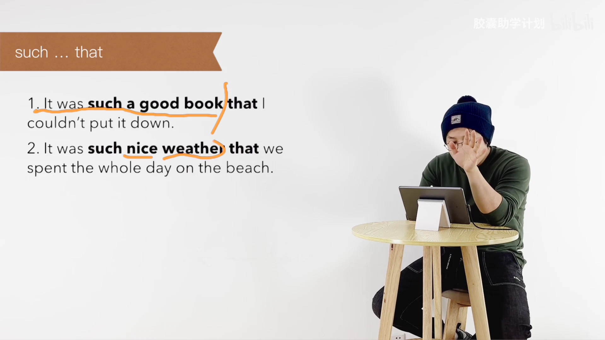

文字识别：such / that / 1. It was such a good bookthat I / couldn't put it down. / 2. It was such nice weathe) t / that we / spent the whole day on the beach.

### 画面 00:08:43

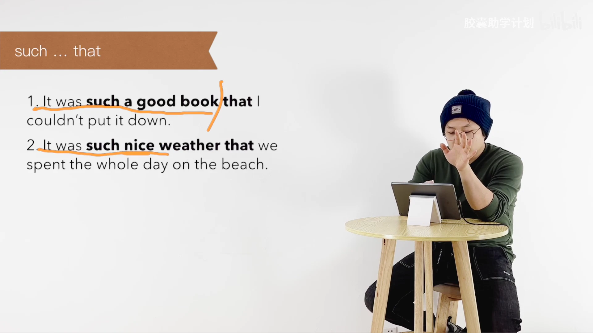

文字识别：such / that / 1. It was such a good bookthat l / couldn't put it down. / 2 It was such nice weather that we / spent the whole day on the beach.

### 画面 00:08:45

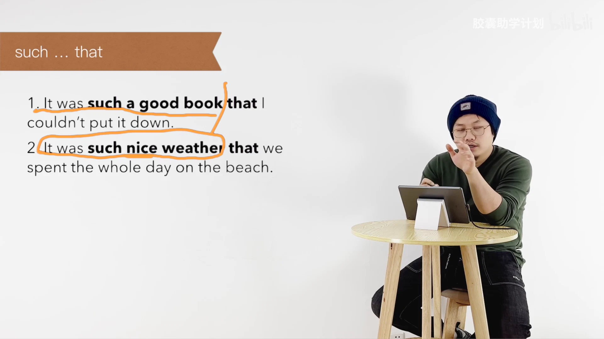

文字识别：such / that / 1. lt was such a good bookthat I / couldn't put it down. / It wass / such nice / weathel / that we / spent the whole / day on the / beach.

### 画面 00:08:50

文字识别：such / that / 1. It was such a good bookthat I / couldn't put it down. / It was / such / nice / weathel / that we / spent the / e whole / day on the / Leach.

### 画面 00:08:53

文字识别：so/such ... that / 1. She worked hard. / 2. It was a beautiful day. / You could hear it from miles away. / 3.I was tired. / You /  would think it was her native / language. / 4.We /  had a good time on / We / spent the whole day indoors. / holiday. / She / made / herself ill. / 5. She speaks English well. / I couldn't open my eyes. / 6.I've9 / got a lot of things to / I didn't eat anything else for the rest of the day. / do. / We /  decided to go to the beach. / I don't know where to begin. / 7.The / music was loud. / 8.Ihad / a big / breakfast. / We / didn't want to come / home. / 9. It was / horrible weather.

### 画面 00:08:55

文字识别：so/such ... that / 1. She worked hard. / 2. It was a beautiful day. / You could hear it from miles away. / 3.1 / was / tired. / You / would think it was  / her native / language. / 4.We / had a good time on / We /  spent the whole day indoors. / holiday. / She / made / herself ill. / 5. She speaks English well. / I couldn't open my eyes. / 6.I've / got a lot of things to / I didn't eat anything e /  else for the rest of the day. / do. / We / decided to go to the / beach. / Idon't know / where to / begin. / 7.The / music was loud. / 8.Ihad / a big / breakfast. / We / didn't want to come / home. / 9. It was / horrible weather.

### 画面 00:08:59

文字识别：so/such ... that / 1.She worked hard. / 2.It was a / beautiful day. / You could hear it from miles away. / 3.1 / was1 / tired. / You / would think it was I / her native /  language. / 4.We / had a good time on / We /  spent the whole day indoors. / holiday. / She / made / herself ill. / 5. She speaks English well. / I couldn't open my eyes. / 6.I've / got a lot of things to / I didn't eat anything else for the rest of the day. / do. / We / decided to go to thel / beach. / Idon't know / where to / begin. / 7.The / music was loud. / 8.Ihad / a big / breakfast. / We / didn't want to come / home. / 9. It was / horrible weather.

## 00:09:00–00:09:30

们做这样一个练习，我给大家说一下这个练习怎么去做，以及呢，如果这里字有点小，你可以去哪里找啊？听好啊，我们先看左面这九个句子。第一句话叫She worked hard，好吧。So和such注意，so形容词副词，such名词，对吧？She worked hard。那我现

### 画面 00:09:04

文字识别：so/such ... that / 1.She worked hard. / 2. It was a / beautiful day. / You could hear it from miles away. / 3.1 / was / tired. / You / would think it wasl / her native / language. / 4.We / hada / agood / time on / We / spent the whole / day indoors. / holiday. / She / made / herself ill. / 5. She speaks English well. / I couldn't open my eyes. / 6.I've / got a lot of things to / I didn't eat anything e /  else for the rest of the day. / do. / We / decided to go to / the / beach. / Idon't know / where to / begin. / 7.The / music was loud. / 8.Ihad / a big / breakfast. / We / didn't want to come / home. / 9. It was / horrible weather.

### 画面 00:09:08

文字识别：so/such ... that / 1.She worked hard. / 2. It was a / beautiful day. / You could hear it from miles away. / 3.1 / was / tired. / You / would think it was / her native / language. / 4.We / had: / agood / time on / We / spent the whole / dayindoors. / holiday. / She / made / herself ill. / 5.She speaks! / s English well. / I couldn't / t open my eyes. / 6.I've / got a lot of things to / I didn't eat anything /  else for the rest of the day. / do. / We / decided t / togoto / the / beach. / Idon't know / where to / begin. / 7.The / music was / loud. / 8.Ihad / a big / breakfast. / We / didn't want to / come / home. / 9. It was / horrible / e weather.

### 画面 00:09:10

文字识别：so/such ... that / 1.She worked hard. / 2.It was a / beautiful day. / You could hear it from miles away. / 3.1 / wast / tired. / You /  would think it was / her native / language. / 4.We / had a goodt / time on / We / spent the whole / day indoors. / holiday. / She / made / herself ill. / 5. She speaks English well. / I couldn't open my eyes. / 6.I've / got a lot of things to / I didn't eat anything /  else for the rest of the day. / do. / We / decided to go to / the / beach. / Idon't know / where to / begin. / 7.The / music was loud. / 8.Ihad / abig / breakfast. / We / didn't want to come / home. / 9.It was / horrible weather.

### 画面 00:09:14

文字识别：so/such ... that / 1.She worked hard. / 2. It was a / beautiful day. / You could hear it from miles away. / 3.1 / was1 / tired. / You / would think it was / her native / language. / 4.We / had a good time on / We / spent the whole / day indoors. / holiday. / She / made / herself ill. / 5. She speaks English well. / I couldn't open my eyes. / 6.I've / got a lot of things to / I didn't eat anything e / elsef /  for the rest of the day. / do. / We / decided to go to / the / beach. / Idon't know / where to / begin. / 7.The / music was loud. / 8.Ihad / a big / breakfast. / We / didn't want to come / home. / 9. It was / horrible weather.

### 画面 00:09:17

文字识别：so/such ... that / 1. She worked hard. / 2. It was a / beautiful day. / You could hear it from miles away. / 3.1 / 1wast / tired. / You / would think it was / her native / language. / 4.We / had a good time on / We / spent the whole / day indoors. / holiday. / She / made / herself ill. / 5. She speaks English well. / I couldn't open my eyes. / 6.I've / got a lot of things to / I didn't eat anything e / elsef / for the rest of the day. / do. / We / decided to go to / the / beach. / Idon't know / where to / begin. / 7.The / music was loud. / 8.Ihad / a big / breakfast. / We / didn't want to come / home. / 9. It was / horrible / e weather.

### 画面 00:09:19

文字识别：so/such / that / 1. She worked hard. / 2.It was al / beautiful day. / You could hear it from miles away. / 3.1 / wast / tired. / You / would think it was / her native / language. / 4.We / had a goodt / time on / We / spent thev / whole / day indoors. / holiday. / She / made / herself ill. / 5. She speaks English well. / I couldn't open my eyes. / 6.l've / got a lot of things to / I didn't eat anything else f / e for the rest of the day. / do. / We / decidedt / togoto / the / beach. / Idon't know / where to / begin. / 7.The / music was / loud. / 8.Ihad / a big / breakfast. / We / didn't want to come / home. / 9. It was / horrible weather.

### 画面 00:09:23

文字识别：so/such / that / 1.She / e worked hard. / 2. It was a / beautiful day. / You could hear it from miles away. / 3.1 / wast / tired. / You /  would think itwas / her native / language. / 4.We / had a good / time on / We / spent the whole / day indoors. / holiday. / She / made / herself ill. / 5. She speaks English well. / I couldn't open my eyes. / 6.I've / got a lot of things to / I didn't eat anything / elset / e for the rest of the day. / do. / We / decided to go to / the / beach. / Idon't know / where to / begin. / 7.The / music was / loud. / 8.Ihad / a big / breakfast. / We / didn't want to come / home. / 9. It was / horrible weather.

### 画面 00:09:25

文字识别：so/such / .. that / 1.She worked hard. / 2. It was a / beautiful day. / You could hear it from miles away. / 3.1 / was / tired. / You / would think it was / her native / language. / 4.We / had a goodt / time on / We / spent the whole / day indoors. / holiday. / She / made / herself ill. / 5.She speaks / s English well. / I couldn't open my eyes. / 6.I've / got a lot of things to / I didn't eat anything  /  else for the rest of the day. / do. / We / decided to go tot / the / beach. / Idon't know / where to / begin. / 7.The / music was loud. / 8.Ihad / a big / breakfast. / We / didn't want to come / home. / 9. It was / horrible weather.

### 画面 00:09:29

文字识别：so/such ... that / 1. She worked hard. / 2. It was a / beautiful day. / You could hear it from miles away. / 3.1 / was / tired. / You / would think it was / her native / language. / 4.We / had / agood / d time on / We / spent the whole day indoors. / holiday. / She / made / herself ill. / 5. She speaks English well. / I couldn't open my eyes. / 6.'ve / got a lot of things to / I didn't eat anything e /  else for the rest of the day. / do. / We / decided to go to / the / beach. / Idon't know / where to / begin. / 7.The / music was loud. / 8.Ihad / a big / breakfast. / We / didn't want to come / home. / 9. It was / horrible weather.

## 00:09:30–00:10:00

ask you to do the first thing is I want to say that she worked so hard. Should I use so or such? This is what we just learned. Then I have to judge the gender here, right? Hard here is a description, ah, to modify this worked. Then it is a negative word. So it definitely cannot use such. It is so. Put it in front of it. So this sentence becomes she worked so hard. She worked so hard.

### 画面 00:09:33

文字识别：so/such ... that / 1. She worked hard. / 2. It was al / beautiful day. / You could hear it from miles away. / 3.1 / was1 / tired. / You /  would think it was her native / language. / 4.We / had a good time on / We / spent the whole day indoors. / holiday. / She / made / herself ill. / 5. She speaks English well. / I couldn't open my eyes. / 6.I've / got a lot of things to / I didn't eat anything else for the rest of the day. / do. / We / decided to go to thek / beach. / 7.The / music was loud. / Idon't knowv /  where to / begin. / 8.Ihad / a big / breakfast. / We / didn't want to come / home. / 9. It was / horrible weather.

### 画面 00:09:35

文字识别：so/such ... that / 1. She worked hard. / 2. It was a / beautiful day. / You could hear it from miles away. / 3.1 / wast / tired. / You / would think it was / her native / language. / 4.We / had a goodt / d time on / We /  spent the whole day indoors. / holiday. / She / made / herself ill. / 5. She speaks English well. / I couldn't open my eyes. / 6.I've / got a lot of things to / I didn't eat anything  /  else for the rest of the day. / do. / We / decided to go tot / the / beach. / Idon't know / where to / begin. / 7.The / music was loud. / 8.Ihad / a big / breakfast. / We / didn't want to come / home. / 9. It was / horrible weather.

### 画面 00:09:39

文字识别：so/such ... that / 1. She worked hard. / 2. It was a / beautiful day. / You could hear it from miles away. / 3.1 / was1 / tired. / You / would think it was / her native / language. / 4.We / had a good time on / We / spent the whole day indoors. / holiday. / She / made / herself ill. / 5. She speaks English well. / I couldn't open my eyes. / 6.I've / got a lot of things to / I didn't eat anything e / j else for the rest of the day. / do. / We / decided to go to t / the / beach. / Idon't know /  where to / begin. / 7.The / music was loud. / 8.Ihad / a big / breakfast. / We / didn't want to come / home. / 9.It was / horrible weather.

### 画面 00:09:44

文字识别：so/such / that / 1.She / e worked hard. / 2.It was a / beautiful day. / You could hear it from miles away. / 3.1 / wast / tired. / You / would think it was  / her native / language. / 4.We / hada / agood time on / We / spent the whole / day indoors. / holiday. / She / made / herself ill. / 5. She speaks English well. / I couldn't open my eyes. / 6.'ve / got a lot of things to / I didn't eat anything else for the rest of the day. / do. / We / decided t / to gotot / the / beach. / Idon't know / where to / begin. / 7.The / music was / loud. / 8.Ihad / a big / breakfast. / We / didn't want to come / home. / 9. It was / horrible weather.

### 画面 00:09:47

文字识别：so/such / that / 1. She worked hard. / 2. It was a / beautiful day. / You could hear it from miles away. / 3.1 / wast / tired. / You / would think it was / her native / language. / 4.We / had a good / dtime on / We / spent the whole day indoors. / holiday. / She / made / herself ill. / 5. She speaks English well. / I couldn't open my eyes. / 6.I've / got a lot of things to / I didn't eat anything e /  else for the rest of the day. / do. / We / decided t / Itogoto / the / beach. / Idon't know / where to / begin. / 7.The / music was / loud. / 8.Ihad / a big / breakfast. / We / didn't want to come / home. / 9. It was / horrible / e weather.

### 画面 00:09:49

文字识别：so/such ... that / 1. She worked hard. / 2.It was al / beautiful day. / You could hear it from miles away. / 3.1 / wast / tired. / You / would think it was / her native / language. / 4.We / had a good time on / We /  spent the whole day indoors. / holiday. / She / made / herself ill. / 5. She speaks English well. / I couldn't open my eyes. / 6.'ve / got a lot of things to / I didn't eat anything else for the rest of the day. / do. / We / decided to go to t / the / beach. / Idon't knowl / where to / begin. / 7.The / music was loud. / 8.Ihad / a big / breakfast. / We / didn't want to come / home. / 9.It was / horrible weather.

### 画面 00:09:54

文字识别：so/such ... that / 1.She worked hard. / 2. It was a / beautiful day. / You could hear it from miles away. / 3.1 / was / tired. / You / would think it was / her native / language. / 4.We / had / agood / time on / We / spent the whole / day indoors. / holiday. / She / made / herself ill. / 5. She speaks English well. / I couldn't / t open my eyes. / 6.'ve / got a lot of things to / I didn't eat anything e /  else for the rest of the day. / do. / We / decided to go tot / the / beach. / Idon't know / where to / begin. / 7.The / music was loud. / 8.Ihad / a big / breakfast. / We / didn't want to come / home. / 9. It was / horrible weather.

### 画面 00:09:59

文字识别：so/such ... that / 1.She worked hard. / 2. It was a / beautiful day. / You could hear it from miles away. / 3.1 / was / tired. / You / would think it was / her native / language. / 4.We / had a goodt / time on / We / spent the whole / day indoors. / holiday. / She / made / herself ill. / 5.She speaks / s English well. / I couldn't / t open my eyes. / 6.I've / got a lot of things to / I didn't eat anything / elset / efor the rest of the day. / do. / We / decided to go to / the / beach. / Idon't know / where to / begin. / 7.The / music was loud. / 8.Ihad / a big / breakfast. / We / didn't want to come / home. / 9. It was / horrible / e weather.

## 00:10:00–00:10:30

that以至于怎么了呢？哎，对吧？以至于怎么了呢？以至于在后面这句话当中找一个答案。那因为我做过，我直接说了，叫做 she made herself ill，对吧？所以这句话连起来叫做 she worked so hard that she made herself ill。说她工作如此的努力，以至于她把她自己给弄生病了。我们再看一个，比如说第二题，说 it was

### 画面 00:10:03

文字识别：so/such / .. that / 1. She worked hard. / 2. It was a / beautiful day. / You could hear it from miles away. / 3.1 / was / tired. / You / would think it was / her native / language. / 4.We / hada / agood / d time on / We / spent the whole / day indoors. / holiday. / She / made / herself ill. / 5.She speaks / s English well. / I couldn't / t open my eyes. / 6.I've / got a lot of things to / I didn't eat anything / elsef / efor the rest of the day. / do. / We / decided to go tot / the / beach. / Idon't know / where to / begin. / 7.The / music was loud. / 8.Ihad / a big / breakfast. / We / didn't want to come / home. / 9. It was / horrible / e weather.

### 画面 00:10:05

文字识别：so/such / that / 1.She / worked hard. / 2. It was a / beautiful day. / You could hear it from miles away. / 3.1 / wast / tired. / You / would think it was / her native / language. / 4.We / hada / Ia good time on / We / spent thev / whole / day indoors. / holiday. / She / made / herself ill. / 5. She speaks English well. / I couldn't open my eyes. / 6.I've / got a lot of things to / I didn't eat anything  / elset / for the rest of the day. / do. / We / decidedt / to go to / the / beach. / Idon't know / where to / begin. / 7.The / music was / loud. / 8.Ihad / a big / breakfast. / We / didn't want to / come / home. / 9. It was / horrible / e weather.

### 画面 00:10:07

文字识别：so/such / that / 1.She / worked hard. / 2.It was a / beautiful day. / lou could hear it from miles away. / 3.1 / wast / tired. / You / would think it was / her native / language. / 4.We / had a good time on / We / spent the whole / day indoors. / holiday. / She / made / herself ill. / 5. She speaks English well. / Icouldn't / topen my eyes. / 6.I've / got a lot of things to / I didn't eat anything  / else / for the rest of the day. / do. / We / decidedt / Ito goto / the / beach. / don't know / where to / begin. / 7.The / music was / loud. / 8.Ihad / a big / breakfast. / We / didn't want to / come / home. / 9. It was / horrible / weather.

### 画面 00:10:09

文字识别：so/such ... that / 1. She worked hard. / 2. It was a / beautiful day. / You could hear it from miles away. / 3.1 / was / tired. / You / would think it was / her native / language. / 4.We / hada / Iagood time on / We / spent the whole / day indoors. / holiday. / She / made / herself ill. / 5.She speaks /  English well. / I couldn't open my eyes. / 6.I've / got a lot of things to / I didn't eat anything / elsef / efor the rest of the day. / do. / We / decided to go to / the / beach. / Idon't know / where to / begin. / 7.The / music was / loud. / 8.Ihad / a big / breakfast. / We / didn't want to / come / home. / 9. It was / horrible / weather.

### 画面 00:10:12

文字识别：so/such / that / 1.She / worked hard. / 2.It / wasa / beautiful day. / You could hear it fromr / miles / away. / 3.1 / was / tired. / You / wouldt / Ithink it was / her native / language. / 4.We / had: / agood / time on / We / spent the / whole / dayindoors. / holiday. / She / made / herself ill. / 5.She speaks / English well. / I couldn't / t open my eyes. / 1 / 6.I've / got a lot of things to / I didn't eat anything / else / for the rest of the day. / do. / We / decidedt / to go to / the / beach. / Idon't know / where to / begin. / 7.The / music / was / loud. / 8.Ihad / abig / breakfast. / We / didn't want to / come / home. / 9. It was / horrible / weather.

### 画面 00:10:14

文字识别：so/such / that / 1.She / worked hard. / 2.It was a / beautiful day. / You could hear it from miles away. / 3.1 / was / tired. / You / would think it was / her native / language. / 4.We / had: / agood / I time on / We / spent the / whole / day indoors. / holiday. / She / made / herself ill. / 5.She speaks / English wel / I couldn't open my eyes. / 6.'ve / got a lot of things to / I didn't eat anything / elset / for the rest of the day. / do. / We / decidedt / to goto / the / beach. / Idon't know / where to / begin. / 7.The / music was / loud. / 8.Ihad / a big / breakfast. / We / didn't want to / come / home. / 9. It was / horrible / weather.

### 画面 00:10:16

文字识别：so/such / that / 1. She worked hard. / 2. It was a / beautiful day. / You could hear it from miles away. / 3.1 / wast / tired. / You /  would think it was / her native / language. / 4.We / had a good time on / We / spent the / whole / dayindoors. / holiday. / She / made / herself ill. / 5.She speaks / s English wel / I couldn't open my eyes. / 6.I've / got a lot of things to / I didn't eat anything /  else for the rest of the day. / do. / We / decided t / Itogoto / the / beach. / Idon't know / where to / begin. / 7.The / music was / loud. / 8.Ihad / a big / breakfast. / We / didn't want to come / home. / 9.It was / horrible / e weather.

### 画面 00:10:19

文字识别：so/such / that / 1.She / worked hard. / 2. It was a / beautiful day. / You could hear it from miles away. / 3.1 / was / tired. / You / would think it was / her native / language. / 4.We / had: / agood /  time on / We / spent the / whole / dayindoors. / holiday. / She / made / herself ill. / 5.She speaks / English wel / I couldn't open my eyes. / 6.I've / got a lot of things to / I didn't eat anything / else / for the rest of the day. / do. / We / decidedt / to goto / the / beach. / Idon't know / where to / begin. / 7.The / music was / loud. / 8.Ihad / a big / breakfast. / We / didn't want to / come / home. / 9. It was / horrible / weather.

### 画面 00:10:24

文字识别：so/such / that / 1.She / worked hard. / 2.It / wasa / beautiful day. / You could hear it from miles away. / 3.1 / was / tired. / You / would think it was / her native / language. / 4.We / had / agood / I time on / We / spent the / whole / dayindoors. / holiday. / She / made / herself ill. / 5.She speaks /  English well. / I couldn't open my eyes. / 6.I've / got a lot of things to / I didn't eat anything / elset / for the rest of the day. / do. / We / decided to go to / the / beach. / Idon't know / where to / begin. / 7.The / music was / loud. / 8.Ihad / abig / breakfast. / We / didn'twant to / come / home. / 9.It was / horrible / e weather.

### 画面 00:10:29

文字识别：so/such / that / 1.She / worked hard. / . / It was a / beautiful day. / You could hear it from miles away. / 3.1 / was / tired. / You / would think it was / her native / language. / 4.We / had / agood /  time on / We / spent the / whole / dayindoors. / holiday. / She / made / herself ill. / 5.She speaks /  English well. / I couldn't open my eyes. / 6.I've / got a lot of things to / I didn't eat anything / else / for the rest of the day. / do. / We / decidedt / Ito go to / the / beach. / Idon't know / where to / begin. / 7.The / music was / loud. / 8.Ihad / abig / breakfast. / We / didn't want to / come / home. / 9. It was / horrible / weather.

## 00:10:30–00:11:00

a beautiful day，然后我看到了 beautiful，哎太好了，so往里一放 it was so a beautiful day，出问题了，为什么？so我讲了后面不能加名词，such后边加形容词名词，对吧？你看后边有一个day，啊，哎非常好，要用such说如此美好的一天，于是它就变成 it was such a beautiful day，是如此美好的一天 that这个单词要加在这里，以至

### 画面 00:10:34

文字识别：so/such / that / 1.She / worked hard. / V. / It was a / beautiful day. / You could hear it from miles away. / 3.1 / was / tired. / You / wouldt / Ithink it was / her native / language. / 4.We / had / agood /  time on / We / spent the / whole / dayindoors. / holiday. / She / made / herself ill. / 5.She speaks /  English well. / Icouldn't / t open my eyes. / 6.'ve / got a lot of things to / I didn't eat anything / else / for the rest of the day. / do. / We / decidedt / to go to / the / beach. / Idon't know / where to / begin. / 7.The / music was / loud. / 8.Ihad / a big / breakfast. / We / didn'twant to / come / home. / 9. It was / horrible / weather.

### 画面 00:10:39

文字识别：so/such / that / 1.She worked hard. / V. / It was a / beautiful day. / You could hear it from miles away. / 3.1 / was / tired. / You /  would think it was / her native / language. / 4.We / had: / agood / I time on / We / spent the / whole / day indoors. / holiday. / Zhe / made / herself ill. / 5.She speaks /  English well. / I couldn't open my eyes. / 6.I've / got a lot of things to / I didn't eat anything / elset / for the rest of the day. / do. / We / decided to go to / the / beach. / Idon't know / where to / begin. / 7.The / music was / loud. / 8.Ihad / a big / breakfast. / We / didn'twant to / come / home. / 9. It was / horrible / weather.

### 画面 00:10:44

文字识别：so/such / that / 1.She / worked hard. / V. / It was a / beautiful day. / You could hear it from n / miles / away. / 3.1 / was / tired. / You / wouldt / think it was / her native / language. / 4.We / had / agood / time on / We / spent the / whole / day indoors. / holiday. / Zhe / made / herself ill. / 5.She speaks / English well. / I couldn't open my eyes. / 6.I've / got a lot of things to / I didn't eat anything / else / for the rest of the day. / do. / We / decidedt / to goto / the / beach. / Idon't know / where to / begin. / 7.The / music / was / loud. / 8.Ihad / a big / breakfast. / We / didn't want to / come / home. / 9. It was / horrible / weather.

### 画面 00:10:49

文字识别：so/such / that / 1. She worked hard. / V. / Itwas a / beautiful day. / You could hear it from miles away. / 3.1 / wast / tired. / You / would think it was / her native / language. / 4.We / had / agood /  time on / We / spent the / whole / day indoors. / holiday. / Zhe / made / herself ill. / 5.She speaks /  English well. / I couldn't open my eyes. / 6.I've / got a lot of things to / I didn't eat anything / elset / for the rest of the day. / do. / We / decidedt / Ito goto / the / beach. / Idon't know / where to / begin. / 7.The / music was / loud. / 8.Ihad / a big / breakfast. / We / didn't want to / come / home. / 9. It was / horrible / weather.

### 画面 00:10:54

文字识别：so/such / that / 1.She / worked hard. / V. / It was a / beautiful day. / You could hear it from miles away. / 3.1 / was / tired. / You / would think it was / her native / language. / 4.We / had: / agood / time on / We / spent the / whole / dayindoors. / holiday. / Zhe / made / herself ill. / 5.She speaks /  English well. / I couldn't open my eyes. / 6.I've / got a lot of things to / I didn't eat anything / else / for the rest of the day. / do. / We / decidedt / to go to / the / beach. / Idon't know / where to / begin. / 7.The / music was / loud. / 8.Ihad / a big / breakfast. / We / didn't want to / come / home. / 9. It was / horrible / weather.

### 画面 00:10:59

文字识别：so/such / that / 1.She / worked hard. / . / It was a / beautiful day. / You could / I hear it from miles away. / 3.1 / was / tired. / You /  would think it was / her native / language. / 4.We / had / agood / time on / We / spent the / whole / day indoors. / holiday. / She / made / herself ill. / 5.She speaks / English well. / I couldn't open my eyes. / 6.I've / got a lot of things to / I didn't eat anything / else / for the rest of the day. / do. / We / decidedt / Ito goto / the / beach. / Idon't know / where to / begin. / 7.The / music was / loud. / 8.Ihad / a big / breakfast. / We / didn't want to / come / home. / 9. It was / horrible / weather.

## 00:11:00–00:11:30

于然后您在后面去找一个答案，对吧？OK，好，那我不多说了，这是各位课下今天的一个家庭作业啊，先在这边加上so和such，然后这儿中间不变的加that，然后您在后面去找到以至于的那个答案。我相信这道题基本做完了，so such点儿点儿that，如此以至于这个语法您基本应该就没问题了，是吧？OK，那当然以后造单词造句的时候，我还会不停

### 画面 00:11:01

文字识别：so/such / .. that / 1. She worked hard. / V. / It was a / beautiful day. / You couldl / I hear it from miles away. / 3.1 / was1 / tired. / You / would think it was / her native / language. / 4.We / had / agood / time on / We / spent the / whole / day indoors. / holiday. / Zhe / made / herself ill. / 5.She speaks! / s English well. / I couldn't open my eyes. / 6.I've / got a lot of things to / I didn't eat anything /  else for the rest of the day. / do. / We / decided to go to / the / beach. / don't know / where to / begin. / 7.The / music was / loud. / 8.Ihad / a big / breakfast. / Wsdidn't want to / come / home. / 9.It was / horrible / weather.

### 画面 00:11:03

文字识别：so/such / that / 1.She / worked hard. / V. / It was a / beautiful day. / ou could / heari / it from / miles / away. / 3.1 / was / tired. / You / would / think it was / her native / language. / 4.We / had / agood / I time on / We / spent the / whole / day indoors. / holiday. / he / made / herself ill. / 5.She speaks / English well. / I couldn't open my eyes. / 6.I've / got a lot of things to / I didn't eat anything / else / for the rest of the day. / do. / We / decidedt / to go to / the / beach. / don't know / where to / begin. / 7.The / music was / loud. / 8.Ihad / abig / breakfast. / W / didn't want to / come / home. / 9. It was / horrible / weather.

### 画面 00:11:05

文字识别：so/such ... that / 1.She worked hard. / 2. It was a / beautiful day. / You could hear it from miles away. / 3.1 / was / tired. / You / would think it was / her native / language. / 4.We / had a good time on / We / spent the whole / dayindoors. / holiday. / She / made / herself ill. / 5. She speaks English we!l. / I couldn't open my eyes. / 6.I've / got a lot of things to / I didn't eat anything /  else for the rest of the day. / do. / We / decided to go to / the / beach. / 7.The / music was loud. / Idon't know / where to / begin. / 8.Ihad / a big / breakfast. / We / didn't want to / come / home. / 9. It was / horrible / weather.

### 画面 00:11:07

文字识别：so/such / .. t hat / 1.She worked hard. / 2. It was a / beautiful day. / You could hear it from miles away. / 3.1 / wast / tired. / You / would think it was / her native / language. / 4.We / had a goodt / dtime on / We / spent the whole c / day indoors. / holiday. / She / made / herself ill. / 5. She speaks English well. / I couldn't open my eyes. / 6.I've / got a lot of things to / I didn't eat anything /  else for the rest of the day. / do. / We / decided to go to / the / beach. / 7.The / music was loud. / Idon't knowl / where to / begin. / 8.Ihad / a big / breakfast. / We / didn't want to / come / home. / 9. It was / horrible / e weather.

### 画面 00:11:09

文字识别：so/such ... that / She / worked hard. / 2. It was a / beautiful day. / You could hear it from miles away. / 3.1 / was / tired. / You / would think it was / her native / language. / 4.We / had a good time on / We / spent the whole day indoors. / holiday. / She / made / herself ill. / 5. She speaks English well. / I couldn't open my eyes. / 6.I've / got a lot of things to / I didn't eat anything e /  else for the rest of the day. / do. / We / decided to go to / the / beach. / Idon't know / where to / begin. / 7.The / music was / loud. / 8.Ihada / a big / breakfast. / We / didn't want to come / home. / 9.lt was / horrible / eweather

### 画面 00:11:11

文字识别：so/sugh / that / She worked hard. / beautiful day. / 2. / It / wasa / You could hear it from miles away. / 3.1 / was / tired. / You / would think it was / her native / language. / 4.We / had: / agood / time on / We / spent thev / whole / day indoors. / holiday. / She / made / herself ill. / 5.She speaks / s English well. / I couldn't / open my eyes. / 6.I've / got a lot of things to / I didn't eat anything / elset / for the rest of the day. / do. / We / decided to go to / the / beach. / Idon't know / where to / begin. / 7.The / music was / loud. / 8.Ihad: / a big / breakfast. / We / didn't want to / come / home. / 9.lt was / horrible / weather

### 画面 00:11:13

文字识别：so/sugh / that / She worked hard. / 2. / Itwas a / beautiful / day. / You could hear it from miles away. / 3.1 / was / tired. / You /  would think it was / her native / language. / 4.We / had: / agood / Itime on / We / spent thev / whole / day indoors. / holiday. / She / made / herself ill. / 5.She speaks / s English well. / I couldn't / open my eyes. / 6.I've / got a lot of things to / I didn't eat anything / elset / e for the rest of the day. / do. / We / decided to go to / the / beach. / Idon't know / where to / begin. / 7.The / music was / loud. / 8.Ihada / a big / breakfast. / We / didn't want to / come / home. / 9.lt was / horrible / weather

### 画面 00:11:15

文字识别：so/sugh / that / She worked hard. / 2. / Itwas a / beautiful / day. / You could hear it from miles away. / 3.1 / was / tired. / You / would think it was / her native / language. / 4.We / had: / agood / I time on / We / spent the whole / day indoors. / holiday. / She / made / herself ill. / 5. She speaks English well. / I couldn't / open my eyes. / 6.I've / got a lot of things to / I didn't eat anything / else / for the rest of the day. / do. / We / decided to go to / the / beach. / Idon't know / where to / begin. / 7.The / music was / loud. / 8.Ihad / a big / breakfast. / We / didn't want to / come / home. / 9.lt was / horrible / weather

### 画面 00:11:17

文字识别：so/sugh / that / She worked hard. / 2. It was a / beautiful / day. / ou couldl / I hear it from miles away. / 3.1 / was / tired. / You / would think it was / her native / language. / 4.We / had: / agood / I time on / We / spent the whole / day indoors. / holiday. / She / made / herself ill. / 5. She speaks English well. / Icouldn't / t open my eyes. / 6.I've / got a lot of things to / I didn't eat anything e / elset / e for the rest of the day. / do. / We / decided to go to / the / beach. / don'tknow / where to / begin. / 7.The / music was / loud. / 8.Ihad / a big / breakfast. / We / didn't want to / come / home. / 9.lt was / horrible / weather

### 画面 00:11:19

文字识别：so/sugh / that / . She worked hard. / 2. / It / wasa / beautiful / day. / ou / could / hear it from r / miles / away. / 3.1 / was / tired. / You / would / think it was / her native / language. / 4.We / had / a / agood / time on / We / spent the / whole / day indoors. / holiday. / She / made / herself ill. / 5.She speaksl /  English well. / I couldn't / open my / eyes. / 6.I've / got a lot of things to / I didn't eat anything / else / for the rest of the day. / do. / We / decided / to go to / the / beach. / don't know / where to / begin. / 7.The / music / was / loud. / 8.Ihad / abig / breakfast. / We didn't want to / come / home. / 9.lt was / horrible / weather

### 画面 00:11:21

文字识别：so/sugh / that / .She worked hard. / 2.1 / It / wasa / beautiful / day. / ou / could / hear it from r / miles / away. / 3.1 / was / tired. / You / wouldt / I think it was / her native / language. / 4.We / had / agood / time on / We / spent the / whole / day indoors. / holiday. / She / made / herself ill. / 5.She speaks /  English well. / Icouldn't / open my / eyes. / 6.I've / got a lot of things to / I didn't eat anything / else / for the rest of the day. / do. / We / decidedt / to go to / the / beach. / don't know / where to / begin. / 7.The / music / was / loud. / 8.Ihad / abig / breakfast. / We didn't want to / come / home. / 9.lt was / horrible / weather

### 画面 00:11:24

文字识别：so/sugh / that / She worked hard. / 2.1 / It / wasa / beautiful / day. / You could / hear it from / miles / away. / 3.1 / was / tired. / You / would / Ithink it was / her native / language. / 4.We / had / agood / time on / We / spent the / whole / day indoors. / holiday. / She / made / herself ill. / 5.She speaks /  English well. / I couldn't / open my / eyes. / 6.I've / got a lot of things to / I didn't eat anything / else / for the rest of the day. / do. / We / decidedt / to go to / the / beach. / don'tl / tknow / where to / begin. / 7.The / music / was / loud. / 8.Ihad / a big / breakfast. / We didn't want to / come / home. / 9.lt was / horrible / weather

### 画面 00:11:26

文字识别：so/sugh / that / She worked hard. / 2. / It / wasa / beautiful / day. / You could / hear it fromr / miles / saway. / 3.1 / was / tired. / You / wouldt / think it was / her native / language. / 4.We / had: / agood / time on / We / spent the / whole / day indoors. / holiday. / She / made / herself ill. / 5.She speaksl /  English well. / I couldn't / t open my eyes. / 6.I've / got a lot of things to / I didn't eat anything / else / for the rest of the day. / do. / We / decidedt / to go to / the / beach. / don't know / where to / begin. / 7.The / music was / loud. / 8.Ihad / a big / breakfast. / We didn't want to / come / home. / 9.lt was / horrible / weather

### 画面 00:11:28

文字识别：so/sugh / that / She worked hard. / 2. / It / was a / beautiful / day. / You could / hear it from r / miles / saway. / 3.1 / was / tired. / You / would think it was / her native / language. / 4.We / had: / agood / time on / We / spent the / whole / day indoors. / holiday. / She / made / herself ill. / 5.She speaksl / s English well. / I couldn't / open my eyes. / 6.I've / got a lot of things to / I didn't eat anything / else / for the rest of the day. / do. / We / decidedt / to go to / the / beach. / don'tknow / where to / begin. / 7.The / music was / loud. / 8.Ihad / a big / breakfast. / We didn't want to / come / home. / 9.lt was / horrible / weather

## 00:11:30–00:12:00

的用它，你放心啊。OK，那这个东西在哪儿呢？我们一会儿留家作业的时候告诉各位。如果这个地方您看不清，对吧？如果你看得清，直接写就好了，好吧？好，Recap，本视频也就是本课的语法，我们最关键就是学了这两个东西，一个是把之前三十课so点儿点儿that拉过来了，一个是本课自己在文章当中就出现的叫such点儿点儿that。OK，呃，家庭作业的话呢，pad and

### 画面 00:11:30

文字识别：so/sugh / that / She worked hard. / 2. / It / was a / beautiful / day. / ou / could / hear it fromr / miles / away. / 3.1 / was / tired. / You / would / Ithink it was / her native / language. / 4.We / had / agood / time on / We / spent the / whole / day indoors. / holiday. / She / made / herself ill. / 5.She speaks / s English well. / Icouldn't / open my eyes. / 6.'ve / got a lot of things to / I didn't eat anything / elset / for the rest of the day. / do. / We / decided / to go to / the / beach. / don't know / where to / begin. / 7.The / music / was / loud. / 8.Ihad / a big / breakfast. / We didn't want to / come / home. / 9.lt was / horrible / weather

### 画面 00:11:34

文字识别：so/sugh / that / . She worked hard. / 2. / It / was a / beautiful / day. / ou / could / hear it from / miles / saway. / 3.1 / was / tired. / You / would / think it was / her native / language. / 4.We / had / agood / I time on / We / spent the / whole / day indoors. / holiday. / She / made / herself ill. / 5.She speaks / s English well. / I couldn't / openmy / eyes. / 6.I've / got a lot of things to / I didn't eat anything / elset / for the rest of the day. / do. / We / decided / to go to / the / beach. / don't know / where to / begin. / 7.The / music was / loud. / 8.Ihad / abig / breakfast. / We didn't want to / come / home. / 9.lt was / horrible / weather

### 画面 00:11:36

文字识别：so/sugh / that / She worked hard. / 2.1 / It / was a / beautiful / day. / You could hear it from miles away. / 3.1 / was / tired. / You / would think it was / her native / language. / 4.We / had / agood / time on / We / spent the / whole / day indoors. / holiday. / She / made / herself ill. / 5. She speaks English well. / I couldn't / t open my eyes. / 6.I've / got a lot of things to / I didn't eat anything / elset / efor the rest of the day. / do. / We / decided / to goto / the / beach. / I don't know / where to / begin. / 7.The / music was / loud. / 8.Ihad / a big / breakfast. / We / didn't want to / come / home. / 9.lt was / horrible / weather

### 画面 00:11:38

文字识别：so/such / that / She worked hard. / 2. It was a / beautiful day. / You could I / I hear it from miles away. / 3.1 / was / tired. / You / would think it was / her native / language. / 4.We / had / agood / time on / We / spent the / whole / dayindoors. / holiday. / She / made / herself ill. / 5.She speaks / s English well. / I couldn't / t open my eyes. / 6.I've / got a lot of things to / I didn't eat anything / else / for the rest of the day. / do. / We / decidedt / Ito goto / the / beach. / Idon't know / where to / begin. / 7.The / music was / loud. / 8.Ihad / a big / breakfast. / We / didn't want to / come / home. / 9.lt was / horrible / weather

### 画面 00:11:40

文字识别：Recap / Patterns / so...that / ＆ / such...that / Grammar

### 画面 00:11:42

文字识别：Recap / Patterns / so...that / ＆ / such...that / Grammar

### 画面 00:11:44

文字识别：Recap / Patterns / so...that / ＆ / such...that / Grammar

### 画面 00:11:47

文字识别：Recap / Patterns / so...that / ＆ / such...that / Grammar

### 画面 00:11:49

文字识别：Recap / Patterns / so...that / ＆ / such...that / Grammar

### 画面 00:11:52

文字识别：Recap / Patterns / so...that / ＆ / such..that / Grammar

### 画面 00:11:54

文字识别：Recap / Patterns / so...that / ＆ / such..that / Grammar

### 画面 00:11:58

文字识别：1.F / Pattern Drill写&朗读 / 专栏 / 4×4

## 00:12:00–00:12:30

drill，本课没有，您不用写，对吧？然后尝试回忆，给自己讲解一遍今天的核心语法，这个非常重要。然后呢，翻阅红皮书，我直接告诉各位，在一百零二单元右面有一道练习，就是我刚才那道练习，对吧？非常的好，各位先去写，写完了之后对答案，有什么不懂的，您视频下方留言告诉我，对吧？或者进入群啊，进入我们的群，然后呢再at我

### 画面 00:12:00

文字识别：1. f / Pattern Drill 写&朗读 / 专栏 / 4×4

### 画面 00:12:02

文字识别：Pattern Drill写&朗读 / 1. / 专栏 / 4×4 / 尝试回忆并给自己讲解一 / 遍今天的核心语法 / Study-Test / Learning Pyramid

### 画面 00:12:04

文字识别：Pattern Drill写&朗读 / 专栏 / 4×4 / 尝试回忆并给自己讲解一 / 遍今天的核心语法 / Study-Test / Learning Pyramid

### 画面 00:12:06

文字识别：PatternDrill写&朗读 / 专栏 / 4×4 / 尝试回忆并给自己讲解一 / 遍今天的核心语法 / Study-Test / Learning Pyramid

### 画面 00:12:08

文字识别：1.↑ / Pattern Drill写&朗读 / 专栏 / 4×4 / 尝试回忆并给自己讲解一 / 遍今天的核心语法 / Study-Test / Learning Pyramid / 尝试翻阅红皮书（中级） / 通过目录或索引(Index) / 查找到本课语法Unit 102

### 画面 00:12:10

文字识别：1. f / Pattern Drill写&朗读 / 专栏 / 4×4 / 尝试回忆并给自己讲解一 / 遍今天的核心语法 / Study-Test / Learning Pyramid / 尝试翻阅红皮书（中级） / 通过目录或索引(Index) / 查找到本课语法Unit 102

### 画面 00:12:12

文字识别：1. f / Pattern Drill写&朗读 / 专栏 / 4×4 / 尝试回忆并给自己讲解一 / 遍今天的核心语法 / Study-Test / Learning Pyramid / 尝试翻阅红皮书（中级） / 通过目录或索引(Index) / 查找到本课语法Unit 102

### 画面 00:12:14

文字识别：1.↑ / Pattern Drill写&朗读 / 专栏 / 4×4 / 尝试回忆并给自己讲解一 / 遍今天的核心语法 / Study-Test / Learning Pyramid / 尝试翻阅红皮书（中级） / 通过目录或索引(Index) / 查找到本课语法Unit 102

### 画面 00:12:16

文字识别：Pattern Drill写&朗读 / 专栏 / 4×4 / 尝试回忆并给自己讲解一 / 遍今天的核心语法 / Study-Test / Learning Pyramid / 尝试翻阅红皮书（中级） / 通过目录或索引（Index) / 查找到本课语法Unit 102

### 画面 00:12:19

文字识别：1. f / Pattern Drill写&朗读 / 专栏 / 4×4 / 尝试回忆并给自己讲解一 / 遍今天的核心语法 / Study-Test / Learning Pyramid / 尝试翻阅红皮书（中级） / 通过目录或索引(Index) / 查找到本课语法Unit 102

### 画面 00:12:24

文字识别：1. / Pattern Drill写&朗读 / 专栏 / 4×4 / 尝试回忆并给自己讲解一 / 遍今天的核心语法 / Study-Test / Learning Pyramid / 尝试翻阅红皮书（中级） / 通过目录或索引(Index) / 查找到本课语法Unit 102

### 画面 00:12:29

文字识别：1.f / Pattern Drill写&朗读 / 专栏 / 4×4 / 尝试回忆并给自己讲解一 / 遍今天的核心语法 / Study-Test / Learning Pyramid / 尝试翻阅红皮书（中级） / 通过目录或索引(Index) / 查找到本课语法Unit 102

## 00:12:30–00:12:57

问我也可以，没有问题啊。好，那以上呢就是本期视频的全部内容了。如果您喜欢我们的课程呢，欢迎各位关注、订阅、一键三连，分享给那些需要的朋友来帮助我们快速成长。See you next time.

### 画面 00:12:32

文字识别：370*

### 画面 00:12:44

文字识别：不 / ￥

### 画面 00:12:46

文字识别：CAPSULEACADEMY / 胶囊助学计划 / 小红书 / Lecturer / Leo / OE

### 画面 00:12:49

文字识别：CAPSULEACADEMY / 胶囊助学计划 / 小红书

### 画面 00:12:52

文字识别：CAPSULEACADEMY / 胶囊助学计划 / 小红书 / Creator / □ / Leo & Berlin

### 画面 00:12:54

文字识别：bilbili / 胶囊助学计划 / CAPSULEACADEMY / 胶囊助学计划 / 小红书 / OE

### 画面 00:12:56

文字识别：bilibili / 胶囊助学计划

