# L035 听说读写复述练习

快速机器解析：语音为单模型转写，未进行独立交叉校对或人工复核；画面每秒采样并按变化选帧，短时文字和标记可能遗漏。截图时间约有 1 秒误差。图片有损压缩；遇到疑点请按时间查看 Google Drive 原视频。

## 00:00:00–00:00:30

Hello everyone, welcome to Capsule Academy. This is Leo. Today we're going to learn New Concept English Book Two, Lesson Thirty Five Practices. That注意进行如下练习的唯一前提叫做文章跟读制，熟读成诵，否则请勿开始。Hope you gonna enjoy.那我们先看第一题，我们的任务叫做听懂一般疑问句和特殊疑问句，对吧？我问您答，在文章当中可以找

### 画面 00:00:00

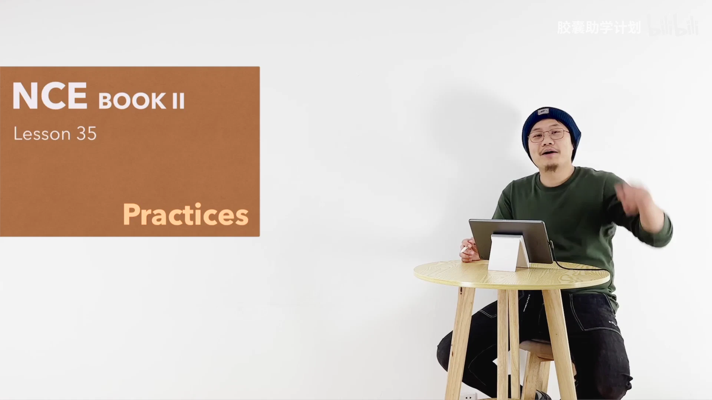

文字识别：NCE / BOOKII / Lesson 35 / Practices

### 画面 00:00:05

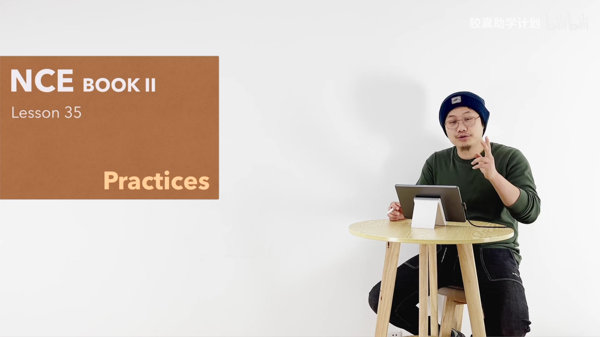

文字识别：NCE / BOOKII / Lesson 35 / Practices

### 画面 00:00:08

文字识别：进行如下练习唯一前提 / 文章跟读至熟读成诵 / 否则请勿开始

### 画面 00:00:17

文字识别：胶囊助学计划bl出 / •

### 画面 00:00:21

### 画面 00:00:23

文字识别：Comprehension / 训练目标： / 听懂一般疑问句＆特殊疑问句

## 00:00:30–00:01:00

答案来了。What did Roy Trenton used to do? Drive a taxi. Next one, what does he drive now? A bus. Next one, does he regret the change? No, he doesn't. Next one, how is he finding his new work? Hey, far more exciting. Okay, next one, say where was

### 画面 00:00:31

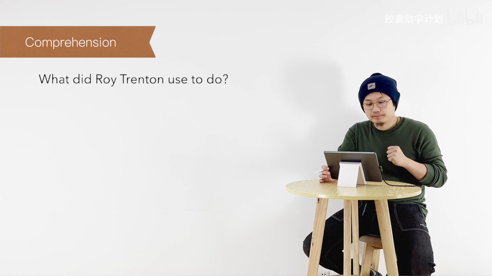

文字识别：Comprehension / What did Roy Trenton use to do?

## 00:01:00–00:01:30

he driving recently? Along Catford Street. Next one, who did he see rush out of a shop? Two thieves. Next one, where did they run? Towards a waiting car. Next one, what was one of them carrying? A bag full of money. Next one, which way

### 画面 00:01:01

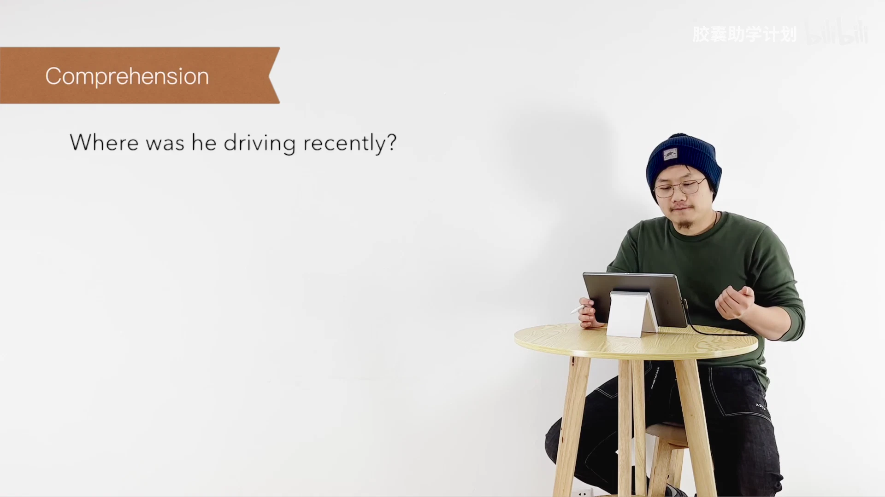

文字识别：Comprehension / Where was he driving recently?

## 00:01:30–00:02:00

did Roy drive his bus? Straight at the thieves. Next one, were the thieves frightened? Yes, they were. Next one, what did the one with the money do? He dropped the bag. Next one, where did Roy drive his bus next?

### 画面 00:01:31

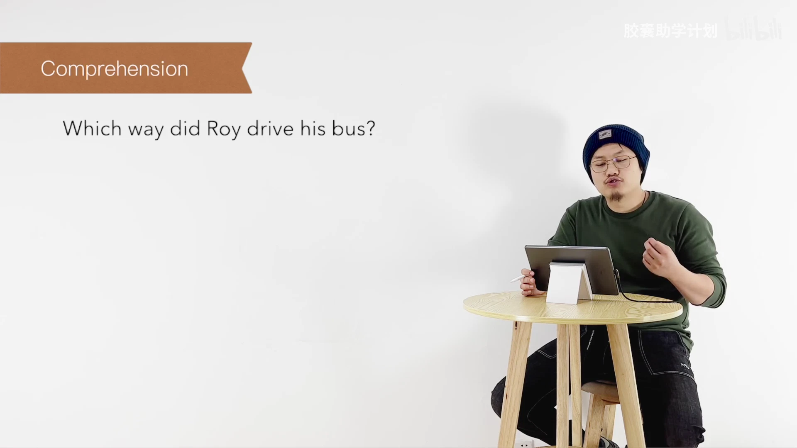

文字识别：Comprehension / Which way did Roy drive his bus?

### 画面 00:01:52

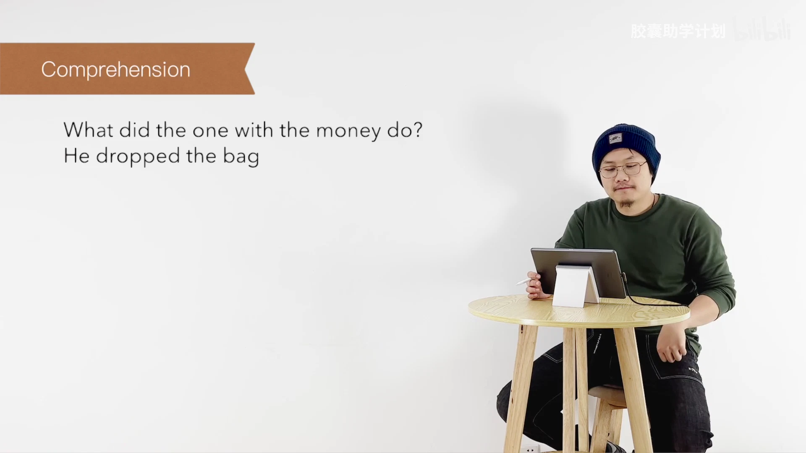

文字识别：Comprehension / What did the one with the money do? / He dropped the bag

### 画面 00:01:55

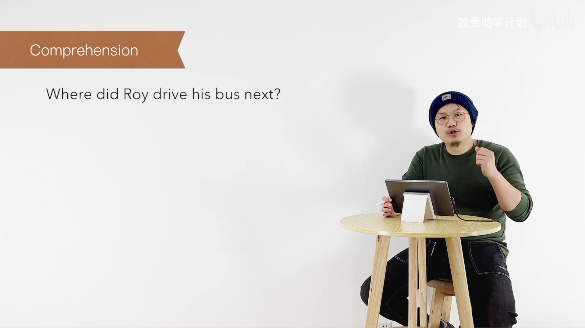

文字识别：Comprehension / Where did Roy drive his bus next?

## 00:02:00–00:02:30

into the back of the thieves' car. Okay, asking questions.练习的是我们能说出来啊，一般疑问句和特殊疑问句的能力，就是我们发问的能力，对吧？好了，那我们先看一个简单的例子，说 Roy Trenton used to drive a taxi. 这个我们在三十一课讲过了。Did提前，used换回原形，对吧？然后What那那肯定就对a taxi提问，直接替代，这事儿就搞定了啊。好，

### 画面 00:02:04

文字识别：Asking questions / 训练目标： / 会说一般疑问句＆特殊疑问句 / Accuracy / Fluency

### 画面 00:02:13

文字识别：Asking questions / T:Ask me if Roy Trenton used to drive a taxi.

### 画面 00:02:25

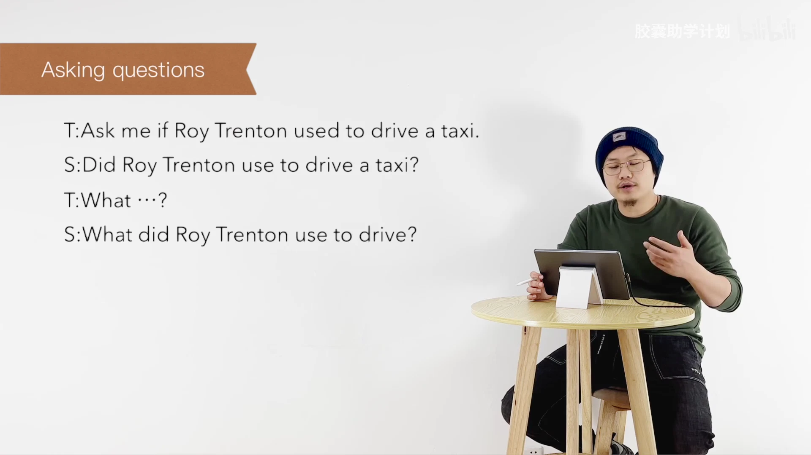

文字识别：Asking questions / T:Ask me if Roy Trenton used to drive a taxi. / S:Did Roy Trenton use to drive a taxi? / T:What…? / S:What did Roy Trenton use to drive?

### 画面 00:02:29

文字识别：Asking questions

## 00:02:30–00:03:00

那我们来看接下来的。说 He changed his job recently. Changed，一般过去时，did提前，动词换原形。Where？你想他 changed to where，是吧？各位自己去想一下。你在视频下方告诉我，这个还是有一点点很有意思的。你要想一下，它翻译过来是什么意思？好吧。接下来呢？说 He became a bus driver. Did提前 What对a bus driver提问。

### 画面 00:02:32

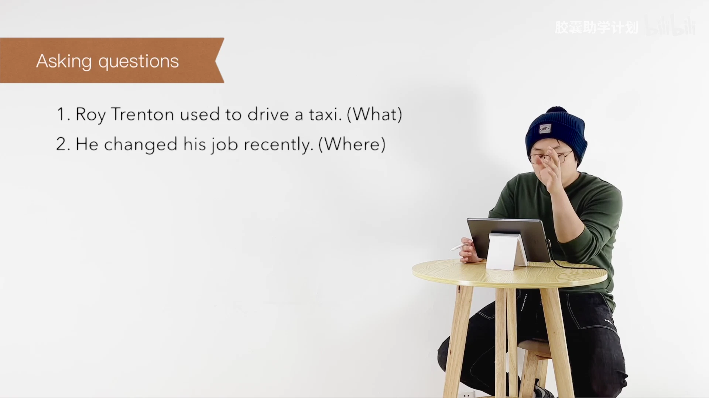

文字识别：Asking questions / 1. Roy Trenton used to drive a taxi. (What) / 2. He changed his job recently. (Where)

### 画面 00:02:34

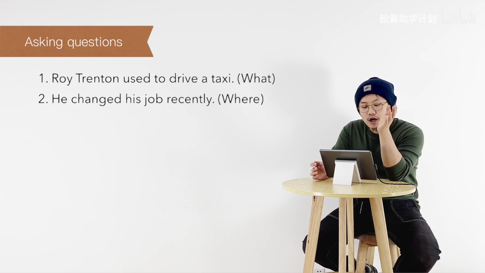

文字识别：Asking questions / 1. Roy Trenton used to drive a taxi. (What) / 2. He changed his job recently. (Where)

### 画面 00:02:52

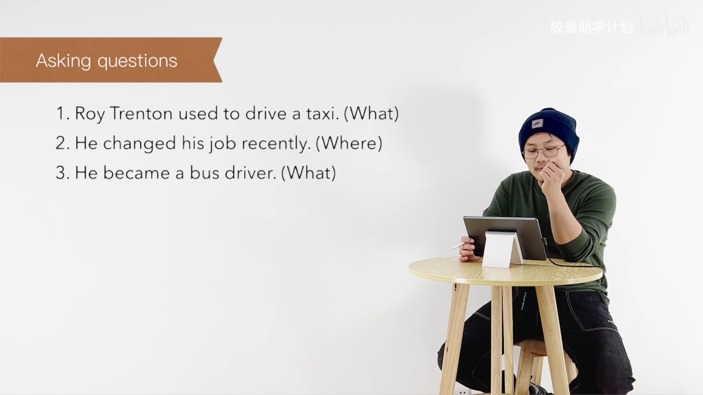

文字识别：Asking questions / 1. Roy Trenton used to drive a taxi. (What) / 2. He changed his job recently. (Where) / 3. He became a bus driver.(What)

## 00:03:00–00:03:30

He is finding his new work far more exciting. Is提前，How，其实答案叫做How is he finding his new work，对吧？哎，感觉如何啊？那What对 his new work提问，对吧？He was driving along Catford Street recently.过去进行时was提前。Where呢？对Catford Street。When呢？对Recently。Who do对主语提问？Next one. He saw two thieves.

### 画面 00:03:16

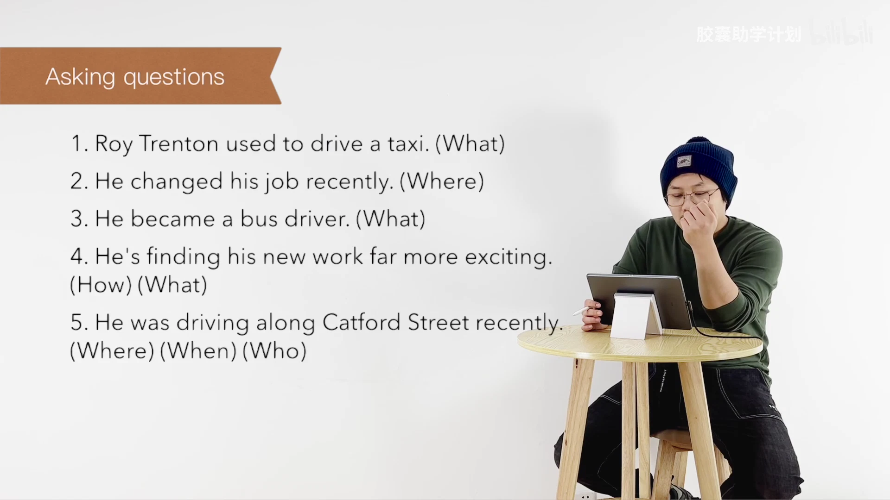

文字识别：Asking questions / 1. Roy Trenton used to drive a taxi. (What) / 2. He changed his job recently. (Where) / 3. He became a bus driver.(What) / 4. He's finding his new work far more exciting. / (How)(What) / 5. He was driving along Catford Street recently. / (Where)(When)(Who)

### 画面 00:03:19

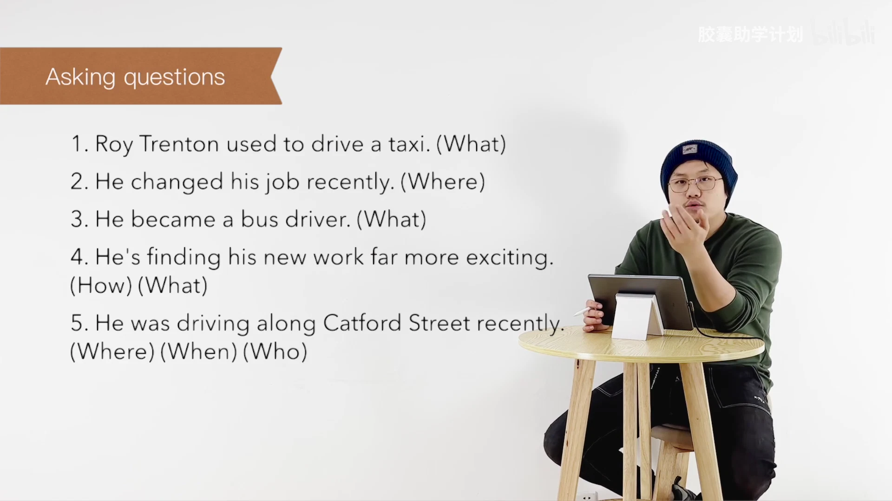

文字识别：Asking questions / 1. Roy Trenton used to drive a taxi. (What) / 2. He changed his job recently. (Where) / 3. He became a bus driver. (What) / 4. He's finding his new work far more exciting. / (How)(What) / 5. He was driving along Catford Street recently. / (Where)(When)(Who)

### 画面 00:03:27

文字识别：Asking questions

## 00:03:30–00:04:00

Did提前, what对two thieves提问, where对整句提问，直接加一般疑问句. They rushed out of a shop. Did提前, what点点点do是标准答案，叫What did they do? Okay.第八个说They ran towards a waiting car. Did提前, which way其实可以理解为是对towards a waiting car提问，所以叫做Which way did they run?他们冲哪条路跑

### 画面 00:03:46

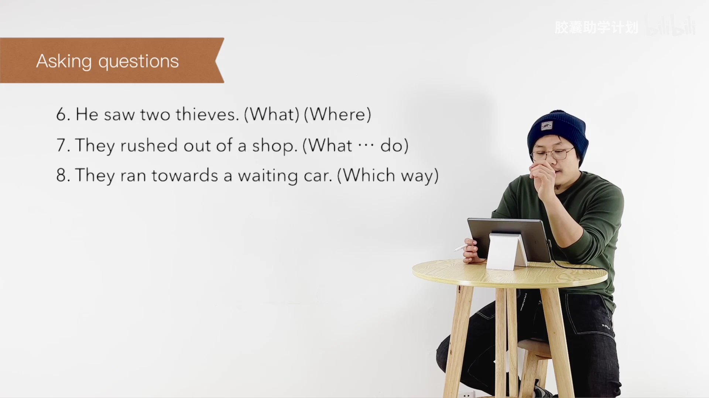

文字识别：Asking questions / 6. He saw two thieves.(What) (Where) / 7. They rushed out of a shop.(What … do) / 8. They ran towards a waiting car. (Which way)

## 00:04:00–00:04:30

### 画面 00:04:01

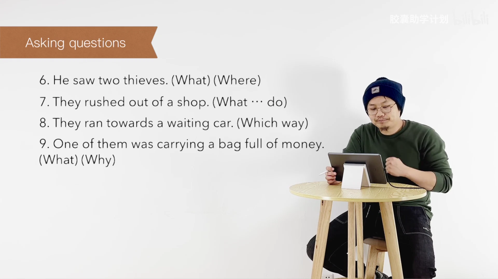

文字识别：Asking questions / 6. He saw two thieves.(What) (Where) / 7.They rushed out of a shop.(What . do) / 8. They ran towards a waiting car. (Which way) / 9. One of them was carrying a bag full of money. / (What) (Why)

### 画面 00:04:27

文字识别：Tell the story / 训练目标： / 口语复述能力 / Accuracy / Fluency

## 00:04:30–00:05:00

以错一点点，但绝对不能慢，对吧？所以文章要读到非常非常的熟啊，才可以出现说. Right and Trenton used to drive a taxi a short while ago. He became a bus driver and he has not regretted it. Okay, and he is finding his new work far more exciting.你要读到很熟，对吧？Okay, uh, summary writing.只要写作写完来这儿对答案就可以了。我们不多说，有问题视频下方留言告诉我啊。Topic for

### 画面 00:04:36

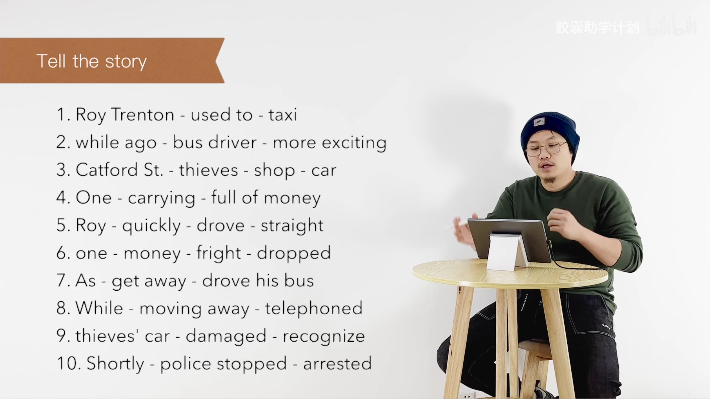

文字识别：Tell the story / 1. Roy Trenton - used to - taxi / 2. while ago - bus driver - more exciting / 3. Catford St.- thieves - shop - car / 4.One - carrying - full of money / 5. Roy- quickly- drove- straight / 6.one - money -fright- dropped / 7.As - get away - drove his bus / 8. While - moving away - telephoned / 9.thieves' car - damaged - recognize / 10. Shortly - police stopped - arrested

### 画面 00:04:51

文字识别：Summary writing: Key / 训练目标： / 写作复述能力

### 画面 00:04:53

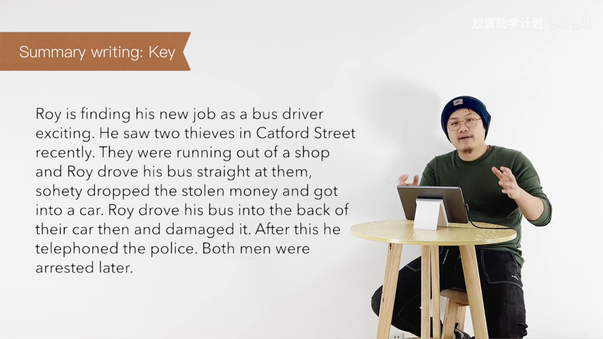

文字识别：Summary writing: Key / Roy is finding his new job as a bus driver / exciting. He saw two thieves in Catford Street / recently. They were running out of a shop / and Roy drove his bus straight at them, / sohety dropped the stolen money and got / into a car. Roy drove his bus into the back of / their car then and damaged it. After this he / telephoned the police. Both men were / arrested later.

### 画面 00:04:58

文字识别：Topics for discussion / 训练目标： / 完全自由的对话 / Accuracy / Fluency

## 00:05:00–00:05:30

discussion.我们先看一下，第一题说In your experience, which are the better or worse drivers, taxi or bus drivers? Why?说在你的这个体验当中啊，说公交车司机和出租车司机谁开的驾驾这个你可以理解为谁的驾驶技术更强？为什么？第二，说Imagine you were a passenger on Roy Trenton's car. Tell the story from your point of view.这道题我觉得倒是

### 画面 00:05:00

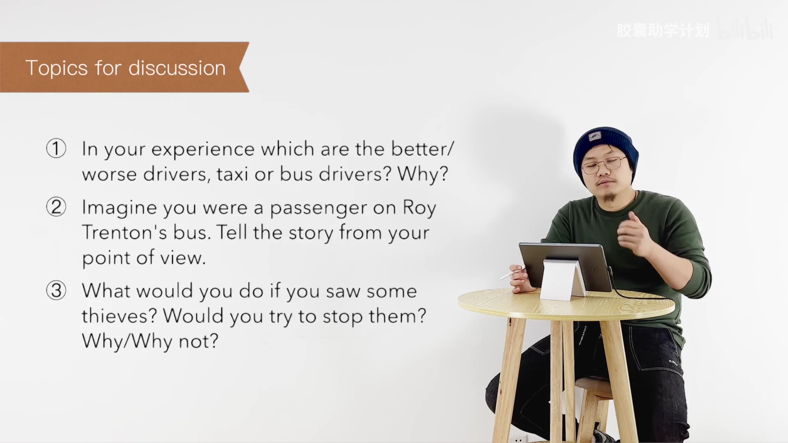

文字识别：Topics for discussion / In your experience which are the better/ / worse drivers, taxi or bus drivers? Why? / Imagine you were a passenger on Roy / Trenton's bus. Tell the story from your / point of view. / What would you do if you saw some / thieves? Would you try to stop them? / Why/Why not?

## 00:05:30–00:06:00

挺适合各位去写一下，其实就是复述一下文章，叫做假设你是 Roy Trenton 那个公交车上的一名乘客，那你给我去从你的这个视角去讲一下这个故事。最后一道题说 What would you do if you saw some thieves? Would you try to stop them? Why? Why not? 说你如果看到一些贼，你会尝试去制止他们吗？如果会，为什么会？如果不会，为什么不会？好吧，

### 画面 00:05:30

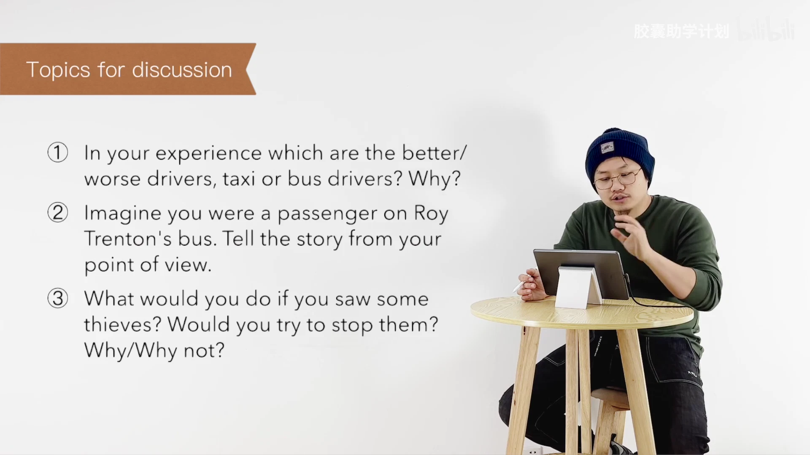

文字识别：Topics for discussion / In your experience which are the better/ / worse drivers, taxi or bus drivers? Why? / Imagine you were a passenger on Roy / Trenton's bus. Tell the story from your / point of view. / What would you do if you saw some / thieves? Would you try to stop them? / Why/Why not?

## 00:06:00–00:06:30

OK，呃，家庭作业 ask me if 先写再大声朗读，只要写作先写，然后来这里对答案， tell the story 进行一个口语复述，专栏当中可以找的。好，那以上呢就是本期视频的全部内容了。如果各位喜欢我们的课程呢，欢迎各位关注、订阅、一键三连，分享给那些需要的朋友，来帮助我们快速成长。See you next time.

### 画面 00:06:00

### 画面 00:06:02

文字识别：1.Ask me if写&朗读

### 画面 00:06:04

文字识别：1.Ask me if写&朗读 / 2.摘要写作写&答案

### 画面 00:06:06

文字识别：1.Ask me if写&朗读 / 2. / 摘要写作写&答案

### 画面 00:06:08

文字识别：1.Ask me if写&朗读 / 摘要写作写&答案 / 3.Tell the story 口语复述

### 画面 00:06:10

文字识别：1.Ask me if写&朗读 / 摘要写作写&答案 / 2. / 3.Tell the story 口语复述 / 专栏 / 4.

### 画面 00:06:13

文字识别：👍

### 画面 00:06:27

文字识别：CAPSULEACADEMY / 胶囊助学计划 / 小红书

### 画面 00:06:29

文字识别：CAPSULEACADEMY / 胶囊助学计划 / 小红书 / Leo / OE

## 00:06:30–00:06:39

### 画面 00:06:35

文字识别：CAPSULEACADEMY / 胶囊助学计划 / 小红书 / Creator / □ / Leo & Berlin

### 画面 00:06:37

文字识别：bilibili / 胶囊助学计划

### 画面 00:06:38

文字识别：bilibili / 胶囊助学计划

