# L036 单词

快速机器解析：语音为单模型转写，未进行独立交叉校对或人工复核；画面每秒采样并按变化选帧，短时文字和标记可能遗漏。截图时间约有 1 秒误差。图片有损压缩；遇到疑点请按时间查看 Google Drive 原视频。

## 00:00:00–00:00:30

Hello everyone, welcome to Capsule Academy. This is Leo. Today we're going to learn New Concept English Book Two, Lesson Thirty Six Words. 那老习惯，进入正式课程之前呢，我们先看几个小的问题。那首先，如何去表达创世界纪录？接下来，如何表达完成某件事情？那最后一个问题，如何表达打算做某事？那带着这三个问题，Hope you gonna enjoy it.

### 画面 00:00:00

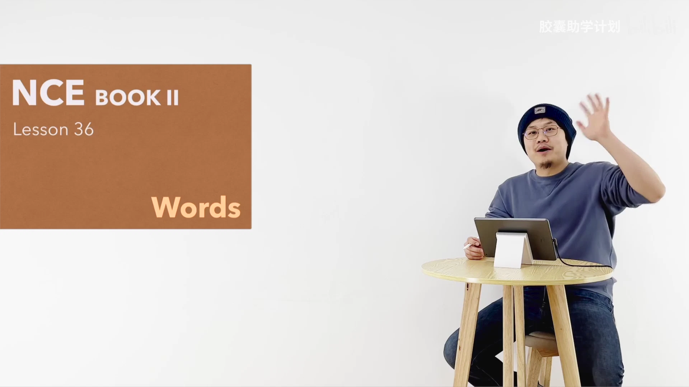

文字识别：NCE / BOOKⅡI / Lesson 36 / Words

### 画面 00:00:09

### 画面 00:00:11

文字识别：①如何表达“创世界纪录”？

### 画面 00:00:16

文字识别：①如何表达“创世界纪录”？ / 如何表达“成功完成某事”?

### 画面 00:00:18

文字识别：①如何表达“创世界纪录”？ / 如何表达“成功完成某事”?

### 画面 00:00:20

文字识别：①如何表达“创世界纪录”？ / 如何表达“成功完成某事”? / 如何表达“打算做某事”?

### 画面 00:00:26

文字识别：胶囊助学计划bil出 / •

## 00:00:30–00:01:00

好，那我们先看本课的第一个单词啊。我们先看，注意一下，它是名词词性的时候，它的含义就是我们说打破世界纪录的那个记录那两个字，对吧？那先跟我一起读一下，看重音在前面，叫做 record record。 OK，那注意，如果它是动词词性的时候，它的含义呢，你还可以理解为是记录，只不过这时候是把事情记录下来，而不是打破世界

### 画面 00:00:30

### 画面 00:00:32

文字识别：单词造句指南 / 网：v.+v.变化 / 四句型转换 / 方式/地点/时间 / ZALEISI / 结合习惯用法 / 其他单词+词性 / SEIKO / VORLO INDOOR RECORD / 原文摘抄+变 / 3:01.77 / 6123456 / /'reko:d/ / /rI'ko:d/ / record n. record v.

### 画面 00:00:35

文字识别：单词造句指南 / 网：v.+v.变化 / 四句型转换 / 方式/地点/时间 / ZALEISI / 结合习惯用法 / 其他单词+词性 / SEIKO / VORLD INDOOR RECORD / 原文摘抄+变 / 3:01.77 / 6123456 / /'reko:d/ / /rI'ko:d/ / record n. record v.

### 画面 00:00:40

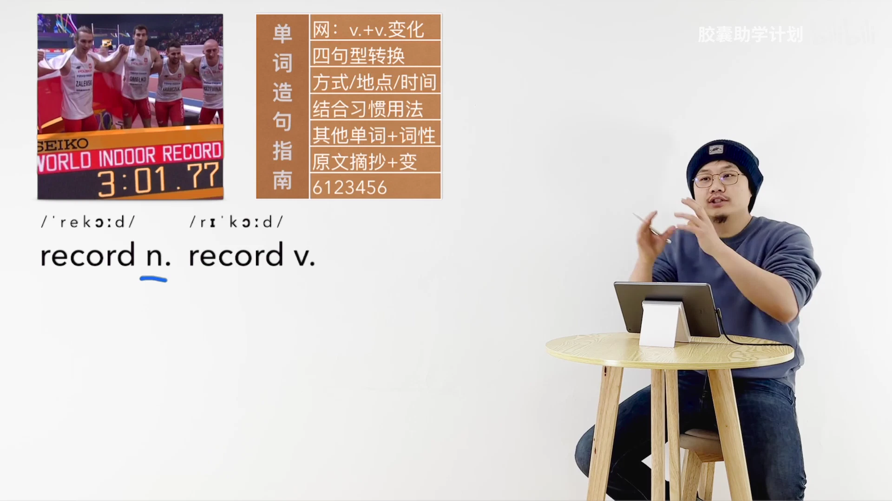

文字识别：单词造句指南 / 网：v.+v.变化 / 四句型转换 / 方式/地点/时间 / ZALEISI / 结合习惯用法 / 其他单词+词性 / SEIKO / VORLO INDOOR RECORD / 原文摘抄+变 / 3:01.77 / 6123456 / /'reko:d/ / /rI'ko:d/ / record n. record v.

### 画面 00:00:45

文字识别：单词造句指南 / 网：v.+v.变化 / 四句型转换 / 方式/地点/时间 / ZALENSI / 结合习惯用法 / 其他单词+词性 / SEIKO / VORLO INDOOR RECORD / 原文摘抄+变 / 3:01.77 / 6123456 / /'reko:d/ / /rI'ko:d/ / record n. record v.

### 画面 00:00:51

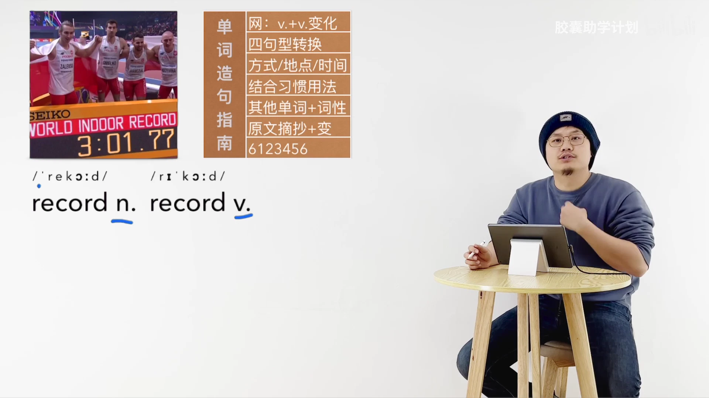

文字识别：单词造句指南 / 网：v.+v.变化 / 四句型转换 / 方式/地点/时间 / ZALEISI / 结合习惯用法 / 其他单词+词性 / SEIKO / VORLO INDOOR RECORD / 原文摘抄+变 / 3:01.77 / 6123456 / /'reko:d/ / /rI'ko:d/ / record n. record v.

### 画面 00:00:55

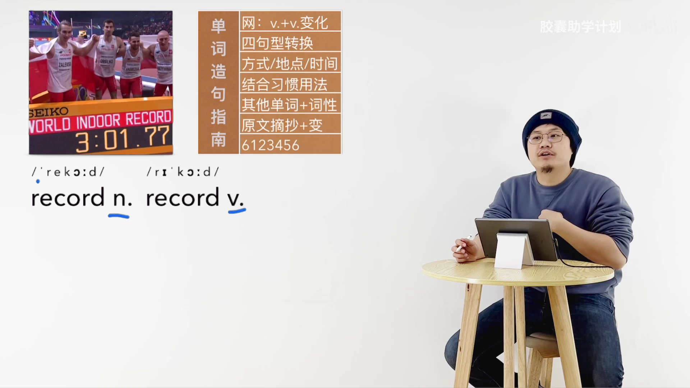

文字识别：单词造句指南 / 网：v.+v.变化 / 四句型转换 / 方式/地点/时间 / ZALEISI / 结合习惯用法 / 其他单词+词性 / SEIKO / VORLO INDOOR RECORD / 原文摘抄+变 / 3:01.77 / 6123456 / /'reko:d/ / /rI'ko:d/ / record n. record  / V.

## 00:01:00–00:01:30

纪录的那个记录啊。OK，那所以这个时候呢，它就变成了叫做record，record。注意发音是不太一样的。今天我们学的啊，或者说文章当中出现的这个单词叫做record啊。那告诉各位，它还有另一个非常常见的词性含义以及它的发音叫做record。OK，very good。那接下来我们说几个小的习惯用法。首先第一个叫做哎，比如说

### 画面 00:01:01

文字识别：单词造句指南 / 网：v.+v.变化 / 四句型转换 / 方式/地点/时间 / ZALEISU / 结合习惯用法 / 其他单词+词性 / SEIKO / VORLO INDOOR RECORD / 原文摘抄+变 / 3:01.77 / 6123456 / /'reko:d/ / /rI'ko:d/ / record n. record v.

### 画面 00:01:05

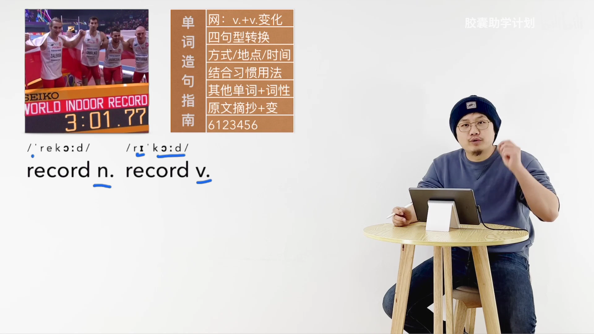

文字识别：单词造句指南 / 网：v.+v.变化 / 四句型转换 / 方式/地点/时间 / ZALEISI / 结合习惯用法 / 其他单词+词性 / SEIKO / VORLO INOOOR RECORD / 原文摘抄+变 / 3:01.77 / 6123456 / /'reko:d/ / /ri'ko:d/ / record n. record / V.

### 画面 00:01:10

文字识别：单词造句指南 / 网：v.+v.变化 / 四句型转换 / 方式/地点/时间 / ZALEISI / 结合习惯用法 / 其他单词+词性 / SEIKO / VORLO INDOOR RECORD / 原文摘抄+变 / 3:01.77 / 6123456 / /'reko:d/ / /rI'ko:d/ / record n. record / V.

### 画面 00:01:14

文字识别：单词造句指南 / 网：v.+v.变化 / 四句型转换 / 方式/地点/时间 / ZALEISI / 结合习惯用法 / 其他单词+词性 / SEIKO / VORLO INDOOR RECORD / 原文摘抄+变 / 3:01.77 / 6123456 / reko:d/ / /rI'ko:d/ / record n. record / V.

### 画面 00:01:16

文字识别：单词造句指南 / 网：v.+v.变化 / 四句型转换 / 方式/地点/时间 / ZALEISI / 结合习惯用法 / 其他单词+词性 / SEIKO / VORLO INDOOR RECORD / 原文摘抄+变 / 3:01.77 / 6123456 / reko:d/ / /rI'ko:d/ / record n. record / V.

### 画面 00:01:18

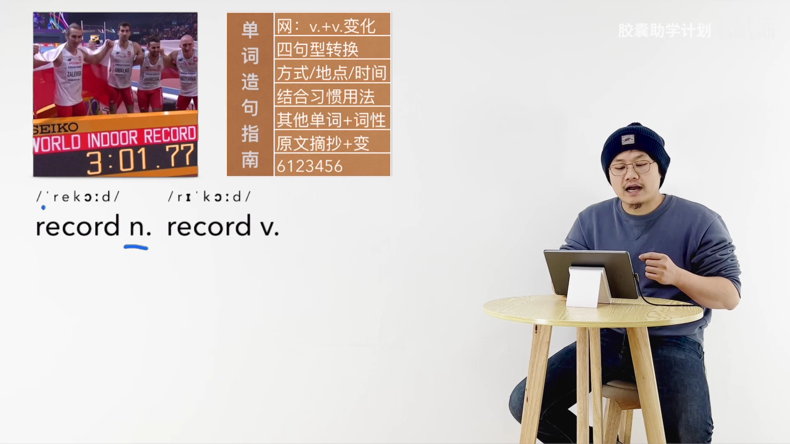

文字识别：单词造句指南 / 网：v.+v.变化 / 四句型转换 / 方式/地点/时间 / ZALEISI / 结合习惯用法 / 其他单词+词性 / SEIKO / VORLD INDOOR RECORD / 原文摘抄+变 / 3:01.77 / 6123456 / /'reko:d/ / /rI'ko:d/ / record n. record v.

### 画面 00:01:20

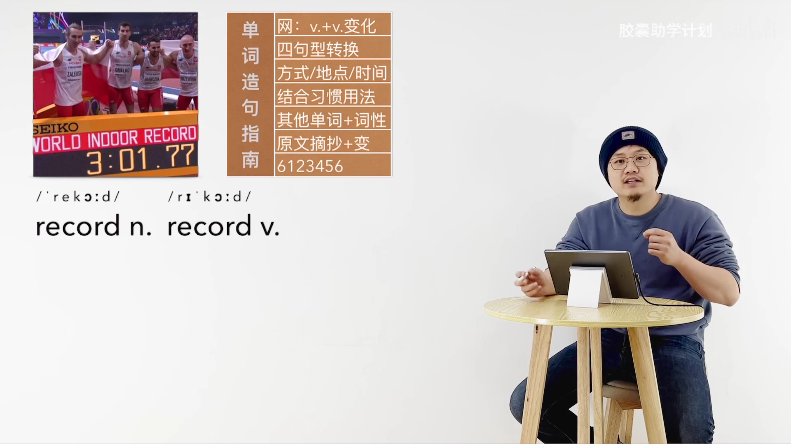

文字识别：单词造句指南 / 网：v.+v.变化 / 四句型转换 / 方式/地点/时间 / ZALEISI / 结合习惯用法 / 其他单词+词性 / SEIKO / VORLO INDOOR RECORD / 原文摘抄+变 / 3:01.77 / 6123456 / /'reko:d/ / /rI'ko:d/ / record n. record v.

### 画面 00:01:25

文字识别：单词造句指南 / 网：v.+v.变化 / 四句型转换 / 方式/地点/时间 / ZALENSO / 结合习惯用法 / 其他单词+词性 / SEIKO / VORLD INDOOR RECORD / 原文摘抄+变 / 3:01.77 / 6123456 / /'reko:d/ / /rI'ko:d/ / record n. record v. / set up a new world record

## 00:01:30–00:02:00

创建新的世界纪录叫做 set up a new world record. Okay, very good.叫 set up啊，在这个地方理解为叫做创建了一个新的世界纪录。Okay，那打破世界纪录呢，还真的就是用打破这个字叫做 break the record. Okay，那给了各位两个小的短语，其实从这个地方各位要去想的就是六一二三四五六当中这两个小的短语其实都跟二是相关的，对吧？一个是

### 画面 00:01:30

文字识别：单词造句指南 / 网：v.+v.变化 / 四句型转换 / 方式/地点/时间 / ZALENS / 结合习惯用法 / 其他单词+词性 / SEIKO / VORLD INDOOR RECORD / 原文摘抄+变 / 3:01.77 / 6123456 / /'reko:d/ / /rI'ko:d/ / record n. record v. / set up a new world record

### 画面 00:01:40

文字识别：单词造句指南 / 网：v.+v.变化 / 四句型转换 / 方式/地点/时间 / ZALEISU / 结合习惯用法 / 其他单词+词性 / SEIKO / VORLD INDOOR RECORD / 原文摘抄+变 / 3:01.77 / 6123456 / /'reko:d/ / /rI'ko:d/ / record n. record v. / set up a new world record

### 画面 00:01:45

文字识别：单词造句指南 / 网：v.+v.变化 / 四句型转换 / 方式/地点/时间 / ZALEISI / 结合习惯用法 / 其他单词+词性 / SEIKO / VORLD INDOOR RECORD / 原文摘抄+变 / 3:01.77 / 6123456 / /'reko:d/ / /rI'ko:d/ / record n. record v. / 1 / set up a new world record / break the record

### 画面 00:01:50

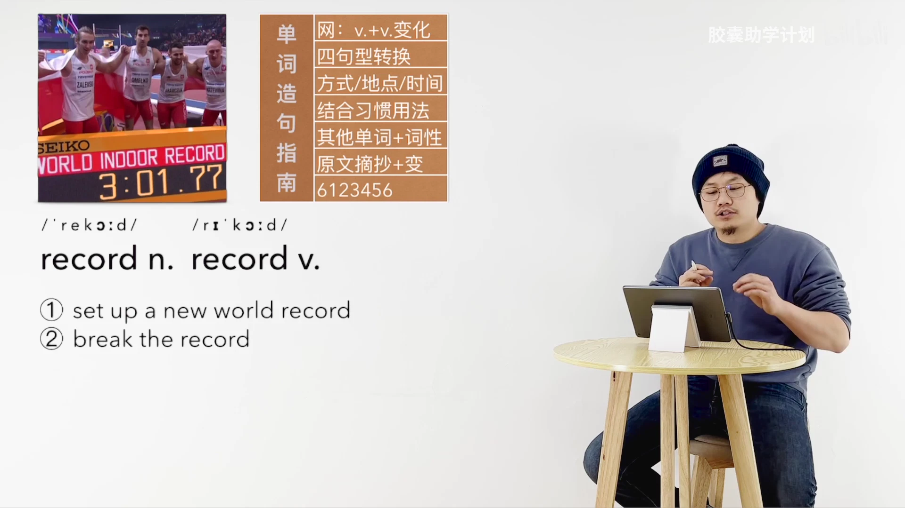

文字识别：单词造句指南 / 网：v.+v.变化 / 四句型转换 / 方式/地点/时间 / ZALEISI / 结合习惯用法 / 其他单词+词性 / SEIKO / VORLD INOOOR RECORD / 原文摘抄+变 / 3:01.77 / 6123456 / /'reko:d/ / /rI'ko:d/ / record n. record v. / 1 / set up a new world record / break the record

### 画面 00:01:55

文字识别：单词造句指南 / 网：v.+v.变化 / 四句型转换 / 方式/地点/时间 / ZALENSU / 结合习惯用法 / 其他单词+词性 / SEIKO / VORLO INOOOR RECORD / 原文摘抄+变 / 3:01.77 / 6123456 / /'reko:d/ / /rI'ko:d/ / record n. record v. / set up a new world record / 1 / break the record

## 00:02:00–00:02:30

break，一个是 set up。那各位要去想一想，比如说我要用什么样的动词的时态呀？啊，包括我用不用情态动词啊？我可以往里去加，这就是我们单词造句的思路，对吧？然后我随便，当然再去找一个人作为主语就 OK 了。好，那我们接着往下走啊。比如说，说 he was so fast, so fast that he set up a new world record last night。好，注意，你看他是如此的快，以至于他昨天晚上创建了

### 画面 00:02:01

文字识别：单词造句指南 / 网：v.+v.变化 / 四句型转换 / 方式/地点/时间 / ZALENSI / 结合习惯用法 / 其他单词+词性 / SEIKO / VORLD INDOOR RECORD / 原文摘抄+变 / 3:01.77 / 6123456 / /'reko:d/ / /rI'ko:d/ / record n. record v. / 1 / set up a new world record / break the record

### 画面 00:02:05

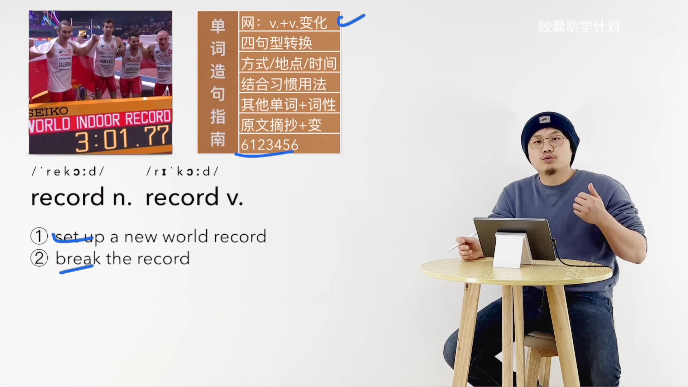

文字识别：单词造句指南 / 网：v.+v.变化 / 四句型转换 / 方式/地点/时间 / ZALENSI / 结合习惯用法 / 其他单词+词性 / SEIKO / VORLD INDOOR RECORD / 原文摘抄+变 / 3:01.77 / 6123456 / /'reko:d/ / /rI'ko:d/ / record n. record v. / 1 / set up a new world record / break the record

### 画面 00:02:13

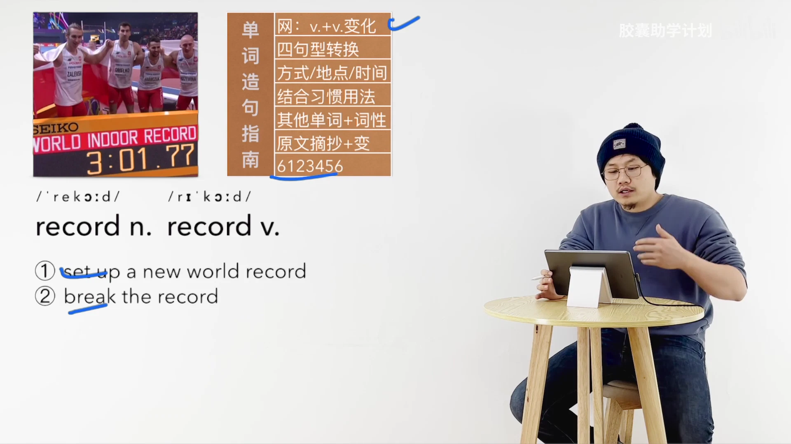

文字识别：单词造句指南 / 网：v.+v.变化 / 四句型转换 / 方式/地点/时间 / ZALENSU / 结合习惯用法 / 其他单词+词性 / SEIKO / VORLD INDOOR RECORD / 原文摘抄+变 / 3:01.77 / 6123456 / /'reko:d/ / /rI'ko:d/ / record n. record v. / 1 / set up a new world record / break the record

### 画面 00:02:17

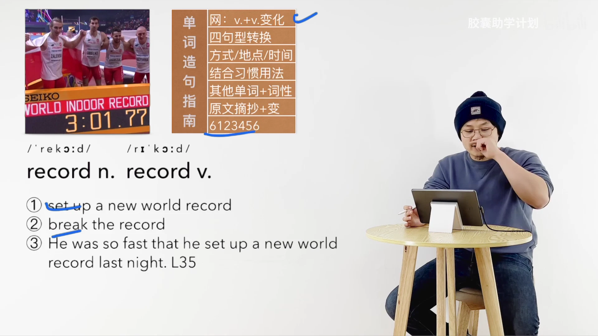

文字识别：单词造句指南 / 网：v.+v.变化 / 四句型转换 / 方式/地点/时间 / ZALEISI / 结合习惯用法 / 其他单词+词性 / SEIKO / VORLO INDOOR RECORD / 原文摘抄+变 / 3:01.77 / 6123456 / /'reko:d/ / /rI'ko:d/ / record n. record v. / setup a new world record / break the record / He was so fast that he set up a new world / record last night. L35

### 画面 00:02:21

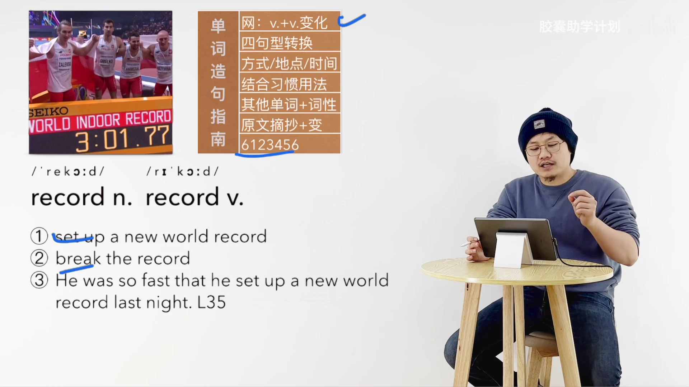

文字识别：单词造句指南 / 网：v.+v.变化 / 四句型转换 / 方式/地点/时间 / ZALEISU / 结合习惯用法 / 其他单词+词性 / SEIKO / VORLO INDOOR RECORD / 原文摘抄+变 / 3:01.77 / 6123456 / /'reko:d/ / /rI'ko:d/ / record n. record v. / 1 / set up a new world record / break the record / He was so fast that he set up a new world / record last night. L35

## 00:02:30–00:03:00

一个新的世界纪录，比如说昨天晚上是短道速滑这个比赛，对吧？OK，那叫做如此的快以至于so fast that very good. Continue继续说，the man who broke the record last year set up a new world record yesterday.好，这个地方我就不多说了，两个习惯用法我都用进去了，多用了一个小的定语从句，这是我们单词造句得算是一个小的思路，对吧？啊，您结

### 画面 00:02:30

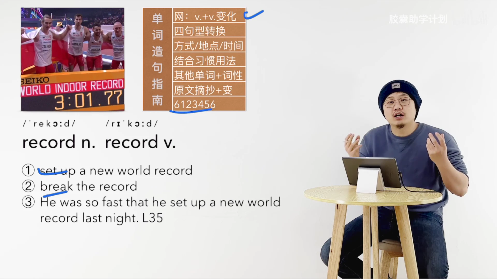

文字识别：单词造句指南 / 网：v.+v.变化 / 四句型转换 / 方式/地点/时间 / ZALENSI / 结合习惯用法 / 其他单词+词性 / SEIKO / VORLD INOOOR RECORD / 原文摘抄+变 / 3:01.77 / 6123456 / /'reko:d/ / /rI'ko:d/ / record n. record v. / ① / set up a new world record / break the record / 2 / He was so fast that he set up a new world / 3 / record last night. L35

### 画面 00:02:35

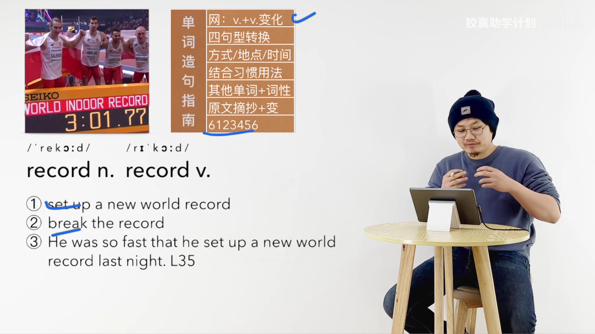

文字识别：单词造句指南 / 网：v.+v.变化 / 四句型转换 / 方式/地点/时间 / ZALEISU / 结合习惯用法 / 其他单词+词性 / SEIKO / VORLO INDOOR RECORD / 原文摘抄+变 / 3:01.77 / 6123456 / /'reko:d/ / /rI'ko:d/ / record n. record v. / 1 / setup a new world record / break the record / He was so fast that he set up a new world / record last night. L35

### 画面 00:02:42

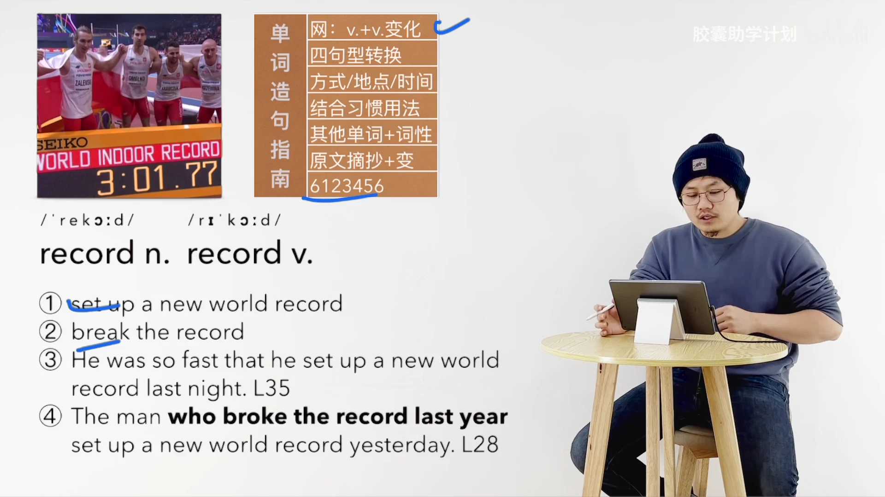

文字识别：单词造句指南 / 网：v.+v.变化 / 四句型转换 / 方式/地点/时间 / ZALEISI / 结合习惯用法 / 其他单词+词性 / SEIKO / VORLD INOOOR RECORD / 原文摘抄+变 / 3:01.77 / 6123456 / /'reko:d/ / /ri'ko:d/ / record n. record v. / ① / set up a new world record / break the record / 2 / 3 / He was so fast that he set up a new world / record last night. L35 / The man who broke the record last year / set up a new world record yesterday. L28

### 画面 00:02:45

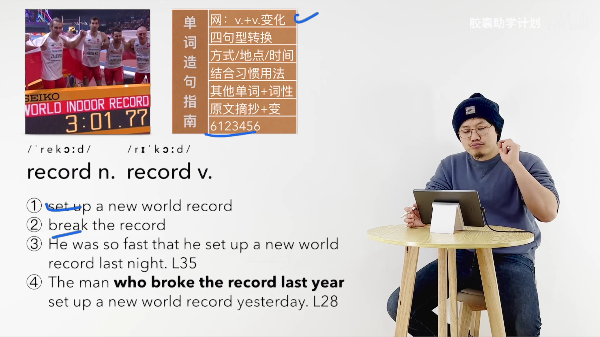

文字识别：单词造句指南 / 网：v.+v.变化 / 四句型转换 / 方式/地点/时间 / ZALEISI / 结合习惯用法 / 其他单词+词性 / SEIKO / VORLD INDOOR RECORD / 原文摘抄+变 / 3:01.77 / 6123456 / /'reko:d/ / /ri'ko:d/ / record n. record v. / ① / setup a new world record / 2 / break the record / 3 / He was so fast that he set up a new world / record last night. L35 / The man who broke the record last year / set up a new world record yesterday. L28

### 画面 00:02:50

文字识别：单词造句指南 / 网：v.+v.变化 / 四句型转换 / 方式/地点/时间 / ZALENSU / 结合习惯用法 / 其他单词+词性 / SEIKO / VORLD INOOOR RECORD / 原文摘抄+变 / 3:01.77 / 6123456 / /'reko:d/ / /ri'ko:d/ / record n. record v. / ① / set up a new world record / 2 / break the record / He was so fast that he set up a new world / 3 / record last night. L35 / The man who broke the record last year / set up a new world record yesterday. L28

## 00:03:00–00:03:30

合着之前我们学过的一些东西。Very good. 接下来，我们直接看一个小电影片段。这个电影片段当中就出现了叫 Break the Record。好，注意力集中，来了。Wow, Randall, that's great. That should make it even more humiliating when we break the record first. Ha ha. Do you hear that? It's the winds of change. You hear it? You hear the winds of change? Okay,叫When

### 画面 00:03:00

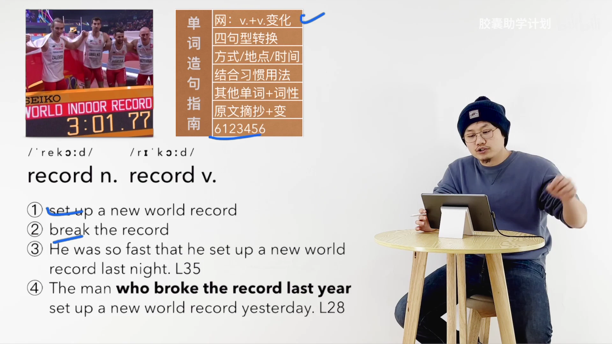

文字识别：单词造句指南 / 网：v.+v.变化 / 四句型转换 / 方式/地点/时间 / ZALEISU / 结合习惯用法 / 其他单词+词性 / SEIKO / VORLO INDOOR RECORD / 原文摘抄+变 / 3:01.77 / 6123456 / /'reko:d/ / /ri'ko:d/ / record n. record v. / ① / set up a new world record / 2 / break the record / He was so fast that he set up a new world / 3 / record last night. L35 / The man who broke the record last year / set up a new world record yesterday. L28

### 画面 00:03:03

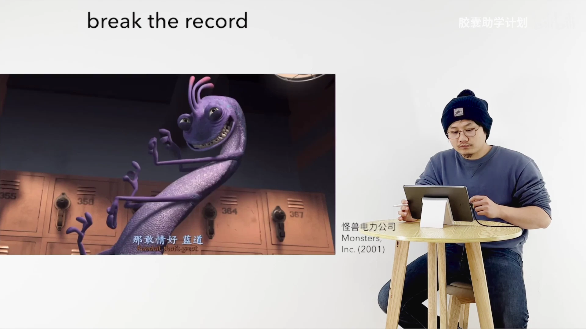

文字识别：break the record / 364 / 367 / 怪兽电力公司 / 那敢情好蓝道 / Monsters, / Randall that's great. / Inc.(2001)

### 画面 00:03:13

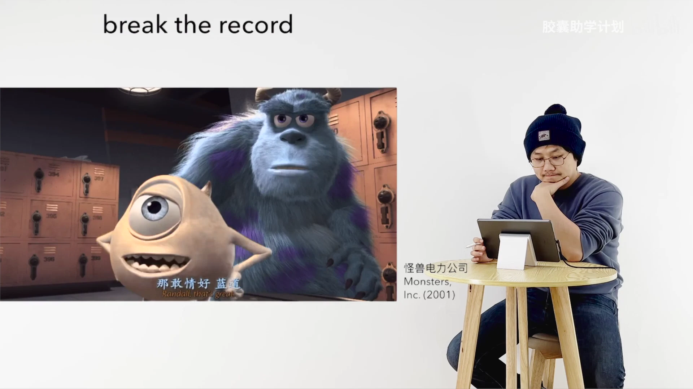

文字识别：break the record / 怪兽电力公司 / 那敢情好蓝道 / Monsters, / Randall, thats / greats / Inc.(2001)

### 画面 00:03:15

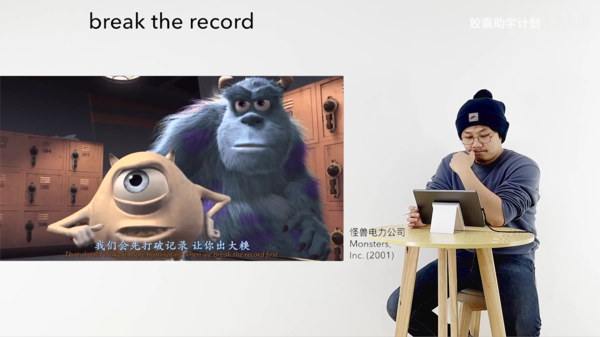

文字识别：break the record / 怪兽电力公司 / 我们会先打破记录让你出大 / Monsters, / That should make it wore humitiating when we break the record first. / Inc.(2001)

### 画面 00:03:17

文字识别：break the record / 怪兽电力公司 / Monsters, / Inc.(2001)

### 画面 00:03:19

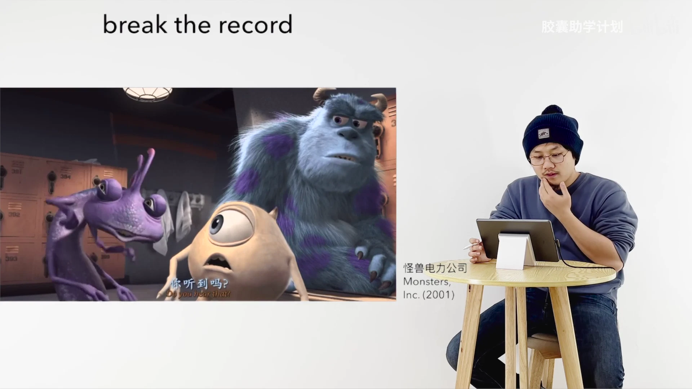

文字识别：break the record / 怪兽电力公司 / 你听到吗？ / Monsters, / DO / you hear tha / Inc.(2001)

### 画面 00:03:21

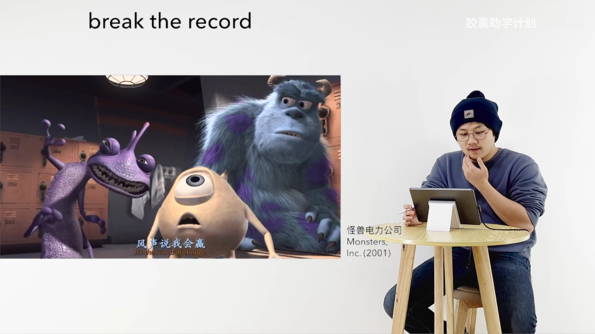

文字识别：break the record / 怪兽电力公司 / 风声说我会赢 / Monsters, / Irs the winds of change. / Inc.(2001)

### 画面 00:03:23

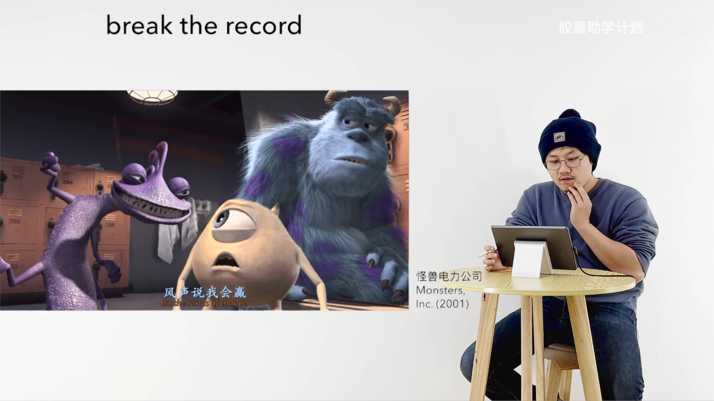

文字识别：break the record / 怪兽电力公司 / 风声说我会赢 / Monsters, / Ir's the winds of change. / Inc.(2001)

### 画面 00:03:25

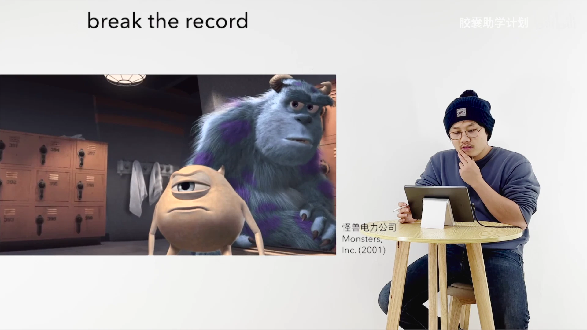

文字识别：break the record / 2 / 怪兽电力公司 / Monsters, / Inc.(2001)

### 画面 00:03:27

文字识别：break the record / 怪兽电力公司 / 风什么大头声胡说八道？ / Monsters, / "You hear that Ies the winds of.What a crep. / Inc.(2001)

### 画面 00:03:29

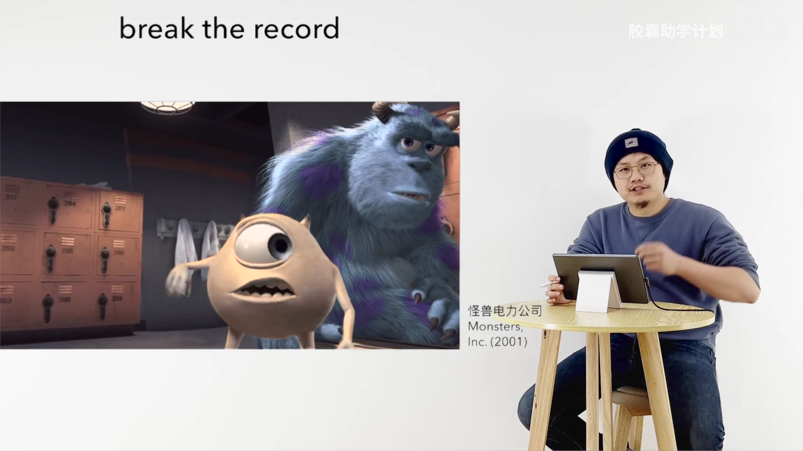

文字识别：break the record / 怪兽电力公司 / Monsters, / Inc.(2001)

## 00:03:30–00:04:00

we break the record. Okay,打破记录。Next one，下一个单词我们应该是在新一见过的，跟我一起读一下，叫做strong，strong。Okay, very good啊，叫非常强壮的strong。Okay，那它是一个形容词，那我们就注意啊，这个单词既然我们比较熟，我们补充一些跟它也比较常用的搭配的一些小的啊，包含它的习惯用法，比如说as strong as a horse，我们汉语说

### 画面 00:03:32

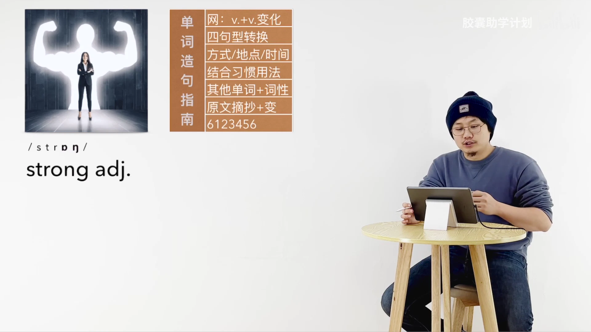

文字识别：单词造句指南 / 网：v.+v.变化 / 四句型转换 / 方式/地点/时间 / 结合习惯用法 / 其他单词+词性 / 原文摘抄+变 / 6123456 / /strDn/ / strong adj.

### 画面 00:03:35

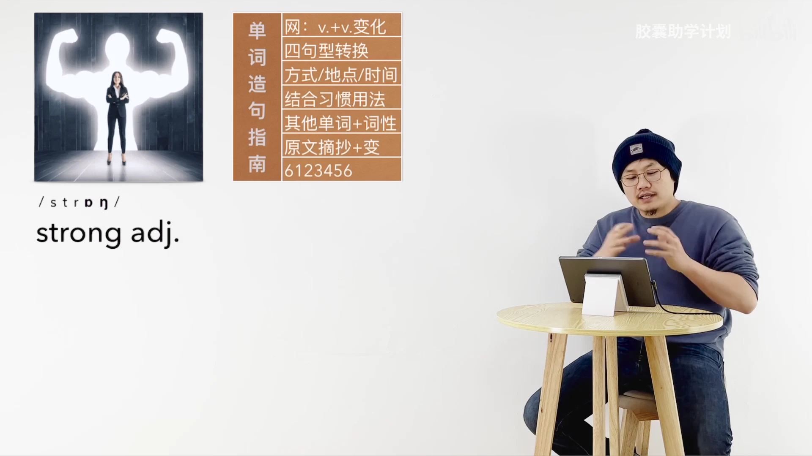

文字识别：单词造句指南 / 网：v.+v.变化 / 四句型转换 / 方式/地点/时间 / 结合习惯用法 / 其他单词+词性 / 原文摘抄+变 / 6123456 / /strDη/ / strong adj.

### 画面 00:03:57

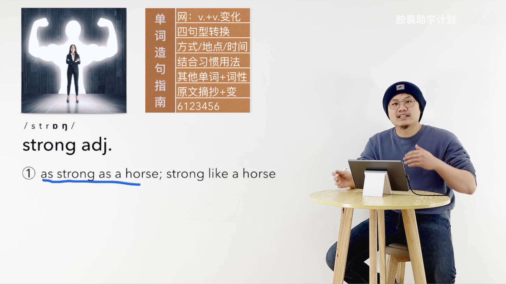

文字识别：单词造句指南 / 网：v.+v.变化 / 四句型转换 / 方式/地点/时间 / 结合习惯用法 / 其他单词+词性 / 原文摘抄+变 / 6123456 / /strpn/ / strong adj. / as strong as a horse; strong like a horse

## 00:04:00–00:04:30

叫力大如牛，对吧？好，英文当中说力大如马，或者说这个壮强壮如马。OK，或者 strong like a horse。这地方的 like 和 as 是几乎是同义词，就叫做像，对吧？强壮的就像一匹马一样。Very good。那其实这个 as strong as a horse 也是我们三十二课和新一一百一十一课学过的那个语法，叫 as 点点点 as，对吧？OK，那

### 画面 00:04:27

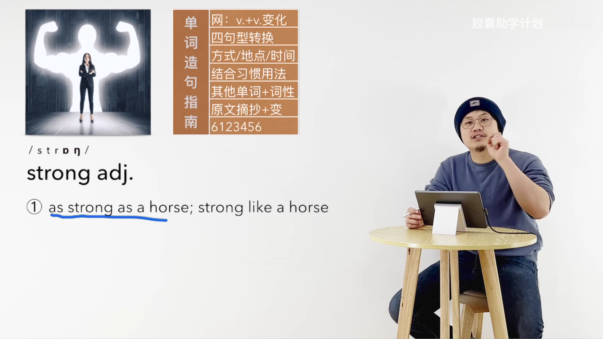

文字识别：单词造句指南 / 网：v.+v.变化 / 四句型转换 / 方式/地点/时间 / 结合习惯用法 / 其他单词+词性 / 原文摘抄+变 / 6123456 / /strDn/ / strong adj. / as strong as a horse; strong like a horse

## 00:04:30–00:05:00

们造句子说He used to be very strong.三十一课used to do something，再然后呢，我们就可以用加上as as说He used to be as strong as a horse.啊，说他强壮的就像一个呃马一样，对吧？就是翻译成汉语其实就是力大如牛啊。OK，接下来我们可以结合三十四课说的刚刚学过的叫had been done啊，过去完成式

### 画面 00:04:33

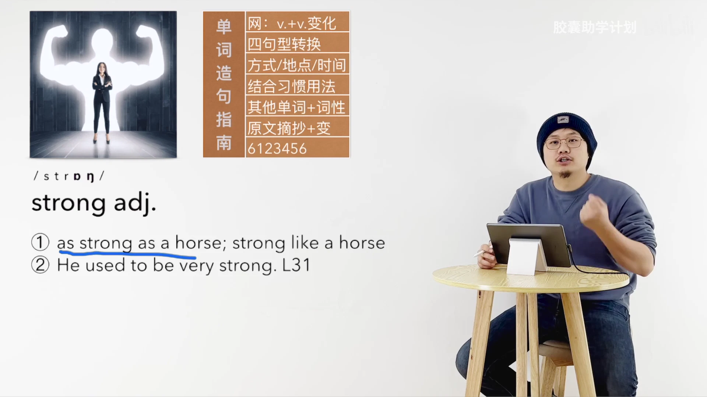

文字识别：单词造句指南 / 网：v.+v.变化 / 四句型转换 / 方式/地点/时间 / 结合习惯用法 / 其他单词+词性 / 原文摘抄+变 / 6123456 / /strpn/ / strong adj. / as strong as a horse; strong like a horse / He used to be very strong. L31

### 画面 00:04:40

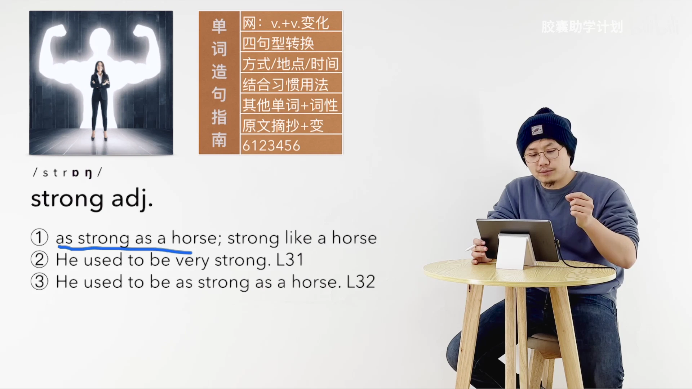

文字识别：单词造句指南 / 网：v.+v.变化 / 四句型转换 / 方式/地点/时间 / 结合习惯用法 / 其他单词+词性 / 原文摘抄+变 / 6123456 / /strpn/ / strong adj. / as strong as a horse; strong like a horse / He used to be very strong. L31 / He used to be as strong as a horse. L32

### 画面 00:04:53

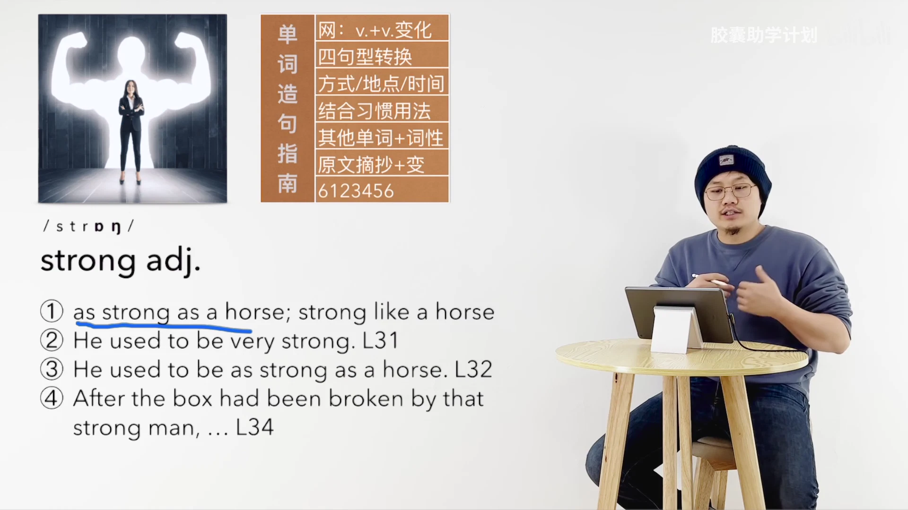

文字识别：单词造句指南 / 网：v.+v.变化 / 四句型转换 / 方式/地点/时间 / 结合习惯用法 / 其他单词+词性 / 原文摘抄+变 / 6123456 / /strpn/ / strong adj. / as strong as a horse; strong like a horse / He used to be very strong. L31 / He used to be as strong as a horse. L32 / After the box had been broken by that / strong man, ... L34

### 画面 00:04:57

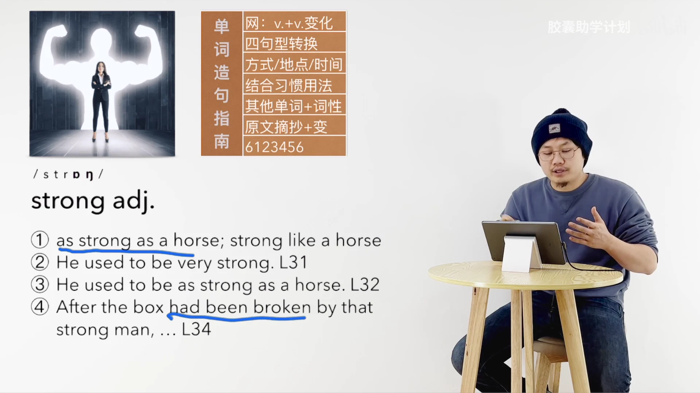

文字识别：单词造句指南 / 网：v.+v.变化 / 四句型转换 / 方式/地点/时间 / 结合习惯用法 / 其他单词+词性 / 原文摘抄+变 / 6123456 / /strpn/ / strong adj. / as strong as a horse; strong like a horse / He used to be very strong. L31 / He used to be as strong as a horse. L32 / After the box had been broken by that / strong man, ... L34

## 00:05:00–00:05:30

的被动说，After the box had been broken by that strong man，巴拉巴拉，哒哒哒，OK，说在这个箱子已经被这个特别强壮的男子给打碎之后，又发生了什么呢？哎，您可以不妨下课就把它去，实际上给补齐就可以了。您自己随便想一句话，给它写在那儿，对吧？OK， continue，接下来呢，我们就看一下电影当中出现的叫做 strong as a

### 画面 00:05:00

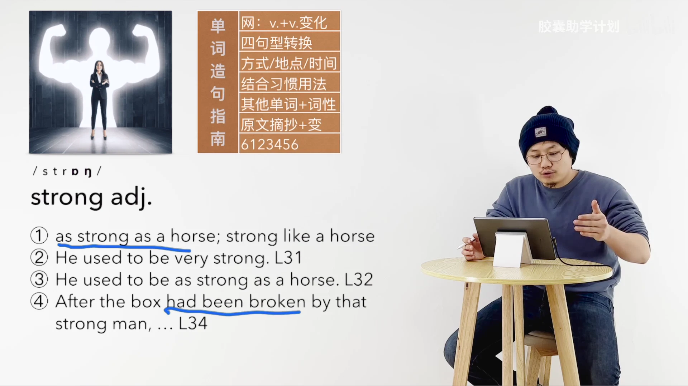

文字识别：单词造句指南 / 网：v.+v.变化 / 四句型转换 / 方式/地点/时间 / 结合习惯用法 / 其他单词+词性 / 原文摘抄+变 / 6123456 / /strpn/ / strong adj. / as strong as a horse; strong like a horse / He used to be very strong. L31 / He used to be as strong as a horse. L32 / After the box had been broken by that / strong man, ... L34

### 画面 00:05:16

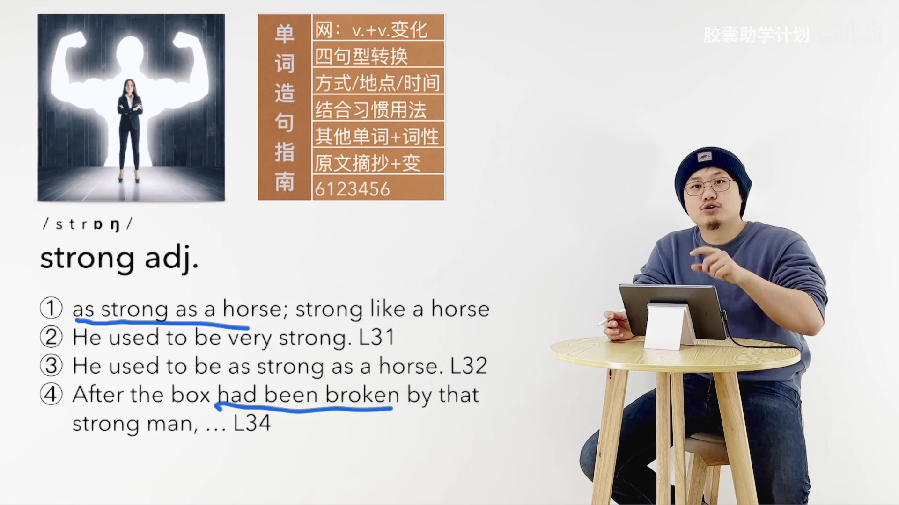

文字识别：单词造句指南 / 网：v.+v.变化 / 四句型转换 / 方式/地点/时间 / 结合习惯用法 / 其他单词+词性 / 原文摘抄+变 / 6123456 / /strpn/ / strong adj. / as strong as a horse; strong like a horse / He used to be very strong. L31 / He used to be as strong as a horse. L32 / After the box had been broken by that / strong man, ... L34

### 画面 00:05:20

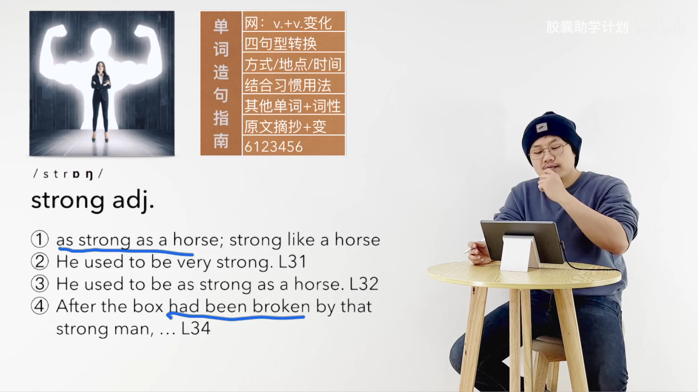

文字识别：单词造句指南 / 网：v.+v.变化 / 四句型转换 / 方式/地点/时间 / 结合习惯用法 / 其他单词+词性 / 原文摘抄+变 / 6123456 / /strpn/ / strong adj. / as strong as a horse; strong like a horse / He used to be very strong. L31 / He used to be as strong as a horse. L32 / After the box had been broken by that / strong man, ... L34

### 画面 00:05:24

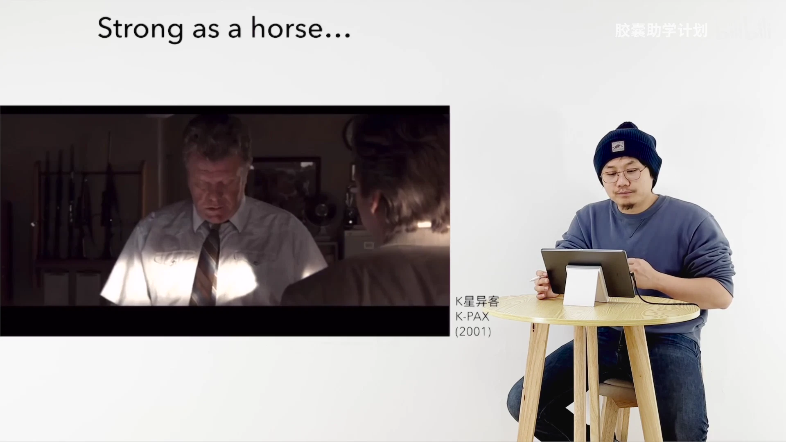

文字识别：Strong as a horse... / K星异客 / K-PAX / (2001)

## 00:05:30–00:06:00

horse，这个用法来了。 Quiet type. As I recall, he was a real smart fella, brainy. Strong as a horse, only worked as a knocker. Lived about twenty miles outside the town with his his wife and child. Okay, strong as a horse, very good. 好，下一个单词，跟我一起读一下，叫做 swimmer. swimmer 这个单词应该不是很困难，

### 画面 00:05:32

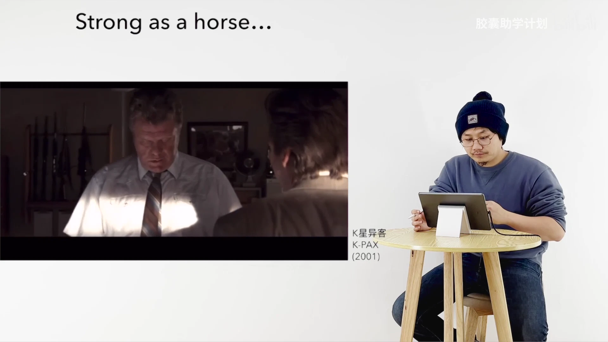

文字识别：Strong as a horse... / K星异客 / K-PAX / (2001)

### 画面 00:05:34

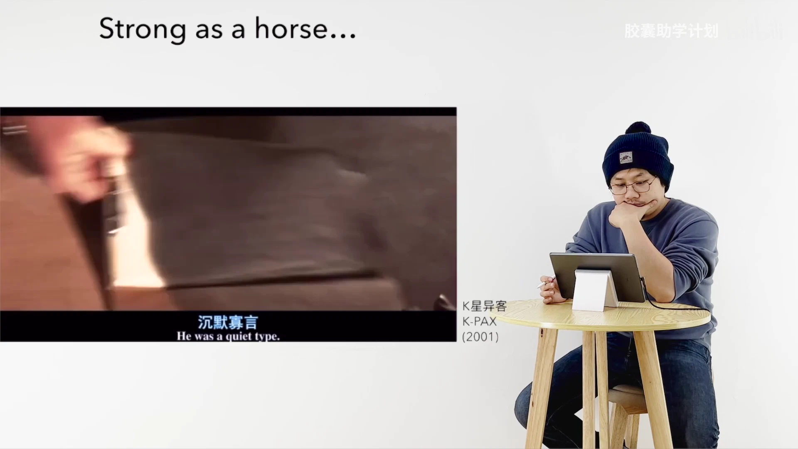

文字识别：Strong as a horse... / K星异客 / 沉默寡言 / K-PAX / He was a quiet type. / (2001)

### 画面 00:05:36

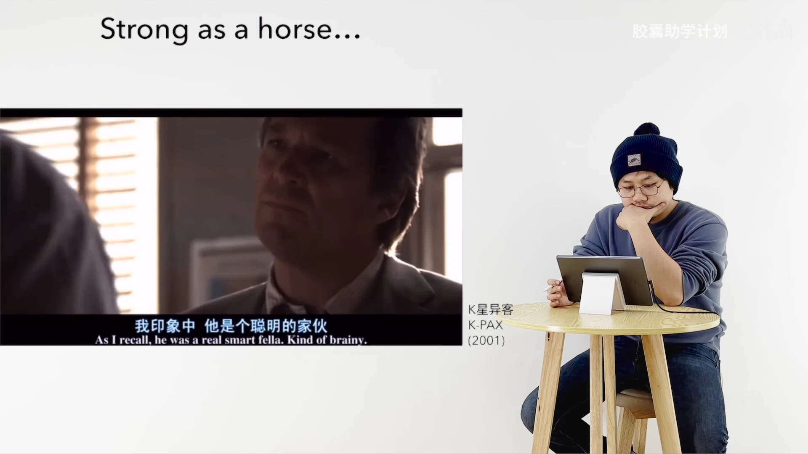

文字识别：Strong as a horse... / K星异客 / 我印象中他是个聪明的家伙 / K-PAX / As I recall, he was a real smart fella. Kind of brainy. / (2001)

### 画面 00:05:38

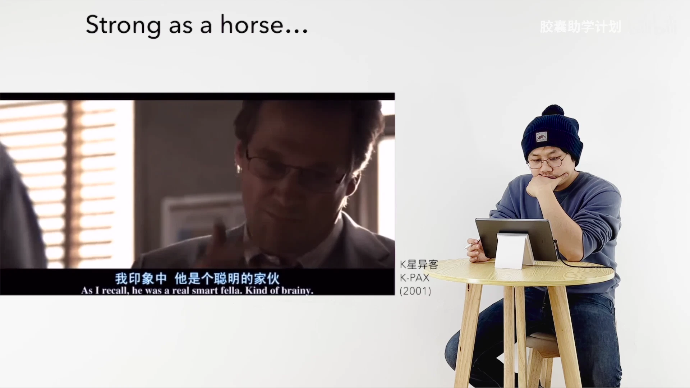

文字识别：Strong as a horse... / K星异客 / 我印象中他是个聪明的家伙 / K-PAX / As I recall, he was a real smart fella. Kind of brainy. / (2001)

### 画面 00:05:40

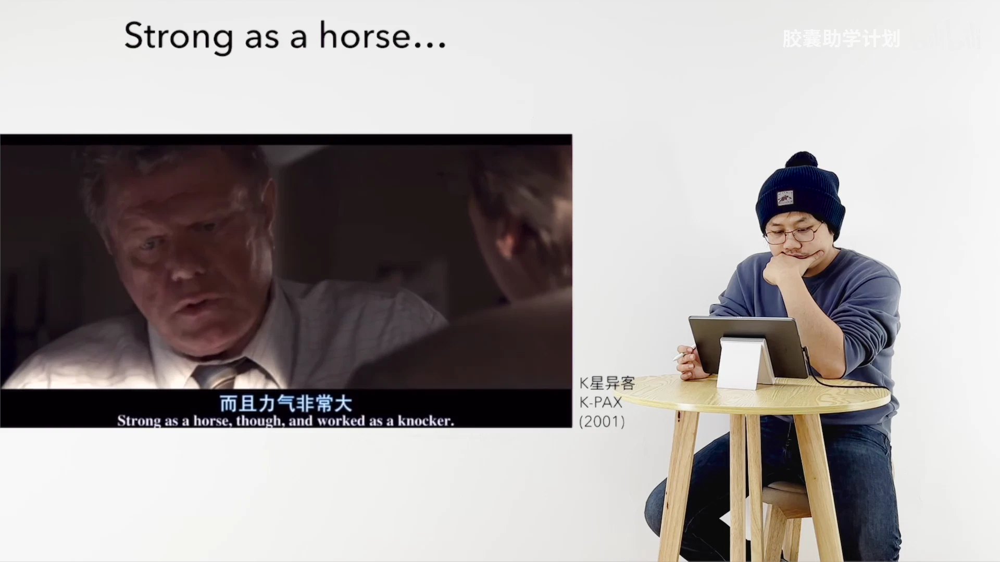

文字识别：Strong as a horse... / K星异客 / 而且力气非常大 / K-PAX / Strong as a horse, though, and worked as a knocker. / (2001)

### 画面 00:05:42

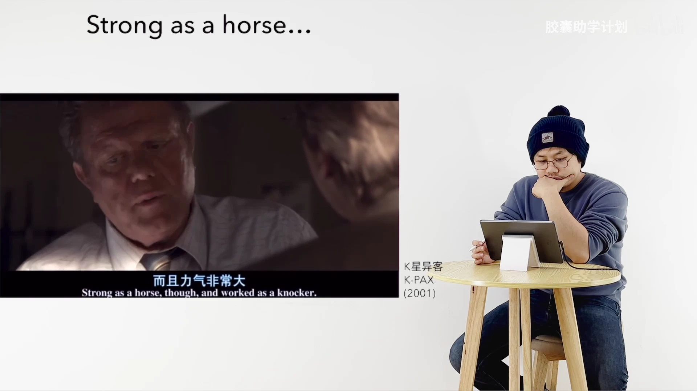

文字识别：Strong as a horse... / K星异客 / 而且力气非常大 / K-PAX / Strong as a horse, though, and worked as a knocker. / (2001)

### 画面 00:05:44

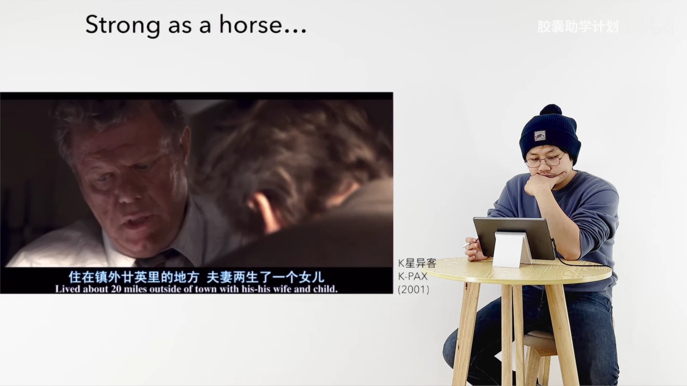

文字识别：Strong as a horse... / K星异客 / 住在镇外廿英里的地方夫妻两生了一个女儿 / K-PAX / Lived about 20 miles outside of town with his-his wife and child. / (2001)

### 画面 00:05:46

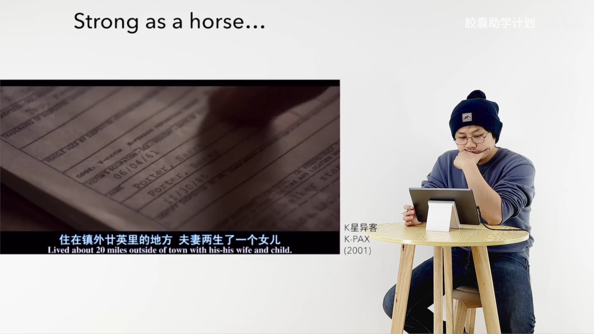

文字识别：Strong as a horse... / K星异客 / 住在镇外廿英里的地方夫妻两生了一个女儿 / K-PAX / Lived about 20 miles outside of town with his-his wife and child. / (2001)

### 画面 00:05:48

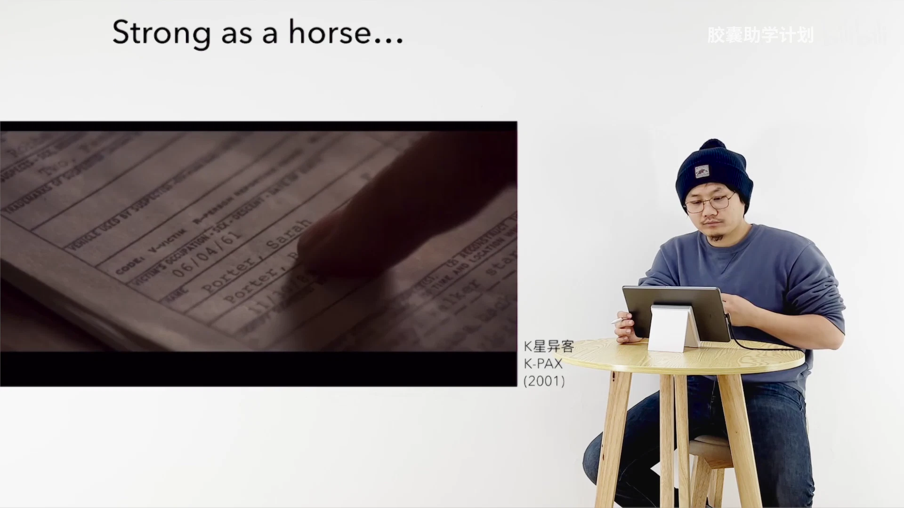

文字识别：Strong as a horse... / K星异客 / K-PAX / (2001)

### 画面 00:05:52

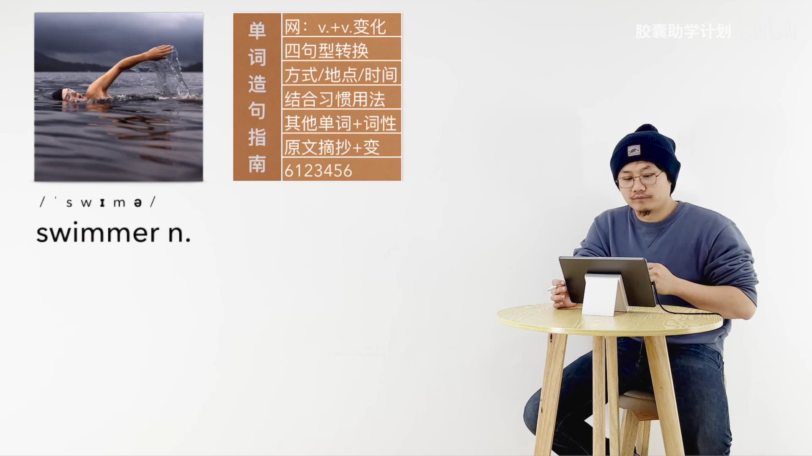

文字识别：单词造句指南 / 网：v.+v.变化 / 四句型转换 / 方式/地点/时间 / 结合习惯用法 / 其他单词+词性 / 原文摘抄+变 / 6123456 / /'s w Im a / / swimmer n.

### 画面 00:05:55

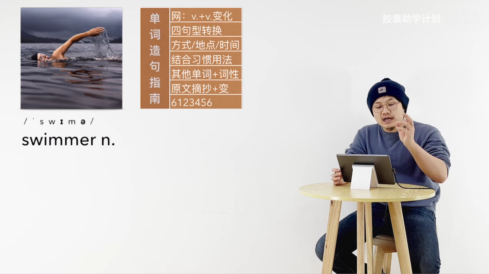

文字识别：单词造句指南 / 网：v.+v.变化 / 四句型转换 / 方式/地点/时间 / 结合习惯用法 / 其他单词+词性 / 原文摘抄+变 / 6123456 / /'sw Ima / / swimmer n.

## 00:06:00–00:06:30

因为 swim 这个单词我们认的，我们又很清楚的知道很多动作后面加上 e r 了之后表示做这个动作的人，对吧？就是游泳的人啊。 Okay, next one, 那我们就可以说这个游泳者，对吧？说 that swimmer never expected his swimming goggles to be fine. 好，这个地方实际上有一个三十四课学过的习惯用法叫 expect something to be fine. 啊，我们就不多说了。那这个地方给大家补了一个叫做

### 画面 00:06:11

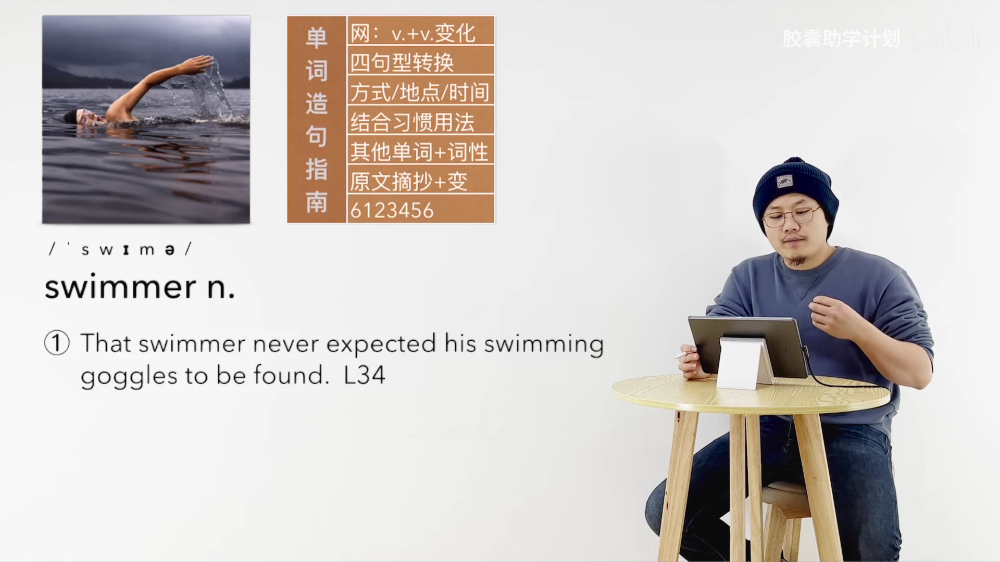

文字识别：单词造句指南 / 网：v.+v.变化 / 四句型转换 / 方式/地点/时间 / 结合习惯用法 / 其他单词+词性 / 原文摘抄+变 / 6123456 / / ' s w Ⅰ m a / / swimmer n. / ① That swimmer never expected his swimming / goggles to be found. L34

### 画面 00:06:15

文字识别：单词造句指南 / 网：v.+v.变化 / 四句型转换 / 方式/地点/时间 / 结合习惯用法 / 其他单词+词性 / 原文摘抄+变 / 6123456 / / 's w ǐma / / swimmer n. /  That swimmer never expected his swimming / 1 / goggles to be found. L34

### 画面 00:06:20

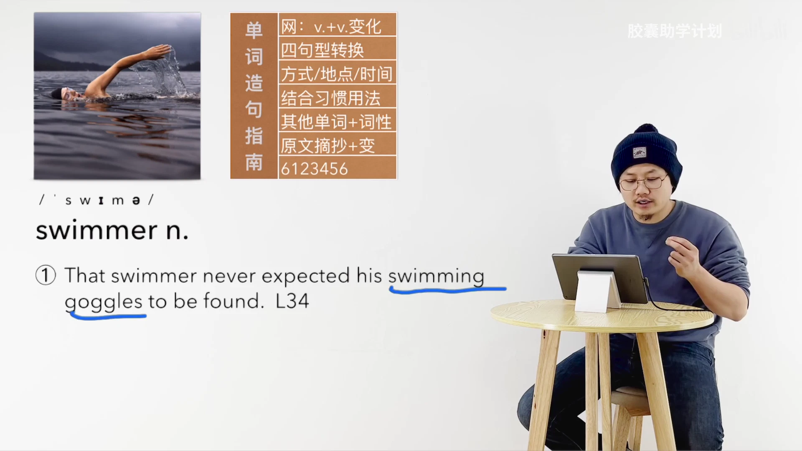

文字识别：单词造句指南 / 网：v.+v.变化 / 四句型转换 / 方式/地点/时间 / 结合习惯用法 / 其他单词+词性 / 原文摘抄+变 / 6123456 / /'s w I m a / / swimmer n. / ) That swimmer never expected his swimming / 1 / goggles to be found. L34

### 画面 00:06:25

文字识别：单词造句指南 / 网：v.+v.变化 / 四句型转换 / 方式/地点/时间 / 结合习惯用法 / 其他单词+词性 / 原文摘抄+变 / 6123456 / / 's w I m a / / swimmer n. /  That swimmer never expected his swimming / 1 / goggles to be found. L34

## 00:06:30–00:07:00

swimming goggles goggles. Okay, 指的就是泳镜啊，我们的泳镜叫做 swimming goggles. Very good. Next one, 接下来我们结合三十一课的习惯用法，叫 In his twenties, he is a very strong swimmer. 说在他二十岁的时候，他是一个特别强壮的游泳运动员，对吧？啊，那你注意这个地方的 strong swimmer 叫做强壮的游泳运游泳运动员啊，指的是游的很好啊。

### 画面 00:06:31

文字识别：单词造句指南 / 网：v.+v.变化 / 四句型转换 / 方式/地点/时间 / 结合习惯用法 / 其他单词+词性 / 原文摘抄+变 / 6123456 / /'s w I m a / / swimmer n. /  That swimmer never expected his swimming / 1 / goggles to be found. L34

### 画面 00:06:35

文字识别：单词造句指南 / 网：v.+v.变化 / 四句型转换 / 方式/地点/时间 / 结合习惯用法 / 其他单词+词性 / 原文摘抄+变 / 6123456 / / ' s w Ⅰ m a / / swimmer n. / ) That swimmer never expected his swimming / goggles to be found. L34

### 画面 00:06:38

文字识别：单词造句指南 / 网：v.+v.变化 / 四句型转换 / 方式/地点/时间 / 结合习惯用法 / 其他单词+词性 / 原文摘抄+变 / 6123456 / / ' s w Ⅰ m a / / swimmer n. / ① That swimmer never expected his swimming / goggles to be found. L34 /  In his twenties, he is a very strong swimmer. L31

### 画面 00:06:48

文字识别：单词造句指南 / 网：v.+v.变化 / 四句型转换 / 方式/地点/时间 / 结合习惯用法 / 其他单词+词性 / 原文摘抄+变 / 6123456 / / ' s w I m a / / swimmer n. / ① That swimmer never expected his swimming / goggles to be found. L34 /  In his twenties, he is a very strong swimmer. L31

### 画面 00:06:52

文字识别：单词造句指南 / 网：v.+v.变化 / 四句型转换 / 方式/地点/时间 / 结合习惯用法 / 其他单词+词性 / 原文摘抄+变 / 6123456 / / ' s w Ⅰ m a / / swimmer n. / ① That swimmer never expected his swimming / goggles to be found. L34 /  In his twenties, he is a very strong swimmer. L31

### 画面 00:06:56

文字识别：单词造句指南 / 网：v.+v.变化 / 四句型转换 / 方式/地点/时间 / 结合习惯用法 / 其他单词+词性 / 原文摘抄+变 / 6123456 / / ' s w Ⅰ m a / / swimmer n. / ① That swimmer never expected his swimming / goggles to be found. L34 /  In his twenties, he is a very strong swimmer. L31

## 00:07:00–00:07:30

OK，继续。那我们结合三十五课说，He is such a great swimmer that点儿点儿点儿点儿。这又是我们三十五课学的，叫做such加形容词名词，然后以如此怎么怎么样，以至于，比如说他是如此好的一个游泳运动员，以至于比如说他拿过世界冠军等等等等，好吧？或者说He break the呃record every year啊，他每年都

### 画面 00:07:02

文字识别：单词造句指南 / 网：v.+v.变化 / 四句型转换 / 方式/地点/时间 / 结合习惯用法 / 其他单词+词性 / 原文摘抄+变 / 6123456 / / ' s w Ⅰ m a / / swimmer n. / ① That swimmer never expected his swimming / goggles to be found. L34 / In his twenties, he is a very strong swimmer. L31 / He is such a great swimmer that ... L35

### 画面 00:07:09

文字识别：单词造句指南 / 网：v.+v.变化 / 四句型转换 / 方式/地点/时间 / 结合习惯用法 / 其他单词+词性 / 原文摘抄+变 / 6123456 / / ' s w I m a / / swimmer n. / ① That swimmer never expected his swimming / goggles to be found. L34 / In his twenties, he is a very strong swimmer. L31 / He is such a great swimmer that ... L35 / 3

### 画面 00:07:25

文字识别：单词造句指南 / 网：v.+v.变化 / 四句型转换 / 方式/地点/时间 / 结合习惯用法 / 其他单词+词性 / 原文摘抄+变 / 6123456 / / 's w I m a / / swimmer n. / ① That swimmer never expected his swimming / goggles to be found. L34 / In his twenties, he is a very strong swimmer. L31 / He is such a great swimmer that ... L35 / 3

## 00:07:30–00:08:00

world record every year. Ah, or his own record. Okay, one more. Next one,下一个单词我们一起读一下，叫做succeed. Succeed叫做成功。注意它的词性，它是一个动词。那我们直接补一个习惯用法，叫succeed in doing something.好，注意啊，这个动词它实际上是以ed结尾的。但如果它要变过去式，它后边还要再加上一个ed，叫succeeded. Okay,比如说，

### 画面 00:07:30

文字识别：单词造句指南 / 网：v.+v.变化 / 四句型转换 / 方式/地点/时间 / 结合习惯用法 / 其他单词+词性 / 原文摘抄+变 / 6123456 / / 's w I m a / / swimmer n. / ① That swimmer never expected his swimming / goggles to be found. L34 / In his twenties, he is a very strong swimmer. L31 / He is such a great swimmer that ... L35 / 3

### 画面 00:07:35

文字识别：单词造句指南 / 网：v.+v.变化 / 四句型转换 / 方式/地点/时间 / 结合习惯用法 / 其他单词+词性 / 原文摘抄+变 / 6123456 / /sak'si:d/ / succeed v.

### 画面 00:07:40

文字识别：单词造句指南 / 网：v.+v.变化 / 四句型转换 / 方式/地点/时间 / 结合习惯用法 / 其他单词+词性 / 原文摘抄+变 / 6123456 / /sak'si:d/ / succeed v.

### 画面 00:07:45

文字识别：单词造句指南 / 网：v.+v.变化 / 四句型转换 / 方式/地点/时间 / 结合习惯用法 / 其他单词+词性 / 原文摘抄+变 / 6123456 / /sak'si:d / / succeed v. / succeed in doing sth.

### 画面 00:07:50

文字识别：单词造句指南 / 网：v.+v.变化 / 四句型转换 / 方式/地点/时间 / 结合习惯用法 / 其他单词+词性 / 原文摘抄+变 / 6123456 / /sak'si:d/ / succeed / dv. / succeed in doing sth.

### 画面 00:07:55

文字识别：单词造句指南 / 网：v.+v.变化 / 四句型转换 / 方式/地点/时间 / 结合习惯用法 / 其他单词+词性 / 原文摘抄+变 / 6123456 / /sak'si:d / / succeed / succeed in doing sth.

### 画面 00:07:58

文字识别：单词造句指南 / 网：v.+v.变化 / 四句型转换 / 方式/地点/时间 / 结合习惯用法 / 其他单词+词性 / 原文摘抄+变 / 6123456 / / s a k ' s i : d / / succeed / succeed in doing sth. / She succeeded in resisting the temptation. L32

## 00:08:00–00:08:30

she succeeded in resisting the temptation，说她成功的抵制了这个诱惑啊，她成功的抵制住了这个诱惑。She succeeded in resisting the temptation，啊，这是我们三十二课学过的。Continue，说 she succeeded in finding a new job，说她成功的找到了一份新的工作啊，没有什么可说的。然后您可以把它变成一般疑问句和各种特殊疑问句，

### 画面 00:08:01

文字识别：单词造句指南 / 网：v.+v.变化 / 四句型转换 / 方式/地点/时间 / 结合习惯用法 / 其他单词+词性 / 原文摘抄+变 / 6123456 / / s a k ' s i : d / / succeed / succeed in doing sth. / She succeeded in resisting the temptation. L32

### 画面 00:08:05

文字识别：单词造句指南 / 网：v.+v.变化 / 四句型转换 / 方式/地点/时间 / 结合习惯用法 / 其他单词+词性 / 原文摘抄+变 / 6123456 / / s a k ' s i : d / / succeed / succeed in doing sth. / She succeeded in resisting the temptation. L32

### 画面 00:08:07

文字识别：单词造句指南 / 网：v.+v.变化 / 四句型转换 / 方式/地点/时间 / 结合习惯用法 / 其他单词+词性 / 原文摘抄+变 / 6123456 / / s a k ' s i : d / / succeed / succeed in doing sth. / She succeeded in resisting the temptation. L32

### 画面 00:08:20

文字识别：单词造句指南 / 网：v.+v.变化 / 四句型转换 / 方式/地点/时间 / 结合习惯用法 / 其他单词+词性 / 原文摘抄+变 / 6123456 / / s a k ' s i : d / / succeed / succeed in doing sth. / She succeeded in resisting the temptation. L32 / She succeeded in finding a new job.

## 00:08:30–00:09:00

做了一个非常简单的四句型转换。OK， next one，下一个单词跟我一起读一下，叫做 train， train。 OK，那它名词的意思各位是比较熟悉的，叫做火车，对吧？那今天呢，我们要学它一个新的含义，叫做训练啊。注意它的含义，再说一遍，是动词啊，叫做训练。比如说，我们可以说 train somebody to do something。当然，你这个 somebody 也可以是，比如说某条狗或者某个猫

### 画面 00:08:30

文字识别：单词造句指南 / 网：v.+v.变化 / 四句型转换 / 方式/地点/时间 / 结合习惯用法 / 其他单词+词性 / 原文摘抄+变 / 6123456 / /sak'si: d / / succeed / succeed in doing sth. / She succeeded in resisting the temptation. L32 / She succeeded in finding a new job. / did/who...

### 画面 00:08:33

文字识别：单词造句指南 / 网：v.+v.变化 / 四句型转换 / 方式/地点/时间 / 结合习惯用法 / 其他单词+词性 / 原文摘抄+变 / 6123456 / /treIn/ / train v.

### 画面 00:08:36

文字识别：单词造句指南 / 网：v.+v.变化 / 四句型转换 / 方式/地点/时间 / 结合习惯用法 / 其他单词+词性 / 原文摘抄+变 / 6123456 / /trein/ / train v.

### 画面 00:08:44

文字识别：单词造句指南 / 网：v.+v.变化 / 四句型转换 / 方式/地点/时间 / 结合习惯用法 / 其他单词+词性 / 原文摘抄+变 / 6123456 / /trein/ / train V.

## 00:09:00–00:09:30

啊，我们在接下来的文章当中就会见到这个东西啊，这个用法。我们可以说训练某个人去做某件事情，好吧？好，那原文呢又给了一句话，我觉得这句话就很不错，我们直接把它拿过来看一下，叫做 Mr. Howard has trained his daughter for years. 好，首先这个结构看到了之后，立刻就确定了是一个现在完成时，这没有什么可说的。然后训练他的女儿已经许多年了，现

### 画面 00:09:04

文字识别：单词造句指南 / 网：v.+v.变化 / 四句型转换 / 方式/地点/时间 / 结合习惯用法 / 其他单词+词性 / 原文摘抄+变 / 6123456 / /trein/ / train V. / ① train sb.to do sth.

### 画面 00:09:09

文字识别：单词造句指南 / 网：v.+v.变化 / 四句型转换 / 方式/地点/时间 / 结合习惯用法 / 其他单词+词性 / 原文摘抄+变 / 6123456 / /trein/ / train v. / ① train sb.to do sth. /  [Story]: Mr. Hart has trained his daughter for years. / 2

### 画面 00:09:15

文字识别：单词造句指南 / 网：v.+v.变化 / 四句型转换 / 方式/地点/时间 / 结合习惯用法 / 其他单词+词性 / 原文摘抄+变 / 6123456 / /trein/ / train v. / ① train sb.to do sth. /  [Story]: Mr. Hart has trained his daughter for years.

### 画面 00:09:20

文字识别：单词造句指南 / 网：v.+v.变化 / 四句型转换 / 方式/地点/时间 / 结合习惯用法 / 其他单词+词性 / 原文摘抄+变 / 6123456 / /trein/ / train v. / ① train sb.to do sth. /  [Story]: Mr. Hart has trained his daughter for years. / 2）

### 画面 00:09:22

文字识别：单词造句指南 / 网：v.+v.变化 / 四句型转换 / 方式/地点/时间 / 结合习惯用法 / 其他单词+词性 / 原文摘抄+变 / 6123456 / /trein/ / train v. / ① train sb. to do sth. / ② [Story]: Mr. Hart / has trained / his daughter for years. / 2

## 00:09:30–00:10:00

在完成时从过去持续到现在，第二个用法，对吧？OK，那接下来呢，我们就可以做各种各样的特殊疑问句、一般疑问句。这地方我重点想提一个叫做“how long”对“for years”提问啊，这是现在完成时第二个用法，非常典型的一个特殊疑问句，叫做“how long”去引导。OK，Very good。接下来我们呃文章当中给的是后面这个单词，对吧？那我们

### 画面 00:09:34

文字识别：单词造句指南 / 网：v.+v.变化 / 四句型转换 / 方式/地点/时间 / 结合习惯用法 / 其他单词+词性 / 原文摘抄+变 / 6123456 / /trein/ / train v. / ① train sb.to do sth. / [Story]: Mr. Harthas trained / his daughter for years. / 2） / ) has/who/how long/why.

### 画面 00:09:41

文字识别：单词造句指南 / 网：v.+v.变化 / 四句型转换 / 方式/地点/时间 / 结合习惯用法 / 其他单词+词性 / 原文摘抄+变 / 6123456 / /trein/ / train v. / ① train sb. to do sth. / [Story]: Mr. Harthas trained / his daughter for years. / 2） / ) has/who/how long/why.

### 画面 00:09:45

文字识别：单词造句指南 / 网：v.+v.变化 / 四句型转换 / 方式/地点/时间 / 结合习惯用法 / 其他单词+词性 / 原文摘抄+变 / 6123456 / /trein/ / train v. / ① train sb.to do sth. / [Story]: Mr. Harthas trained / his daughter for years / 2） / ) has/who/how long/why..

### 画面 00:09:52

文字识别：单词造句指南 / 网：v.+v.变化 / 四句型转换 / 方式/地点/时间 / 结合习惯用法 / 其他单词+词性 / 原文摘抄+变 / 6123456 / /'ænk∫as/ / anxious adj. anxiously adv.

### 画面 00:09:55

文字识别：单词造句指南 / 网：v.+v.变化 / 四句型转换 / 方式/地点/时间 / 结合习惯用法 / 其他单词+词性 / 原文摘抄+变 / 6123456 / /'ænk∫as/ / anxious adj. anxiously adv.

### 画面 00:09:58

文字识别：单词造句指南 / 网：v.+v.变化 / 四句型转换 / 方式/地点/时间 / 结合习惯用法 / 其他单词+词性 / 原文摘抄+变 / 6123456 / /'ænk∫as/ / anxious adj. anxiously adv.

## 00:10:00–00:10:30

先学前面这个单词，跟我们一起读一下，叫 anxious。 anxious 指的是特别的焦虑，很紧张，很焦虑啊。 anxious 那 anxiously 加了 ly 之后，它表示是一个副词啊，呃，紧张地啊，一般肯定是跟动词去连起来。比如说，呃，焦虑紧张的看着这个比赛，对不对？好，比如说，我们先说形容词， she was very anxious last night。非常简单，说她昨晚

### 画面 00:10:00

文字识别：单词造句指南 / 网：v.+v.变化 / 四句型转换 / 方式/地点/时间 / 结合习惯用法 / 其他单词+词性 / 原文摘抄+变 / 6123456 / /'ænk∫as/ / anxious adj. anxiously adv.

### 画面 00:10:05

文字识别：单词造句指南 / 网：v.+v.变化 / 四句型转换 / 方式/地点/时间 / 结合习惯用法 / 其他单词+词性 / 原文摘抄+变 / 6123456 / /'ænk∫as/ / anxious adj. anxiously adv.

## 00:10:30–00:11:00

was very anxious last night. That's a general question. Four sentence conversion is not a particularly difficult thing. Next, they were watching the game anxiously. It means, hey, they were watching the game anxiously. It means, hey, they were watching the game anxiously. It means, hey, they were watching the game anxiously. It means, hey, they were watching the game anxiously. It means, hey, they were watching the game anxiously. It means, hey, they were watching the game anxiously. It means, hey, they were watching the game anxiously. It means, hey, they were watching the game anxiously. It means, hey, they were watching the game anxiously. It means, hey, they were watching the game anxiously. It means, hey, they were watching the game anxiously. It means, hey, they were watching the game anxiously. It means, hey, they were watching the game anxiously. It means, hey, they were watching the

### 画面 00:10:30

文字识别：单词造句指南 / 网：v.+v.变化 / 四句型转换 / 方式/地点/时间 / 结合习惯用法 / 其他单词+词性 / 原文摘抄+变 / 6123456 / /'ænk∫as/ / anxious adj. anxiously adv. / ① She was very anxious last night.

### 画面 00:10:35

文字识别：单词造句指南 / 网：v.+v.变化 / 四句型转换 / 方式/地点/时间 / 结合习惯用法 / 其他单词+词性 / 原文摘抄+变 / 6123456 / /'ænk∫as/ / anxious adj. anxiously adv. / ① She was very anxious last night. / was/who/when... / They were watching the game anxiously.

### 画面 00:10:40

文字识别：单词造句指南 / 网：v.+v.变化 / 四句型转换 / 方式/地点/时间 / 结合习惯用法 / 其他单词+词性 / 原文摘抄+变 / 6123456 / /'ænk∫as/ / anxious adj. anxiously adv. / ① She was very anxious last night. / was/who/when... / They were watching the game anxiously.

### 画面 00:10:50

文字识别：单词造句指南 / 网：v.+v.变化 / 四句型转换 / 方式/地点/时间 / 结合习惯用法 / 其他单词+词性 / 原文摘抄+变 / 6123456 / /'ænk∫as/ / anxious adj. anxiously adv. / ① She was very anxious last night. / was/who/when... / They were watching the game anxiously. / were/who/how/why...

### 画面 00:10:57

文字识别：单词造句指南 / 网：v.+v.变化 / 四句型转换 / 方式/地点/时间 / 结合习惯用法 / 其他单词+词性 / 原文摘抄+变 / 6123456 / /'ænk∫as/ / anxious adj. anxiously adv. / ① She was very anxious last night. / was/who/when... / They were watching the game anxiously. / were/who/how/why...

## 00:11:00–00:11:30

型的转换，OK，好，Next one，下一个单词也是本课的一个比较重点的单词啊。但你说它是语法吗？嗯，也不用算是语法，我们把它就当做单词的一个小的用法就可以了。比如说这个单词，首先它的发音叫intend，intend，好，它是打算的意思。你看我们原来学过打算的英文，计划打算叫be going to do，这是我们新一三十七课、三十九课就学过

### 画面 00:11:00

文字识别：单词造句指南 / 网：v.+v.变化 / 四句型转换 / 方式/地点/时间 / 结合习惯用法 / 其他单词+词性 / 原文摘抄+变 / 6123456 / /'ænk∫as/ / anxious adj. anxiously adv. / ① She was very anxious last night. / was/who/when... / They were watching the game anxiously. / were/who/how/why...

### 画面 00:11:02

文字识别：单词造句指南 / 网：v.+v.变化 / 四句型转换 / TO DO LIST / 方式/地点/时间 / 结合习惯用法 / 其他单词+词性 / 原文摘抄+变 / 6123456 / /In'tend/ / intend v.

### 画面 00:11:05

文字识别：单词造句指南 / 网：v.+v.变化 / 四句型转换 / TO DO LIST / 方式/地点/时间 / 结合习惯用法 / 4 / 其他单词+词性 / 原文摘抄+变 / 6123456 / /in'tend/ / intend v.

### 画面 00:11:15

文字识别：单词造句指南 / 网：v.+v.变化 / 四句型转换 / TO DO LIST / 方式/地点/时间 / 结合习惯用法 / 其他单词+词性 / 原文摘抄+变 / 6123456 / /in'tend/ / intend v.

### 画面 00:11:20

文字识别：单词造句指南 / 网：v.+v.变化 / 四句型转换 / TO DO LIST / 方式/地点/时间 / 结合习惯用法 / 其他单词+词性 / 原文摘抄+变 / 6123456 / /In'tend/ / intend v.

### 画面 00:11:26

文字识别：单词造句指南 / 网：v.+v.变化 / 四句型转换 / TO DO LIST / 方式/地点/时间 / 结合习惯用法 / 4 / 其他单词+词性 / 原文摘抄+变 / 6123456 / /in'tend/ / intend v.

## 00:11:30–00:12:00

的知识点，对吧？那 intend be going to do，那今天我们要学叫做 intend to do。intend to do 的含义还是计划打算，只不过这个地方注意一小下，它虽然它的含它的这个含义是计划打算，但是它往往可以出现的时候是以一般现在时这个时态，因为 intend 这个单词本身就是计划打算的意思，对吧？所以你看，我可以造一句话叫 for some reason，出

### 画面 00:11:32

文字识别：单词造句指南 / 网：v.+v.变化 / 四句型转换 / TO DO LIST / 方式/地点/时间 / 结合习惯用法 / 其他单词+词性 / 原文摘抄+变 / 6123456 / /in'tend/ / intend v. / ① intend to do sth.

### 画面 00:11:36

文字识别：单词造句指南 / 网：v.+v.变化 / 四句型转换 / TO DO LIST / 方式/地点/时间 / 结合习惯用法 / 4 / 其他单词+词性 / 原文摘抄+变 / 6123456 / /in'tend/ / intend v. / intend to do sth.

### 画面 00:11:45

文字识别：单词造句指南 / 网：v.+v.变化 / 四句型转换 / TO DO LIST / 方式/地点/时间 / 结合习惯用法 / 4 / 其他单词+词性 / 原文摘抄+变 / 6123456 / /in'tend/ / intend v. / intend to do sth.

### 画面 00:11:50

文字识别：单词造句指南 / 网：v.+v.变化 / 四句型转换 / TO DO LIST / 方式/地点/时间 / 结合习惯用法 / 其他单词+词性 / 原文摘抄+变 / 6123456 / /in'tend/ / intend v. / intend to do sth. / For some reason, she intends to learn / Chinese. L21

### 画面 00:11:55

文字识别：单词造句指南 / 网：v.+v.变化 / 四句型转换 / TO DO LIST / 方式/地点/时间 / 结合习惯用法 / 其他单词+词性 / 原文摘抄+变 / 6123456 / /in'tend/ / intend v. / intend to do sth. / For some reason, she intends to learn / Chinese. L21

## 00:12:00–00:12:30

于某些原因，she intends to learn Chinese。说她计划打算要去学汉语。您看这个地方，我就选择用的是一般现在时，对不对？好，intend to do something。那注意了，你看接下来我再造一句话叫 she intends to take a taxi。她计划打算去打一辆出租车。我就是陈述一个客观事实。您像第二句话和第三句话，我想变一般疑

### 画面 00:12:05

文字识别：单词造句指南 / 网：v.+v.变化 / 四句型转换 / TO DO LIST / 方式/地点/时间 / 结合习惯用法 / 其他单词+词性 / 原文摘抄+变 / 6123456 / /in'tend/ / intend v. / intend to do sth. / For some reason, she intends to learn / Chinese. L21

### 画面 00:12:17

文字识别：单词造句指南 / 网：v.+v.变化 / 四句型转换 / TO DO LIST / 方式/地点/时间 / 结合习惯用法 / 其他单词+词性 / 原文摘抄+变 / 6123456 / /in'tend/ / intend v. / intend to do sth. / For some reason, she intends to learn / Chinese. L21 / She intends to take a taxi. L29

### 画面 00:12:21

文字识别：单词造句指南 / 网：v.+v.变化 / 四句型转换 / TO DO LIST / 方式/地点/时间 / 结合习惯用法 / 其他单词+词性 / 原文摘抄+变 / 6123456 / /in'tend/ / intend v. / intend to do sth. / For some reason, she intends to learn / Chinese. L21 / She intends to take a taxi. L29

### 画面 00:12:28

文字识别：单词造句指南 / 网：v.+v.变化 / 四句型转换 / TO DO LIST / 方式/地点/时间 / 结合习惯用法 / 其他单词+词性 / 原文摘抄+变 / 6123456 / /in'tend/ / intend v. / ) intend to do sth. / 1 / For some reason, she intends to learn / Cbinese. L21 /  She intends to take a taxi. L29 / 3

## 00:12:30–00:13:00

问句，都应该是提 does，因为这个地方动词用的是动词的三单状态，对吧？啊，这个地方格外注意一下就行了。一会儿进入语法的视频当中呢，我们还会继续练习到它，好吧？好，然后各种特殊疑问句，这您自己去处理就好了。下一个单词，跟我一起读一下，叫做 solid，solid。好， solid 这个单词呢，就像这个图一样，你看最左面是稀稀糊糊的，最右面都

### 画面 00:12:31

文字识别：单词造句指南 / 网：v.+v.变化 / 四句型转换 / TO DO LIST / 方式/地点/时间 / 结合习惯用法 / 其他单词+词性 / 原文摘抄+变 / 6123456 / /in'tend/ / intend v. / ① intend to do sth. / For some reason, she intends to learn / 'dove / Chinese.L21 /  She intends to take a taxi. L29 / 3

### 画面 00:12:33

文字识别：单词造句指南 / 网：v.+v.变化 / 四句型转换 / TO DO LIST / 方式/地点/时间 / 结合习惯用法 / 其他单词+词性 / 原文摘抄+变 / 6123456 / /in'tend/ / intend v. / ① intend to do sth. / For some reason, she intends to learn / does / Cbinese. L21 /  She intends to take a taxi. L29 / 3

### 画面 00:12:35

文字识别：单词造句指南 / 网：v.+v.变化 / 四句型转换 / TO DO LIST / 方式/地点/时间 / 结合习惯用法 / 其他单词+词性 / 原文摘抄+变 / 6123456 / /in'tend/ / intend v. / D intend to do sth. / For some reason, she intends to learn / does / Cbinese. L21 /  She intends to take a taxi. L29 / 3

### 画面 00:12:48

文字识别：单词造句指南 / 网：v.+v.变化 / 四句型转换 / 方式/地点/时间 / 结合习惯用法 / 其他单词+词性 / 原文摘抄+变 / 6123456 / /'splId/ / solid adj.

### 画面 00:12:50

文字识别：单词造句指南 / 网：v.+v.变化 / 四句型转换 / 方式/地点/时间 / 结合习惯用法 / 其他单词+词性 / 原文摘抄+变 / 6123456 / /'splId/ / solid adj.

### 画面 00:12:55

文字识别：单词造句指南 / 网：v.+v.变化 / 四句型转换 / 方式/地点/时间 / 结合习惯用法 / 其他单词+词性 / 原文摘抄+变 / 6123456 / /'splId/ / solid adj.

### 画面 00:12:58

文字识别：单词造句指南 / 网：v.+v.变化 / 四句型转换 / 方式/地点/时间 / 结合习惯用法 / 其他单词+词性 / 原文摘抄+变 / 6123456 / /'splId/ / solid adj.

## 00:13:00–00:13:30

是这种固态的，对吧？食物好，那我们就可以叫一个 solid food，也是本课我们要尝试告诉各位的一个短语，叫做固态的食物，好吧？那比如说 that baby can't eat any solid food，说那个小宝宝还没有办法吃哎固态的食物，还要吃一些稀的东西啊，比如说牛奶。说 why can't that baby eat any solid food？为什么呢？比如说他还没长牙，对吧？Next one，我们可以再拿三十二课说

### 画面 00:13:00

文字识别：单词造句指南 / 网：v.+v.变化 / 四句型转换 / 方式/地点/时间 / 结合习惯用法 / 其他单词+词性 / 原文摘抄+变 / 6123456 / /'splId/ / solid adj.

### 画面 00:13:05

文字识别：单词造句指南 / 网：v.+v.变化 / 四句型转换 / 方式/地点/时间 / 结合习惯用法 / 其他单词+词性 / 原文摘抄+变 / 6123456 / /'splId/ / solid adj. / solid food

### 画面 00:13:12

文字识别：单词造句指南 / 网：v.+v.变化 / 四句型转换 / 方式/地点/时间 / 结合习惯用法 / 其他单词+词性 / 原文摘抄+变 / 6123456 / /'splId/ / solid adj. / solid food / That baby can't eat any solid food.

### 画面 00:13:17

文字识别：单词造句指南 / 网：v.+v.变化 / 四句型转换 / 方式/地点/时间 / 结合习惯用法 / 其他单词+词性 / 原文摘抄+变 / 6123456 / /'splId/ / solid adj. / solid food / That baby can't eat any solid food.

### 画面 00:13:26

文字识别：单词造句指南 / 网：v.+v.变化 / 四句型转换 / 方式/地点/时间 / 结合习惯用法 / 其他单词+词性 / 原文摘抄+变 / 6123456 / /'splId/ / solid adj. / solid food / That baby can't eat any solid food. / Why can't that baby eat any solid food? / 3

## 00:13:30–00:14:00

It is easy，很简单，for a eight years old child to eat solid food。那对于一个八岁的孩子来说，去吃一些固态的食物是很容易的。你看这个地方我们来说很简单，我们就是结合了一些其他的习惯用法，三十二课的，对吧？好，Recap，本课除了单词以外，我们还真的说了不少小的习惯用法。这些习惯用法，我的

### 画面 00:13:30

文字识别：单词造句指南 / 网：v.+v.变化 / 四句型转换 / 方式/地点/时间 / 结合习惯用法 / 其他单词+词性 / 原文摘抄+变 / 6123456 / /'splId/ / solid adj. / ) solid food / That baby can't eat any solid food. / Why can't that baby eat any solid food? / 3 / It is easy for a 8 years old child to eat solid / food.L32

### 画面 00:13:47

文字识别：单词造句指南 / 网：v.+v.变化 / 四句型转换 / 方式/地点/时间 / 结合习惯用法 / 其他单词+词性 / 原文摘抄+变 / 6123456 / /'splId/ / solid adj. / ) solid food / That baby can't eat any solid food. / Why can't that baby eat any solid food? / 3 / It is easy for a 8 years old child to eat solid / food.L32

### 画面 00:13:51

文字识别：Recap / Words / set up a new world / record / break the / record / as / strong / as a horse / Expression / strong / like / horse / a / succeed in doing / sth. / train / sb.to do / sth. / intend / to do / sth.

### 画面 00:13:53

文字识别：Recap / Words / set up a new world / record / break the record / as / strong / asa horse / Expression / strong / like / horse / a / succeed in doing / sth. / train / sb.to do / sth. / intendt / to do / sth.

### 画面 00:13:55

文字识别：Recap / Words / set up a new world / record / break the record / as / strong / as a horse / Expression / strong / like / horse / a / succeed in doing / sth. / train / sb.to do / sth. / intendt / to do / sth.

### 画面 00:13:57

文字识别：Recap / Words / set up a new world / record / break the / record / as / strong / asa horse / Expression / strong / like / horse / a / succeedi / din doing / sth. / train / sb.to do / sth. / lintend / to do / sth.

## 00:14:00–00:14:30

个人建议是，您不妨多去造一些句子，对吧？哎，最差的就是您把我那个给各位的句子啊，就是这个是最保底的吧？我们不能叫最差啊，最保底的就是您把我给各位造的那些句子四句型转换一下，对吧？OK，那家庭作业呢？单词造句，然后反复听这两个电影片段，好吧？那以上呢就是本期视频的全部内容了。如果您喜欢我们的课程呢，欢迎各位关注、订

### 画面 00:14:00

文字识别：Recap / Words / set up a new world / record / break the / record / as / strong / as a horse / Expression / strong / like / horse / a / succeed in doing / sth. / train / sb.to do / sth. / lintend / to do / sth.

### 画面 00:14:03

文字识别：Recap / Words / set up a new world / record / break the / record / as / strong / as a horse / Expression / strong / like / horse / a / succeed in doing / sth. / train / sb.to do / sth. / lintend / to do / sth.

### 画面 00:14:05

文字识别：Recap / Words / set up a new world / record / break the / erecord / as / strong / y as a horse / Expression / strong / like / horse / a / succeed in doing / sth. / train / sb.to do / sth. / lintendt / to do / sth.

### 画面 00:14:07

文字识别：Recap / Words / set up a new world / record / break the / erecord / as / strong / asa horse / Expression / strong / like / horse / a / succeed in doing / sth. / train / sb.to do / sth. / lintend / to do / sth.

### 画面 00:14:10

文字识别：Recap / Words / set up a new world / record / break the / erecord / as / strong / as a horse / Expression / strong / like / horse / a / succeed in doing / sth. / train / sb.to do / sth. / lintend to do / sth.

### 画面 00:14:13

文字识别：Recap / Words / set up a new world / record / break the / erecord / as / strong / as a horse / Expression / strong / like / horse / a / succeed in doing / sth. / train / sb.to do / sth. / lintend t / Ito do / sth.

### 画面 00:14:15

文字识别：Recap / Words / set up a new world / record / break the / erecord / as / strong / as a horse / Expression / strong / like / horse / a / succeed in doing / sth. / train / sb.to do / sth. / lintend / to do / sth.

### 画面 00:14:18

### 画面 00:14:20

文字识别：宁 / 单词造句/对话 / 【单词造句指南】 / 每个5句 / 2.反复听电影片段，直到能 / 听出关键短语/句子

### 画面 00:14:23

文字识别：👍

## 00:14:30–00:14:48

阅、一键三连，分享给那些需要的朋友，来帮助我们快速成长。See you next time.

### 画面 00:14:36

### 画面 00:14:38

文字识别：CAPSULEACADEMY / 胶囊助学计划 / 小红书 / Lecturer / Leo / OE

### 画面 00:14:40

文字识别：CAPSULEACADEMY / 胶囊助学计划 / 小红书 / Photographer / □ / Berlin / OE

### 画面 00:14:42

文字识别：CAPSULEACADEMY / 胶囊助学计划 / 小红书 / Editor / Berlin / OE

### 画面 00:14:45

文字识别：CAPSULEACADEMY / 胶囊助学计划 / 小红书

### 画面 00:14:47

文字识别：bilibili / 胶囊助学计划

