# L036 语法

快速机器解析：语音为单模型转写，未进行独立交叉校对或人工复核；画面每秒采样并按变化选帧，短时文字和标记可能遗漏。截图时间约有 1 秒误差。图片有损压缩；遇到疑点请按时间查看 Google Drive 原视频。

## 00:00:00–00:00:30

Hello everyone, welcome to Capsule Academy. This is Leo. Today we're going to learn New Concept English Book Two Lesson Thirty Six Grammar. Hope you're gonna enjoy it.好，那我们本课呀是一个复习课，对吧？基本都是复习跟一般将来时或者跟表示将来的时间相关的那些时态啊。OK，那所以我们接下来 repetition drill 就是

### 画面 00:00:00

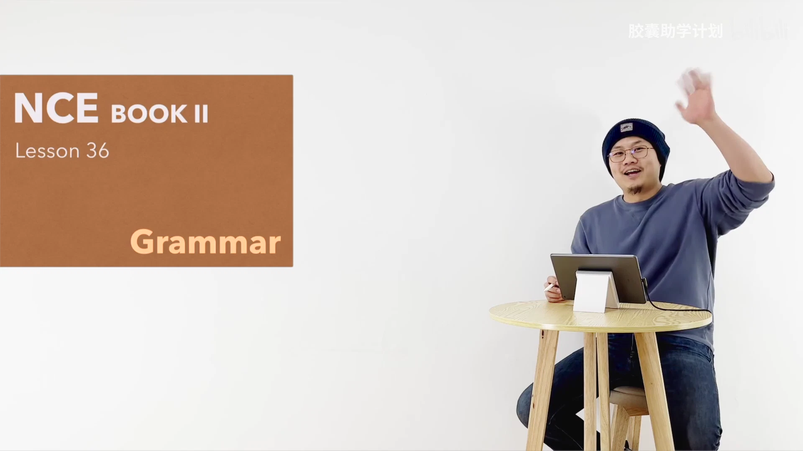

文字识别：NCE / BOOKII / Lesson 36 / Grammar

### 画面 00:00:02

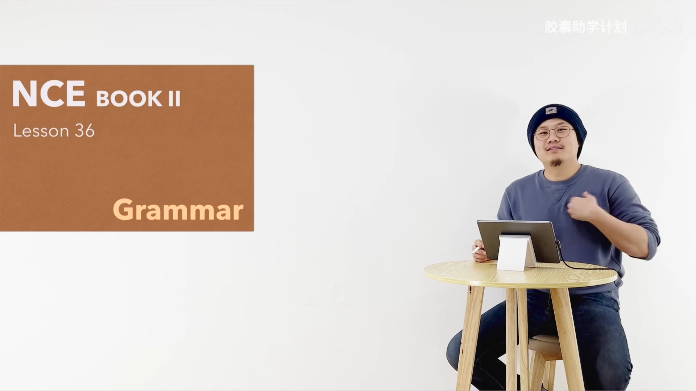

文字识别：NCE / BOOKII / Lesson 36 / Grammar

### 画面 00:00:05

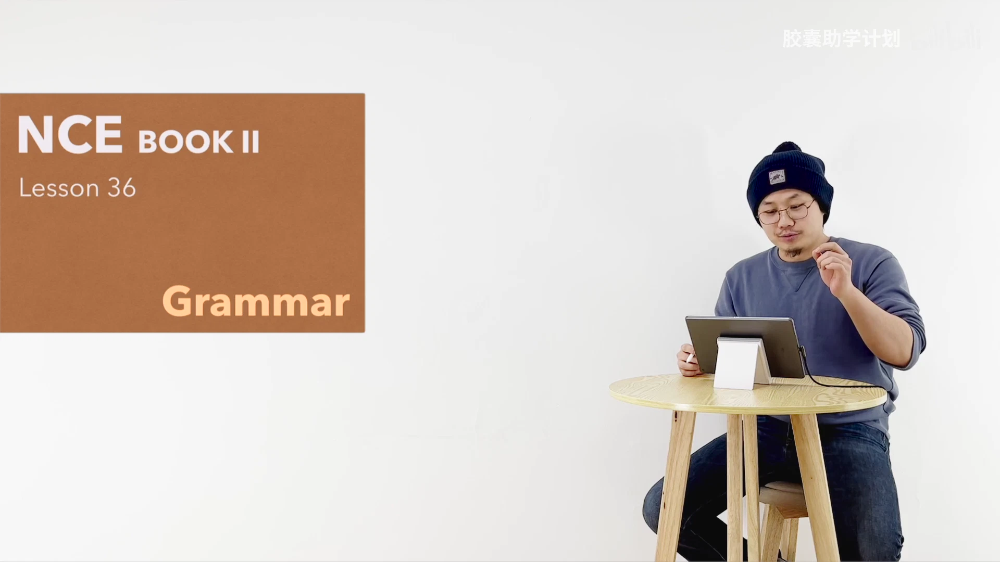

文字识别：NCE / BOOKII / Lesson 36 / Grammar

### 画面 00:00:10

文字识别：胶囊助学计划bill

### 画面 00:00:14

### 画面 00:00:16

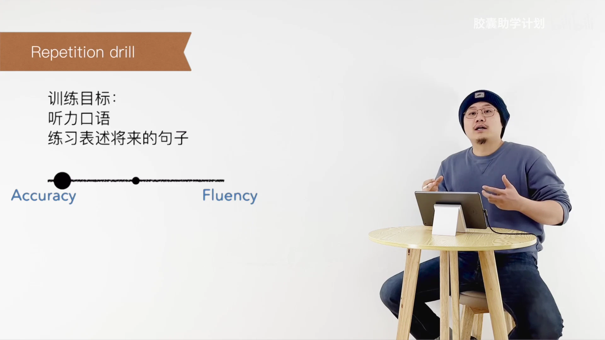

文字识别：Repetition drill / 训练目标： / 听力口语 / 练习表述将来的句子 / Accuracy / Fluency

## 00:00:30–00:01:00

去练习表述将来的那些句子。那重点其实就是 intend to do something，在单词部分我们讲过的那个啊。来跟我一起读，说 Do you think he intends to sell his car? 啊，我们先翻译一下，说你认为他计划打算去卖他的车吗？你看，从含义上来说，它是表示将来的计划打算，但是从结构语法结构上来说，它是个一般现在时。

### 画面 00:00:34

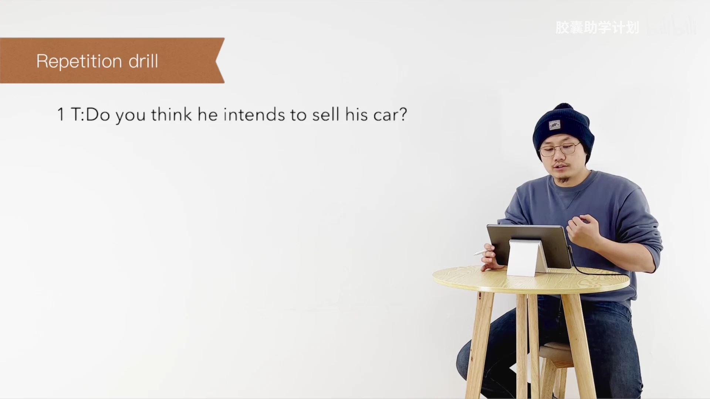

文字识别：Repetition drill / 1 T:Do you think he intends to sell his car?

### 画面 00:00:46

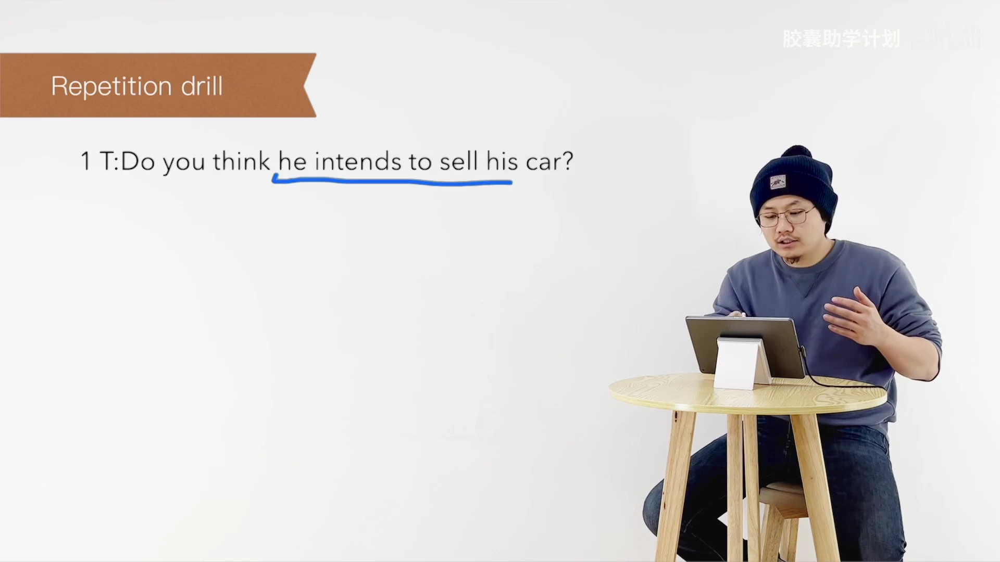

文字识别：Repetition drill / 1 T:Do you think he intends to sell his car?

## 00:01:00–00:01:30

所以这个地方你要注意了，对吧？Okay,那he certainly does.哎，他确实是，他在含义上和底下这句话几乎是一样的，叫做he's going to sell it tomorrow.他明天打算把它卖掉啊。好，我们讲三个啊，然后剩下大声张嘴跟我读就行了。比如说，do you think she intends to look for a new job?啊，look intend to do something，计划打算

### 画面 00:01:00

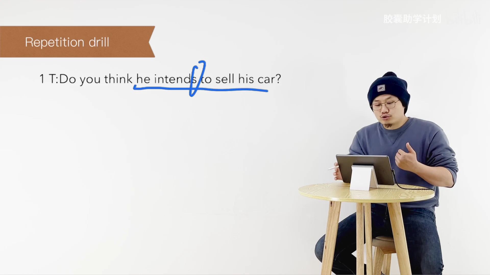

文字识别：Repetition drill / 1 T:Do you think he intendto sell his car?

### 画面 00:01:10

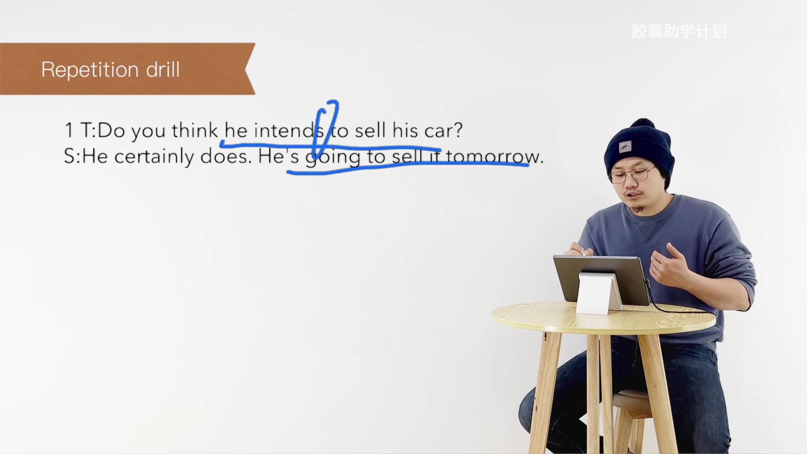

文字识别：Repetition drill / 1 T:Do you think he intendto sell his car? / S:He certainly / does. He's Going to sell if tomorrow.

### 画面 00:01:19

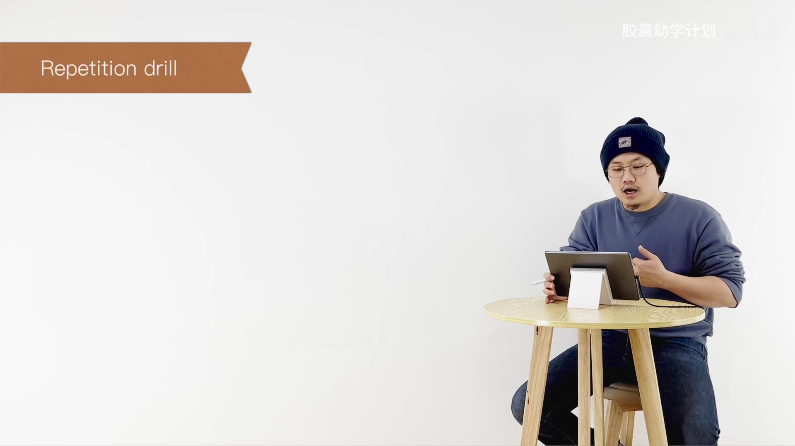

文字识别：Repetition drill

### 画面 00:01:28

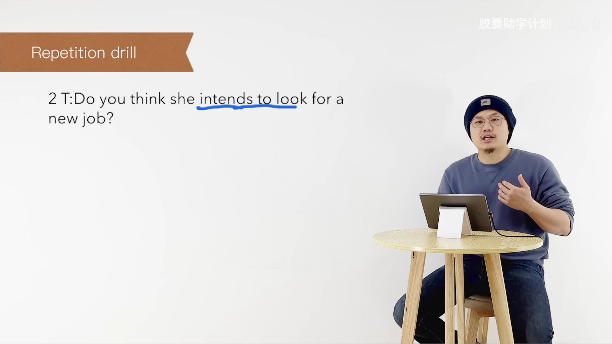

文字识别：Repetition drill / 2 T:Do you think she intends to look for a / newjob?

## 00:01:30–00:02:00

去做某件事情。虽然表将来，但它的结构是一般现在时，对吧？计划打算去找一个新的工作。说She is, she, she certainly does. She's going to look for a new job tomorrow. Okay, very good. Next one.说Do you think they intend to leave?哎，你认为？你看，注意啊，这个地方又用用到动词原形了，对吧？你认为他们计划打算离开吗？

### 画面 00:01:39

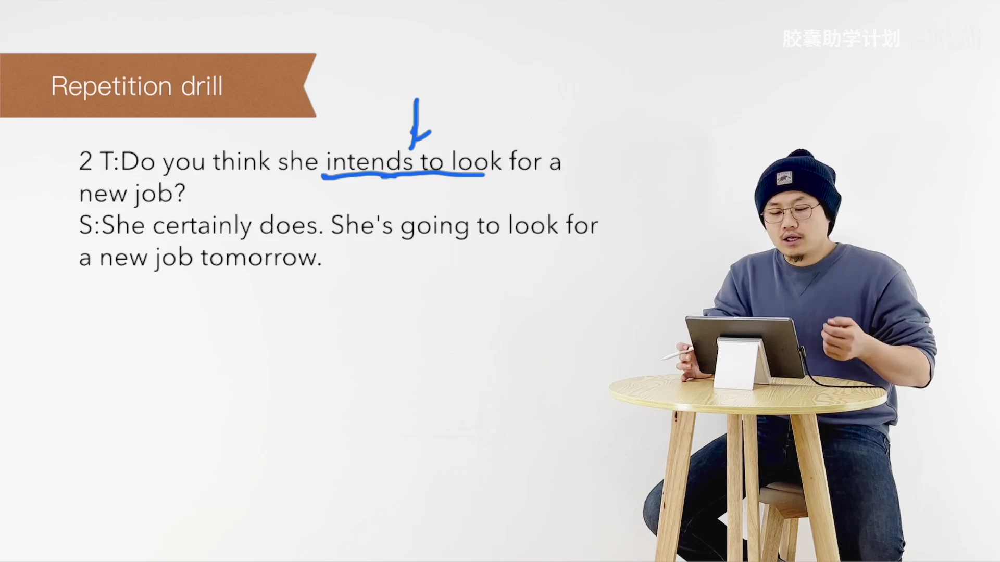

文字识别：Repetition drill / 2 T:Do you think she intends to look for a / newjob? / S:She certainly does. She's going to look for / a new job tomorrow.

### 画面 00:01:48

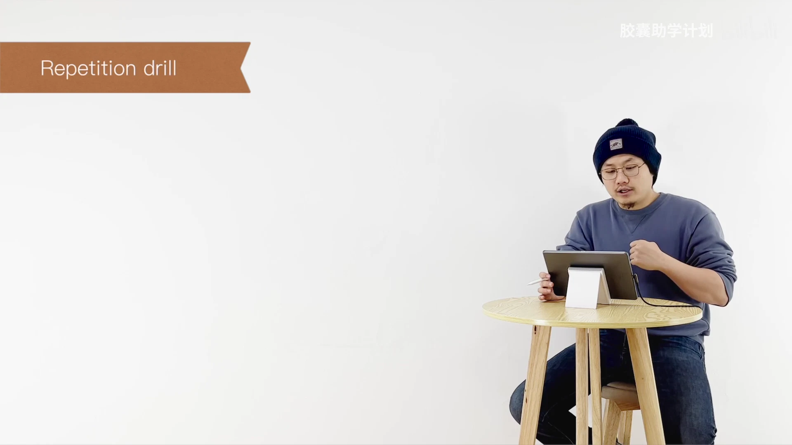

文字识别：Repetition drill

### 画面 00:01:56

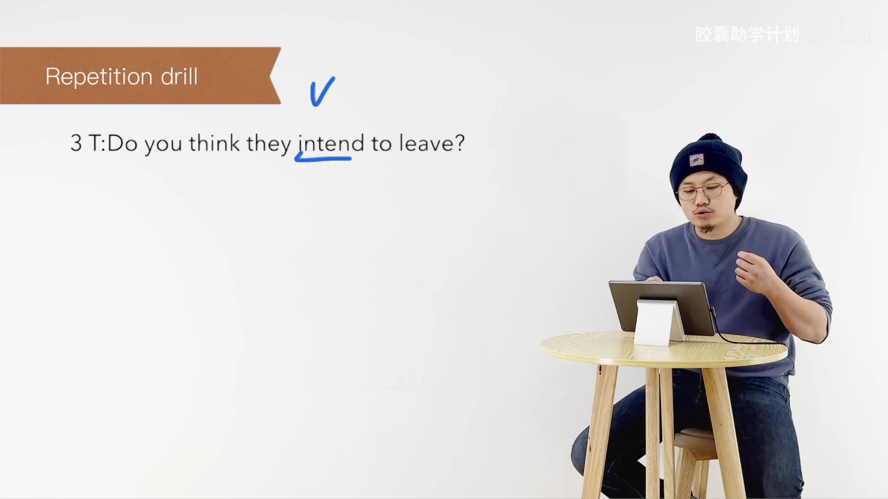

文字识别：Repetition drill / V / 3 T:Do you think they jntend to leave?

## 00:02:00–00:02:30

they certainly do. They're going to leave tomorrow. They plan to leave tomorrow. They plan to leave tomorrow. They plan to leave tomorrow. They plan to leave tomorrow. They plan to leave tomorrow. They plan to leave tomorrow. They plan to leave tomorrow. They plan to leave tomorrow. They plan to leave tomorrow. They plan to leave tomorrow. They plan to leave tomorrow. They plan to leave tomorrow. They plan to leave tomorrow. They plan to leave tomorrow. They plan to leave tomorrow. They plan to leave tomorrow. They plan to leave tomorrow. They plan to leave tomorrow. They plan to leave tomorrow. They plan to leave tomorrow. They plan to leave tomorrow. They plan to leave tomorrow. They plan to

### 画面 00:02:06

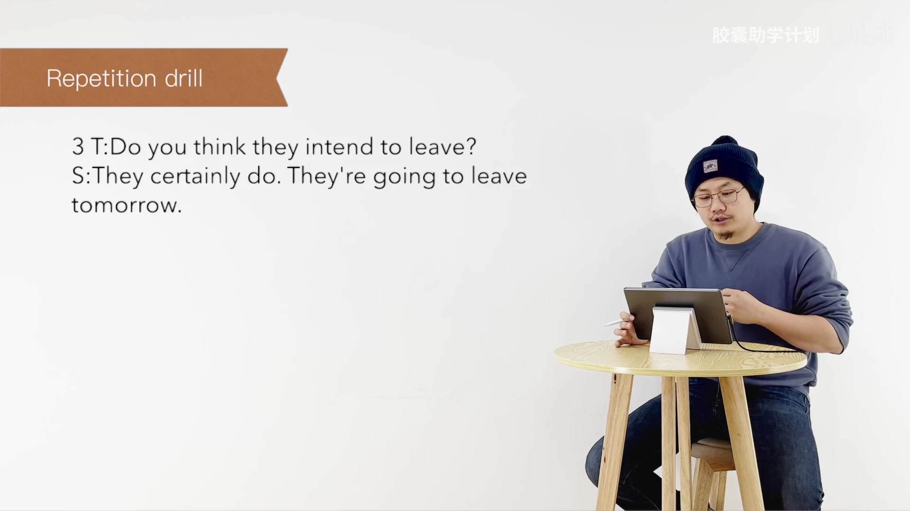

文字识别：Repetition drill / 3 T:Do you think they intend to leave? / S:They certainly do. They're going to leave / tomorrow.

### 画面 00:02:08

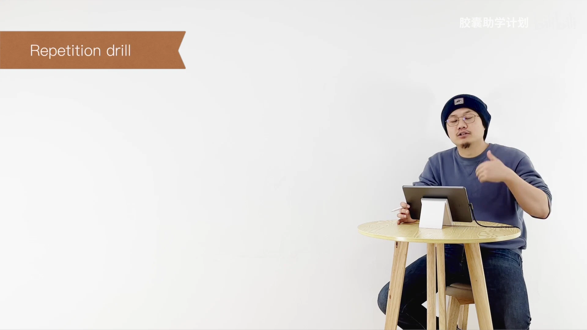

文字识别：Repetition drill

### 画面 00:02:16

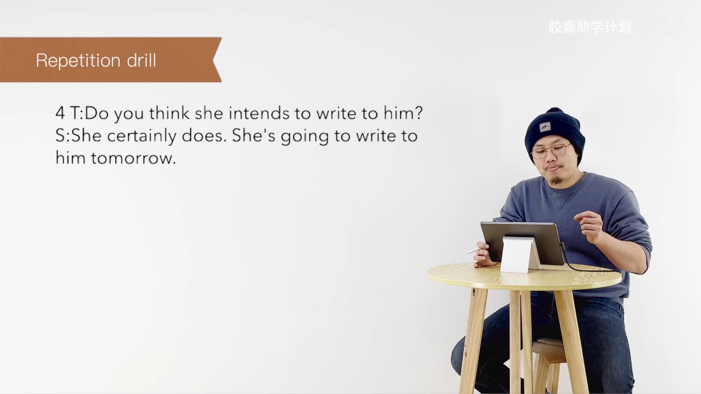

文字识别：Repetition drill / 4 T:Do you think she intends to write to him? / S:She certainly does. She's going to write to / him tomorrow.

### 画面 00:02:23

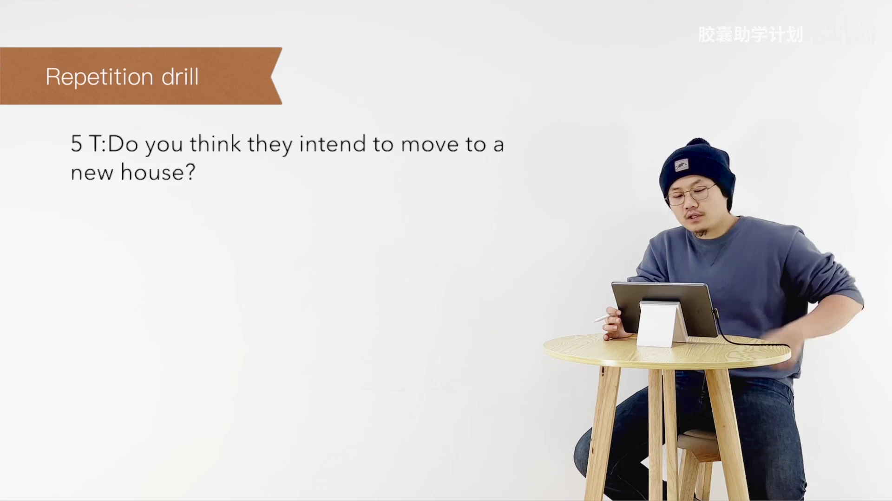

文字识别：Repetition drill / 5 T:Do you think they intend to move to a / new house?

### 画面 00:02:26

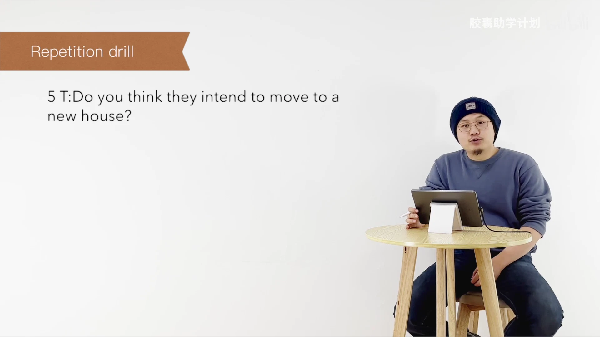

文字识别：Repetition drill / 5 T:Do you think they intend to move to a / new house?

### 画面 00:02:28

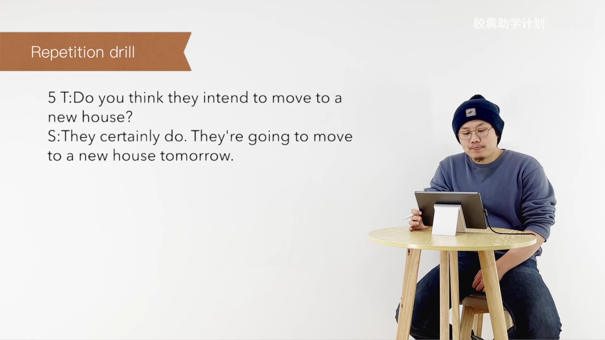

文字识别：Repetition drill / 5 T:Do you think they intend to move to a / new house? / S:They certainly do. They're going to move / to a new house tomorrow.

## 00:02:30–00:03:00

They're going to move to a new house tomorrow. Next one. Do you think he intends to ask for an explanation? He certainly does. He's going to ask for an explanation tomorrow. Next one. Do you think he intends to pay these bills? He certainly does. He's going to pay these bills tomorrow. Next one. Do you think they intend to drive to London?

### 画面 00:02:33

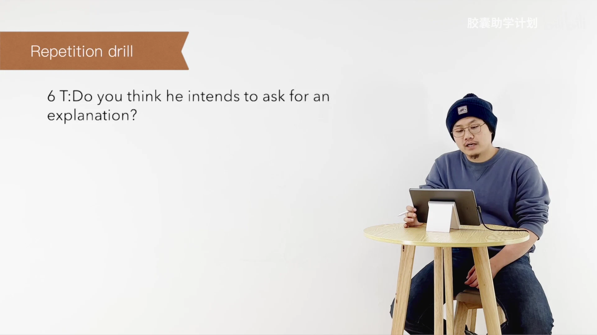

文字识别：Repetition drill / 6 T:Do you think he intends to ask for an / explanation?

### 画面 00:02:39

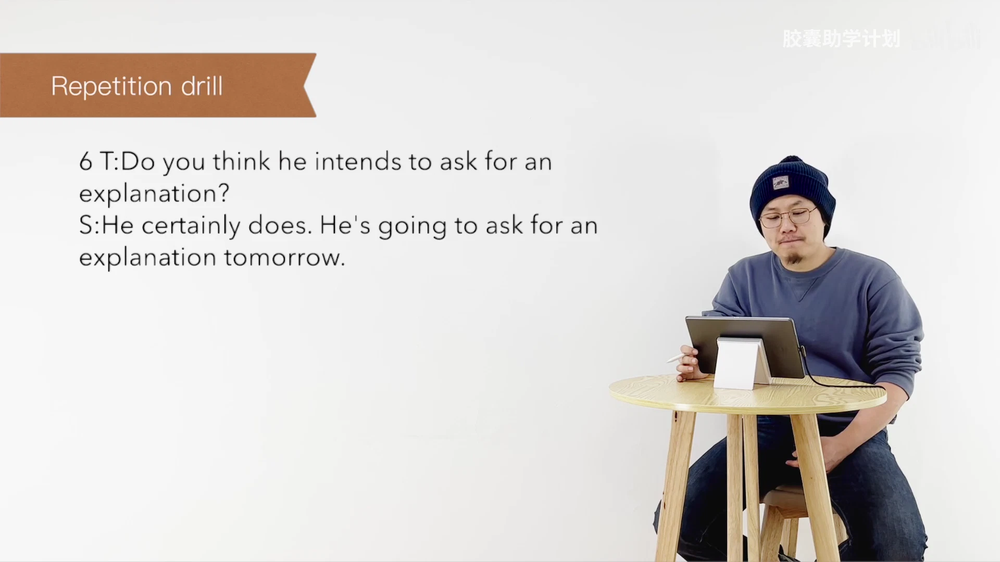

文字识别：Repetition drill / 6 T:Do you think he intends to ask for an / explanation? / S:He certainly does. He's going to ask for an / explanation tomorrow.

### 画面 00:02:46

文字识别：Repetition drill / 7 T:Do you think he intends to pay these / bills?

## 00:03:00–00:03:30

They certainly do. They are going to drive to London tomorrow. Next one. Do you think she intends to swim across the channel? She certainly does. She's going to swim across the channel tomorrow. Next one. Do you think he intends to persuade him? He certainly does. He's going to persuade him tomorrow. Okay, very good.好，刚才

### 画面 00:03:00

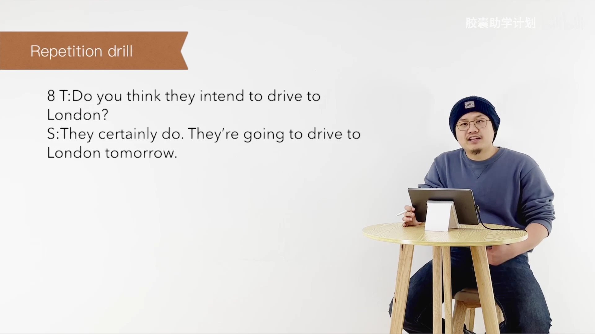

文字识别：Repetition drill / 8 T:Do you think they intend to drive to / London? / S:They certainly do. They're going to drive to / London tomorrow.

### 画面 00:03:06

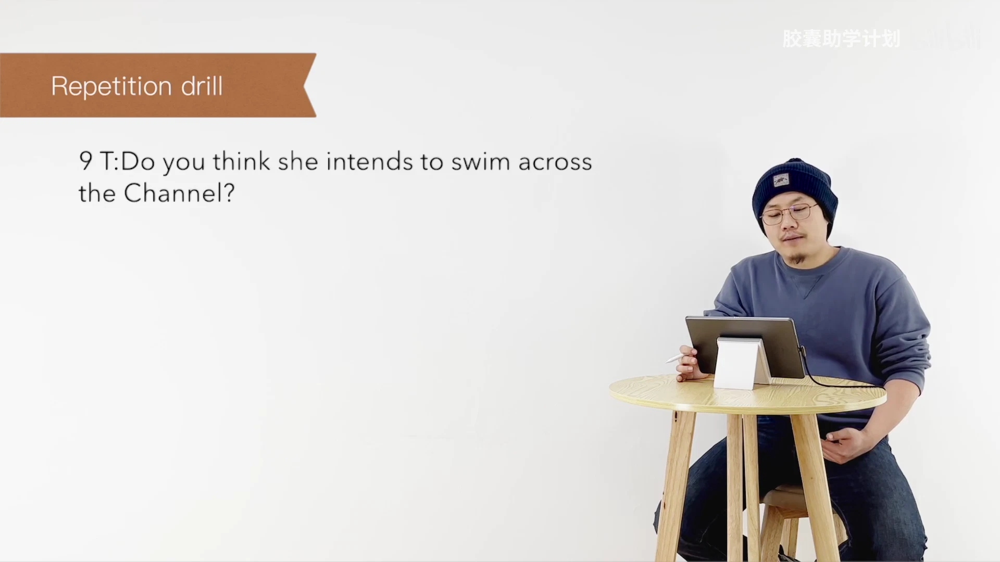

文字识别：Repetition drill / 9 T:Do you think she intends to swim across / the Channel?

### 画面 00:03:11

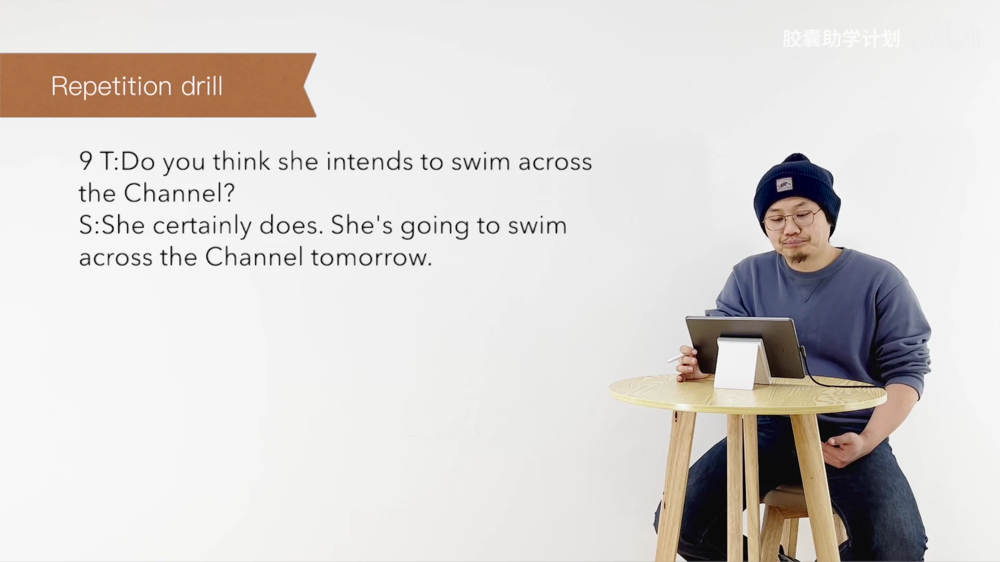

文字识别：Repetition drill / 9 T:Do you think she intends to swim across / the Channel? / S:She certainly does. She's going to swim / across the Channel tomorrow.

### 画面 00:03:18

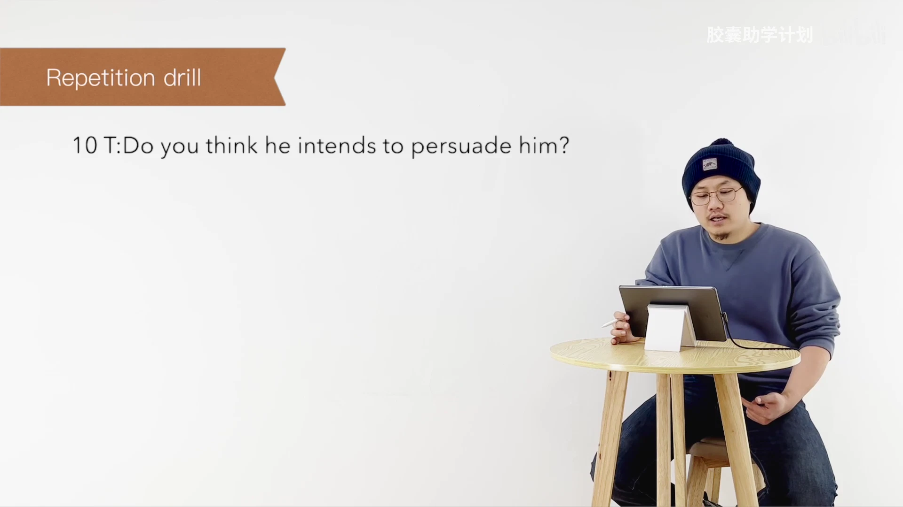

文字识别：Repetition drill / 10 T:Do you think he intends to persuade him?

### 画面 00:03:23

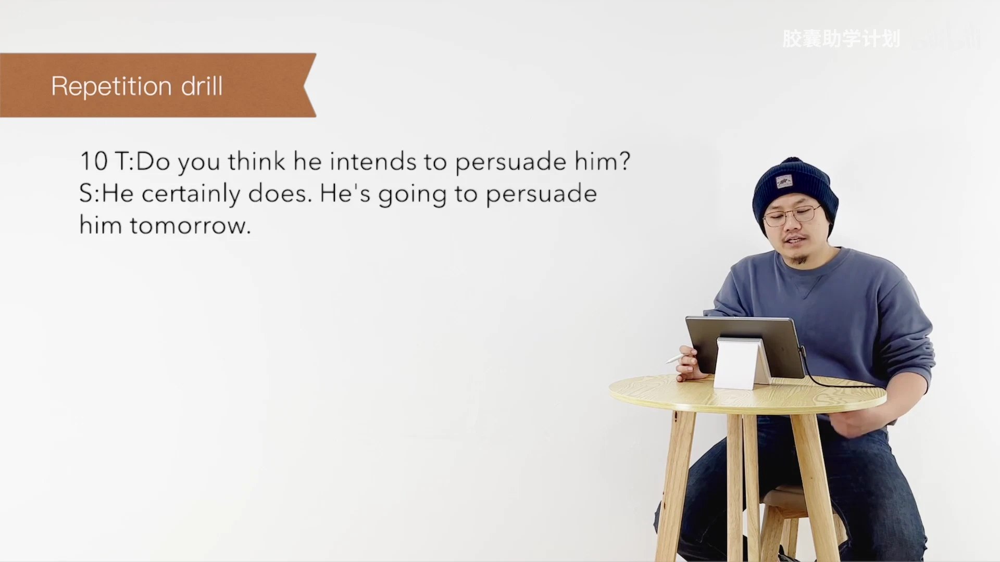

文字识别：Repetition drill / 10 T:Do you think he intends to persuade him? / S:He certainly does. He's going to persuade / him tomorrow.

### 画面 00:03:28

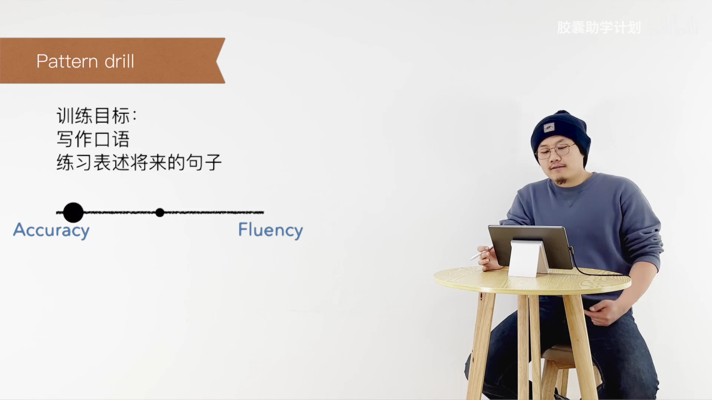

文字识别：Pattern drill / 训练目标： / 写作口语 / 练习表述将来的句子 / Accuracy / Fluency

## 00:03:30–00:04:00

那个呢，就是我读，您跟着我读就好了。接下来这个练习是 pattern drill，我们练的还是将来的句子，但这些呢，就是我讲讲完了之后，各位课下要自己去写的句子啊。好，I C S二，这是我们重点要讲的两个句话，以及要知道它练什么啊。说 What do you intend to do in the park? 好，这一看一目了然，练的就是 intend to do something，对吧？说你在公园当中要打算去做

### 画面 00:03:30

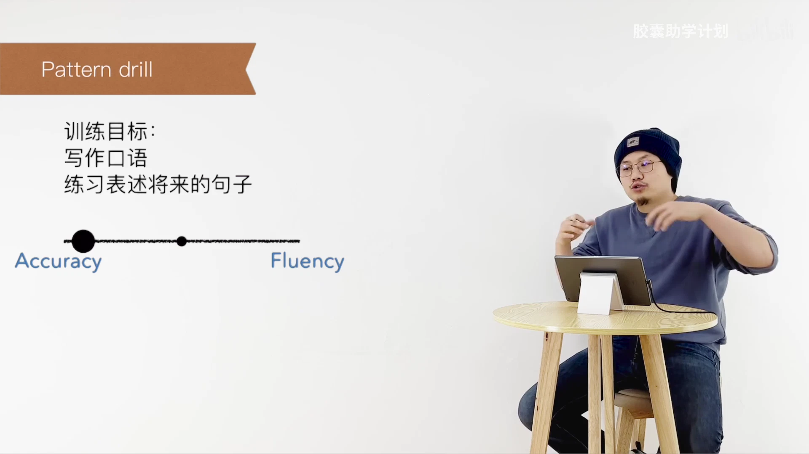

文字识别：Pattern drill / 训练目标： / 写作口语 / 练习表述将来的句子 / Accuracy / Fluency

### 画面 00:03:38

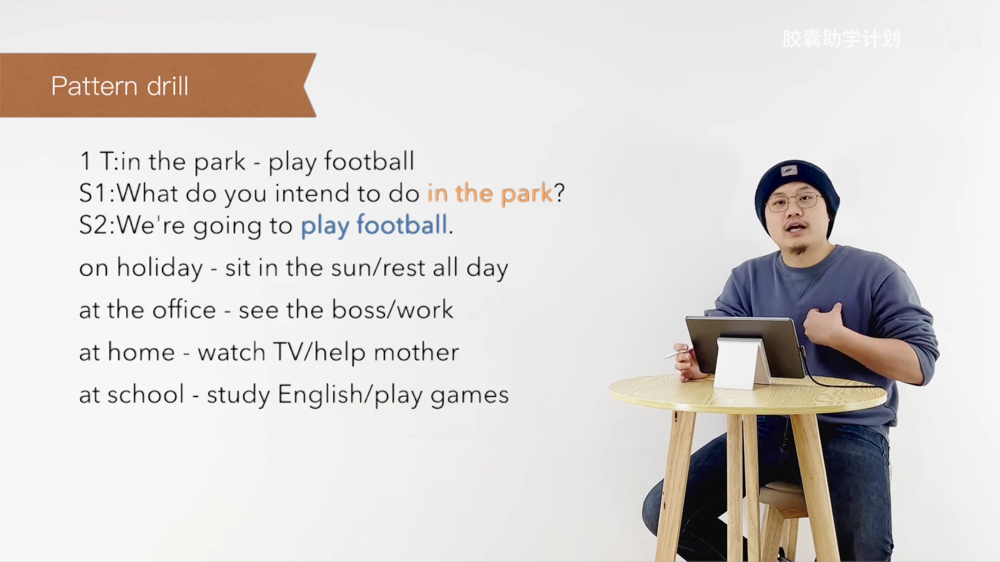

文字识别：Pattern drill / 1 T:in the park - play football / S1:What do you intend to do in the park? / S2:We're going to play football. / on holiday - sit in the sun/rest all day / at the office - see the boss/work / at home - watch TV/help mother / at school - study English/play games

## 00:04:00–00:04:30

什么？回答 We are going to play football. 练的句子也非常简单，叫 be going to do 啊。从新一又练到了今天，各位老习惯先往里去带，对吧？把底下的带上来，然后写写完了之后大声朗读。OK。第二题，Why doesn't he tidy the garden？他为什么没有打扫清理这个啊这个花园呢？He's decided

### 画面 00:04:08

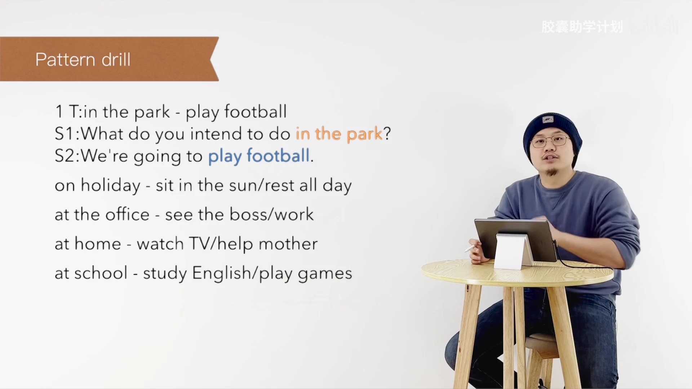

文字识别：Pattern drill / 1 T:in the park - play football / S1:What do you intend to do in the park? / S2:We're going to play football. / on holiday - sit in the sun/rest all day / at the office - see the boss/work / at home - watch TV/help mother / at school - study English/play games

### 画面 00:04:17

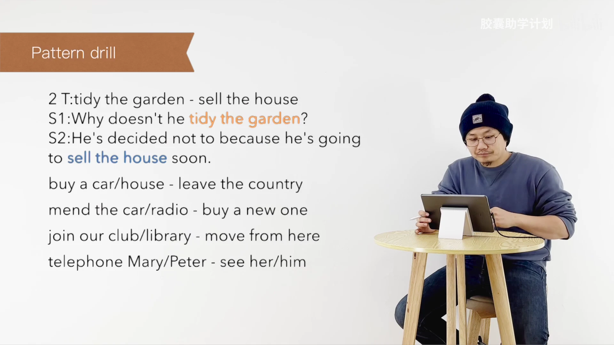

文字识别：Pattern drill / 2 T:tidy the garden - sell the house / S1:Why doesn't he tidy the garden? / S2:He's decided not to because he's going / to sell the house soon. / buy a car/house - leave the country / mend the car/radio - buy a new one / join our club/library - move from here / telephone Mary/Peter - see her/him

## 00:04:30–00:05:00

not to.他已经决定了不要那么去做. Because he's going to sell the house soon.说因为啊，他马上就要把这个房子给卖掉了. Be going to do,是吧？很简单，不多说了。各位还是往里面去带。第三题说，You won't forget for forget to bring something to eat, will you？说你不会忘记带一些吃的东西吧？对吧？Will you？就是对吧？对吧？新学的反义疑问句啊。说Don't worry,别担心.

### 画面 00:04:45

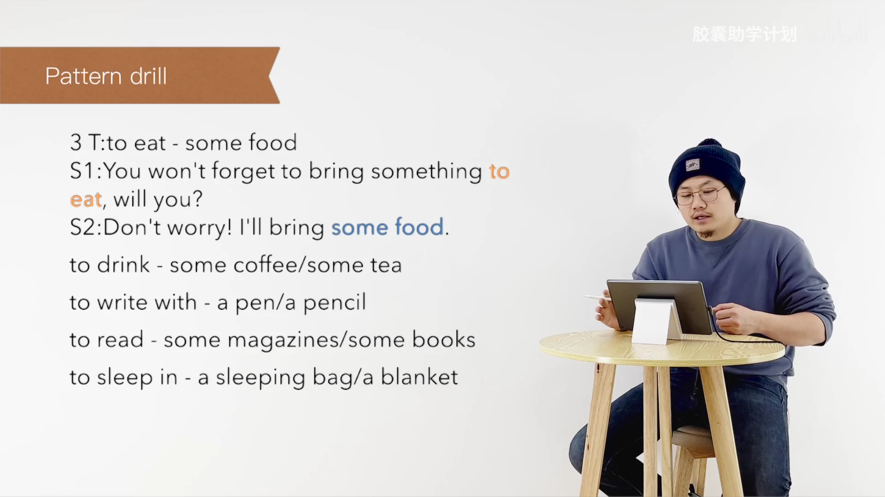

文字识别：Pattern drill / 3 T:to eat- some food / S1:You won't forget to bring something to / eat, willyou? / S2:Don't worry! Ill bring some food. / to drink - some coffee/some tea / to write with - a pen/a pencil / to read - some magazines/some books / to sleep in - a sleeping bag/a blanket

## 00:05:00–00:05:30

I will bring some food.说我会带来一些食物的。注意，你看P L L W I L L will的缩写，对吧？所以这个地方各位练完了之后呢，其实你基本上到最后很熟悉的几个句型。第一个叫Don't worry，别担心，对吧？然后呢，下一个叫做You won't forget to bring something to啊to read啊to drink。你不会忘记带点喝的东西，对吧？啊，基本就是你们把这句话

### 画面 00:05:15

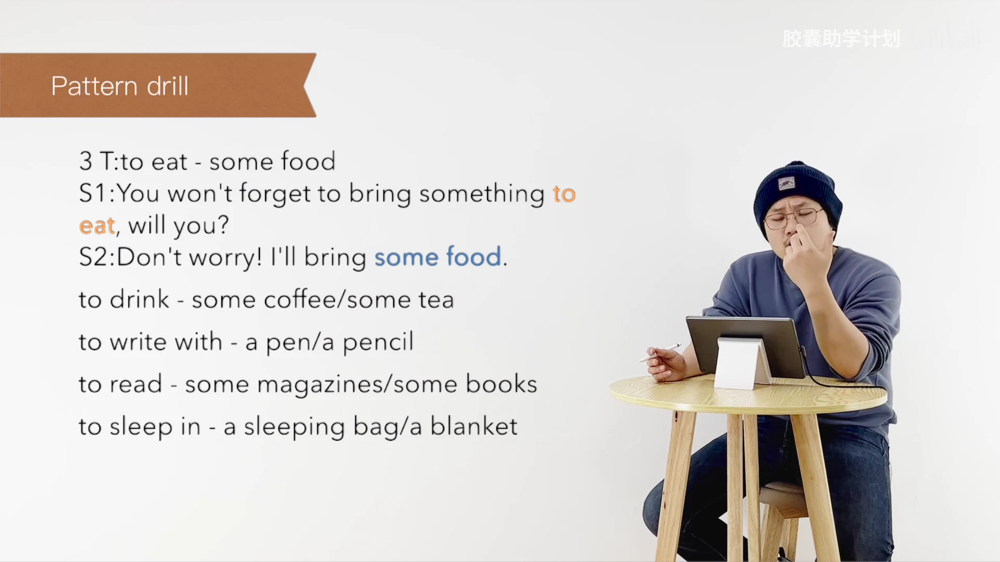

文字识别：Pattern drill / 3 T:to eat - some food / S1:You won't forget to bring something to / eat, will you? / S2:Don't worry! 'll bring some food. / to drink - some coffee/some tea / to write with - a pen/a pencil / to read - some magazines/some books / to sleep in - a sleeping bag/a blanket

## 00:05:30–00:06:00

变得非常熟悉了，以及说 I'll bring，说我会带什么什么的啊，OK，所以老习惯各位往里面去带，好吧？呃，那 Recap 本课我们可以理解为没有什么新的语法，对吧？我们复习了一下之前学过的东西，然后把单词 intend to do something 也放到里面一起去学习了一下。好，粘作业 pattern drill，各位一定要去写四乘四，对吧？尝试回忆

### 画面 00:05:39

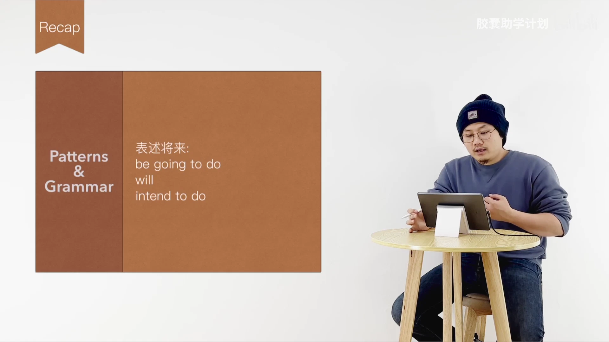

文字识别：Recap / 表述将来: / Patterns / be going to do / will / Grammar / intend to do

### 画面 00:05:41

文字识别：Recap / 表述将来: / Patterns / be going to do / ＆ / will / Grammar / intend to do

### 画面 00:05:45

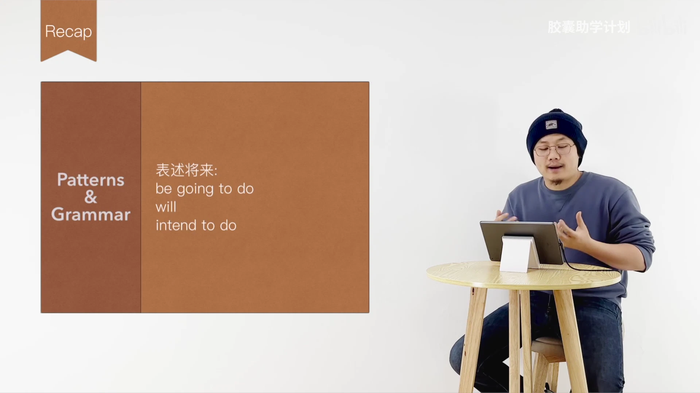

文字识别：Recap / 表述将来: / Patterns / be going to do / ＆ / will / Grammar / intend to do

### 画面 00:05:50

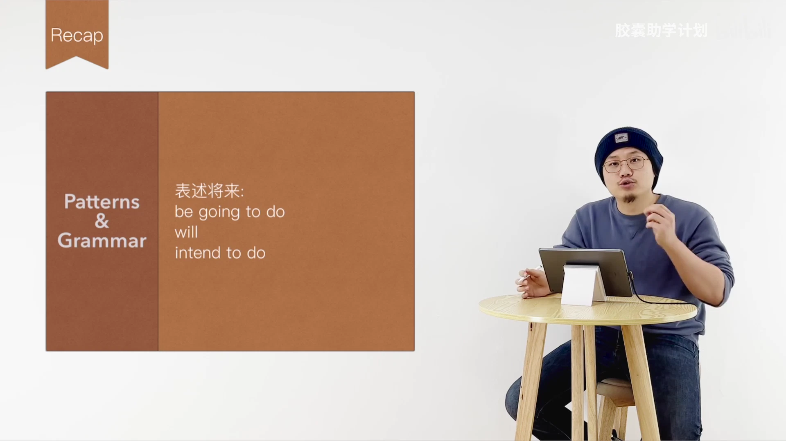

文字识别：Recap / 表述将来: / Patterns / be going to do / ＆ / will / Grammar / intend to do

### 画面 00:05:55

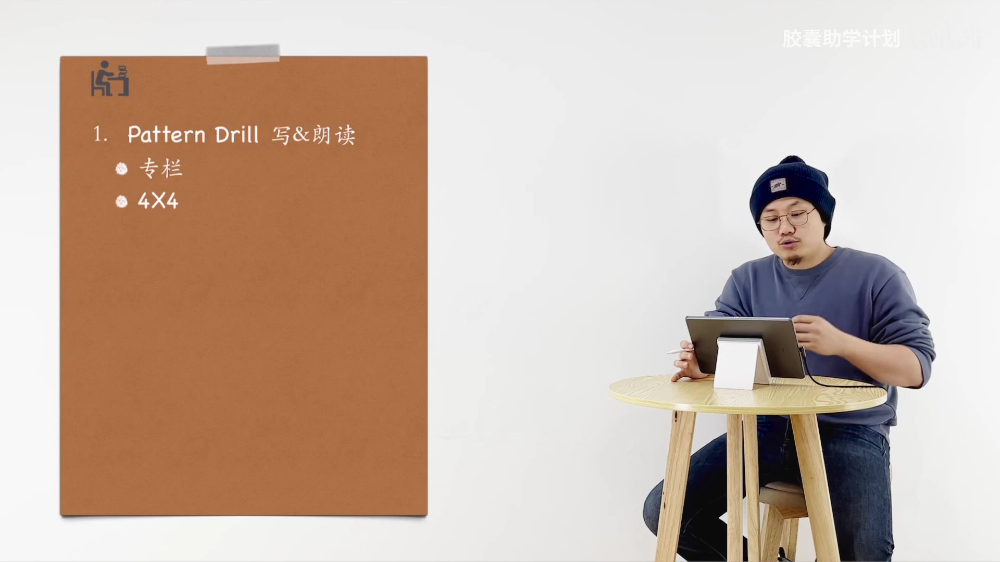

文字识别：1.f / Pattern Drill 写&朗读 / 专栏 / 4×4

### 画面 00:05:57

文字识别：1. / Pattern Drill写&朗读 / 专栏 / 4X4 / 尝试回忆并给自己讲解一 / 遍今天的核心语法 / Study-Test / Learning Pyramid

## 00:06:00–00:06:30

讲解一遍今天的核心语法。如果您这里面的某个语法还没有用初级红皮书或中级红皮书去查阅过，那您不妨今天就可以去查一下，然后对应的练习去写一写，好吧？那以上呢就是本期视频的全部内容了。如果您喜欢我我们的课程呢，欢迎给我们关注、订阅、一键三连，分享给那些需要的朋友，来帮助我们快速成长。See you next time.

### 画面 00:06:00

文字识别：1. / Pattern Drill写&朗读 / 专栏 / 4×4 / 尝试回忆并给自己讲解一 / 遍今天的核心语法 / Study-Test / Learning Pyramid

### 画面 00:06:02

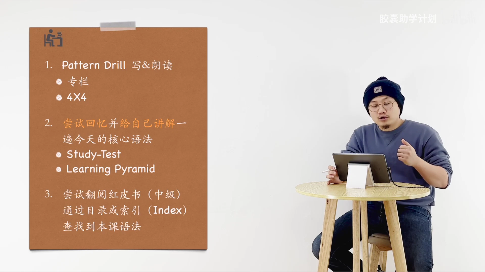

文字识别：1.f / Pattern Drill 写&朗读 / 专栏 / 4×4 / 尝试回忆并给自己讲解一 / 遍今天的核心语法 / Study-Test / Learning Pyramid / 尝试翻阅红皮书（中级） / 通过目录或索引(Index) / 查找到本课语法

### 画面 00:06:05

文字识别：1. f / Pattern Drill写&朗读 / 专栏 / 4×4 / 尝试回忆并给自己讲解一 / 遍今天的核心语法 / Study-Test / Learning Pyramid / 尝试翻阅红皮书（中级） / 通过目录或索引(Index) / 查找到本课语法

### 画面 00:06:10

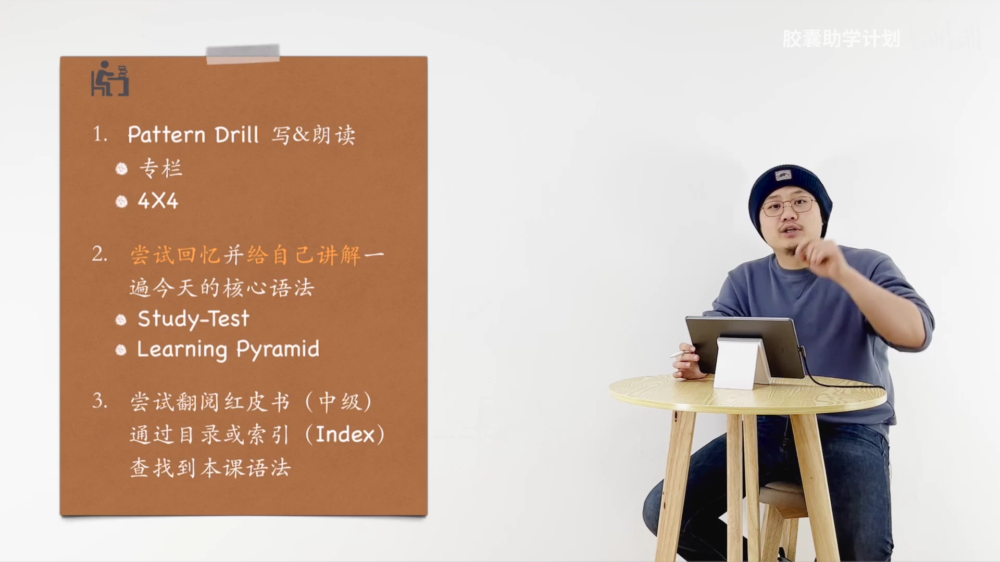

文字识别：Pattern Drill 写&朗读 / 1. f / 专栏 / 4×4 / 尝试回忆并给自己讲解一 / 遍今天的核心语法 / Study-Test / Learning Pyramid / 尝试翻阅红皮书（中级） / 通过目录或索引(Index) / 查找到本课语法

### 画面 00:06:14

### 画面 00:06:28

## 00:06:30–00:06:40

### 画面 00:06:30

文字识别：CAPSULEACADEMY / 胶囊助学计划 / 小红书 / Lecturer / Leo / OE

### 画面 00:06:32

文字识别：CAPSULEACADEMY / 胶囊助学计划 / 小红书 / Photographer / Berlin / OE

### 画面 00:06:34

文字识别：CAPSULEACADEMY / 胶囊助学计划 / 小红书 / Editor / □ / Berlin / OE

### 画面 00:06:37

文字识别：CAPSULEACADEMY / 胶囊助学计划 / 小红书

### 画面 00:06:39

文字识别：bilibili / 胶囊助学计划

