# L036 听说读写复述练习

快速机器解析：语音为单模型转写，未进行独立交叉校对或人工复核；画面每秒采样并按变化选帧，短时文字和标记可能遗漏。截图时间约有 1 秒误差。图片有损压缩；遇到疑点请按时间查看 Google Drive 原视频。

## 00:00:00–00:00:30

Hello everyone, welcome to Capsule Academy. This is Leo. Today we're going to learn New Concept English Book Two Lesson Thirty Six Practices. 那注意进行如下练习的唯一前提叫做文章跟读至熟读成诵，否则请勿开始。 Hope you gonna enjoy. 好，那我们先看第一题 comprehension. 练习的是我们能听懂一般疑问句和特殊疑问句的能力。我问您答啊。

### 画面 00:00:00

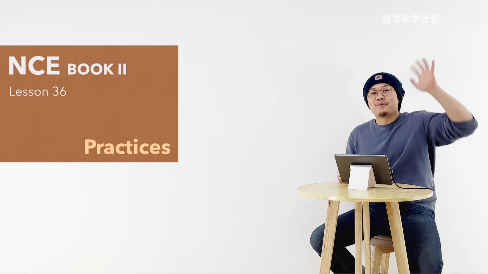

文字识别：NCE / BOOKII / Lesson 36 / Practices

### 画面 00:00:02

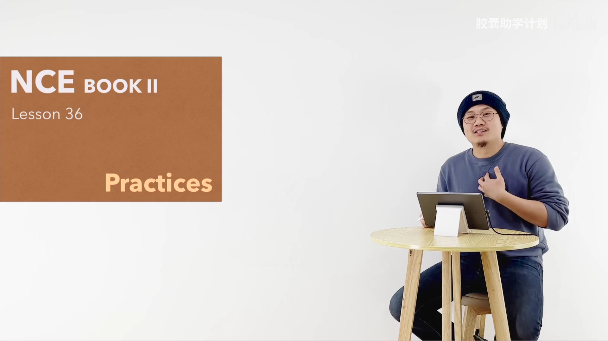

文字识别：NCE / BOOKII / Lesson 36 / Practices

### 画面 00:00:08

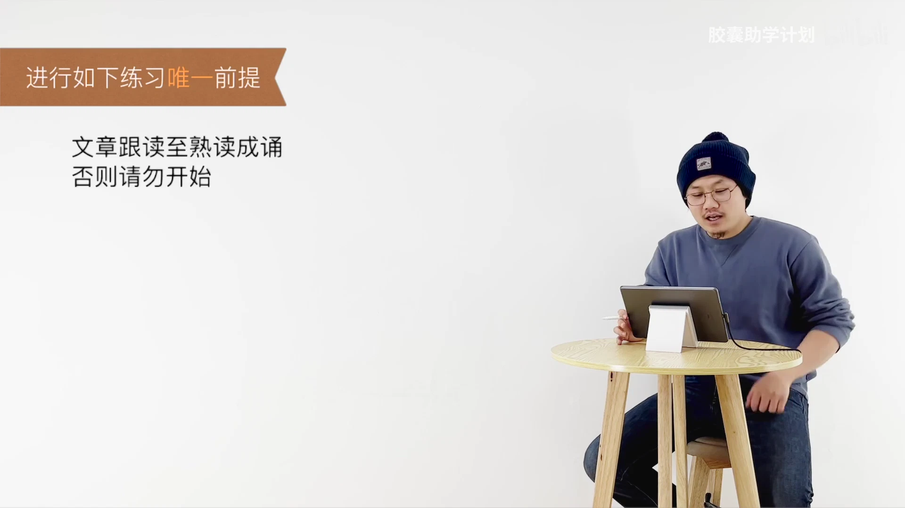

文字识别：进行如下练习唯一前提 / 文章跟读至熟读成诵 / 否则请勿开始

### 画面 00:00:18

文字识别：胶囊助学计划bill / • / •

### 画面 00:00:21

文字识别：胶囊助学计划 / 胶囊助学计划

### 画面 00:00:23

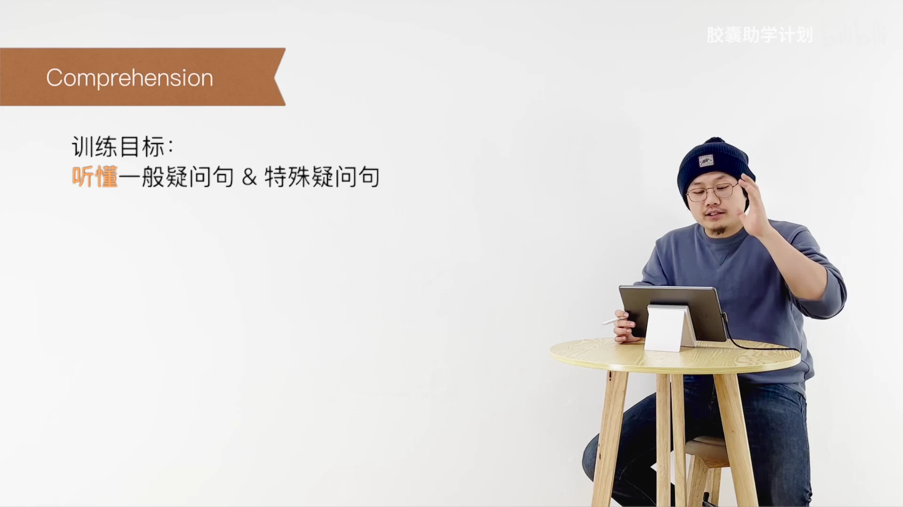

文字识别：Comprehension / 训练目标： / 听懂一般疑问句＆特殊疑问句

## 00:00:30–00:01:00

好，第一题，Who's going to swim across the English Channel tomorrow? Debbie Hart. Next one. Where is she going to set out from? From the French coast. Very good. Next one. When will she set out? At five o'clock in the morning. Okay. Next one. How old is Debbie?

### 画面 00:00:31

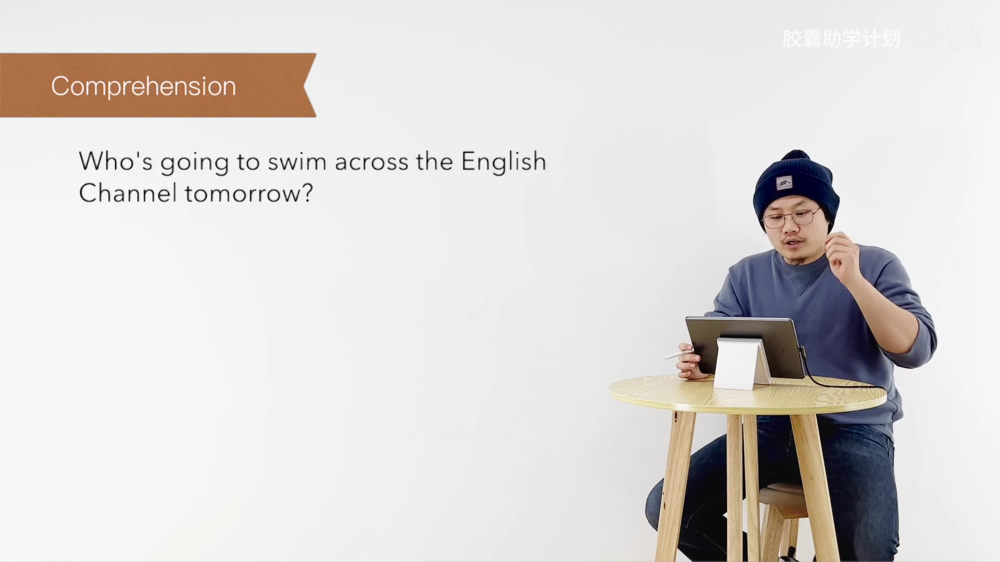

文字识别：Comprehension / Who's going to swim across the English / Channel tomorrow?

### 画面 00:00:41

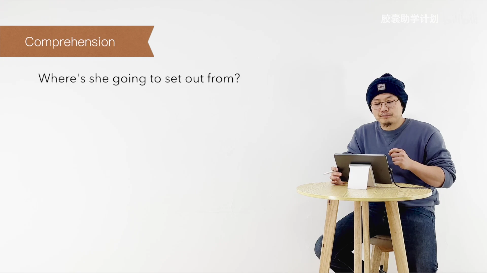

文字识别：Comprehension / Where's she going to set out from?

## 00:01:00–00:01:30

Eleven. Next one, what does she hope to do? To set up a new world record. Next one, is she a strong swimmer? Yes, she is. Next one, do many people think she will succeed? Yes, they do. Next one, who will set out with her? Her father will. Next one,

### 画面 00:01:11

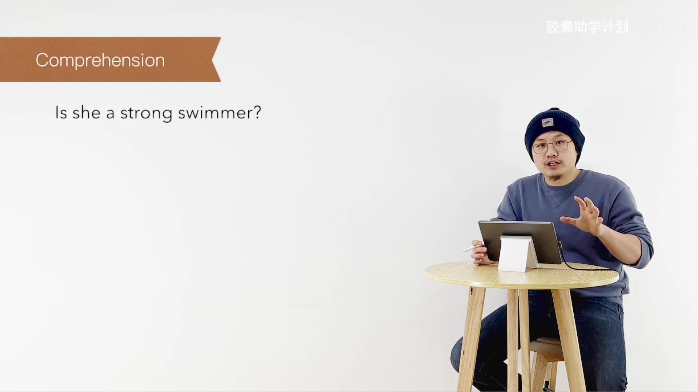

文字识别：Comprehension / Is she a strong swimmer?

## 00:01:30–00:02:00

will he swim or go in a small boat? Ah, in a small boat. Next one, how long has he trained Debbie? Answer, two words, for years, right? Next one, how will he be watching her tomorrow? One word, anxiously. Very good. Next one, is it a short distance from France to England? No, it isn't. It's a long distance to England,

### 画面 00:01:41

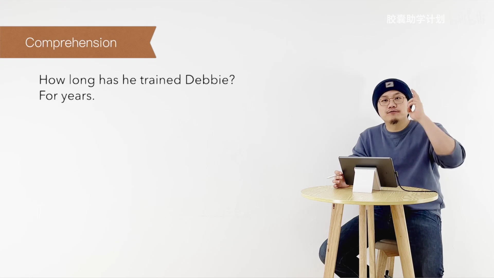

文字识别：Comprehension / How long has he trained Debbie? / For years.

### 画面 00:01:54

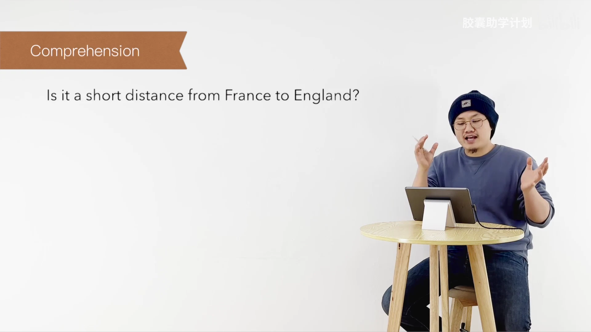

文字识别：Comprehension / Is it a short distance from France to England?

## 00:02:00–00:02:30

right? Next one, how often does Debbie intend to take a rest? Every two hours. Okay,好 asking questions老习惯肯定句一般疑问句特殊疑问句对吧？Okay,那来先看第一个例子叫 ask me if Debbie Hard is going to swim across the English Channel.这个很简单，is提前就行了，对吧？那who对主语提问，您把主语直接去掉，哎，直接一加叫 who is going

### 画面 00:02:01

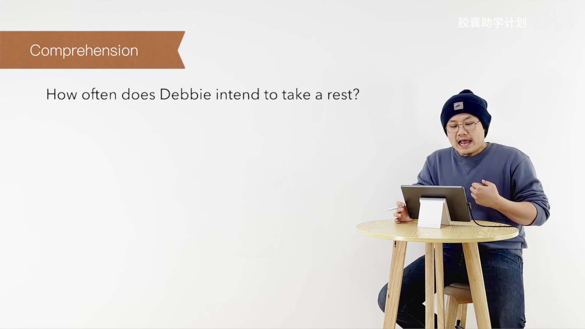

文字识别：Comprehension / How often does Debbie intend to take a rest?

### 画面 00:02:08

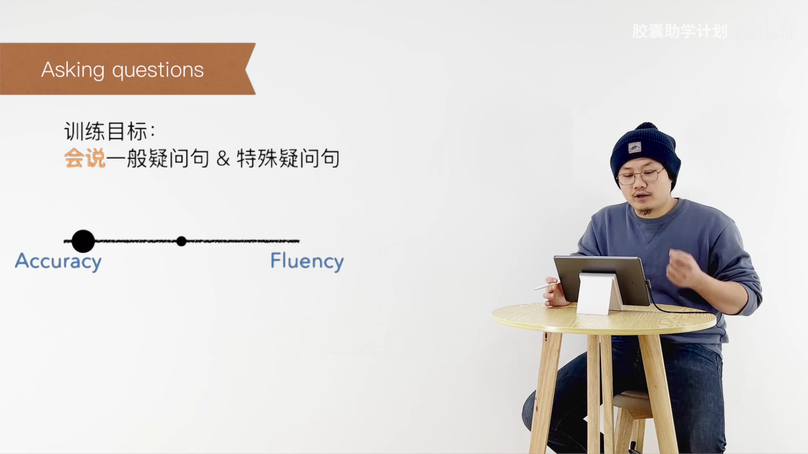

文字识别：Asking questions / 训练目标： / 会说一般疑问句＆特殊疑问句 / Accuracy / Fluency

### 画面 00:02:14

文字识别：Asking questions

### 画面 00:02:21

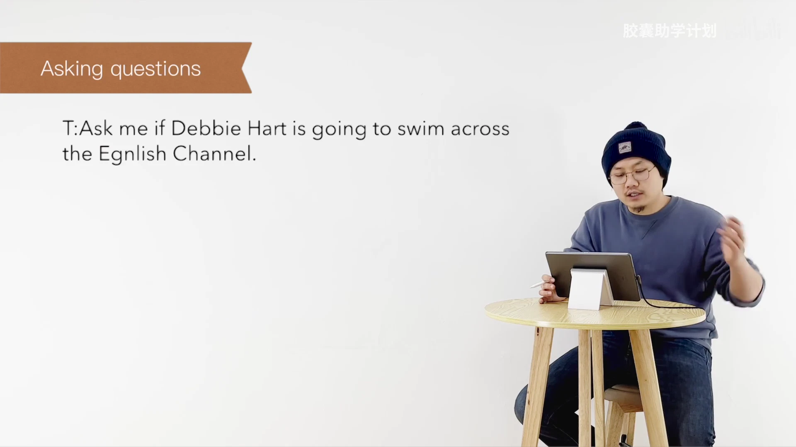

文字识别：Asking questions / T:Ask me if Debbie Hart is going to swim across / the Egnlish Channel.

### 画面 00:02:23

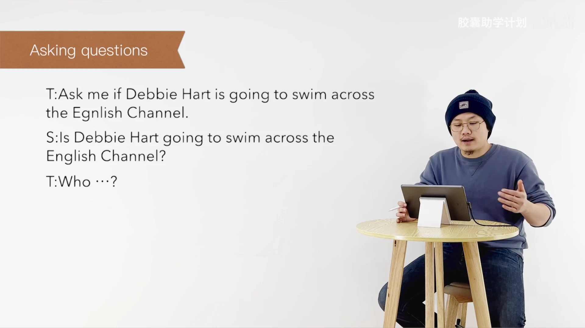

文字识别：Asking questions / T:Ask me if Debbie Hart is going to swim across / the Egnlish Channel. / S:Is Debbie Hart going to swim across the / English Channel? / T:Who…?

### 画面 00:02:26

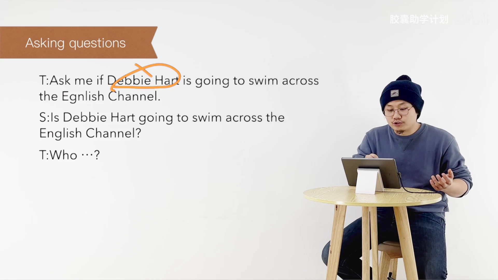

文字识别：Asking questions / T:Ask me if Debbie Har is going to swim across / the Egnlish Channel. / S:Is Debbie Hart going to swim across the / English Channel? / T:Who…?

### 画面 00:02:28

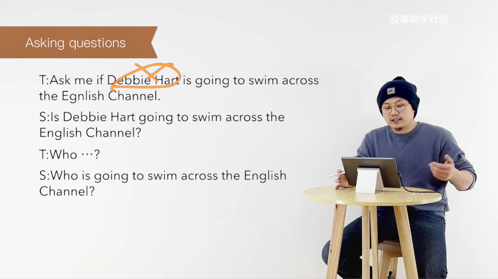

文字识别：Asking questions / T:Ask me if Debbie Har is going to swim across / the Egnlish Channel. / S:Is Debbie Hart going to swim across the / English Channel? / T:Who…? / S:Who is going to swim across the English / Channel?

## 00:02:30–00:03:00

to swim across the English Channel? Okay,好，那 When 注意啊 When 直接加整句 When 直接加整句，对吧？您下课要先写，写完大声朗读出来。我在这儿只提思路啊，这个练习对我们非常的重要啊。Next one说 She's going to set out tomorrow. Is 提前对吧？然后 When 呢？对 Tomorrow 提问很简单，所以答案呢，您想一下是不是就是 When is she going to set out? Okay, Next

### 画面 00:02:32

文字识别：Asking questions

### 画面 00:02:34

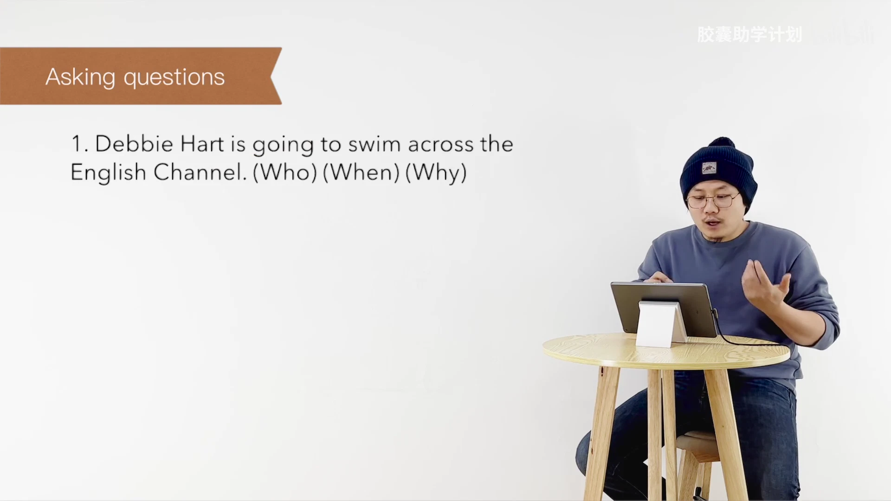

文字识别：Asking / questions / 1. Debbie Hart is going to swim across the / English Channel. (Who) (When) (Why)

### 画面 00:02:55

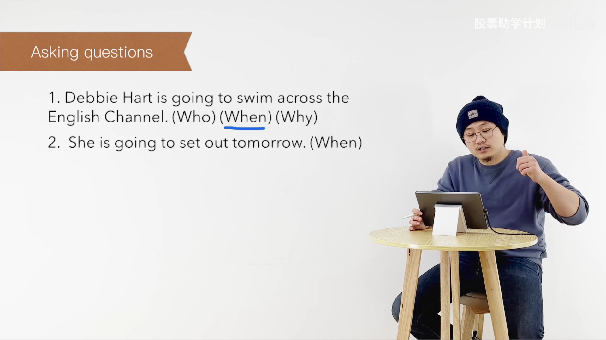

文字识别：Asking questions / 1. Debbie Hart is going to swim across the / English / Channel.(Who)(When)(Why) / 2. She is going to set out tomorrow. (When)

### 画面 00:02:59

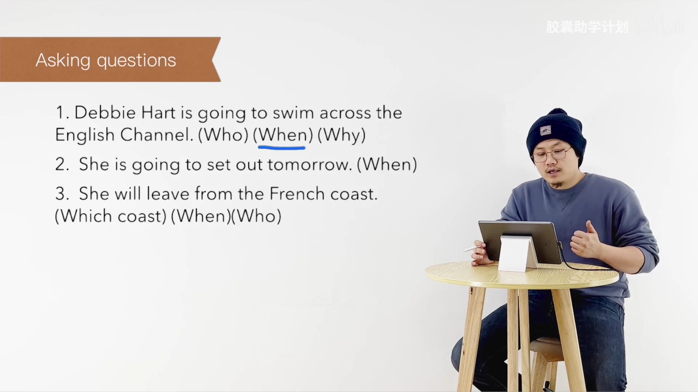

文字识别：Asking questions / 1. Debbie Hart is going to swim across the / English Channel. (Who) (When) (Why) / 2. She is going to set out tomorrow. (When) / 3. She will leave from the French coast. / (Which coast) (When)(Who)

## 00:03:00–00:03:30

one. Say she will leave from the French coast. Will提前就行了。注意which coast对的是the French coast提问，对吧？When整句，who对主语，对吧？不要变一般疑问句了。Next one, say she will start at five o'clock in the morning. Will提前，对吧？然后what time肯定是对at five o'clock提问。您可以这样说，叫做what啊对at five o'clock in the morning提问，对吧？可以说what time will

### 画面 00:03:29

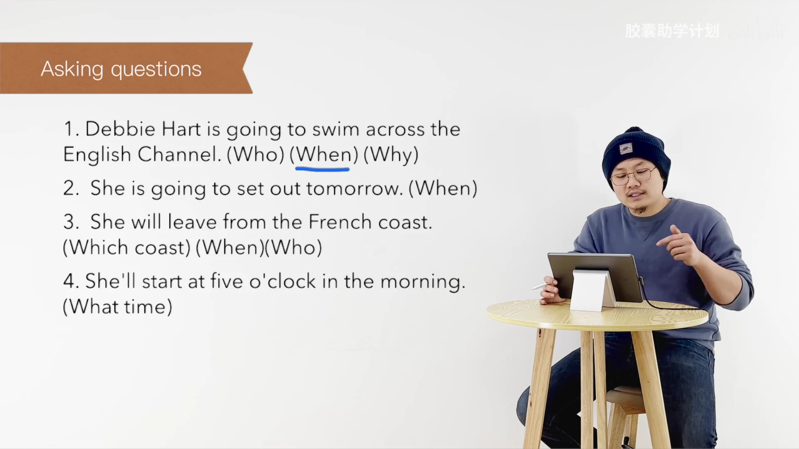

文字识别：Asking questions / 1. Debbie Hart is going to swim across the / English Channel. (Who) (When) (Why) / 2. She is going to set out tomorrow. (When) / 3. She will leave from the French coast. / (Which coast) (When)(Who) / 4. She'll start at five o'clock in the morning. / (What time)

## 00:03:30–00:04:00

she start? 对吧？说 Debbie is eleven years old. 这个很简单，is提前。How old? 对 eleven years old提问对吧？没什么可说的。第六题，哎，这个就是我们说的叫 hopes to set up。虽然叫希望怎么怎么样，一提希望就是将来，但它是一般现在时的结构对吧？所以您是 does提前。What? 那肯定就是对 a new record提问对吧？Next one. She's a strong swimmer. Is

### 画面 00:03:38

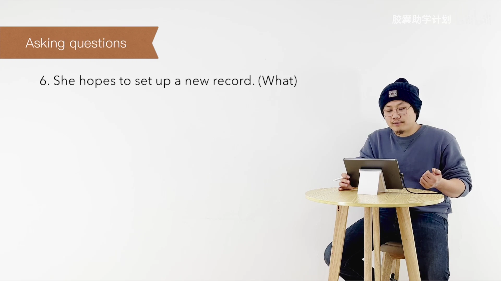

文字识别：Asking questions / 6. She hopes to set up a new record. (What)

### 画面 00:03:42

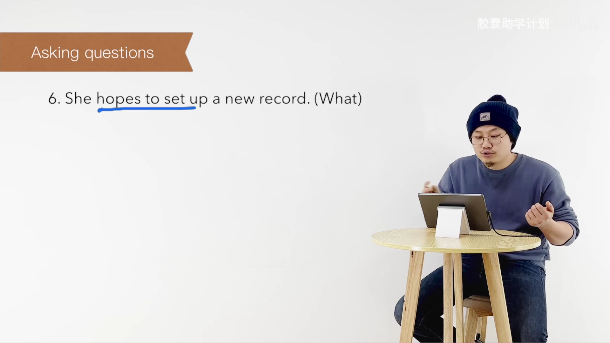

文字识别：Asking questions / 6. She hopes to set up a new record. (What)

## 00:04:00–00:04:30

提前就行了。What kind of对strong提问，所以是What kind of swimmer is she啊？她是一个什么类型的呃这个游泳运动员啊啊？Her father will set out with her. Will提前who对her father提问可以对her提问也可以对吧？您想一下区别啊，是否变一般疑问句？好吧。第九题说He will be in a small boat. Will提前What对a a small boat提问对吧？叫做

### 画面 00:04:08

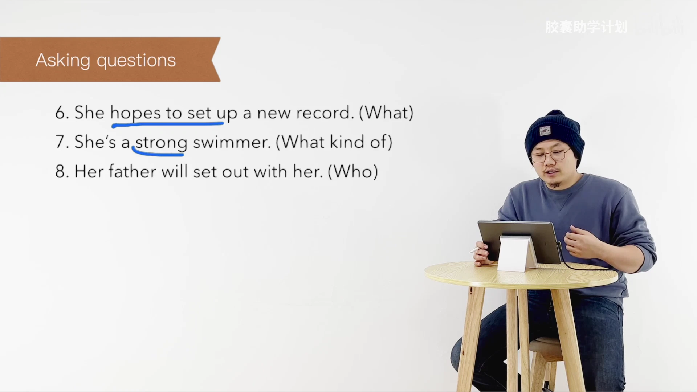

文字识别：Asking questions / 6. She hopes to set up a new record.(What) / 7. She's a strong swimmer. (What kind of) / 8. Her father will set out with her. (Who)

## 00:04:30–00:05:00

What will he be in？啊，他将在什么里面？啊，在一个小船里面，对吧？Who对主语提问？最后一题，注意那个撇s，his的那个撇s是has，对吧？所以has要提前，这是现在完成时嘛？那How long对four years提问？Who对he提问？可以对吧？啊，或者对his daughter提问？啊，他训练了谁？训练了如此多的年份？啊，Tell the story

### 画面 00:04:37

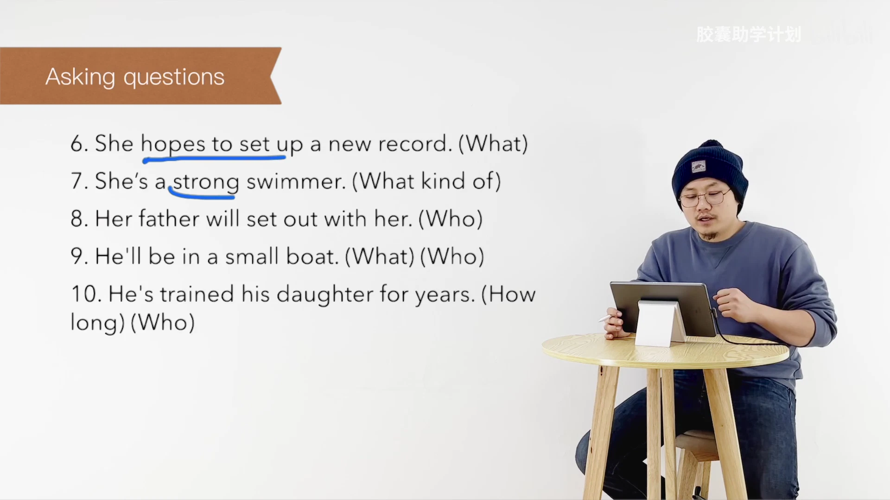

文字识别：Asking questions / 6. She hopes to set up a new record.(What) / 7. She's a strong swimmer. (What kind of) / 8. Her father will set out with her. (Who) / 9. He'll be in a small boat. (What) (Who) / 10. He's trained his daughter for years. (How / long)(Who)

### 画面 00:04:58

文字识别：Tell the story / 训练目标： / 口语复述能力 / Accuracy / Fluency

## 00:05:00–00:05:30

练习的是我们口语复述的能力，可以有一点点错误，但不能太慢，更偏向于是流利，对吧？所以文章读熟非常的重要。那我们在这就不多说了。第一个单元已经给各位做了非常多的示范啊。那然后呢，下一题summary writing摘要写作。各位在文章的下面就有摘要写作，先看着题一道一道题写完，写完了之后来这里对一下答案，有什么不懂的，视频下方留言告诉我，好吧？

### 画面 00:05:05

文字识别：Tell the story / 训练目标： / 口语复述能力 / Accuracy / Fluency

### 画面 00:05:07

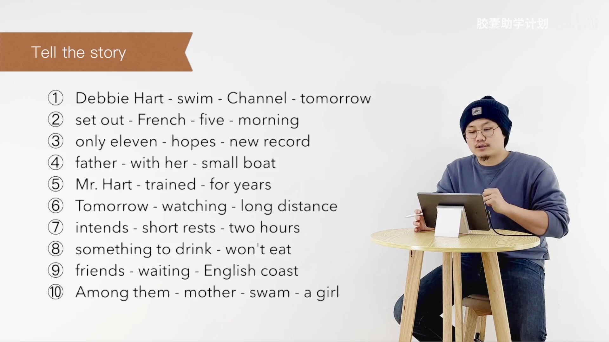

文字识别：Tell the story / ① Debbie Hart - swim - Channel - tomorrow / set out - French - five - morning / only eleven - hopes - new record / 3 / father - with her - small boat / Mr. Hart - trained - for years / Tomorrow - watching - long distance / intends - short rests - two hours / something to drink - won't eat / 8 / friends - waiting - English coast / 9 / ⑩ Among them - mother- swam - a girl

### 画面 00:05:16

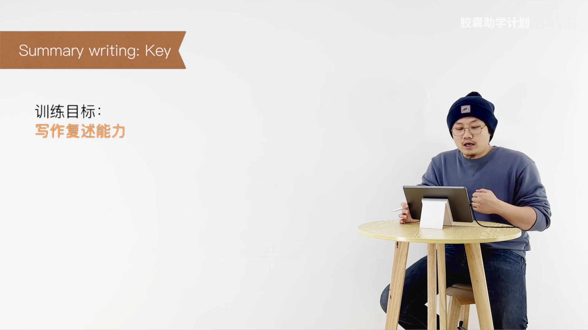

文字识别：Summary writing: Key / 训练目标： / 写作复述能力

### 画面 00:05:24

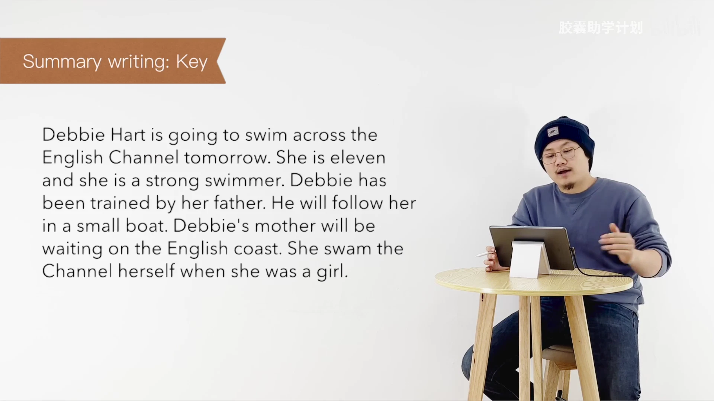

文字识别：Summary writing: Key / Debbie Hart is going to swim across the / English Channel tomorrow. She is eleven / and she is a strong swimmer. Debbie has / been trained by her father. He will follow her / in a small boat. Debbie's mother will be / waiting on the English coast. She swam the / Channel herself when she was a girl.

## 00:05:30–00:06:00

然后呢，最后一道题叫 Topics for Discussion。那这道题其实是最难的，也是我们学习了所有单词、语法、习惯用法，每天跟读文章，做完所有的练习了之后，最主要的一个目的就是能跟别人就一个话题可以自由的对话，对吧？比如像第一题说，Debbie Hard illustrates the saying like father like daughter or like father like son. Tell us about someone you know who else

### 画面 00:05:30

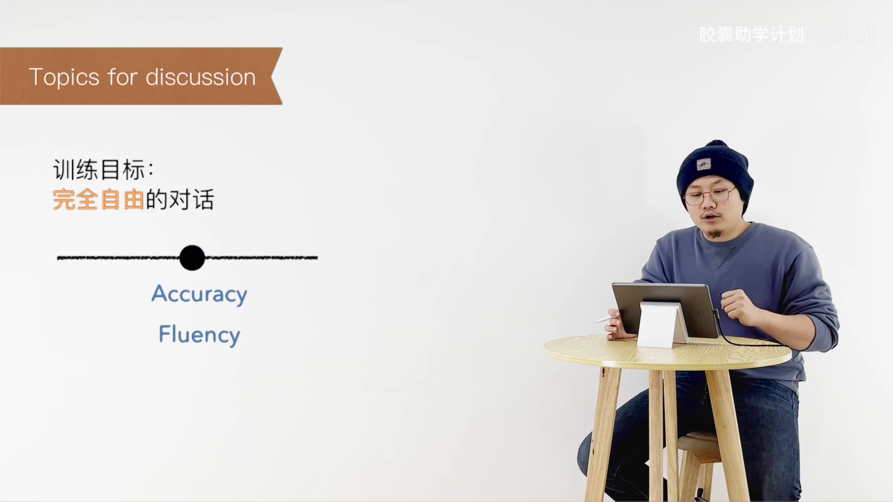

文字识别：Topics for discussion / 训练目标： / 完全自由的对话 / Accuracy / Fluency

### 画面 00:05:47

文字识别：Topics for discussion / Debbie Hart illustrates the saying 'Like / mother, like daughter'(or:'Like father, like / son'). Tell us about someone you know / who also illustrates this saying. / Do you 'train'for any sport? What does / serious training for a sport involve? / Swimming is said to be the healthiest / form of exercise. Do you agree? Why/ / Why not?

## 00:06:00–00:06:30

illustrate this thing,对吧？说，哎，我们文章当中的这个 Debbie Hard 就很好的诠释了什么叫虎父无犬子，对吧？或者虎母无犬女，对吧？大概是这样一个呃说法。然后呢，你能不能给我们讲一讲你知道的这样的一个人啊？比如说，你可以说你自己啊。Next one，第二题说，Do you train for any sport？你你会为任何体育运动训练吗？哎，你认为一个非常严肃认真的训

### 画面 00:06:17

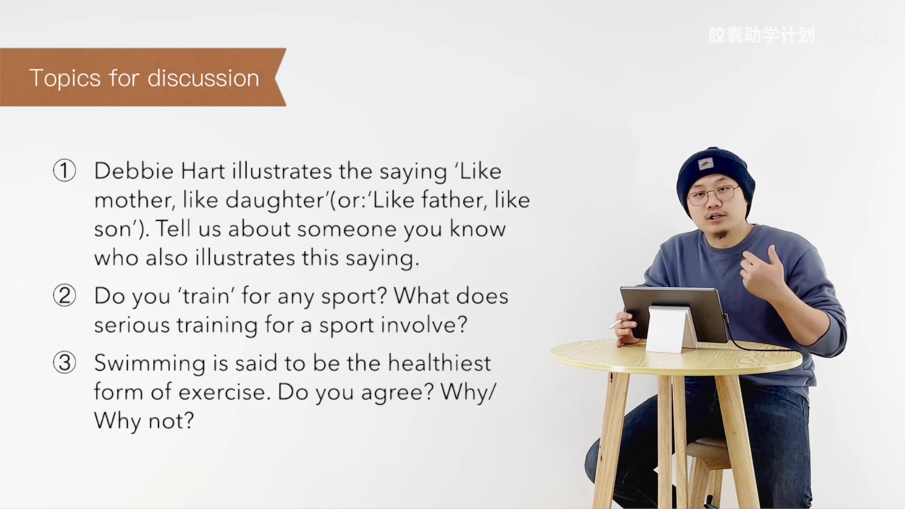

文字识别：Topics for discussion / Debbie Hart illustrates the saying 'Like / mother, like daughter'(or:'Like father, like / son'). Tell us about someone you know / who also illustrates this saying. / Do you 'train'for any sport? What does / serious training for a sport involve? / Swimming is said to be the healthiest / form of exercise. Do you agree? Why/ / Why not?

## 00:06:30–00:07:00

练应该包含什么？叫 What does serious serious training for a sport involve? Okay, 最后一道题叫 Swimming is said to be the health healthiest form of exercise. Do you agree? Well, why not? 说游泳啊被认为是最健康的一种运动形式。你同意吗？哎，同意。为什么同意？不同意？为什么不同意？ Okay, 好，那家庭作业呢？ Ask me if. 各位一定要记住，先

### 画面 00:06:47

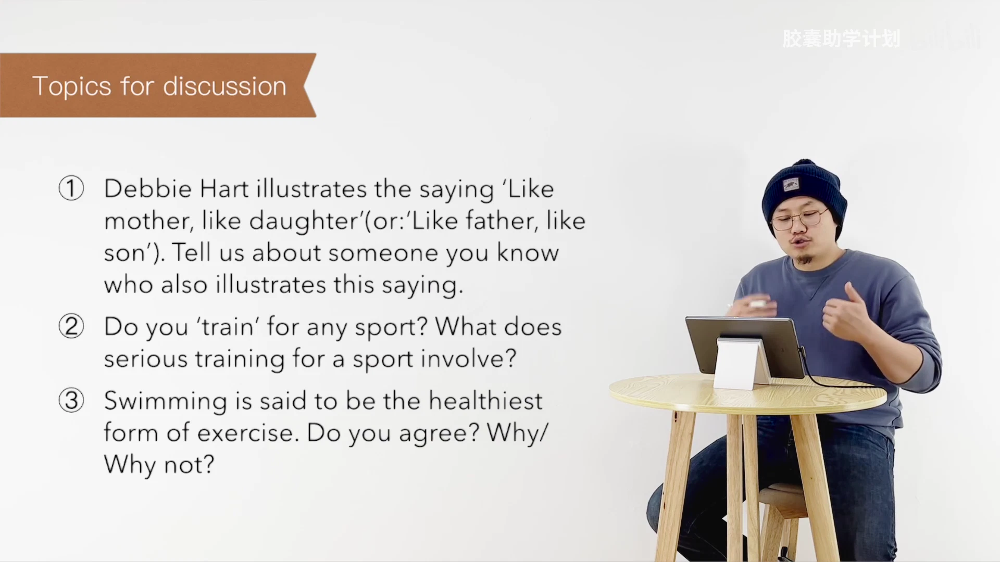

文字识别：Topics for discussion / Debbie Hart illustrates the saying 'Like / mother, like daughter'(or:'Like father, like / son'). Tell us about someone you know / who also illustrates this saying. / Do you 'train' for any sport? What does / serious training for a sport involve? / Swimming is said to be the healthiest / form of exercise. Do you agree? Why/ / Why not?

### 画面 00:06:56

## 00:07:00–00:07:30

写，然后看着，保证答案是对的，然后大声朗读出来。摘要写作，先写，然后对答案。Tell the story，进行口语复述。专栏当中都可以找到。以上就是本期视频的全部内容了。如果各位喜欢我们的课程呢，欢迎各位关注、订阅，一键三连，分享给那些需要的朋友，来帮助我们快速成长。See you next time.

### 画面 00:07:00

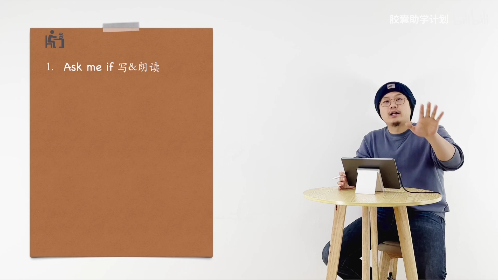

文字识别：1.Ask me if写&朗读

### 画面 00:07:04

文字识别：1.Ask me if写&朗读 / 2. / 摘要写作写&答案

### 画面 00:07:07

文字识别：1.Ask me if写&朗读 / 摘要写作写&答案 / 3.Tell the story 口语复述

### 画面 00:07:09

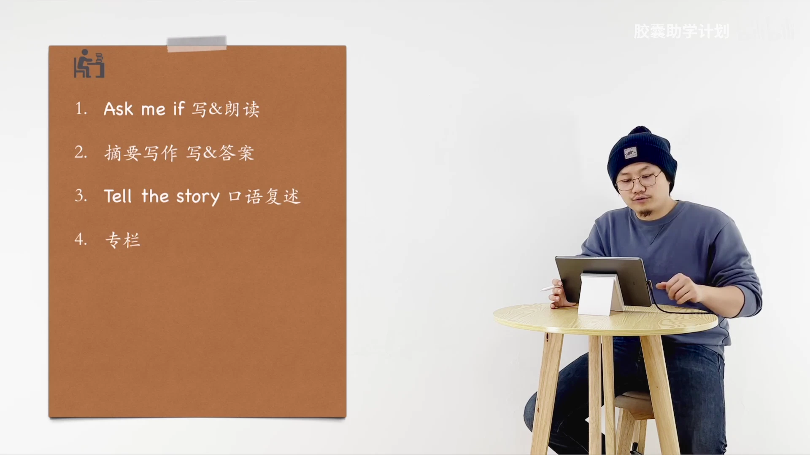

文字识别：1.Askme if写&朗读 / 摘要写作写&答案 / 3.Tell the story 口语复述 / 专栏 / 4.

### 画面 00:07:11

### 画面 00:07:25

### 画面 00:07:27

文字识别：CAPSULEACADEMY / 胶囊助学计划 / 小红书 / Lecturer / Leo / OE

## 00:07:30–00:07:37

### 画面 00:07:30

文字识别：CAPSULEACADEMY / 胶囊助学计划 / 小红书 / Edit. / OE

### 画面 00:07:33

文字识别：CAPSULEACADEMY / 胶囊助学计划 / 小红书 / Creator / Leo & Berlin / OE

### 画面 00:07:35

文字识别：bilibili / 胶囊助学计划 / CAPSULEACA / 胶囊助学计划 / 小红书 / OE

### 画面 00:07:37

文字识别：bilibili / 胶囊助学计划

