# L037 单词

快速机器解析：语音为单模型转写，未进行独立交叉校对或人工复核；画面每秒采样并按变化选帧，短时文字和标记可能遗漏。截图时间约有 1 秒误差。图片有损压缩；遇到疑点请按时间查看 Google Drive 原视频。

## 00:00:00–00:00:30

Hello everyone, welcome to Capsule Academy. This is Leo. Today we're going to learn New Concept English Book Two, Lesson Thirty Seven Words.那老习惯进入正式课程之前呢，我们先看几个小的问题。那首先如何表达举办奥运会，对吧？正好应景啊。再然后呢，如何表达太棒了？口语的一个习惯表达啊。最后如何表达召开某个会议？那带着这三个问题，Hope you gonna enjoy it.

### 画面 00:00:00

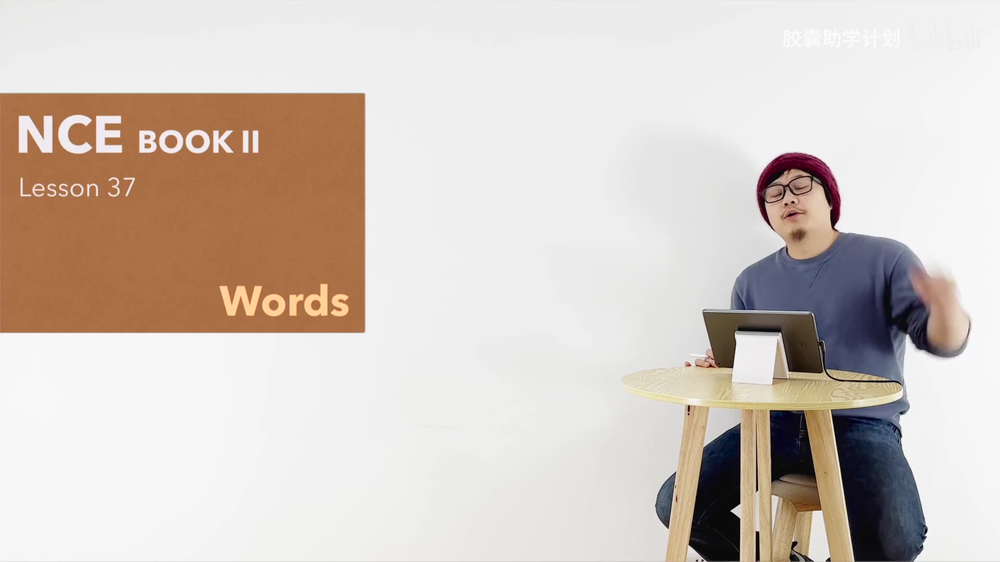

文字识别：NCE / BOOK"I / Lesson 37 / Words

### 画面 00:00:05

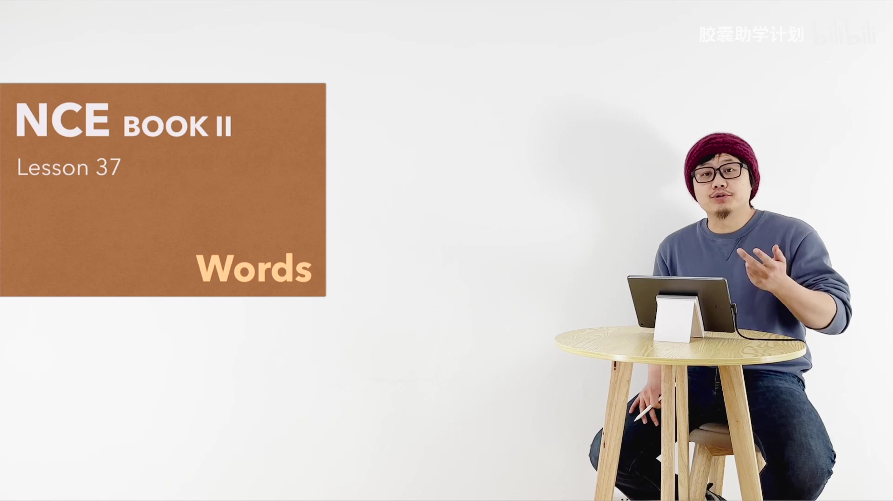

文字识别：NCE / BOOKI"I / Lesson 37 / Words

### 画面 00:00:10

### 画面 00:00:12

文字识别：①如何表达“举办奥运会”？

### 画面 00:00:16

文字识别：①如何表达“举办奥运会”？ / “太棒了”?

### 画面 00:00:18

文字识别：①如何表达“举办奥运会”? / 如何表达“太棒了”?

### 画面 00:00:21

文字识别：①如何表达“举办奥运会” / 如何表达“太棒了”？ / 达“召开会议”?

### 画面 00:00:23

文字识别：①如何表达“举办奥运会” / 如何表达“太棒了”? / 如何表达“召开会议”?

### 画面 00:00:28

文字识别：胶囊助学计划bill

## 00:00:30–00:01:00

好，那我们上来先看这样几个小的单词啊，举办、召开的动词，跟我一起读一下，原型叫做 hold， hold， OK，那它的过去式我们管它叫做 held， held， OK， very good，然后呢，注意它的过去分词也是 held，是吧？ OK，那只不过发音稍有不同啊，发音是跟过去式是一样的，过去分词、过去式长得是一样的啊。

### 画面 00:00:32

### 画面 00:00:34

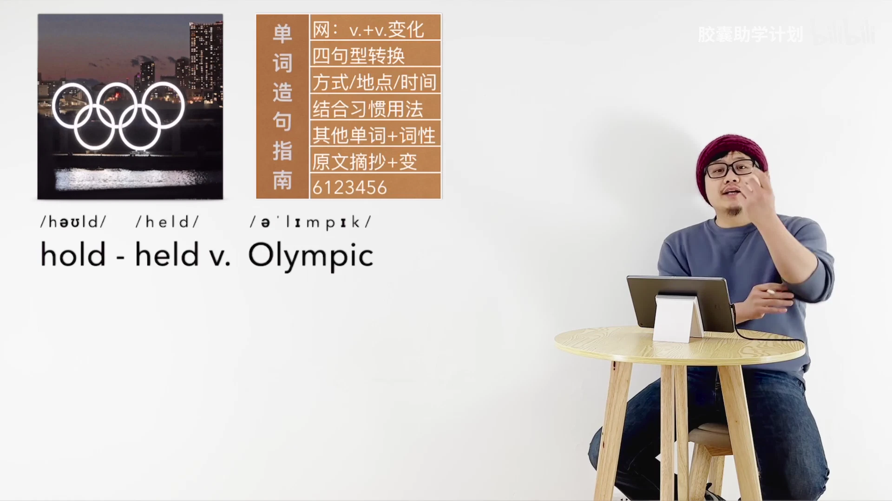

文字识别：单词造句指南 / 网：v.+v.变化 / 四句型转换 / 方式/地点/时间 / 结合习惯用法 / 其他单词+词性 / 原文摘抄+变 / 6123456 / /hauld/ / /held/ / /a'limpk/ / hold - held v. Olympic

### 画面 00:00:36

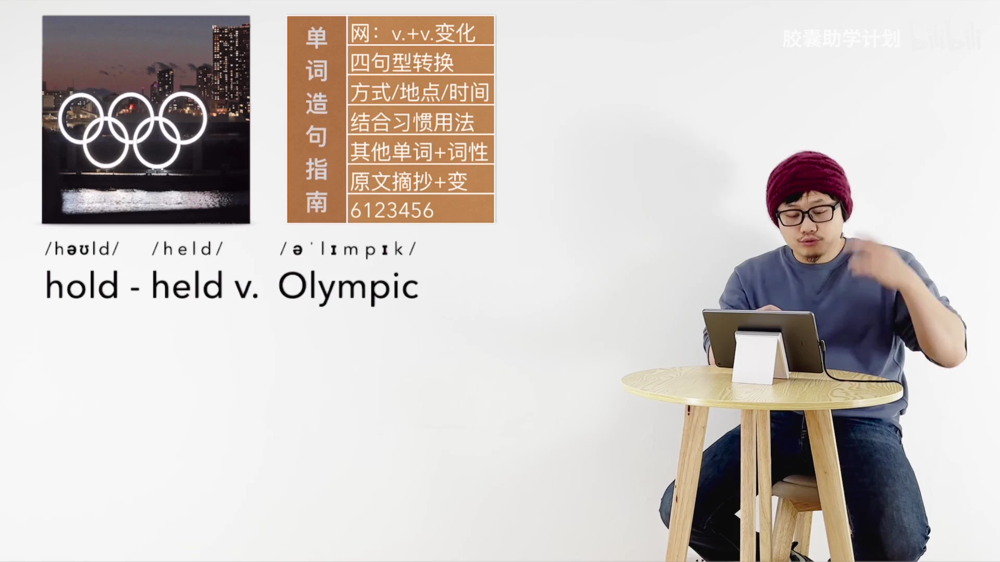

文字识别：单词造句指南 / 网：v.+v.变化 / 四句型转换 / 方式/地点/时间 / 结合习惯用法 / 其他单词+词性 / 原文摘抄+变 / 6123456 / /hauld/ / /held/ / /a'limpik/ / hold - held v. Olympic

### 画面 00:00:40

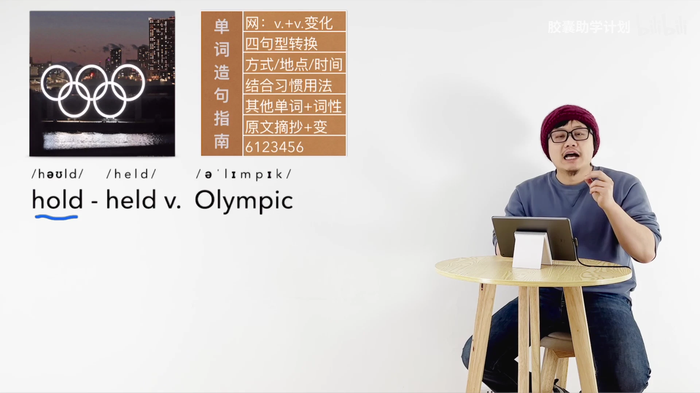

文字识别：单词造句指南 / 网：v.+v.变化 / 四句型转换 / 方式/地点/时间 / 结合习惯用法 / 其他单词+词性 / 原文摘抄+变 / 6123456 / /hauld/ / /held/ / /a'limρk/ / hold - held v. Olympic

### 画面 00:00:45

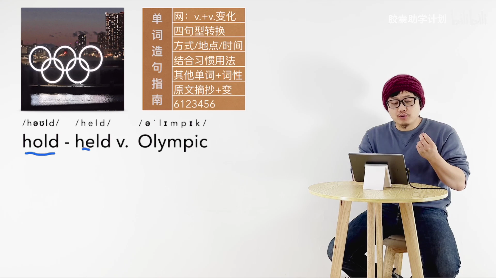

文字识别：单词造句指南 / 网：v.+v.变化 / 四句型转换 / 方式/地点/时间 / 结合习惯用法 / 其他单词+词性 / 原文摘抄+变 / 6123456 / /hauld/ / /held/ / la'limpik/ / hold - held v. Olympic

### 画面 00:00:51

文字识别：单词造句指南 / 网：v.+v.变化 / 四句型转换 / 方式/地点/时间 / 结合习惯用法 / 其他单词+词性 / 原文摘抄+变 / 6123456 / /hauld/ / /held/ / /a'limpik/ / hold - heldv / Olympic

### 画面 00:00:56

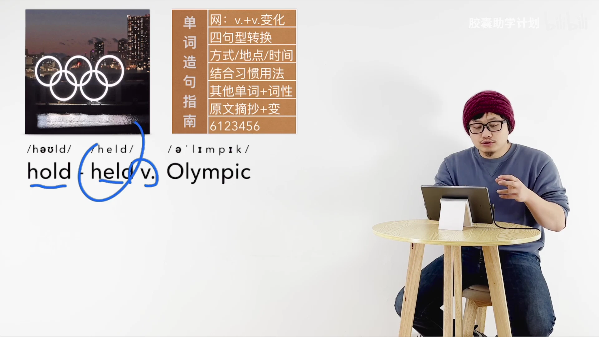

文字识别：单词造句指南 / 网：v.+v.变化 / 四句型转换 / 方式/地点/时间 / 结合习惯用法 / 其他单词+词性 / 原文摘抄+变 / 6123456 / /hauld/ / Theld/ / /a'limpik/ / hold / helg / Olympic

## 00:01:00–00:01:30

OK，呃，书写也一样，OK。然后呢，后面这个单词，我相信大多数同学可能都见过了，叫做 Olympic，对吧？Olympic， very good，叫奥林匹克。那我们拿他们尝试去造一些句子，比如说说 The Olympic Games were held in Beijing, China in 2008，是吧？说奥林匹克运动会在北京，中国北京于二零零八年举办。注意，这是我们曾经的事情，对吧？今年是二零

### 画面 00:01:00

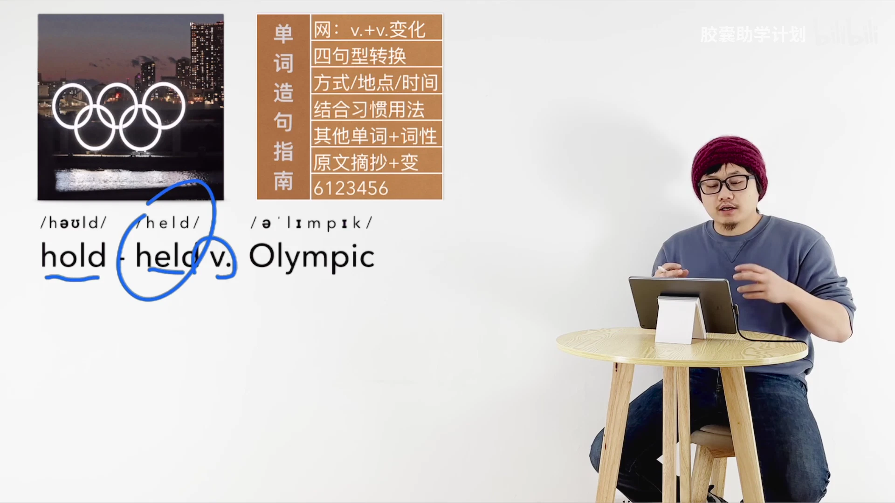

文字识别：单词造句指南 / 网：v.+v.变化 / 四句型转换 / 方式/地点/时间 / 结合习惯用法 / 其他单词+词性 / 原文摘抄+变 / 6123456 / /hauld/ / Theld/ / /a'limpik/ / hold / helgy / Olympic / V

### 画面 00:01:06

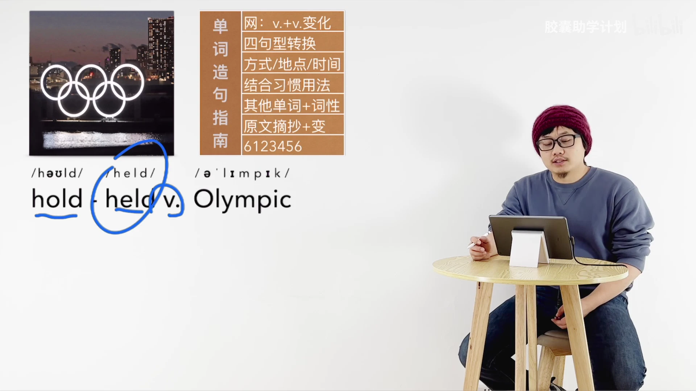

文字识别：单词造句指南 / 网：v.+v.变化 / 四句型转换 / 方式/地点/时间 / 结合习惯用法 / 其他单词+词性 / 原文摘抄+变 / 6123456 / /hauld/ / Theld/ / /a'limpik/ / hold / helg / Olympic

### 画面 00:01:10

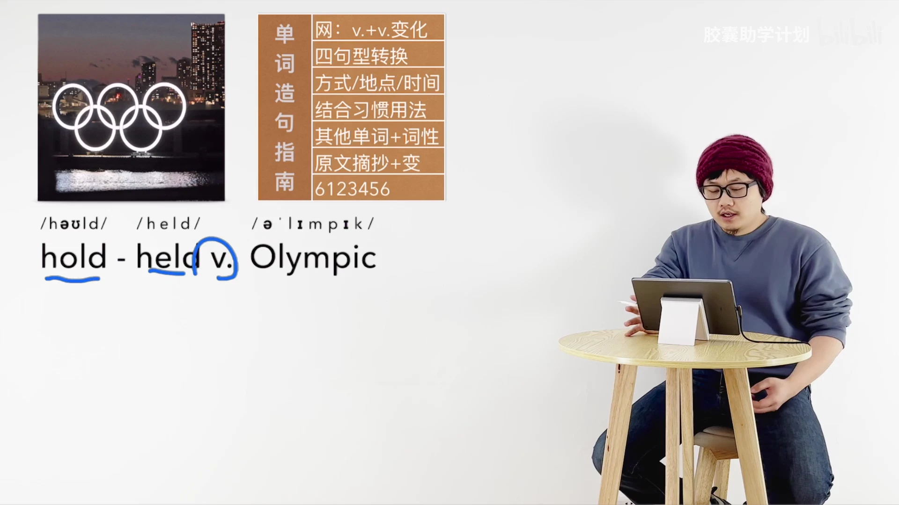

文字识别：单词造句指南 / 网：v.+v.变化 / 四句型转换 / 方式/地点/时间 / 结合习惯用法 / 其他单词+词性 / 原文摘抄+变 / 6123456 / /hauld/ / /held/ / /a'limpik/ / hold - helqV / Olympic

### 画面 00:01:12

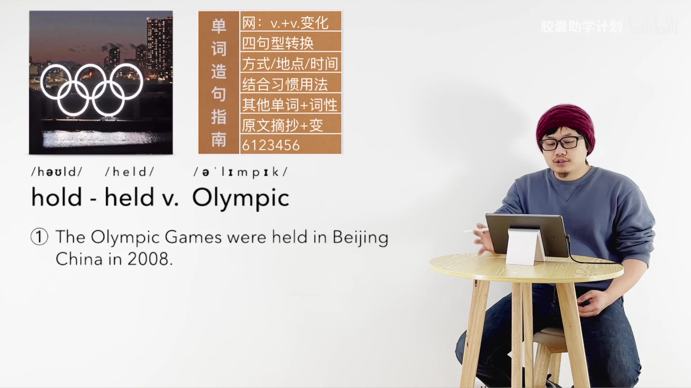

文字识别：单词造句指南 / 网：v.+v.变化 / 四句型转换 / 方式/地点/时间 / 结合习惯用法 / 其他单词+词性 / 原文摘抄+变 / 6123456 / /hauld/ / /held/ / la'limpik/ / hold - held v. Olympic / ① The Olympic Games were held in Beijing / China in 2008.

### 画面 00:01:15

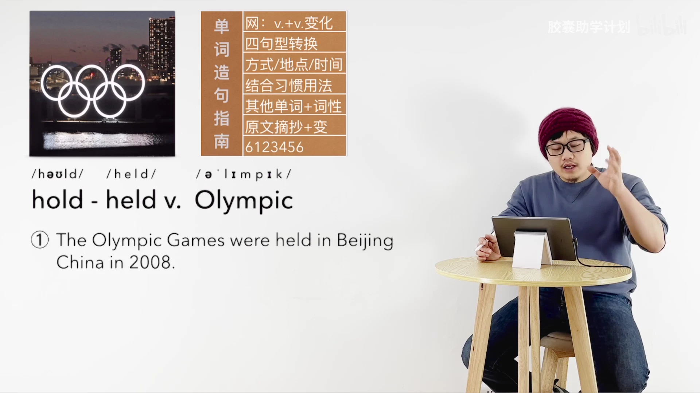

文字识别：单词造句指南 / 网：v.+v.变化 / 四句型转换 / 方式/地点/时间 / 结合习惯用法 / 其他单词+词性 / 原文摘抄+变 / 6123456 / /hauld/ / /held/ / la'limpik/ / hold - held v. Olympic / ① The Olympic Games were held in Beijing / China in 2008.

### 画面 00:01:25

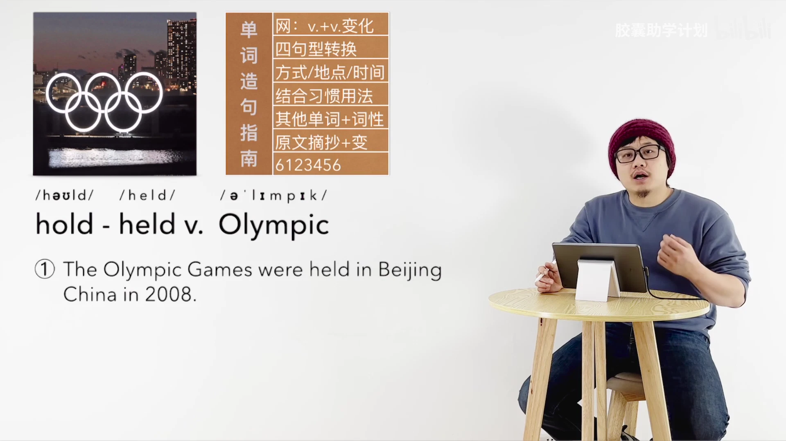

文字识别：单词造句指南 / 网：v.+v.变化 / 四句型转换 / 方式/地点/时间 / 结合习惯用法 / 其他单词+词性 / 原文摘抄+变 / 6123456 / /hauld/ / /held/ / la'limpik/ / hold - held v. Olympic / ① The Olympic Games were held in Beijing / China in 2008.

## 00:01:30–00:02:00

二二年了，所以叫做 were 加 held, OK? Very good.所以它是一个一般过去时的被动啊，叫做被举办、被召开，是吧？Next one,你要想把它变成一般疑问句和各种特殊疑问句，那这个地方我们的句型就被扩展了，造的句子就变多了，对不对？然后呢，那比如说我说，我们其实呃，Olympic Games 分 Summer Olympic Games and Winter Olympic Olympic Games，对吧？那我们说 the next Winter

### 画面 00:01:30

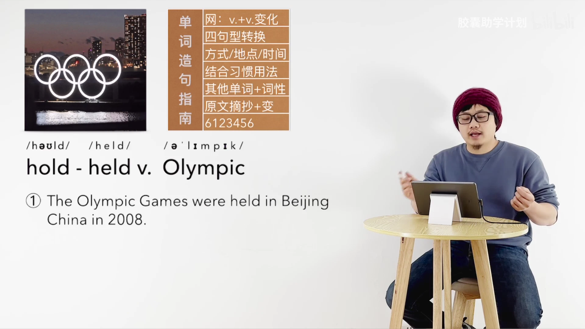

文字识别：单词造句指南 / 网：v.+v.变化 / 四句型转换 / 方式/地点/时间 / 结合习惯用法 / 其他单词+词性 / 原文摘抄+变 / 6123456 / /hauld/ / /held/ / la'limpik/ / hold - held v. Olympic / ① The Olympic Games were held in Beijing / China in 2008.

### 画面 00:01:35

文字识别：单词造句指南 / 网：v.+v.变化 / 四句型转换 / 方式/地点/时间 / 结合习惯用法 / 其他单词+词性 / 原文摘抄+变 / 6123456 / /hauld/ / /held/ / la'limpik/ / hold - held v. Olympic / ① The Olympic Games were held in Beijing / China in 2008.

### 画面 00:01:41

文字识别：单词造句指南 / 网：v.+v.变化 / 四句型转换 / 方式/地点/时间 / 结合习惯用法 / 其他单词+词性 / 原文摘抄+变 / 6123456 / /hauld/ / /held/ / la'limpik/ / hold - held v. Olympic / ① The Olympic Games were held in Beijing / China in 2008. / were/where/when...

### 画面 00:01:45

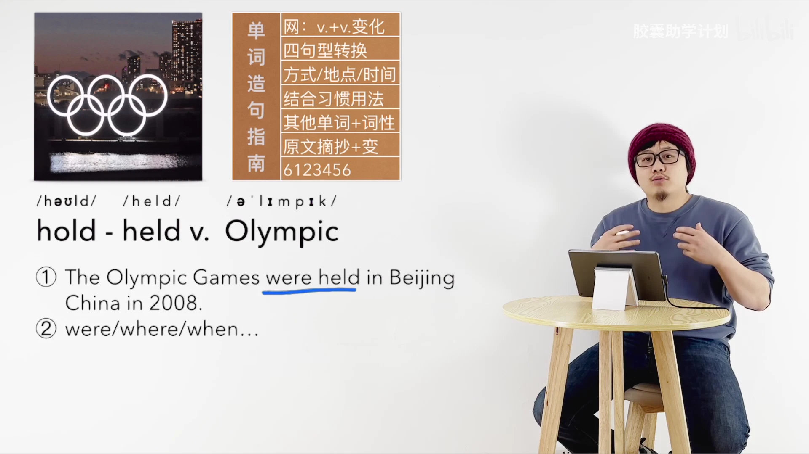

文字识别：单词造句指南 / 网：v.+v.变化 / 四句型转换 / 方式/地点/时间 / 结合习惯用法 / 其他单词+词性 / 原文摘抄+变 / 6123456 / /hauld/ / /held/ / la'limpik/ / hold - held v. Olympic / ① The Olympic Games were held in Beijing / China in 2008. / were/where/when...

### 画面 00:01:52

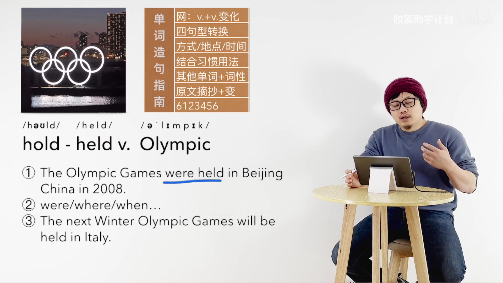

文字识别：单词造句指南 / 网：v.+v.变化 / 四句型转换 / 方式/地点/时间 / 结合习惯用法 / 其他单词+词性 / 原文摘抄+变 / 6123456 / /hauld/ / /held/ / la'limpik/ / hold - held v. Olympic / ① The Olympic Games were held in Beijing / China in 2008. / were/where/when... / The next Winter Olympic Games will be / held in Italy.

### 画面 00:01:56

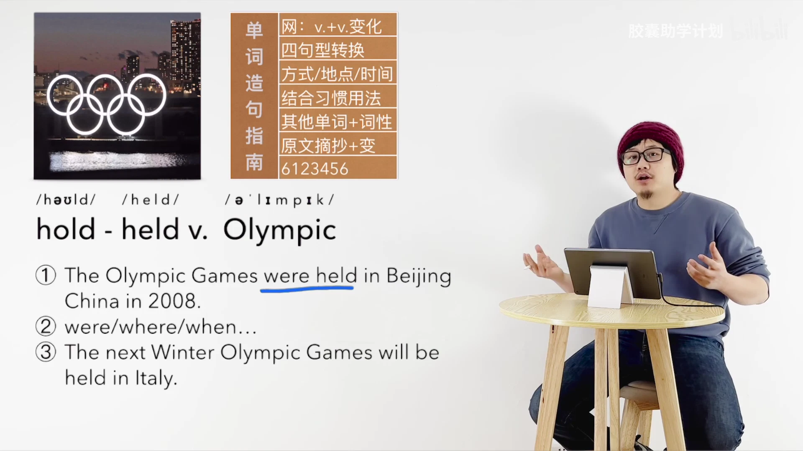

文字识别：单词造句指南 / 网：v.+v.变化 / 四句型转换 / 方式/地点/时间 / 结合习惯用法 / 其他单词+词性 / 原文摘抄+变 / 6123456 / /hauld/ / /held/ / la'limpik/ / hold - held v. Olympic / ① The Olympic Games were held in Beijing / China in 2008. / were/where/when... / The next Winter Olympic Games will be / held in Italy.

## 00:02:00–00:02:30

Olympic Games，下一个冬季奥运会怎么样呢？Will be held in Italy，将在意大利被召开或者举行，对不对？Okay，叫做 will be held in Italy. Okay， very good.那然后注意，其实在这个地方我们重点啊，其实就是换了一下动词，动词的变化。原来是一般过去时的被动，现在我们把它调成了一般将来时的被动。时间上您稍微改变一下，这个是很容易的，对不对？然后我们再

### 画面 00:02:15

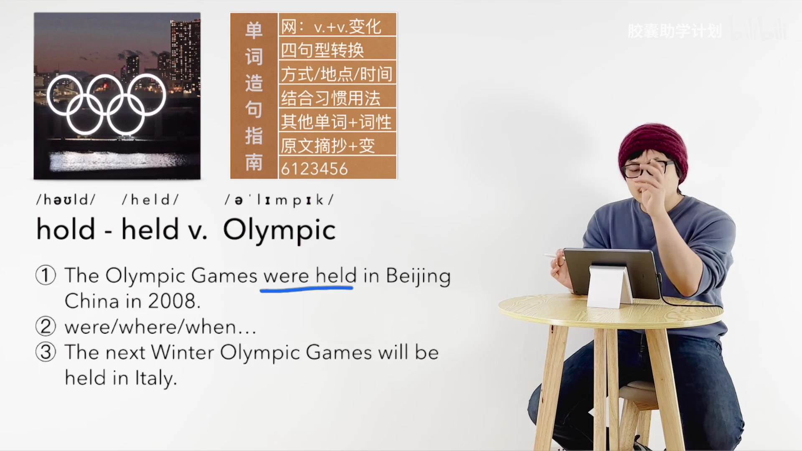

文字识别：单词造句指南 / 网：v.+v.变化 / 四句型转换 / 方式/地点/时间 / 结合习惯用法 / 其他单词+词性 / 原文摘抄+变 / 6123456 / /hauld/ / /held/ / la'limpik/ / hold - held v. Olympic / ① The Olympic Games were held in Beijing / China in 2008. / were/where/when... / The next Winter Olympic Games will be / held in Italy.

### 画面 00:02:17

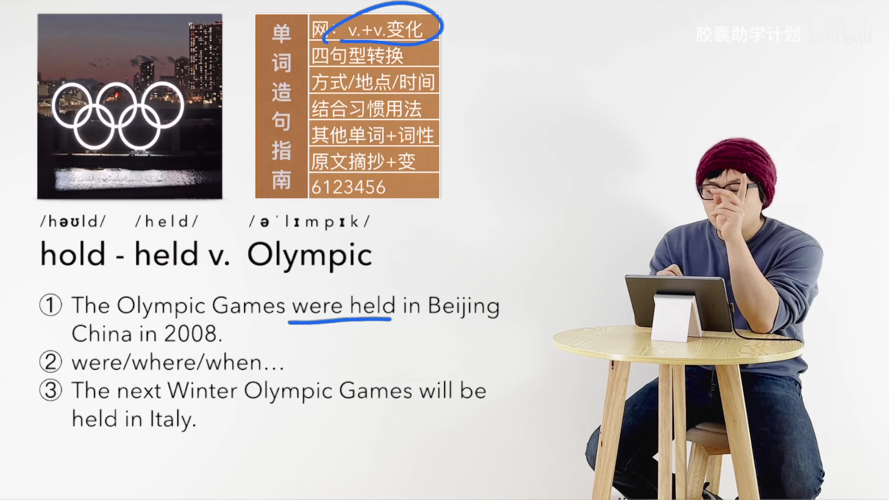

文字识别：单词造句指南 / 网V.+v.变化 / 四句型转换 / 方式/地点/时间 / 结合习惯用法 / 其他单词+词性 / 原文摘抄+变 / 6123456 / /hauld/ / /held/ / la'limpik/ / hold - held v. Olympic / ① The Olympic Games were held in Beijing / China in 2008. / were/where/when... / The next Winter Olympic Games will be / held in Italy.

### 画面 00:02:20

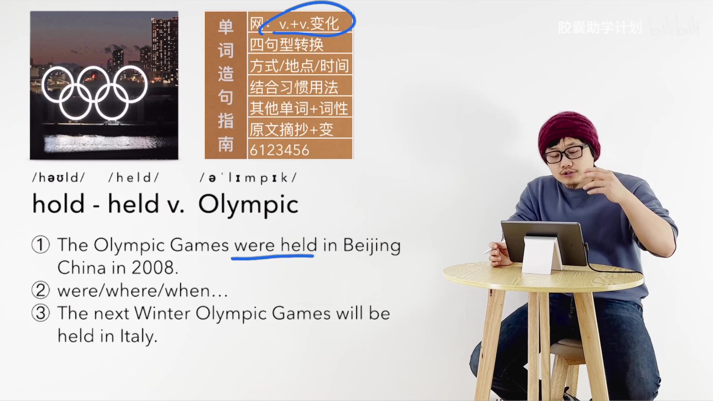

文字识别：单词造句指南 / 网v.+v.变化 / 四句型转换 / 方式/地点/时间 / 结合习惯用法 / 其他单词+词性 / 原文摘抄+变 / 6123456 / /hauld/ / /held/ / la'limpik/ / hold - held v. Olympic / ① The Olympic Games were held in Beijing / China in 2008. / were/where/when... / The next Winter Olympic Games will be / held in Italy.

### 画面 00:02:25

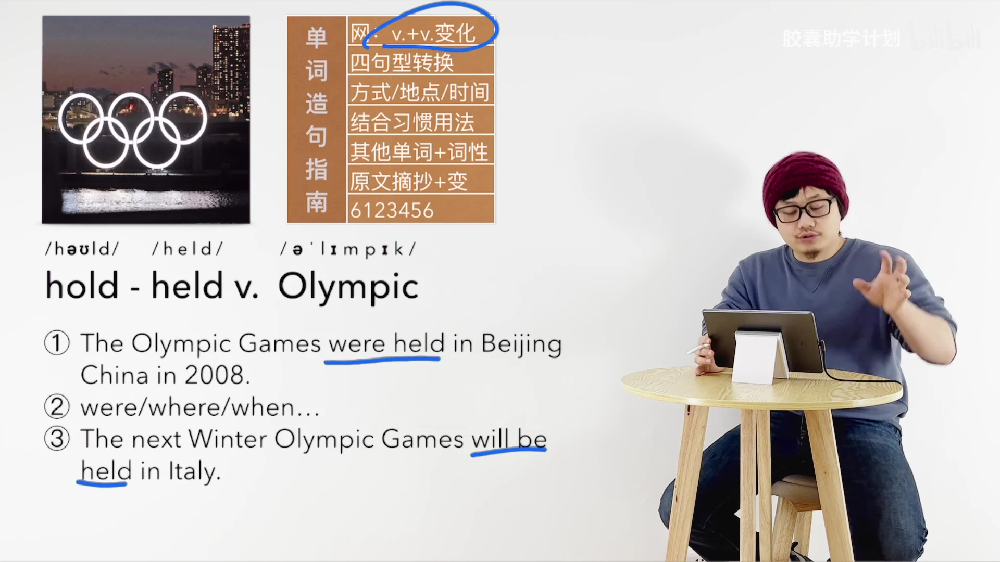

文字识别：单词造句指南 / 网v.+v.变化 / 四句型转换 / 方式/地点/时间 / 结合习惯用法 / 其他单词+词性 / 原文摘抄+变 / 6123456 / /hauld/ / /held/ / la'limpik/ / hold - held v. Olympic / ① The Olympic Games were held in Beijing / China in 2008. / were/where/when... / The next Winter Olympic Games will be / held in Italy.

### 画面 00:02:28

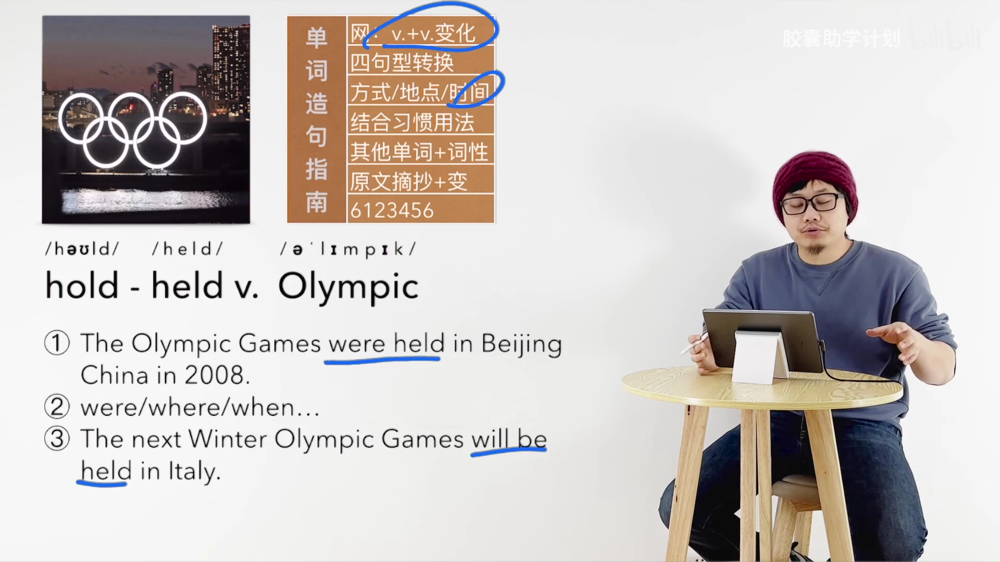

文字识别：单词造句指南 / 网v.+v.变化 / 四句型转换 / 方式/地点/明间 / 结合习惯用法 / 其他单词+词性 / 原文摘抄+变 / 6123456 / /hauld/ / /held/ / la'limpik/ / hold - held v. Olympic / ① The Olympic Games were held in Beijing / China in 2008. / were/where/when... / The next Winter Olympic Games will be / held in Italy.

## 00:02:30–00:03:00

来四句型的转换。那这个其实就是我们常说的，我们造句子最容易的一个方式之一，就是您做一些动词动词变化啊，多造几个肯定句出来，对吧？你比如说这事儿过去发生的，正在发生，经常发生，这就是三个不同的肯定句了。然后您再把它做一些四句型的转换，肯定句、否定句、一般疑问句和特殊疑问句，这一下我们能造出很多的句子来。OK，好，Next one，接下来

### 画面 00:02:31

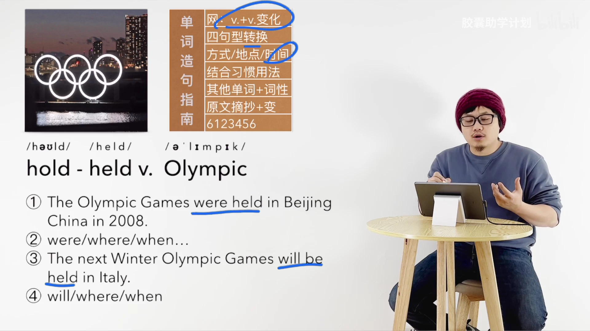

文字识别：单词造句指南 / 网v.+v.变化 / 四句型转换 / 方式/地点/间 / 结合习惯用法 / 其他单词+词性 / 原文摘抄+变 / 6123456 / /hauld/ / /held/ / la'limpik/ / hold - held v. Olympic / ① The Olympic Games were held in Beijing / China in 2008. / were/where/when... / The next Winter Olympic Games will be / held in Iltaly. / will/where/when

### 画面 00:02:35

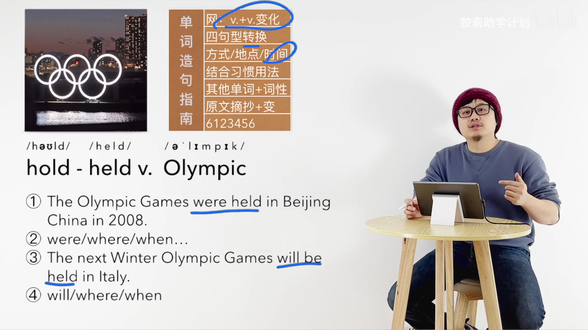

文字识别：单词造句指南 / 网v.+v.变化 / 四句型转换 / 方式/地点/明间 / 结合习惯用法 / 其他单词+词性 / 原文摘抄+变 / 6123456 / /hauld/ / /held/ / la'limpik/ / hold - held v. Olympic / ① The Olympic Games were held in Beijing / China in 2008. / were/where/when... / The next Winter Olympic Games will be / held in Italy. / will/where/when

### 画面 00:02:41

文字识别：单词造句指南 / 网v.+v.变化 / 四句型转换 / 方式/地点/间 / 结合习惯用法 / 其他单词+词性 / 原文摘抄+变 / 6123456 / /hauld/ / /held/ / la'limpik/ / hold - held v. Olympic / ① The Olympic Games were held in Beijing / China in 2008. / were/where/when... / The next Winter Olympic Games will be / held in Italy. / will/where/when

### 画面 00:02:45

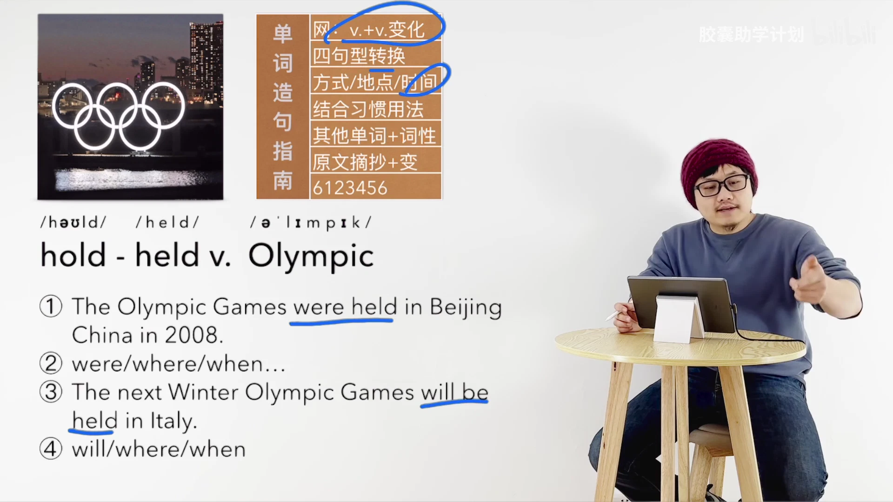

文字识别：单词造句指南 / 网v.+v.变化 / 四句型转换 / 方式/地点/明间 / 结合习惯用法 / 其他单词+词性 / 原文摘抄+变 / 6123456 / /hauld/ / /held/ / la'limpik/ / hold - held v. Olympic / ① The Olympic Games were held in Beijing / China in 2008. / were/where/when... / The next Winter Olympic Games will be / held in Italy. / will/where/when

### 画面 00:02:50

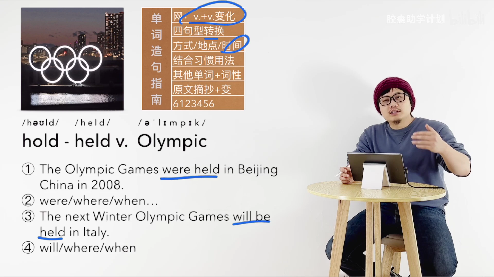

文字识别：单词造句指南 / 网v.+v.变化 / 四句型转换 / 方式/地点/明间 / 结合习惯用法 / 其他单词+词性 / 原文摘抄+变 / 6123456 / /hauld/ / /held/ / la'limpik/ / hold - held v. Olympic / ① The Olympic Games were held in Beijing / China in 2008. / were/where/when... / The next Winter Olympic Games will be / held in Italy. / will/where/when

### 画面 00:02:58

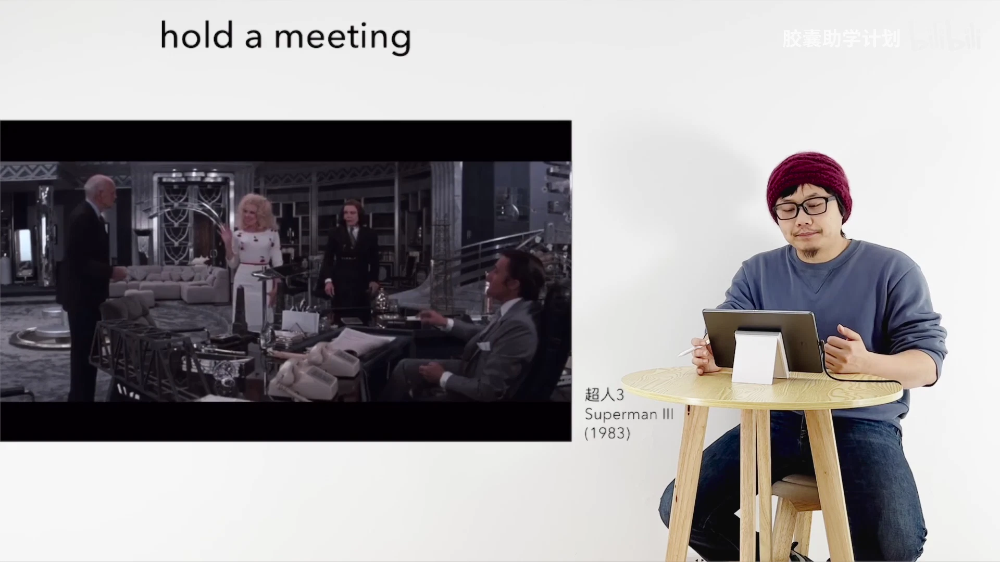

文字识别：hold a meeting / 超人3 / Superman II / (1983)

## 00:03:00–00:03:30

呢，我们补一个 hold 这个单词，另一个非常常用的意思就是召开什么什么会议，对吧？比如说它经常在这样一个短语当中去用，叫做 hold a meeting. Okay,那接下来呢，我们看一个小的电影片段，这个电影片段当中就出现了 hold a meeting 这个短语. Okay,注意力集中啊. Hello, if you don't mind, we are trying to hold a meeting here. Why don't you hold your breath instead? Maybe you'll turn

### 画面 00:03:09

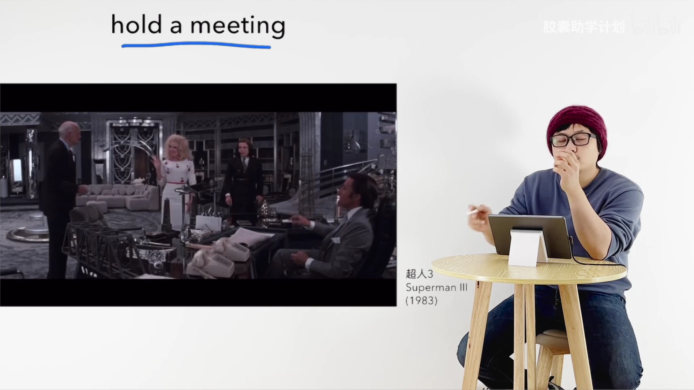

文字识别：hold a meeting / 超人3 / Superman II / (1983)

### 画面 00:03:23

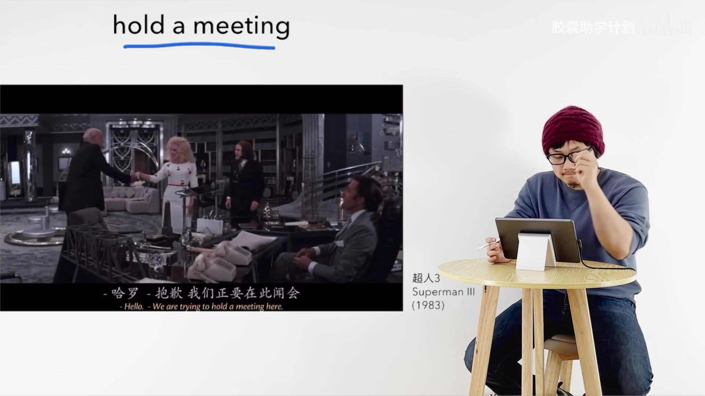

文字识别：hold a meeting / 超人3 / 哈罗-抱歉我们正要在此闻会 / Superman II / - Hello. - We are trying to hold a meeting here. / (1983)

### 画面 00:03:25

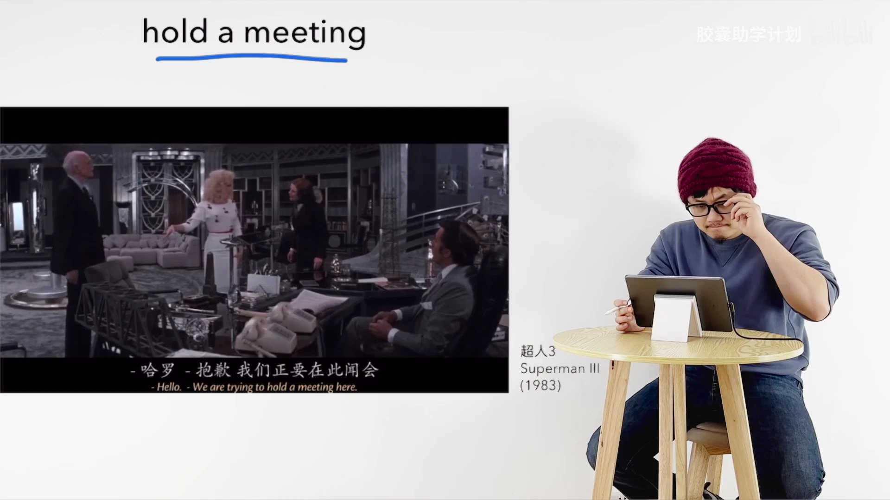

文字识别：hold a meeting / 超人3 / 哈罗-抱歉我们正要在此闻会 / Superman II / - Hello. - We are trying to hold a meeting here. / (1983)

### 画面 00:03:27

文字识别：hold a meeting / 超人3 / 你为何不省省力别讲话这样很容易血压上升 / Superman Il / Why don't you hold your breath instead. Maybe you'l turn blue. / (1983)

### 画面 00:03:29

文字识别：hold a meeting / 超人3 / 你为何不省省力别讲话这样很容易血压上升 / Superman Il / Why don't you hold your breath instead. Maybe you'l turn blue. / (1983)

## 00:03:30–00:04:00

blue. Improvement. Pay attention, people. I am about to take a human life. Simpson, would you excuse us for a second, please? Okay, hold a meeting.啊招召开一个会议。Very good. Next one,下一个小的单词，跟我一起读一下，叫做government。连起来do government government. Okay,各位注意一个小点，比如说我们上网的时候，有最后有的，比如说有.com，对吧？.dot com. dot cn还有dot gov，

### 画面 00:03:31

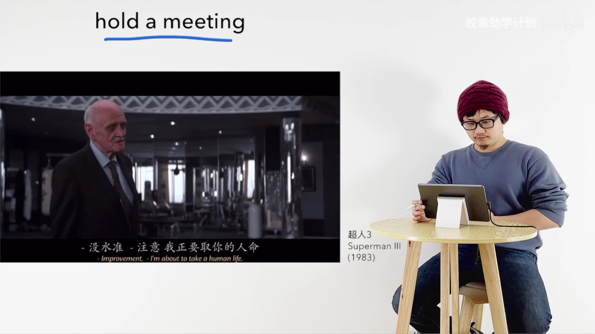

文字识别：hold a meeting / 超人3 / -没水准-注意我正要取你的人命 / Superman Il / -Improvement. -I'm about to take a human life. / (1983)

### 画面 00:03:33

文字识别：hold a meeting / 超人3 / -没水准-注意 我正要取你的人命 / Superman Il / -Improvement. -I'm about to take a human life. / (1983)

### 画面 00:03:35

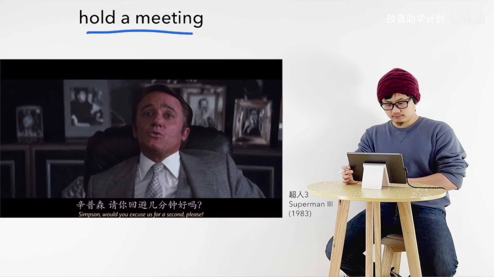

文字识别：hold a meeting / 超人3 / 辛普森请你回避几分钟好吗？ / Superman Il / Simpson, would you excuse us for a second, please? / (1983)

### 画面 00:03:37

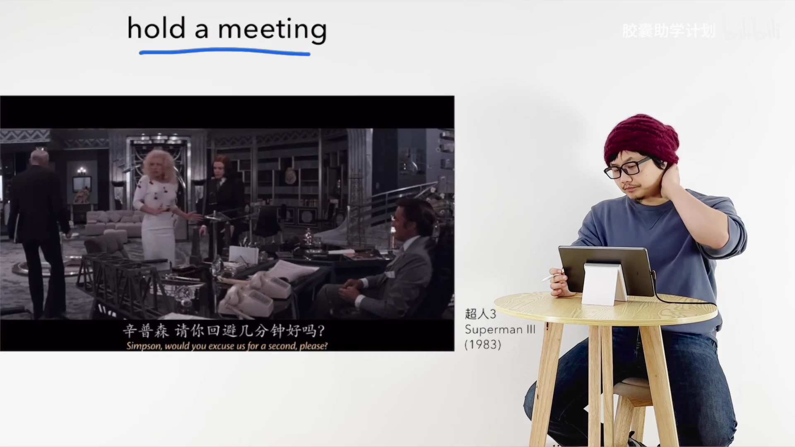

文字识别：hold a meeting / 超人3 / 辛普森请你回避几分钟好吗？ / Superman II / Simpson, would you excuse us for a second, please? / (1983)

### 画面 00:03:39

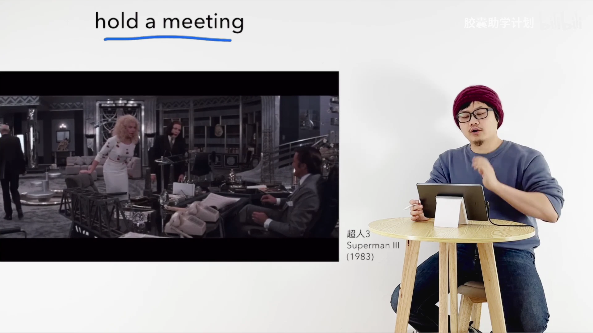

文字识别：hold a meeting / 超人3 / Superman III / (1983)

### 画面 00:03:43

文字识别：单词造句指南 / 网：v.+v.变化 / 四句型转换 / 方式/地点/时间 / 结合习惯用法 / 其他单词+词性 / 原文摘抄+变 / 6123456 / /'gavanman t / / government

### 画面 00:03:45

文字识别：单词造句指南 / 网：v.+v.变化 / 四句型转换 / 方式/地点/时间 / 结合习惯用法 / 其他单词+词性 / 原文摘抄+变 / 6123456 / /'gavanman t / / government

### 画面 00:03:50

文字识别：单词造句指南 / 网：v.+v.变化 / 四句型转换 / 方式/地点/时间 / 结合习惯用法 / 其他单词+词性 / 原文摘抄+变 / 6123456 / /'gavanmant/ / government

### 画面 00:03:55

文字识别：单词造句指南 / 网：v.+v.变化 / 四句型转换 / 方式/地点/时间 / 结合习惯用法 / 其他单词+词性 / 原文摘抄+变 / 6123456 / /'gavanmant/ / government

### 画面 00:03:58

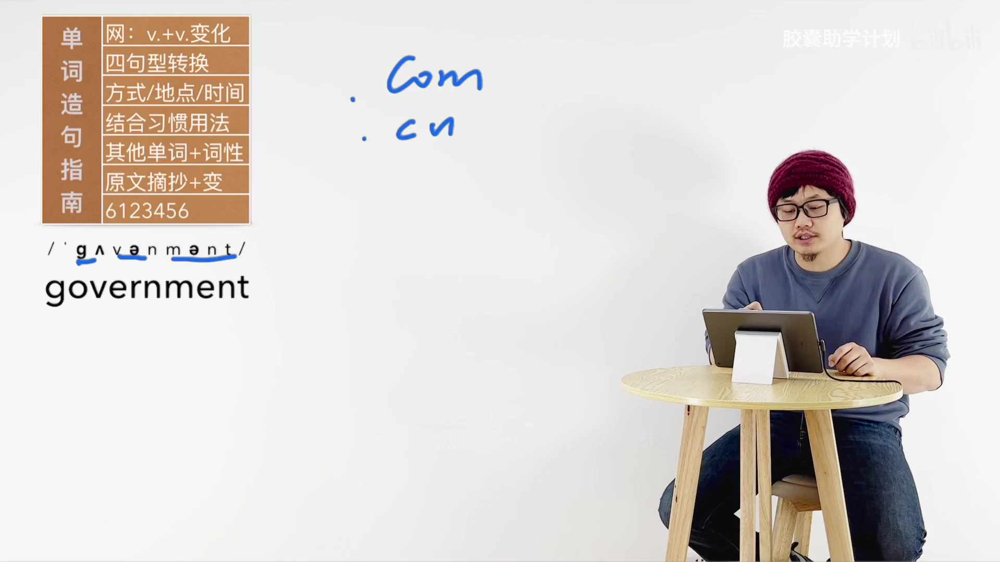

文字识别：单词造句指南 / 网：v.+v.变化 / 四句型转换 / Com / 方式/地点/时间 / 结合习惯用法 / C√ / 其他单词+词性 / 原文摘抄+变 / 6123456 / /'gavanmant/ / government

## 00:04:00–00:04:30

是吧？gov就是政府的网站的一个缩写，就是gov。那你看gov是不是这个缩写就是由government这个单词过来的呢？对吧？Okay，那所以government这个单词本身的意思就是政府的意思。你可以理解为在这儿它是一个名词，对吧？啊，它是一个抽象名词啊，并不特指哪个。比如说，说he used to work for the government，非常简单，三十一课used to do something，再来一个work for啊，应该是我们第四课那课学过的。

### 画面 00:04:00

文字识别：单词造句指南 / 网：v.+v.变化 / 四句型转换 / Com / 方式/地点/时间 / 结合习惯用法 / 其他单词+词性 / goV / 原文摘抄+变 / 6123456 / /'gavanmant/ / government

### 画面 00:04:05

文字识别：单词造句指南 / 网：v.+v.变化 / 四句型转换 / Com / 方式/地点/时间 / 结合习惯用法 / Cn / 其他单词+词性 / Jov. / 原文摘抄+变 / 6123456 / /'gavanmant/ / government

### 画面 00:04:08

文字识别：单词造句指南 / 网：v.+v.变化 / 四句型转换 / Com / 方式/地点/时间 / 结合习惯用法 / C✔ / 其他单词+词性 / Jov. / 原文摘抄+变 / 6123456 / /'gavanmant/ / government

### 画面 00:04:10

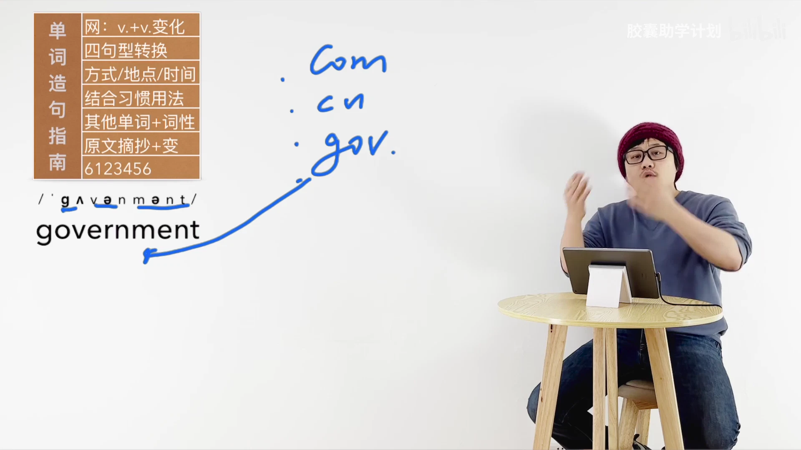

文字识别：单词造句指南 / 网：v.+v.变化 / 四句型转换 / Com / 方式/地点/时间 / 结合习惯用法 / Cn / 其他单词+词性 / Jov. / 原文摘抄+变 / 6123456 / /'gavanmant/ / government

### 画面 00:04:12

文字识别：单词造句指南 / 网：v.+v.变化 / 四句型转换 / Com / 方式/地点/时间 / 结合习惯用法 / C✔ / 其他单词+词性 / gov. / 原文摘抄+变 / 6123456 / /gavanmant/ / government

### 画面 00:04:15

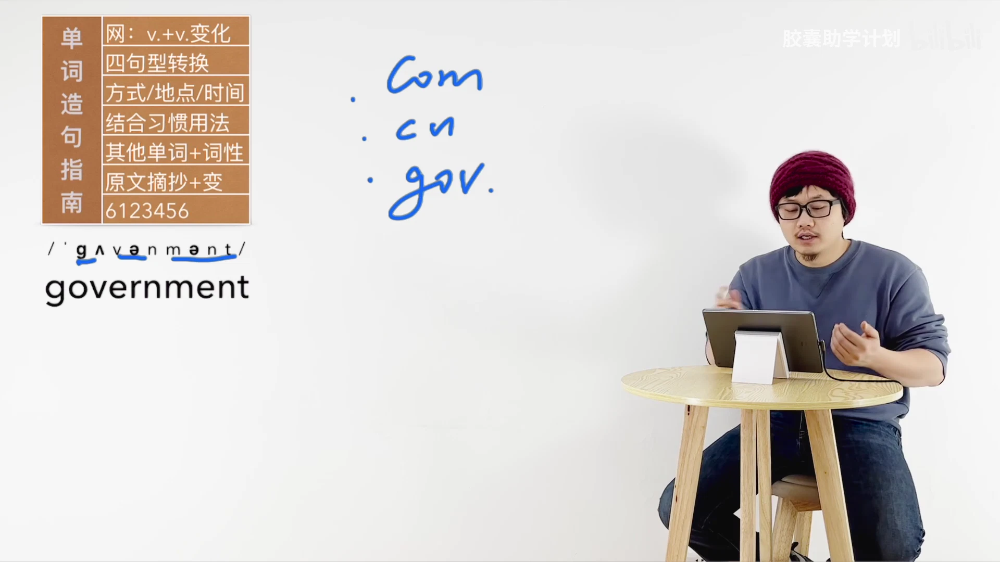

文字识别：单词造句指南 / 网：v.+v.变化 / 四句型转换 / Com / 方式/地点/时间 / 结合习惯用法 / C✔ / 其他单词+词性 / Jov. / 原文摘抄+变 / 6123456 / /'gavanmant/ / government

### 画面 00:04:20

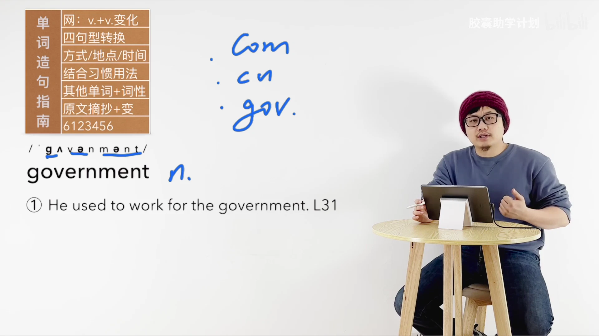

文字识别：单词造句指南 / 网：v.+v.变化 / 四句型转换 / Com / 方式/地点/时间 / 结合习惯用法 / 其他单词+词性 / Jov. / 原文摘抄+变 / 6123456 / / 'gavanmant/ / government / ① He used to work for the government. L31

### 画面 00:04:25

文字识别：单词造句指南 / 网：v.+v.变化 / 四句型转换 / Com / 方式/地点/时间 / 结合习惯用法 / 其他单词+词性 / Jov. / 原文摘抄+变 / 6123456 / / gavanmant/ / government / ① He used to work for the government. L31

## 00:04:30–00:05:00

哎，为谁谁而工作？说他曾经啊是给政府打工的，对吧？给为政府去工作的。后来比如说跳槽了啊。Next one说，He realized that they were working for the government。说他注意，他意识到说这帮人实际上是给政府工作的人啊。OK，那这是我们第二课，realize that后面加一个哎这个宾语从句啊。OK，Next one说，The man who works for the government flew

### 画面 00:04:30

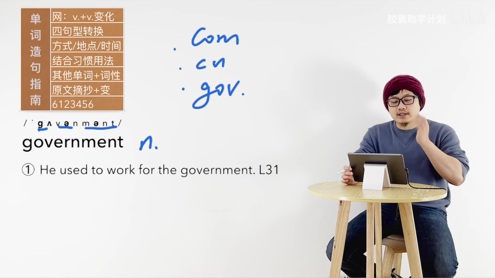

文字识别：单词造句指南 / 网：v.+v.变化 / 四句型转换 / Com / 方式/地点/时间 / 结合习惯用法 / 其他单词+词性 / Jov. / 原文摘抄+变 / 6123456 / /'gavanmant/ / government / ① He used to work for the government. L31

### 画面 00:04:40

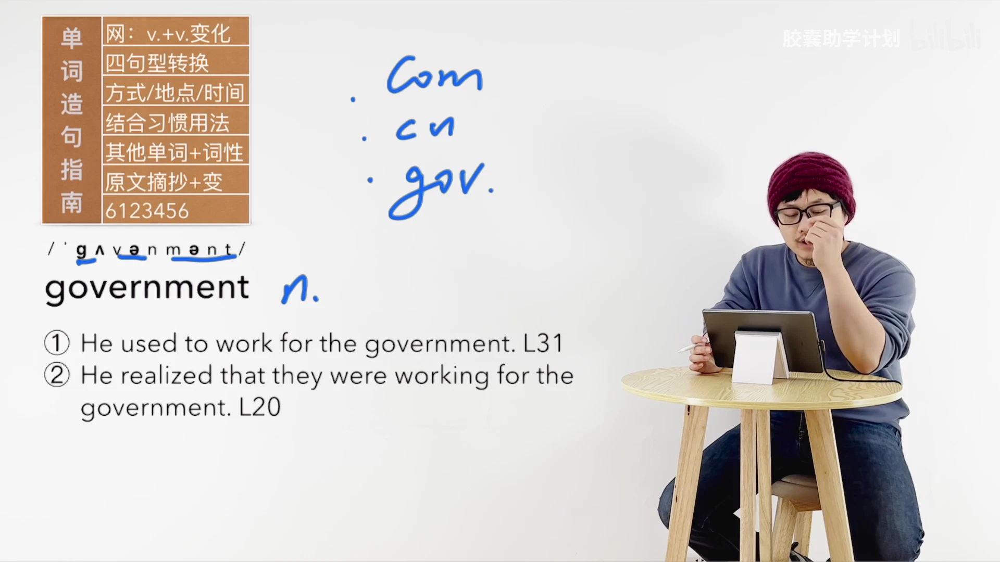

文字识别：单词造句指南 / 网：v.+v.变化 / 四句型转换 / Com / 方式/地点/时间 / 结合习惯用法 / C✔ / 其他单词+词性 / gov. / 原文摘抄+变 / 6123456 / / 'g^vanmant/ / government / ① He used to work for the government. L31 / He realized that they were working for the / government. L20

### 画面 00:04:46

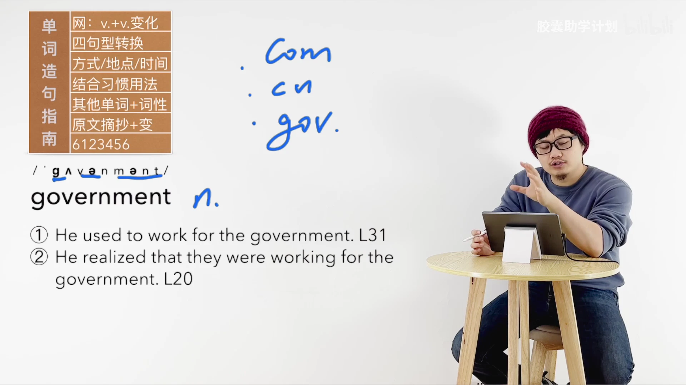

文字识别：单词造句指南 / 网：v.+v.变化 / 四句型转换 / Com / 方式/地点/时间 / 结合习惯用法 / 其他单词+词性 / gov. / 原文摘抄+变 / 6123456 / /'gavanmant/ / government / ① He used to work for the government. L31 /  He realized that they were working for the / government. L20

### 画面 00:04:50

文字识别：单词造句指南 / 网：v.+v.变化 / 四句型转换 / Com / 方式/地点/时间 / 结合习惯用法 / C✔ / 其他单词+词性 / gov. / 原文摘抄+变 / 6123456 / / 'gavanmant/ / government / ① He used to work for the government. L31 /  He realized that they were working for the / government. L20

### 画面 00:04:55

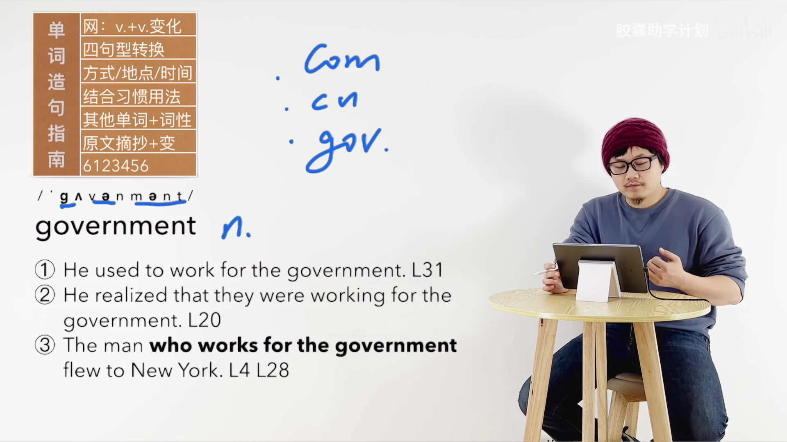

文字识别：单词造句指南 / 网：v.+v.变化 / 四句型转换 / Com / 方式/地点/时间 / 结合习惯用法 / C✔ / 其他单词+词性 / JoV. / 原文摘抄+变 / 6123456 / / g^vanmant/ / government / ① He used to work for the government. L31 /  He realized that they were working for the / 2 / government. L20 / The man who works for the government / flew to New York. L4 L28

## 00:05:00–00:05:30

New York. 好，这句话其实我们用了一个习惯用法，叫 fly to somewhere，叫飞去某地，对吧？然后呢，我们又多来了一个叫做定语从句啊，叫做 who works for the government，啊，叫他们为政府去工作，好吧？ Very good. Next one，接下来两个小的单词并不难，跟我一起读一下。首先，第一个小单词叫 immense，immense，叫做巨大的。OK，啊，后面那个

### 画面 00:05:00

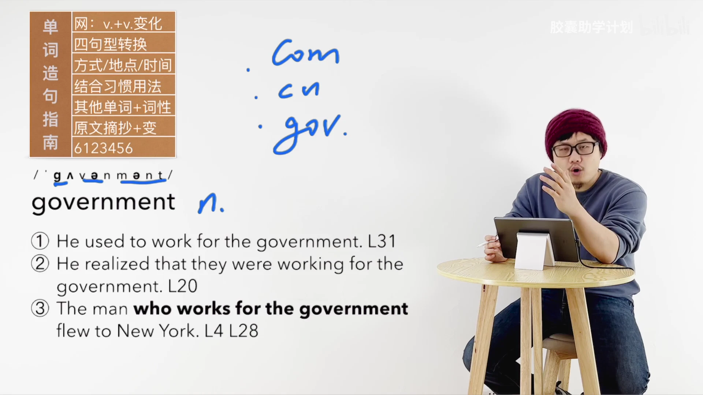

文字识别：单词造句指南 / 网：v.+v.变化 / 四句型转换 / Com / 方式/地点/时间 / 结合习惯用法 / C✔ / 其他单词+词性 / goV. / 原文摘抄+变 / 6123456 / /'g^vanmant/ / government / ① He used to work for the government. L31 /  He realized that they were working for the / 2 / government. L20 / The man who works for the government / flew to New York. L4 L28

### 画面 00:05:15

文字识别：单词造句指南 / 网：v.+v.变化 / 四句型转换 / Com / 方式/地点/时间 / 结合习惯用法 / C✔ / 其他单词+词性 / gov. / 原文摘抄+变 / 6123456 / / 'g^vanmant/ / government / ① He used to work for the government. L31 /  He realized that they were working for the / 2 / government. L20 / The man who works for the government / flew to New York. L4 L28

### 画面 00:05:17

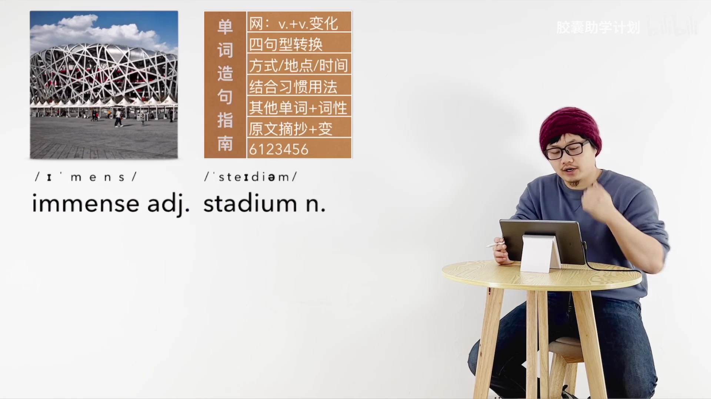

文字识别：单词造句指南 / 网：v.+v.变化 / 四句型转换 / 方式/地点/时间 / 结合习惯用法 / 其他单词+词性 / 原文摘抄+变 / 6123456 / /I'mens/ / /'steidiam/ / immense adj. stadium n.

### 画面 00:05:19

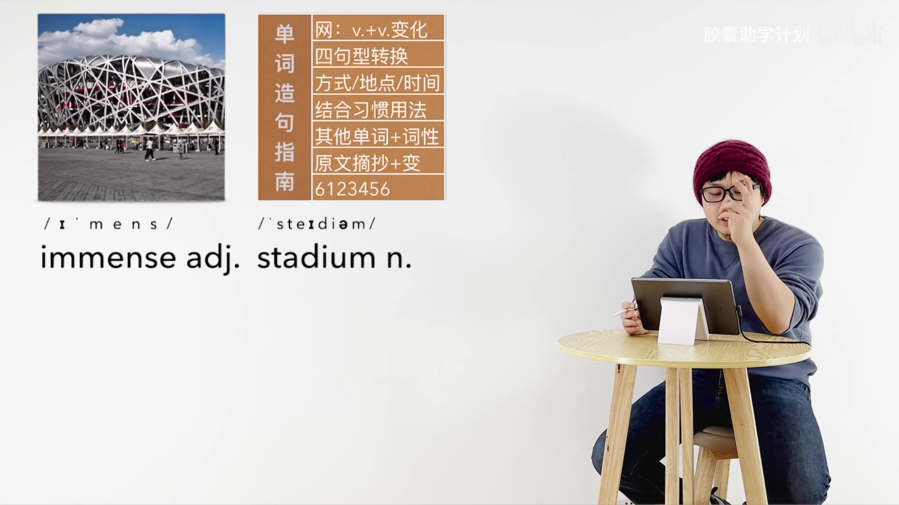

文字识别：单词造句指南 / 网：v.+v.变化 / 四句型转换 / 方式/地点/时间 / 结合习惯用法 / 其他单词+词性 / 原文摘抄+变 / 6123456 / /Ⅰ'mens/ / /'steidiam/ / immense adj. stadium n.

### 画面 00:05:21

文字识别：单词造句指南 / 网：v.+v.变化 / 四句型转换 / 方式/地点/时间 / 结合习惯用法 / 其他单词+词性 / 原文摘抄+变 / 6123456 / /Ⅰ'mens/ / /'steidiam/ / immense adj. stadium n.

### 画面 00:05:25

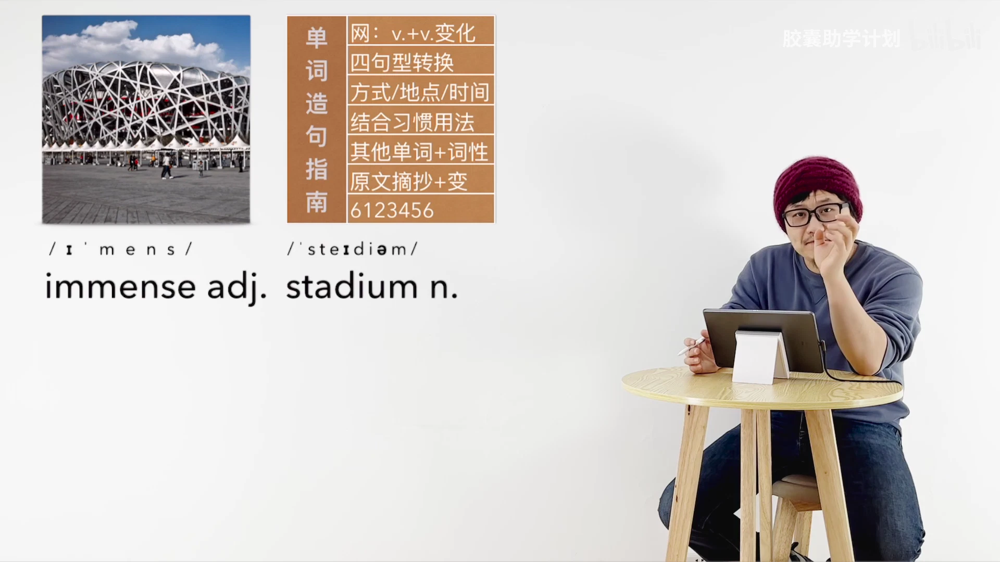

文字识别：单词造句指南 / 网：v.+v.变化 / 四句型转换 / 方式/地点/时间 / 结合习惯用法 / 其他单词+词性 / 原文摘抄+变 / 6123456 / /Ⅰ'mens / / /'steidiam/ / immense adj. stadium n.

## 00:05:30–00:06:00

单词别忘了把它浊化一下，叫做 stadium, stadium. Okay, very good.那 stadium 的意思指的是它是一个名词啊。首先注意，我们把它可以放到一起，叫巨大的露天体育场。比如说，我们中国为了零八年奥运会出啊，这个这个建建的那个叫做鸟巢，对吧？啊，那个就是一个叫做 stadium 的一个典范啊，露天体育馆。 Okay,好，把这两个单词放到一起，比如说 it is such an immense

### 画面 00:05:30

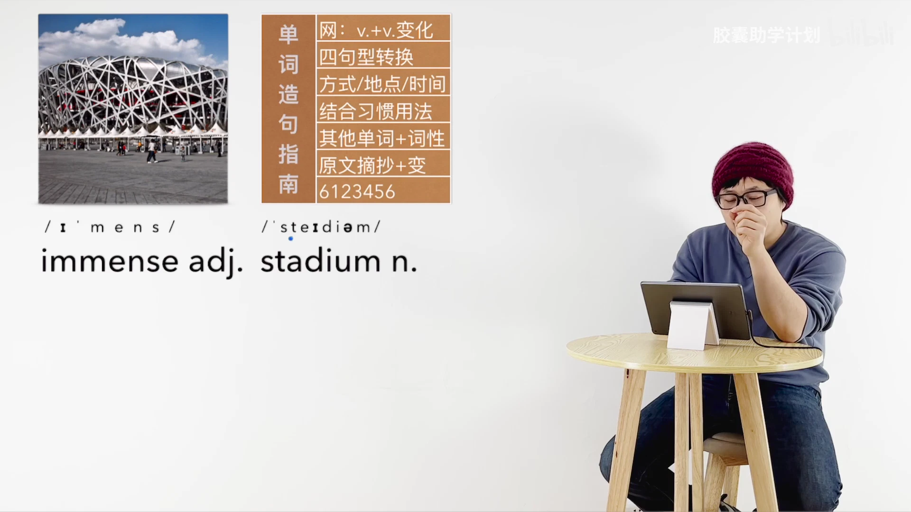

文字识别：单词造句指南 / 网：v.+v.变化 / 四句型转换 / 方式/地点/时间 / 结合习惯用法 / 其他单词+词性 / 原文摘抄+变 / 6123456 / /I'mens / / /'steidiam/ / immense adj. stadium n.

### 画面 00:05:40

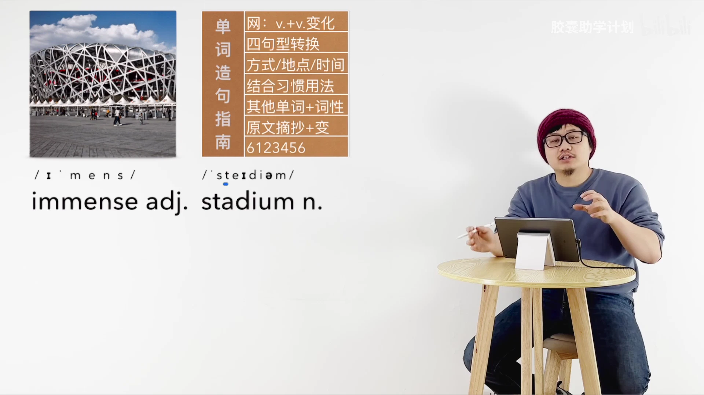

文字识别：单词造句指南 / 网：v.+v.变化 / 四句型转换 / 方式/地点/时间 / 结合习惯用法 / 其他单词+词性 / 原文摘抄+变 / 6123456 / /I'mens/ / /'steidiam/ / immense adj. stadium n.

### 画面 00:05:56

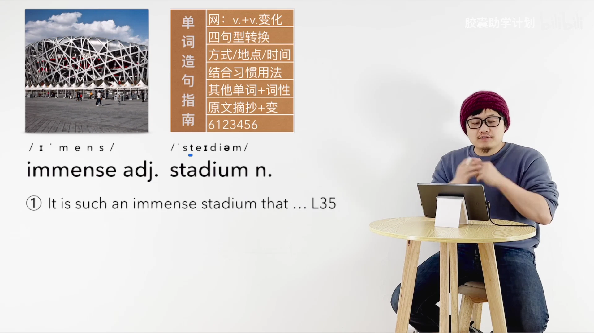

文字识别：单词造句指南 / 网：v.+v.变化 / 四句型转换 / 方式/地点/时间 / 结合习惯用法 / 其他单词+词性 / 原文摘抄+变 / 6123456 / / Ⅰ' m e n s / / /'steidiam/ / immense adj. stadium n. / ① It is such an immense stadium that ... L35

## 00:06:00–00:06:30

stadium that吧嗒吧嗒吧嗒好，后面实际上连的是一个句子，对吧？我故意在这儿没有写，各位可以课下自己去补齐。这我们用的是三十五课那个such点儿点儿点儿，然后that叫做这是一个如它是一个如此巨大的露天体育场，以至于比如说它能容纳数万人，对吧？这您自己去想，自己去补全啊。Okay, next one. I

### 画面 00:06:00

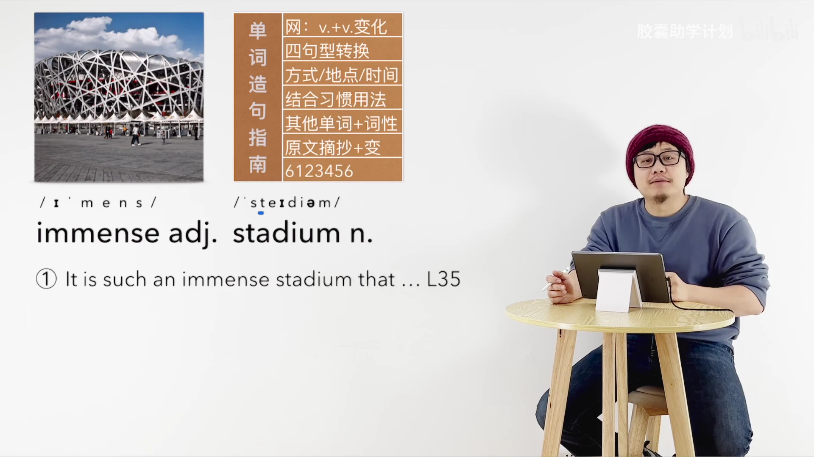

文字识别：单词造句指南 / 网：v.+v.变化 / 四句型转换 / 方式/地点/时间 / 结合习惯用法 / 其他单词+词性 / 原文摘抄+变 / 6123456 / /Ⅰ' m e n s / / /'steidiam/ / immense adj. stadium n. / ① It is such an immense stadium that ... L35

### 画面 00:06:05

文字识别：单词造句指南 / 网：v.+v.变化 / 四句型转换 / 方式/地点/时间 / 结合习惯用法 / 其他单词+词性 / 原文摘抄+变 / 6123456 / /Ⅰ' m e n s / / /'steidiam/ / immense adj. stadium n. / ① It is such an immense stadium that ... L35

### 画面 00:06:10

文字识别：单词造句指南 / 网：v.+v.变化 / 四句型转换 / 方式/地点/时间 / 结合习惯用法 / 其他单词+词性 / 原文摘抄+变 / 6123456 / / Ⅰ' m e n s / / /'steidiam/ / immense adj. stadium n. / ① It is such an immense stadium that ... L35

### 画面 00:06:15

文字识别：单词造句指南 / 网：v.+v.变化 / 四句型转换 / 方式/地点/时间 / 结合习惯用法 / 其他单词+词性 / 原文摘抄+变 / 6123456 / /Ⅰ' m e n s / / /'steidiam/ / immense adj. stadium n. / ① It is such an immense stadium that ... L35

### 画面 00:06:20

文字识别：单词造句指南 / 网：v.+v.变化 / 四句型转换 / 方式/地点/时间 / 结合习惯用法 / 其他单词+词性 / 原文摘抄+变 / 6123456 / /Ⅰ'mens / / /'steidiam/ / immense adj. stadium n. / ① It is such an immense stadium that ... L35

### 画面 00:06:29

文字识别：单词造句指南 / 网：v.+v.变化 / 四句型转换 / 方式/地点/时间 / 结合习惯用法 / 其他单词+词性 / 原文摘抄+变 / 6123456 / / Ⅰ' m e n s / / /'steidiam/ / immense adj. stadium n. / ① It is such an immense stadium that ... L35 / ② I saw them cleaning the immense stadium. / 2 / L35

## 00:06:30–00:07:00

saw them cleaning the immense stadium. 啊，还是要张开嘴跟我一起去读啊，不要放弃这个机会，对吧？那我看见他们正在清扫这个巨大的露天体育场。然后注意 saw them cleaning. 三十五课，对吧？ See somebody doing something. Okay, very good. Next one, say the immense stadium must have been built years ago. 说这个巨大的露天体育场啊，一定是数年前

### 画面 00:06:31

文字识别：单词造句指南 / 网：v.+v.变化 / 四句型转换 / 方式/地点/时间 / 结合习惯用法 / 其他单词+词性 / 原文摘抄+变 / 6123456 / /Ⅰ'mens / / /'steidiam/ / immense adj. stadium n. / ① It is such an immense stadium that ... L35 / ② I saw them cleaning the immense stadium. / L35

### 画面 00:06:35

文字识别：单词造句指南 / 网：v.+v.变化 / 四句型转换 / 方式/地点/时间 / 结合习惯用法 / 其他单词+词性 / 原文摘抄+变 / 6123456 / /Ⅰ'mens / / /'steidiam/ / immense adj. stadium n. / ① It is such an immense stadium that ... L35 / ② I saw them cleaning the immense stadium. / L35

### 画面 00:06:40

文字识别：单词造句指南 / 网：v.+v.变化 / 四句型转换 / 方式/地点/时间 / 结合习惯用法 / 其他单词+词性 / 原文摘抄+变 / 6123456 / /Ⅰ'mens/ / /'steidiam/ / immense adj. stadium n. / ① It is such an immense stadium that ... L35 / ② I saw them cleaning the immense stadium. / 2 / L35

### 画面 00:06:45

文字识别：单词造句指南 / 网：v.+v.变化 / 四句型转换 / 方式/地点/时间 / 结合习惯用法 / 其他单词+词性 / 原文摘抄+变 / 6123456 / /Ⅰ'mens/ / /'steidiam/ / immense adj. stadium n. / ① It is such an immense stadium that ... L35 / ② I saw them cleaning the immense stadium. / L35

### 画面 00:06:50

文字识别：单词造句指南 / 网：v.+v.变化 / 四句型转换 / 方式/地点/时间 / 结合习惯用法 / 其他单词+词性 / 原文摘抄+变 / 6123456 / /Ⅰ'mens/ / /'steidiam/ / immense adj. stadium n. / ① It is such an immense stadium that ... L35 / ② I saw them cleaning the immense stadium. / L35 / The immense stadium must have been built / years ago. L21

### 画面 00:06:55

文字识别：单词造句指南 / 网：v.+v.变化 / 四句型转换 / 方式/地点/时间 / 结合习惯用法 / 其他单词+词性 / 原文摘抄+变 / 6123456 / / Ⅰ' m e n s / / /'steidiam/ / 0 / immense adj. stadium n. / ① It is such an immense stadium that ... L35 / ② I saw them cleaning the immense stadium. / L35 / The immense stadium must have been built / years ago. L21

## 00:07:00–00:07:30

人们建造的。好了，那我们可在这儿可能说的就不是鸟巢了，就比如说是像意大利的那个露天体育场啊，有一个非常著名的那个电影啊，古罗马时期的那个角斗场是吧？有一个电影还叫《角斗士》是吧？就是在里面去进行角斗的啊，和人啊，和动物啊，对吧？OK，那我们就说那个就可以叫做 the immense stadium must have been built years ago，是吧？是很多年前被建造，一定是 must have been done。

### 画面 00:07:06

文字识别：单词造句指南 / 网：v.+v.变化 / 四句型转换 / 方式/地点/时间 / 结合习惯用法 / 其他单词+词性 / 原文摘抄+变 / 6123456 / / Ⅰ' m e n s / / /'steidiam/ / immense adj. stadium n. / ① It is such an immense stadium that ... L35 / ② I saw them cleaning the immense stadium. / L35 / The immense stadium must have been built / years ago. L21

### 画面 00:07:10

文字识别：单词造句指南 / 网：v.+v.变化 / 四句型转换 / 方式/地点/时间 / 结合习惯用法 / 其他单词+词性 / 原文摘抄+变 / 6123456 / / Ⅰ' m e n s / / /'steidiam/ / immense adj. stadium n. / ① It is such an immense stadium that ... L35 / ② I saw them cleaning the immense stadium. / L35 / The immense stadium must have been built / years ago. L21

### 画面 00:07:15

文字识别：单词造句指南 / 网：v.+v.变化 / 四句型转换 / 方式/地点/时间 / 结合习惯用法 / 其他单词+词性 / 原文摘抄+变 / 6123456 / /Ⅰ'mens/ / /'steidiam/ / immense adj. stadium n. / ① It is such an immense stadium that ... L35 / ② I saw them cleaning the immense stadium. / L35 / The immense stadium must have been built / years ago. L21

### 画面 00:07:20

文字识别：单词造句指南 / 网：v.+v.变化 / 四句型转换 / 方式/地点/时间 / 结合习惯用法 / 其他单词+词性 / 原文摘抄+变 / 6123456 / / Ⅰ' m e n s / / /'steidiam/ / immense adj. stadium n. / ① It is such an immense stadium that ... L35 / ② I saw them cleaning the immense stadium. / L35 / The immense stadium must have been built / years ago. L21

### 画面 00:07:25

文字识别：单词造句指南 / 网：v.+v.变化 / 四句型转换 / 方式/地点/时间 / 结合习惯用法 / 其他单词+词性 / 原文摘抄+变 / 6123456 / /Ⅰ'mens / / /'steidiam/ / immense adj. stadium n. / ① It is such an immense stadium that ... L35 / ② I saw them cleaning the immense stadium. / L35 / The immense stadium must have been built / years ago. L21

## 00:07:30–00:08:00

这实际上是我们二十一课学过的一个呃呃六一二三四五六当中的二啊，就是动词动词的变化，我们经常忘啊。 Next one，下一个单词，跟我一起读一下这个单词，叫做 standard standard. OK，它最基本的意思叫做标准。我印象当中，呃，在非常多的至少男士卫生间的那个呃用具当中，会有一个东西叫什么什么 standard，是吧？各位以后可以自己去观察一

### 画面 00:07:30

文字识别：单词造句指南 / 网：v.+v.变化 / 四句型转换 / 方式/地点/时间 / 结合习惯用法 / 其他单词+词性 / 原文摘抄+变 / 6123456 / / Ⅰ' m e n s / / /'steidiam/ / immense adj. stadium n. / ① It is such an immense stadium that ... L35 / ② I saw them cleaning the immense stadium. / L35 / The immense stadium must have been built / years ago. L21

### 画面 00:07:35

文字识别：单词造句指南 / 网v.+v.变化 / 四句型转换 / 方式/地点/时间 / 结合习惯用法 / 其他单词+词性 / 原文摘抄+变 / 6123456 / /Ⅰ'mens/ / /'steidiam/ / immense adj. stadium n. / ① It is such an immense stadium that ... L35 / ② I saw them cleaning the immense stadium. / L35 / The immense stadium must have been built / years ago. L21

### 画面 00:07:38

文字识别：单词造句指南 / 网：v.+v.变化 / 四句型转换 / 方式/地点/时间 / 结合习惯用法 / 其他单词+词性 / 原文摘抄+变 / 6123456 / / 'st ændad / / standard

### 画面 00:07:40

文字识别：单词造句指南 / 网：v.+v.变化 / 四句型转换 / 方式/地点/时间 / 结合习惯用法 / 其他单词+词性 / 原文摘抄+变 / 6123456 / / 's t ændad / / standard

### 画面 00:07:45

文字识别：单词造句指南 / 网：v.+v.变化 / 四句型转换 / 方式/地点/时间 / 结合习惯用法 / 其他单词+词性 / 原文摘抄+变 / 6123456 / / ' s t æn d a d / / standard

### 画面 00:07:50

文字识别：单词造句指南 / 网：v.+v.变化 / 四句型转换 / 方式/地点/时间 / 结合习惯用法 / 其他单词+词性 / 原文摘抄+变 / 6123456 / / ' s t ænd ad / / standard

### 画面 00:07:55

文字识别：单词造句指南 / 网：v.+v.变化 / 四句型转换 / 方式/地点/时间 / 结合习惯用法 / 其他单词+词性 / 原文摘抄+变 / 6123456 / / ' s t æendad / / standard

### 画面 00:07:59

文字识别：单词造句指南 / 网：v.+v.变化 / 四句型转换 / 方式/地点/时间 / 结合习惯用法 / 其他单词+词性 / 原文摘抄+变 / 6123456 / / ' s t æen d a d / / standard

## 00:08:00–00:08:30

下，我估计女士的应该是也有的，叫做美标是吧？我印象当中啊，American standard. Okay, 那这个单词叫做standard啊. Okay, 那比如说Olympic standard就指的是奥林匹克运动会标准的什么什么东西。那后面加了个swimming pool，之前我们学过啊，就不多说了是吧？游泳池。比如说，我们造一个句子说，The Chinese government succeeded in building an Olympic standard swimming pool. 这句话看着比较长，

### 画面 00:08:04

文字识别：单词造句指南 / 网：v.+v.变化 / 四句型转换 / 方式/地点/时间 / 结合习惯用法 / 其他单词+词性 / 原文摘抄+变 / 6123456 / / ' s t æen d a d / / standard

### 画面 00:08:10

文字识别：单词造句指南 / 网：v.+v.变化 / 四句型转换 / 方式/地点/时间 / 结合习惯用法 / 其他单词+词性 / 原文摘抄+变 / 6123456 / / ' s t æen d a d / / standard / ① Olympic-standard swimming pool n.

### 画面 00:08:14

文字识别：单词造句指南 / 网：v.+v.变化 / 四句型转换 / 方式/地点/时间 / 结合习惯用法 / 其他单词+词性 / 原文摘抄+变 / 6123456 / / ' s t æ n d a d / / standard / ① Olympic-standard swimming pool n.

### 画面 00:08:19

文字识别：单词造句指南 / 网：v.+v.变化 / 四句型转换 / 方式/地点/时间 / 结合习惯用法 / 其他单词+词性 / 原文摘抄+变 / 6123456 / / ' s t æe n d a d / / standard / ① Olympic-standard swimming pool n.

### 画面 00:08:21

文字识别：单词造句指南 / 网：v.+v.变化 / 四句型转换 / 方式/地点/时间 / 结合习惯用法 / 其他单词+词性 / 原文摘抄+变 / 6123456 / / ' s t æen d a d / / standard / ① Olympic-standard swimming pool n. / The Chinese government succeeded in / building an Olympic-standard swimming / pool. L36

### 画面 00:08:24

文字识别：单词造句指南 / 网：v.+v.变化 / 四句型转换 / 方式/地点/时间 / 结合习惯用法 / 其他单词+词性 / 原文摘抄+变 / 6123456 / / ' s t æe n d a d / / standard / ① Olympic-standard swimming pool n. / The Chinese government succeeded in / building an Olympic-standard swimming / pool. L36

## 00:08:30–00:09:00

其实就用到了我们刚刚学过的一个习惯用法，叫 succeeded in doing something，对吧？成功做了某件事情，玩一个。那不多说了啊。接下来继续说 the Olympic standard swimming pool。各位注意到了，其实我把这么长的一个部分都直接当做了一个名词去用，对吧？那它的核心名词就是 swimming pool。那至于是不是 Olympic standard，只是为了我们造句，要把它放在那个地方。然后呢，我们造

### 画面 00:08:30

文字识别：单词造句指南 / 网：v.+v.变化 / 四句型转换 / 方式/地点/时间 / 结合习惯用法 / 其他单词+词性 / 原文摘抄+变 / 6123456 / / ' st æen d ad / / standard / ① / Olympic-standard swimming pool n. / The Chinese government succeededin / building an Olympic-standard swimming / pool. L36

### 画面 00:08:34

文字识别：单词造句指南 / 网：v.+v.变化 / 四句型转换 / 方式/地点/时间 / 结合习惯用法 / 其他单词+词性 / 原文摘抄+变 / 6123456 / / 'st ænd ad / / standard / ① / Olympic-standard swimming pool n. / The Chinese government succeededin / building an Olympic-standard swimming / pool. L36

### 画面 00:08:39

文字识别：单词造句指南 / 网：v.+v.变化 / 四句型转换 / 方式/地点/时间 / 结合习惯用法 / 其他单词+词性 / 原文摘抄+变 / 6123456 / / 's t æn d a d / / standard / ① / Olympic-standard swimming pool n. / The Chinese government succeeded in / building an Olympic-standard swimming / pool.L36 / The Olympic-standard swimming pool was / built years ago. L10

### 画面 00:08:44

文字识别：单词造句指南 / 网：v.+v.变化 / 四句型转换 / 方式/地点/时间 / 结合习惯用法 / 其他单词+词性 / 原文摘抄+变 / 6123456 / / 's t æn da d / / standard / ① Olympic-standard swimming pool n. / The Chinese government succeeded in / building an Olympic-standard swimming / pool.L36 / The Olympic-standard swimming pool was / built years ago. L10

### 画面 00:08:46

文字识别：单词造 / 网：v.+v.变化 / 四句型转换 / 方式/地点/时间 / 旭句指南 / 结合习惯用法 / 其他单词+词性 / 原文摘抄+变 / 6123456 / /'s t æen d a d / / standard / ①Olympic-standard swimming pool n. / The Chinese government succeeded in / building an Olympic-standard swimming / pool. L36 / The Olympic-standard swimming pool was / built years ago. L10

### 画面 00:08:48

文字识别：单词造 / 网：v.+v.变化 / 四句型转换 / 方式/地点/时间 / 句 / 结合习惯用法 / 其他单词+词性 / 指 / 原文摘抄+变 / 南 / 6123456 / / ' s t æn d a d / / standard / ①Olympic-standard / swimming pooln / The / Chinese / e government succeeded in / building an Olympic-standard s / swimming / pool. L36 / The / Olympic-standard / swimming pool was / built years a / ago.L10

### 画面 00:08:50

文字识别：单词造 / 网：v.+v.变化 / 四句型转换 / 方式/地点/时间 / 句 / 结合习惯用法 / 其他单词+词性 / 指 / 原文摘抄+变 / 南 / 6123456 / / 's t æn d a d / / standard / ①Olympic-standard swimming pool n. / The / Chinese / e government succeeded in / building an Olympic-standard swimming / pool.L36 / The / Olympic-standard / swimming pool was / built years ago. L10

### 画面 00:08:59

文字识别：单词造 / 网：v.+v.变化 / 四句型转换 / 方式/地点/时间 / 旭句指 / 结合习惯用法 / 其他单词+词性 / 原文摘抄+变 / 南 / 6123456 / / 's t æn dad / / standard / ①Olympic-standard swimming pool n. / The / Chinese /  government succeeded in / kuilding an Olympic-standard swimming / pool. L36 / The / Olympic-standard / swimming pool was / built years a / ago.L10

## 00:09:00–00:09:30

的句子叫做 The Olympic standard swimming pool was built years ago. 是数年前被建造的，又是复习了一下被动，对吧？OK，那您看，这个是一般过去时的被动。如果我把它变成一般将来时的被动，对吧？一般现在时的被动，现在进行时的被动，现在完成时的被动，和我们刚刚学过的叫过去完成时的被动，这一下您就造出来了非常多的句子，肯定句还是对吧？然后我

### 画面 00:09:05

文字识别：单词造 / 网：v.+v.变化 / 四句型转换 / 方式/地点/时间 / 旭句指 / 结合习惯用法 / 其他单词+词性 / 原文摘抄+变 / 南 / 6123456 / / ' s t æn d a d / / standard / ①Olympic-standard swimming pool n. / The / Chinese / e government succeeded in / building an Olympic-standard swimming / pool. L36 / The / Olympic-standard / swimming pool was / built years ago. L10

### 画面 00:09:29

文字识别：单词造 / 网：v.+v.变化 / 四句型转换 / 方式/地点/时间 / 旭句指 / 结合习惯用法 / 其他单词+词性 / 原文摘抄+变 / 南 / 6123456 / / ' s t æn d a d / / standard / ①Olympic-standard swimming pool n. / The / Chinese / e government succeeded in / building an Olympic-standard swimming / pool. L36 / The / Olympic-standard / swimming pool was / built years ago. L10

## 00:09:30–00:10:00

们再来个四句型转换。哎，四一下就成啊，这个六一下就成了啊，又成了六，可能是不是啊？就很多的句子就造出来了。Next one，下一个单词跟我读一下，叫做 capital，capital，capital。啊，指的是首都的意思。比如说，说 Beijing is the capital of China。非常简单的一句话，说北京是中国的首都，叫 the capital of China。由后往前翻译，叫中国的首都啊。我们

### 画面 00:09:34

文字识别：单词造 / 网：v.+v.变化 / 四句型转换 / 方式/地点/时间 / 旭句指南 / 结合习惯用法 / 其他单词+词性 / 原文摘抄+变 / 6123456 / / ' s t æ n d a d / / standard / ①Olympic-standard swimming pool n. / The Chinese government succeeded in / building an Olympic-standard swimming / pool. L36 / The Olympic-standard  / I swimming pool was / built years ago. L10

### 画面 00:09:39

文字识别：单词造句指南 / 网：v.+v.变化 / 四句型转换 / 方式/地点/时间 / 结合习惯用法 / 其他单词+词性 / 原文摘抄+变 / 6123456 / /'kæpital/ / capital

### 画面 00:09:41

文字识别：单词造句指南 / 网：v.+v.变化 / 四句型转换 / 方式/地点/时间 / 结合习惯用法 / 其他单词+词性 / 原文摘抄+变 / 6123456 / /'kæpital/ / capital

### 画面 00:09:44

文字识别：单词造句指南 / 网：v.+v.变化 / 四句型转换 / 方式/地点/时间 / 结合习惯用法 / 其他单词+词性 / 原文摘抄+变 / 6123456 / /'kæpital/ / capital

### 画面 00:09:49

文字识别：单词造句指南 / 网：v.+v.变化 / 四句型转换 / 方式/地点/时间 / 结合习惯用法 / 其他单词+词性 / 原文摘抄+变 / 6123456 / /'kæpItal/ / capital / ① Beijing is the capital of China.

### 画面 00:09:54

文字识别：单词造句指南 / 网：v.+v.变化 / 四句型转换 / 方式/地点/时间 / 结合习惯用法 / 其他单词+词性 / 原文摘抄+变 / 6123456 / /'kæpItal/ / capital / ① Beijing is the capital of China.

### 画面 00:09:58

文字识别：单词造句指南 / 网：v.+v.变化 / 四句型转换 / 方式/地点/时间 / 结合习惯用法 / 其他单词+词性 / 原文摘抄+变 / 6123456 / /'kæpital/ / Capital / ① Beijing is the capital of China.

## 00:10:00–00:10:30

们新一就学过的叫 A of B 结构是吧？啊，不是很难啊。Next one，说 she intends to go to the capital of China next month。说她 intend to do something，对吧？哎，她希望去做一件事情，叫做去中国的首都。哎，计划对吧？Intend to do something。三十六课咱们刚学 next month 下周。那这句话虽然说啊下个月啊，虽然说的是下个月的

### 画面 00:10:00

文字识别：单词造句指南 / 网：v.+v.变化 / 四句型转换 / 方式/地点/时间 / 结合习惯用法 / 其他单词+词性 / 原文摘抄+变 / 6123456 / /'kæepital/ / capital / ① Beijing is the capital Oof China.

### 画面 00:10:03

文字识别：单词造句指南 / 网：v.+v.变化 / 四句型转换 / 方式/地点/时间 / 结合习惯用法 / 其他单词+词性 / 原文摘抄+变 / 6123456 / /'kæpital/ / A / capital / ① Beijing is the capital Of China.

### 画面 00:10:05

文字识别：单词造句指南 / 网：v.+v.变化 / 四句型转换 / 方式/地点/时间 / 结合习惯用法 / 其他单词+词性 / 原文摘抄+变 / 6123456 / /'kæpital/ / A / capital / ① Beijing is the capital Of China. / She intends to go to the capital of China / next month. L36

### 画面 00:10:09

文字识别：单词造句指南 / 网：v.+v.变化 / 四句型转换 / 方式/地点/时间 / 结合习惯用法 / 其他单词+词性 / 原文摘抄+变 / 6123456 / /'kæpital/ / A / capital / ① Beijing is the capital of China. / She intends to go to the capital of China / next month. L36

### 画面 00:10:14

文字识别：单词造句指南 / 网：v.+v.变化 / 四句型转换 / 方式/地点/时间 / 结合习惯用法 / 其他单词+词性 / 原文摘抄+变 / 6123456 / /'kæpital/ / A / capital / ① Beijing is the capital of China. / She intends to ao to the capital of China / next month. L36

### 画面 00:10:19

文字识别：单词造句指南 / 网：v.+v.变化 / 四句型转换 / 方式/地点/时间 / 结合习惯用法 / 其他单词+词性 / 原文摘抄+变 / 6123456 / /'kæpital/ / A / capital / ① Beijing is the capital Of China. / She intends to ao to the capital of China / next month. L36

## 00:10:30–00:11:00

事情，但你注意语法结构上它是一般现在时，所以我们想去变一般疑问句的时候，还是要看动词自己本身的，对吧？它是第三人称单数，所以我们是把 does 这个单词提前，然后呢，你再用 where when 这样的特殊疑问词，包括 who 等等等等啊，自己去呃变这个句型，我们就不多说了，这是您课下的作业啊。下一个说南京 used to be the capital of China，说它曾经是

### 画面 00:10:30

文字识别：单词造句指南 / 网：v.+v.变化 / 四句型转换 / 方式/地点/时间 / 结合习惯用法 / 其他单词+词性 / 原文摘抄+变 / 6123456 / LS / /'kæpital/ / A / capital / ① Beijing is the capital Of China. / She intends to ao to the capital of China / next month. L36

### 画面 00:10:36

文字识别：单词造句指南 / 网：v.+v.变化 / 四句型转换 / 方式/地点/时间 / 结合习惯用法 / 其他单词+词性 / 原文摘抄+变 / 6123456 / /'kæpital/ / capital / ① Beijing is the capital Of China. / She intends to go to the capital of China / next month. L36 / does/where/when...

### 画面 00:10:39

文字识别：单词造句指南 / 网：v.+v.变化 / 四句型转换 / 方式/地点/时间 / 结合习惯用法 / 其他单词+词性 / 原文摘抄+变 / 6123456 / /'kæpital/ / capital / ①E / Beijing is the capital of China. / She0 / ntenas to ao to the capital of China / next month. L36 / does/where/when...

### 画面 00:10:44

文字识别：单词造句指南 / 网：v.+v.变化 / 四句型转换 / 方式/地点/时间 / 结合习惯用法 / 其他单词+词性 / 原文摘抄+变 / 6123456 / /'kæpital/ / A / capital / ① Beijing is the capital Of China. / She / ntends to aoto the capital of China / next month. L36 / does/where/when...

### 画面 00:10:52

文字识别：单词造句指南 / 网：v.+v.变化 / 四句型转换 / 方式/地点/时间 / 结合习惯用法 / 其他单词+词性 / 原文摘抄+变 / 6123456 / /'kæpital/ / capital / ① Beijing is the capital Of China. / She / ntenas to aoto the capital of China / next month. L36 / does/where/when... / Nanjing used to be the capital of China. / L31

### 画面 00:10:54

文字识别：单词造句指南 / 网：v.+v.变化 / 四句型转换 / 方式/地点/时间 / 结合习惯用法 / 其他单词+词性 / 原文摘抄+变 / 6123456 / /'kæpital/ / capital / ① Beijing is the capital of China. / She / ntends to aoto the capital of China / next month. L36 / does/where/when... / Nanjing used to be the capital of China. / L31

## 00:11:00–00:11:30

中国的古都，对吧？哈，南京嘛，对吧？与中国有很多的古都，西安、开封啊等等，他们曾经是中国的古都。那在这儿说的是南京 used to do 啊。我们又复习了一下这个小的语法。OK，好，接下来呢，我们先看一个单词，我们先一起读一下啊，看音标。我们这个单词就不造句了，直接给大家呃上它常用的口语含义，叫做 fantastic，

### 画面 00:11:05

文字识别：单词造句指南 / 网：v.+v.变化 / 四句型转换 / 方式/地点/时间 / 结合习惯用法 / 其他单词+词性 / 原文摘抄+变 / 6123456 / /'kæpital/ / capital / ① Beijing is the capital of China. / Shentenos to ao to the capital of China / next month. L36 / does/where/when... / Nanjing used to be the capital of China. / L31

### 画面 00:11:09

文字识别：单词造句指南 / 网：v.+v.变化 / 四句型转换 / 方式/地点/时间 / 结合习惯用法 / 其他单词+词性 / 原文摘抄+变 / 6123456 / /'kæpital/ / capital / ① Beijing is the capital of China. / Shentenas to ao to the capital of China / next month. L36 / does/where/when... / Nanjing used to be the capital of China. / L31

### 画面 00:11:14

文字识别：单词造句指南 / 网：v.+v.变化 / 四句型转换 / 方式/地点/时间 / 结合习惯用法 / 其他单词+词性 / 原文摘抄+变 / 6123456 / /'kæpital/ / capital / ① Beijing is the capital of China. / Shentenas to ao to the capital of China / next month. L36 / does/where/when... / Nanjing ysed to be the capital of China. / L31

### 画面 00:11:16

文字识别：/fæen'tæstik/ / fantastic / 华尔街之狼 / 你的阿姨去世之前 / The Wolf of Wall Street / Your aunt,before she died, / (2013)

## 00:11:30–00:12:00

连起来读. Fantastic, fantastic, fantastic,基本就是 great啊, wonderful的同义词.各位可以这样去理解,就是太棒了,太好了,是吧?好,那接下来我们看一个电影片段啊.电影片段当中直接就非常好的说清楚了这个 fantastic,就表示太棒了,太好了,好吧? You asked before she died, signed the document naming you as her successor. She did. Fantastic. Well, that's good

### 画面 00:11:30

文字识别：/fæen'tæstik/ / fantastic / 华尔街之狼 / 你的阿姨去世之前 / The Wolf of Wall Street / Your aunt,before she died, / (2013)

### 画面 00:11:52

文字识别：/fæen'tæestik/ / fantastic / 华尔街之狼 / 你的阿姨去世之前 / The Wolf of Wall Street / Your aunt,before she died, / (2013)

### 画面 00:11:54

文字识别：/fæn'tæestik/ / fantastic / 华尔街之狼 / 签署了一份文件指定你是继承人 / The Wolf of Wall Street / signed a document naming you as her successor. / (2013)

### 画面 00:11:56

文字识别：/fæn'tæestik/ / fantastic / 华尔街之狼 / 签署了一份文件 指定你是继承人 / The Wolf of Wall Street / signed a document naming you as her successor. / (2013)

### 画面 00:11:58

文字识别：/fæen'tæestik/ / fantastic / 华尔街之狼 / 是吗 / The Wolf of Wall Street / She did? / (2013)

## 00:12:00–00:12:30

Well, nada bien. What does that mean? Nada bien. No, okay. Fantastic, is吧太棒了，太好了. Continue. 下一个单词跟我们一起读，叫做 design. Design. Okay, 叫做设计，对吧？你注意，它是一个动词啊。我们在这儿没有写。说 the building was designed by a famous guy. 第十课 was 加 designed，对吧？一般过去时的被动啊。然后呢，说

### 画面 00:12:00

文字识别：/fæen'tæestik/ / fantastic / 华尔街之狼 / 太好了那这是好消息啊 / The Wolf of Wall Street / Fantastic! Well,that's good news! / (2013)

### 画面 00:12:02

文字识别：/fæen'tæestik/ / fantastic / 华尔街之狼 / 其实还没有 / The Wolf of Wall Street / Well,not as of yet. / (2013)

### 画面 00:12:04

文字识别：/fæen'tæestik/ / fantastic / 华尔街之狼 / 等等还没有是什么意思 / The Wolf of Wall Street / What does that mean? Not as of yet? / (2013)

### 画面 00:12:06

文字识别：/fæen'tæstik/ / fantastic / 华尔街之狼 / The Wolf of Wall Street / (2013)

### 画面 00:12:09

文字识别：单词造句指南 / 网：v.+v.变化 / 四句型转换 / 方式/地点/时间 / 结合习惯用法 / 其他单词+词性 / 原文摘抄+变 / 6123456 / /dr'zain/ / design

### 画面 00:12:12

文字识别：单词造句指南 / 网：v.+v.变化 / 四句型转换 / 方式/地点/时间 / 结合习惯用法 / 其他单词+词性 / 原文摘抄+变 / 6123456 / /dr'zain/ / design

### 画面 00:12:14

文字识别：单词造句指南 / 网：v.+v.变化 / 四句型转换 / 方式/地点/时间 / 结合习惯用法 / 其他单词+词性 / 原文摘抄+变 / 6123456 / /dr'zain/ / design

### 画面 00:12:19

文字识别：单词造句指南 / 网：v.+v.变化 / 四句型转换 / 方式/地点/时间 / 结合习惯用法 / 其他单词+词性 / 原文摘抄+变 / 6123456 / /dI'zain/ / design /  This building was designed by a famous / guy. L10

### 画面 00:12:24

文字识别：单词造句指南 / 网：v.+v.变化 / 四句型转换 / 方式/地点/时间 / 结合习惯用法 / 其他单词+词性 / 原文摘抄+变 / 6123456 / /dI'zain/ / design / ) This building was designed by a famous / guy. L10

### 画面 00:12:28

文字识别：单词造句指南 / 网：v.+v.变化 / 四句型转换 / 方式/地点/时间 / 结合习惯用法 / 其他单词+词性 / 原文摘抄+变 / 6123456 / /dI'zain/ / design / ① This building was designed by a famous / guy. L10 / This building must have been designed by / a famous guy. L21

## 00:12:30–00:13:00

this building，你注意我在这几乎没有换别的东西，我只是换了一下动词加动词的变化，这是我们造句子的一个思路，叫做 this building must have been designed by a famous guy，是吧？你看这两句话非常的像，含义稍有不同，差就差在了动词和动词的变化这个地方。那鉴于这两句话的动词是一致的，都是 design，那它们唯一的区别就是它们的动词变化不同。各位能理解哈？一个是一般过去

### 画面 00:12:30

文字识别：单词造句指南 / 网：v.+v.变化 / 四句型转换 / 方式/地点/时间 / 结合习惯用法 / 其他单词+词性 / 原文摘抄+变 / 6123456 / /dI'zain/ / design / ① This building was designed by a famous / guy. L10 / This building must have been designed by / a famous guy. L21

### 画面 00:12:32

文字识别：单词造句指南 / 网：v.+v.变化 / 四句型转换 / 方式/地点/时间 / 结合习惯用法 / 其他单词+词性 / 原文摘抄+变 / 6123456 / /dI'zain/ / design / ① This building was designed by a famous / guy. L10 / This building must have been designed by / a famous guy. L21

### 画面 00:12:34

文字识别：单词造句指南 / 网：v.+v.变化 / 四句型转换 / 方式/地点/时间 / 结合习惯用法 / 其他单词+词性 / 原文摘抄+变 / 6123456 / /dI'zain/ / design / ① This building was designed by a famous / guy. L10 / This building must have been designed by / a famous guy. L21

### 画面 00:12:36

文字识别：单词造句指南 / 网：v.+V.变化 / 四句型转换 / 方式/地点/时间 / 结合习惯用法 / 其他单词+词性 / 原文摘抄+变 / 6123456 / /dI'zain/ / design / ① This building was designed by a famous / guy. L10 / This building must have been designed by / a famous guy. L21

### 画面 00:12:39

文字识别：单词造句指南 / 网：v.+v.变化 / 四句型转换 / 方式/地点/时间 / 结合习惯用法 / 其他单词+词性 / 原文摘抄+变 / 6123456 / /dI'zain/ / design / ① This building was designed by a famous / guy. L10 / This building must have been designed by / a famous guy. L21

### 画面 00:12:48

文字识别：单词造句指南 / 网：v.+V.变化 / 四句型转换 / 方式/地点/时间 / 结合习惯用法 / 其他单词+词性 / 原文摘抄+变 / 6123456 / /dr'zain/ / design / ① This building Was designed by a famous / guy. L10 / This buildingmust have been designed by / a famous guy. L21

### 画面 00:12:50

文字识别：单词造句指南 / 网：v.+v.变化 / 四句型转换 / 方式/地点/时间 / 结合习惯用法 / 其他单词+词性 / 原文摘抄+变 / 6123456 / /dr'zain/ / design /  This building vas designed / dpy a famous / guy. L10 / This buildingmust have been designeg by / a famous guy. L2

### 画面 00:12:59

文字识别：单词造句指南 / 网：v.+V.变化 / 四句型转换 / 方式/地点/时间 / 结合习惯用法 / 其他单词+词性 / 原文摘抄+变 / 6123456 / /dr'zain/ / design / This building vas designed / py a famous / guy. L10 / This buildingmust have been designeg by / a famous guy. L21

## 00:13:00–00:13:30

时的结构，一个是当时一定是怎么怎么样这样一个推测，情态动词推测过去的这样的一个，还是被动的一个情况，对吧？Okay，那我们还可以另一个方式，很简单，就是结合其他习惯用法，说 she has trouble designing the whole building，是吧？Okay，这个就不多说了，很简单的一个东西啊，这我们自己去呃总总结下来摘抄下来就可以了。好，Next one， recap，本课除了单词以外，还有两个小

### 画面 00:13:04

文字识别：单词造句指南 / 网：v.+v.变化 / 四句型转换 / 方式/地点/时间 / 结合习惯用法 / 其他单词+词性 / 原文摘抄+变 / 6123456 / /dr'zain/ / design / This building Vas designed / py a famous / guy. L10 / This buildingmust have been designed by / a famous guy. L21

### 画面 00:13:09

文字识别：单词造句指南 / 网：v.+V.变化 / 四句型转换 / 方式/地点/时间 / 结合习惯用法 / 其他单词+词性 / 原文摘抄+变 / 6123456 / /di'zain/ / design /  This building vas designedpy a famous / guy. L10 / This buildingmust have been designeg by / a famous guy. L21

### 画面 00:13:12

文字识别：单词造句指南 / 网：v.+v.变化 / 四句型转换 / 方式/地点/时间 / 结合习惯用法 / 其他单词+词性 / 原文摘抄+变 / 6123456 / /dr'zain/ / design /  This building yas designedpy a famous / 1 / guy. L10 / This buildingmust have been designed by / a famous guy. L2 / She has trouble designing the whole / building. L28

### 画面 00:13:14

文字识别：单词造句指南 / 网：v.+V.变化 / 四句型转换 / 方式/地点/时间 / 结合习惯用法 / 其他单词+词性 / 原文摘抄+变 / 6123456 / /di'zaIn/ / design / ① This building Vas designed / dpya famous / guy. L10 / This buildingmust have been designed by / a famous guy. L21 / She has trouble designing the whole / building. L28

### 画面 00:13:21

文字识别：单词造句指南 / 网：v.+v.变化 / 四句型转换 / 方式/地点/时间 / 结合习惯用法 / 其他单词+词性 / 原文摘抄+变 / 6123456 / /dI'zain/ / design / ① This building vas designedpy a famous / guy. L10 / This buildingmust have been designeg by / a famous guy. L2 / She has trouble designing the whole / building. L28

### 画面 00:13:24

文字识别：单词造句指南 / 网：v.+v.变化 / 四句型转换 / 方式/地点/时间 / 结合习惯用法 / 其他单词+词性 / 原文摘抄+变 / 6123456 / /dr'zain/ / design / D This building vas designedpy a famous / 1 / guy. L10 / This buildingmust have been designedby / a famous guy. L21 / She has trouble designing the whole / building. L28

### 画面 00:13:26

文字识别：Recap / Words / Expression / hold a meeting / fantastic

### 画面 00:13:28

文字识别：Recap / Words / Expression / hold a meeting / fantastic

## 00:13:30–00:14:00

的用法，hold a meeting以及fantastic。我希望各位去记住。那家庭作业呢？单词造句，每个单词造五句话，这是我们老习惯。您反复听一下这两个电影片段，尝试把那些我们要教给各位的单词或者说短语，把它能尽可能听出来，是吧？OK。那以上呢就是本期视频的全部内容了。如果您喜欢我们的课程呢，欢迎各位关注、订阅、一键三连，分享给那些

### 画面 00:13:30

文字识别：Recap / Words / Expression / hold a meeting / fantastic

### 画面 00:13:34

文字识别：Recap / Words / Expression / hold a meeting / fantastic

### 画面 00:13:36

文字识别：1. / 单词造句/对话 / 【单词造句指南】 / 每个5句

### 画面 00:13:39

文字识别：单词造句/对话 / 1. / 【单词造句指南】 / 每个5句

### 画面 00:13:41

文字识别：单词造句/对话 / 1. / 【单词造句指南】 / 每个5句 / 反复听电影片段，直到能 / 听出关键短语/句子

### 画面 00:13:44

文字识别：单词造句/对话 / 1. / 【单词造句指南】 / 每个5句 / 2.反复听电影片段，直到能 / 听出关键短语/句子

### 画面 00:13:49

文字识别：单词造句/对话 / 1. / 【单词造句指南】 / 每个5句 / 2.反复听电影片段，直到能 / 听出关键短语/句子

### 画面 00:13:51

文字识别：👍

## 00:14:00–00:14:16

需要的朋友，来帮助我们快速成长。See you next time.

### 画面 00:14:04

### 画面 00:14:06

文字识别：CAPSULEACADEMY / 胶囊助学计划 / 小红书 / Lecturer / Leo / OE

### 画面 00:14:09

文字识别：CAPSULEACADEMY / 胶囊助学计划 / 小红书 / Editor / 💯 / OE

### 画面 00:14:12

文字识别：CAPSULEACADEMY / 胶囊助学计划 / 小红书 / Creator / Leo & Berlin

### 画面 00:14:14

文字识别：bilibili / 胶囊助学计划 / 封口

### 画面 00:14:16

文字识别：bilibili / 胶囊助学计划

