# L037 语法 将来完成时

快速机器解析：语音为单模型转写，未进行独立交叉校对或人工复核；画面每秒采样并按变化选帧，短时文字和标记可能遗漏。截图时间约有 1 秒误差。图片有损压缩；遇到疑点请按时间查看 Google Drive 原视频。

## 00:00:00–00:00:30

Hello everyone, welcome to Capsule Academy. This is Leo. Today we're going to learn New Concept English Book Two Lesson Thirty Seven Grammar. Now,习惯进入正式课程之前呢，我们先问大家两个问题。那第一，如何使用将来完成时这个时态？那以前我们已经学过了现在完成时和过去完成时。今天我们来学一个新的时态。那第二呢，就是我们要对比一下这三个时态啊。好，那带着这两个问题，Hope you guys enjoyed.

### 画面 00:00:00

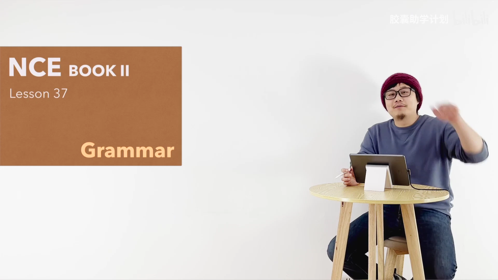

文字识别：NCE / BOOK"I / Lesson 37 / Grammar

### 画面 00:00:02

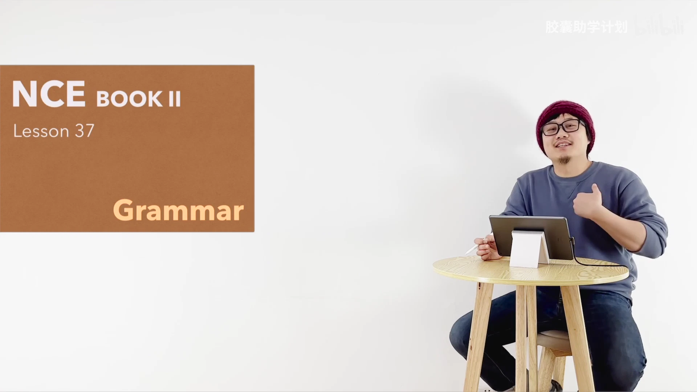

文字识别：NCE / BOOK I"I / Lesson 37 / Grammar

### 画面 00:00:07

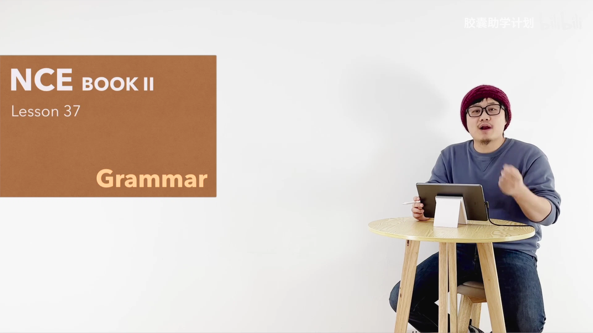

文字识别：NCE / BOOKII / Lesson 37 / Grammar

### 画面 00:00:09

### 画面 00:00:11

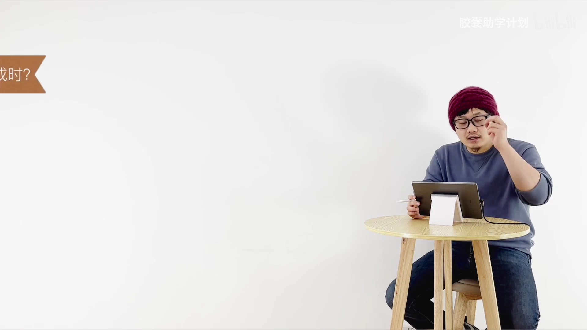

文字识别：戈时？

### 画面 00:00:13

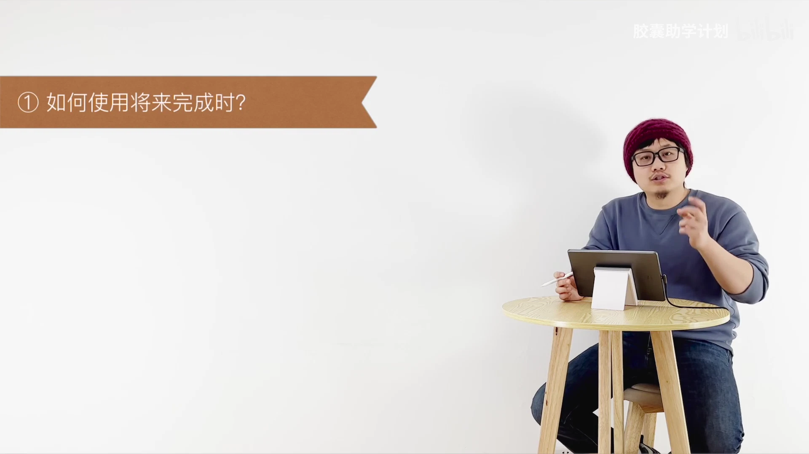

文字识别：①如何使用将来完成时？

### 画面 00:00:22

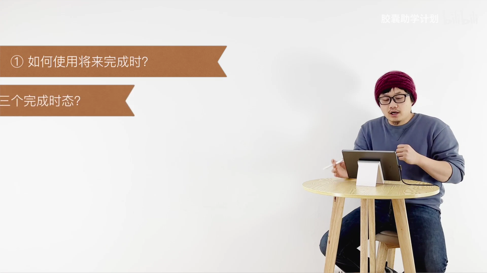

文字识别：①如何使用将来完成时？ / 三个完成时态?

### 画面 00:00:24

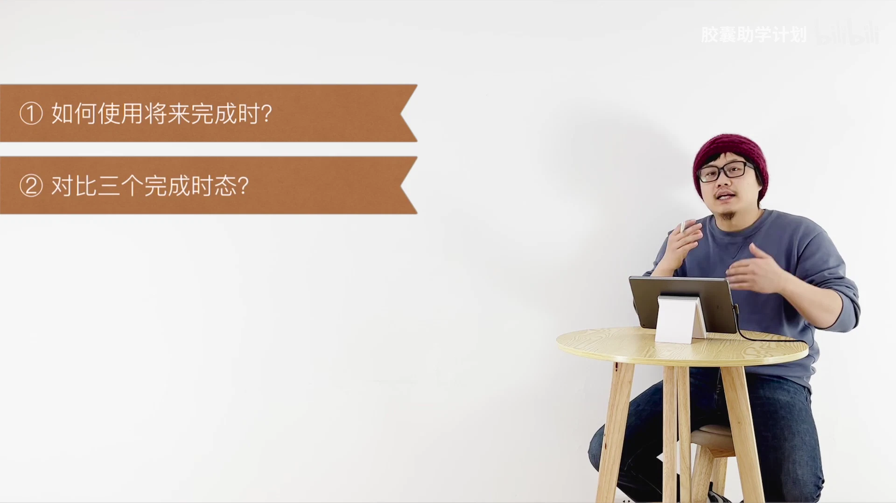

文字识别：①如何使用将来完成时？ / 对比三个完成时态?

### 画面 00:00:29

文字识别：胶囊助学计划 bilbl / •

## 00:00:30–00:01:00

好，那将来完成时跟现在完成时有一点类似，它都不止一个用法，对吧？我们先看将来完成时的第一个用法，其实非常像现在完成时或过去完成时的一个用法，叫做一个动作持续或重复到将来。我们某种程度上可以把它理解为叫 have done 的将来时，也就是

### 画面 00:00:33

文字识别：胶囊助学计划

### 画面 00:00:35

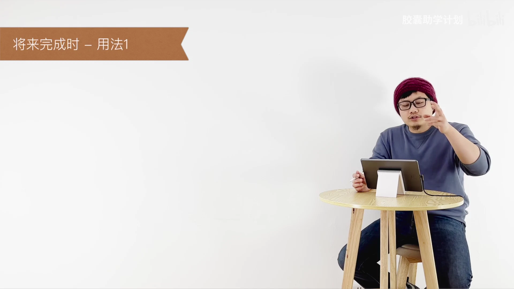

文字识别：将来完成时 - 用法1

### 画面 00:00:48

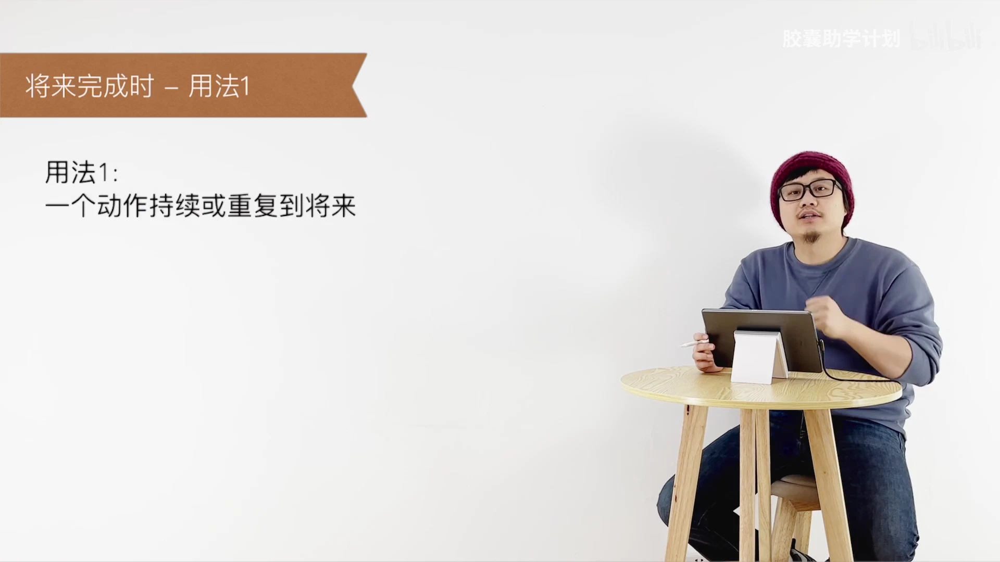

文字识别：将来完成时- 用法1 / 用法1： / 一个动作持续或重复到将来

## 00:01:00–00:01:30

是现在完成时的将来时，就是将来完成时。这句话听上去挺绕的，怎么去理解？我们先回顾一下现在完成时有一个用法，比如说现在完成时的一个用法叫做截止到今天，我已经在这儿，比如说我在北京已经住满一年了。那你注意这句话是从一年前开始的，一直持续到了现在，所以我们管它叫做现在完成时。如果一个动作从过

### 画面 00:01:18

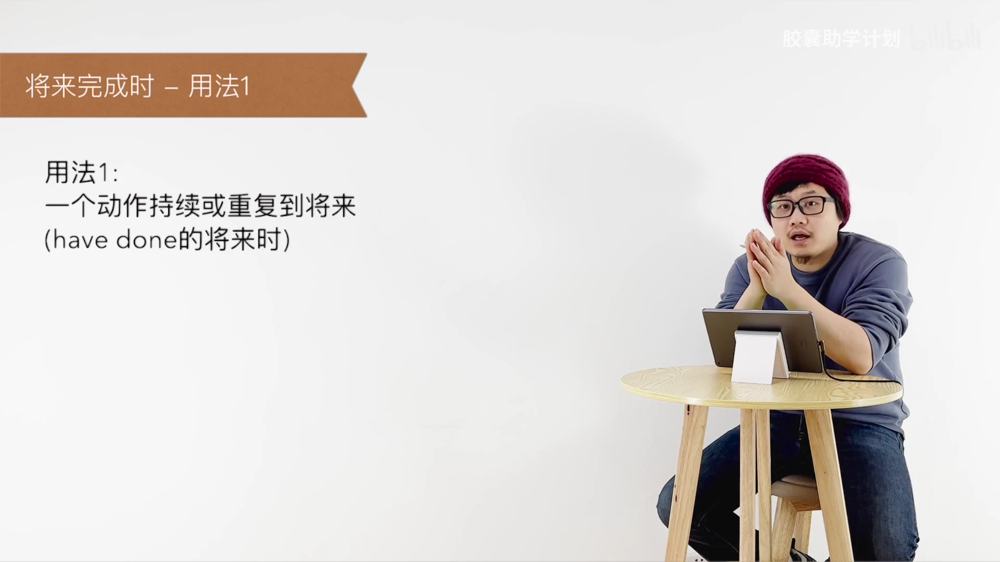

文字识别：将来完成时- 用法1 / 用法1： / 一个动作持续或重复到将来 / (have done的将来时)

## 00:01:30–00:02:00

去持续到了过去，比如说说截止到去年，哎，就比如说二月份，我已经在北京住了一年了，那这个就叫做过去完成时，因为一个动作从过去重复或持续到了过去，叫做过去完成时，对吧？那你从定义的角度来说，对吧？举一反三，照葫芦画瓢，我们说一个动作持续或重复到将来，那这个时态我们管它就叫做将来完成时，对吧？

### 画面 00:01:48

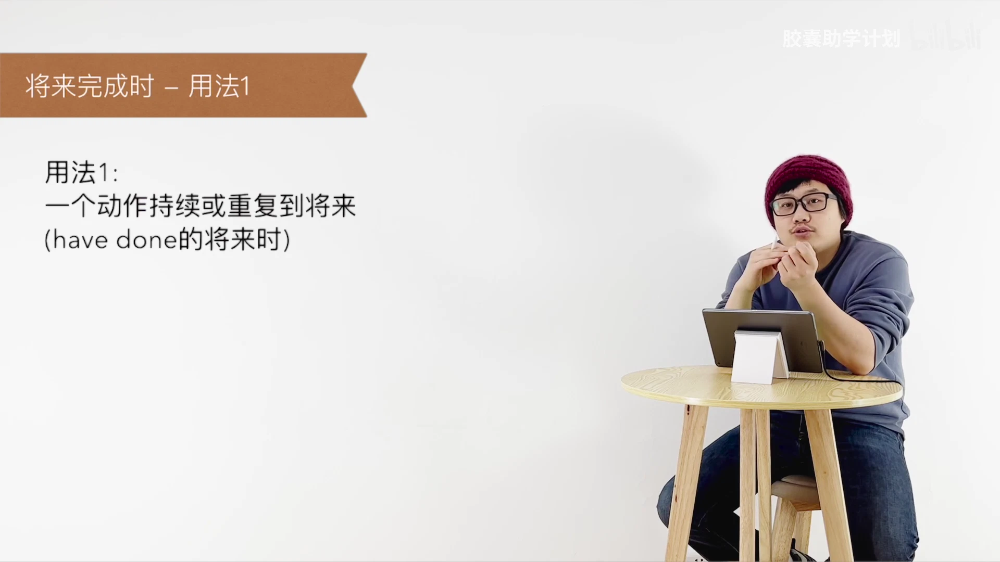

文字识别：将来完成时- 用法1 / 用法1: / 一个动作持续或重复到将来 / (have done的将来时)

## 00:02:00–00:02:30

哎，所以我们管它叫 have done 的将来时。那我们从结构上想一下，我待会儿直接给各位就不会进行推导了。但是我们先去想一下，现在完成时是 have 加上 done，过去完成时是把 have 或 has 统统归化为一个单词叫 had，然后再加上 done，这都是我们之前学的，今天只是复习一下，对吧？然后呢，我们接下来要说将来完成时的结构长成什么样子

### 画面 00:02:18

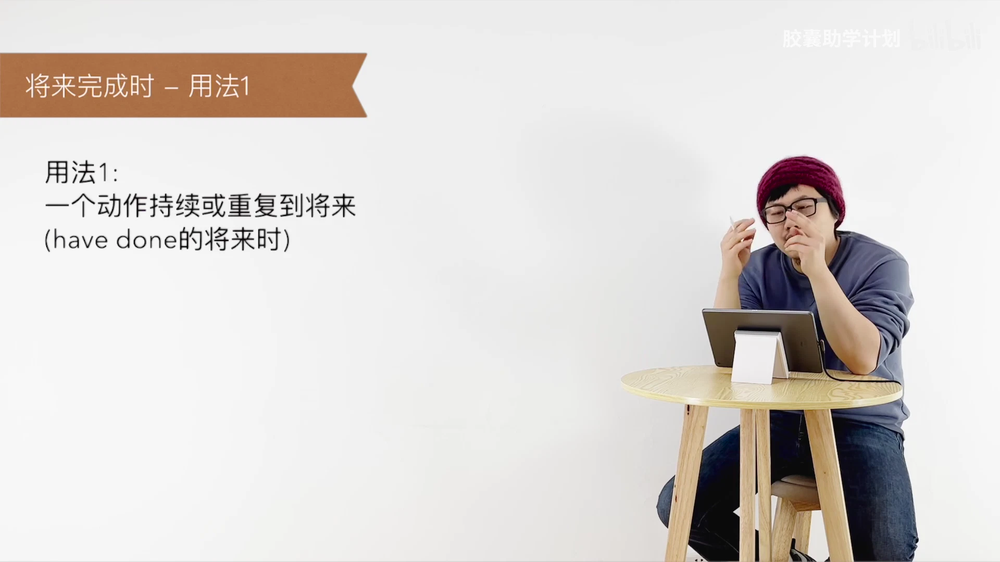

文字识别：将来完成时- 用法1 / 用法1： / 一个动作持续或重复到将来 / (have done的将来时)

## 00:02:30–00:03:00

呢？先直接给各位叫做 will have done，怎么去理解它？其实挺简单。您想一下这几个时态对应的，我们已经学过的啊，叫做现在进行时是 am is are 加 doing，过去进行时是把 am is are 换成了 was were 再加 doing，将来进行时是怎么走来着？是把 was were am is are 全换成了原形叫 be，然后前面再加一个

### 画面 00:02:30

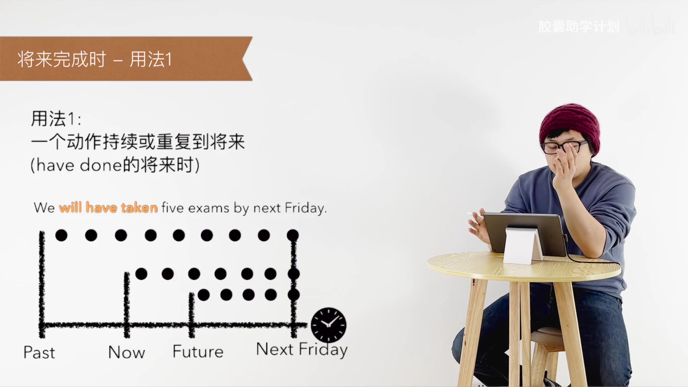

文字识别：将来完成时 － 用法1 / 用法1: / 一个动作持续或重复到将来 / (have done的将来时) / We will have taken five exams by next Friday. / Next Friday / Past / Now / Future

## 00:03:00–00:03:30

单词叫做 will，于是它叫做 will be doing。那我们现在其实做的事情就是，你不管是 have has 还是 had，对吧？这三个单词我不管你，你都给我换回原形，原形就是一个单词 have，对吧？然后前面再加一个单词叫 will，所以它的基本结构叫做 will 加 have 再加上单。我说清楚了吧？OK。那为什么还要画这个图呢？

### 画面 00:03:00

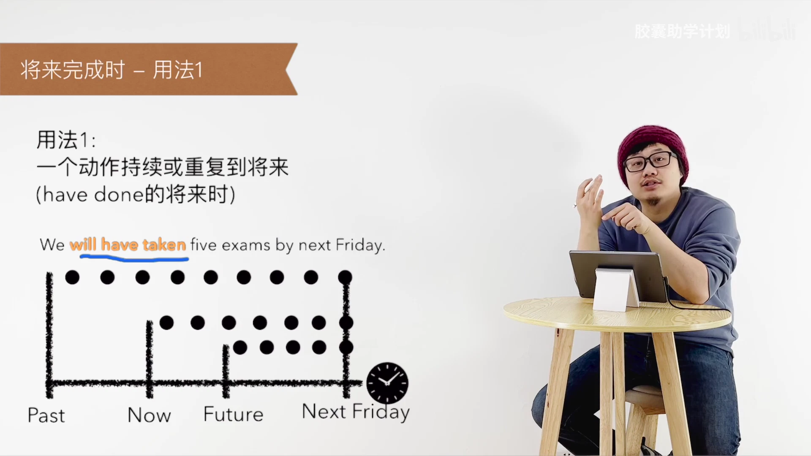

文字识别：将来完成时- 用法1 / 用法1: / 一个动作持续或重复到将来 / (have done的将来时) / We will have taken five exams by next Friday. / Next Friday / Past / Now / Future

## 00:03:30–00:04:00

就是想告诉各位这样一件事情。你看这句话叫做一个动作重复或持续到将来。注意这个图想告诉各位的就是这个动作是从过去开始持续到将来，是从现在开始持续到将来，还是从甚至是从将来开始持续到将来都不重要，都可以用将来完成时。我们比如说看这句话，We will

### 画面 00:03:30

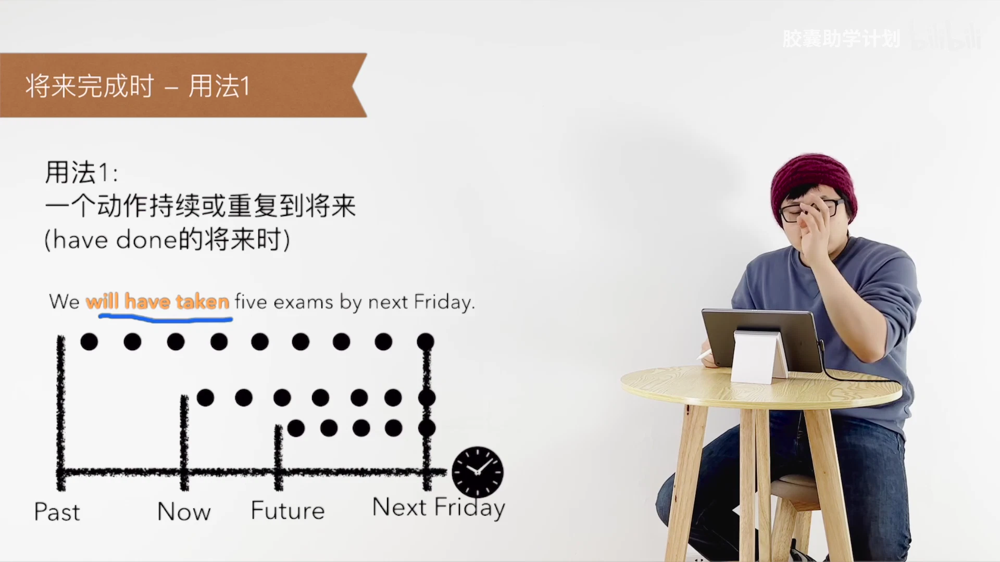

文字识别：将来完成时 - 用法1 / 用法1: / 一个动作持续或重复到将来 / (have done的将来时) / We will have taken five exams by next Friday. / Next Friday / Past / Now / Future

### 画面 00:03:34

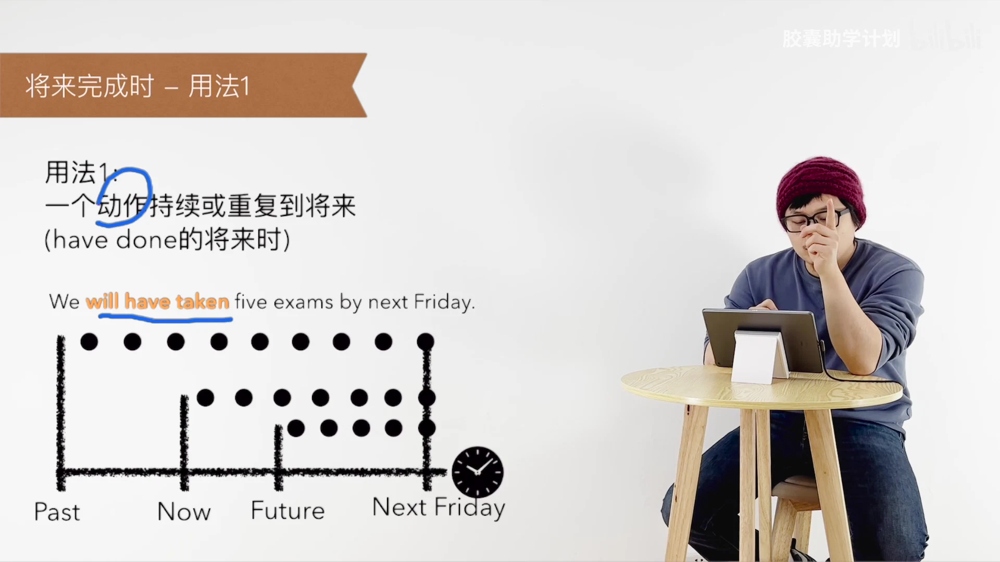

文字识别：将来完成时- 用法1 / 用法1 / 一个幼作持续或重复到将来 / (have done的将来时) / We will have taken five exams by next Friday. / Next Friday / Past / Now / Future

## 00:04:00–00:04:30

have taken five exams by next Friday.首先，我们能确定的是，next Friday一定是将来，这是没有任何问题的。其次，我用的结构叫做will have taken。按照我们目前只知道，它叫做一个动作持续或重复到将来。那taken five exams就是典型的重复，重复了五次，对吧？说截止到下周五，我们将已经考了五次试。

### 画面 00:04:04

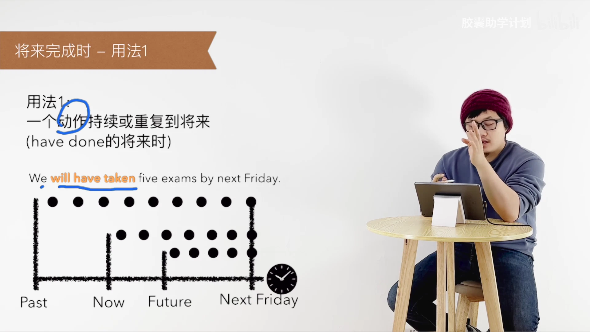

文字识别：将来完成时- 用法1 / 用法1 / 一个幼作持续或重复到将来 / (have done的将来时) / We will have taken five exams by next Friday. / Next Friday / Past / Now / Future

### 画面 00:04:07

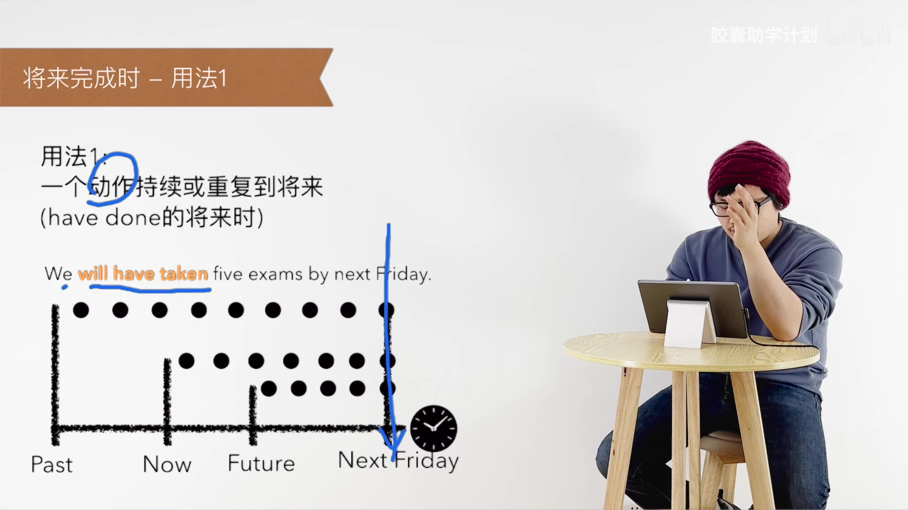

文字识别：将来完成时 - 用法1 / 用法1 / 一个幼作持续或重复到将来 / (have done的将来时) / We will have taken five exams by next Ffiday. / NextFriday / Past / Now / Future

### 画面 00:04:09

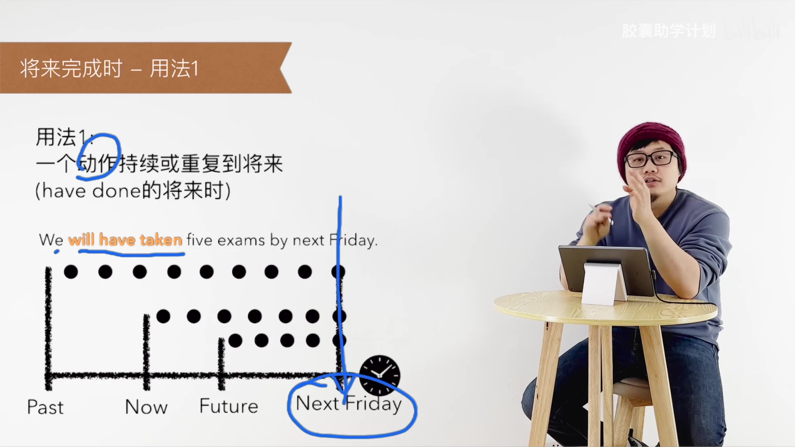

文字识别：将来完成时 - 用法1 / 用法1 / 一个幼作持续或重复到将来 / (have done的将来时) / We will have taken five exams by next Friday. / NextFriday / Past / Now / Future

### 画面 00:04:21

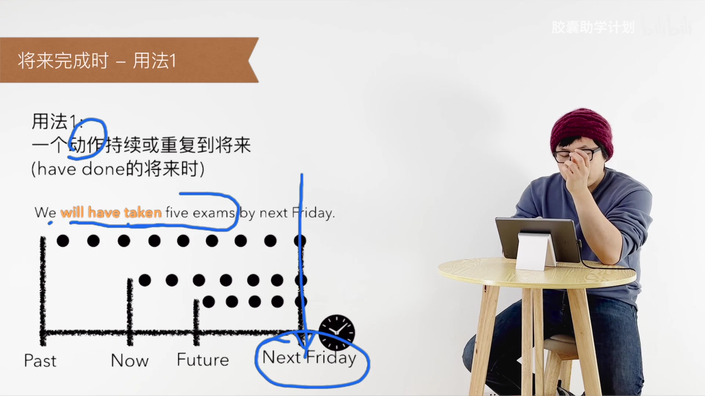

文字识别：将来完成时 - 用法1 / 用法1 / 一个幼作持续或重复到将来 / (have done的将来时) / We will have taken f /  five examsby next Friday. / Next Friday / Past / Now / Future

## 00:04:30–00:05:00

至于这第一次考试是以前发生的，是现在发生的，甚至还是将来发生的都不重要。我举个例子啊，比如说，看各位能不能反应过来啊？今天我们把它定为周二，是本周二，对吧？然后这个 future 呢，假设说是下周一啊，下周一，那第一次考试是下周一开始

### 画面 00:04:34

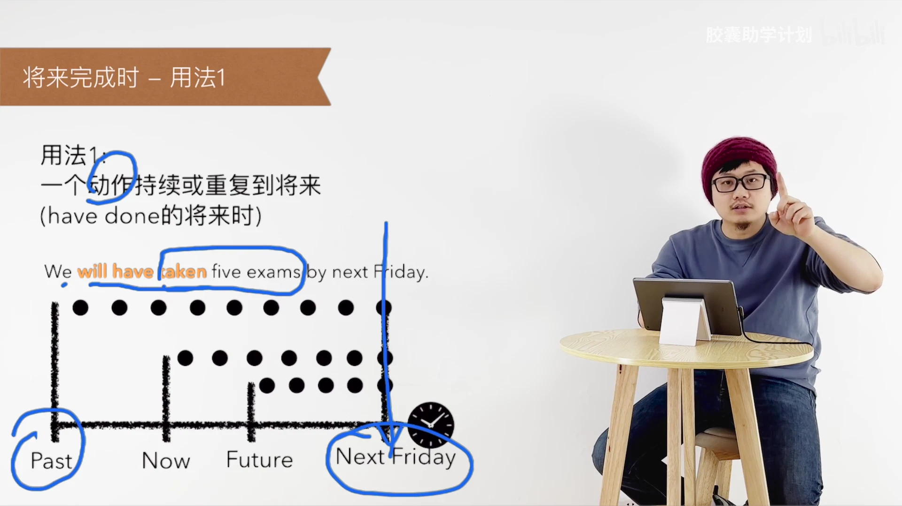

文字识别：将来完成时- 用法1 / 用法1 / 一个幼作持续或重复到将来 / (have done的将来时) / We will have aken / five examsby next Friday. / NextFriday / Past / Now / Future

### 画面 00:04:36

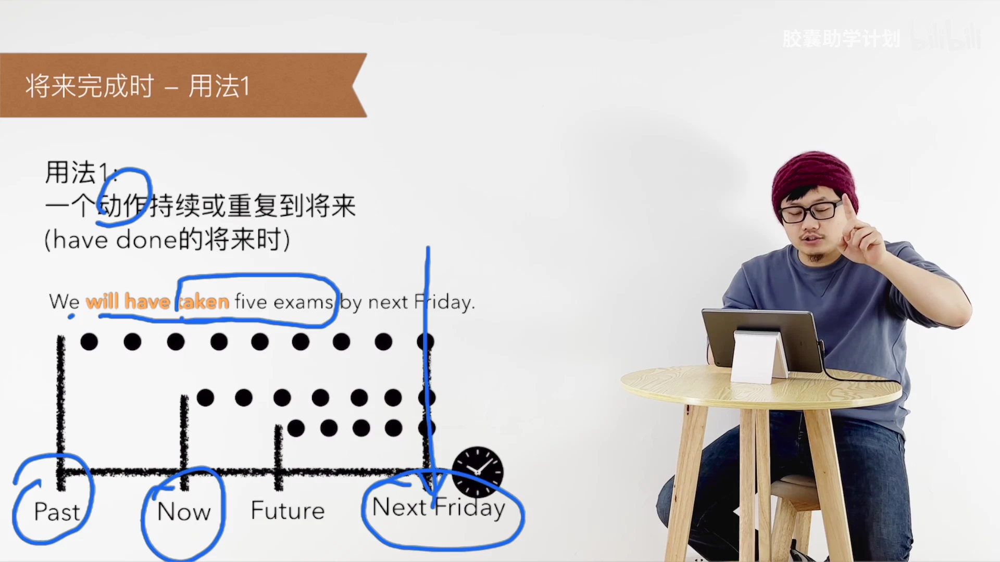

文字识别：将来完成时- 用法1 / 用法1 / 一个幼作持续或重复到将来 / (have done的将来时) / We will have aken / five examsby next Friday. / NextFriday / Past / 'Now / Future

### 画面 00:04:38

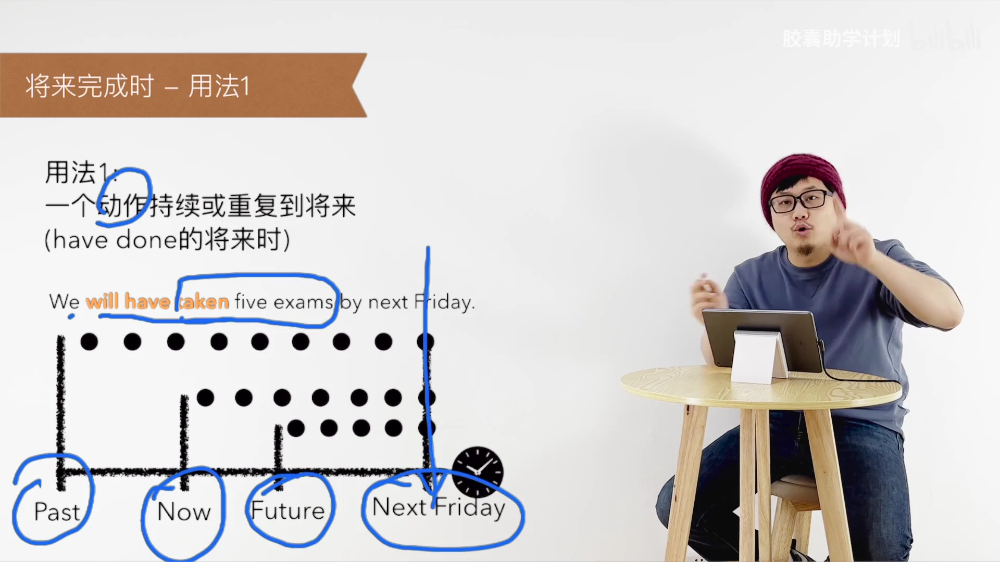

文字识别：将来完成时－ 用法1 / 用法1 / 一个幼作持续或重复到将来 / (have done的将来时) / We will have aken / five examsby next Friday. / NextFriday / Past / Now / Future

### 画面 00:04:42

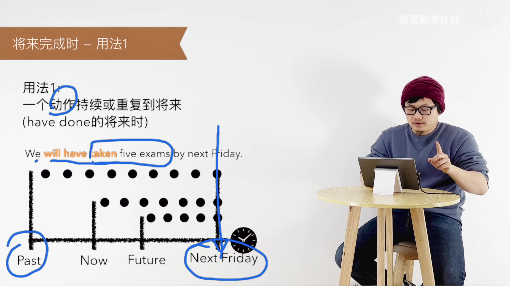

文字识别：将来完成时 - 用法1 / 用法1 / 一个幼作持续或重复到将来 / (have done的将来时) / We will have aken / five exams)by next Friday. / Next Friday / Past / Now / Future

### 画面 00:04:44

文字识别：将来完成时 - 用法1 / 用法1 / 一个幼作持续或重复到将来 / (have done的将来时) / We will have aken / five examsby next Friday. / Next Friday / Past / Now / Future

### 画面 00:04:51

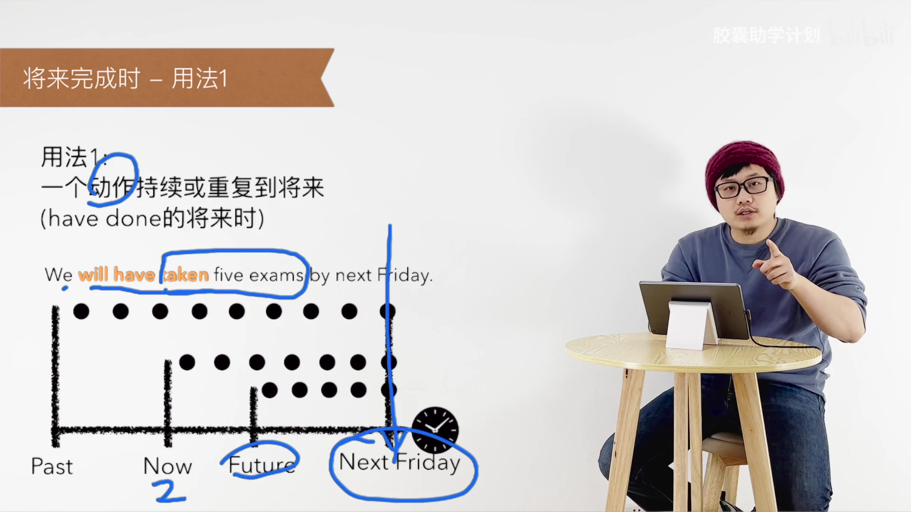

文字识别：将来完成时- 用法1 / 用法1 / 一个幼作持续或重复到将来 / (have done的将来时) / We will have aken / five examsby next Friday. / Next Friday / Past / Now / Future / 2

### 画面 00:04:56

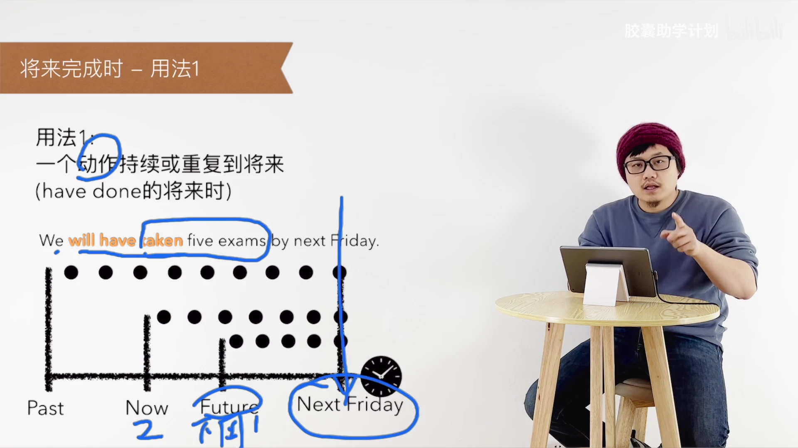

文字识别：将来完成时- 用法1 / 用法1 / 一个幼作持续或重复到将来 / (have done的将来时) / We will have aken / five examsby next Friday. / Next Friday / Past / Now / Futur / 2

## 00:05:00–00:05:30

的，还是本周二开始的，还是本周二开始之前的任何一个时间都无所谓。他想表达的叫做从任何时间开始，叫做截止到下周五，我连着考了五次试。比如说我是从下周一开始考的第一次考试，那截止到下周五我考了五次了，我说清楚了吧？所以这个动作从何时开始并不重要。这个时态想强调的

### 画面 00:05:05

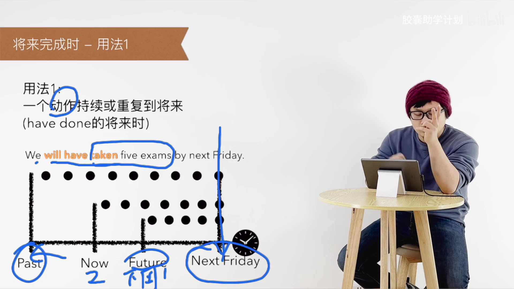

文字识别：将来完成时- 用法1 / 用法1 / 一个幼作持续或重复到将来 / (have done的将来时) / We will have laken / five exams / by next Friday. / Next Friday / Past / Now / Futur / 2

## 00:05:30–00:06:00

事情叫做这个动作在何时也不是结束，叫重复到什么时间啊，对吧？所以持续或重复到将来，所以它重点想强调的并不是这边看见了啊，重点想强调的是右边，也就是未来的这个时间。我应该说清楚了，好吧？好，那肯定句就是 will 加 have 再加上一个 that，对吧？哎，叫做哎哎，这个截

### 画面 00:05:35

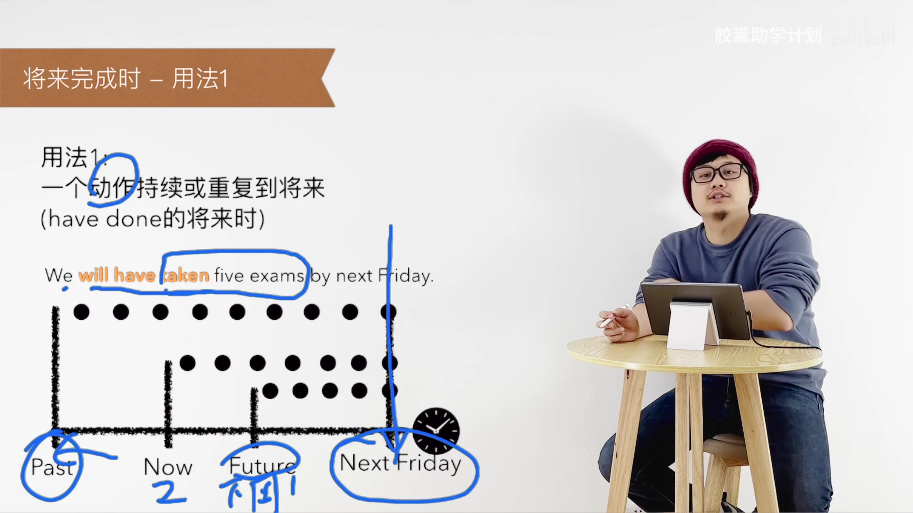

文字识别：将来完成时- 用法1 / 用法1 / 一个幼作持续或重复到将来 / (have done的将来时) / We will have aken / five exams / by next Friday. / NextFriday / Past / Now / Futur / 2

### 画面 00:05:42

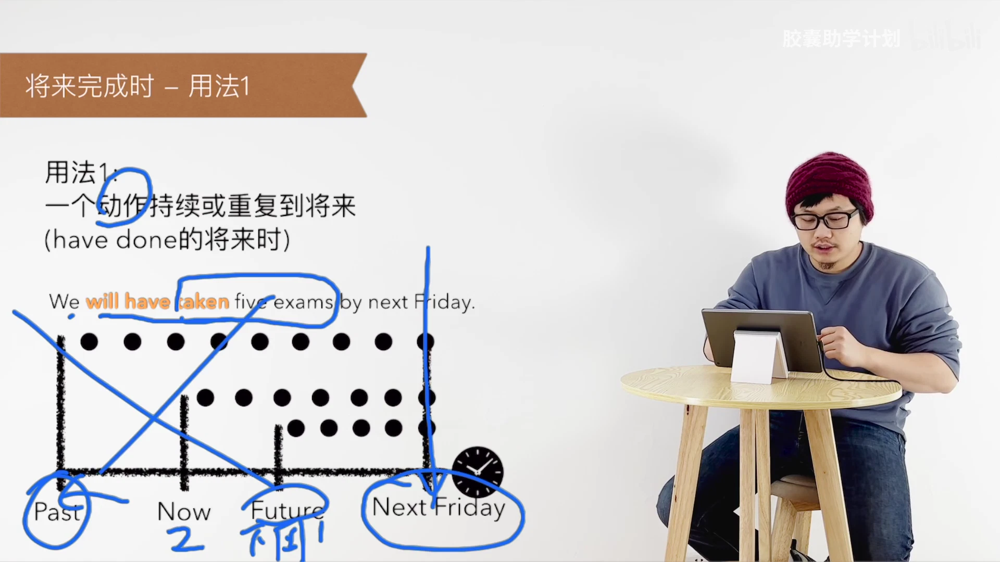

文字识别：将来完成时－ 用法1 / 用法1 / 一个幼作持续或重复到将来 / (have done的将来时) / We / will have laken / fiv examsby next Friday. / Next Friday / Past / Now / Futur / 2

### 画面 00:05:44

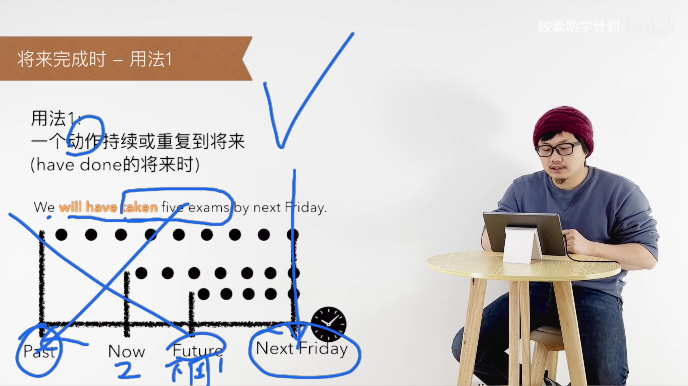

文字识别：将来完成时- 用法1 / 用法1 / 一个幼作持续或重复到将来 / (have done的将来时) / We will have laken / fiv examsby next Friday. / NextFriday / Now / Futur / 2

### 画面 00:05:50

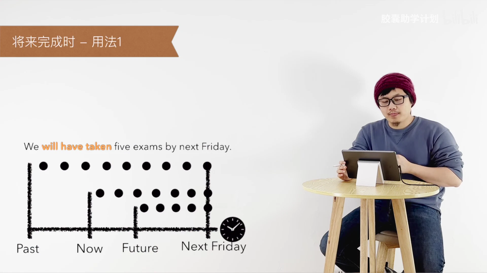

文字识别：将来完成时－用法1 / We will have taken five exams by next Friday. / Next Friday / Past / Now / Future

### 画面 00:05:52

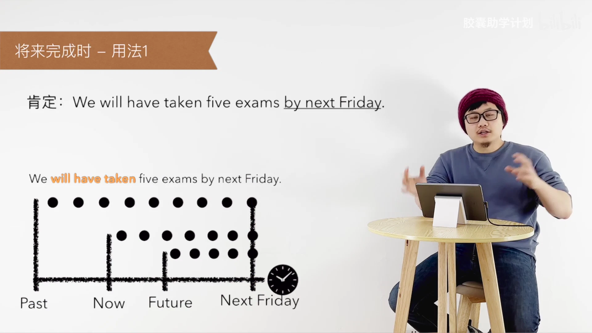

文字识别：将来完成时－ 用法1 / 肯定：We wil have taken five exams by next Friday. / We will have taken five exams by next Friday. / Next Friday / Past / Now / Future

### 画面 00:05:55

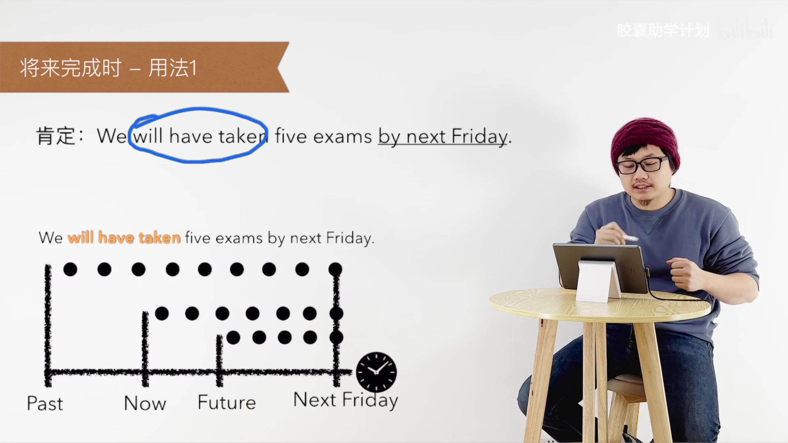

文字识别：将来完成时- 用法1 / 肯定：Wewill have taken / five exams by next Friday. / We will have taken five exams by next Friday. / Next Friday / Past / Now / Future

## 00:06:00–00:06:30

止到下周五啊，我们将已经考了五次考试了。然后这个 by next Friday，我们待会儿进入文章会见过，见很多遍，叫做截止怎么怎么样，对吧？这个就是一个小的时间状语上的一个小的介词啊，您不用花太多的时间精力去管它。肯定句给各位了，接下来我们必定要去思考它的否定句和一般疑问句。它的否定句非常的简单，就是 will 后边加

### 画面 00:06:07

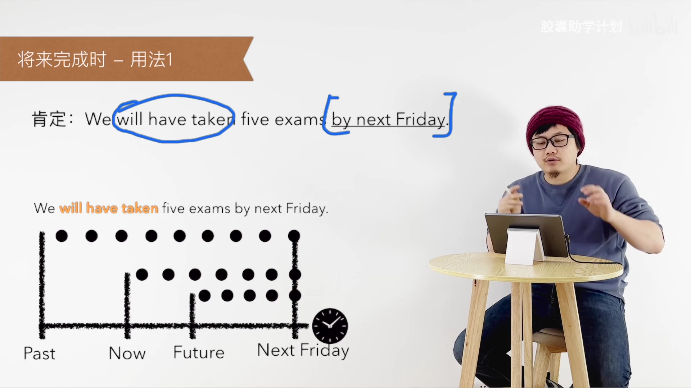

文字识别：将来完成时－ 用法1 / 肯定：Wewill have taken / five exams / by next Friday. / We will have taken five exams by next Friday. / Next Friday / Past / Now / Future

### 画面 00:06:20

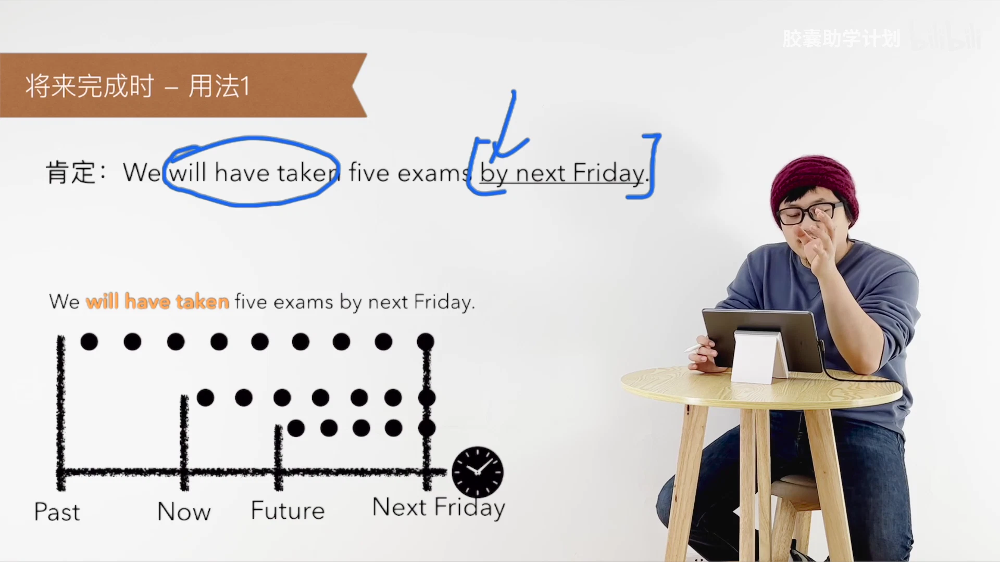

文字识别：将来完成时－用法1 / 肯定：Wewill have taken / five exams / by next Friday. / We will have taken five exams by next Friday. / Next Friday / Past / Now / Future

### 画面 00:06:29

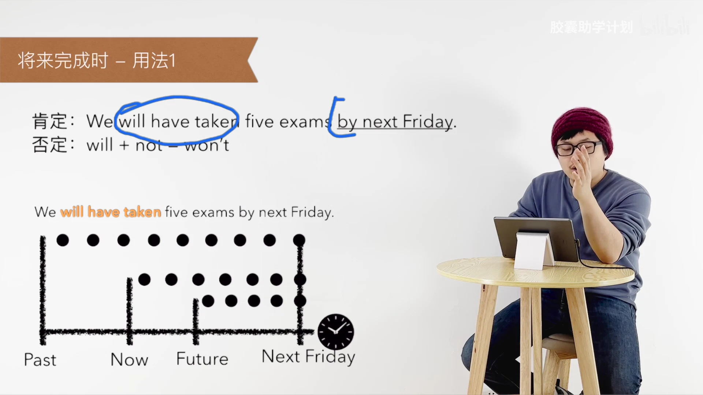

文字识别：将来完成时－用法1 / 肯定：Wewill have takent / five exams / by next Friday. / 否定：will+ not—won't / We will have taken five exams by next Friday. / Next Friday / Past / Now / Future

## 00:06:30–00:07:00

not，缩写叫 won't。一般疑问句也非常的简单，就是把 will 提到句首去，这个事儿就结束了。听见了吧？啊，非常的简单，对吧？所以第一个用法，我们再回顾一下，指的是一个动作重复或持续到未来的某个时间，这个就叫做将来完成时，对吧？OK。那接下来我们要做的事情是看一下这个图，我们给了各

### 画面 00:06:31

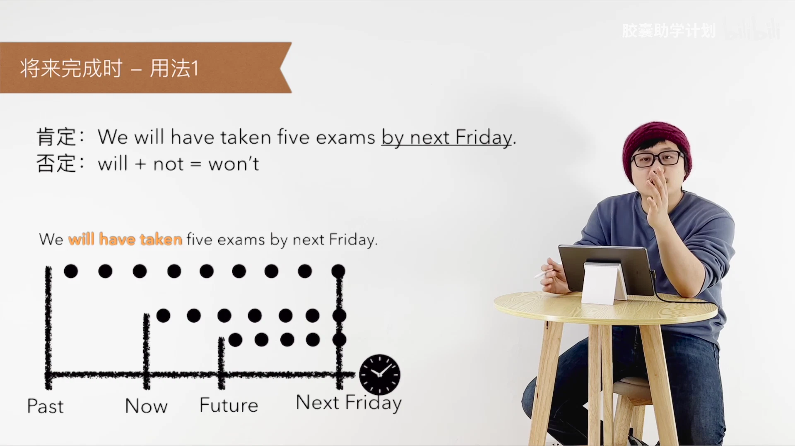

文字识别：将来完成时- 用法1 / 肯定： We will have taken five exams by next Friday. / 否定：will + not = won't / We will have taken five exams by next Friday. / Next Friday / Past / Now / Future

### 画面 00:06:45

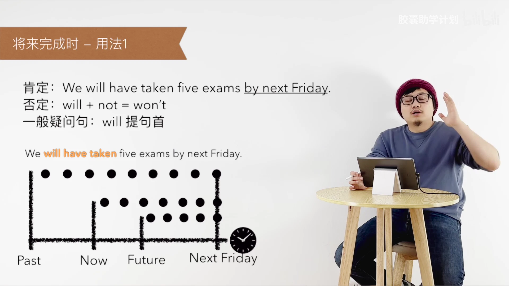

文字识别：将来完成时- 用法1 / 肯定： We will have taken five exams by next Friday. / 否定： will + not = won't / 一般疑问句：will 提句首 / We will have taken five exams by next Friday. / Next Friday / Past / Now / Future

### 画面 00:06:54

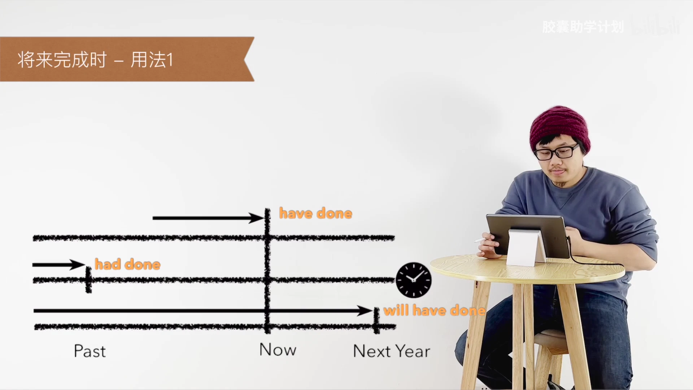

文字识别：将来完成时- 用法1 / have done / had done / will have done / Past / Now / Next Year

## 00:07:00–00:07:30

位三个截止时间，第一个截止时间是过去，第二个截止时间是现在，第三个截止时间是将来 next year 明年。然后又给各位了三个不同的什么呢结构 have done 现在完成时 had done 过去完成时 will have done 将来完成时。现在完成时有一个用法叫做从过去任意时间都行，

### 画面 00:07:05

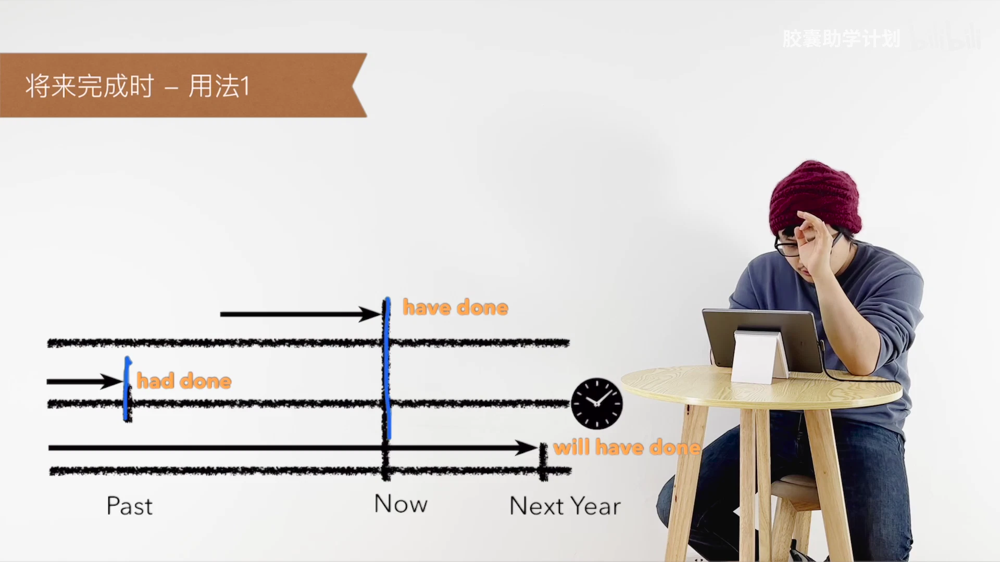

文字识别：将来完成时- 用法1 / have done / had done / will have done / Past / Now / Next Year

### 画面 00:07:15

文字识别：将来完成时- 用法1 / have done / had done / will have done / Past / Now / Next Year

### 画面 00:07:19

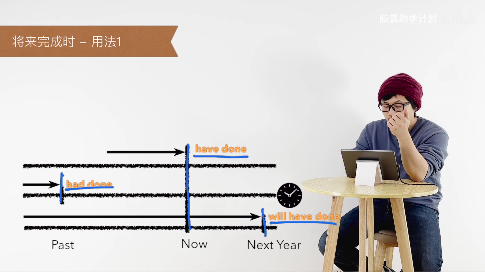

文字识别：将来完成时- 用法1 / have done / had done / will have done / Past / Now / Next Year

### 画面 00:07:29

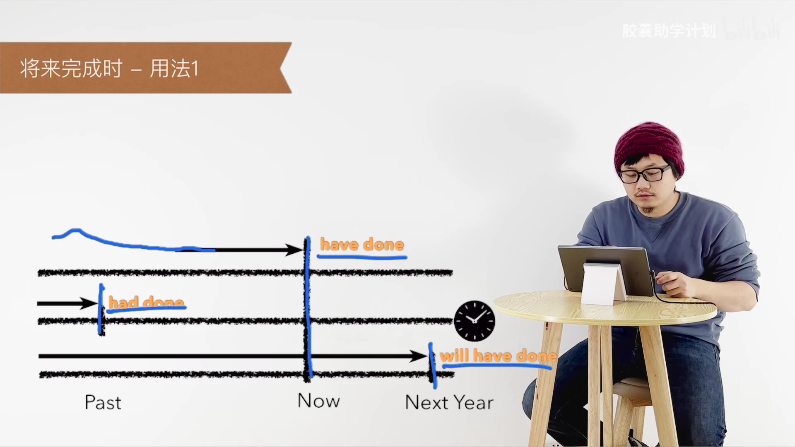

文字识别：将来完成时 - 用法1 / have done / had done / will have done / Past / Now / Next Year

## 00:07:30–00:08:00

重复持续到现在，现在完成时，过去完成时叫做从过去的过去重复或持续到过去的某一个时间点，而将来完成时，你在什么时候开始无所谓，但重点叫做一定是截止到将来。比如说，我们看三句话，第一句话，Ted and Amy have been married for

### 画面 00:07:31

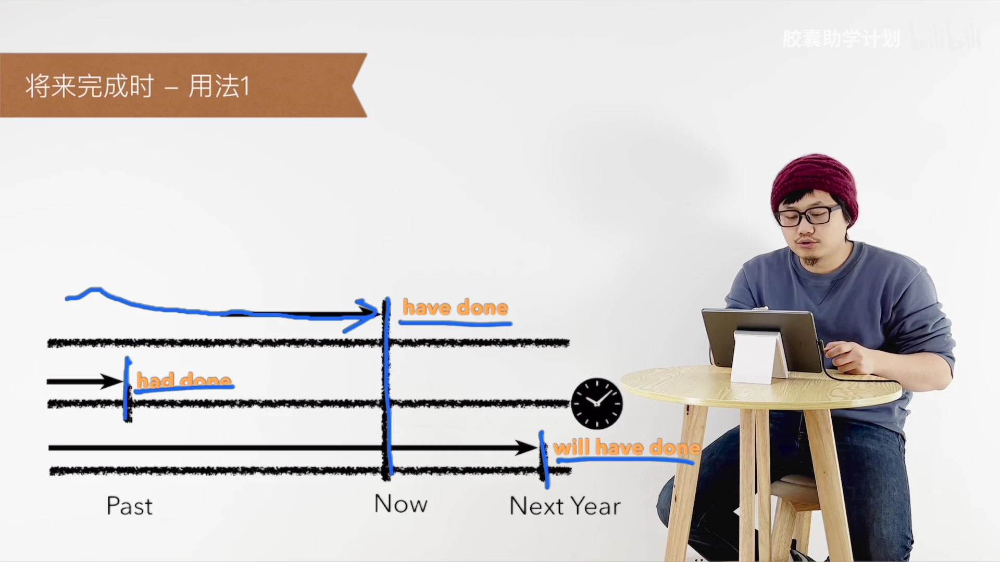

文字识别：将来完成时 - 用法1 / have done / had done / will have done / Past / Now / Next Year

### 画面 00:07:37

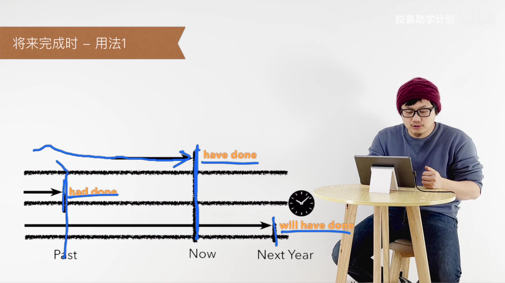

文字识别：将来完成时-用法1 / have done / had done / will have done / Past / Now / Next Year

### 画面 00:07:40

文字识别：将来完成时- 用法1 / have done / had done / will have done / Past / Now / Next Year

### 画面 00:07:44

文字识别：将来完成时 - 用法1 / have done / had done / will have done / Past / Now / Next Year

### 画面 00:07:50

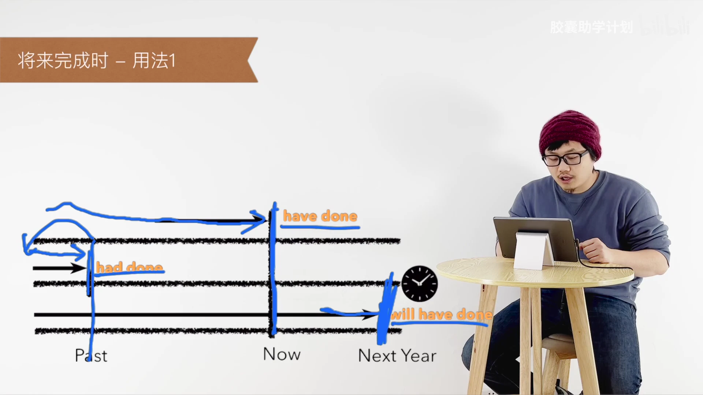

文字识别：将来完成时- 用法1 / have done / had done / will have done / Past / Now / Next Year

### 画面 00:07:52

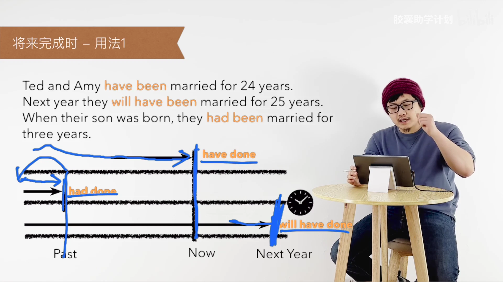

文字识别：将来完成时- 用法1 / Ted / and Amy / have / been married for 24 / years. / Next year they / will have / been married for 25 / years. / When / their son was / s born, they / had / been r / married for / three years. / have done / had done / will have done / Past / Now / Next Year

## 00:08:00–00:08:30

twenty-four years.呃，Ted和Amy这两个人已经结婚二十四年了。注意，这叫持续到现在结婚满二十四年了。第二句话叫Next year they will have been married for twenty-five years.叫做明年他们将已经结婚二十五年了。你注意，叫截止到明年一个动作或状态重复持续重复或持续到了

### 画面 00:08:02

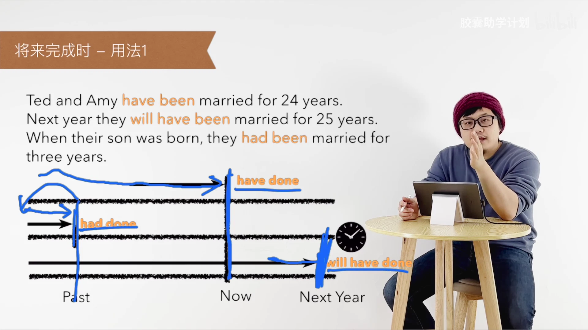

文字识别：将来完成时 - 用法1 / Ted / and Amy / have / been married for 24 years. / Next year they / will have / been married for 25 / years. / When / their son was born, they / had been married for / three years. / have done / had done / will have done / Past / Now / Next Year

### 画面 00:08:21

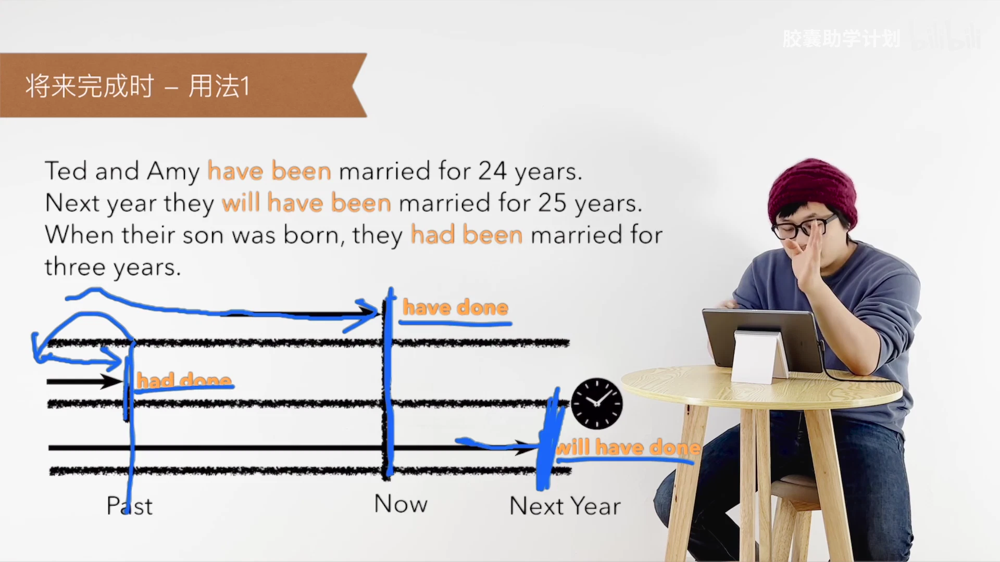

文字识别：将来完成时- 用法1 / Ted / and Amy / have / beenI / married for 24 / years. / Next year they / will have / been married for 25 / years. / When / their son was / ; born, they / had / been married for / three years. / have done / had done / will have done / Past / Now / Next Year

### 画面 00:08:23

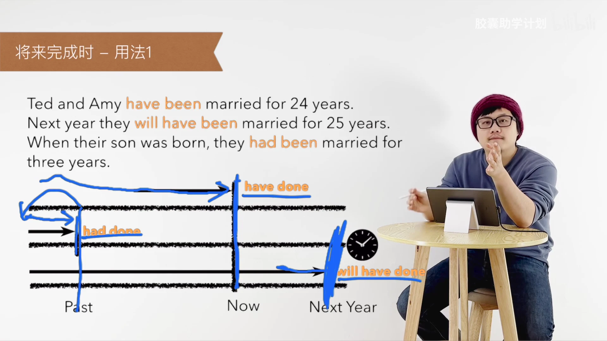

文字识别：将来完成时 - 用法1 / Ted / and Amy / have / beenI / married for 24 / years. / Next year they / will have / been married for 25 / years. / When / their son was / ; born, they / had / been / married for / three years. / have done / had done / will have done / Past / Now / Next Year

### 画面 00:08:25

文字识别：将来完成时 - 用法1 / Ted / and Amy / have / been married for 24 / years. / Next year they / will have / been married for 25 / years. / When / their son was / ; born, they / had been married for / three years. / have done / had done / will have done / Past / Now / Next Year

## 00:08:30–00:09:00

明年的时候，这个状态是二十五年了，看见了吧？将来完成时。如果说 when their son was born，当他们儿子出生的时候，they had been married for three years，叫做他们已经结婚结婚了三年了。你注意这个叫做 had been，叫做过去完成时，对吧？OK啊，那不都说了，接着往下走。刚才说的是第一个用法，以及在第一个用法

### 画面 00:08:40

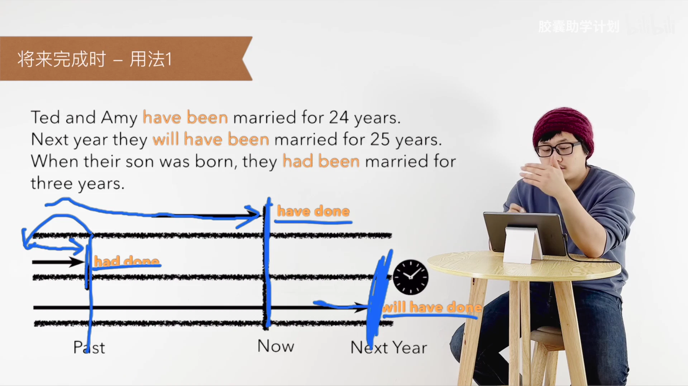

文字识别：将来完成时- 用法1 / Ted / and Amy / have / beenI / married for 24y / years. / Next year they / will have / been married for 25 / years. / When / their son was / s born, they / had / been married for / three years. / have done / had done / will have done / Past / Now / Next Year

### 画面 00:08:46

文字识别：将来完成时- 用法1 / Ted / and Amy / have / been / married for 24 / years. / Next / t year they / will have / been / married for 25 / years. / When / their  / son was / ; born, they / had been / married for / three years. / have done / had done / will have done / Past / Now / Next Year

### 画面 00:08:54

文字识别：将来完成时- 用法2 / Future Next Friday / Past / Now

## 00:09:00–00:09:30

之下，这三个时态的区别就取决于截止到什么时间点完成。截止到现在就是现在完成时，截止到过去就是过去完成时，截止到将来就是将来完成时，对吧？就这么简单啊。还有第二个用法，第二个用法我们看一下，叫做一个动作截止到未来的某个时间前，它就完成了。比如说，我们看这个图，未来的时间叫 next

### 画面 00:09:17

文字识别：将来完成时- 用法2 / 用法2: / 一个动作截止到未来某个时间前完成 / Future Next Friday / Past / Now

### 画面 00:09:29

文字识别：将来完成时－ 用法2 / 用法2： / 一个动作截止到未来某个时间前完成 / Future Next'Friday / Past / Now

## 00:09:30–00:10:00

Friday，但是在截止在这个时间之前，它也是未来，看见了吧？还是未来，它就完成了，在这个地方就完成了。比如说，我们造一个句子，说 I will have finished my homework by next Friday. 好了，首先各位在学现在完成时以及其他的时态的时候，应该注意到了这个点，叫做你的用法随便变，我的结构都是一样的，对吧？我不会因为你的用

### 画面 00:09:36

文字识别：将来完成时 － 用法2 / 用法2: / 一个动作截止到未来某个时间前完成 / Futu/e NextFriday / Past / Now

### 画面 00:09:38

文字识别：将来完成时 － 用法2 / 用法2: / 一个动作截止到未来某个时间前完成 / Futu/e NextFriday / Past / Now

### 画面 00:09:40

文字识别：将来完成时 － 用法2 / Future Next Friday / Past / Now

### 画面 00:09:42

文字识别：将来完成时－用法2 / 肯定：I will have finished my homework by next Friday. / Future Next Friday / Past / Now

### 画面 00:09:51

文字识别：将来完成时－用法2 / 肯定：I will have finished my homework by next Friday. / Future Next Friday / Past / Now

### 画面 00:09:55

文字识别：将来完成时- 用法2 / 肯定：I will have finished / my homework by next Friday. / Future Next Friday / Past / Now

## 00:10:00–00:10:30

法从第一个用法变成了第二个用法，比如说现在完成时，对吧？它有两个用法，一个叫延迟过去在当下，一个叫从过去重复或持续到现在，有两个用法。我不会因为你用法产生变化了之后，我结构就发生变化。我永远不管你用法是什么，我的结构永远都是 have has 加上 done，对吧？所以将来完成时是一样的用法，你随便换，对吧？我的结构 will have done 是不

### 画面 00:10:00

文字识别：将来完成时－ 用法2 / 肯定： / will have finished / my homework by next Friday. / Future Next Friday / Past / Now

### 画面 00:10:28

文字识别：将来完成时- 用法2 / 肯定： / Will have finished / my homework by next Friday. / Future Next Friday / Past / Now

## 00:10:30–00:11:00

换的，我说清楚了啊。肯定句是 I will have finished my homework by next Friday。说我将完成了我的家庭作业，叫截止到下周五，也就是在下周五之前，我的家庭作业应该就已经完成了。叫截止到未来的某个时间之前，这个事儿我做完了，叫做将来完成时。听见了啊？OK，玩一个。那它的肯定和否定、一般疑问句跟

### 画面 00:10:57

文字识别：将来完成时－ 用法2 / 肯定： / will have finished / my homework by next Friday. / 否定：will + not = won't / 一般疑问句：will 提句首 / Future Next Friday / Past / Now

## 00:11:00–00:11:30

我们之前说的也没有任何的变化，还是 will 后边加 no。一般疑问句 will 提到句首，好吧，那我们就不多说了。今天本课我们学最重要的一个语法叫做 will have done，你要清楚的知道它是动词加动词变化，也就是谓语这个地方的一个语法，所以比较的重要，好吧？我们造句子几乎离不开这些东西啊。OK，接下来呢，我们做一些小的听力口语练习，

### 画面 00:11:06

文字识别：will have done / 6时间 / 1主 / 2谓 / 3宾 / 4方式 / 5地点 / 6时间 / When? / Who? / action / Who? / How? / Where? / When? / Which? / (v.+v.变化) / Which? / What? / What?

### 画面 00:11:11

文字识别：will have done / 6时间 / 1主 / 2谓 / 3宾 / 4方式 / 5地点 / 6时间 / When? / Who? / action / Who? / How? / Where? / When? / Which? / (v.+v.变化) / Which? / What? / What?

### 画面 00:11:15

文字识别：will have done / 6时间 / 1主 / 谓 / 3宾 / 4方式 / 5地点 / 6时间 / When? / Who? / action / Who? / How? / Where? / When? / Which? / (v.+v.变化) / Which? / What? / What?

### 画面 00:11:26

文字识别：Repetition drill / 训练目标： / 听力口语 / 练习包含 will have done的句子 / Accuracy / Fluency

## 00:11:30–00:12:00

叫 repetition drill，练的都是包含 will have done 的句子。我们一起来看一下先，好吧，先看几个啊。第一个， hasn't he moved to his new flat yet？他难道还没有搬到他的新的公寓吗？好，no， but 还没搬呢。But he will have moved to his new flat by this time tomorrow。截止到明天的这个时候，他将已经搬去了他的新的公寓。一

### 画面 00:11:34

文字识别：Repetition drill

### 画面 00:11:45

文字识别：Repetition drill / 1 T:Hasn't he moved to his new flat yet? / S:No, but he will have moved to his new flat / by this time tomorrow.

### 画面 00:11:57

文字识别：Repetition drill / 1 T:Hasn't he moved to his new flat yet? / S:No, but he will have moved to his new flat / by this time tomorrow.

## 00:12:00–00:12:30

个动作截止到未来的某个时间之前完成，未来的某个时间之前叫明天这个时候，对吧？By this time tomorrow,啊，这在明天这个时候之前，他应该已经搬过去了。用的结构叫 will have done，看见了吧？所以英语我原来说过一个事儿，叫做我们用特殊的结构表达特殊的含义。那同理啊，或者说反过来说，叫做我们想表达特殊的含义，往往也需

### 画面 00:12:02

文字识别：Repetition drill / 1 T:Hasn't he moved to his new flat yet? / S:No, but he will have moved to his new flat / by this time tomorrow.

### 画面 00:12:16

文字识别：Repetition drill / 1 T:Hasn't he moved to his new flat yet? / S:No, but heWill have moveDto / his new flat / by this / time tomorrow.

### 画面 00:12:21

文字识别：Repetition drill / 1 T:Hasn't he moved to his new flat yet? / S:No, but he / will have movedto / his new flat / by this / time / tomorrow.

## 00:12:30–00:13:00

要用到特殊的结构。那在这个地方，特殊的结构是 will have done，特殊的含义叫做截止到未来的某一个时间点之前动作完成，对吧？剩下都是一样的啊。好，比如说 haven't you finished your work yet？难道你还没有完成你的工作吗？No， but I shall have finished my work by this time tomorrow。好，这地方我提一个小点，shall

### 画面 00:12:44

文字识别：Repetition drill

### 画面 00:12:52

文字识别：Repetition drill / 2 T:Haven't you finished your work yet? / S:No, but I shall have finished my work by / this time tomorrow.

## 00:13:00–00:13:30

对于各位来说就是will啊，至少在这个里面，对吧？所以will have done它还是将来完成时，对吧？Okay, next one,说haven't you and Mary learned the results yet？你们还不知道结果吗？No, but we shall have learned the results by this time tomorrow，对吧？截止到明天这个时间点之前，我们应该已经知道了。Okay, next one，剩下都跟我大声

### 画面 00:13:00

文字识别：Repetition drill / w'll / 2 T:Haven't you / finished your work yet? / S:No, but I shalLhave / e finished my work by / this / time tomorrow.

### 画面 00:13:10

文字识别：Repetition drill / 3 T:Haven't you and Mary learnt the results yet?

### 画面 00:13:17

文字识别：Repetition drill / 3 T:Haven't you and Mary learnt the results yet? / S:No, but we shall have learnt the results by this / time tomorrow.

### 画面 00:13:27

文字识别：Repetition drill

## 00:13:30–00:14:00

张嘴读就行了啊！来了。Hasn't George completed his novel yet? No, but he will have completed his novel by this time tomorrow. Next one. Haven't you received a reply yet? No, but I shall have received a reply by this time tomorrow. Next one. Haven't Tom and Mary

### 画面 00:13:37

文字识别：Repetition drill / 4 T:Hasn't George completed his novel yet? / S:No, but he will have completed his novel / by this time tomorrow.

### 画面 00:13:45

文字识别：Repetition drill / 5 T:Haven't you received a reply yet?

### 画面 00:13:50

文字识别：Repetition drill / 5 T:Haven't you received a reply yet? / S:No, but I shall have received a reply by this / time tomorrow

### 画面 00:13:56

文字识别：Repetition drill

## 00:14:00–00:14:30

decorated this room yet? No, but they will have decorated this room by this time tomorrow. Next one, haven't you and Mary heard from him yet? No, but we shall have heard from him by this time tomorrow. Next one, haven't you seen the new stadium yet? No, but I shall have seen the new

### 画面 00:14:02

文字识别：Repetition drill / 6 T:Haven't Tom and Mary decorated this / room yet? / S:No, but they will have decorated this room / by this time tomorrow.

### 画面 00:14:09

文字识别：Repetition drill / 7 T:Haven't you and Mary heard from him yet?

### 画面 00:14:26

文字识别：Repetition drill / 8 T:Haven't you seen the new stadium yet? / S:No, but I shall have seen the new stadium / by this time tomorrow.

## 00:14:30–00:15:00

stadium by this time tomorrow. Next one. Hasn't your teacher corrected those exercise books yet? No, but they will have corrected those exercise books by this time tomorrow.啊，各位跟我读的时候，如果太快你反应不过来，你不妨暂停屏幕，或者甚至回去再听一遍，对吧？然后把这个地方该看的看一下，该翻译的翻译一下，对吧？好。接下来,

### 画面 00:14:33

文字识别：Repetition drill

### 画面 00:14:40

文字识别：Repetition drill / 9 T:Hasn't your teacher corrected those / exercise books yet? / S:No, but he will have corrected those / exercise books by this time tomorrow.

### 画面 00:14:54

文字识别：Repetition drill / 9 T:Hasn't your teacher corrected those / exercise books yet? / S:No, but he will have corrected those / exercise books by this time tomorrow.

### 画面 00:14:57

文字识别：Repetition drill

## 00:15:00–00:15:30

haven't they delivered those parcels yet? 都是我们之前学的单词啊。 No, but they will have delivered those parcels by this time tomorrow. Okay, 那第一题结束，第二题 pattern drill，老习惯对吧？哎，练习的是包含完成时态的句子，哎，关键句型都是。所以接下来我们做的事情呢是，呃，我呢把这两句话 I C S 二给大家说清楚，你要带什么，各位课下把这些东西带进

### 画面 00:15:05

文字识别：Repetition drill / 10 T:Haven't they delivered those parcels yet? / S: No, but they will have delivered those parcels / by this time tomorrow.

### 画面 00:15:11

文字识别：Pattern drill / 训练目标： / 写作口语 / 练习包含完成时态的句子 / Accuracy / Fluency

### 画面 00:15:17

文字识别：Pattern drill / 1 T:writing your essay / S1:Will you still be writing your essay / at six? / S2:No, I'll have written it by then. / reading the papers / mowing the lawn / washing the / dishes / doing the crossword / mending t /  the radio / preparing / supper / painting the gate ironing the clothes

## 00:15:30–00:16:00

去，写完了之后大声朗读，好吧？来了啊。说，Will you still be writing your essay at six?哎，注意先看时态，这句话当中练的是will be doing，将来进行时。说，在六点钟的时候，你还会在写你的essay，你的哎这个论文作业吗？啊，文章吗？No, I will have written it by then.截止到那个时间之前，我应该已经

### 画面 00:15:47

文字识别：Pattern drill / 1 T:writing your essay / S1:Will you still be writing your essay / at six? / S2:No, I'll have written it by then. / reading the papers / mowing the lawn / washing the / dishes / doing the crossword / mending t /  the radio / preparing / supper / painting the gate ironing the clothes

## 00:16:00–00:16:30

写完它了，对吧？Okay, very good. Will have done.哎，你看这两句话练的一个是将来进行时，一个是将来完成时，对吧？Will be doing, will have done.第二题，They've started to build the stadium.他们已经开始要建这个这个stadium，这个露天体育场了。I hope they will have finished it in time for the games.啊，他们会为

### 画面 00:16:12

文字识别：Pattern drill / 2 T:build the stadium - Games / S1:They've started to build the stadium. / S2:I hope they'll have finished it in time for / the Games. / paint/mend the boat - holiday/week / end clean/arrange the hall- debate/meeting / repair/mend the car - journey/trip / prepare/test the plane - flight/race

## 00:16:30–00:17:00

这个比赛，奥林匹克运动会，他们能及时在那个事件之前及时的完成，对吧？Finish it,完成它。Will have done,对不对？Okay,啊，各位还是往里带，不多说。Next one, the gate hasn't been painted yet.现在完成时的被动，练习的是是吧？还没有被上漆上色。Never mind,别没别担心。I will paint

### 画面 00:16:42

文字识别：Pattern drill / 2 T:build the stadium - Games / S1:They've started to build the stadium. / S2:I hope they'll have finished it in time for / the Games. / paint/mend the boat - holiday/week / end clean/arrange the hall- debate/meeting / repair/mend the car - journey/trip / prepare/test the plane - flight/race

### 画面 00:16:44

文字识别：Pattern drill / 3 T:paint the gate / S1:The gate hasn't been painted yet. / S2:Never mind! I'll paint it for you. / mend the radio cut the grass / sweep the floor pay the milkman / wash my clothes lay the table / make the coffee

## 00:17:00–00:17:30

painted for you. 我会给你上漆的，我会给你上色的啊，往里带。第四题，You haven't painted the gate yet. 说你还没有给这个门上色呀。 Don't worry, 别担心，I will have painted it by this evening. 说截止到今晚，我会给他上漆上色的。 Will have done，对吧？哎，

### 画面 00:17:06

文字识别：Pattern drill / 4 T:paint the gate / S1:You haven't painted the gate yet! / S2:Don't worry! 'll have painted it by this / evening. / iron my shirts wash my clothes / type the letters pay the milkman / mend the radio cut the grass / sweep the floor do your homework

## 00:17:30–00:18:00

呃，将来完成时，然后 haven't painted the gate yet。现在完成时啊，可以往里面去带就好了。好，不多说了。Recap，本课我们重要处理的语法，首先第一个 will have done 处理完了，第二个三个时态的对比我们处理完了，对吧？好，然后呢，家庭作业，拍灯之友，各位先写，然后去朗读四乘四老习惯。接下来尝试回忆，并给自己讲解一遍今天的核心语法，对

### 画面 00:17:36

文字识别：Pattern drill / 4 T:paint the gate / S1:You haven't painted the gate yet! / S2:Don't worry! 'll have painted it by this / evening. / iron my shirts wash my clothes / type the letters pay the milkman / mend the radio cut the grass / sweep the floor do your homework

### 画面 00:17:38

文字识别：Recap / Patterns / will have done / & / have done VS had done VS will have done / Grammar

### 画面 00:17:40

文字识别：Recap / Patterns / will have done / & / have done VS had done VS will have done / Grammar

### 画面 00:17:42

文字识别：Recap / Patterns / will have done / & / have done VS had done VS will have done / Grammar

### 画面 00:17:44

文字识别：Recap / Patterns / will have done / & / have done VS had done VS will have done / Grammar

### 画面 00:17:48

文字识别：Recap / Patterns / will have done / & / have done VS had done VS will have done / Grammar

### 画面 00:17:50

文字识别：1.f / Pattern Drill写&朗读 / 专栏 / 4×4

### 画面 00:17:52

文字识别：Pattern Drill写&朗读 / 1. / 专栏 / 4×4 / 尝试回忆并给自己讲解一 / 遍今天的核心语法 / Study-Test /  Learning Pyramid

### 画面 00:17:54

文字识别：Pattern Drill写&朗读 / 1. / 专栏 / 4×4 / 尝试回忆并给自己讲解一 / 遍今天的核心语法 / Study-Test / Learning Pyramid

### 画面 00:17:59

文字识别：1. / Pattern Drill写&朗读 / 专栏 / 4×4 / 尝试回忆并给自己讲解一 / 遍今天的核心语法 / Study-Test / Learning Pyramid

## 00:18:00–00:18:30

吧？然后呢，尝试翻阅一下红皮书，通过目录或索引查到本课的语法 will have done 啊，中级红皮书。然后您试着去写一写它，好吧？呃，以上呢就是本视频的全部内容了。如果各位喜欢我们的课程呢，欢迎各位关注、订阅、一键三连，分享给那些需要的朋友，来帮助我们快速成长。See you next time.

### 画面 00:18:01

文字识别：1. f / Pattern Drill写&朗读 / 专栏 / 4×4 / 尝试回忆并给自己讲解一 / 遍今天的核心语法 / Study-Test / Learning Pyramid / 尝试翻阅红皮书（中级） / 通过目录或索引(Index) / 查找到本课语法

### 画面 00:18:04

文字识别：1. f / Pattern Drill写&朗读 / 专栏 / 4×4 / 尝试回忆并给自己讲解一 / 遍今天的核心语法 / Study-Test / Learning Pyramid / 尝试翻阅红皮书（中级） / 通过目录或索引(Index) / 查找到本课语法

### 画面 00:18:09

文字识别：1. f / Pattern Drill 写&朗读 / 专栏 / 4×4 / 尝试回忆并给自己讲解一 / 遍今天的核心语法 / Study-Test / Learning Pyramid / 尝试翻阅红皮书（中级） / 通过目录或索引(Index) / 查找到本课语法

### 画面 00:18:11

### 画面 00:18:24

### 画面 00:18:26

文字识别：CAPSULEACADEMY / 胶囊助学计划 / 『 / 小红书 / Lecturer / □ / Leo / OE

### 画面 00:18:29

文字识别：CAPSULEACADEMY / 胶囊助学计划 / 小红书 / Fdi-

## 00:18:30–00:18:36

### 画面 00:18:32

文字识别：CAPSULEACADEMY / 胶囊助学计划 / 小红书 / Creator / Leo & Berlin

### 画面 00:18:34

文字识别：bilibili / 胶囊助学计划 / CAPSULEACADEMY / 胶囊助学计划 / 小红书 / OE

### 画面 00:18:36

文字识别：bilibili / 胶囊助学计划

