# L037 文章

快速机器解析：语音为单模型转写，未进行独立交叉校对或人工复核；画面每秒采样并按变化选帧，短时文字和标记可能遗漏。截图时间约有 1 秒误差。图片有损压缩；遇到疑点请按时间查看 Google Drive 原视频。

## 00:00:00–00:00:30

Hello everyone, welcome to Capsule Academy. This is Leo. Today we're going to learn New Concept English Book Two Lesson Thirty Seven Story. Hope you can enjoy it.好，那我们直接看文章啊。这篇文章非常的应景，正好对吧？是我们北京举办这个二零二二年的冬奥会是吧？那这篇文章讲的就是奥林匹克运动会。那我们一起看一下啊。说 the Olympic

### 画面 00:00:00

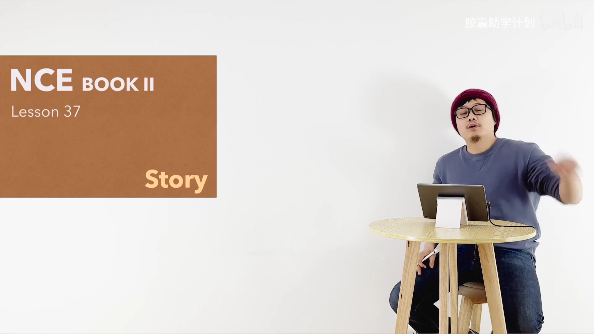

文字识别：NCE / BOOKⅡI / Lesson 37 / Story

### 画面 00:00:07

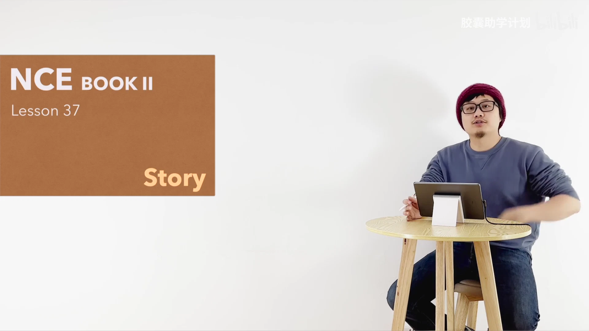

文字识别：NCE / BOOKⅡI / Lesson 37 / Story

### 画面 00:00:10

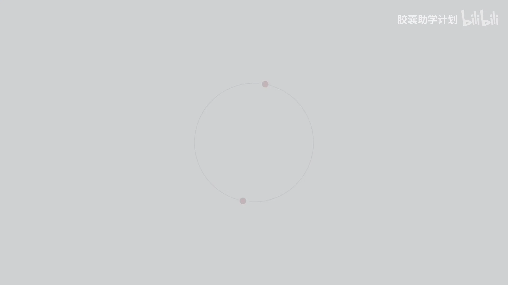

文字识别：胶囊助学计划b出出 / •

### 画面 00:00:13

文字识别：胶囊助学计划 / 胶囊助学计划

### 画面 00:00:15

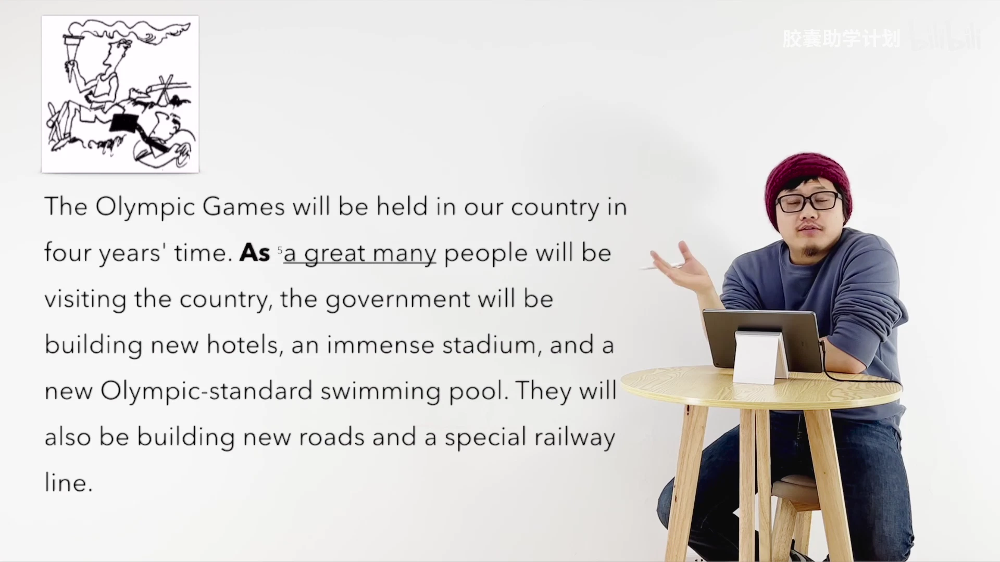

文字识别：The Olympic Games will be held in our country in / four years' time. As 5a great many people will be / visiting the country, the government will be / building new hotels, an immense stadium, and a / new Olympic-standard swimming pool.They will / also be building new roads and a special railway / line.

## 00:00:30–00:01:00

Games，哦，奥林匹克运动会，对吧？全称 will be held。好了，注意一个小点，will be done。是我们之前在第十课应该就学过的，要么就是第二十一课，是吧？呃，二十一课应该是啊，我们就学过的将来完成时的被动，对吧？Will be done。啊，说将被呃这个举行 in our country。啊，被我们举办啊，在我们的国家 in four years' time。哎，这

### 画面 00:00:45

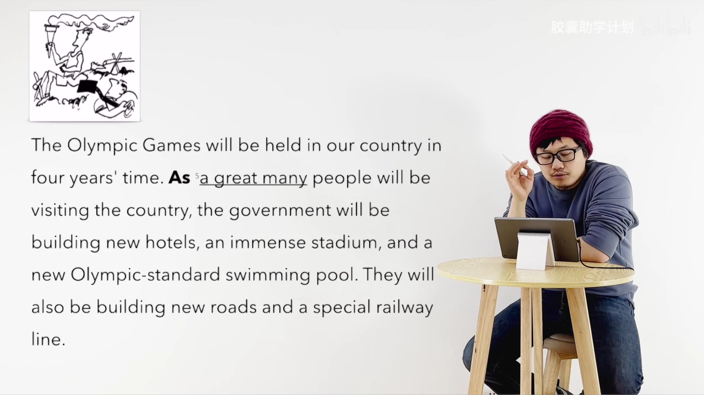

文字识别：The Olympic Games will be held in our country in / four years' time. As 5a great many people will be / visiting the country, the government will be / building new hotels, an immense stadium, and a / new Olympic-standard swimming pool. They will / also be building new roads and a special railway / line.

## 00:01:00–00:01:30

个叫四年之后。我们之前学过in four years' time这样的短语啊。As我专门把它标出来了，想告诉各位的就是我们第一次见到as开始有第二个含义了。注意啊，as原来我们学过它有when的含义，我不知道各位记不记得是吧？When或while的含义叫当as放在句首的时候，还有另一个比较常见的含义叫做because因为，对吧？哎，连接一个原因

### 画面 00:01:15

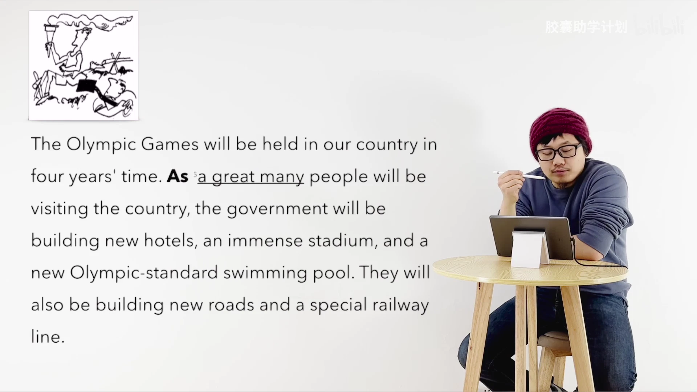

文字识别：The Olympic Games will be held in our country in / four years' time. As a great many people will be / visiting the country, the government will be / building new hotels, an immense stadium, and a / new Olympic-standard swimming pool. They will / also be building new roads and a special railway / line.

### 画面 00:01:19

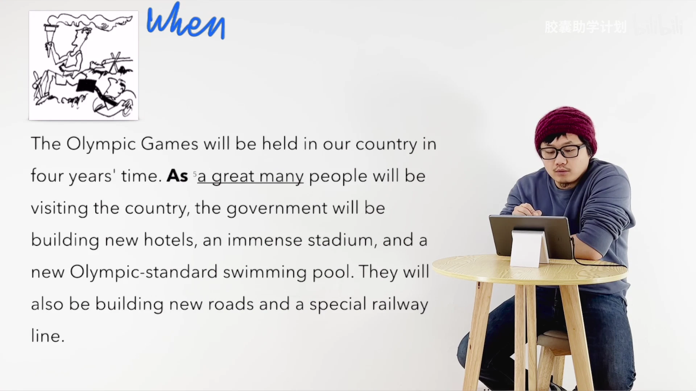

文字识别：When / The Olympic Games will be held in our country in / four years' time. As sa great many people will be / visiting the country, the government will be / building new hotels, an immense stadium, and a / new Olympic-standard swimming pool. They will / also be building new roads and a special railway / line.

## 00:01:30–00:02:00

状语从句啊，连接一个这个原因状语从句啊，because。那我们怎么去判断它是翻译成when还是翻译成as呢？换就我这么说吧，各位，这个单词单独放在这里的时候，只看这个单词，你永远不可能知道为什么。你想一下，你要由后面这两句话，这是第一句话，哎，这是第二句

### 画面 00:01:49

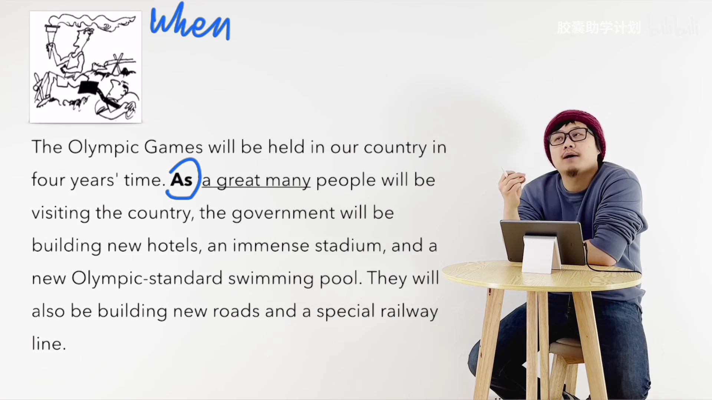

文字识别：When / The Olympic Games will be held in our country in / four years' time.As) / agreat many people will be / visiting the country, the government will be / building new hotels, an immense stadium, and a / new Olympic-standard swimming pool.They will / also be building new roads and a special railway / line.

### 画面 00:01:53

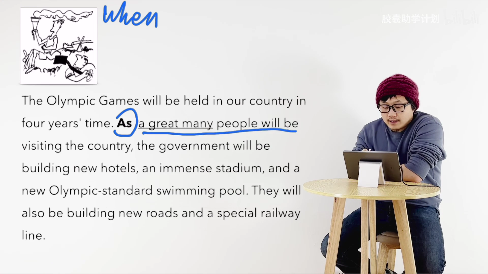

文字识别：When / The Olympic Games will be held in our country in / four years' time. As / a great many people will be / visiting the country, the government will be / building new hotels, an immense stadium, and a / new Olympic-standard swimming pool. They will / also be building new roads and a special railway / line.

### 画面 00:01:55

文字识别：When / The Olympic Games will be held in our country in / four years' time.As / a great many people will be / yisiting the country, the government will be / building new hotels, an immense stadium, and a / new Olympic-standard swimming pool. They will / also be building new roads and a special railway / line.

### 画面 00:01:57

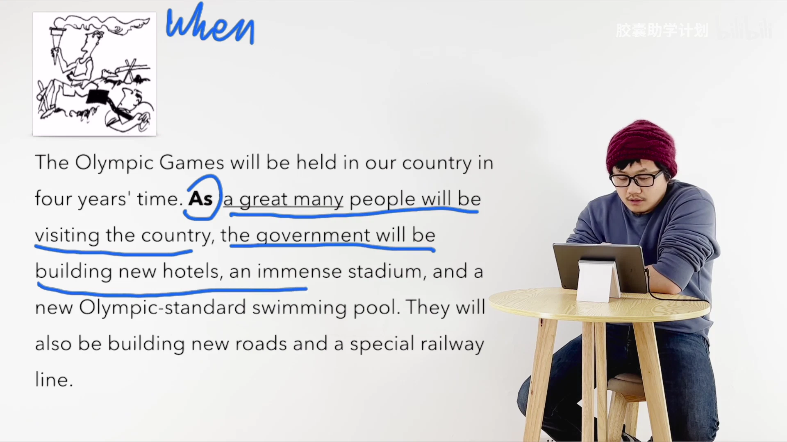

文字识别：When / The Olympic Games will be held in our country in / four years' time.As / a great many people will be / visiting the country, the government will be / building new hotels, an immense stadium, and a / new Olympic-standard swimming pool. They will / also be building new roads and a special railway / line.

### 画面 00:01:59

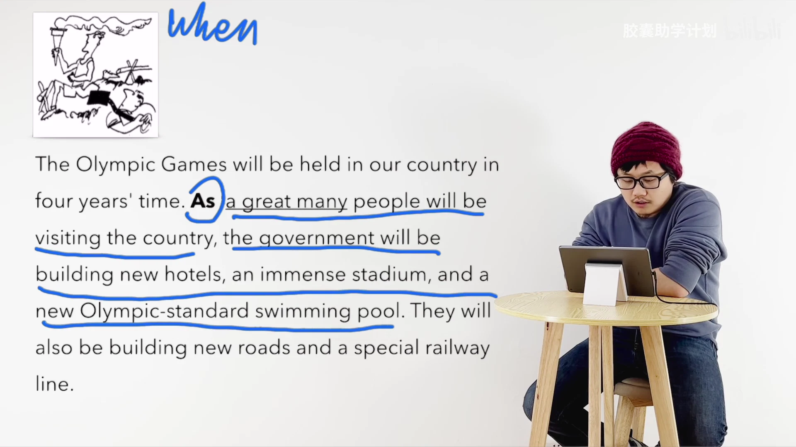

文字识别：When / The Olympic Games will be held in our country in / four years' time. As / a great many people will be / visiting the country, the government will be / building new hotels, an immense stadium, and a / new Olympic-standard swimming pool. They will / also be building new roads and a special railway / line.

## 00:02:00–00:02:30

对吧？这是第一句话，然后从这儿开始，这是第二句话。你要由这两句话之间的关系去决定，是伴随着一件事情发生，另一件事情怎么怎么样，还是因为一件事情怎么怎么样，另一件事情怎么怎么样，对吧？你要由两句话的逻辑关系去判断，它是因为还是当。所以 as 这个单词某种程度上有点残废，是吧？你单独看它，你不知道它是 as 还是问，就不管它其实就可以了。

### 画面 00:02:03

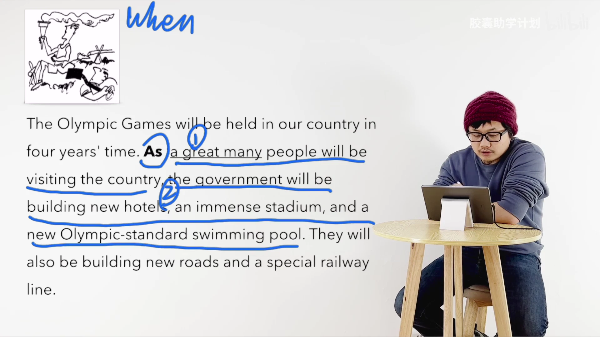

文字识别：When / The Olympic Games wil / lbe / : held in our country in / four years' time.As / great many people will be / a / visiting the country, / pe government will be / building new hotela / an immense stadium, and a / new Olympic-standard swimming pool. They will / also be building new roads and a special railway / line.

## 00:02:30–00:03:00

我们往下看啊，说 a great many people. 那首先 a great many 这是我们第五课就学过的，叫许多，是吧？这是第五课学过的习惯用法。许多的人 will be visiting the country. 说届时将来参观拜访，是吧？来来这个国家玩，说白了就是来旅游，对吧？OK，来看比赛啊，叫 visiting the country will be doing 将来进行时。The government will be building new hotels.

### 画面 00:02:33

文字识别：When / The Olympic Games wily / e held in our country in / four years' time.As / great many people will be / a / visiting the country, / pe government will be / building new hotel / an immense stadium, and a / new Olympic-standard swimming pool. They will / also be building new roads and a special railway / line.

## 00:03:00–00:03:30

Good. Will be building.又是一个叫将来进行时。说政府啊将会去建一些新的旅店。我们先不往后看了，我们就看到这儿。许多的人要来，政府要建旅店。这明显是一个，因为有很多人要来，所以才要建嘛，对吧？所以才要建一个新的很多新的 hotels, an immense stadium,一个大的露天体育场, and a new Olympic standard swimming pool.这个我们在讲

### 画面 00:03:03

文字识别：When / The Olympic Games wil / Hbe / : held in our country in / four years' time.As / great many people will be / a / visiting the country, / pe government will be / building new hotel / an immense stadium, and a / new Olympic-standard swimming pool. They will / also be building new roads and a special railway / line.

## 00:03:30–00:04:00

part have mentioned, not much to say. This Olympic standard swimming pool, right? So these things are put up, you naturally read them all, you ask, you understand, it is because. In fact, to some extent, if you read all the bottom, you, you, you, even don't care if it is because. Love is not love, is it? Right, it doesn't matter. Anyway, the key things I have understood. The logical relationship of two sentences I also understand. Because many people will come, the government will build such a large number of things, right?

### 画面 00:03:33

文字识别：When / The Olympic Games wily / Fbe / : held in our country in / four years' time.As / great many people will be / a / visiting the country, / pe government will be / building new hotela / an immense stadium, and a / new Olympic-standard swimming pool. They will / also be building new roads and a special railway / line.

### 画面 00:03:47

文字识别：When / The Olympic Games wil / e held in our country in / be / four years' time.As / great many people will be / a / visiting the country, / pe government will be / building new hotel,an immense stadium, and a / new Olympic-standard swimming pool. They will / also be building new roads and a special railway / line.

## 00:04:00–00:04:30

这么一大堆东西，对吧？我们接着往下看。They will also be building new roads and a special railway line.说他们也要去建一些新的公路，是吧？然后呢，以及a special railway line，一个特殊的railway line。呃，我们在汉语当中啊，对railway的理解叫做火车，对吧？OK，啊，比如说这个，我们从，比如说你从北京坐到我老家秦皇岛，是吧？那就

### 画面 00:04:03

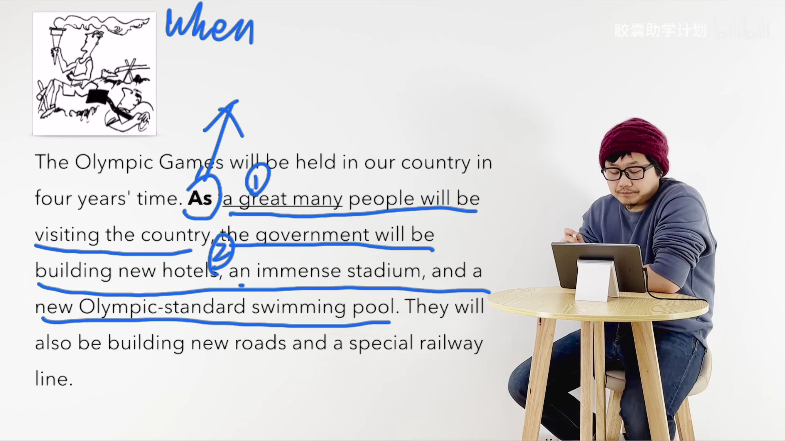

文字识别：When / The Olympic Games wil / e held in our country in / be / four years' time.As / great many people will be / a / yisiting the country, / pe government will be / building new hotelan immense stadium, and a / new Olympic-standard swimming pool. They will / also be building new roads and a special railway / line.

### 画面 00:04:18

文字识别：When / The Olympic Gam&s wil /  held in our country in / be / four years' time.As / great many people will be / a / visiting the country, / pe government will be / building new hotelan immense stadium, and a / new Olympic-standard swimming pool. They will / also be building new roads and a special railway / line.

### 画面 00:04:21

文字识别：When / The Olympic Gam&s wil /  held in our country in / be / four years' time.As / great many people will be / a / visiting the country, / pe government will be / building new hotela / an immense stadium, and a / new Olympic-standard swimming pool. They will / also be building new roads and a specialrailway / line.

## 00:04:30–00:05:00

是要用 railway 的，我们一般不会说坐地铁去。但 railway 在西方的很多国家当中呢，它有点类似于地铁，就有点像什么呢？比如说我们北京的四号线往大兴走的时候，走着走着就跑到地上来了，对吧？或者说我们说通州那条线，对吧？走着走着就跑地上来了，类似于轻轨那种东西。包括你像我去日本的时候，他们的 subway 和 railway 其实连的没有区分的没有那么的紧密。

### 画面 00:04:51

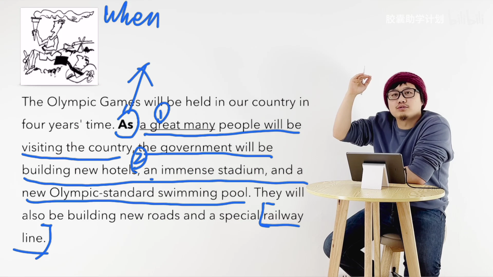

文字识别：When / The Olympic Gam&s wil / : held in our country in / be / four years' time.As / great many people will be / a / visiting the country, / pe government will be / building new hotelan immense stadium, and a / new Olympic-standard swimming pool. They will / also be building new roads and a specialrailway / line.

## 00:05:00–00:05:30

我们现在你看，作为我们中国人区分 subway 和 railway 的区别是，我们认为 subway 第一往往在地下，第二往往是城市内的，对吧？那 railway 呢，往往是呃这个火车呢，往往是在地上，往往是城市间的。我们是这样尝试去定义的。但是在西方国家，比如说像奥克兰，我做的那个东西，对吧？它也有地下的，也是呃，虽然是城市内的，但是它的名

### 画面 00:05:21

文字识别：When / The Olympic Gam&s wil /  held in our country in / be / four years' time.As / great many people will be / a / visiting the country, / pe government will be / building new hotelan immense stadium, and a / new Olympic-standard swimming pool. They will / also be building new roads and a special railway / line.

## 00:05:30–00:06:00

名字也叫 railway。我印象当中它是叫 railway 的，是吧？Okay，啊，就是轨道交通，它统称为 railway，它不是叫火车，貌似是吧？Okay，所以你看，你可以理解为我印象当中我们的 Line Eight，就我们的北京八号线，就是当年单独给这个奥运会盖的，叫做 a special railway line，是吧？Okay，啊，接着往下走，呃，the games will

### 画面 00:05:31

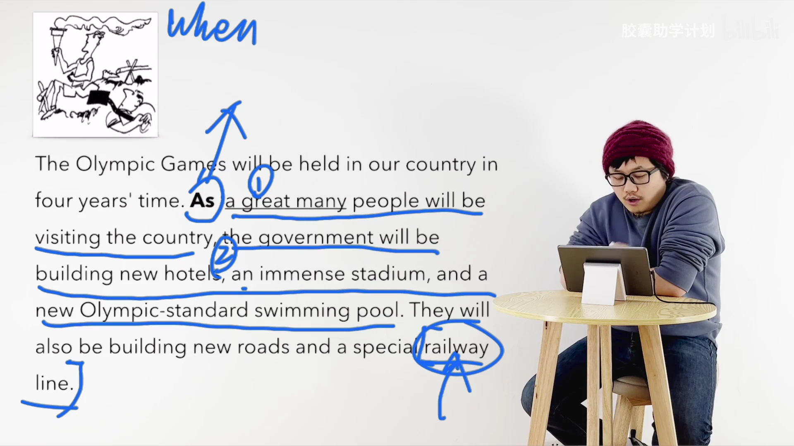

文字识别：When / The Olympic Gam&s wil /  held in our country in / be / four years' time.As / great many people will be / a / visiting the country, / pe government will be / building new hotel / an immense stadium, and a / new Olympic-standard swimming pool. They will / also be building new roads and a speciafrailway / line.

### 画面 00:05:43

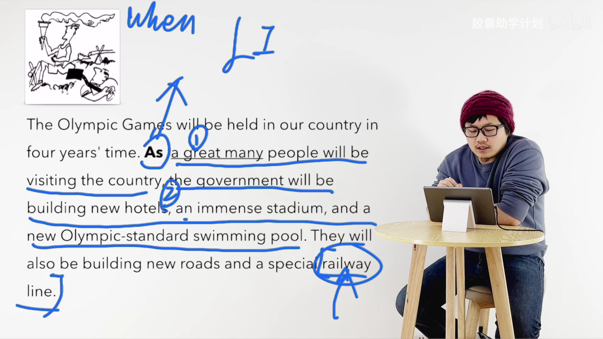

文字识别：When / The Olympic Games wil /  held in our country in / be / four years' time.As / great many people will be / a / visiting the country, / pe government will be / building new hotelan immense stadium, and a / new Olympic-standard swimming pool. They will / also be building new roads and a specia/railway / line.

### 画面 00:05:45

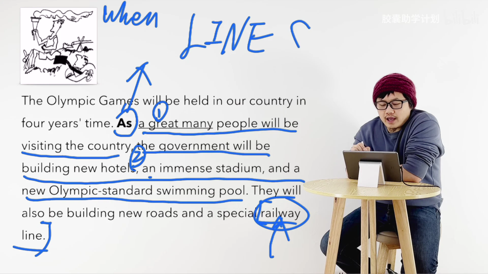

文字识别：When / INE / The Olympic Gamgs wil /  held in our country in / be / four years' time. As / great many people will be / a / visiting the country, / pe government will be / building new hotela / an immense stadium, and a / new Olympic-standard swimming pool. They will / also be building new roads and a specialrailway / line.

### 画面 00:05:56

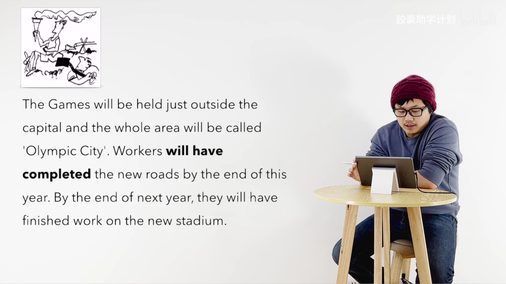

文字识别：The Games will be held just outside the / capital and the whole area will be called / 'Olympic City'. Workers will have / completed the new roads by the end of this / year. By the end of next year, they will have / finished work on the new stadium.

## 00:06:00–00:06:30

be held just outside the capital.说这个比赛呀将被举办just恰好刚刚outside the capital就在这个首都的外面，对吧？And the whole area,然后整个这片地区will be called将来完成时的哎呃这个将来完成时呃不是一般将来时的被动对吧？Will be that啊说将被叫做Olympic City啊，将会被叫做奥运会城市是吧？我们汉

### 画面 00:06:07

文字识别：The Games will be held justoutside the_ / capital and the whole area will be called / 'Olympic City'. Workers will have / completed the new roads by the end of this / year. By the end of next year, they will have / finished work on the new stadium.

### 画面 00:06:13

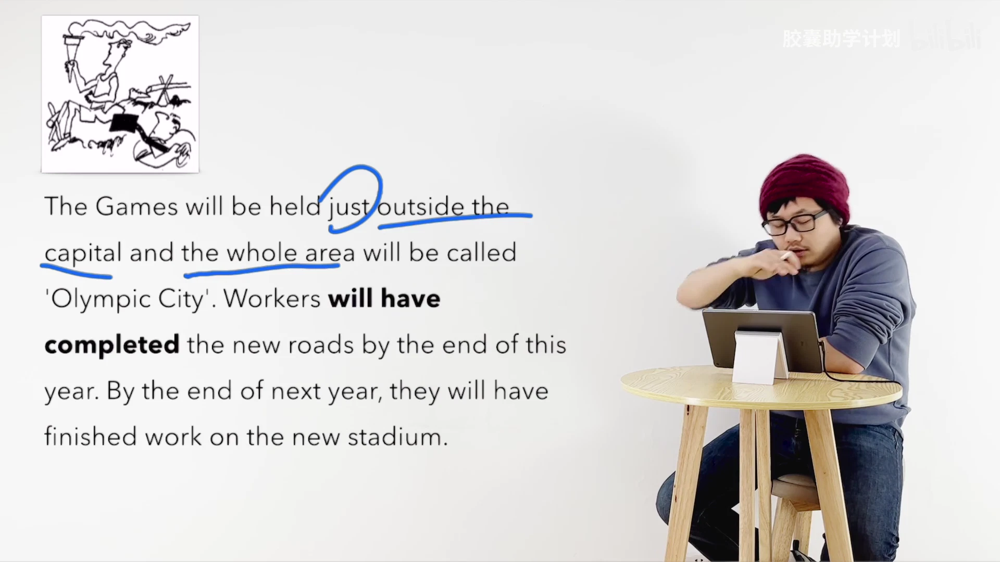

文字识别：The Games will be held justoutside the / capital and the whole area will be called / 'Olympic City'. Workers will have / completed the new roads by the end of this / year. By the end of next year, they will have / finished work on the new stadium.

## 00:06:30–00:07:00

语叫奥运村嘛，是吧？Workers说工人，Will have completed都不用往后看了，你看到这儿就明白了一件事，叫Will have done。首先，我不管含义结构，它一定叫做将来完成时。有含打蛇打七寸，我们先看它的结构，结构确定了之后，再结合上下文，看它到底是用法一还是用法二，对吧？你先看字面意思，叫做将完成。你看完成这个单词，

### 画面 00:06:36

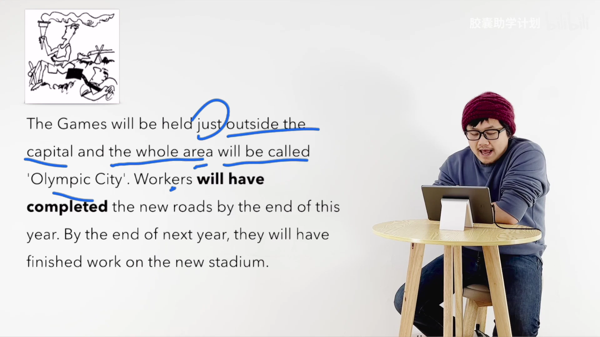

文字识别：The Games will be held justoutside the_ / capital and the whole area will be called / 'Olympic City'. Workers will have / completed the new roads by the end of this / year. By the end of next year, they will have / finished work on the new stadium.

## 00:07:00–00:07:30

不管是汉语还是英语，某种程度上都告诉你了，只要是个动作，它就一下的事儿，它不可能是持续或重复，它高概率事件就是用法二，叫一个动作或状态在未来的某个时间点之前结束，对吧？完成说将完成 the new roads 这条新的马路 by the end of this year，叫今年结束的时候，你看在今年结束之前，这个马路

### 画面 00:07:06

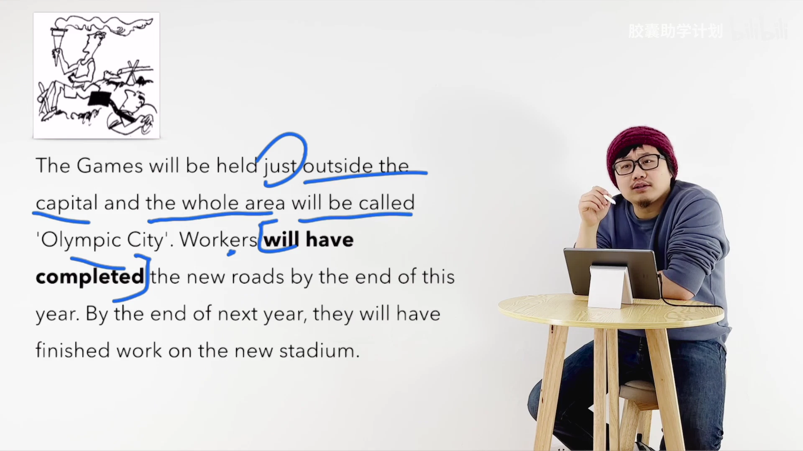

文字识别：The Games will be held justoutside the / capital and the whole area will be called / 'Olympic City'. Workers / swill have / completedthe new roads by the end of this / year. By the end of next year, they will have / finished work on the new stadium.

## 00:07:30–00:08:00

将被完成，将完成，对吧？好，你看 will have completed，在这个地方就是一个典型的用法。二叫做在今年年底之前，这条路会被修好，对吧？我们接着往下看。By the end of next year，在明年年底之前，they will have finished，那不就一样了吗？对吧？他们将完成 work，将 finish work，将完成他们的工作 on the new stadium，在这个新

### 画面 00:07:36

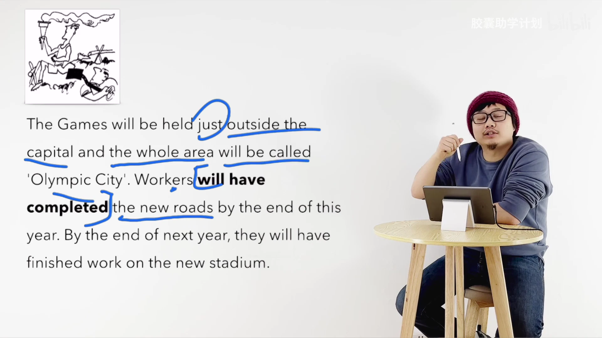

文字识别：The Games will be held justoutside the / capital and the whole area will be called / 'Olympic City'. Workers / will have / completed the new roads by the end of this / year. By the end of next year, they will have / finished work on the new stadium.

### 画面 00:07:53

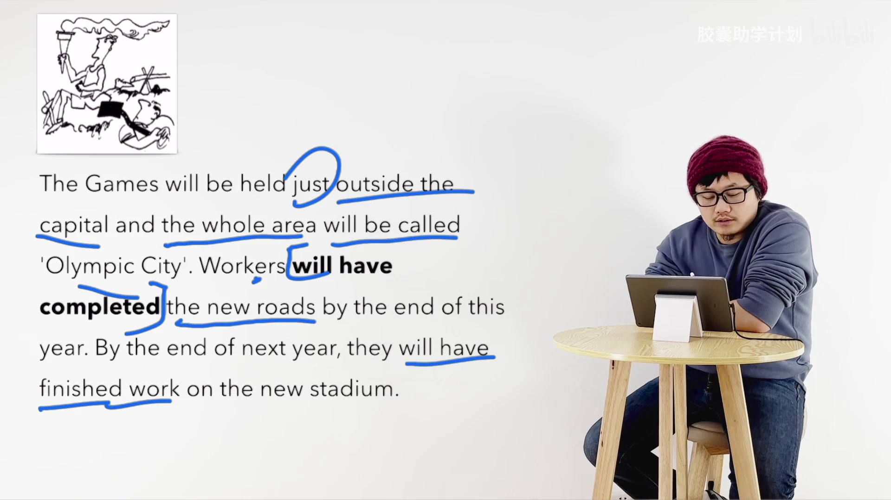

文字识别：The Games will be held justoutside the / capital and the whole area will be called / 'Olympic City'. Workersl / will have / completed the new roads by the end of this / year. By the end of next year, they will have / finished work on the new stadium.

## 00:08:00–00:08:30

的呃露天体育场上的工作，他们将完成啊，哎，对应在中国上，各位就可以理解为是鸟巢嘛，对不对？OK，very good，continue。The fantastic modern buildings have been designed by Kurt Gantner。好了，注意，fantastic modern buildings， fantastic这个单词在我们讲单词的时候，我告诉各位它的含义叫做great， wonderful，对吧？

### 画面 00:08:10

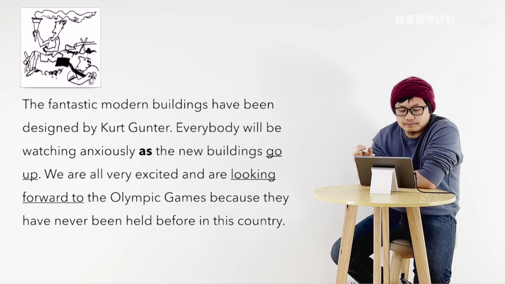

文字识别：The fantastic modern buildings have been / designed by Kurt Gunter. Everybody will be / watching anxiously as the new buildings go / up. We are all very excited and are looking / forward to the Olympic Games because they / have never been held before in this country.

### 画面 00:08:20

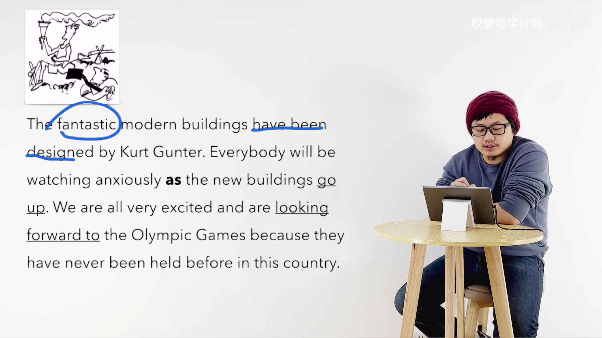

文字识别：The fantastic modern buildings have been / desianed by Kurt Gunter. Everybody will be / watching anxiously as the new buildings go / up. We are all very excited and are looking / forward to the Olympic Games because they / have never been held before in this country.

## 00:08:30–00:09:00

书中以及这个课文注释当中给的它的另一个含义呢，叫做大的、巨大的。呃，我个人觉得，首先我查了一下，它确实还真有这个含义，对吧？那我个人觉得这个地方呢，其实这个地方的 fantastic，我们把它其实就翻译成 great 或 wonderful。我个人觉得会稍微舒服一点点啊，就它并不单纯指大，它指的是特别棒，是吧？所以这个 fantastic modern buildings 就是这个特别棒的

### 画面 00:08:50

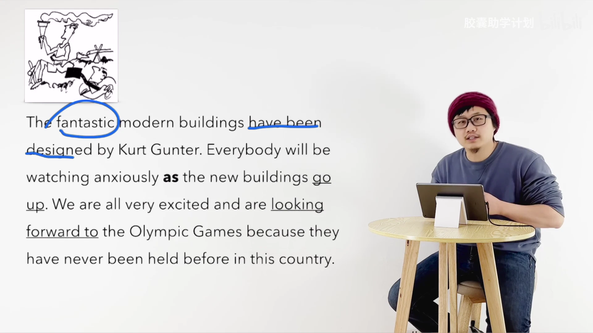

文字识别：The fantastic modern buildings have been / desianed by Kurt Gunter. Everybody will be / watching anxiously as the new buildings go / up. We are all very excited and are looking / forward to the Olympic Games because they / have never been held before in this country.

## 00:09:00–00:09:30

现代化的建筑物，have been designed叫做已经被设计出来了，被谁呢？被K G这个人啊，我们不用管他是谁啊。那have been designed叫做已经被设计出来了，have been done. Everybody will be watching anxiously. Will be doing, 是吧？就每一个人都将 will be doing, will be watching anxiously. 啊，非常焦虑的，非常这个这个这个充

### 画面 00:09:20

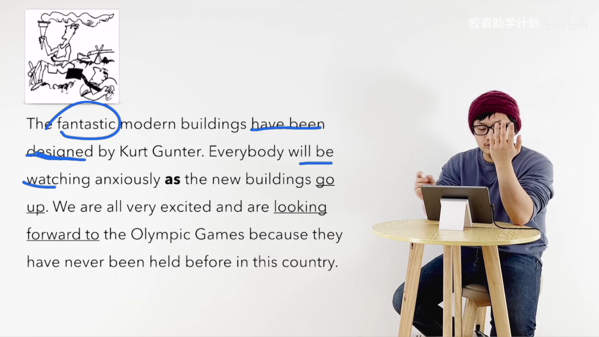

文字识别：The fantastic modern buildings have been / desianed by Kurt Gunter. Everybody will be / watching anxiously as the new buildings go / up. We are all very excited and are looking / forward to the Olympic Games because they / have never been held before in this country.

## 00:09:30–00:10:00

满这种焦急的心情的，as啊，而且这 anxiously 是我们刚刚学过的，就由英吉利海峡那课，你想一下是吧？as啊，跟那课这个句式都一样，那课的 anxiously 后边也紧跟了一个 as，对吧？说这个地方就是当了，当什么呢？The new buildings go up，说这些新的建筑群 go up，go叫走，up叫往上走。那新的建筑群 go up，

### 画面 00:09:50

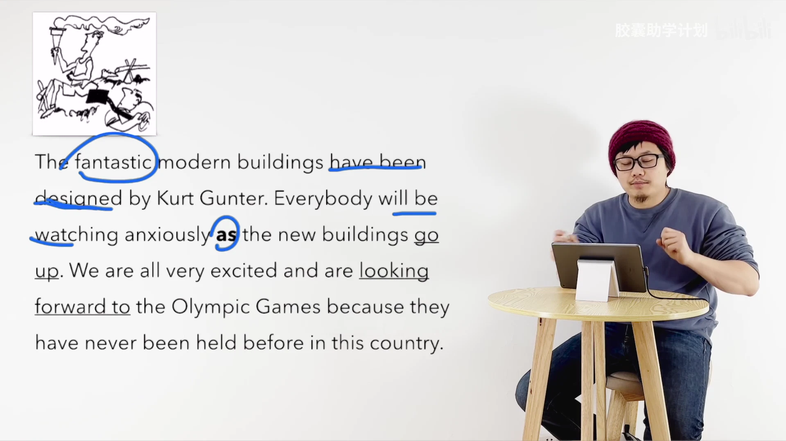

文字识别：The fantastic modern buildings have been / desianed by Kurt Gunter. Everybody will be / watching anxiously / the new buildings go / as / up. We are all very excited and are looking / forward to the Olympic Games because they / have never been held before in this country.

## 00:10:00–00:10:30

往上走，我们汉语管它叫拔地而起，对吧？Okay， we are all very excited，我们都特别兴奋，and然后怎么样呢？Are looking forward to the Olympic Games。注意这地方有一个特别关键，也非常常出现，并且我们容易错的一个习惯用法，叫 look forward to，这个叫做盼望、期望。说而且我们非常的兴奋，并

### 画面 00:10:05

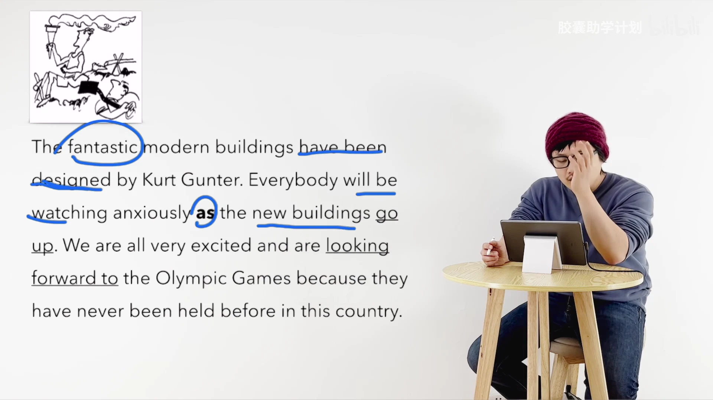

文字识别：The fantastic modern buildings have been / desianed by Kurt Gunter. Everybody will be / watching anxiously / the new buildings go / as / up. We are all very excited and are looking / forward to the Olympic Games because they / have never been held before in this country.

### 画面 00:10:13

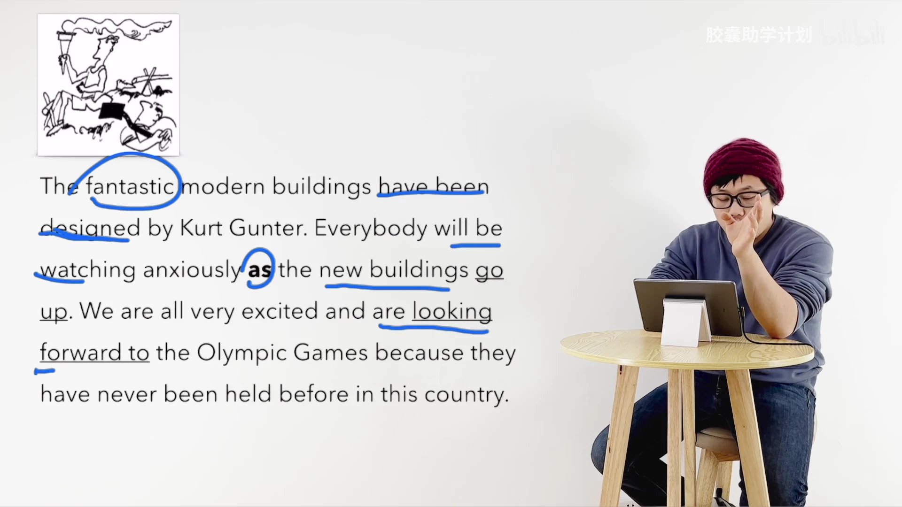

文字识别：The fantastic modern buildings have been / desianed by Kurt Gunter. Everybody will be / watching anxiously / the new buildings go / as / up. We are all very excited and are looking / forward to the Olympic Games because they / have never been held before in this country.

### 画面 00:10:15

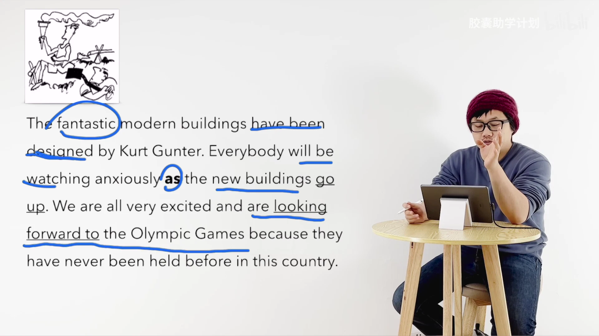

文字识别：The fantastic modern buildings have been / desianed by Kurt Gunter. Everybody will be / watching anxiously / the new buildings go / as / up. We are all very excited and are looking / forward to the Olympic Games because they / have never been held before in this country.

## 00:10:30–00:11:00

且也期盼奥运会，because因为 they have never been held before in this country. They注意指的是Olympic Games啊，说奥运会从来没有被举办过before之前in this country叫在这个国家啊，就在这个国家以前从来没举办过奥运会。那整个这篇文章的心情状态特别像

### 画面 00:10:41

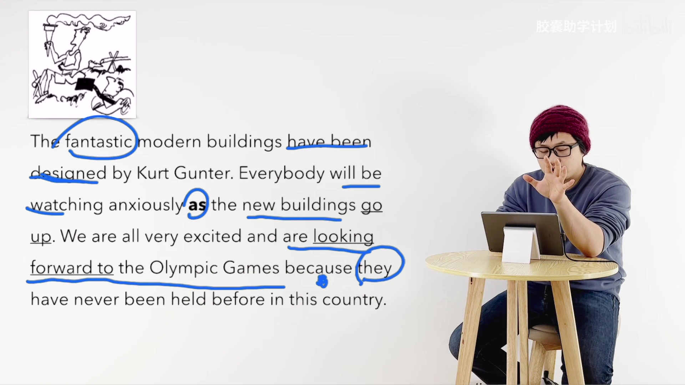

文字识别：The fantastic modern buildings have been / desianed by Kurt Gunter. Everybody will be / watching anxiously / the new buildings go / as / up. We are all very excited and are looking / forward to the Olympic Games becausethey / have never been held before in this country.

### 画面 00:10:43

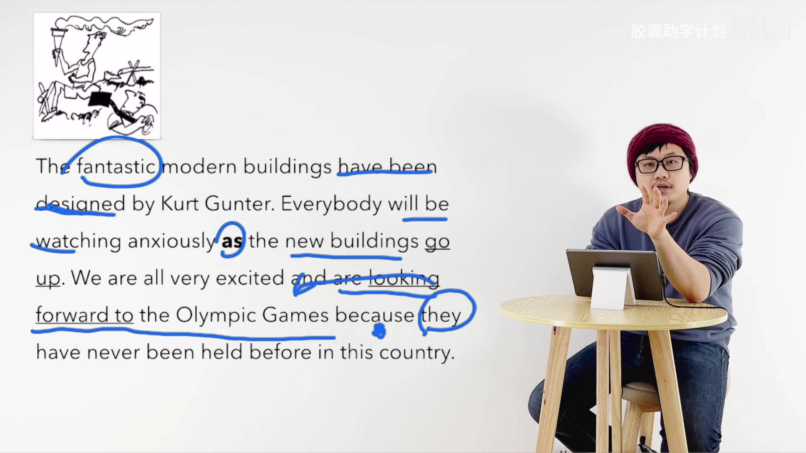

文字识别：The fantastic modern buildings have been / desianed by Kurt Gunter. Everybody will be / watching anxiously / the new buildings go / as / up. We are all very excited / nd are loc / forward to the Olympic Games because / ethey / have never been held before in this country.

### 画面 00:10:47

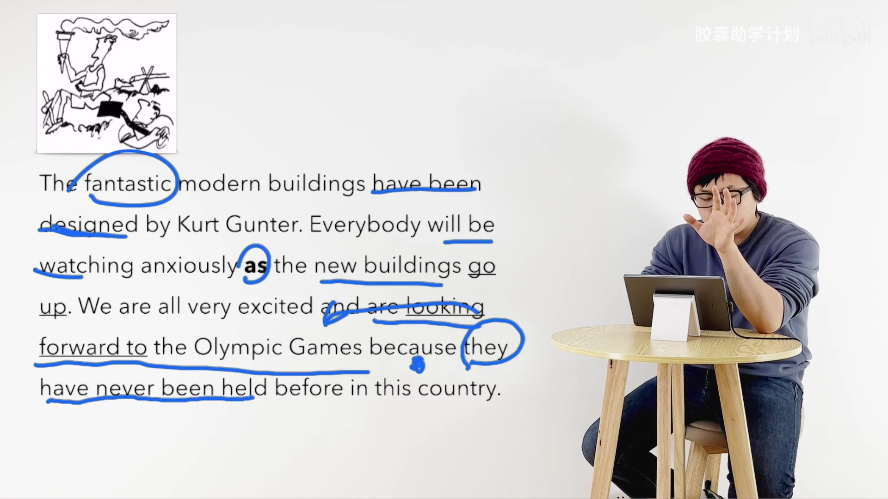

文字识别：The fantastic modern buildings have been / desianed by Kurt Gunter. Everybody will be / watching anxiously / the new buildings go / as / up. We are all very excited / Dd are looki / forward to the Olympic Games becausethey / have never been held before in this country.

### 画面 00:10:50

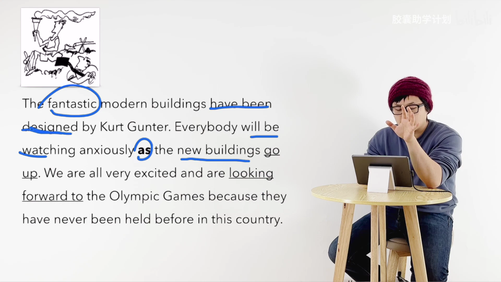

文字识别：The fantastic modern buildings bave been / desianed by Kurt Gunter. Everybody will be / watching anxiously / the new buildings go / as / up. We are all very excited and are looking / forward to the Olympic Games because they / have never been held before in this country.

### 画面 00:10:56

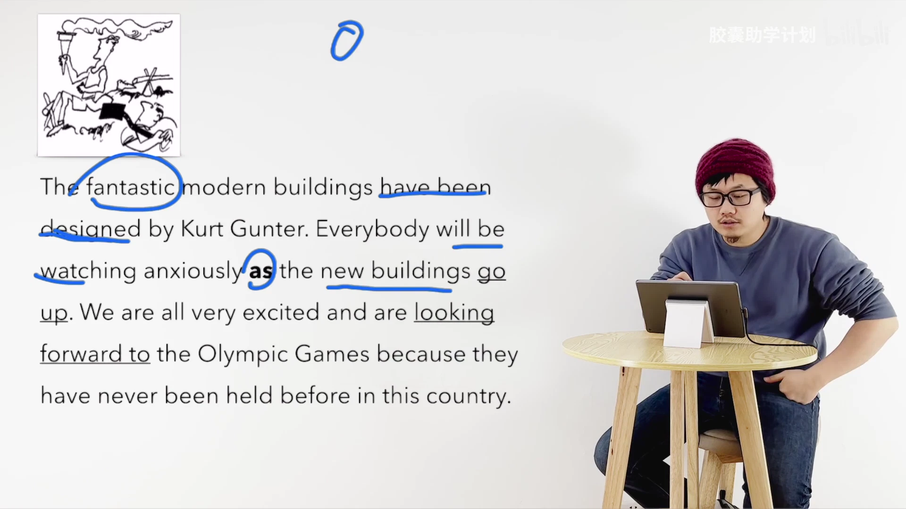

文字识别：The fantastic modern buildings have been / desianed by Kurt Gunter. Everybody will be / watching anxiously / the new buildings go / as / up. We are all very excited and are looking / forward to the Olympic Games because they / have never been held before in this country.

### 画面 00:10:58

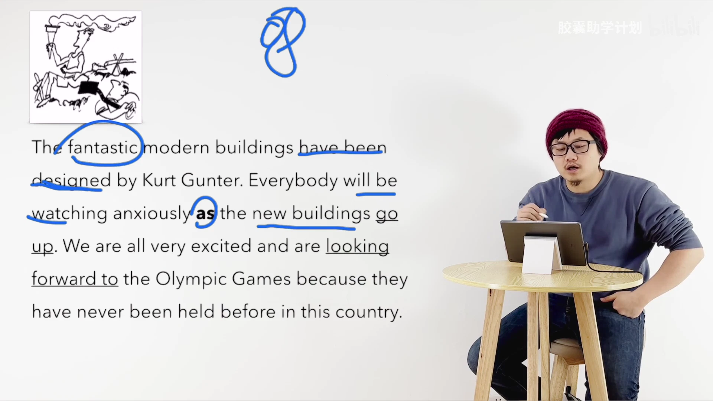

文字识别：The fantastic modern buildings have been / desianed by Kurt Gunter. Everybody will be / watching anxiously / the new buildings go / as / up. We are all very excited and are looking / forward to the Olympic Games because they / have never been held before in this country.

## 00:11:00–00:11:30

零八年之前的中国是吧？那种感受是非常的像的。那接下来呢，除了文章以外，我们要重点说一下这个 look forward to。注意，大多数我们 to 不是后边加 to do something 吗？这个 look forward to 的 to 后边加的不是 do，它不是个动词的不定式，它是 to doing something，好吧？还有第二个用法就是 look forward to something。第一个用法叫 to doing something，第二个

### 画面 00:11:00

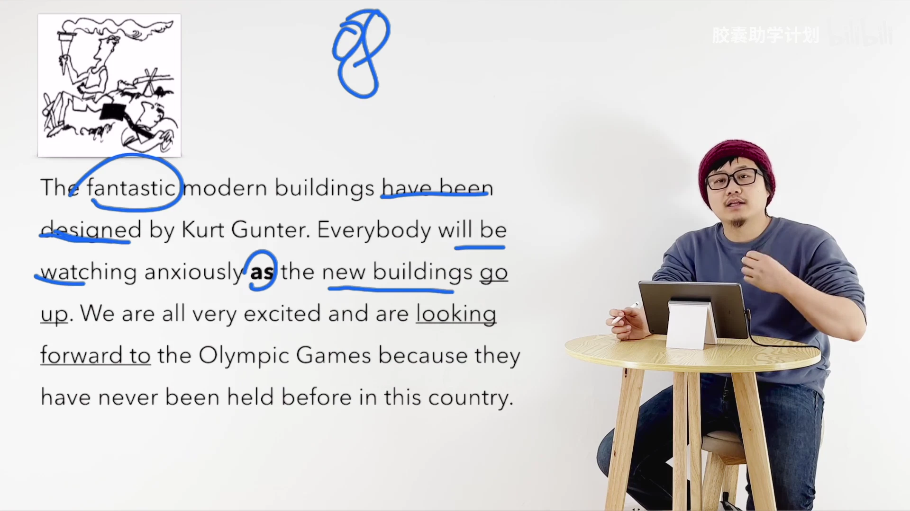

文字识别：The fantastic modern buildings bave been / desianed by Kurt Gunter. Everybody will be / watching anxiously / the new buildings go / as / up. We are all very excited and are looking / forward to the Olympic Games because they / have never been held before in this country.

### 画面 00:11:05

文字识别：习惯用法造句 / look forward to doing sth.

### 画面 00:11:07

文字识别：习惯用法造句 / look forward to doing sth.

### 画面 00:11:09

文字识别：习惯用法造句 / look forward to doing sth.

### 画面 00:11:11

文字识别：习惯用法造句 / look forward to doing sth.

### 画面 00:11:15

文字识别：习惯用法造句 / look forward to doing sth.

### 画面 00:11:20

文字识别：习惯用法造句 / look forward to doing sth.

### 画面 00:11:24

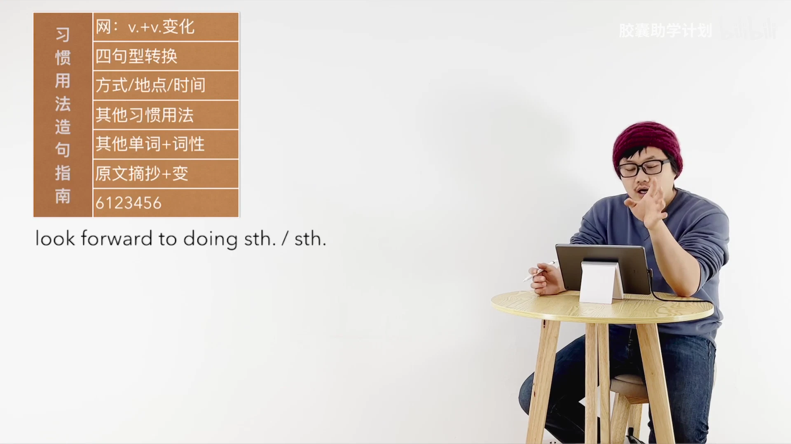

文字识别：网：v.+v.变化 / 习惯用法造句指南 / 四句型转换 / 方式/地点/时间 / 其他习惯用法 / 其他单词+词性 / 原文摘抄+变 / 6123456 / look forward to doing sth./ sth.

### 画面 00:11:26

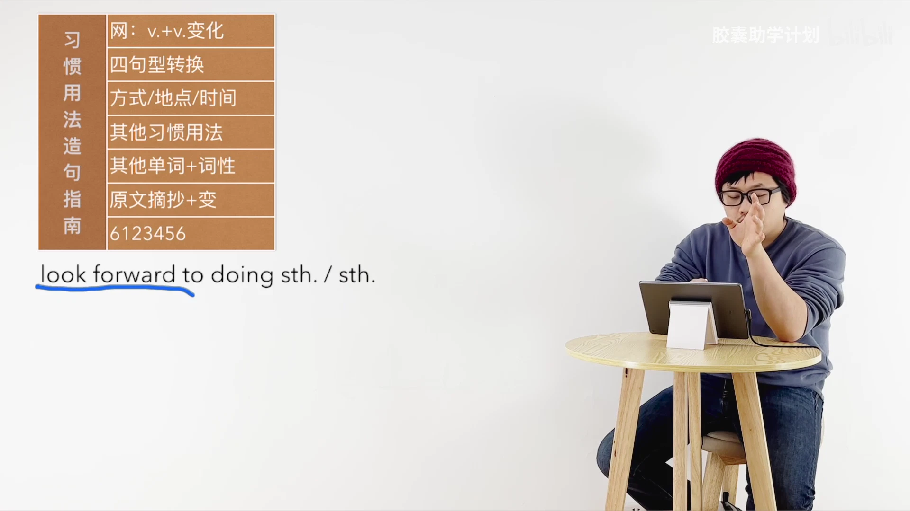

文字识别：网：v.+v.变化 / 习惯用法造句指南 / 四句型转换 / 方式/地点/时间 / 其他习惯用法 / 其他单词+词性 / 原文摘抄+变 / 6123456 / look forward to doing sth./ sth.

### 画面 00:11:28

文字识别：网：v.+v.变化 / 习惯用法造句指南 / 四句型转换 / 方式/地点/时间 / 其他习惯用法 / 其他单词+词性 / 原文摘抄+变 / 6123456 / look forward to (oing sth)/ sth.

## 00:11:30–00:12:00

叫 to something，叫做期盼、盼望。比如说，我们造一个句子啊，We all look forward to spending the whole weekend in the country。说我们都期盼度过整个周末 in the country，叫做在这个乡下，对吧？哎，好，look forward to spending，啊，这儿的习惯用法叫 spend some time somewhere，是吧？很简单的一个习惯用法，二十课学的啊。但是你注意这个地方用的是 doing，这个

### 画面 00:11:30

文字识别：网：v.+v.变化 / 习惯用法造句指南 / 四句型转换 / 方式/地点/时间 / 其他习惯用法 / 其他单词+词性 / 原文摘抄+变 / 6123456 / look forward to doing sth / sth.

### 画面 00:11:33

文字识别：网：v.+v.变化 / 习惯用法造句指南 / 四句型转换 / 方式/地点/时间 / 其他习惯用法 / 其他单词+词性 / 原文摘抄+变 / 6123456 / look forward to loing sth / sth. / We all look forward to spending the whole / weekend in the country. L20

### 画面 00:11:35

文字识别：网：v.+v.变化 / 习惯用法造句指南 / 四句型转换 / 方式/地点/时间 / 其他习惯用法 / 其他单词+词性 / 原文摘抄+变 / 6123456 / look forward to oing sth / sth. / We all look forward to spending the whole / weekend in the country. L20

### 画面 00:11:40

文字识别：网：v.+v.变化 / 习惯用法造句指南 / 四句型转换 / 方式/地点/时间 / 其他习惯用法 / 其他单词+词性 / 原文摘抄+变 / 6123456 / look forward to oing sth / sth. / We all look forward to spending the whole / weekend in the country. L20

### 画面 00:11:45

文字识别：网：v.+v.变化 / 习惯用法造句指南 / 四句型转换 / 方式/地点/时间 / 其他习惯用法 / 其他单词+词性 / 原文摘抄+变 / 6123456 / look forward to oing sth / sth. / We all look forward to spending the whole / weekend in the country. L20

### 画面 00:11:50

文字识别：网：v.+v.变化 / 习惯用法造句指南 / 四句型转换 / 方式/地点/时间 / 其他习惯用法 / 其他单词+词性 / 原文摘抄+变 / 6123456 / look forward to doing sth / sth. / We all look forward to spending the whole / weekend in the country. L20

### 画面 00:11:52

文字识别：网：v.+v.变化 / 习惯用法造句指南 / 四句型转换 / 方式/地点/时间 / 其他习惯用法 / 其他单词+词性 / 原文摘抄+变 / 6123456 / look forward to loing sth / sth. / We all look forward to spending the whole / weekend in the country. L20

### 画面 00:11:54

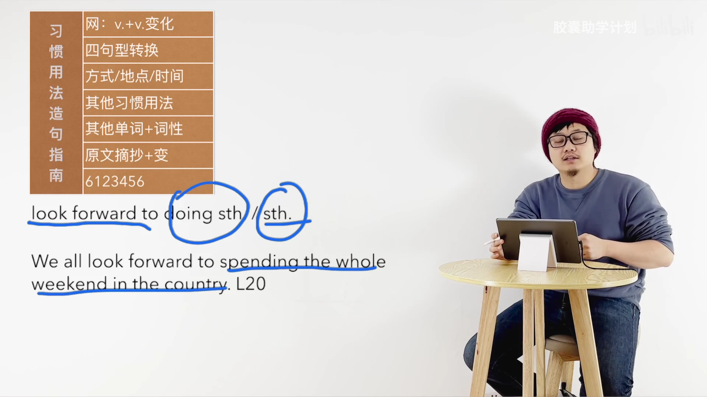

文字识别：网：v.+v.变化 / 习惯用法造句指南 / 四句型转换 / 方式/地点/时间 / 其他习惯用法 / 其他单词+词性 / 原文摘抄+变 / 6123456 / look forward to loing sth / sth. / We all look forward to spending the whole / weekend in the country. L20

### 画面 00:11:56

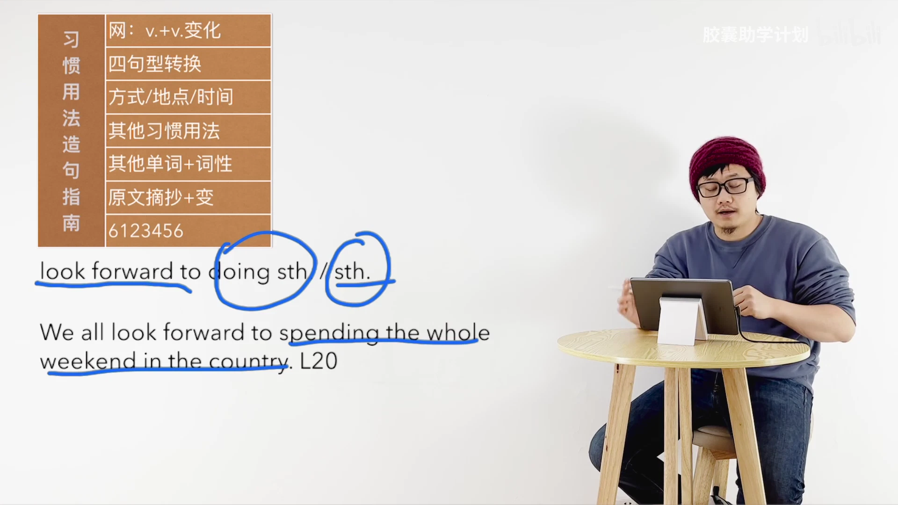

文字识别：网：v.+v.变化 / 习惯用法造句指南 / 四句型转换 / 方式/地点/时间 / 其他习惯用法 / 其他单词+词性 / 原文摘抄+变 / 6123456 / look forward to oing sth / sth. / We all look forward to spending the whole / weekend in the country. L20

### 画面 00:11:58

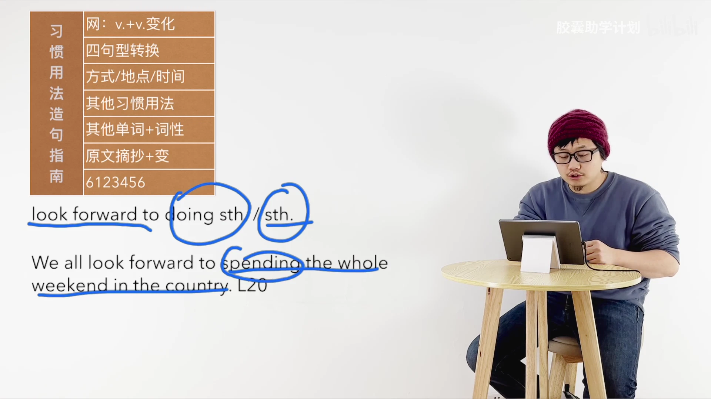

文字识别：网：v.+v.变化 / 习惯用法造句指南 / 四句型转换 / 方式/地点/时间 / 其他习惯用法 / 其他单词+词性 / 原文摘抄+变 / 6123456 / look forward to oing sth / sth. / We all look forward to / spending the whole / weekend in the country. L20

## 00:12:00–00:12:30

地方为什么要用 doing 呢？我就这样讲一下，你能想起来就想，想不起来呢，应记也没事儿。二十课我们学过一个东西叫动名词，这里的 to 不是 to do 结构，这里的 to 是个介词，介词后边加动词的时候要加动名词。我就讲到这儿，你会了就会了，不会你就应记，相信我没有问题，好吧？啊，

### 画面 00:12:00

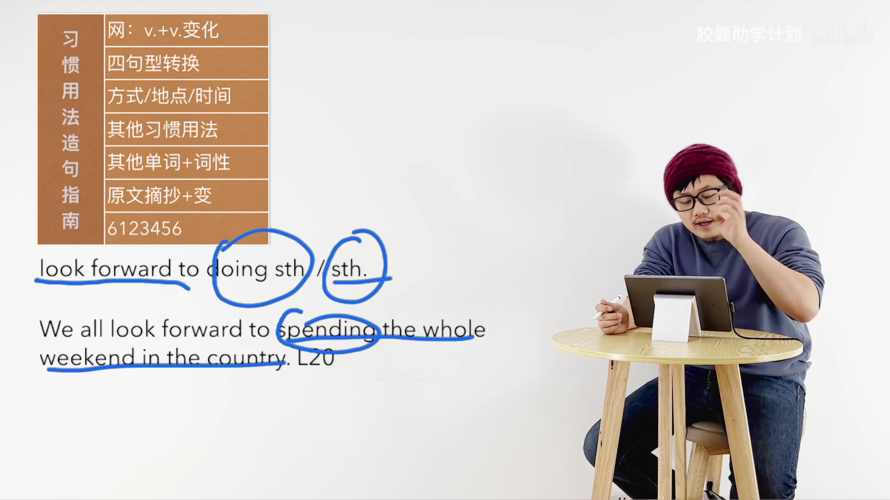

文字识别：网：v.+v.变化 / 习惯用法造句指南 / 四句型转换 / 方式/地点/时间 / 其他习惯用法 / 其他单词+词性 / 原文摘抄+变 / 6123456 / look forward to oing sth) / sth. / We all look forward to / spending the whole / weekend in the country. L20

### 画面 00:12:04

文字识别：网：v.+v.变化 / 习惯用法造句指南 / 四句型转换 / 方式/地点/时间 / 其他习惯用法 / 其他单词+词性 / 原文摘抄+变 / 6123456 / look forward to doing sth) / sth. / We all look forward to / spending the whole / weekend in the country. L20

### 画面 00:12:06

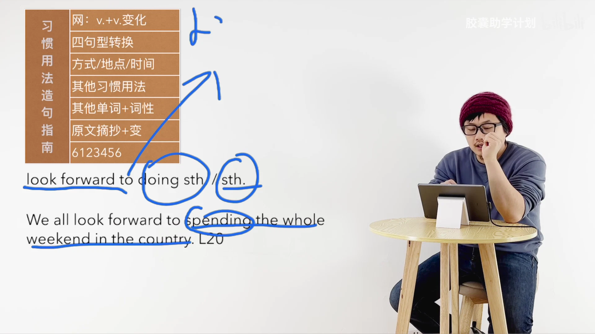

文字识别：网：v.+v.变化 / 习惯用法造句指南 / 四句型转换 / 方式/地点/时间 / 其他习惯用法 / 其他单词+词性 / 原文摘抄+变 / 6123456 / look forward to oing sth) / sth. / We all look forward to / spending the whole / weekend in the country. L20

### 画面 00:12:08

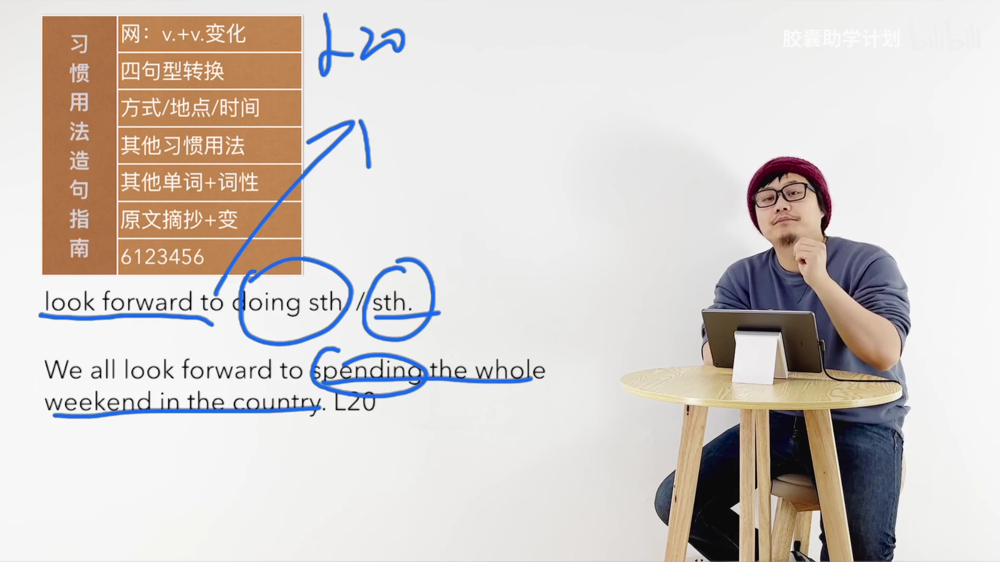

文字识别：网：v.+v.变化 / 习惯用法造句指南 / 四句型转换 / 方式/地点/时间 / 其他习惯用法 / 其他单词+词性 / 原文摘抄+变 / 6123456 / look forward to oing sth) / sth. / We all look forward to / spending the whole / weekend in the country. L20

### 画面 00:12:10

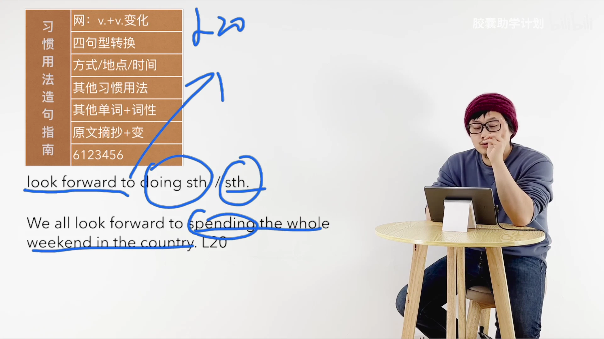

文字识别：网：v.+v.变化 / 20 / 习惯用法造句指南 / 四句型转换 / 方式/地点/时间 / 其他习惯用法 / 其他单词+词性 / 原文摘抄+变 / 6123456 / look forward to oing sth) / sth. / We all look forward to / spending the whole / weekend in the country. L20

### 画面 00:12:15

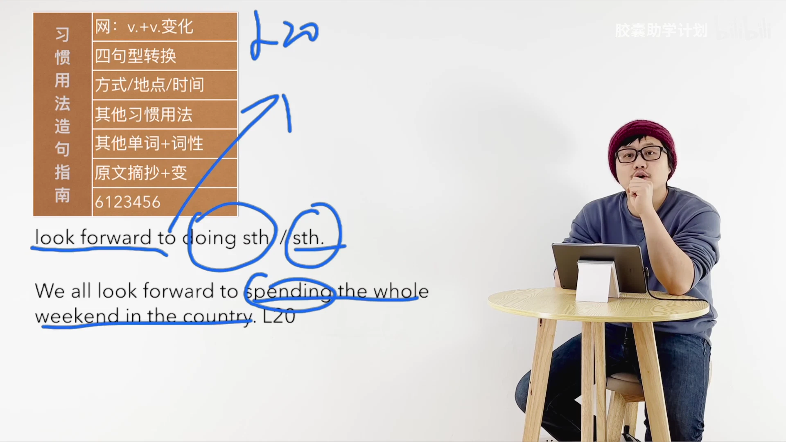

文字识别：网：v.+v.变化 / 习惯用法造句指南 / 四句型转换 / 方式/地点/时间 / 其他习惯用法 / 其他单词+词性 / 原文摘抄+变 / 6123456 / look forward to oing sth) / sth. / We all look forward to / spending the whole / weekend in the country. L20

### 画面 00:12:17

文字识别：网：v.+v.变化 / 习惯用法造句指南 / 四句型转换 / 方式/地点/时间 / 其他习惯用法 / 其他单词+词性 / 原文摘抄+变 / 6123456 / look forward to doing s / sth) / sth. / We all look forward to / spending the whole / weekend in the country. / LZ0

### 画面 00:12:19

文字识别：网：v.+v.变化 / 习惯用法造句指南 / 四句型转换 / 方式/地点/时间 / 其他习惯用法 / 其他单词+词性 / 原文摘抄+变 / 6123456 / look forward todoing  / sth) / sth. / We all look forward to / spending the whole / weekend in the country. / LZO

### 画面 00:12:21

文字识别：网：v.+v.变化 / 习惯用法造句指南 / 四句型转换 / 方式/地点/时间 / 其他习惯用法 / 其他单词+词性 / 原文摘抄+变 / 6123456 / look forward to。oing / sth) / sth. / We all look forward to / spending the whole / weekend in the country. / LZO

### 画面 00:12:24

文字识别：网：v.+v.变化 / 习惯用法造句指南 / 四句型转换 / 方式/地点/时间 / 其他习惯用法 / 其他单词+词性 / 原文摘抄+变 / 6123456 / look forward to doing / sth) / sth. / We all look forward to / spending the whole / weekend in the country. / LZ0

### 画面 00:12:26

文字识别：网：v.+v.变化 / 习惯用法造句指南 / 四句型转换 / 方式/地点/时间 / 其他习惯用法 / 其他单词+词性 / 原文摘抄+变 / 6123456 / look forward to。oing / sth / sth. / We all look forward to / spending the whole / weekend in the country. / LZO

### 画面 00:12:29

文字识别：网：v.+v.变化 / 习惯用法造句指南 / 四句型转换 / 方式/地点/时间 / 其他习惯用法 / 其他单词+词性 / 原文摘抄+变 / 6123456 / look forward to。oing s / sth / sth. / We all look forward to / spending the whole / weekend in the country. / L20 / I look forward to seeing your father tonight.

## 00:12:30–00:13:00

呃，下面又造了一个句子，比如说 I look forward to seeing your father tonight. 啊，我很期盼今天晚上能见到你的父亲啊。好了，那接下来我们看泰坦尼克号里边的一个特别著名的桥段，就出现了这样一句话，叫做 I'm not looking forward to jumping in there after you. 说我不是特别期盼说在你身后跳进去，是吧？就你比如说这个 Rose 要从船上跳下去自

### 画面 00:12:31

文字识别：网：v.+v.变化 / 习惯用法造句指南 / 四句型转换 / 方式/地点/时间 / 其他习惯用法 / 其他单词+词性 / 原文摘抄+变 / 6123456 / look forward todoing s / sth / sth. / We all look forward to / spending the whole / weekend in the country. / LZ0 / I look forward to seeing your father tonight.

### 画面 00:12:35

文字识别：网：v.+v.变化 / 习惯用法造句指南 / 四句型转换 / 方式/地点/时间 / 其他习惯用法 / 其他单词+词性 / 原文摘抄+变 / 6123456 / look forward to doing  / sth) / sth. / We all look forward to / spending the whole / weekend in the country. / L20 / I look forward to seeing your father tonight.

### 画面 00:12:39

文字识别：I'm not looking forward to /  jumping in there after you. / 泰坦尼克号 / Titanic / (1997)

## 00:13:00–00:13:30

杀。Jack说我不期盼于啊，你跳进去了之后，我也要跟你一起跳进去，好吧？来，我们看一下啊。 You can't breathe, can't think, least not about anything but the pain, which is why I'm not looking forward to jumping in there after you. Okay, very good. I'm not looking forward to jumping in there after you. Okay, very good.好，Recap除了文章以

### 画面 00:13:08

文字识别：I'm not looking forward to /  jumping in there after you. / 泰坦尼克号 / Titanic / 没办法呼吸没办法思考 / (1997) / You can't breathe. You can't think.

### 画面 00:13:10

文字识别：I'm not looking forward to /  jumping in there after you. / 泰坦尼克号 / Titanic / 没办法呼吸没办法思考 / (1997) / You can't breathe. You can't think.

### 画面 00:13:12

文字识别：I'm not looking forward to /  jumping in there after you. / 泰坦尼克号 / Titanic / (1997)

### 画面 00:13:14

文字识别：I'm not looking forward to /  jumping in there after you. / 泰坦尼克号 / Titanic / 除了痛苦什么都感觉不到 / (1997) / Least, not about anything but the pain.

### 画面 00:13:16

文字识别：I'm not looking forward to /  jumping in there after you. / 泰坦尼克号 / Titanic / (1997)

### 画面 00:13:19

文字识别：I'm not looking forward to / jumping in there after you. / 泰坦尼克号 / Titanic / 所以我并不想 / (1997) / Whichis why lim not

### 画面 00:13:21

文字识别：I'm not looking forward to /  jumping in there after you. / 泰坦尼克号 / Titanic / 跟着你往下跳 / (1997) / looking forward to jumping in there after you.

### 画面 00:13:23

文字识别：I'm not looking forward to /  jumping in there after you. / 泰坦尼克号 / Titanic / (1997)

### 画面 00:13:27

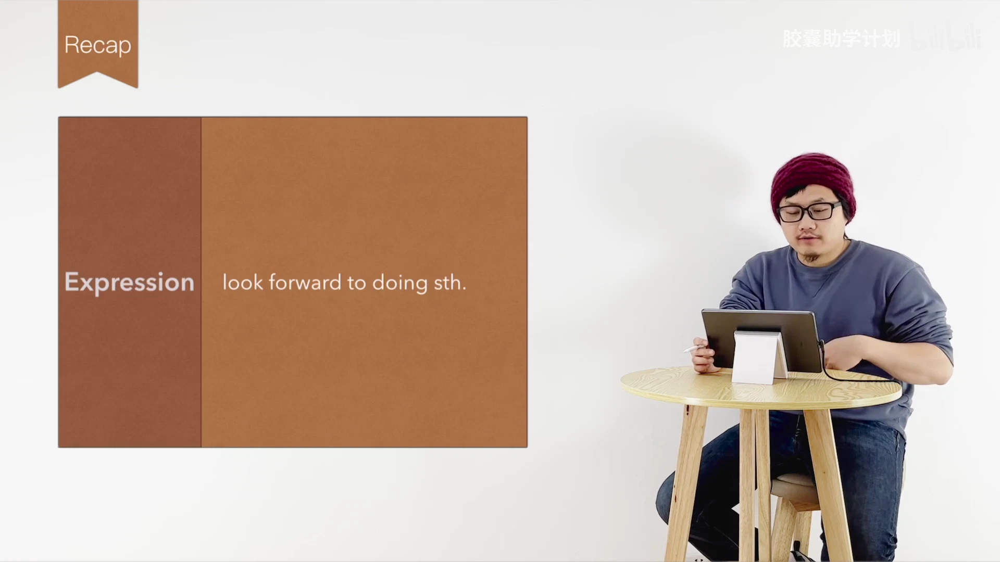

文字识别：Recap / Expression / look forward to doing sth.

### 画面 00:13:29

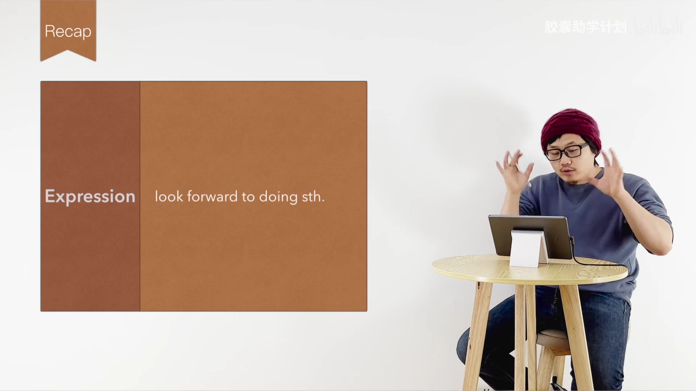

文字识别：Recap / Expression / look forward to doing sth.

## 00:13:30–00:14:00

外，我们新学会了一个习惯用法，叫 look forward to doing something。好吧，呃，然后呢，习惯用法造句啊， look forward to doing something。各位去造造句子。文章跟读至熟读成诵。好，去进行下一个最后一个视频的练习，对吧？好，呃，以上呢就是本期视频的全部内容了。如果各位喜欢我们的课程呢，欢迎各位关注订阅，一键三连，分享给那些需要的朋友，来帮助我们快速成长。See you next time.

### 画面 00:13:31

文字识别：Recap / Expression / look forward to doing sth.

### 画面 00:13:35

### 画面 00:13:37

文字识别：1. / 习惯用法造句/对话 / 【习惯用法造句指南】 / 每个5句

### 画面 00:13:39

文字识别：1. / 习惯用法造句/对话 / 【习惯用法造句指南】 / 每个5句 / 文章跟读至熟读成诵 / 内化单词+语法+习惯用法 / 听力+口语+写作练习

### 画面 00:13:41

文字识别：1. / 习惯用法造句/对话 / 【习惯用法造句指南】 / 每个5句 / 文章跟读至熟读成诵 / 内化单词+语法+习惯用法 / 听力+口语+写作练习

### 画面 00:13:46

## 00:14:00–00:14:12

### 画面 00:14:00

文字识别：CAPSULEACADEMY / 胶囊助学计划 / 小红书

### 画面 00:14:02

文字识别：CAPSULEACADEMY / 胶囊助学计划 / 小红书 / ctu rer / Leo / OE

### 画面 00:14:07

文字识别：CAPSULEACADEMY / 胶囊助学计划 / 小红书 / Leo ＆ De / OE

### 画面 00:14:10

文字识别：bilibili / 胶囊助学计划

### 画面 00:14:11

文字识别：bilibili / 胶囊助学计划

