# L037 听说读写复述练习

快速机器解析：语音为单模型转写，未进行独立交叉校对或人工复核；画面每秒采样并按变化选帧，短时文字和标记可能遗漏。截图时间约有 1 秒误差。图片有损压缩；遇到疑点请按时间查看 Google Drive 原视频。

## 00:00:00–00:00:30

Hello everyone, welcome to Capsule Academy. This is Leo. Today we're going to learn New Concept English Book Two Lesson Thirty Seven Practices. 那注意进行如下练习，唯一的前提就是文章一定要熟读成诵，否则请我开始。 Hope you guys enjoyed. 好，那我们先看第一道题，对吧？老习惯，我们要听懂一般疑问句和特殊疑问句啊，听懂别人发问，好

### 画面 00:00:00

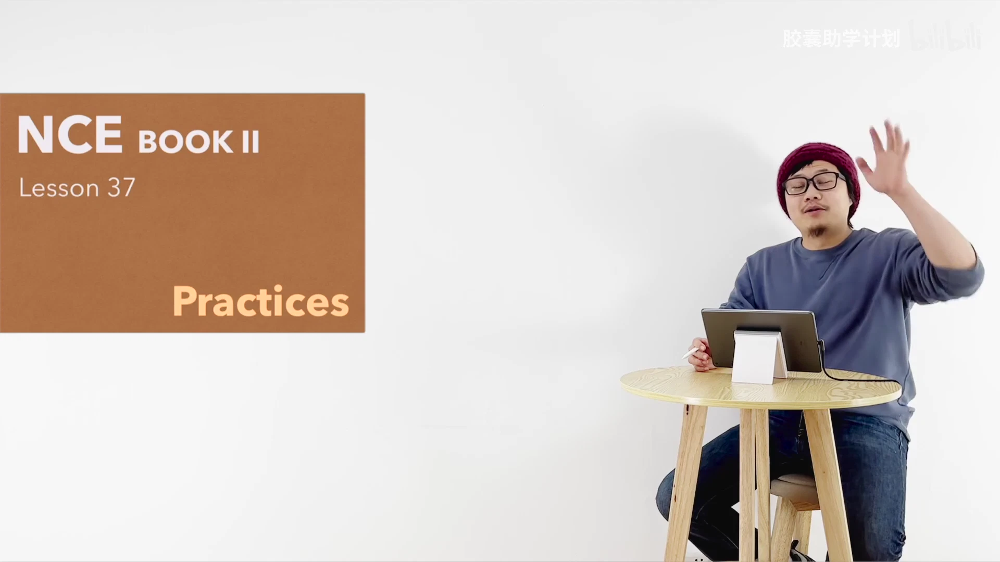

文字识别：NCE / BOOK ⅡI / Lesson 37 / Practices

### 画面 00:00:02

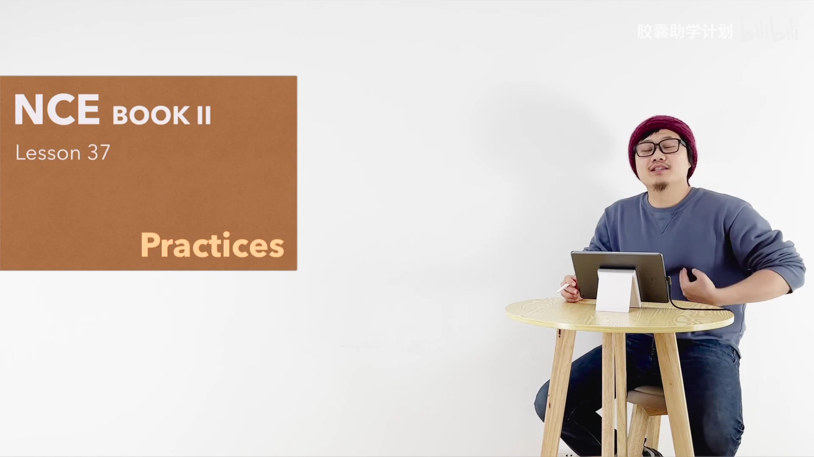

文字识别：NCE / BOOK I"I / Lesson 37 / Practices

### 画面 00:00:05

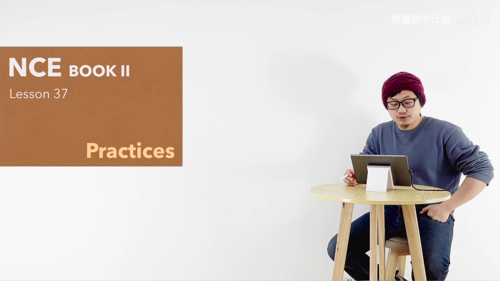

文字识别：NCE / BOOKI"I / Lesson 37 / Practices

### 画面 00:00:09

文字识别：进行如下练习唯一前提 / 文章跟读至熟读成诵 / 否则请勿开始

### 画面 00:00:12

文字识别：进行如下练习唯一前提 / 文章跟读至熟读成诵 / 否则请勿开始

### 画面 00:00:16

文字识别：进行如下练习唯一前提 / 文章跟读至熟读成诵 / 否则请勿开始

### 画面 00:00:18

文字识别：胶囊助学计划 bilbl / •

### 画面 00:00:22

### 画面 00:00:24

文字识别：Comprehension / 训练目标： / 听懂一般疑问句＆特殊疑问句

## 00:00:30–00:01:00

吧？那各位根据文章去找答案啊！我问您答，口语听力练习。第一题，Where will the next Olympic Games be held？注意，这是根据原文去找答案啊，不是根据我们这个真实世界的客观情况啊。啊，In our country，是吧？Next one，When will they be held？In four years' time. Next one，How

### 画面 00:00:30

文字识别：Comprehension

### 画面 00:00:33

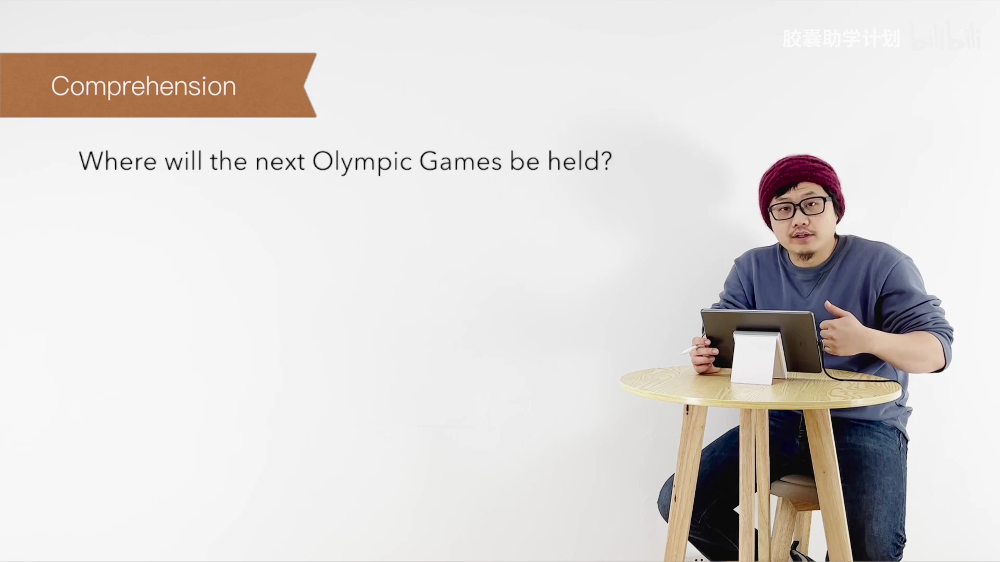

文字识别：Comprehension / Where will the next Olympic Games be held?

### 画面 00:00:50

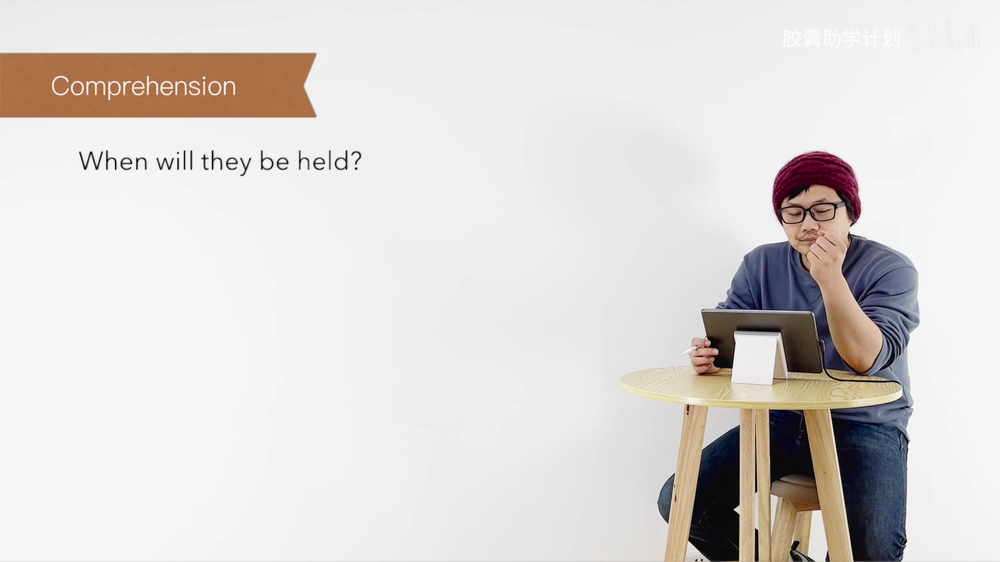

文字识别：Comprehension / When will they be held?

## 00:01:00–00:01:30

how many people will be visiting our country? A great many people. Next one, what will the government be building for the visitors? New hotels. Okay. Next one, so what will the stadium be like? Immense. Next one, there will be a new Olympic standard swimming pool.

### 画面 00:01:04

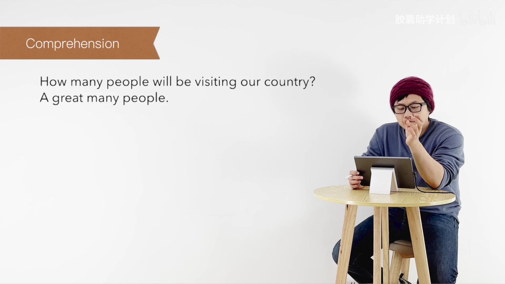

文字识别：Comprehension / How many people / e will be visiting our country? / A great many people.

### 画面 00:01:07

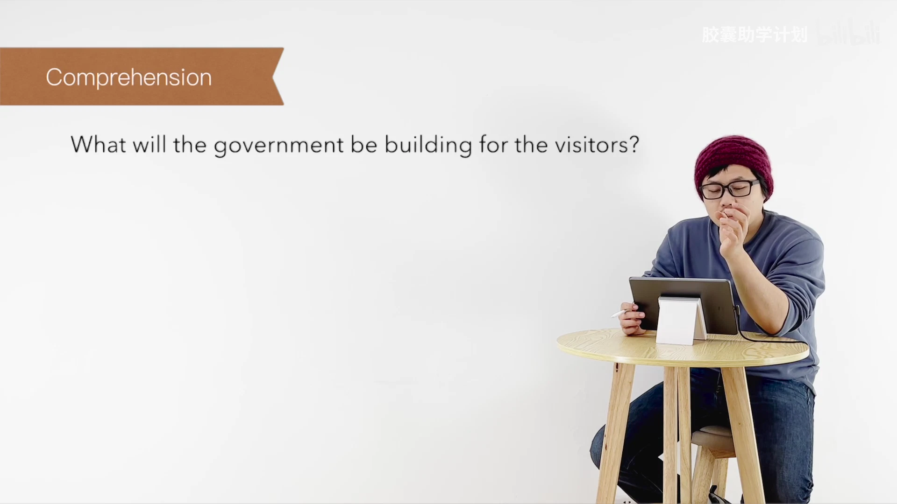

文字识别：Comprehension / What will the government be building for the visitors?

### 画面 00:01:24

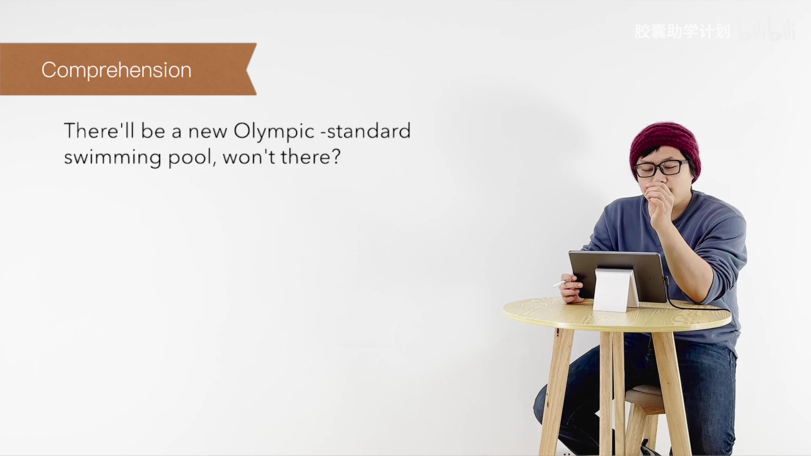

文字识别：Comprehension / There'l be a new Olympic -standard / swimming pool, won't there?

## 00:01:30–00:02:00

won't there? Ah, yes, there will, right? Next one, what else will they be building? New roads and a special railway line. Next one, will the games be held inside the capital or just outside? Just outside. Next one, so what will the whole area be called? Olympic City.

### 画面 00:01:34

文字识别：Comprehension / What else will they be building?

### 画面 00:01:39

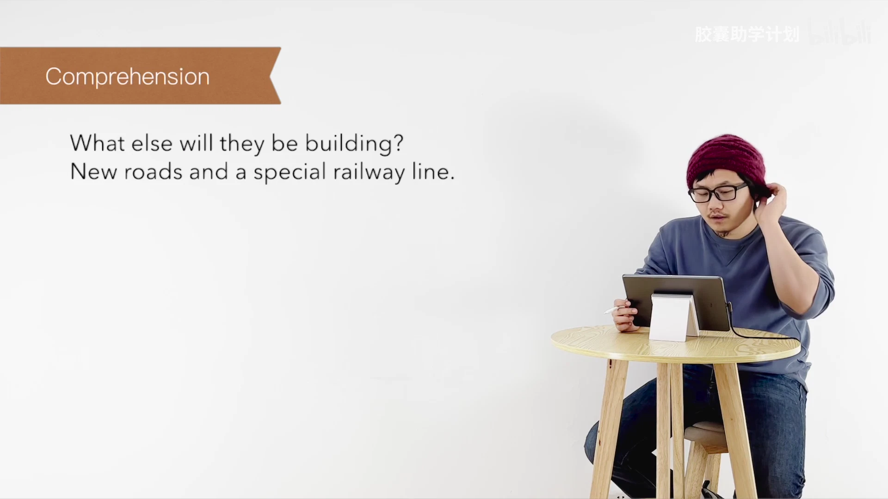

文字识别：Comprehension / What else will they be building? / New roads and a special railway line.

### 画面 00:01:44

文字识别：Comprehension

## 00:02:00–00:02:30

Next one, say when will workers have completed the new roads by the end of this year. Good asking questions. Practice is we can say general questions and special questions ability, right? Okay, ah, that we first look at example. Ask me if the Olympic Games will be held in our country in four years time. Will be held. You see will basically mention this thing is

### 画面 00:02:07

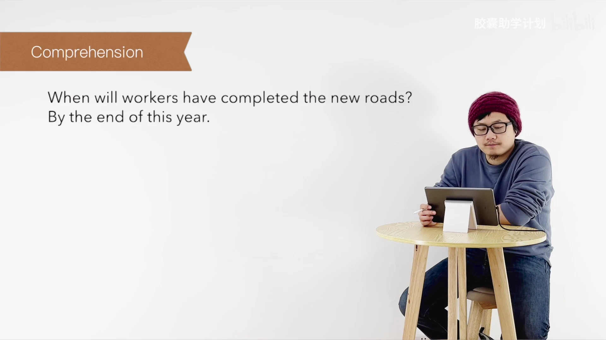

文字识别：Comprehension / When will workers have completed the new roads? / By the end of this year.

### 画面 00:02:11

文字识别：Asking questions / 训练目标： / 会说一般疑问句＆特殊疑问句 / Accuracy / Fluency

### 画面 00:02:18

文字识别：Asking questions

### 画面 00:02:22

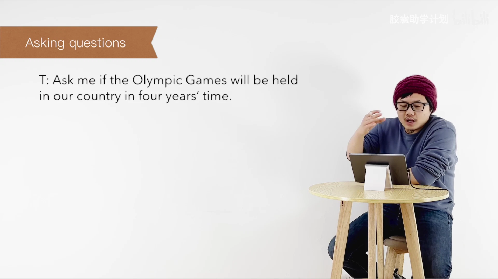

文字识别：Asking questions / T: Ask me if the Olympic Games will be held / in our country in four years' time.

### 画面 00:02:28

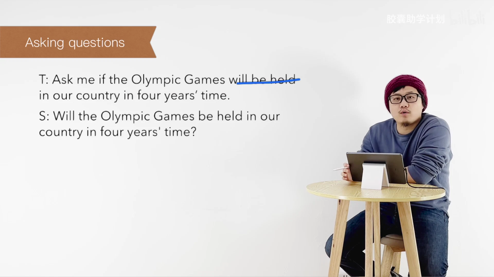

文字识别：Asking questions / T: Ask me if the Olympic Games wilL be helet / in our country in four years' time. / S: Will the Olympic Games be held in our / country in four years' time?

## 00:02:30–00:03:00

事儿就结束了，是吧？OK，然后 when 那肯定是对 in four years' time 提问，把它一去掉，把 when 往前一提啊。 When will the Olympic Games be held in our country？所以这个题练习的就是我们能说出来那一般疑问句和特殊疑问句的能力，对吧？那接下来我们一个一个看啊。 Where 那肯定是对 in our country 提问，对吧？第二题， A great many people will be visiting the

### 画面 00:02:34

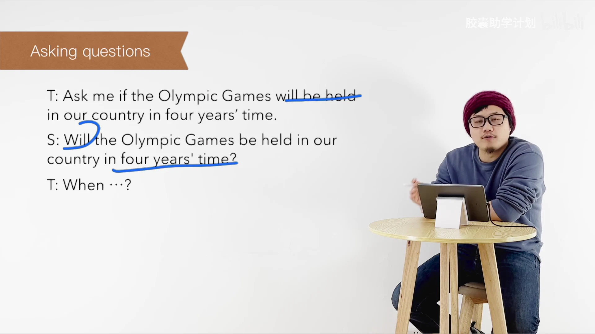

文字识别：Asking / questions / T: Ask me if the Olympic / Games will be helet / in our country in four years' / time. / S: Willthe / Olympic / Games be held in our / country in four years' time? / T: When …?

### 画面 00:02:46

文字识别：Asking / questions / 1.The Olympic / Games will be held in our country / in four years' / time.(When) (Where)

### 画面 00:02:51

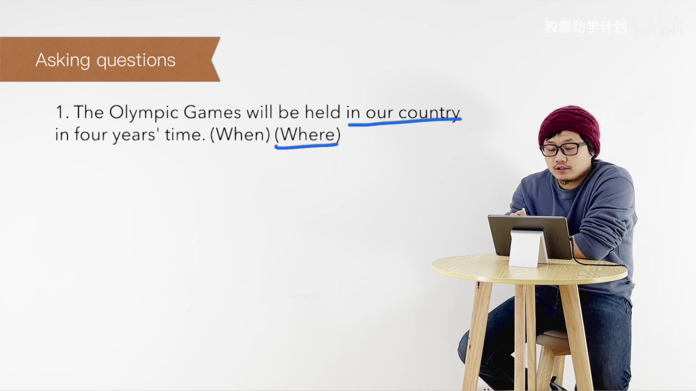

文字识别：Asking / questions / 1.The Olympic / Games will be held in our country / in four years' / time.(When) (Where)

### 画面 00:02:55

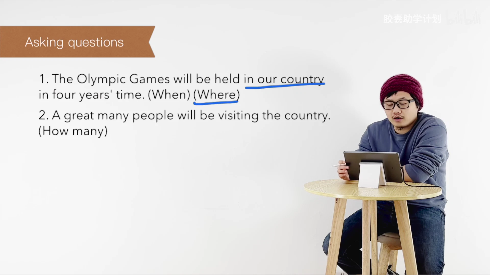

文字识别：Asking / questions / 1.The Olympic / Games will be held in our country / in four years' / time. (When) (Where) / 2.A great many people will be visiting the country. / (How many)

## 00:03:00–00:03:30

country. Will提前，How many肯定是对a great many提问，对吧？它是对主语的一部分提问，同理也不用变一般疑问句。答案就是How many people will be visiting the country? How many people will be visiting the country? Okay, next one说The government will be building new hotels.肯定就是will往前一提，这事儿就结束了，对吧？那What对什么提问呢？What对就对The government嘛，对吧？啊，也不呃What

### 画面 00:03:02

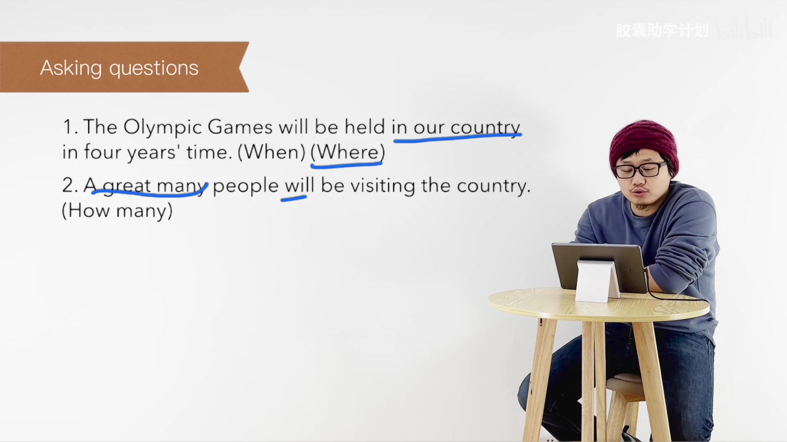

文字识别：Asking / questions / 1.The / Olympic / Games will be held in our country / in four years' / time. (When) (Where) / 2.Agreat many people / : will be visiting the country. / (How many)

### 画面 00:03:07

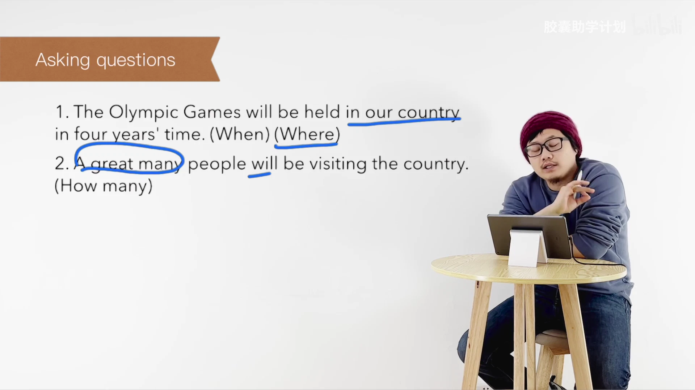

文字识别：Asking / questions / 1.The / Olympic / Games will be held in our country / in four years' / time. (When) (Where) / 2.Agreat many / people / : will be visiting /  the country. / (How many)

### 画面 00:03:15

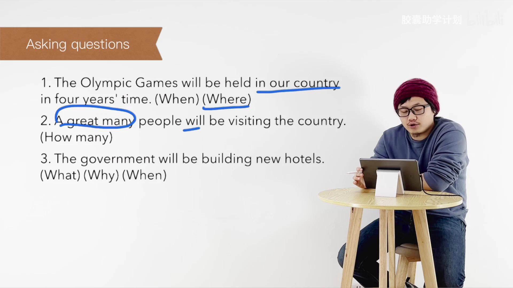

文字识别：Asking / questions / 1.The Olympic / Games will be held in our country / in four years' / time. (When) (Where) / 2.Agreat many / people will be visiting the country. / (How many) / 3.The / government will be building new hotels. / (What) (Why)(When)

### 画面 00:03:20

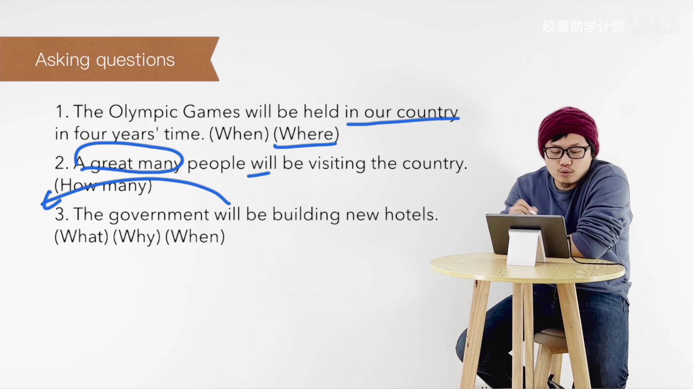

文字识别：Asking / questions / 1.The( / Olympic / Games will be held in our country / in four years' / time. (When) (Where) / 2.Agreat many / people will be visiting the country. / (How many) / 3.The / government will be building new hotels. / (What) (Why)(When)

## 00:03:30–00:04:00

你可以对 government 提问，也可以对 new hotels 提问，对吧？比如说 what will the government be building？啊， next one，你 why 可以直接整句话叫做 why will the government be building new hotels？那 when 直接加整句话。第四题 will 往前一提，很简单，how big 对 immense 嘛，对吧？叫做 how big will the new stadium be？ Okay， next one，第五题说 they will be building。好了，后面都不

### 画面 00:03:47

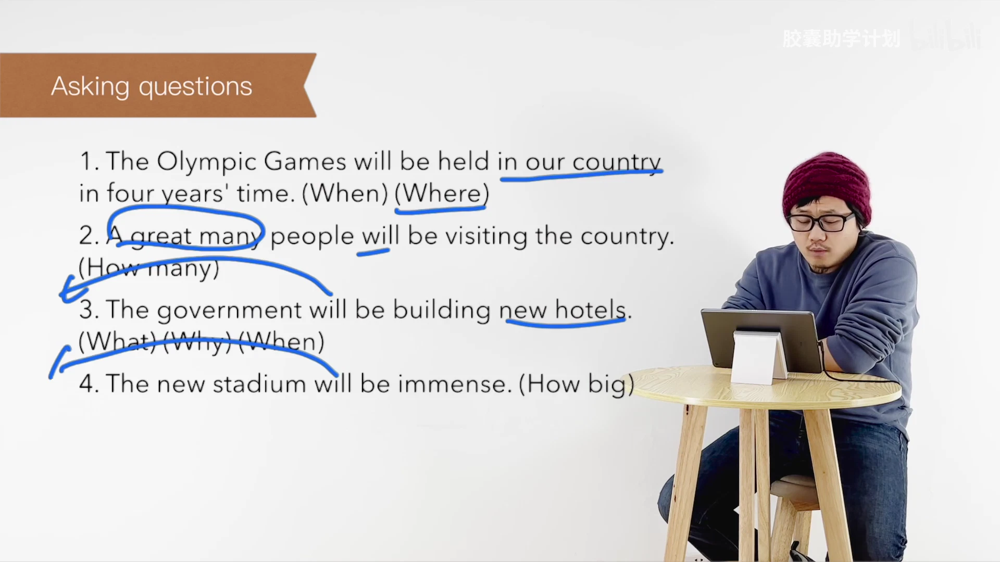

文字识别：Asking / questions / 1.The Olympic / Games will be held in our country / in four years' / time.(When) (Where) / 2.Agreat many / people will be visiting the country. / (How many) / 3.The / government will be building new hotels. / (What)(Whry)(When) / 4. The new stadium will be immense. (How big)

### 画面 00:03:49

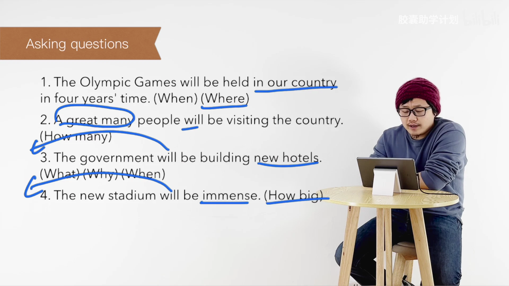

文字识别：Asking / questions / 1.The Olympic / Games will be held in our country / in four years' / time. (When) (Where) / 2.Agreat many / people will be visiting the country. / (How many) / 3.The / government will be building new hotels. / (What)(Whry)(When) / 4. The new stadium will be immense.(How big)

### 画面 00:03:55

文字识别：Asking / questions / 5. They'll be building a new / Olympi-cstandard / swimming pool. (What kind of)

## 00:04:00–00:04:30

用看了。Will往前一提，一定是这个样子的，对吧？然后，What kind of? What kind of叫什么类型的？原来我跟各位分析过，它对于起到形容词作用的那些单词是进行提问的，对吧？那New Olympic standard肯定是嘛，叫做What kind of swimming pool will they be building?对吧？OK啊，再具体一点，其实What kind of应该是对形容词及

### 画面 00:04:01

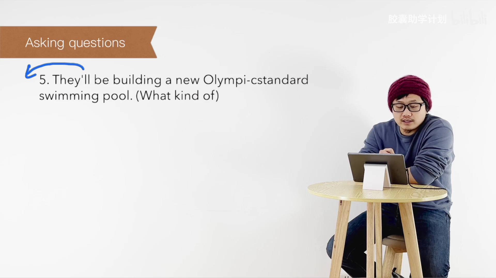

文字识别：Asking / questions / 5.They'll be / building a new / Olympi-cstandard / swimming pool. (What kind / of)

### 画面 00:04:18

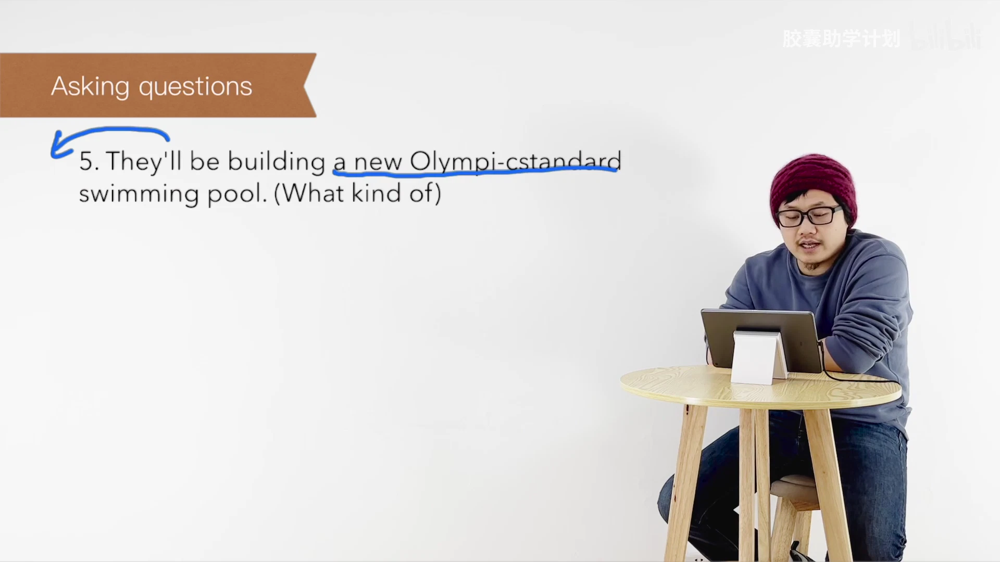

文字识别：Asking / questions / 5.They'll be / building anew / Olympi-cstandard / swimming pool. (What kind of)

### 画面 00:04:29

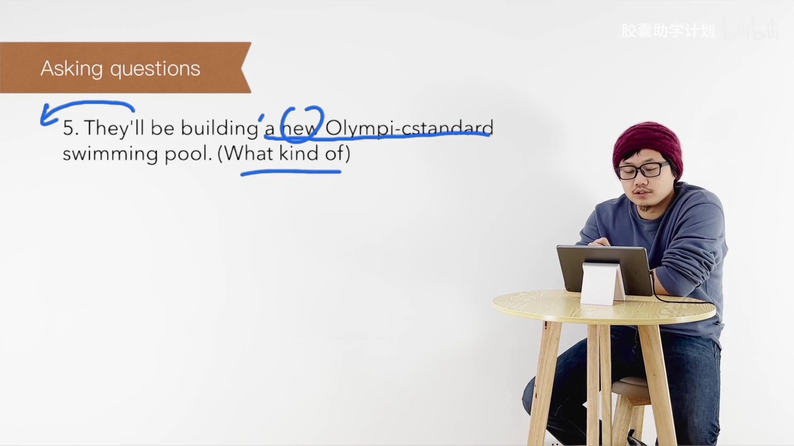

文字识别：Asking / questions / building' a heD / Olympi-cstandard / 5.They'll be / swimming pool. (What kind of)

## 00:04:30–00:05:00

这种限定词是吧，冠词啊都带着。继续说，呃，new roads and special railway line will be built. 那就What else will be built嘛？非常简单，直接对前面这一堆东西提问啊，就还会建什么其他的东西啊？Next one，第七个说，the games will be held just outside the capital. Where往前一提，where对outside the capital提问，what对the games提问，所以答案就是What will be

### 画面 00:04:35

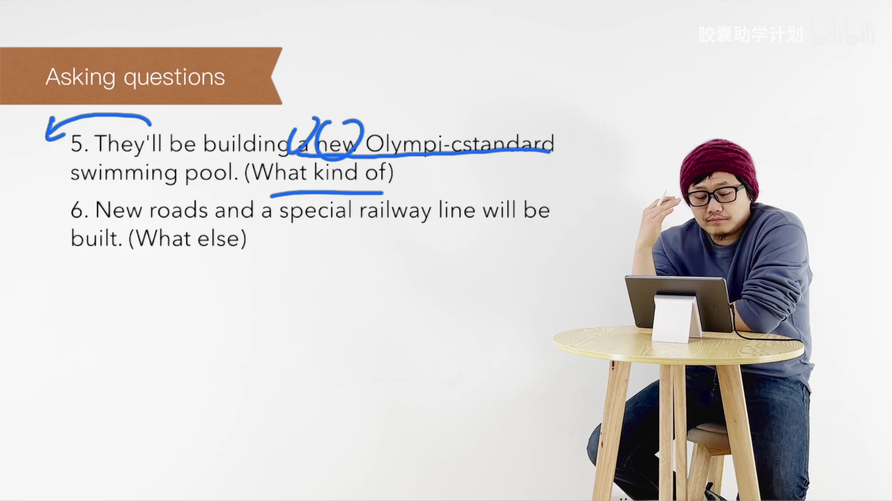

文字识别：Asking / questions / Olympi-cstandard / 5.They'll be / building / swimming pool. (What kind / of) / 6.New roads / and a special railway line will be / built.(What else)

### 画面 00:04:46

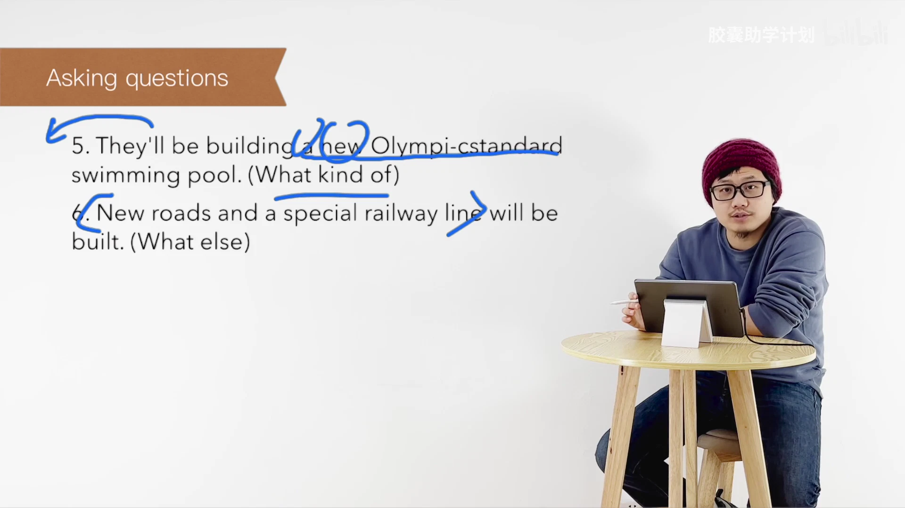

文字识别：Asking / questions / dheD / Olympi-cstandard / 5.They'll be / building / swimming pool.(What k / kind / of) / New roads / anda /  special railway line will be / a / built. / (What / else)

### 画面 00:04:48

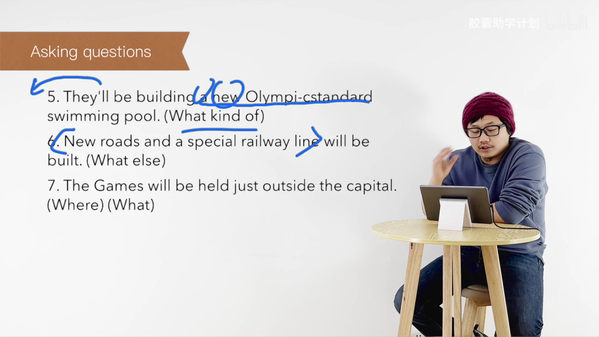

文字识别：Asking / questions /  buildindheD / )Olympi-cstandard / 5.They'll be / swimming pool. (What kind  / of) / .New roads / s and a special railway line will be / built. (What else) / 7.The /  Games will be held just outside the capital. / (Where)(What)

### 画面 00:04:52

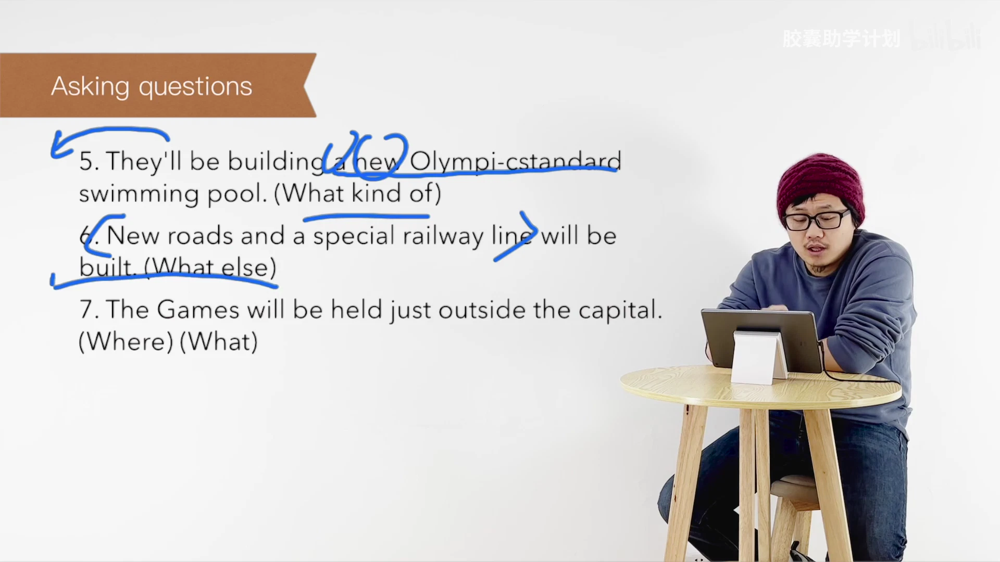

文字识别：Asking / questions /  buildinlheD / )Olympi-cstandard / 5.They'll be / swimming pool. (What kind / of) / .New roads /  and a special railway line will be / built. (What else) / 7.The / Games will be held just outside / e the capital. / (Where)(What)

### 画面 00:04:55

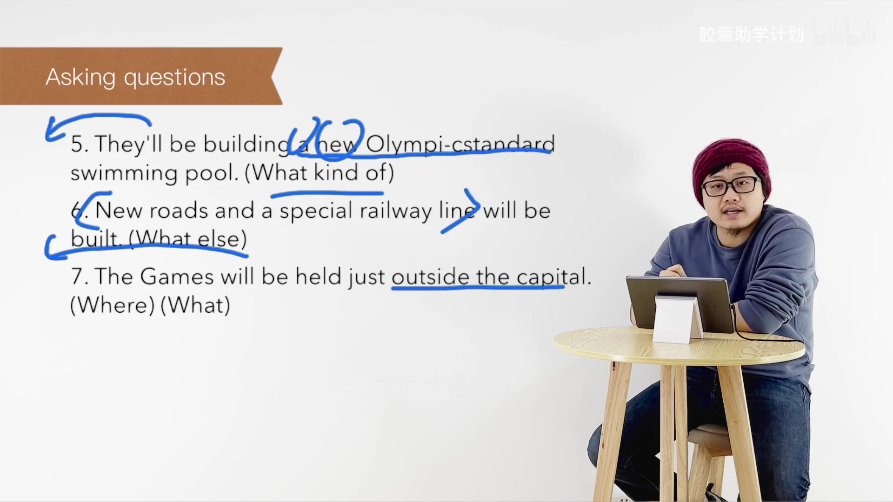

文字识别：Asking / questions /  buildindheD / )Olympi-cstandard / 5. They'll be k / swimming pool. (What kind of) /  New roads and a special railway lin will be / built.(What else) / 7.The( / Games will be held just outside the capital. / (Where)(What)

### 画面 00:04:57

文字识别：Asking / questions /  buildindLeD / )Olympi-cstandard / 5.They'll be / swimming pool. (What kind  / of) / .New roads / s and a special railway line will be / built. (What else) / 7. The Ganes will be held just outside the capital. / (Where)(What)

## 00:05:00–00:05:30

just outside the capital, 对吧？ Next one说 There will be a new city, will往前一提，对吧？ Will there be a new city? What kind?刚才刚说了，应该是 What kind of? 啊 What kind of city will there be? 对吧？ Very good. Tell the story. 练习的是我们能把这个文章复述下来，注意是复述，复述不是背诵，对吧？区别还是很大的。之前我讲过啊，第一个单元重点解释

### 画面 00:05:04

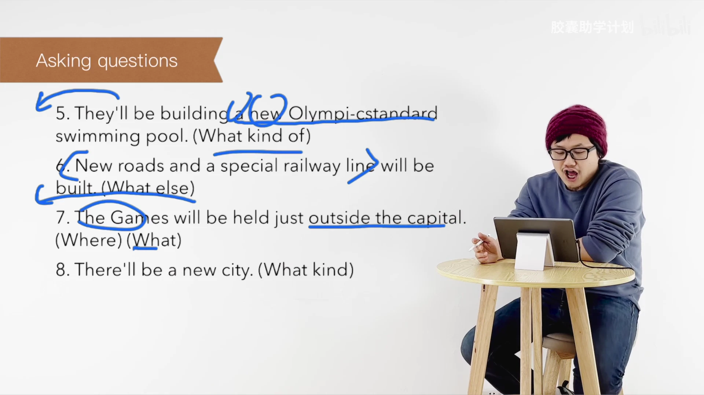

文字识别：Asking / questions / 5. They' be uildinde / DOlympi-cstandard / swimming pool. (What kind of) / New roads and a special railway line will be / built. (What else) / 7. The Ganes will be held just outside the capital. / (Where)(What) / 8. There'l be a new city. (What kind)

### 画面 00:05:12

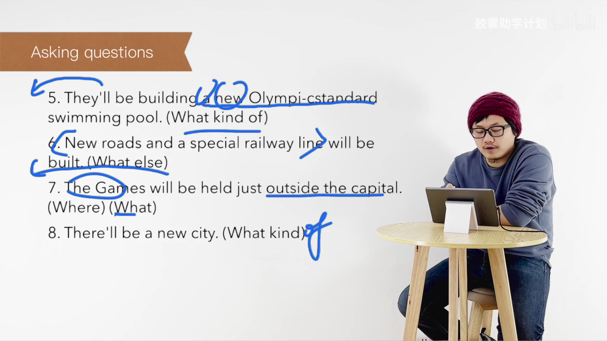

文字识别：Asking / questions / 5. Theyl e uildindemoicstandard / swimming pool. (What kind of) /  New roads and a special railway line will be / built.(What else) / 7. The Ganes will be held just outside the capital. / (Where)(What) / 8. There'll be a new city. (What kind)

### 画面 00:05:17

文字识别：Tell the story / 训练目标： / 口语复述能力 / Accuracy / Fluency

### 画面 00:05:27

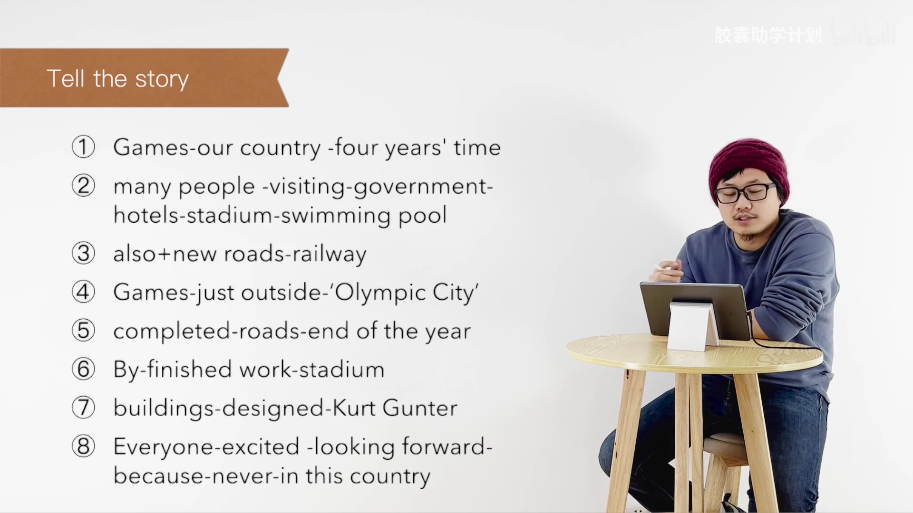

文字识别：Tell the story / ① / Games-our country -four years' time / many people -visiting-government- / hotels-stadium-swimming pool / also+new roads-railway / Games-just outside-'Olympic City' / completed-roads-end of the year / 5 / By-finished work-stadium / buildings-designed-Kurt Gunter / Everyone-excited -looking forward- / because-never-in this country

### 画面 00:05:29

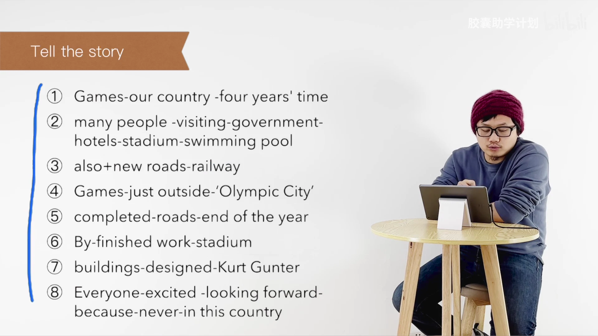

文字识别：Tell the story / ① / Games-our country -four years' time / many people -visiting-government- / 2 / hotels-stadium-swimming pool / also+new roads-railway / Games-just outside-'Olympic City' / completed-roads-end of the year / 5 / By-finished work-stadium / buildings-designed-Kurt Gunter / Everyone-excited -looking forward- / because-never-in this country

## 00:05:30–00:06:00

释过这些东西，包括开篇视频。各位要做的事情就是看着这些关键词，把文章尽可能流利的复述出来，不要怕有一点错，不用怕啊，不要怕有错，对吧？好，然后呢，summary writing是摘要写作，写完来这儿对答案，有问题留言就可以了，好吧？呃，完全自由的对话，我们就一起来看一下啊。比如说，talk about some of the outstanding athletic achievements of the last Olympic Games，说

### 画面 00:05:31

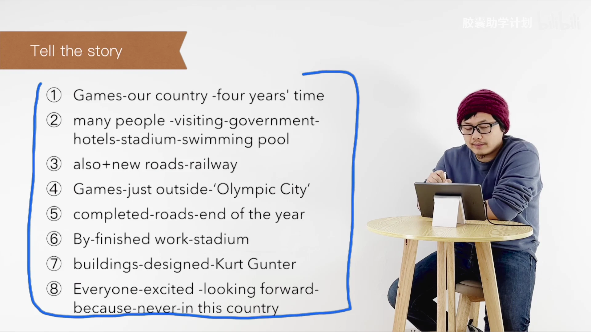

文字识别：Tell the story / ① / Games-our country -four years' time / many people -visiting-government- / 2 / hotels-stadium-swimming pool / also+new roads-railway / Games-just outside-'Olympic City' / completed-roads-end of the year / 5 / By-finished work-stadium / buildings-designed-Kurt Gunter / Everyone-excited -looking forward- / because-never-in this country

### 画面 00:05:33

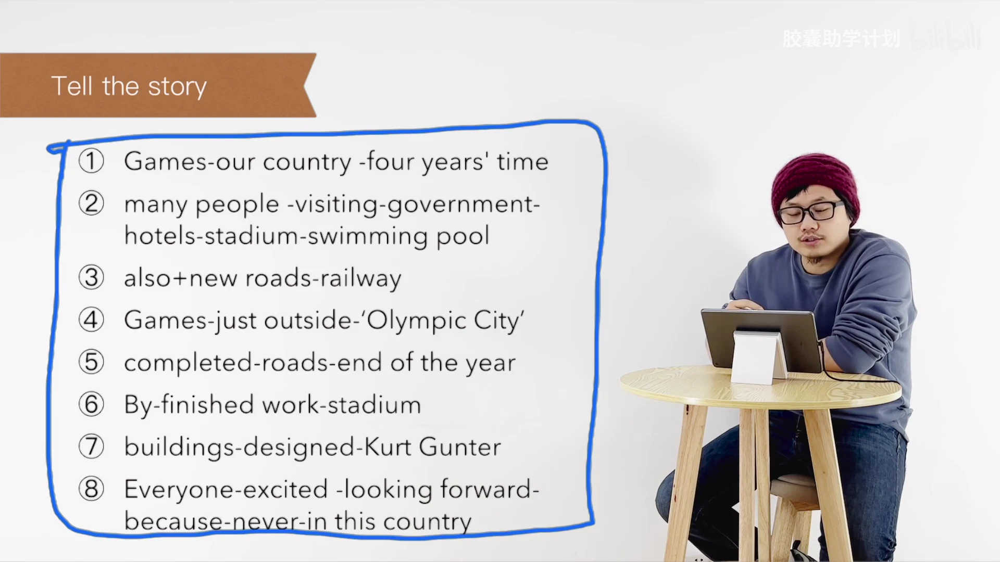

文字识别：Tell the story / ① / Games-our country -four years' time / many people -visiting-government- / hotels-stadium-swimming pool / also+new roads-railway / Games-just outside-'Olympic City' / completed-roads-end of the year / 5 / By-finished work-stadium / buildings-designed-Kurt Gunter / Everyone-excited -looking forward- / because-never-in this country

### 画面 00:05:43

文字识别：Summary writing: Key / 训练目标： / 写作复述能力

### 画面 00:05:45

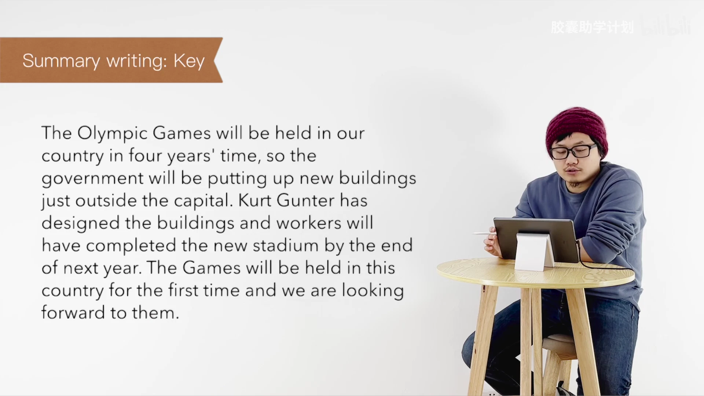

文字识别：Summary writing: Key / The Olympic Games will be held in our / country in four years' time, so the / government will be putting up new buildings / just outside the capital. Kurt Gunter has / designed the buildings and workers will / have completed the new stadium by the end / of next year. The Games will be held in this / country for the first time and we are looking / forward to them.

### 画面 00:05:50

文字识别：Topics for discussion / 训练目标： / 完全自由的对话 / Accuracy / Fluency

### 画面 00:05:52

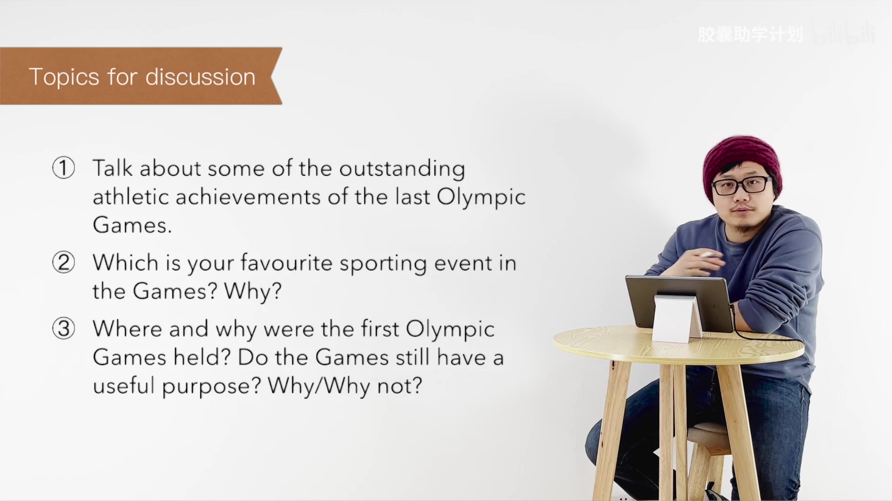

文字识别：Topics for discussion / Talk about some of the outstanding / athletic achievements of the last Olympic / Games. / Which is your favourite sporting event in / the Games? Why? / Where and why were the first Olympic / Games held? Do the Games still have a / useful purpose? Why/Why not?

## 00:06:00–00:06:30

### 画面 00:06:03

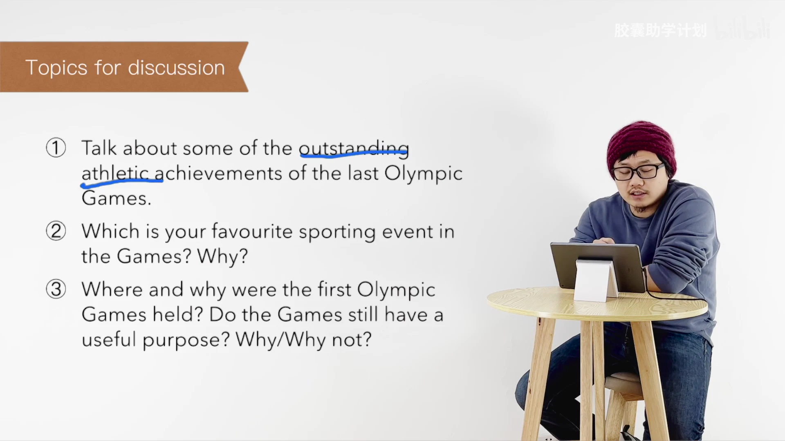

文字识别：Topics for discussion / Talk about some of the outstanding / athletic achievements of the last Olympic / Games. / Which is your favourite sporting event in / the Games? Why? / Where and / I why were the first Olympic / Games held? Do the / Games still have a / useful purpose? Why/Why not?

### 画面 00:06:05

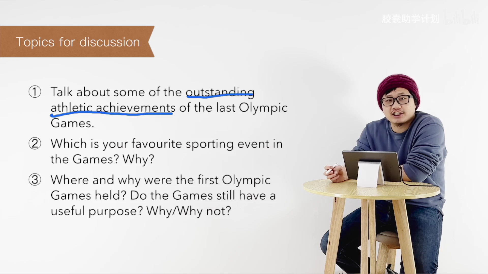

文字识别：Topics for discussion / Talk about some of the outstanding / athletic achievements / s of the last Olympic / Games. / Which is your favourite sporting event in / the Games? Why? / Where and / I why were the first Olympic / Games held? Do the / Games still have a / useful purpose? Why/Why not?

## 00:06:30–00:07:00

### 画面 00:06:35

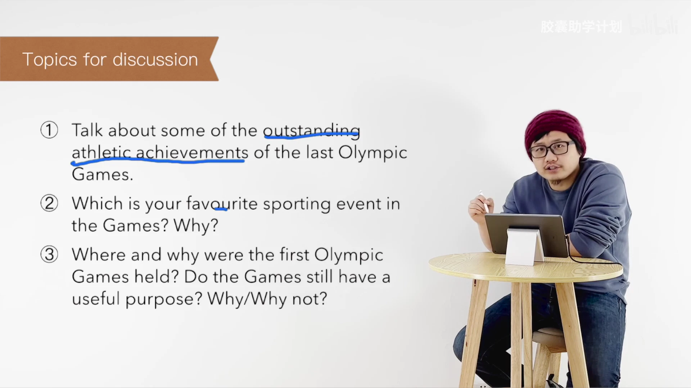

文字识别：Topics for discussion / Talk about some of the ( / : outstanding / athletic achievements / of the last Olympic / Games. / Which is your favourite sporting event in / the Games? Why? / Where and / I why were the first Olympic / Games held? Do the / Games still have a / useful purpose? Why/Why not?

## 00:07:00–00:07:30

Why? Why not? 有还是没有？比如说促进世界和平，是吧？啊，五个圈儿连在连在一起，还有这样的作用吗？有，为什么有？没有，为什么没有？OK，好，呃，家庭作业，Ask Smith，先写，大声朗读，摘要写作，各位先写，然后来这里对答案，Tell the story，文章读熟了之后，来这里进行口语复述，最后专栏当中我们可以找得到啊。那以上呢就是本期视频的全部内容

### 画面 00:07:00

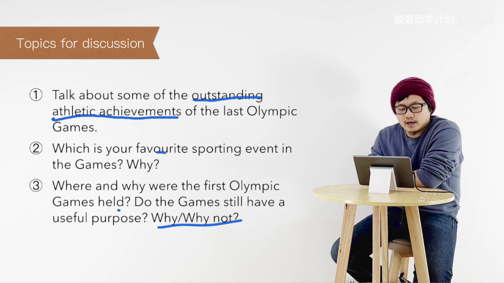

文字识别：Topics for discussion / Talk about some of the / outstanding / athletic achievements / of the last Olympic / Games. / Which is your favQurite / sporting event in / the Games? Why? / Where and / why were / : the first Olympic / Games / s held? Do t / the / Games still have a / useful purpose? Why/Why not?

### 画面 00:07:12

### 画面 00:07:15

文字识别：1.Ask me if写&朗读 / 2.摘要写作写&答案

### 画面 00:07:19

文字识别：1.Ask me if写&朗读 / 摘要写作写&答案 / 2. / 3.Tell the story 口语复述

### 画面 00:07:23

文字识别：1.Ask me if写&朗读 / 摘要写作写&答案 / 3.Tell the story 口语复述 / 专栏 / 4.

### 画面 00:07:26

文字识别：👍

## 00:07:30–00:07:52

了。如果各位喜欢我们的课程呢，欢迎大家关注、订阅、一键三连，分享给那些需要的朋友，来帮助我们快速成长。See you next time.

### 画面 00:07:40

### 画面 00:07:42

文字识别：CAPSULEACADEMY / 胶囊助学计划 / 小红书 / Lecturer / □ / 口 / Leo / OE

### 画面 00:07:45

文字识别：CAPSULEACADEMY / 胶囊助学计划 / 小红书 / Editor / OE

### 画面 00:07:48

文字识别：CAPSULEACADEMY / 胶囊助学计划 / 小红书 / Creator / □ / Leo & Berlin

### 画面 00:07:50

文字识别：bilibili / 胶囊助学计划 / 胶囊助学计划 / 小红书 / OE

### 画面 00:07:52

文字识别：bilibili / 胶囊助学计划

