# L038 单词

快速机器解析：语音为单模型转写，未进行独立交叉校对或人工复核；画面每秒采样并按变化选帧，短时文字和标记可能遗漏。截图时间约有 1 秒误差。图片有损压缩；遇到疑点请按时间查看 Google Drive 原视频。

## 00:00:00–00:00:30

Hello everyone, welcome to Capsule Academy. This is Leo. Today we are going to learn New Concept English Book Two Lesson Thirty Eight Words. 那老习惯进入正式课程之前呢，我先问大家几个小的问题啊。首先，如何表达抱怨啊？接下来呢，如何表达刺骨的冷？OK，那带着这两个问题，Hope you can enjoy it. 好的，我们先看第一个小的单词，看音标，

### 画面 00:00:00

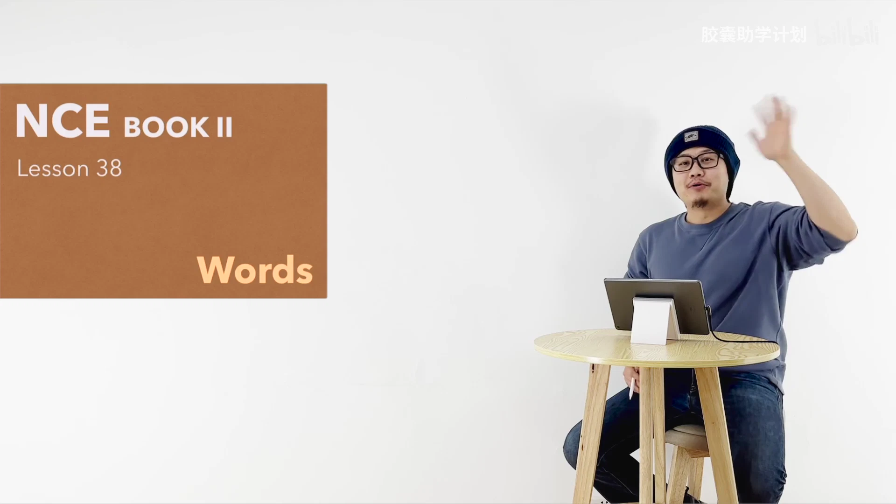

文字识别：NCE / BOOK I"I / Lesson 38 / Words

### 画面 00:00:05

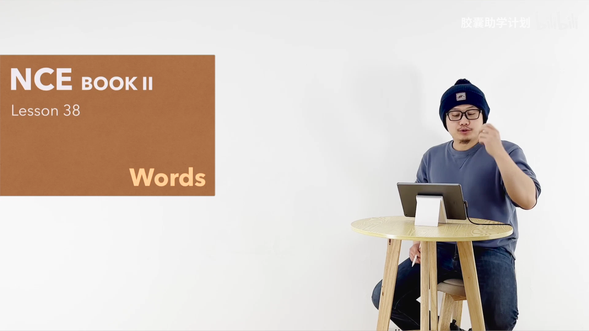

文字识别：NCE / BOOK"I / Lesson 38 / Words

### 画面 00:00:12

文字识别：2

### 画面 00:00:14

文字识别：①如何表达“抱怨”？

### 画面 00:00:16

文字识别：①如何表达“抱怨”？ / 达“刺骨地冷”?

### 画面 00:00:18

文字识别：①如何表达“抱怨”？ / 如何表达“刺骨地冷”?

### 画面 00:00:22

文字识别：胶囊助学计划 bilbl / ••

### 画面 00:00:26

文字识别：胶囊助学计划

### 画面 00:00:28

文字识别：单词造句指南 / 网：v.+v.变化 / 四句型转换 / 方式/地点/时间 / 结合习惯用法 / No dogs / 其他单词+词性 / except / 原文摘抄+变 / guide dogs / 6123456 / /ik'sept/ / except

## 00:00:30–00:01:00

跟我一起读一下，叫做 except， except， OK， very good。那你注意啊，你看我们看这个图，这个标志叫做 no dogs except guide dogs， OK，那它什么意思呢？就是说狗不能进入，除了什么样的狗呢？ Guide dogs，导盲导盲犬，对吧？除了这样的狗，呃，其他所有的狗都不可以进入啊。所以这个 except 就是除了的意思啊。这个单词各位要记住。比如说，

### 画面 00:00:30

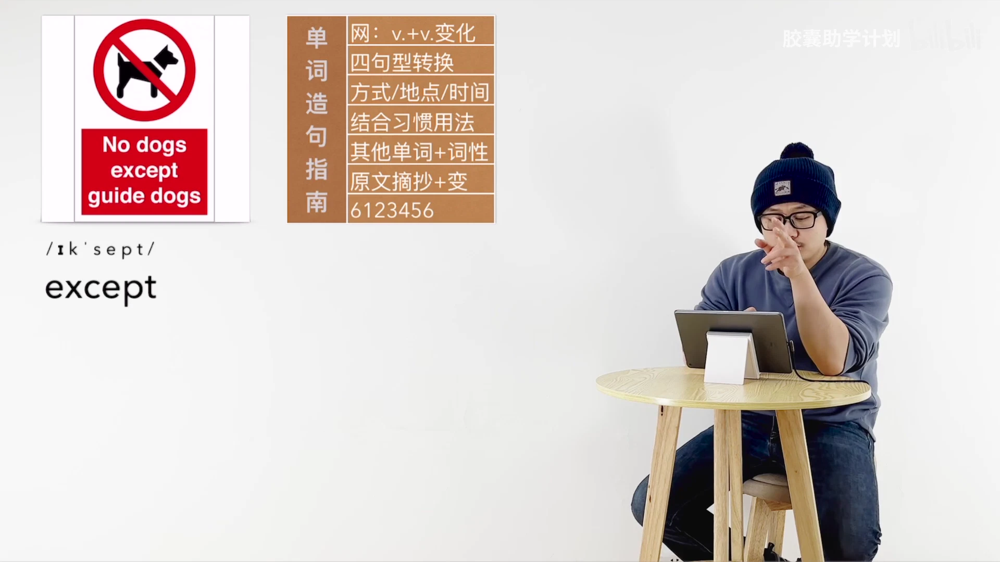

文字识别：单词造句指南 / 网：v.+v.变化 / 四句型转换 / 方式/地点/时间 / 结合习惯用法 / No dogs / 其他单词+词性 / except / 原文摘抄+变 / guide dogs / 6123456 / /ik'sept/ / except

### 画面 00:00:40

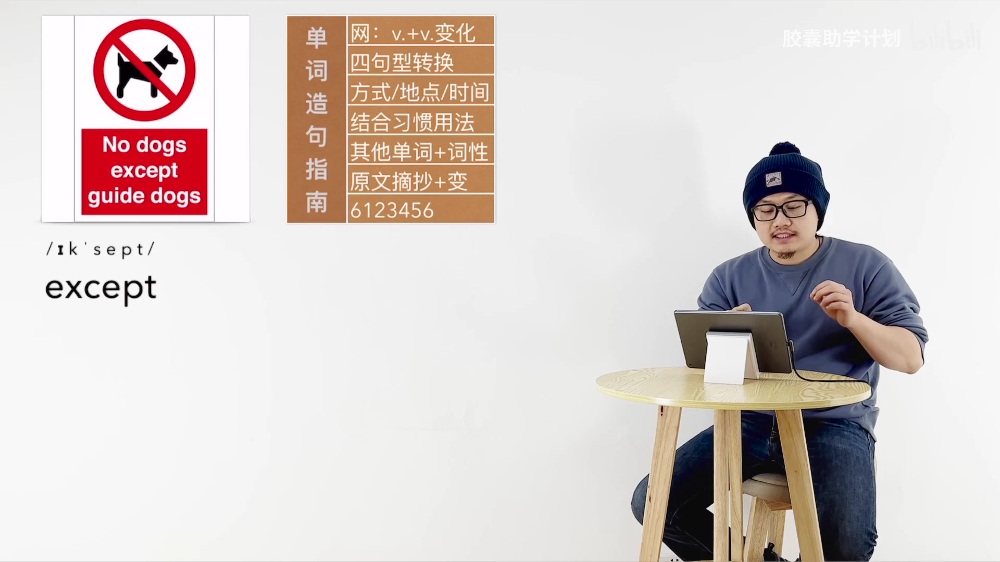

文字识别：单词造句指南 / 网：v.+v.变化 / 四句型转换 / 方式/地点/时间 / 结合习惯用法 / No dogs / 其他单词+词性 / except / 原文摘抄+变 / guide dogs / 6123456 / /ik'sept/ / except

### 画面 00:00:45

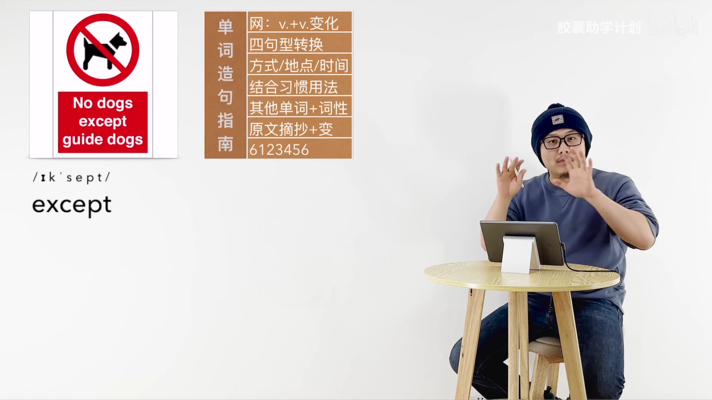

文字识别：单词造句指南 / 网：v.+v.变化 / 四句型转换 / 方式/地点/时间 / 结合习惯用法 / No dogs / 其他单词+词性 / except / 原文摘抄+变 / guide dogs / 6123456 / /ik'sept/ / except

### 画面 00:00:50

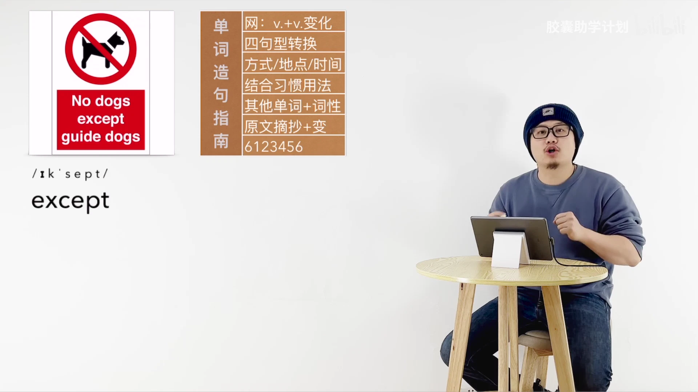

文字识别：单词造句指南 / 网：v.+v.变化 / 四句型转换 / 方式/地点/时间 / 结合习惯用法 / No dogs / 其他单词+词性 / except / 原文摘抄+变 / guide dogs / 6123456 / /ik'sept/ / except

### 画面 00:00:56

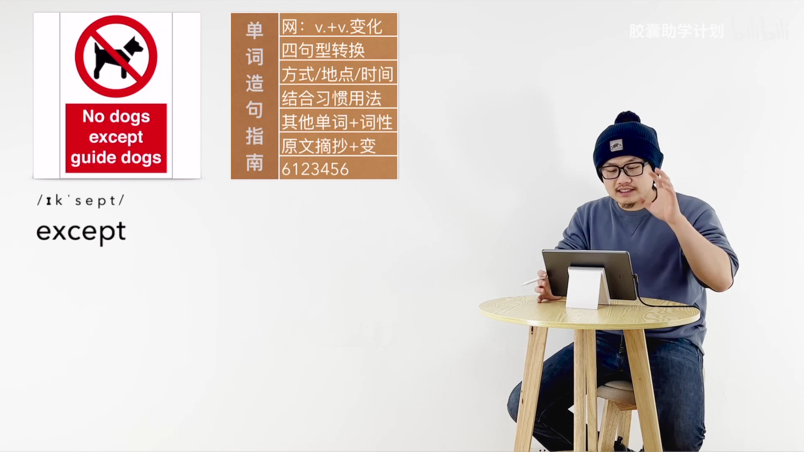

文字识别：单词造句指南 / 网：v.+v.变化 / 四句型转换 / 方式/地点/时间 / 结合习惯用法 / No dogs / 其他单词+词性 / except / 原文摘抄+变 / guide dogs / 6123456 / /ik'sept/ / except

## 00:01:00–00:01:30

we work every day except Sunday. 啊，除了周日，我们每天都工作。再接下来呢，我们可以把这句话变成四句型转换。啊，再然后我们还可以造一句话叫做 There was no one else in the room except myself. 啊，你像 except 这种单词，它不是一个特别重要的动词或者名词啊，甚至它不是一个特别重要的形容词或者副词这样的东西。所以大部分情况下呢，

### 画面 00:01:00

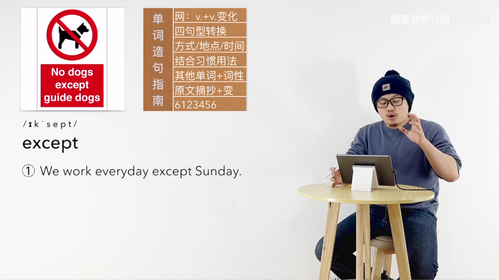

文字识别：单词造句指南 / 网：v.+v.变化 / 四句型转换 / 方式/地点/时间 / 结合习惯用法 / No dogs / 其他单词+词性 / except / 原文摘抄+变 / guide dogs / 6123456 / /ik'sept/ / except / ① We work everyday except Sunday.

### 画面 00:01:05

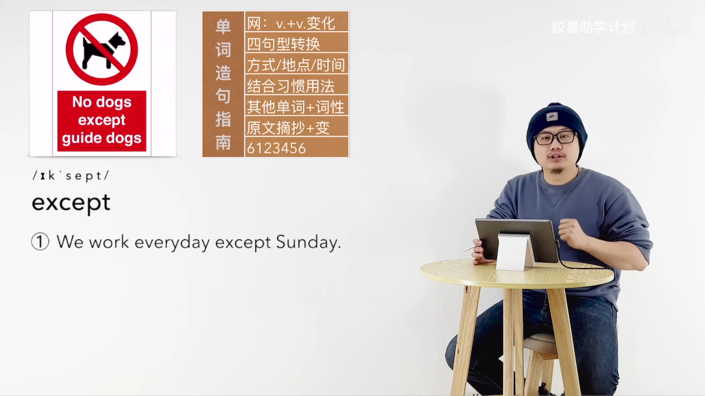

文字识别：单词造句指南 / 网：v.+v.变化 / 四句型转换 / 方式/地点/时间 / 结合习惯用法 / No dogs / 其他单词+词性 / except / 原文摘抄+变 / guide dogs / 6123456 / /ik'sept/ / except / D We work everyday except Sunday. / 1

### 画面 00:01:10

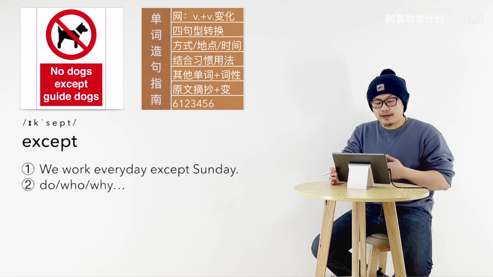

文字识别：单词造句指南 / 网：v.+v.变化 / 四句型转换 / 方式/地点/时间 / 结合习惯用法 / No dogs / 其他单词+词性 / except / 原文摘抄+变 / guide dogs / 6123456 / /ik'sept/ / except / We work everyday except Sunday. / 1 / do/who/why...

### 画面 00:01:15

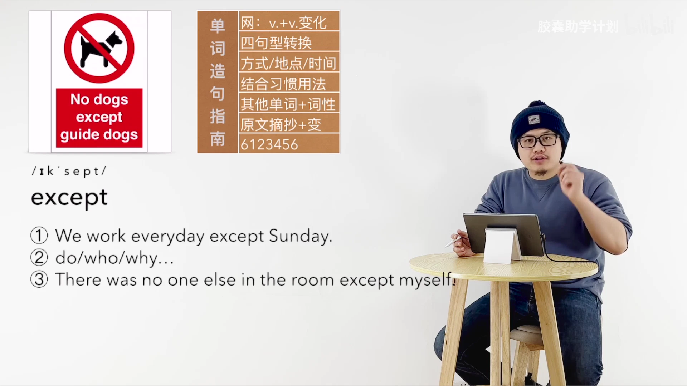

文字识别：单词造句指南 / 网：v.+v.变化 / 四句型转换 / 方式/地点/时间 / 结合习惯用法 / No dogs / 其他单词+词性 / except / 原文摘抄+变 / guide dogs / 6123456 / /ik'sept/ / except / We work everyday except Sunday. / ① / do/who/why... / There was no one else in the room except myself.

### 画面 00:01:25

文字识别：单词造句指南 / 网：v.+v.变化 / 四句型转换 / 方式/地点/时间 / 结合习惯用法 / No dogs / 其他单词+词性 / except / 原文摘抄+变 / guide dogs / 6123456 / /ik'sept/ / except / We work everyday except Sunday. / 1 / do/who/why... / There was no one else in the room except myself.

## 00:01:30–00:02:00

这个单词对于各位来说其实不需要你主动去造句，你只要在文章当中见到它，多见啊，你只要保证你多读多学，见多了，慢慢这个单词就记下来了。也就是说，我们在这地方简单说一下，我们去背单词的时候，可以有一些单词是主动去记忆的，比如说非常重要的各种动词，有一些单词呢，像except这样的单词，我就会告诉各位，你被动去记忆就完全足够了啊，就所谓被动记

### 画面 00:01:30

文字识别：单词造句指南 / 网：v.+v.变化 / 四句型转换 / 方式/地点/时间 / 结合习惯用法 / No dogs / 其他单词+词性 / except / 原文摘抄+变 / guide dogs / 6123456 / /ik'sept/ / except / We work everyday except Sunday. / 1 / do/who/why... / There was no one else in the room except myself .

### 画面 00:01:42

文字识别：单词造句指南 / 网：v.+v.变化 / 四句型转换 / 方式/地点/时间 / 结合习惯用法 / No dogs / 其他单词+词性 / except / 原文摘抄+变 / guide dogs / 6123456 / /ik'sept/ / except / We work everyday except Sunday. / ① / do/who/why... / There was no one else in the room except myself.

### 画面 00:01:45

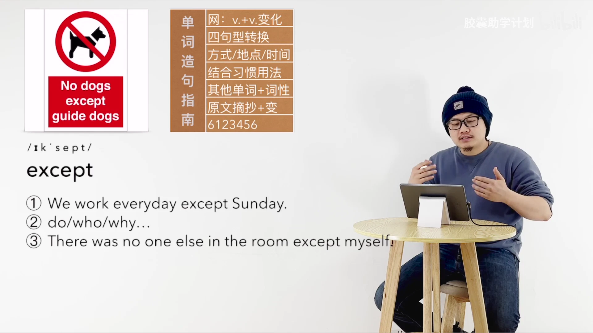

文字识别：单词造句指南 / 网：v.+v.变化 / 四句型转换 / 方式/地点/时间 / 结合习惯用法 / No dogs / 其他单词+词性 / except / 原文摘抄+变 / guide dogs / 6123456 / /ik'sept/ / except / We work everyday except Sunday. / ① / do/who/why... / There was no one else in the room except myself

### 画面 00:01:56

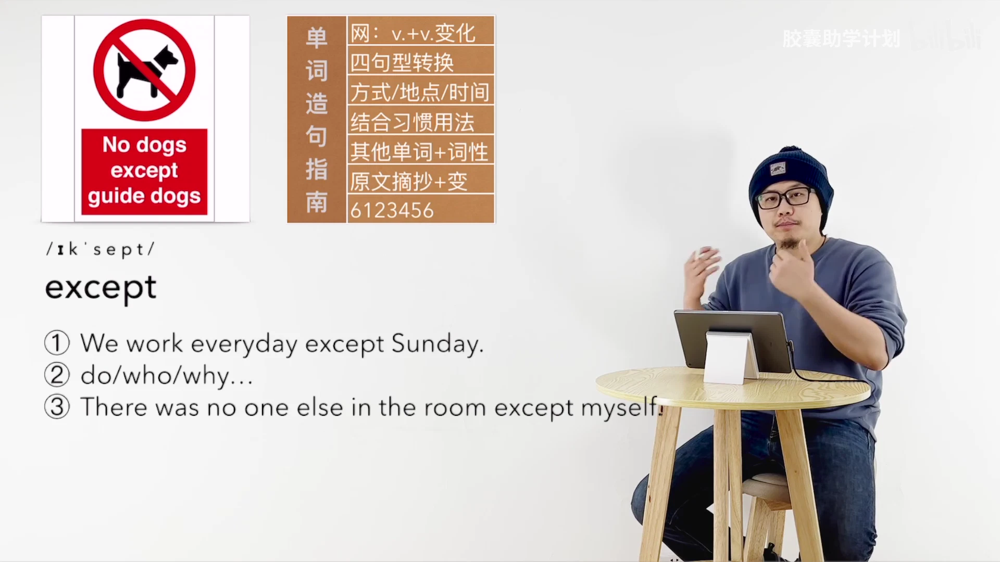

文字识别：单词造句指南 / 网：v.+v.变化 / 四句型转换 / 方式/地点/时间 / 结合习惯用法 / No dogs / 其他单词+词性 / except / 原文摘抄+变 / guide dogs / 6123456 / /ik'sept/ / except / We work everyday except Sunday. / 1 / do/who/why... / There was no one else in the room except myself.

## 00:02:00–00:02:30

忆就是多见啊。OK，下一个单词我们不去造句，各位要注意一个小点。我们看一下这个图啊，这边是欧洲，这边是非洲，欧洲和非洲的中间有一片海，我们管它叫地中海，对吧？这个单词的英文就长成这个样子，非常非常的长。我们一起来看着音标读一下，叫做Mediterranean，来合起来读

### 画面 00:02:00

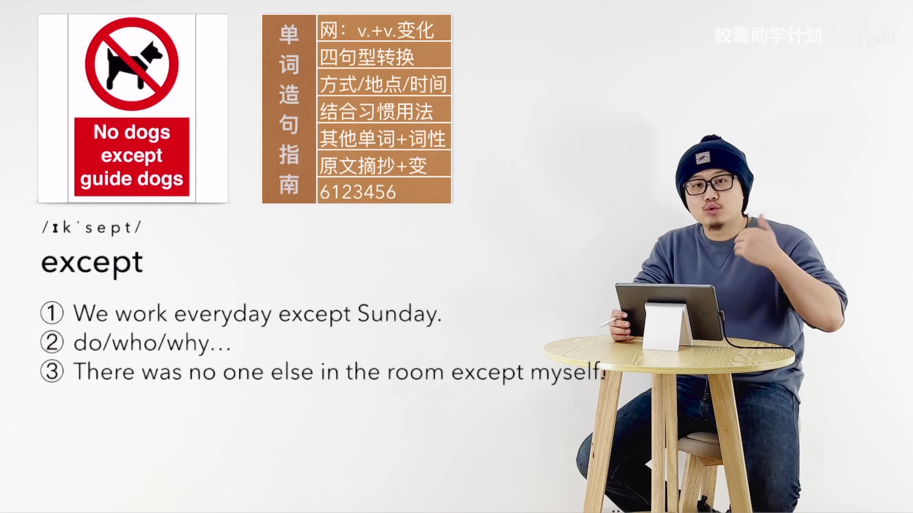

文字识别：单词造句指南 / 网：v.+v.变化 / 四句型转换 / 方式/地点/时间 / 结合习惯用法 / No dogs / 其他单词+词性 / except / 原文摘抄+变 / guide dogs / 6123456 / /ik'sept/ / except / We work everyday except Sunday. / ① / do/who/why.. / There was no one else in the room except myself.

### 画面 00:02:02

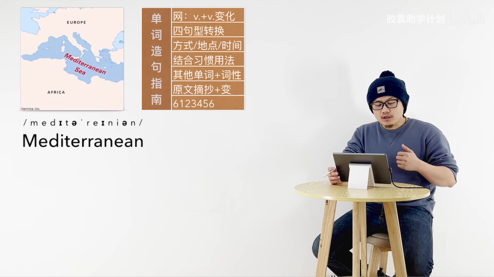

文字识别：单词造句指南 / 网：v.+v.变化 / EUROPE / 四句型转换 / BId / 方式/地点/时间 / Mediterranean / 结合习惯用法 / Sea / 其他单词+词性 / 原文摘抄+变 / AFRICA / 6123456 / ritannica, Inc. / /medrta'relnian/ / Mediterranean

### 画面 00:02:05

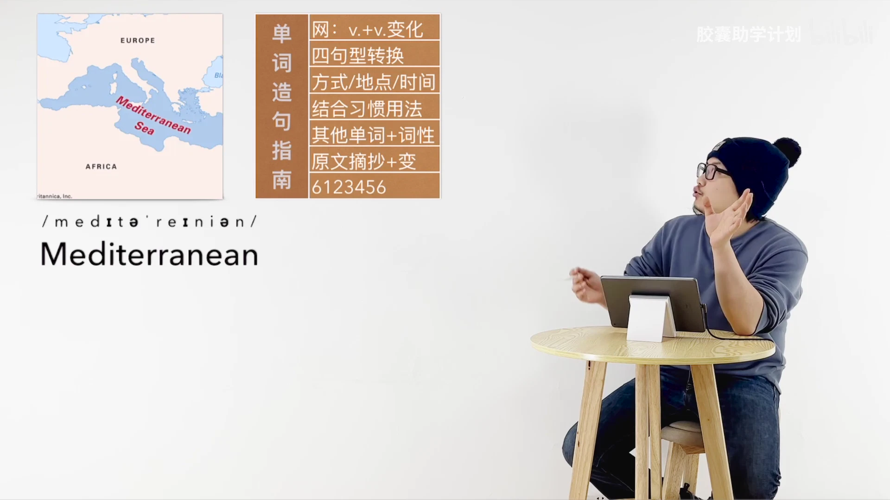

文字识别：单词造句指南 / 网：v.+v.变化 / EUROPE / 四句型转换 / B1 / 方式/地点/时间 / Mediterranean / 结合习惯用法 / Sea / 其他单词+词性 / 原文摘抄+变 / AFRICA / 6123456 / ritannica, Inc, / /medita'relnian/ / Mediterranean

### 画面 00:02:10

文字识别：单词造句指南 / 网：v.+v.变化 / EUROPE / 四句型转换 / BI / 方式/地点/时间 / Mediterranean / 结合习惯用法 / Sea / 其他单词+词性 / 原文摘抄+变 / AFRICA / 6123456 / ritannica, Inc. / /medrta'relnian/ / Mediterranean

### 画面 00:02:15

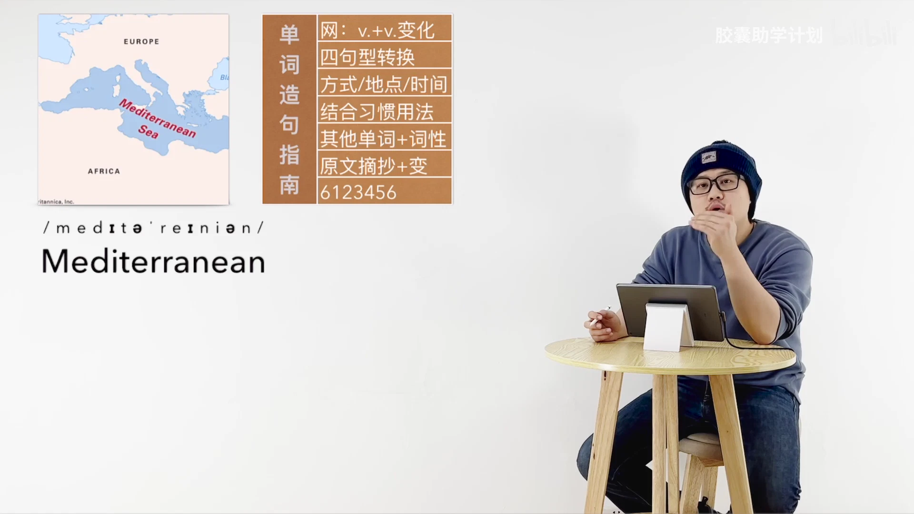

文字识别：单词造句指南 / 网：v.+v.变化 / EUROPE / 四句型转换 / BId / 方式/地点/时间 / Mediterranean / 结合习惯用法 / Sea / 其他单词+词性 / 原文摘抄+变 / AFRICA / 6123456 / ritannica, Inc. / /medrta'relnian/ / Mediterranean

### 画面 00:02:20

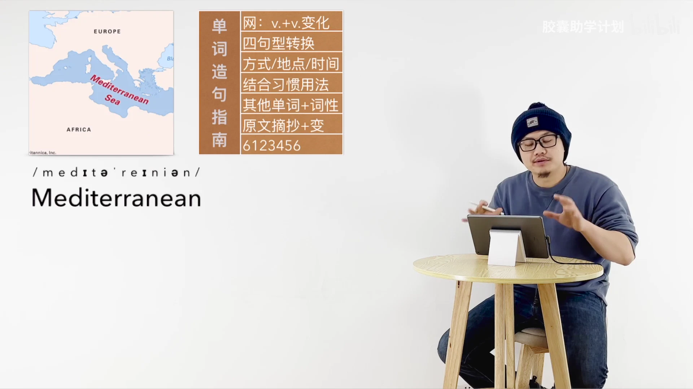

文字识别：单词造句指南 / 网：v.+v.变化 / EUROPE / 四句型转换 / BI / 方式/地点/时间 / Mediterranean / 结合习惯用法 / Sea / 其他单词+词性 / 原文摘抄+变 / AFRICA / 6123456 / ritannica, Inc. / /medrta'relnian/ / Mediterranean

### 画面 00:02:26

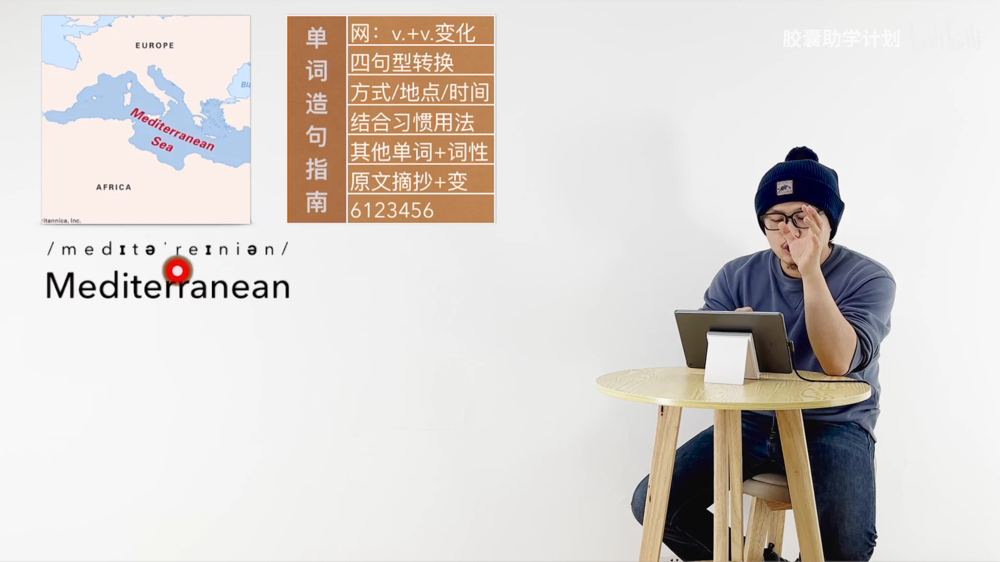

文字识别：单词造句指南 / 网：v.+v.变化 / EUROPE / 四句型转换 / BId / 方式/地点/时间 / Mediterranean / 结合习惯用法 / Sea / 其他单词+词性 / 原文摘抄+变 / AFRICA / 6123456 / ritannica,Inc. / /medita'relnian/ / Mediterranean

## 00:02:30–00:03:00

Mediterranean Mediterranean OK 好这个地方呢，我们就要把音标跟自然拼读法则尝试连到一起。为什么？我们先读一下啊，Medita。其实这三个音节读出来了之后，M这个字母，对吧？D这个字母，T这个字母，基本上就出来了。也就是说辅音字母基本上是可以确定的。然后ra

### 画面 00:02:31

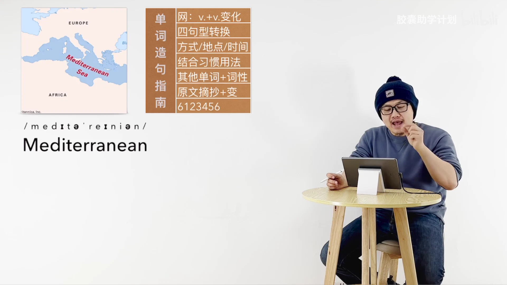

文字识别：单词造句指南 / 网：v.+v.变化 / EUROPE / 四句型转换 / BId / 方式/地点/时间 / Mediterranean / 结合习惯用法 / Sea / 其他单词+词性 / 原文摘抄+变 / AFRICA / 6123456 / ritannica, Inc. / /medita'relnian/ / Mediterranean

### 画面 00:02:35

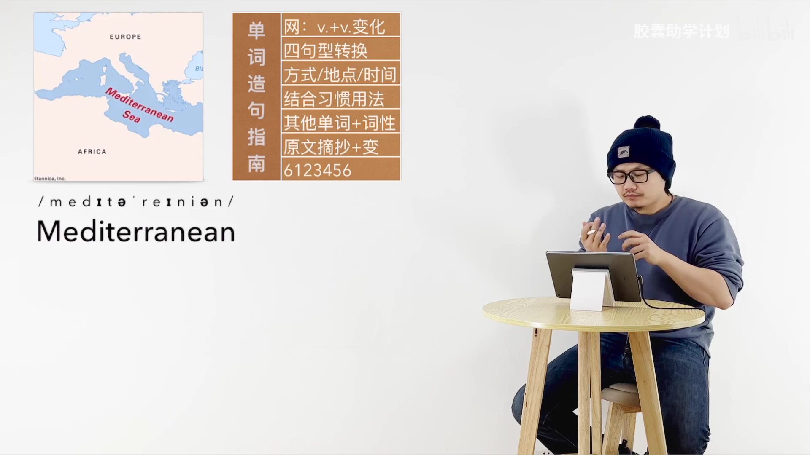

文字识别：单词造句指南 / 网：v.+v.变化 / EUROPE / 四句型转换 / BI / 方式/地点/时间 / Mediterranean / 结合习惯用法 / Sea / 其他单词+词性 / 原文摘抄+变 / AFRICA / 6123456 / ritannica, Inc, / /medita'relnian/ / Mediterranean

### 画面 00:02:41

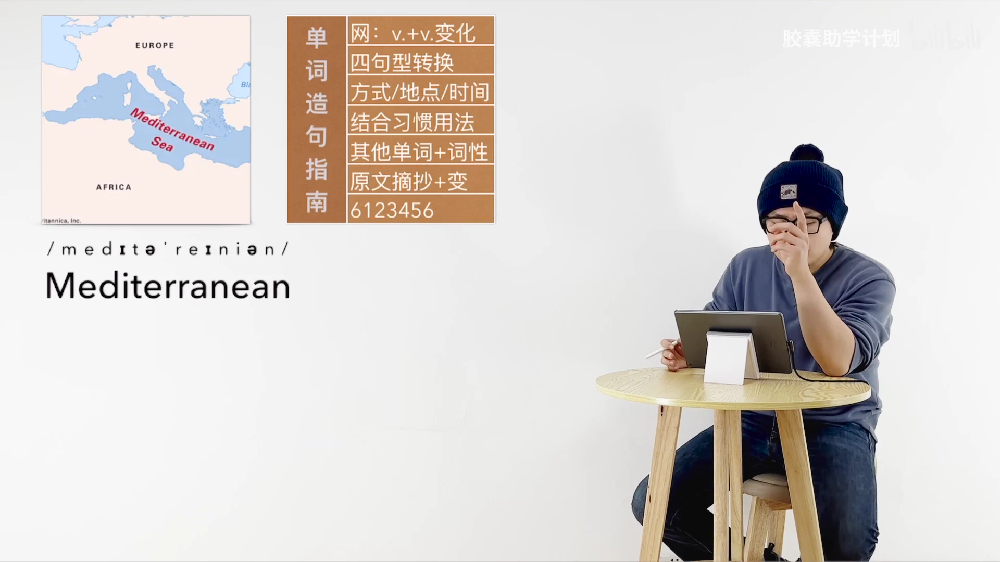

文字识别：单词造句指南 / 网：v.+v.变化 / EUROPE / 四句型转换 / BId / 方式/地点/时间 / Mediterranean / 结合习惯用法 / Sea / 其他单词+词性 / 原文摘抄+变 / AFRICA / 6123456 / ritannica, Inc. / /medrta'relnian/ / Mediterranean

### 画面 00:02:45

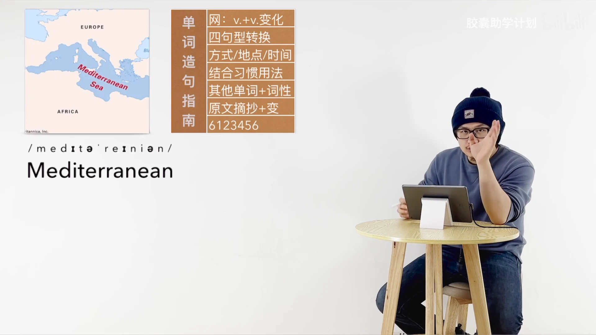

文字识别：单词造句指南 / 网：v.+v.变化 / EUROPE / 四句型转换 / B1 / 方式/地点/时间 / Mediterranean / 结合习惯用法 / Sea / 其他单词+词性 / 原文摘抄+变 / AFRICA / 6123456 / ritannica, Inc, / /medita'relnian/ / Mediterranean

### 画面 00:02:50

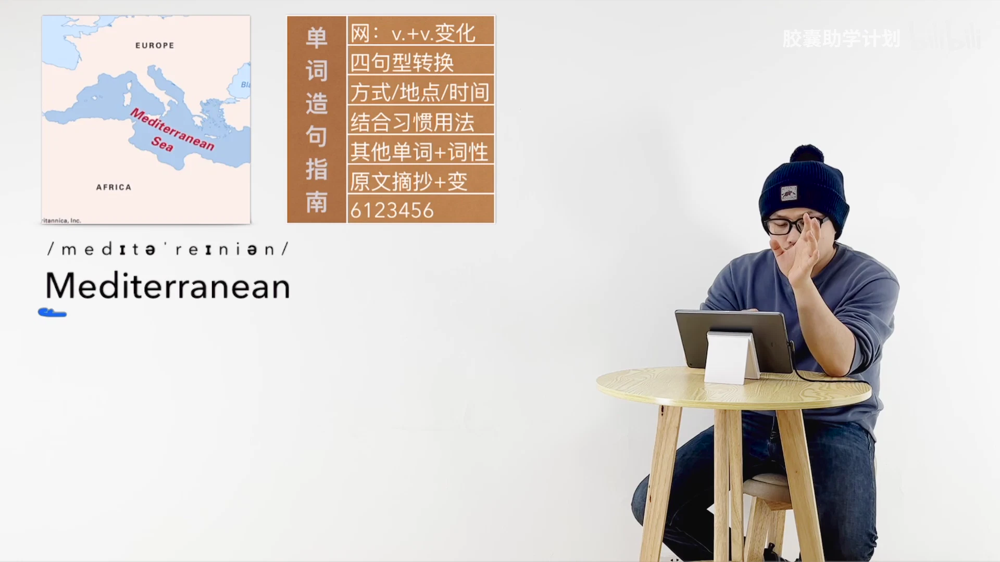

文字识别：单词造句指南 / 网：v.+v.变化 / EUROPE / 四句型转换 / BI / 方式/地点/时间 / Mediterranean / 结合习惯用法 / Sea / 其他单词+词性 / 原文摘抄+变 / AFRICA / 6123456 / ritannica, Inc, / /medrta'relnian/ / Mediterranean

### 画面 00:02:55

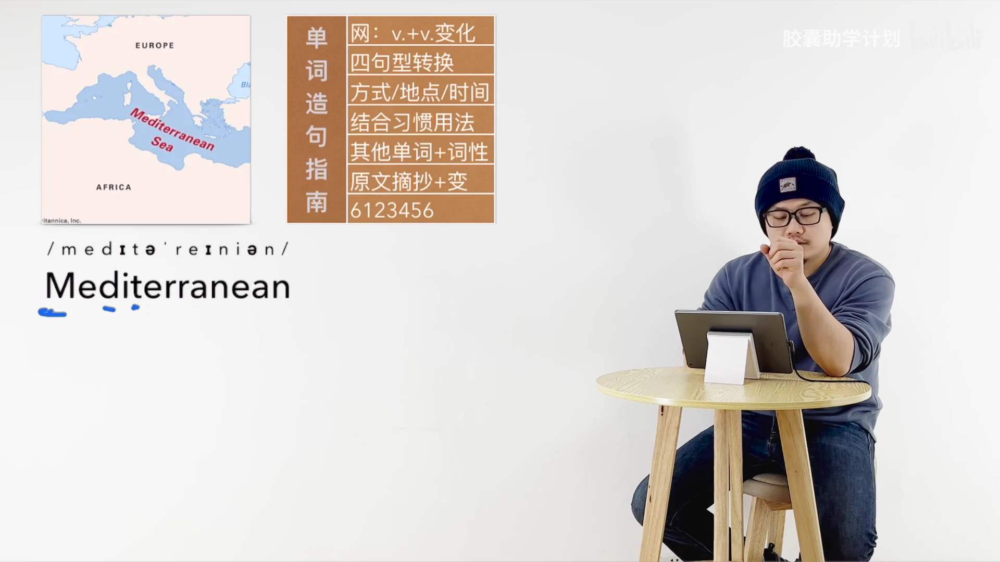

文字识别：单词造句指南 / 网：v.+v.变化 / EUROPE / 四句型转换 / BId / 方式/地点/时间 / Mediterranean / 结合习惯用法 / Sea / 其他单词+词性 / 原文摘抄+变 / AFRICA / 6123456 / ritannica, Inc. / /medita'relnian/ / Mediterranean

## 00:03:00–00:03:30

二肯定出来了，念 n 和最后的 n 肯定就出来了，对吧？ OK，所以叫 Mediterranean 这个单词对于各位来说去拼写其实是比较相对来说可能是困难的，但是实际上你见到它知道它是什么含义，怎么去读应该是比较容易的啊。这个单词格外的长，也比较有特色。那这个对于我们大家来说背单词的时候，音标跟自然拼读法则，这实际上是我们新一啊，我们在讲新一的时候说了无数遍的

### 画面 00:03:00

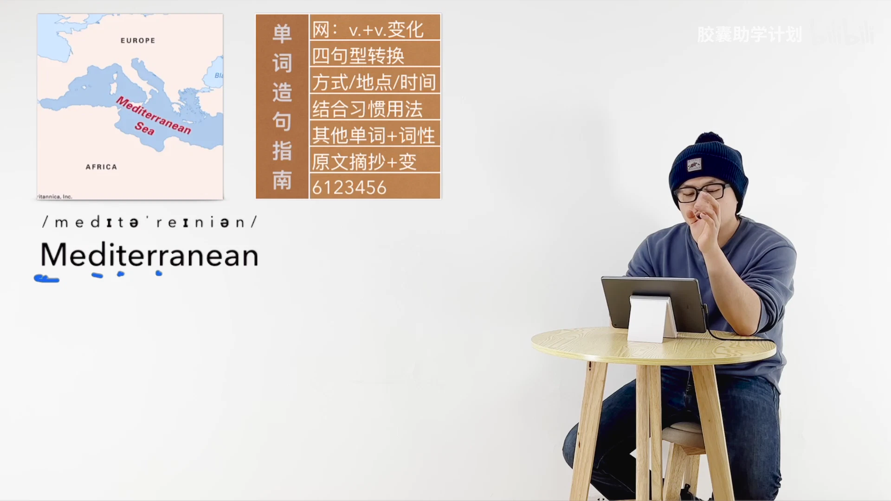

文字识别：单词造句指南 / 网：v.+v.变化 / EUROPE / 四句型转换 / BId / 方式/地点/时间 / Mediterranean / 结合习惯用法 / Sea / 其他单词+词性 / 原文摘抄+变 / AFRICA / 6123456 / ritannica,Inc. / /medrta'relnian/ / Mediterranean

### 画面 00:03:05

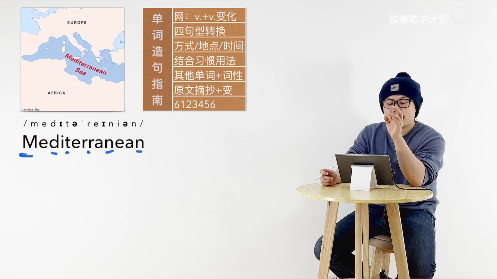

文字识别：单词造句指南 / 网：v.+v.变化 / EUROPE / 四句型转换 / BId / 方式/地点/时间 / Mediterranean / 结合习惯用法 / Sea / 其他单词+词性 / 原文摘抄+变 / AFRICA / 6123456 / ritannica, Inc. / /medrta'relnian/ / Mediterranean

### 画面 00:03:11

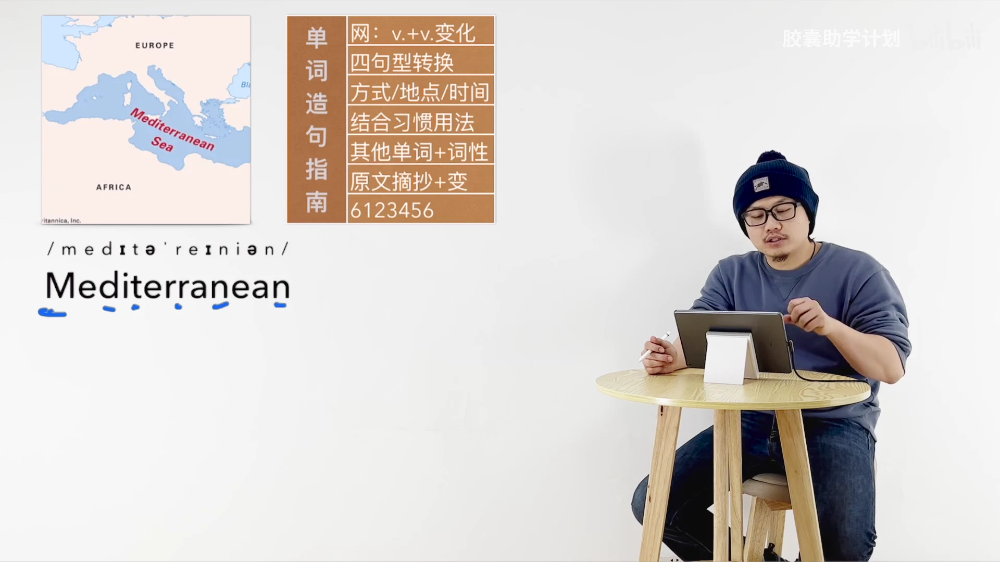

文字识别：单词造句指南 / 网：v.+v.变化 / EUROPE / 四句型转换 / 818 / 方式/地点/时间 / Mediterranean / 结合习惯用法 / Sea / 其他单词+词性 / 原文摘抄+变 / AFRICA / 6123456 / ritannica, Inc. / /medrta'relnian/ / Mediterranean

### 画面 00:03:20

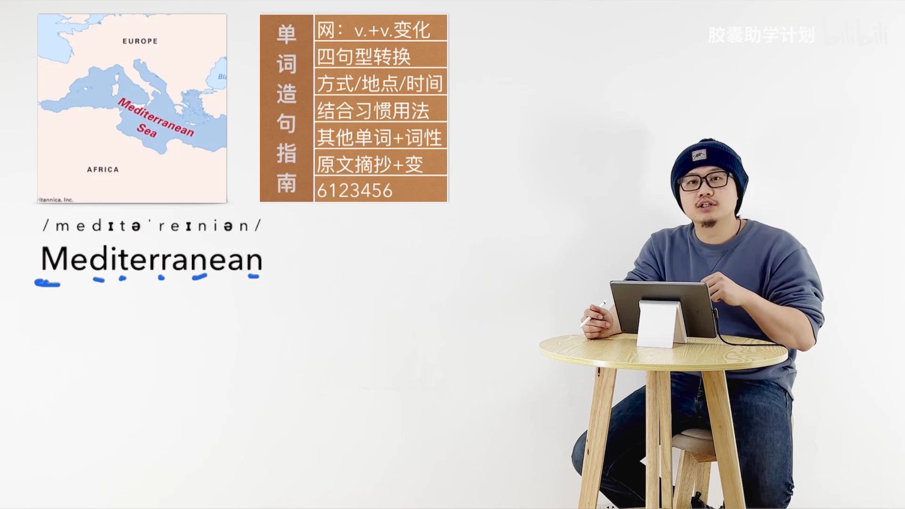

文字识别：单词造句指南 / 网：v.+v.变化 / EUROPE / 四句型转换 / BI / 方式/地点/时间 / Mediterranean / 结合习惯用法 / Sea / 其他单词+词性 / 原文摘抄+变 / AFRICA / 6123456 / ritannica, Inc. / /medrta'relnian/ / Mediterranean

### 画面 00:03:25

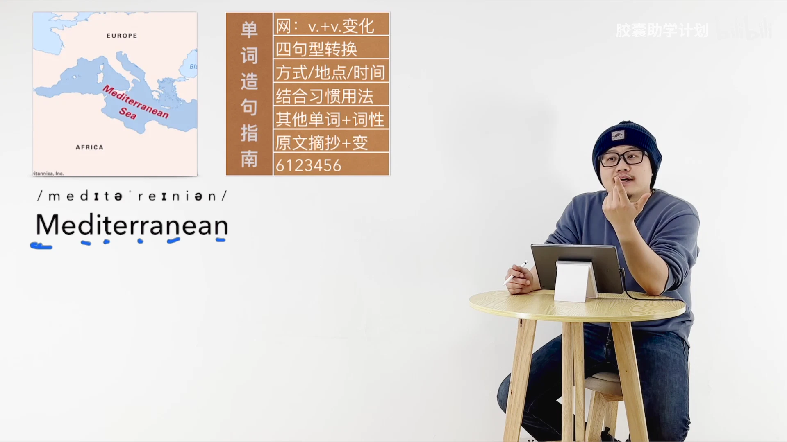

文字识别：单词造句指南 / 网：v.+v.变化 / EUROPE / 四句型转换 / BI / 方式/地点/时间 / Mediterranean / 结合习惯用法 / Sea / 其他单词+词性 / 原文摘抄+变 / AFRICA / 6123456 / ritannica,Inc, / /medrta'relnian/ / Mediterranean

## 00:03:30–00:04:00

一个东西，然后包括专门给大家录了四个视频，讲的就是音标和自然拼读法则，各位不妨去看一下啊。再跟我读一遍这个单词，叫做 Mediterranean。 OK，玩一个。下一个单词跟我一起读一下，叫做 complain。 Complain 啊，它就是抱怨的意思。那如果我们想说抱怨某件事情，叫 complain about something。 OK，比如说 It is easy for them to complain about the weather。 说对于他们来说，去抱怨这个天气是很容易的一件事情

### 画面 00:03:30

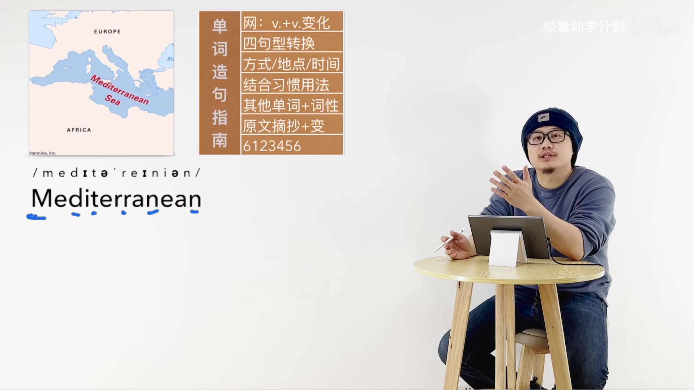

文字识别：单词造句指南 / 网：v.+v.变化 / EUROPE / 四句型转换 / Bld / 方式/地点/时间 / Mediterranean / 结合习惯用法 / Sea / 其他单词+词性 / 原文摘抄+变 / AFRICA / 6123456 / ritannica, Inc. / /medrta'relnian/ / Mediterranean

### 画面 00:03:36

文字识别：单词造句指南 / 网：v.+v.变化 / EUROPE / 四句型转换 / BId / 方式/地点/时间 / Mediterranean / 结合习惯用法 / Sea / 其他单词+词性 / 原文摘抄+变 / AFRICA / 6123456 / ritannica, Inc. / /medrta'relnian/ / Mediterranean

### 画面 00:03:40

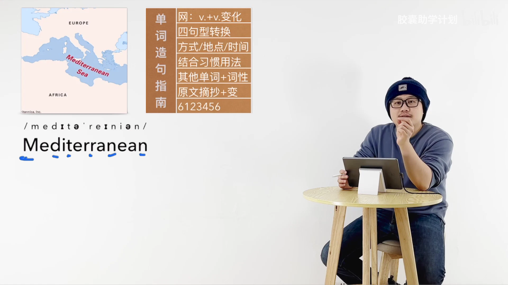

文字识别：单词造句指南 / 网：v.+v.变化 / EUROPE / 四句型转换 / BI / 方式/地点/时间 / Mediterranean / 结合习惯用法 / Sea / 其他单词+词性 / 原文摘抄+变 / AFRICA / 6123456 / ritannica, Inc. / /medrta'relnian/ / Mediterranean

### 画面 00:03:42

文字识别：单词造句指南 / 网：v.+v.变化 / 151 / 四句型转换 / 方式/地点/时间 / 结合习惯用法 / 其他单词+词性 / 原文摘抄+变 / 6123456 / /kam'plein/ / complain v.

### 画面 00:03:46

文字识别：单词造句指南 / 网：v.+v.变化 / 151 / 四句型转换 / 方式/地点/时间 / 结合习惯用法 / 其他单词+词性 / 原文摘抄+变 / 6123456 / /kam'plein/ / complain v.

### 画面 00:03:50

文字识别：单词造句指南 / 网：v.+v.变化 / 151 / 四句型转换 / 方式/地点/时间 / 结合习惯用法 / 其他单词+词性 / 原文摘抄+变 / 6123456 / /kam'plein/ / complain v. / ① complain about sth.

### 画面 00:03:55

文字识别：单词造句指南 / 网：v.+v.变化 / 51 / 四句型转换 / 方式/地点/时间 / 结合习惯用法 / 其他单词+词性 / 原文摘抄+变 / 6123456 / /kam'plein/ / complain v. / ① complain about sth. / It is easy for them to complain about the / weather. L32

## 00:04:00–00:04:30

啊，经常抱怨，对吧？好，我们还可以用之前学的习惯用法，叫做 She is keen on complaining about the neighbor，是吧？她很热衷于抱怨她的邻居。如果各位读过《哈利波特》或看过《哈利波特》这个系列的话，那你应该就记得啊，《哈利波特》的姑妈就是这样的一个人，热衷于吐槽他的邻居，是吧？抱怨他的邻居啊。 Okay， next one， the man who complained about the hotel room lost

### 画面 00:04:05

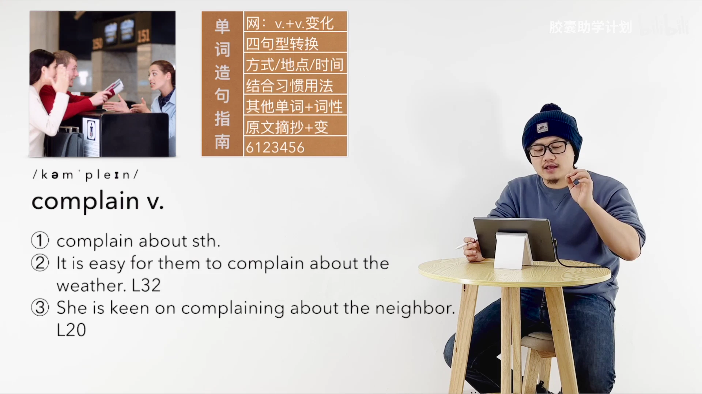

文字识别：单词造句指南 / 网：v.+v.变化 / 151 / 四句型转换 / 方式/地点/时间 / 结合习惯用法 / 其他单词+词性 / 原文摘抄+变 / 6123456 / /kam'plein/ / complain v. / ① complain about sth. / It is easy for them to complain about the / weather. L32 / She is keen on complaining about the neighbor. / L20

### 画面 00:04:10

文字识别：单词造句指南 / 网：v.+v.变化 / 151 / 四句型转换 / 方式/地点/时间 / 结合习惯用法 / 其他单词+词性 / 原文摘抄+变 / 6123456 / / kam'plein/ / complain v. / ① complain about sth. / It is easy for them to complain about the / weather. L32 / She is keen on complaining about the neighbor. / L20

### 画面 00:04:19

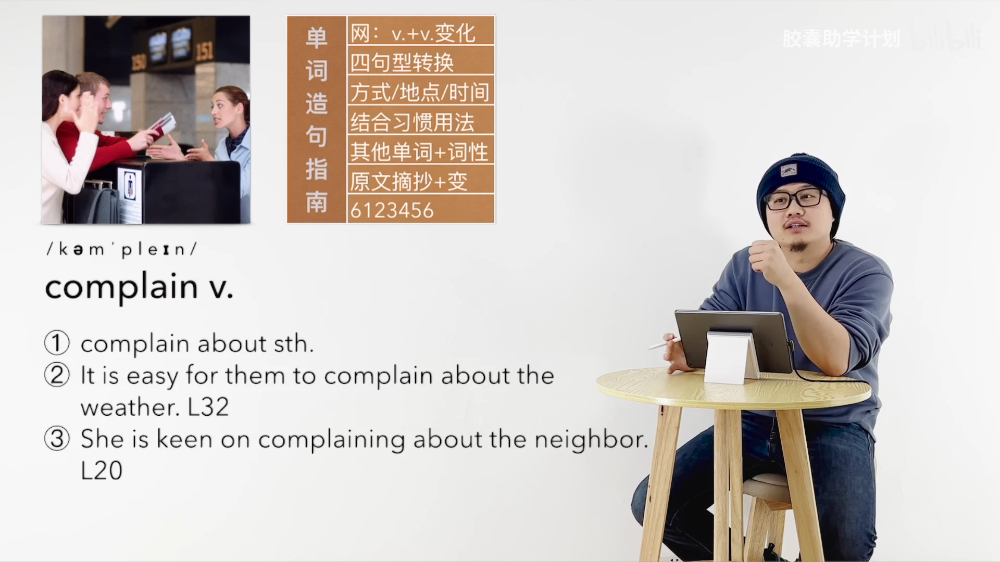

文字识别：单词造句指南 / 网：v.+v.变化 / 51 / 四句型转换 / 方式/地点/时间 / 结合习惯用法 / 其他单词+词性 / 原文摘抄+变 / 6123456 / / kam'plein/ / complain v. / ① complain about sth. / It is easy for them to complain about the / weather. L32 / She is keen on complaining about the neighbor. / L20

### 画面 00:04:21

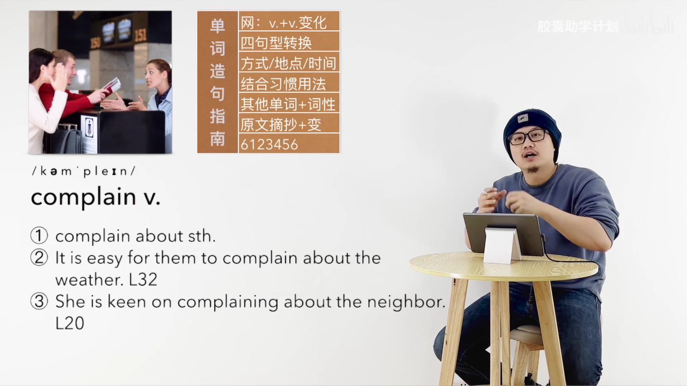

文字识别：单词造句指南 / 网：v.+v.变化 / 151 / 四句型转换 / 方式/地点/时间 / 结合习惯用法 / 其他单词+词性 / 原文摘抄+变 / 6123456 / / kam'plein/ / complain v. / ① complain about sth. / It is easy for them to complain about the / weather. L32 / She is keen on complaining about the neighbor. / L20

### 画面 00:04:24

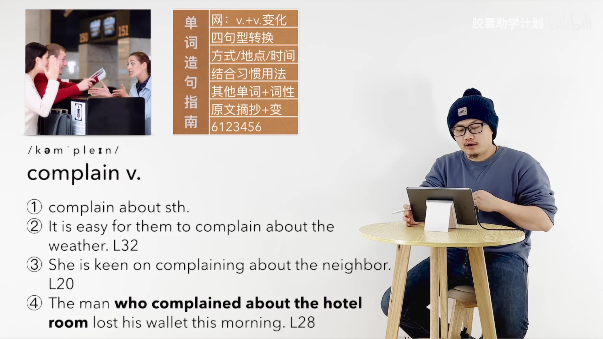

文字识别：单词造句指南 / 网：v.+v.变化 / 51 / 四句型转换 / 方式/地点/时间 / 结合习惯用法 / 其他单词+词性 / 原文摘抄+变 / 6123456 / / kam'plein/ / complain v. / ① complain about sth. / It is easy for them to complain about the / 2 / weather. L32 / She is keen on complaining about the neighbor. / L20 / The man who complained about the hotel / room lost his wallet this morning. L28

### 画面 00:04:26

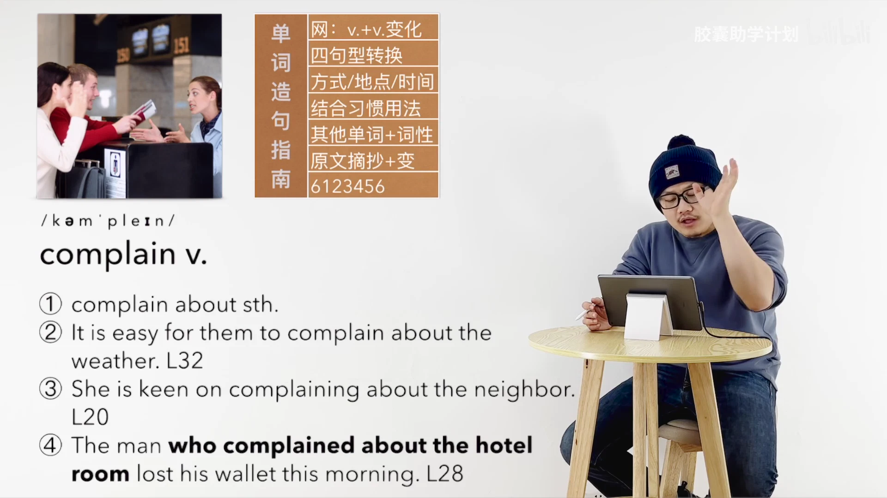

文字识别：单词造句指南 / 网：v.+v.变化 / 151 / 四句型转换 / 方式/地点/时间 / 结合习惯用法 / 其他单词+词性 / 原文摘抄+变 / 6123456 / /kam'plein/ / complain v. / ① complain about sth. / It is easy for them to complain about the / 2 / weather. L32 / She is keen on complaining about the neighbor. / L20 / The man who complained about the hotel / room lost his wallet this morning. L28

## 00:04:30–00:05:00

his wallet this morning.好，我们就结合了其实之前学过的一个语法叫做定语从句，对吧？抱怨这个酒店房间的这名男士今天早上把他的钱包给丢了。OK, very good.好，那接下来呢，我们看一个小电影片段。这个电影片段当中出现了叫做complain about it all the time啊，叫做一直在抱怨这件事情。注意力集中

### 画面 00:04:30

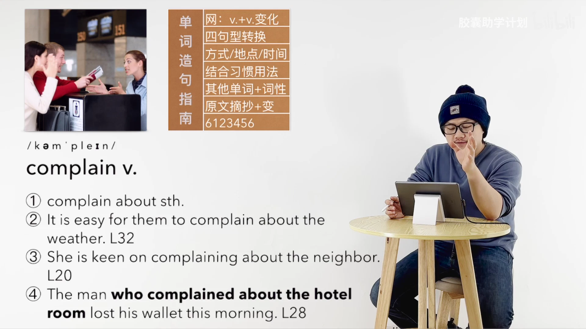

文字识别：单词造句指南 / 网：v.+v.变化 / 151 / 四句型转换 / 方式/地点/时间 / 结合习惯用法 / 其他单词+词性 / 原文摘抄+变 / 6123456 / / kam'plein/ / complain v. / ① complain about sth. / It is easy for them to complain about the / 2 / weather. L32 / She is keen on complaining about the neighbor. / L20 / The man who complained about the hotel / room lost his wallet this morning. L28

### 画面 00:04:35

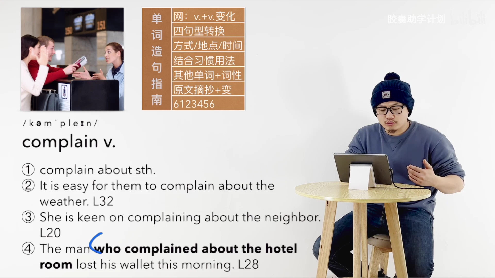

文字识别：单词造句指南 / 网：v.+v.变化 / 151 / 四句型转换 / 方式/地点/时间 / 结合习惯用法 / 其他单词+词性 / 原文摘抄+变 / 6123456 / / kam'plein/ / complain v. / ① complain about sth. / It is easy for them to complain about the / 2 / weather. L32 / She is keen on complaining about the neighbor. / L20 / The manwho complained about the hotel / room lost his wallet this morning. L28

### 画面 00:04:40

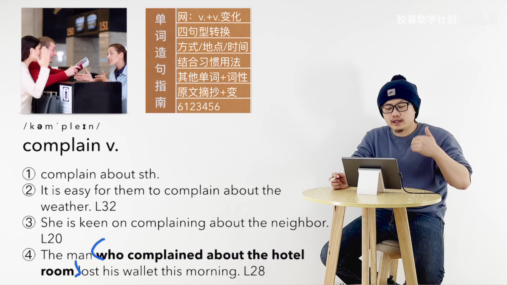

文字识别：单词造句指南 / 网：v.+v.变化 / 151 / 四句型转换 / 方式/地点/时间 / 结合习惯用法 / 其他单词+词性 / 原文摘抄+变 / 6123456 / /kam'plein/ / complain v. / ① complain about sth. / It is easy for them to complain about the / 2 / weather. L32 / She is keen on complaining about the neighbor. / L20 / The man who complained about the hotel / room)ost his wallet this morning. L28

### 画面 00:04:48

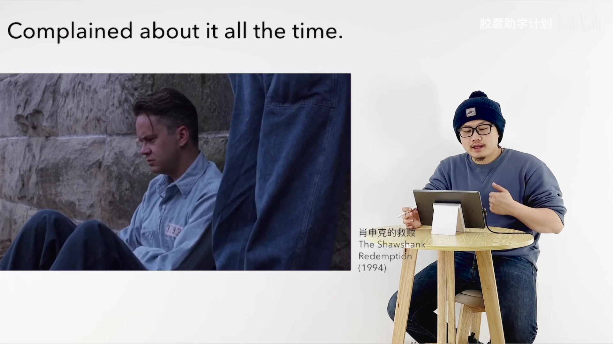

文字识别：Complained about it al the time. / 肖申克的救赎 / The Shawshank / Redemption / (1994)

## 00:05:00–00:05:30

来了。 My wife used to say I'm a hard man to know, like a closed book. Complained about it all the time. She was beautiful. God, I loved her. 好，注意啊，你看这个男主他第一句话说的叫做 used to say，好，过去常常说，代表现在不说了，对吧？啊，那在

### 画面 00:05:03

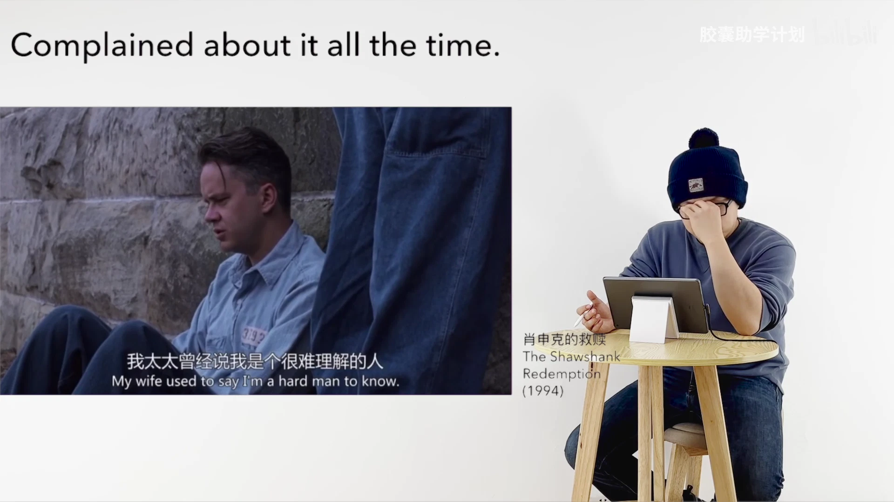

文字识别：Complained about it allthe time. / 肖申克的救赎 / 我太太曾经说我是个很难理解的人 / The Shawshank / Redemption / My wife used to say I'm a hard man to know. / (1994)

### 画面 00:05:05

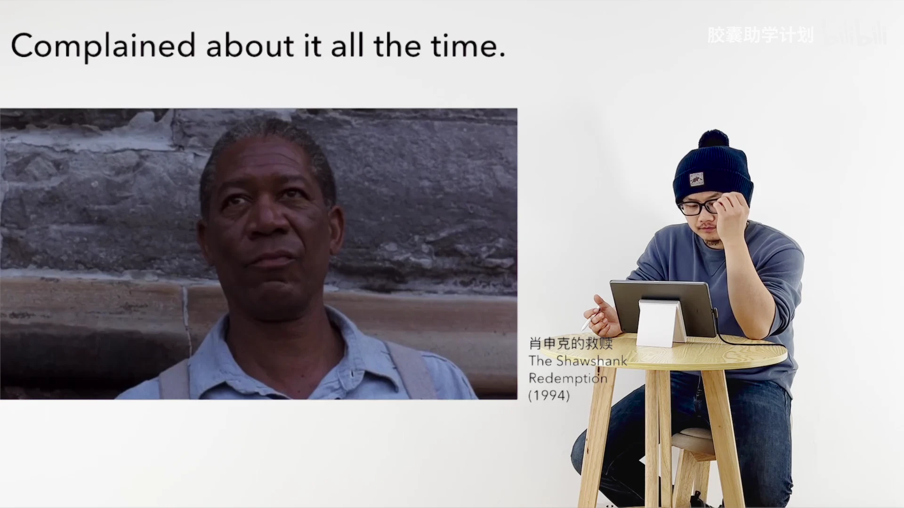

文字识别：Complained about it all the time. / 肖申克的救赎 / The Shawshank / Redemption / (1994)

### 画面 00:05:10

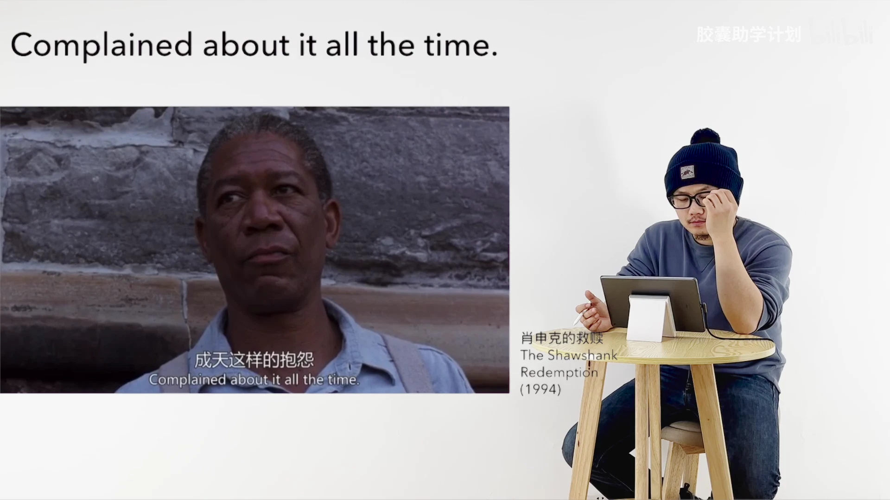

文字识别：Complained about it all the time. / 肖申克的救赎 / 成天这样的抱怨 / The Shawshank / Redemption / Complained about it all the time. / (1994)

### 画面 00:05:12

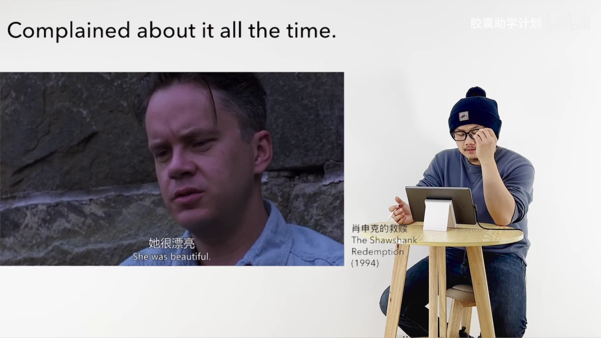

文字识别：Complained about it al the time. / 肖申克的救赎 / 她很漂亮 / The Shawshank / Redemption / She was beautiful. / (1994)

### 画面 00:05:16

文字识别：Complained about it all the time. / 肖申克的救赎 / 老天我爱她 / The Shawshank / Redemption / God, I loved her. / (1994)

### 画面 00:05:21

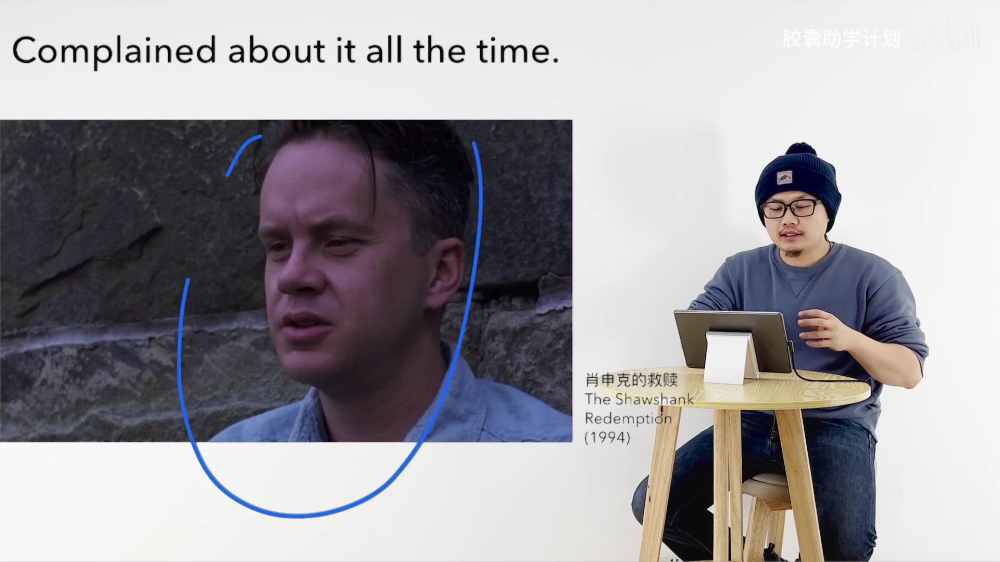

文字识别：Complained about it allthe time. / 肖申克的救赎 / The Shawshank / Redemption / (1994)

### 画面 00:05:23

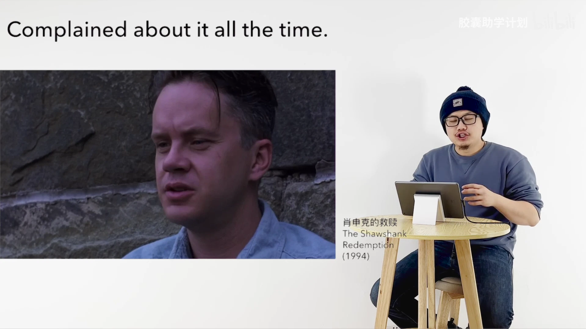

文字识别：Complained about it allthe time. / 肖申克的救赎 / The Shawshank / Redemption / (1994)

## 00:05:30–00:06:00

这个电影当中，就是他的老婆已经没了啊，人已经去世了，对吧？OK，啊，呃，那这个地方另一个点叫做 complain about，是我们刚刚学过的这个习惯用法，抱怨这件事情，抱怨的是呃， I I am like a closed book，是吧？就像一个关闭的书一样，读不懂我到底在想什么，叫做抱怨这件事情，叫 complain about it all the time。OK，好，那下一个单词跟我一起看音标，叫做

### 画面 00:05:53

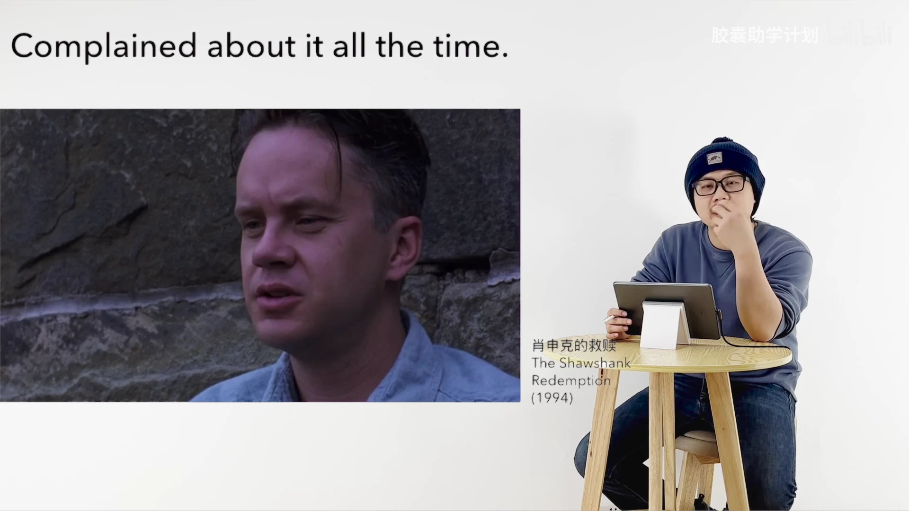

文字识别：Complained about it al the time. / 肖申克的救赎 / The Shawshank / Redemption / (1994)

### 画面 00:05:55

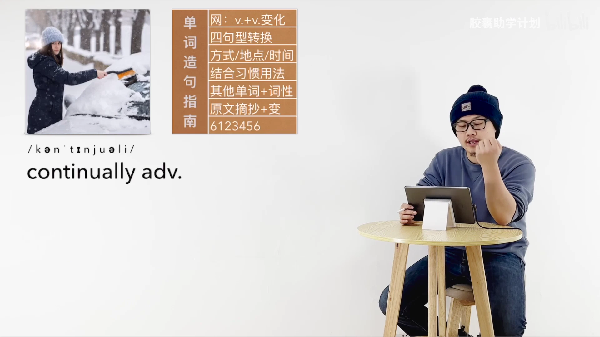

文字识别：单词造句指南 / 网：v.+v.变化 / 四句型转换 / 方式/地点/时间 / 结合习惯用法 / 其他单词+词性 / 原文摘抄+变 / 6123456 / /kan'tinjuali/ / continually adv.

### 画面 00:05:57

文字识别：单词造句指南 / 网：v.+v.变化 / 四句型转换 / 方式/地点/时间 / 结合习惯用法 / 其他单词+词性 / 原文摘抄+变 / 6123456 / /kan'tinjuali/ / continually adv.

## 00:06:00–00:06:30

来 continually 叫做持续不断的 continually，OK。比如说，我们造造一个句子叫做 The baby cried continually last night. 好了，注意一个小点，continually 虽然表示持续不断的啊，持续的，但它并不是表示说一秒钟都不断啊，它表示的往往是断断续续的。比如说，我们说小孩啊，大部分晚上可能是一两个小时，假设

### 画面 00:06:00

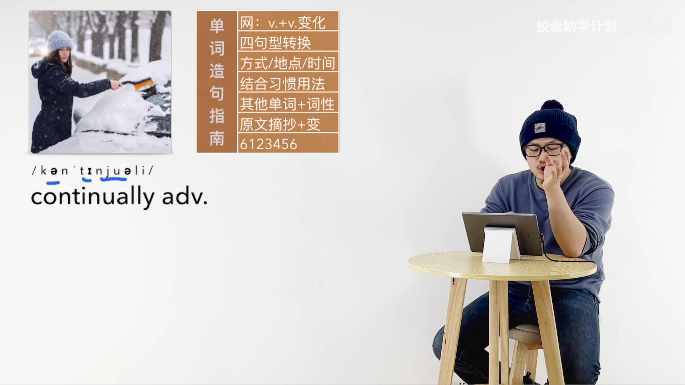

文字识别：单词造句指南 / 网：v.+v.变化 / 四句型转换 / 方式/地点/时间 / 结合习惯用法 / 其他单词+词性 / 原文摘抄+变 / 6123456 / /kan'tinjuali/ / continually adv.

### 画面 00:06:05

文字识别：单词造句指南 / 网：v.+v.变化 / 四句型转换 / 方式/地点/时间 / 结合习惯用法 / 其他单词+词性 / 原文摘抄+变 / 6123456 / /kan'tinjualil / continually adv.

### 画面 00:06:10

文字识别：单词造句指南 / 网：v.+v.变化 / 四句型转换 / 方式/地点/时间 / 结合习惯用法 / 其他单词+词性 / 原文摘抄+变 / 6123456 / /kan'tinjualil / continually adv. / ① The baby cried continually last night.

### 画面 00:06:15

文字识别：单词造句指南 / 网：v.+v.变化 / 四句型转换 / 方式/地点/时间 / 结合习惯用法 / 其他单词+词性 / 原文摘抄+变 / 6123456 / /kan'tinjualil / continually adv. / D The baby cried continually last night.

## 00:06:30–00:07:00

醒一次，饿醒了，想吃，想吃，想吃奶，对吧？那它可能是断断续续的，但是呢，哭了一晚上，对吧？比如说，呃，这个隔两每假设啊，每隔两个小时哭了三十哭了三十分钟，那这个就叫做 the baby cried continually last night. OK，好，注意这个点。再比如说，说 it rained continually last summer，指的并不是说去年夏天从进入夏天

### 画面 00:06:35

文字识别：单词造句指南 / 网：v.+v.变化 / 四句型转换 / 方式/地点/时间 / 结合习惯用法 / 其他单词+词性 / 原文摘抄+变 / 6123456 / /kan'tinjualil / continually adv. / ① The baby cried continually last night.

### 画面 00:06:40

文字识别：单词造句指南 / 网：v.+v.变化 / 四句型转换 / 方式/地点/时间 / 结合习惯用法 / 其他单词+词性 / 原文摘抄+变 / 6123456 / /kan'tinjualil / continually adv. / ① The baby cried continually last night.

### 画面 00:06:47

文字识别：单词造句指南 / 网：v.+v.变化 / 四句型转换 / 方式/地点/时间 / 结合习惯用法 / 其他单词+词性 / 原文摘抄+变 / 6123456 / /kan'tinjualil / continually adv. / ① The baby cried continually last night.

### 画面 00:06:51

文字识别：单词造句指南 / 网：v.+v.变化 / 四句型转换 / 方式/地点/时间 / 结合习惯用法 / 其他单词+词性 / 原文摘抄+变 / 6123456 / /kan'tnjualil / continually adv. / The baby cried continually last night. / It rained continually last summer.

### 画面 00:06:56

文字识别：单词造句指南 / 网：v.+v.变化 / 四句型转换 / 方式/地点/时间 / 结合习惯用法 / 其他单词+词性 / 原文摘抄+变 / 6123456 / / kan'tinjualil / continually adv. / The baby cried continually last night. / It rained continually Tast summer.

## 00:07:00–00:07:30

的第一天开始，连续不断的下到了最后一天，那是不可能的，对吧？所以它指的是去年在持续不断的下雨，总在下雨，断断续续总在下雨，对吧？持续不断啊，注意这个小点。当然，我们也可以造一个非常简单的句子，叫做 It snowed continuously last winter. 所以在这个地方，其实我们可以理解为是借助了一下六一二三四五六，我们非常简单的把动词做了一些转换，对吧？然后我们把时间去做了一些

### 画面 00:07:00

文字识别：单词造句指南 / 网：v.+v.变化 / 四句型转换 / 方式/地点/时间 / 结合习惯用法 / 其他单词+词性 / 原文摘抄+变 / 6123456 / /kan'tinjualil / continually / adv. / The baby cried continually last night. / It rained continually last summer.

### 画面 00:07:05

文字识别：单词造句指南 / 网：v.+v.变化 / 四句型转换 / 方式/地点/时间 / 结合习惯用法 / 其他单词+词性 / 原文摘抄+变 / 6123456 / /kan'tinjualil / continually adv. / The baby cried continually last night. / It rained continually last summer.

### 画面 00:07:15

文字识别：单词造句指南 / 网：v.+v.变化 / 四句型转换 / 方式/地点/时间 / 结合习惯用法 / 其他单词+词性 / 原文摘抄+变 / 6123456 / /kan'tinjualil / continually adv. / The baby cried continually last night. / It rained continually Tast summer. / It snowed continually last winner.

### 画面 00:07:20

文字识别：单词造句指南 / 网：v.+v.变化 / 四句型转换 / 方式/地点/时间 / 结合习惯用法 / 其他单词+词性 / 原文摘抄+变 / 6123456 / /kan'tinjualil / continually adv. / The baby cried continually last night. / It rained continually Tast summer. / It snowed continually last winner.

### 画面 00:07:22

文字识别：单词造句指南 / 网：v.+v.变化 / 四句型转换 / 方式/地点/时间 / 结合习惯用法 / 其他单词+词性 / 原文摘抄+变 / 6123456 / /kan'tinjualil / continually adv. / The baby cried continually last night. / It rained continually Tast summer. / It snowed continually last winner.

### 画面 00:07:25

文字识别：单词造句指南 / 网：v.+v.变化 / 四句型转换 / 方式/地点/时间 / 结合习惯用法 / 其他单词+词性 / 原文摘抄+变 / 6123456 / /kan'tinjualil / continually / adv. / The baby / cried / continually last night. / It / rained / continually Tlast / summer. / It snowed continually last winner.

### 画面 00:07:28

文字识别：单词造句指南 / 网：v.+v.变化 / 四句型转换 / 方式/地点/时间 / 结合习惯用法 / 其他单词+词性 / 原文摘抄+变 / 6123456 / /kan'tinjualil / continually / adv. / The / : baby / cried / continually last night. / t / rained / continually ast / summer. / It snowed / continually ast winner.

## 00:07:30–00:08:00

转换，OK，Very good。接下来呢，然后说did when where why这些东西啊，就是各种句型的转换。那这个就是各位现在应该非常熟悉的了。家庭作业啊，不多说了。下一个单词跟我一起读，叫做bitterly，bitterly，bitterly，bitterly，OK，Very good，bitterly，OK，好。那bitterly这个单词的意思指的是，首先它是个副词，它是刺骨地寒冷，叫做bitterly cold，bitterly cold，OK。

### 画面 00:07:30

文字识别：单词造句指南 / 网：v.+v.变化 / 四句型转换 / 方式/地点/时间 / 结合习惯用法 / 其他单词+词性 / 原文摘抄+变 / 6123456 / /kan'tinjualil / continually / adv. / The baby / continually last night. / cried / It / rained / continually Tast summer / It snowed  / continually ast winne

### 画面 00:07:35

文字识别：单词造句指南 / 网：v.+v.变化 / 四句型转换 / 方式/地点/时间 / 结合习惯用法 / 其他单词+词性 / 原文摘抄+变 / 6123456 / /kan'tinjualil / continually / adv. / The baby / cried / continually last night. / It / rained / continually Yast summer / It snowed continually ast winne / did/when/where/why...

### 画面 00:07:40

文字识别：单词造句指南 / 网：v.+v.变化 / 四句型转换 / 方式/地点/时间 / 结合习惯用法 / 其他单词+词性 / 原文摘抄+变 / 6123456 / /kan'tinjualil / continually / adv. / The baby / cried / continually last night. / It / rained / continually Tast summer / It snowed continually last winne / did/when/where/why...

### 画面 00:07:42

文字识别：单词造句指南 / 网：v.+v.变化 / 四句型转换 / 方式/地点/时间 / 结合习惯用法 / 其他单词+词性 / 原文摘抄+变 / 6123456 / /kan'tinjuali/ / continually adv. / ① The baby cried continually last night. / It rained continually last summer. / It snowed continually last winner. / did/when/where/why...

### 画面 00:07:44

文字识别：单词造句指南 / 网：v.+v.变化 / 四句型转换 / 方式/地点/时间 / 结合习惯用法 / 其他单词+词性 / 原文摘抄+变 / 6123456 / /'bitali/ / bitterly adv.

### 画面 00:07:46

文字识别：单词造句指南 / 网：v.+v.变化 / 四句型转换 / 方式/地点/时间 / 结合习惯用法 / 其他单词+词性 / 原文摘抄+变 / 6123456 / /'bitali/ / bitterly adv.

### 画面 00:07:50

文字识别：单词造句指南 / 网：v.+v.变化 / 四句型转换 / 方式/地点/时间 / 结合习惯用法 / 其他单词+词性 / 原文摘抄+变 / 6123456 / /'bitali/ / bitterly adv.

### 画面 00:07:56

文字识别：单词造句指南 / 网：v.+v.变化 / 四句型转换 / 方式/地点/时间 / 结合习惯用法 / 其他单词+词性 / 原文摘抄+变 / 6123456 / /'bitali/ / bitterly adv. / ① bitterly cold

### 画面 00:07:59

文字识别：单词造句指南 / 网：v.+v.变化 / 四句型转换 / 方式/地点/时间 / 结合习惯用法 / 其他单词+词性 / 原文摘抄+变 / 6123456 / /'bitali/ / bitterly adv. / ① bitterly cold

## 00:08:00–00:08:30

你说very cold啊，那大家大家就是一个模糊的感觉，翻译成汉语就是非常冷啊，多冷也不知道，对吧？你基本上想表达非常冷，你基本上啊表达很很冷啊，那感觉的时候，你只能表达用语气啊去表达，哎，非常冷，对吧？那你可以直接换一个词叫做bitterly cold啊，就是刺骨的冷，那别人立刻就明白了，这个比very实际上要更准确一点点啊，这个副词。那我

### 画面 00:08:04

文字识别：单词造句指南 / 网：v.+v.变化 / 四句型转换 / 方式/地点/时间 / 结合习惯用法 / 其他单词+词性 / 原文摘抄+变 / 6123456 / /'bitali/ / bitterly adv. / ① bitterly cold

### 画面 00:08:09

文字识别：单词造句指南 / 网：v.+v.变化 / 四句型转换 / 方式/地点/时间 / 结合习惯用法 / 其他单词+词性 / 原文摘抄+变 / 6123456 / /'brtali/ / bitterly adv. / ① bitterly cold

### 画面 00:08:14

文字识别：单词造句指南 / 网：v.+v.变化 / 四句型转换 / 方式/地点/时间 / 结合习惯用法 / 其他单词+词性 / 原文摘抄+变 / 6123456 / /'bitali/ / bitterly adv. / ① bitterly cold

### 画面 00:08:20

文字识别：单词造句指南 / 网：v.+v.变化 / 四句型转换 / 方式/地点/时间 / 结合习惯用法 / 其他单词+词性 / 原文摘抄+变 / 6123456 / /'bitali/ / bitterly adv. / ① bitterly cold

### 画面 00:08:25

文字识别：单词造句指南 / 网：v.+v.变化 / 四句型转换 / 方式/地点/时间 / 结合习惯用法 / 其他单词+词性 / 原文摘抄+变 / 6123456 / /'bitali/ / bitterly adv. / ① bitterly cold

### 画面 00:08:29

文字识别：单词造句指南 / 网：v.+v.变化 / 四句型转换 / 方式/地点/时间 / 结合习惯用法 / 其他单词+词性 / 原文摘抄+变 / 6123456 / / ' bitali/ / bitterly adv. / ① bitterly cold / It was bitterly cold last night.

## 00:08:30–00:09:00

们造个句子说 It was bitterly cold last night, 是吧？哎，去这个昨晚嘛，刺骨的寒冷啊！ It was bitterly cold. OK. 再然后，那你像这句话很简单，但我们也能做一些四句型的转换，对吧？我们可以再造一句话叫做 She looks forward to traveling to a bitterly cold city. 这是我们三十七课学过的，说她期冀于去这个特别冷的这个城

### 画面 00:08:34

文字识别：单词造句指南 / 网：v.+v.变化 / 四句型转换 / 方式/地点/时间 / 结合习惯用法 / 其他单词+词性 / 原文摘抄+变 / 6123456 / /'bitali/ / bitterly adv. / ① bitterly cold / It was bitterly cold last night.

### 画面 00:08:39

文字识别：单词造句指南 / 网：v.+v.变化 / 四句型转换 / 方式/地点/时间 / 结合习惯用法 / 其他单词+词性 / 原文摘抄+变 / 6123456 / /' bitali/ / bitterly adv. / ① bitterly cold / It was bitterly cold last night.

### 画面 00:08:44

文字识别：单词造句指南 / 网：v.+v.变化 / 四句型转换 / 方式/地点/时间 / 结合习惯用法 / 其他单词+词性 / 原文摘抄+变 / 6123456 / /'bitali/ / bitterly adv. / ① bitterly cold / It was bitterly cold last night. / was/when/why/how cold...

### 画面 00:08:49

文字识别：单词造句指南 / 网：v.+v.变化 / 四句型转换 / 方式/地点/时间 / 结合习惯用法 / 其他单词+词性 / 原文摘抄+变 / 6123456 / /'bitali/ / bitterly adv. / ① bitterly cold / It was bitterly cold last night. / was/when/why/how cold... / She looks forward to traveling to a bitterly / cold city L37

## 00:09:00–00:09:30

市，对吧？Looks forward to traveling to a bitterly cold city. Okay, there you go.好，这是我们三十七个刚刚学的。Look forward to doing something. Okay,好下最后一个单词很简单。这其实我们新一就学过了，叫做sunshine，对吧？这单词其实也可以分开，sun叫太阳，shine叫闪耀着，对吧？动词。那sunshine就是太阳光，对吧？那我们造一个句子说，We walked in the warm sunshine.

### 画面 00:09:07

文字识别：单词造句指南 / 网：v.+v.变化 / 四句型转换 / 方式/地点/时间 / 结合习惯用法 / 其他单词+词性 / 原文摘抄+变 / 6123456 / /'bitali/ / bitterly adv. / ① bitterly cold / It was bitterly cold last night. / was/when/why/how cold... / She looks forward to traveling to a bitterly / cold city L37

### 画面 00:09:10

文字识别：单词造句指南 / 网：v.+v.变化 / 四句型转换 / 方式/地点/时间 / 结合习惯用法 / 其他单词+词性 / 原文摘抄+变 / 6123456 / /'sΛn∫aⅠn/ / sunshine n.

### 画面 00:09:12

文字识别：单词造句指南 / 网：v.+v.变化 / 四句型转换 / 方式/地点/时间 / 结合习惯用法 / 其他单词+词性 / 原文摘抄+变 / 6123456 / /'sΛn∫aⅠn/ / sunshine n.

### 画面 00:09:14

文字识别：单词造句指南 / 网：v.+v.变化 / 四句型转换 / 方式/地点/时间 / 结合习惯用法 / 其他单词+词性 / 原文摘抄+变 / 6123456 / /'sΛn∫ain/ / sunshine n.

### 画面 00:09:19

文字识别：单词造句指南 / 网：v.+v.变化 / 四句型转换 / 方式/地点/时间 / 结合习惯用法 / 其他单词+词性 / 原文摘抄+变 / 6123456 / /'sΛn∫ain/ / sunshine n.

### 画面 00:09:25

文字识别：单词造句指南 / 网：v.+v.变化 / 四句型转换 / 方式/地点/时间 / 结合习惯用法 / 其他单词+词性 / 原文摘抄+变 / 6123456 / / 'sΛn ∫aⅠn / / sunshine n. / ① We walked in the warm sunshine.

### 画面 00:09:29

文字识别：单词造句指南 / 网：v.+v.变化 / 四句型转换 / 方式/地点/时间 / 结合习惯用法 / 其他单词+词性 / 原文摘抄+变 / 6123456 / / 'sΛn∫aⅠn / / sunshine n. / ① We walked in the warm sunshine.

## 00:09:30–00:10:00

### 画面 00:09:34

文字识别：单词造句指南 / 网：v.+v.变化 / 四句型转换 / 方式/地点/时间 / 结合习惯用法 / 其他单词+词性 / 原文摘抄+变 / 6123456 / / 'sΛn∫aⅠn / / sunshine n. / ① We walked in the warm sunshine.

### 画面 00:09:39

文字识别：单词造句指南 / 网：v.+v.变化 / 四句型转换 / 方式/地点/时间 / 结合习惯用法 / 其他单词+词性 / 原文摘抄+变 / 6123456 / / 'sΛn ∫aⅠn / / sunshine n. / ① We walked in the warm sunshine.

### 画面 00:09:44

文字识别：单词造句指南 / 网：v.+v.变化 / 四句型转换 / 方式/地点/时间 / 结合习惯用法 / 其他单词+词性 / 原文摘抄+变 / 6123456 / /'sΛn ∫an / / sunshine n. / ① We walked in the warm sunshine. / did/when/where/why/who...

### 画面 00:09:49

文字识别：单词造句指南 / 网：v.+v.变化 / 四句型转换 / 方式/地点/时间 / 结合习惯用法 / 其他单词+词性 / 原文摘抄+变 / 6123456 / /'sΛn ∫an / / sunshine n. / ① We walked in the warm sunshine. / did/when/where/why/who...

### 画面 00:09:53

文字识别：单词造句指南 / 网：v.+v.变化 / 四句型转换 / 方式/地点/时间 / 结合习惯用法 / 其他单词+词性 / 原文摘抄+变 / 6123456 / /'sΛn ∫aⅠn / / sunshine n. / ① We walked in the warm sunshine. / did/when/where/why/who...

### 画面 00:09:55

文字识别：单词造句指南 / 网：v.+v.变化 / 四句型转换 / 方式/地点/时间 / 结合习惯用法 / 其他单词+词性 / 原文摘抄+变 / 6123456 / / 'sΛn ∫aⅠn / / sunshine n. / ① We walked in the warm sunshine. / did/when/where/why/who... / Her hair was like the sunshine.

### 画面 00:09:59

文字识别：单词造句指南 / 网：v.+v.变化 / 四句型转换 / 方式/地点/时间 / 结合习惯用法 / 其他单词+词性 / 原文摘抄+变 / 6123456 / / 'sΛn ∫ain / / sunshine n. / ① We walked in the warm sunshine. / did/when/where/why/who... / Her hair was like the sunshine.

## 00:10:00–00:10:30

阳光一样啊，这实际上是一个呃我在电影当中看过的，但他读的实际上是一首诗，所以呢我就没有把那个电影拿出来。但是我们看这句话就很棒，说他的头发就像阳光一样啊！注意啊，它不是一个日常的表达，它是一个 poetry 是吧？是英文的一个嗯诗歌对吧？但是我们可以理解为这肯定是对他的一种夸赞，比如说要么是阳

### 画面 00:10:04

文字识别：单词造句指南 / 网：v.+v.变化 / 四句型转换 / 方式/地点/时间 / 结合习惯用法 / 其他单词+词性 / 原文摘抄+变 / 6123456 / /'sΛn ∫aⅠn / / sunshine n. / ① We walked in the warm sunshine. / did/when/where/why/who... / Her hair was like the sunshine.

### 画面 00:10:06

文字识别：单词造句指南 / 网：v.+v.变化 / 四句型转换 / 方式/地点/时间 / 结合习惯用法 / 其他单词+词性 / 原文摘抄+变 / 6123456 / /'sλn ∫ain / / sunshine n. /  We walked in the warm sunshine. / 1 / did/when/where/whv/whe / Her hair was like the sunshine.

### 画面 00:10:09

文字识别：单词造句指南 / 网：v.+v.变化 / 四句型转换 / 方式/地点/时间 / 结合习惯用法 / 其他单词+词性 / 原文摘抄+变 / 6123456 / / 'sΛn ∫aⅠn / / sunshine n. / ① We walked in the warm sunshine. / did/when/where/whv/whe / Her hair was like the sunshine.

### 画面 00:10:14

文字识别：单词造句指南 / 网：v.+v.变化 / 四句型转换 / 方式/地点/时间 / 结合习惯用法 / 其他单词+词性 / 原文摘抄+变 / 6123456 / / 'sΛn ∫aⅠn / / sunshine n. / We walked in the warm sunshine. / 1 / did/when/where/whv/whe / Her hair was like the sunshine.

### 画面 00:10:20

文字识别：单词造句指南 / 网：v.+v.变化 / 四句型转换 / 方式/地点/时间 / 结合习惯用法 / 其他单词+词性 / 原文摘抄+变 / 6123456 / /'sλn ∫aⅠn / / sunshine n. / ① We walked in the warm sunshine. / did/when/where/whv/whe / Her hair was like the sunshine.

### 画面 00:10:24

文字识别：单词造句指南 / 网：v.+v.变化 / 四句型转换 / 方式/地点/时间 / 结合习惯用法 / 其他单词+词性 / 原文摘抄+变 / 6123456 / /'sΛn ∫aⅠn / / sunshine n. / We walked in the warm sunshine. / 1 / did/when/where/whv/whe / Her hair was like the sunshine.

## 00:10:30–00:11:00

光的颜色，对吧？要不是那种铺下来的感觉，就像阳光一样。OK，玩一个。那 Recap 本视频当中，对于各位来说非常重要的事情，Expression 啊，我们去学习了这样两个小的表达，第一个叫做抱怨，第二个叫刺骨地冷，对吧？那本科单词当然也很重要，所以加上作业，单词造句，老习惯啊，反复听电影片段。然后呢，以上就是本期视频的全部内容了。如

### 画面 00:10:33

文字识别：单词造句指南 / 网：v.+v.变化 / 四句型转换 / 方式/地点/时间 / 结合习惯用法 / 其他单词+词性 / 原文摘抄+变 / 6123456 / /'sΛn ∫aⅠn / / sunshine n. / We walked in the warm sunshine. / 1 / did/when/where/whv/who / Her hair was like the sunshine.

### 画面 00:10:35

文字识别：单词造句指南 / 网：v.+v.变化 / 四句型转换 / 方式/地点/时间 / 结合习惯用法 / 其他单词+词性 / 原文摘抄+变 / 6123456 / /'sΛn ∫an/ / sunshine n. / We walked in the warm sunshine. / 1 / did/when/where/whv/whe / Her hair was like the sunshine.

### 画面 00:10:37

文字识别：Recap / Words / complain about sth. / Expression / bitterly cold

### 画面 00:10:39

文字识别：Recap / Words / complain about sth. / Expression / bitterly cold

### 画面 00:10:41

文字识别：Recap / Words / complain about sth. / Expression / bitterly cold

### 画面 00:10:43

文字识别：Recap / Words / complain about sth. / Expression / bitterly cold

### 画面 00:10:45

文字识别：Recap / Words / complain about sth. / Expression / bitterly cold

### 画面 00:10:51

### 画面 00:10:53

文字识别：1. / 单词造句/对话 / 【单词造句指南】 / 每个5句

### 画面 00:10:55

文字识别：单词造句/对话 / 【单词造句指南】 / 每个5句 / 反复听电影片段，直到能 / 听出关键短语/句子

### 画面 00:10:57

## 00:11:00–00:11:21

果您喜欢我们的课程呢，欢迎各位关注、订阅、一键三连，分享给那些需要的朋友，来帮助我们快速成长。See you next time.

### 画面 00:11:09

### 画面 00:11:11

文字识别：CAPSULEACADEMY / 胶囊助学计划 / 小红书 / Lecturer / Leo / OE

### 画面 00:11:14

文字识别：CAPSULEACADEMY / 胶囊助学计划 / 小红书 / Editor / OE

### 画面 00:11:17

文字识别：CAPSULEACADEMY / 胶囊助学计划 / 小红书 / Creator / Leo & Berlin

### 画面 00:11:19

文字识别：BiliBili / 胶囊助学计划 / 小红书

### 画面 00:11:21

文字识别：bilibili / 胶囊助学计划

