# L038 语法

快速机器解析：语音为单模型转写，未进行独立交叉校对或人工复核；画面每秒采样并按变化选帧，短时文字和标记可能遗漏。截图时间约有 1 秒误差。图片有损压缩；遇到疑点请按时间查看 Google Drive 原视频。

## 00:00:00–00:00:30

Hello everyone, welcome to Capsule Academy. This is Leo. Today we're going to learn the Concept English Book Two Lesson Thirty Eight Grammar. 那老习惯进入正式课程之前呢，我们看一下本课的关键问题。那首先第一个，如何使用 No sooner .

### 画面 00:00:00

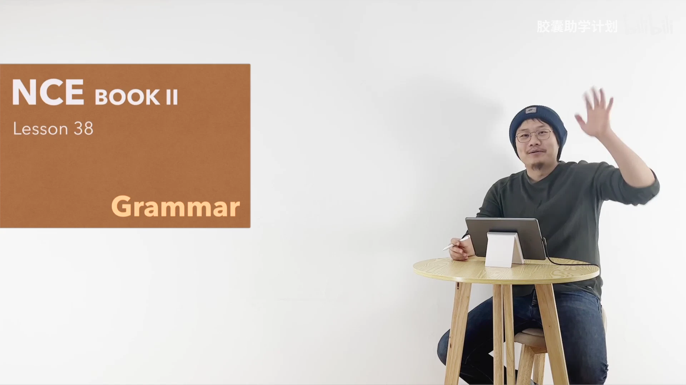

文字识别：NCE / BOOKⅡI / Lesson 38 / Grammar

### 画面 00:00:02

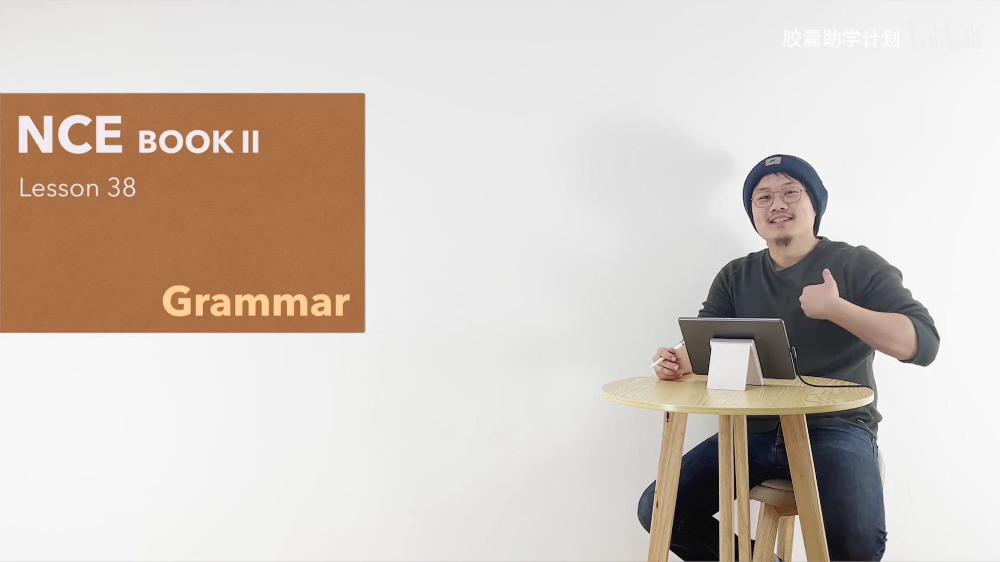

文字识别：NCE / BOOKⅡI / Lesson 38 / Grammar

### 画面 00:00:05

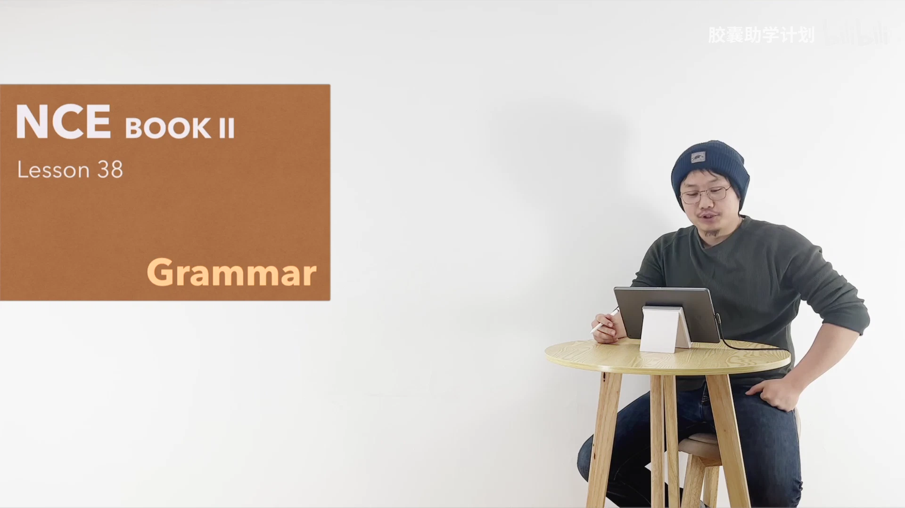

文字识别：NCE / BOOK"I / Lesson 38 / Grammar

### 画面 00:00:12

文字识别：than?

### 画面 00:00:14

文字识别：①如何使用 no sooner / than?

### 画面 00:00:18

文字识别：①如何使用 no sooner / than? / 可使用hardly / when?

### 画面 00:00:20

文字识别：①如何使用no sooner / than? / 如何使用 hardly / when?

### 画面 00:00:26

文字识别：胶囊助学计划 bilbl

### 画面 00:00:29

文字识别：胶囊助学计划

## 00:00:30–00:01:00

那首先注意是吧？这一课是第二单元的，呃，应该是第十四课是吧？然后我们要复习的呢，就是第一单元的 had 加蛋。那其实对于它来说，复习很容易。首先两个点，各位拿到就可以。第一个点，它的名字叫过去完成时，那对应着我们已经学过了现在完成时和将来完成时。今天我们再复习一下过去完成时。那第二呢，过去完成时，我们目前讲到最重要的

### 画面 00:00:31

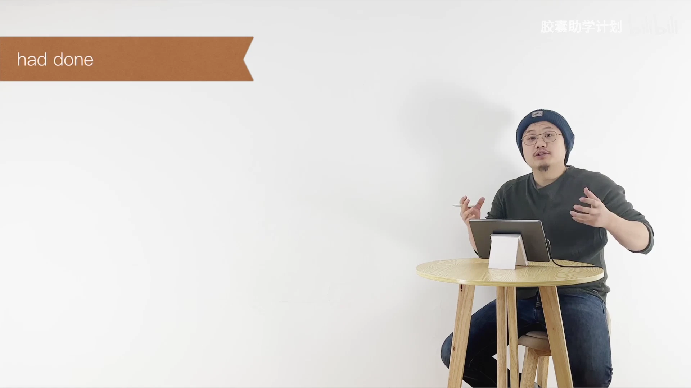

文字识别：had done

## 00:01:00–00:01:30

一个用法，在新概念当中讲的叫做过去的过去，对吧？那如果您想听到更多更详细的，不妨去看一下我们那个语法单项录制的视频，好吧？好，那如果它的含义表示的是过去的过去，是这样一种含义的话啊，我们管它叫过去完成时。于是呢，我们就可以在这儿画一张图，也就是说，如果这里表示的是 now 是现在，那过去如果有两个时间 A and B，对吧？那对于各位

### 画面 00:01:01

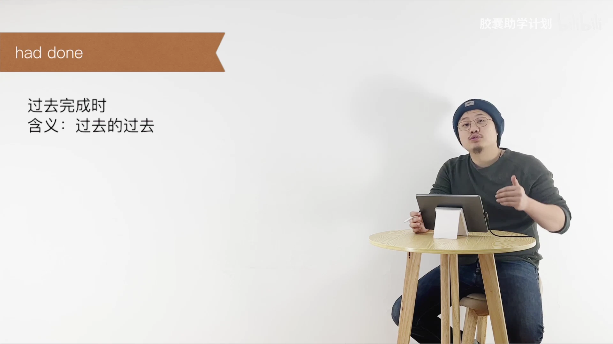

文字识别：had done / 过去完成时 / 含义：过去的过去

### 画面 00:01:19

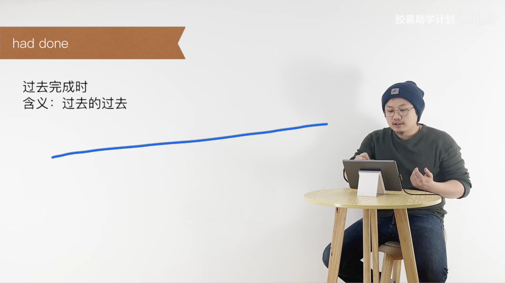

文字识别：had done / 过去完成时 / 含义：过去的过去

### 画面 00:01:22

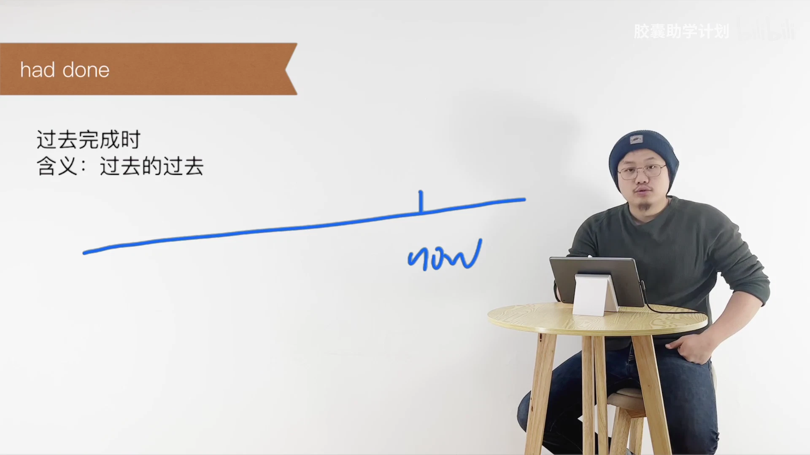

文字识别：had done / 过去完成时 / 含义：过去的过去 / nw

### 画面 00:01:28

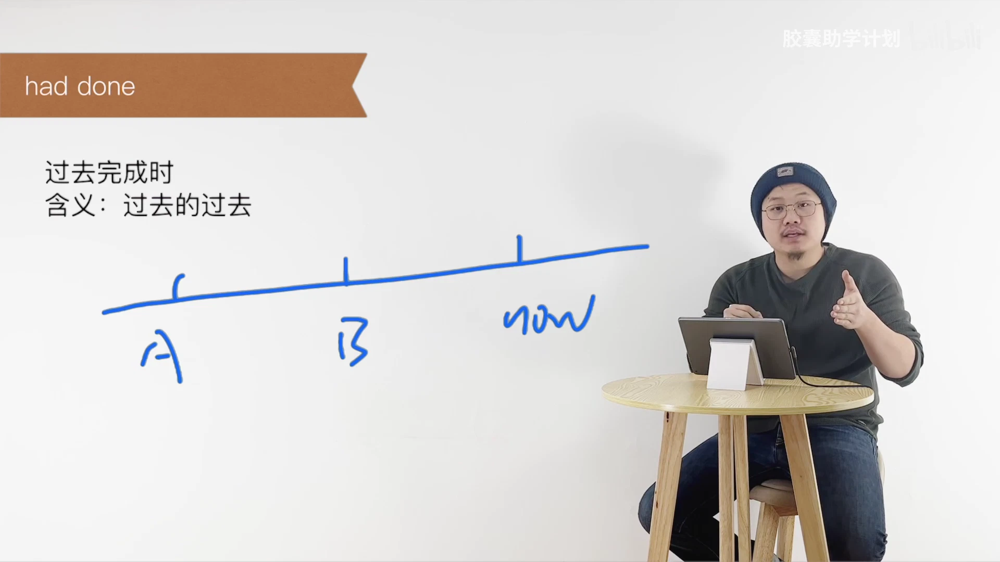

文字识别：had done / 过去完成时 / 含义：过去的过去 / nw / 13 / A

## 00:01:30–00:02:00

来说，各位要知道的事情就是注意啊，也就是说，如果一件事情发生在另一个动作之前，比如说A这个动作发生在B这个动作之前，那么对于各位来说最重要的事情就是要明白，在A这个地方，我们实际上有两个选择。那我们在这儿现在告诉各位，其中一个选择就是had加that过去完成时，所谓叫做过去的过去。那今天我们接下来要讲

### 画面 00:01:38

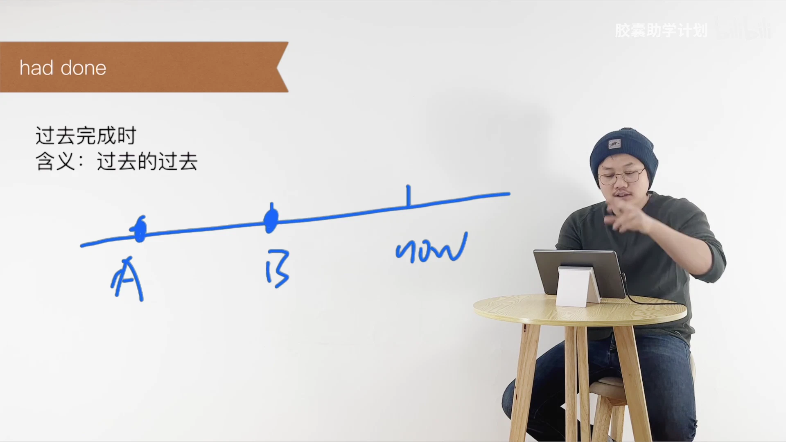

文字识别：had done / 过去完成时 / 含义：过去的过去 / nw / 13 / A

### 画面 00:01:42

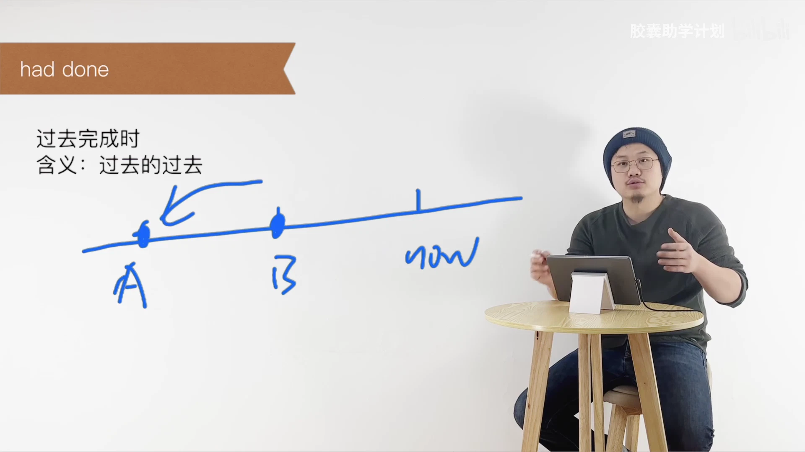

文字识别：had done / 过去完成时 / 含义：过去的过去 / nw / 13 / Á

### 画面 00:01:53

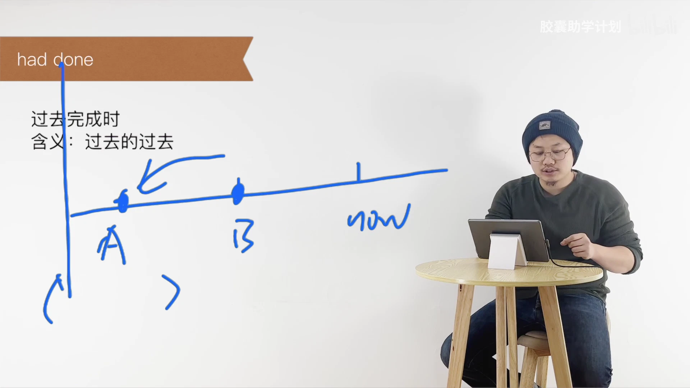

文字识别：had done / 过去完成时 / 含义：过去的过去 / nw / 13 / A

## 00:02:00–00:02:30

的这个语法，对吧？一个叫 no sooner... than... that，另外一个叫 hardly... than... when，都是跟 had that紧密相连的，都是它过去的过去这个用法。比如说，我们先从原文当中摘出一句话来，叫做 he had no sooner returned than. 好了，我们先把 no sooner than 这些我们比较啊马上要讲到的语法给它拉出来，说 he had no sooner returned. 我们先不管啊 no sooner 是吧？我们就说 he had returned，

### 画面 00:02:00

文字识别：than / no sooner

### 画面 00:02:11

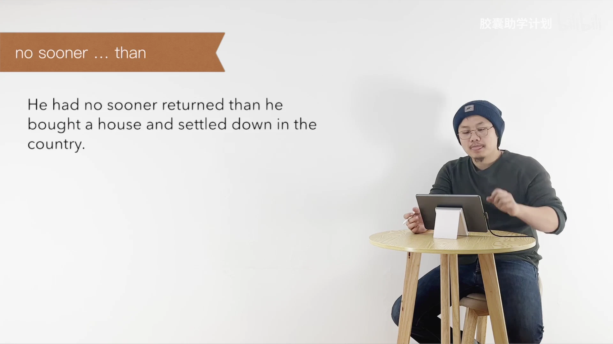

文字识别：than / no sooner / He had no sooner returned than he / bought a house and settled down in the / country.

### 画面 00:02:19

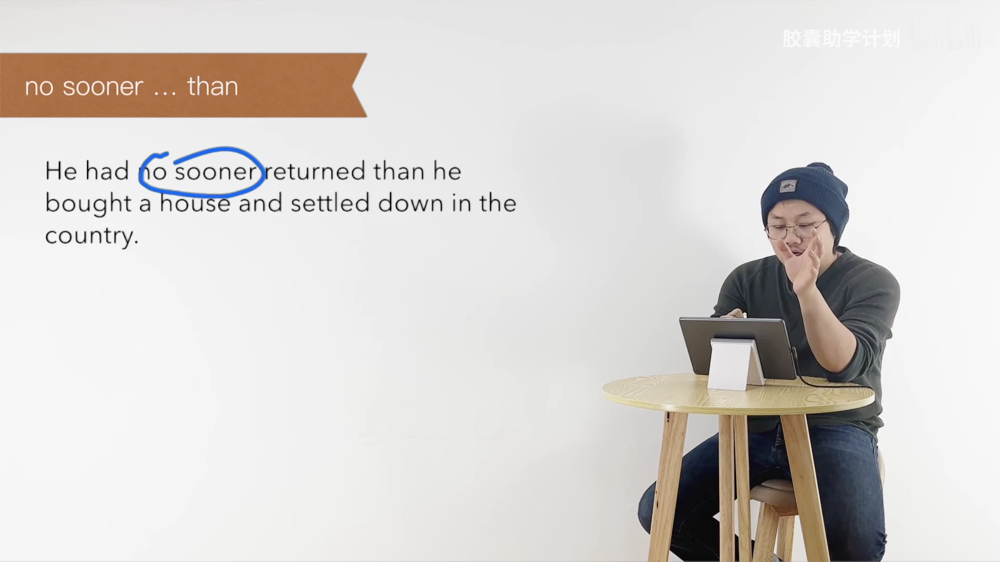

文字识别：than / no sooner / He had / o soonerreturned than he / bought a house and settled down in the / country.

## 00:02:30–00:03:00

叫他已经回来了。Then不管他，先看后面叫做 he built a house and settled down in the country，说他买了一个房子，然后在乡下定居了。Settle down，我们提前告诉各位，它叫做定居，在这里的意思，对吧？安定下来。好，那这里的 no sooner 和 then 怎么去理解呢？好，对于他来说，各位记住，它表示的叫做一怎么怎么样就怎么怎么样，和我们之前学过的 as soon as，对吧？是几乎是高度保持

### 画面 00:02:45

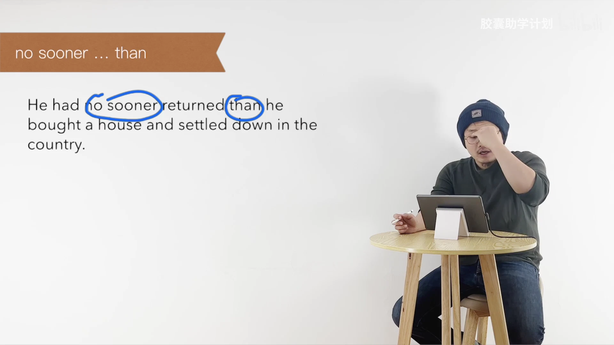

文字识别：than / no sooner / He had / soonerreturnedthan he / bought a house and settled down in the / country.

## 00:03:00–00:03:30

一致的啊，各位记住就可以了。好，那所以在这里我们就可以把它翻译成叫做他一回来就买了一个房子，然后在乡下定居了，对吧？好，这是我们知道了它的含义，这很简单。那第二步叫让，如果让我们自己去造一个句子，我们应该如何去造呢？OK，我们看一下，叫做主语，然后呢，had no sooner，但这是注意第一个句子，第一个

### 画面 00:03:15

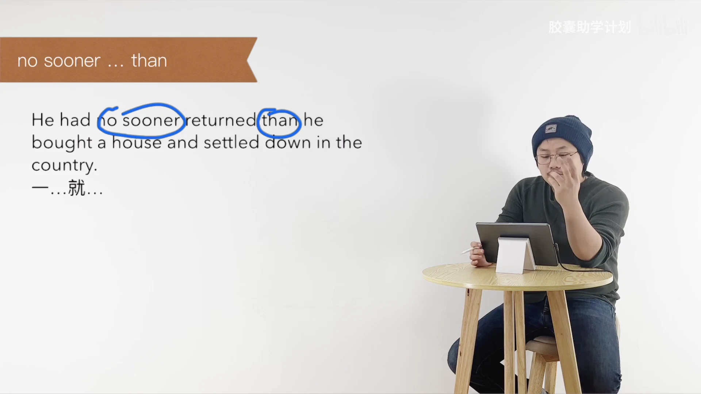

文字识别：than / no sooner / He had / 1o soonerreturnedthanhe / bought a house and settled down in the / country. / 一….就…..

### 画面 00:03:25

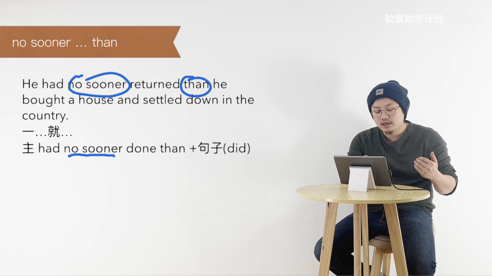

文字识别：than / no sooner / He had / o sooner returnedthan he / bought a house and settled down in the / country. / 一…就. / 主 had no sooner done than +句子(did)

### 画面 00:03:28

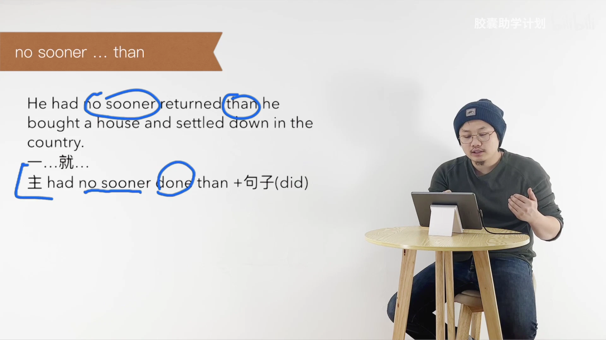

文字识别：than / no sooner / He had / soonerreturnedthanhe / bought a house and settled down in the / country. / 一…就. / 主 had no sooner / done / than+句子(did)

## 00:03:30–00:04:00

句子的关键点有两个。第一，时态你要选择过去完成时，had加done。第二，no sooner应该放在had加done的中间，不像我们原来学as soon as要放到整个句子句首，对吧？这里的no sooner要放在had加done的中间，OK。第二个句子叫做than，哎，注意，那这里面有两个点啊，than加一个句子，对吧？有两个点，各位需要注意。第一，than是引导了第二个

### 画面 00:03:50

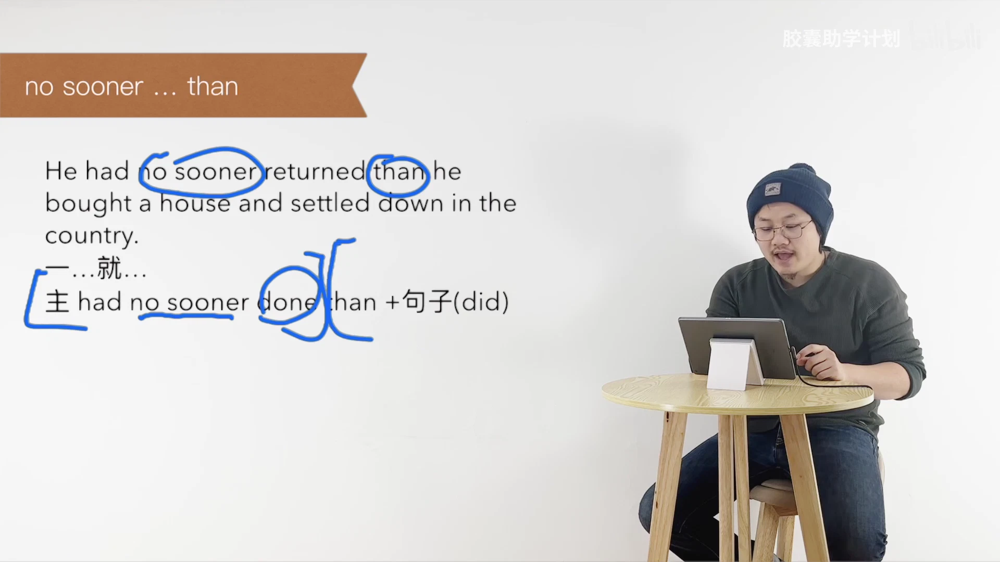

文字识别：than / no sooner / He had / soonerreturnedthanhe / o / bought a house and settled down in the / country. / 一…就. / 主 had no sooner / donehan +句子(did)

## 00:04:00–00:04:30

句子，所以要放在第二个句子的开头，第二个关键点啊，也就是说第二个句子then后边引导的这个句子，我们就要用一般过去时了，对吧？OK叫做did啊，也就是如果A和B两个句子，对吧？那我们先发生的是A这个句子一，但是呢啊，然后再发生的B这个句子，但是呢这两个句子的关系比较紧密，就A一发生B就发生了，对吧？也就是说如果我们把它

### 画面 00:04:15

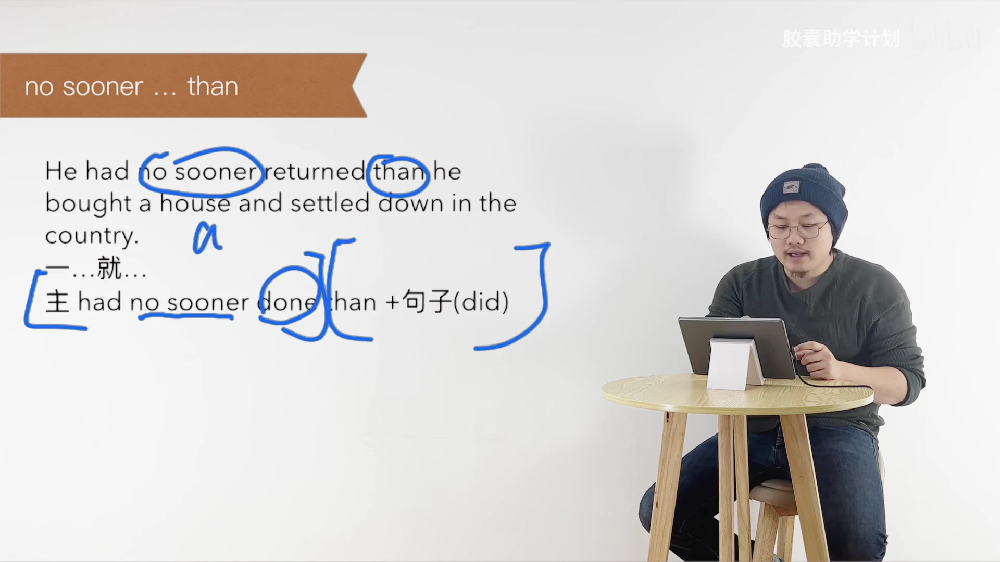

文字识别：than / no sooner / He had / soonerreturnedthanhe / o / bought a /  a house and settled down in the / country. / a / 一…就…. / 主 had no sooner / doneNhan +句子(did)

### 画面 00:04:19

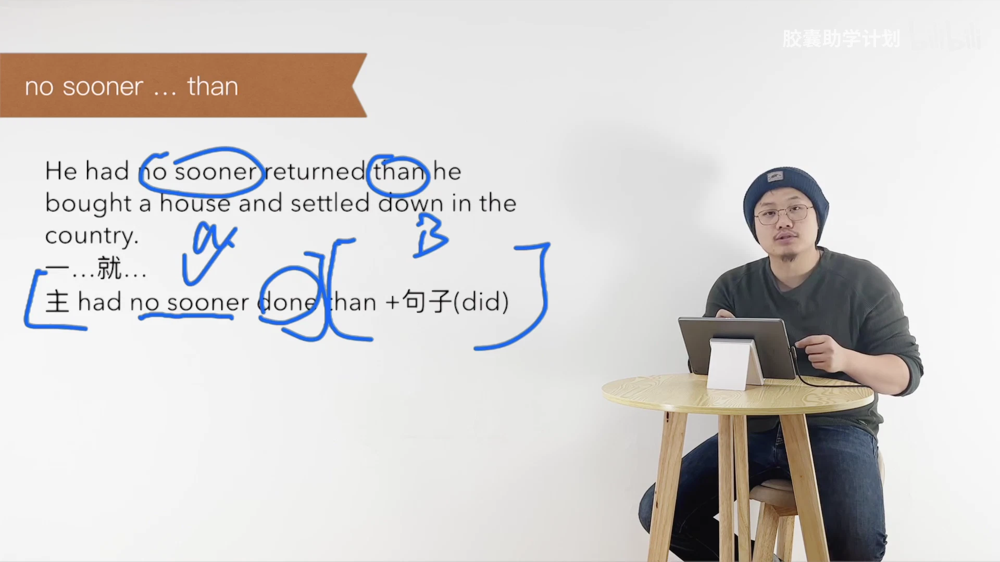

文字识别：than / no sooner / He had / soonerreturnedthan he / bought a /  a house and settled down in the / B / country. / M / 一…就….. / 主had no sooner / doneNhan +句子(did)

### 画面 00:04:29

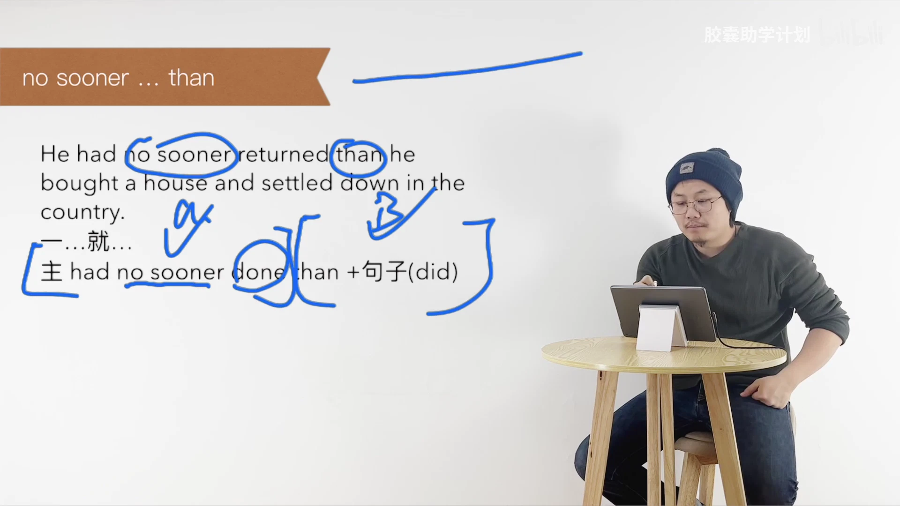

文字识别：than / no sooner / He had / soonerreturnedthan he / ho / bought a / a house and / settled down in the / country. / M / 一…就…. / 主had no sooner / doneNhan +句子(did)

## 00:04:30–00:05:00

如果要画一个图的话，那可能就是 A 在这里，A 发生完，B 立刻就发生了，对吧？但它也是在 A 这个动作的后面，所以 A 叫过去的过去，我们选择用的时态叫 had 加的。OK，好，OK， good。那接下来呢？Hardly when，一会儿我们统一去练啊。我们先看一下 hardly when，说 he had hardly 好不管他 had time to settle down when

### 画面 00:04:31

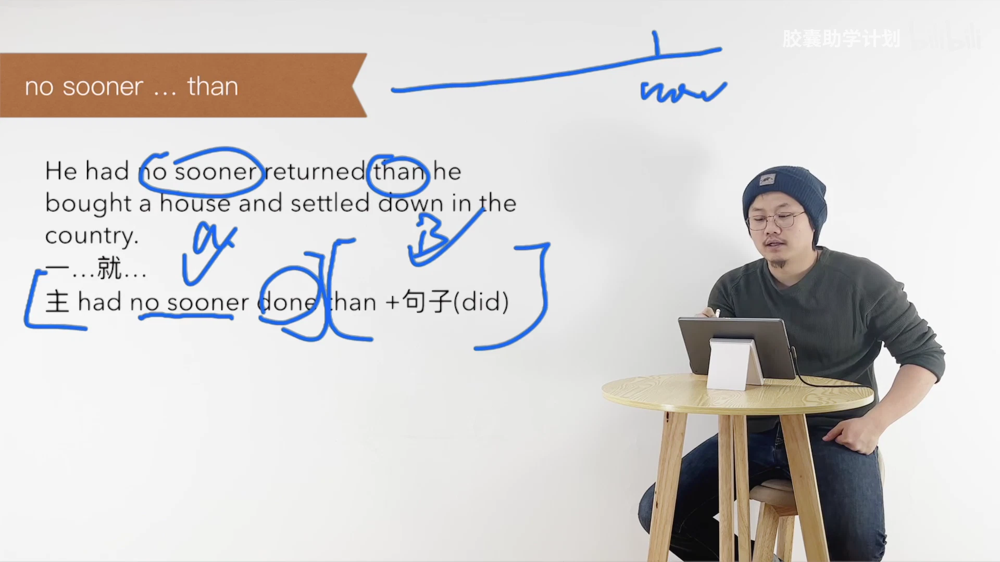

文字识别：than / no sooner / mw / He had / soonerreturned / thanhe / 10 / bought / a house and / settled down in the / country. / M / 一…就…. / 主had no sooner / doneNhan +句子(did)

### 画面 00:04:35

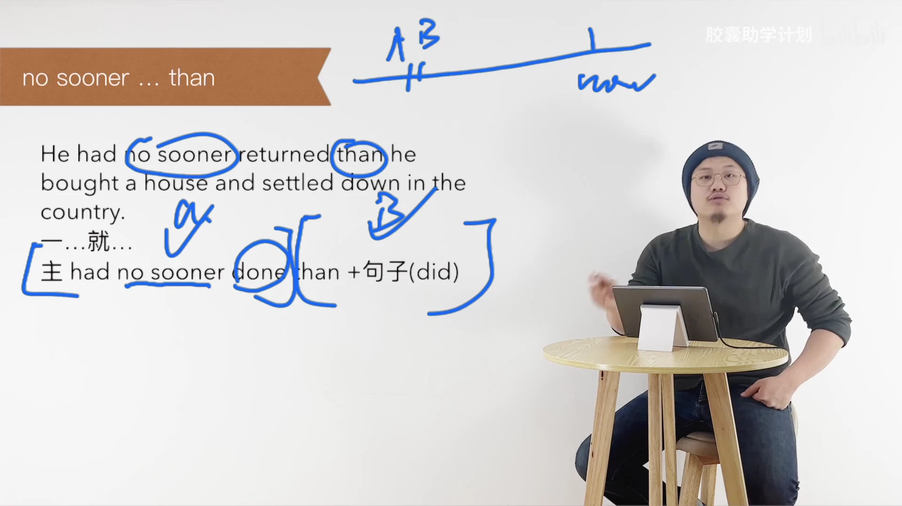

文字识别：13 / than / no sooner / m / He had / ho / soonerreturned / thanhe / bought: / a house and / settled / down in the / country. / M / 一…就.. / 主had no sooner / doneNhan +句子(did)

### 画面 00:04:46

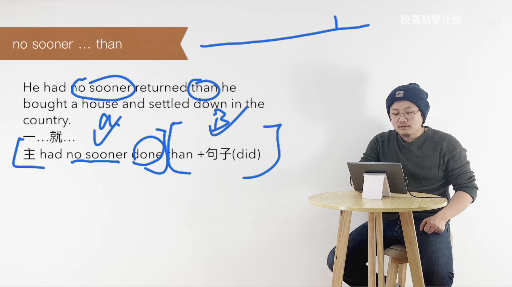

文字识别：than / no sooner / He had / soonerreturnedthan he / 0 / bought a / a house and settled down in the / country. / M / 一…就…. / 主had no sooner / doneNhan+句子(did)

### 画面 00:04:48

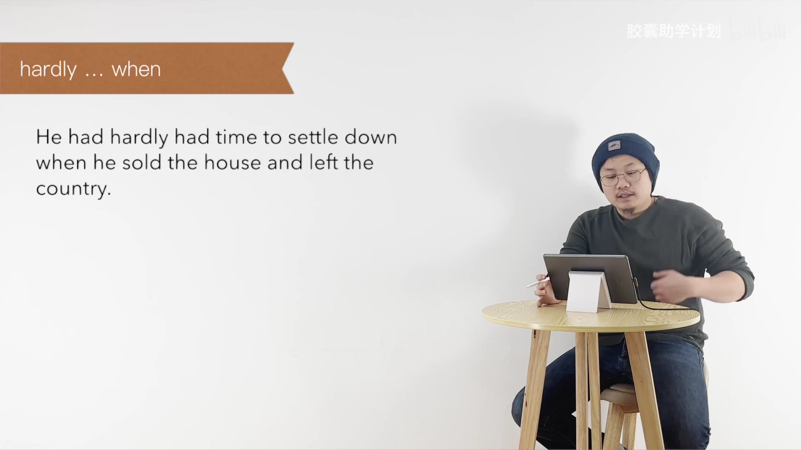

文字识别：hardly / y...when / He had hardly had time to settle down / when he sold the house and left the / country.

### 画面 00:04:57

文字识别：hardly / …..when / He hadhardlyhad time to settle down / when he sold the house and left the / country.

## 00:05:00–00:05:30

he sold the house and left the country,好，这也是原文的一句话，对吧？那我们先看一下它的意思啊。我们先不管 hardly 和 when，说 he had had time to settle down，他有时间去安定下来啊，定居下来。He sold the house，他卖了这个房子，and left the country，然后就离开了这里。好了，注意啊，说 he had hardly had time to settle down when he sold the house and left the country。那这里的

### 画面 00:05:01

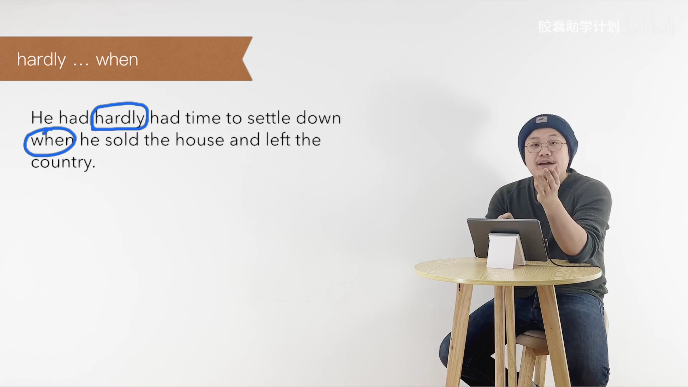

文字识别：hardly / ….when / He hadhardlyhad time to settle down / When he sold the house and left the / country.

## 00:05:30–00:06:00

hardly和when怎么翻译呢？其实hardly跟它字面意思几乎就可以保持一致，就是几乎刚怎么怎么样啊点儿点儿。然后就注意这里的when就不是当什么什么时候了，就变成了就怎么怎么样，对吧？那所以这句话叫做它几乎是刚刚有时间啊，这个安定下来，也就是说几乎还没，或者另一个思路就几乎几乎还没有时间去安定下来，或者说刚刚几乎是刚刚安定下来。然后呢，他就卖了房子，

### 画面 00:05:31

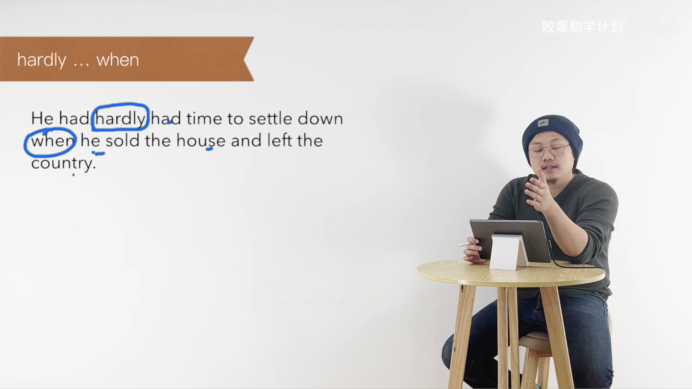

文字识别：hardly / ...when / He hadhardlyhad time to settle down / when he sold the house and left the / country.

### 画面 00:05:53

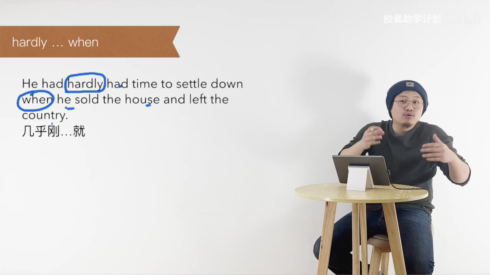

文字识别：hardly / ….when / He hadhardlyhad time to settle down / when he sold the house and left the / country. / 几乎刚..就

## 00:06:00–00:06:30

子，然后离开了这里，对吧？好，那然后呢？所以我们再看一下，第一个叫做含义，第二个叫做结构啊。它的结构呢，实际上也是一样的。A这个句子叫做主语加had hardly then，各位能注意到这个hardly的位置跟no sooner是一样的，都放在had加then的中间，对吧？然后第二个句子呢，刚才是由then去引导的，现在是由when去引导。所以在这个地方，对于各位来说，有几个关

### 画面 00:06:02

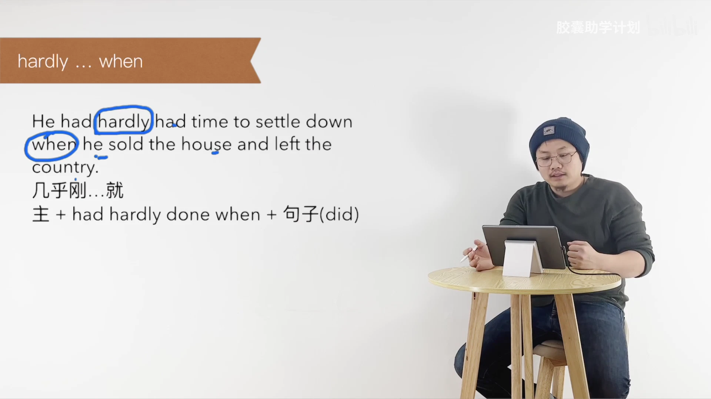

文字识别：hardly / /...when / He had hardlyhad time to settle down / when he sold the house and left the / country. / 几乎刚...就 / 主+had hardly done when +句子(did)

### 画面 00:06:07

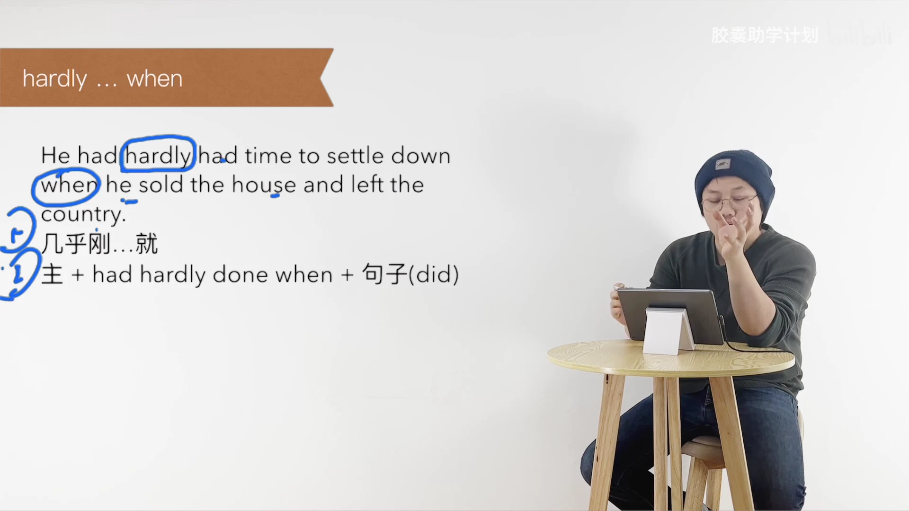

文字识别：hardly / …..when / He hadhardlyhad time to settle down / when he sold the house and left the / country. / 几乎刚…..就 / 主+ had hardly done when + 句子(did)

### 画面 00:06:11

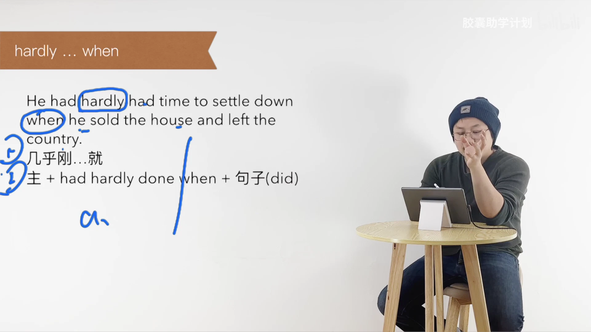

文字识别：hardly / ...when / He hadhardlyhad time to settle down / when he sold the house and left the / country. / 几乎刚…..就 / 主+ had hardly done yhen +句子(did)

### 画面 00:06:14

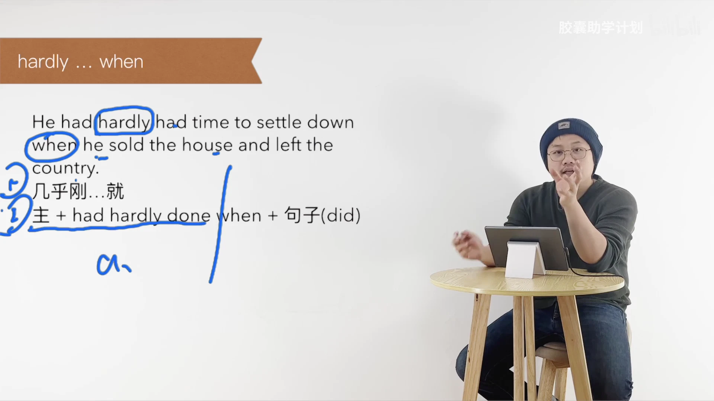

文字识别：hardly / …..when / He hadhardlyhad time to settle down / when he sold the house and left the / country. / 几乎刚…..就 / 主+had hardly done yhen +句子(did) / a、

### 画面 00:06:23

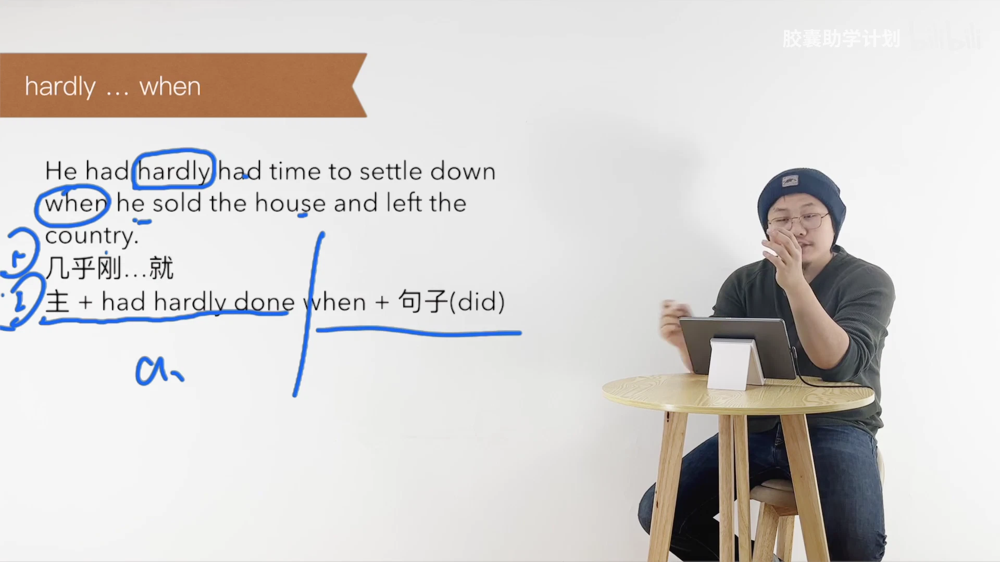

文字识别：hardly / . when / He hadhardlyhad time to settle down / when he sold the house and left the / country. / 几乎刚…..就 / 主+had hardly done when +句子(did) / a、

## 00:06:30–00:07:00

键点需要记住啊！我尝试给各位捋一下，各位可以看我。首先，第一，不管是 no sooner than 还是 hardly when，它实际上都是两句话 A 和 B，A 先发生，B 后发生，对吧？好，其实只不过原来我们用的是 after before 啊，原来在第十四课的时候，今天呢我们新学了两个新的东西 no sooner than 啊 hardly when。其次呢，它们的含义有点相似，一个叫一怎么怎么样就怎么怎么样，另外一个叫几乎是刚怎么怎么样

### 画面 00:06:53

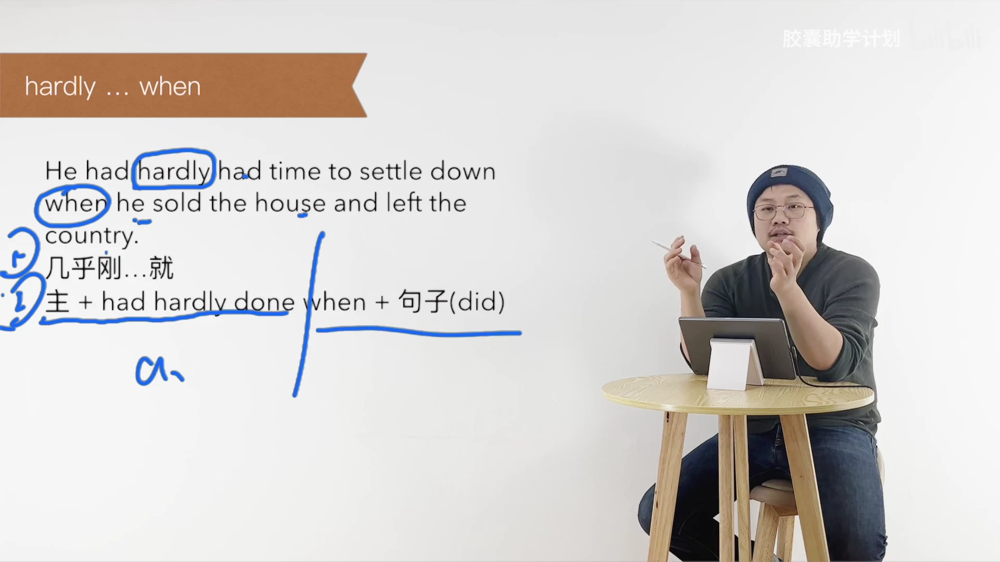

文字识别：hardly / …..when / He hadhardlyhad time to settle down / when he sold the house and left the / country. / 几乎刚...就 / 主+ had hardly done yhen +句子(did) / a、

## 00:07:00–00:07:30

就怎么怎么样啊，也其实大概的意思是差不多的啊，就是A一发生B就发生了。简单来说，好。其次呢，不管是then还是when，都是引导了第二句话，所以它放在第二句话的开头。然后呢，hardly啊和no sooner的位置是一样的，都放在had加done的中间啊，是吧？OK，那接下来我们尝试做一些练习啊。首先一怎么怎么样就怎么怎么样，我们看两个句子，then引导第二个句子，然

### 画面 00:07:22

文字识别：had done

### 画面 00:07:25

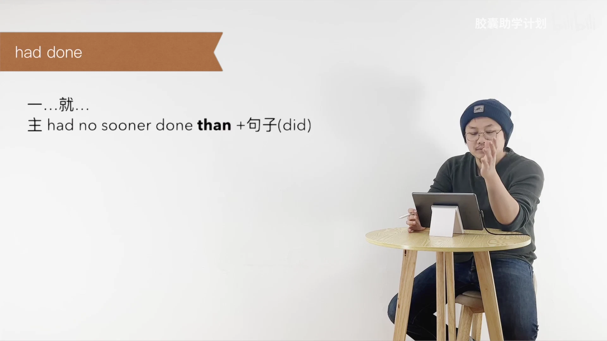

文字识别：had done / 一…就.. / 主 had no sooner done than +句子(did)

### 画面 00:07:29

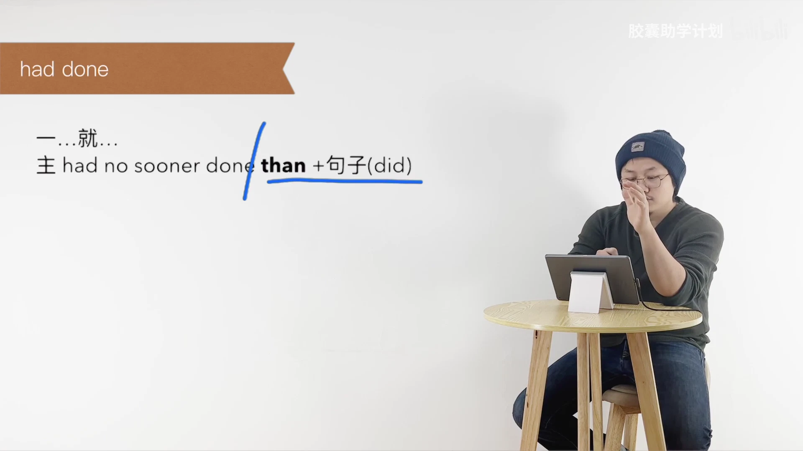

文字识别：had done / 一…就… / 主had no sooner done / than +句子(did)

## 00:07:30–00:08:00

后第一个句子的关键点有两个，第一个叫 had加 then，第二个叫 no sooner放在 had加 then的中间啊。接下来我们一起看啊，就是几乎刚怎么怎么样就怎么怎么样，对吧？这是刚才我们说的，各位能看到啊，他们的位置是一样的，对吧？ No sooner和 hardly的位置也是一样的啊。那接下来我们尝试造造句子，我先给各位两个句子，叫做 he entered the apartment，他进入了这个公寓。第二句话叫 he fell on

### 画面 00:07:31

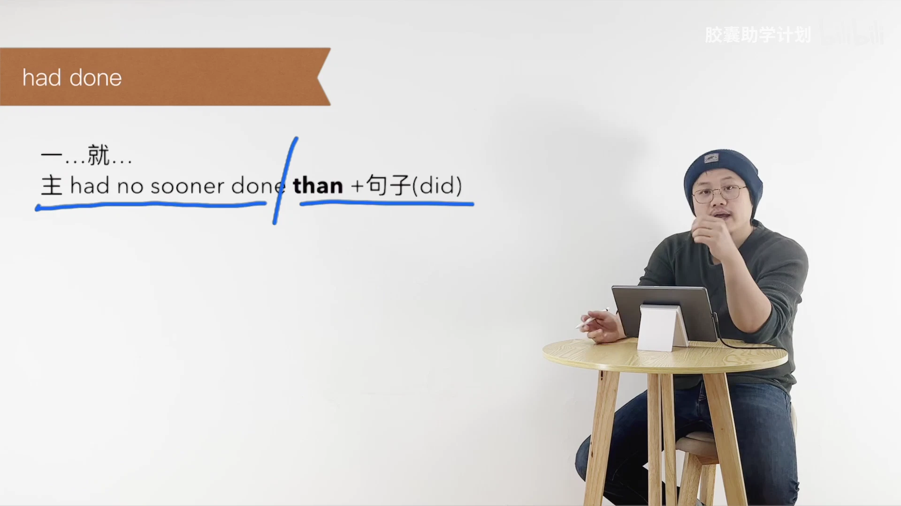

文字识别：had done / 一…就… / 主had no sooner dong / than +句子(did)

### 画面 00:07:38

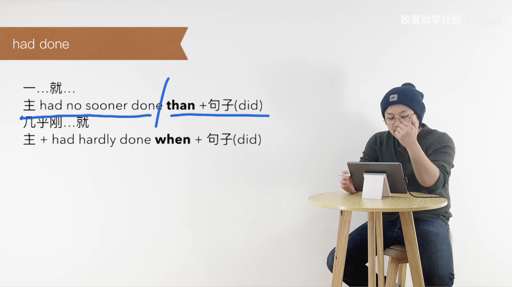

文字识别：had done / 一.就.... / 主 had no sooner done / than +句子(did) / 冗乎刚..就 / 主+had hardly done when + 句子(did)

### 画面 00:07:40

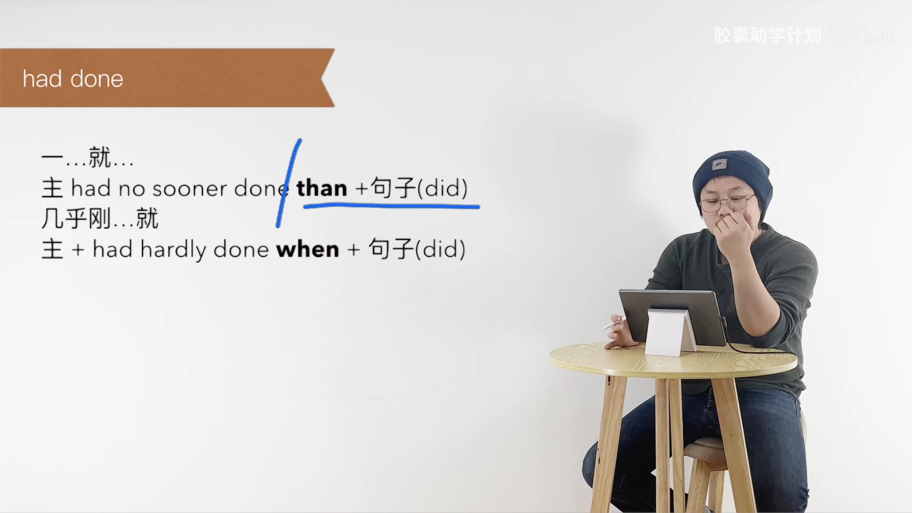

文字识别：had done / 一.就.…... / 主had no sooner donet / than +句子(did) / 几乎刚...就 / 主 + had hardly done when +句子(did)

### 画面 00:07:46

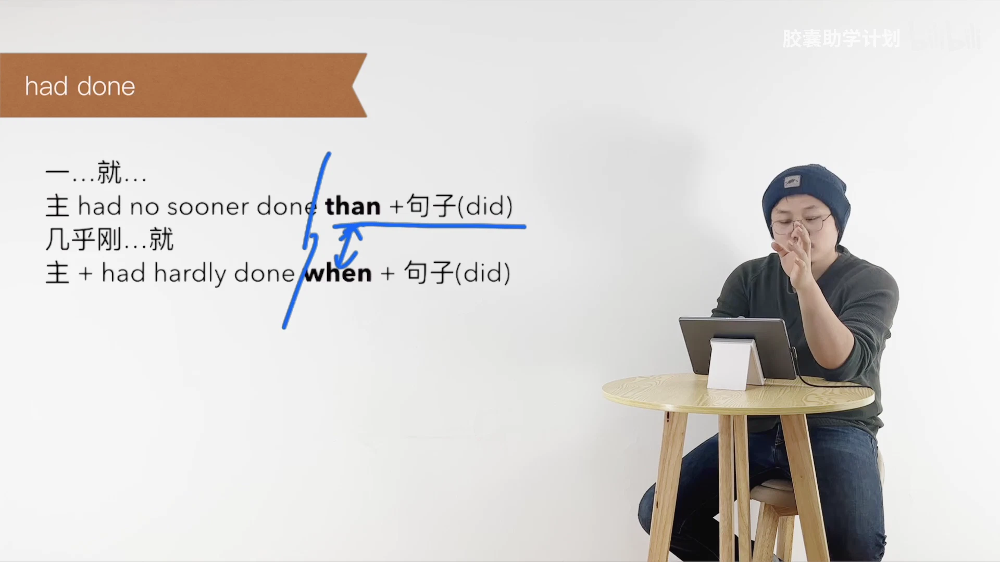

文字识别：had done / 一.就…... / 主had no sooner donethan +句子(did) / 几乎刚...就 / 2正 / 主+ had hardly donewhen +句子(did)

### 画面 00:07:51

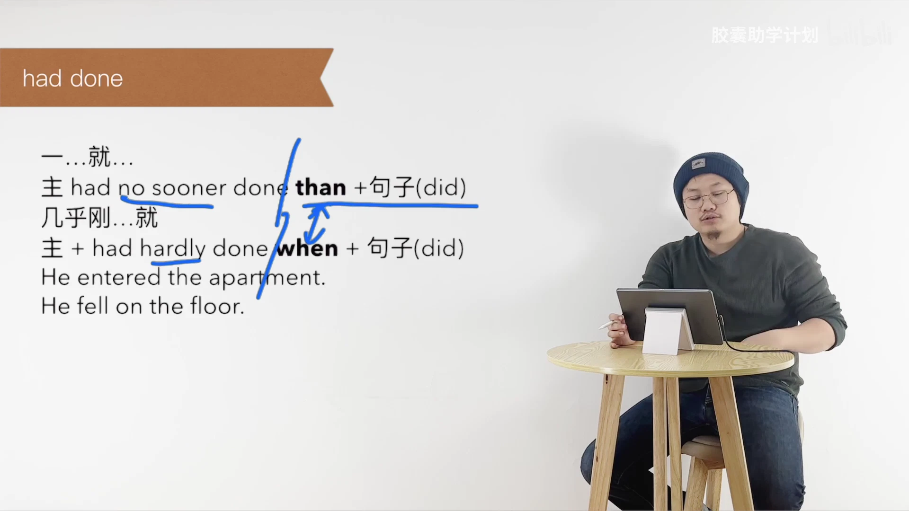

文字识别：had done / 一…就… / 主had no sooner dongthan +句子(did) / 几乎刚...就 / 主+ had hardly donewhen +句子(did) / He entered the apartment. / He fell on the floor.

## 00:08:00–00:08:30

the floor. 他落在了地板上。 Okay, very good. 我们想把这两句话给它穿插到一句话当中，怎么办？ He entered the apartment. He fell on the floor. 那我们先判断一下谁在前面，谁在后面。我们在这儿就把它理解为叫做他先进入的 apartment，然后他才 fall on the floor 的，好吧？所以接下来我要做的事情是把第一句话做一下改写，叫做 He had no sooner entered the apartment. 原来原来这两句

### 画面 00:08:21

文字识别：had done / 一….就… / 主had no sooner dongthan +句子(did) / 几乎刚...就 / 主+had hardly donewhen +句子(did) / He entered the apartment. / He fell on the floor.

### 画面 00:08:24

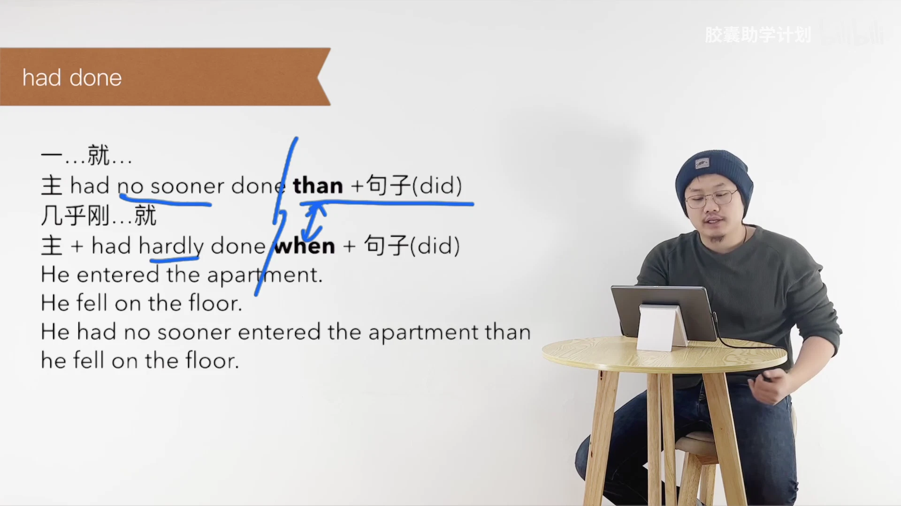

文字识别：had done / 一…就…. / 主had no sooner dongthan +句子(did) / 几乎刚...就 / 主+ had hardly donewhen +句子(did) / He entered the aparyment. / He fell on the floor. / He had no sooner entered the apartment than / he fell on the floor.

### 画面 00:08:26

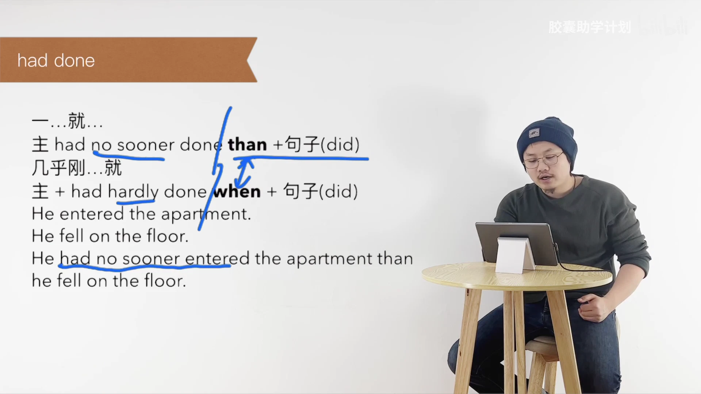

文字识别：had done / 一….就... / 主had no sooner dongthan +句子(did) / 几乎刚.…..就 / 主+had hardly donewhen +句子(did) / He entered the aparyment. / He fell on the floor. / He had no sooner entered the apartment than / he fell on the floor.

## 00:08:30–00:09:00

话给的是一般过去时，你要把它先变成过去完成时，对吧？所以然后再把 no sooner 放在 had 加 done 的中间，这句话就变成了 he had no sooner entered the apartment than 引导了第二句话，放在第二句话的开头就变成了 then he fell on the floor. Okay, 那其实对于各位来说，在这里我把 no sooner 换成 hardly，把 then 换成 when，就出来了第二句话叫做 he had hardly

### 画面 00:08:44

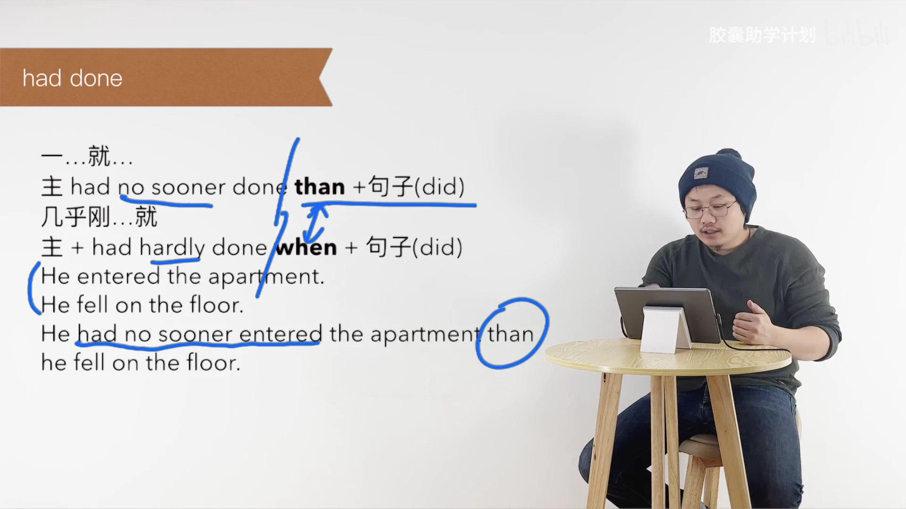

文字识别：had done / 一…就… / 主had no sooner donethan +句子(did) / 几乎刚...就 / 主+ had hardly donewhen +句子(did) / 'He entered the apartment. / He fell on the floor. / He had no sooner entered the apartmentthan / he fell on the floor.

### 画面 00:08:54

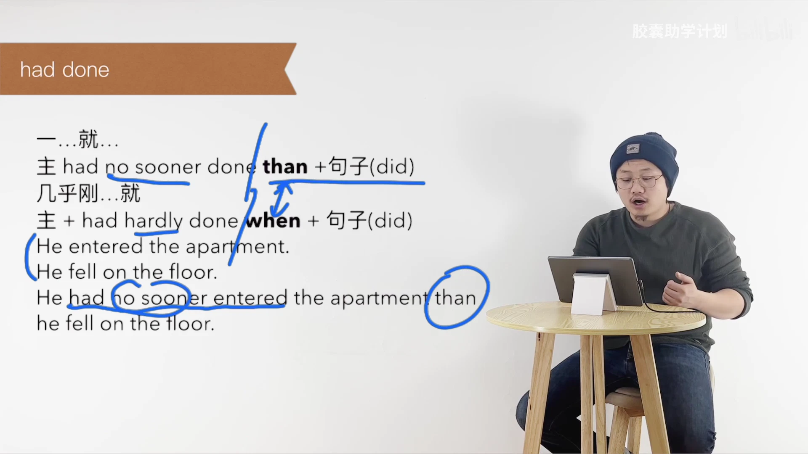

文字识别：had done / 一….就…. / 主had no sooner donethan +句子(did) / 几乎刚...就 / 主+ had hardly donewhen +句子(did) / He entered the apartment. / He fell on the floor. / He had fo sooner entered the apartment than / he fell on the tloor.

### 画面 00:08:57

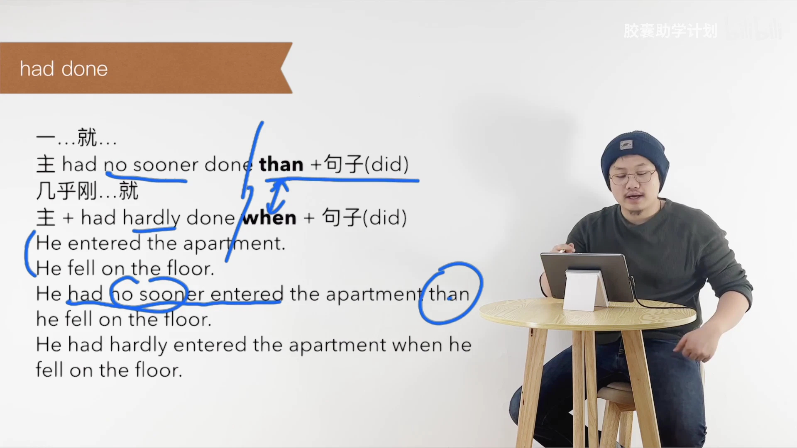

文字识别：had done / 一…就.. / 主had no sooner dongthan +句子(did) / 几乎刚...就 / 主+ had hardly donewhen +句子(did) / He entered the apartment. / He fell on the floor. / He had fo sooner entered the apartment than / he fell on the tloor. / He had hardly entered the apartment when he / fell on the floor.

## 00:09:00–00:09:30

the apartment when he fell on the floor. 叫做他几乎是刚刚进这个公寓，他就摔到地上了。 OK，好。所以各位能看到，他们今天我们学的这个 no sooner than 和 hardly when，从含义到位置到结构，其实都是高度一致的，对吧？各位学会一个，第二个其实基本上带过去就可以了啊，就别弄混就行了，别弄成 no sooner when hardly than，对吧？ OK，啊就可以了。那我们做一些练习吧，啊，先

### 画面 00:09:27

文字识别：had done

## 00:09:30–00:10:00

来第一个。No sooner than，还是老习惯，给两句话。I arrived at the station. The train came.啊，火车来了，我到了火车站，火车来了，对吧？很简单。那各位要做的事情就是先看谁是在前面，谁是在后面，对不对？呃，我在这儿基本上统一的就是，如果这是A，这是B的话啊，我统一的是第一个句子是A，第二个句子是B。所以呢，对于各位来说要做的事情，I arrived at the station。

### 画面 00:09:32

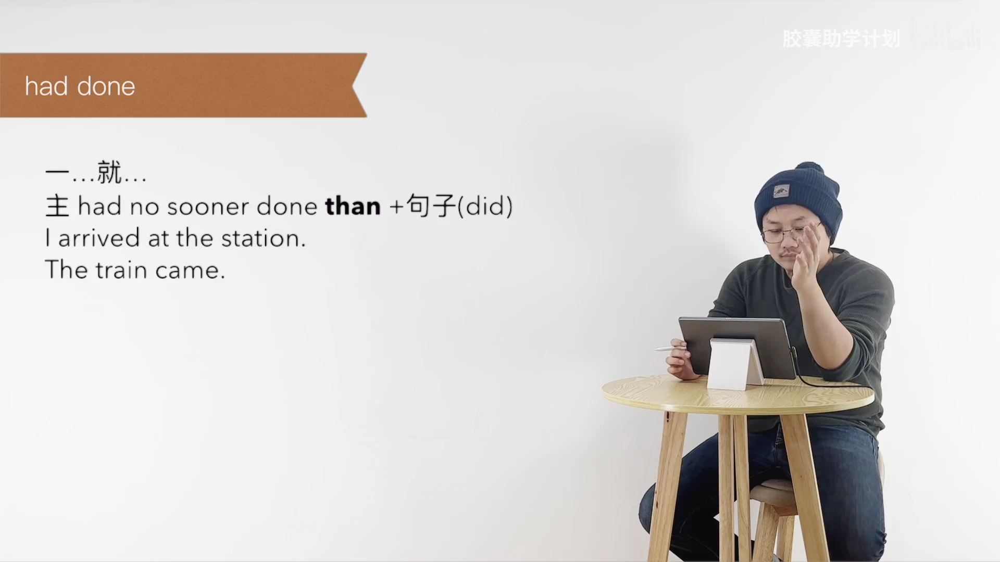

文字识别：had done / 一….就. / 主 had no sooner done than +句子(did) / I arrived at the station. / The train came.

### 画面 00:09:45

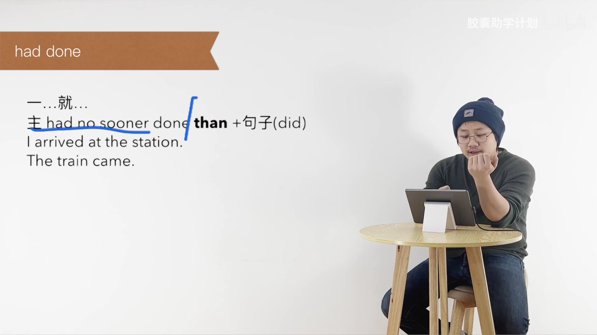

文字识别：had done / 一…就…. / 主had no sooner done / than +句子(did) / I arrived at the station. / The train came.

### 画面 00:09:47

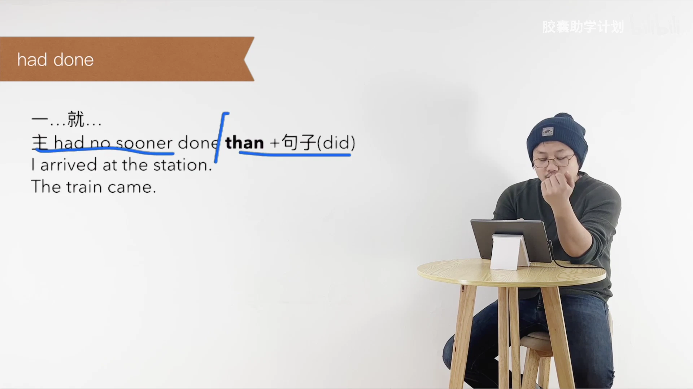

文字识别：had done / 一…就….. / 主had no sooner done / than +句子(did) / I arrived at the station. / The train came.

### 画面 00:09:53

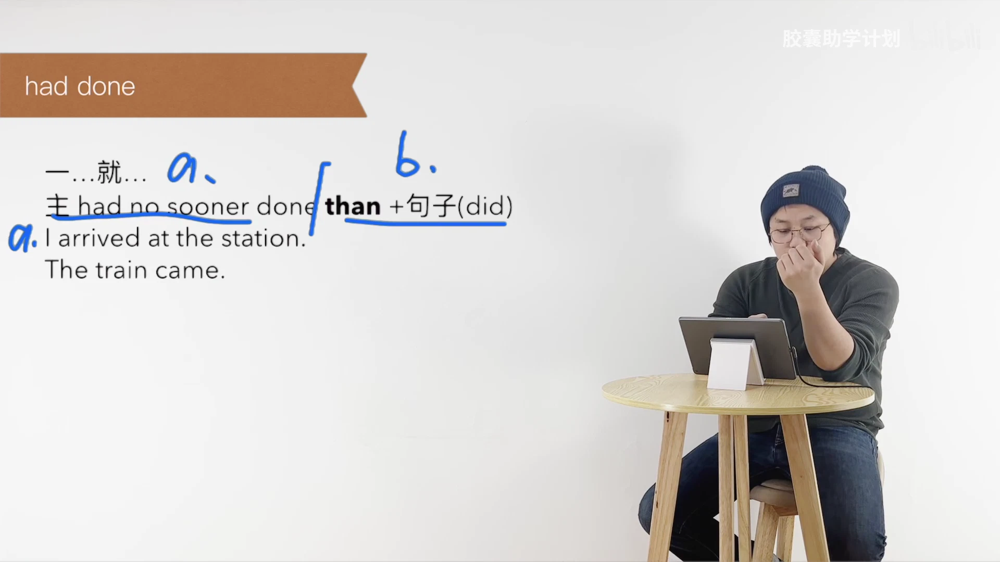

文字识别：had done / の、 / 一…就… / 主had no sooner done / than +句子(did) / 0.Iarrived at the station. / The train came.

## 00:10:00–00:10:30

我们要统一先把它处理成叫做 I had no sooner arrived at the station. 第二句话叫 The train came. 然后再加在它的前面来一个 Then. 注意啊，C 也就是 I had no sooner arrived at the station than the train came. 这是合起来的一句话，它的含义叫我一到车站，火车就来了。 OK，好，我希望我说清楚了啊。从含义到位置是吧？

### 画面 00:10:00

文字识别：had done / の、 / 一…就 / 主had no sooner done / than +句子(did) / 0.1 / .I arrived at the station.' / The train came. / I had no sooner arrived at the station / than the train came.

### 画面 00:10:04

文字识别：had done / の、 / 一…就… / 主had no sooner ( / done / than +句子(did) / 0. / I arrived at the station." / ,The train came. / I had no sooner arrived at the station / than the train came.

### 画面 00:10:10

文字识别：had done / の、 / 一…就… / 主had no sooner / done / than +句子(did) / 0. / I arrived at the station." / The train / came. / I had no sooner arrived at the station / than / the train came.

### 画面 00:10:14

文字识别：had done / の、 / 一.就. / 主had no sooner / done / than +句子(did) / 0. / larrived / atthe / station. / Ihe / train / came. / I had no sooner arrived / at the station / than / the / train came.

### 画面 00:10:16

文字识别：had / done / の、 / 一…就… / 主had no sooner / done / than +句子(did) / 0. / Iarrived / at the / station. / Ihe / UT / I had no / soonera / arrived / att / the / station / than / the / train / came.

### 画面 00:10:29

文字识别：had done

## 00:10:30–00:11:00

接下来我们还是做这个练习啊。两句话，We heard the noise. We rushed to the spot.我们冲到了这个点。那spot新概念一册一百四十三课我们应该是学的是吧？也就是我们新一就学过的一个单词。那这是A，这是B，统一的。它是A，它是它是B。我们现在要把C这个句子造出来。那We heard the noise.我们要先把它变成Had no sooner that，于是这句话就变成了We had no sooner heard the noise

### 画面 00:10:33

文字识别：had done / 一…就. / 主 had no sooner done than +句子(did) / We heard the noise. / We rushed to the spot.

### 画面 00:10:44

文字识别：had done / 一…就.… / 主 had no sooner done/than +句子(did) / We heard the noise. / We rushed to the spot.

### 画面 00:10:48

文字识别：had done / 一…就… / 主had no sooner donethan +句子(did) / OWe heard the noise.

### 画面 00:10:56

文字识别：had done / 一…就. / 主had no sogner donethan +句子(did) / OWe heard the'noise. / We had no sooner heard the noise / C· than we rushed to the spot.

## 00:11:00–00:11:30

than we rushed to the spot.好，注意一个小点啊，这个我们实际上如果在线下课的时候呢，会这样去处理，就是在这儿我一般给到前两个句子，我就会暂停，先不着急给答案，让各位自己尝试去写一写，然后我们对一下答案，对吧？所以那各位现在是在线课程，没有办法，各位就在这儿暂停一下屏幕，自己去写一写啊，这对于你自己学习是好的，只听我讲不如您自己也动动笔头，效果好，好吧？好，下一

### 画面 00:11:10

文字识别：had /  done / 一…就… / 主had no / sognero / done / than+句子(did) / 0 / We / heard / ther / noise. / 0. / We / rushed to / the / spot. / We had / heard the noise / C / than we rushed to the /  spot.

### 画面 00:11:12

文字识别：had / done / 一…就… / 主had no / sogner / done / than+句子(did) / 0 / We / heard / the'r / noise. / 0. / We / rushed to / the / spot. / We had / heard the noise / C / than we rushed to the spot.

### 画面 00:11:29

文字识别：had done

## 00:11:30–00:12:00

个说，She finished on project. She started working on the next.啊，她完成了。呃，这地方我觉得应该是 one project.啊，她或者 this project.她完成了这个，然后呢，她开始了下一个项目，对吧？A B.然后您往里带就行了。叫做 He had no sooner finished one project than she started working on the next.对吧？我们看位置啊，还有 no

### 画面 00:11:32

文字识别：had done / 一….就. / 主 had no sooner done than +句子(did) / She finished on project. / She started working on the next.

### 画面 00:11:49

文字识别：had done / 一….就... / 主 had no sooner done than +句子(did) / She finished oeproject. / 5 / She started working on the next. / She had no sooner finished one project / than she started working on the next.

### 画面 00:11:59

文字识别：had done / 一…就.. / 主 had no sooner done than +句子(did) / a5 / She finished oeproject. / She started working on the next. / She had no sooner finished one project / than she started working on the next.

## 00:12:00–00:12:30

sooner finished，然后 that，你看非常完美的，C契合进了前面的这个句子，对吧？非常的舒服啊。OK，那不多说，咱们接着往下走。I closed my eyes，I fell asleep. 哎，我一闭眼就睡着了，对吧？很舒服。I had no sooner closed my eyes than I fell asleep. 对吧？我一闭眼就睡着了。OK，very good. 啊，看一下 no sooner

### 画面 00:12:01

文字识别：had done / 一…就…. / 主 had no sooner done than +句子(did) / a5 / She finished oeproject. / She started working on the next. / She had no sooner finished one project / tlhan / she started working on the next.

### 画面 00:12:06

文字识别：had done / 一…就… / 主 had no sooner done than +句子(did) / She finished oeproject. / She started working on the next. / Ci / She had no sooner finished one project / than / she started working on the next.

### 画面 00:12:11

文字识别：had done

### 画面 00:12:19

文字识别：had done / 一…就. / 主 had no sooner done than +句子(did) / I closed my eyes. / I fell asleep. / I had no sooner closed my eyes than I / fell asleep.

## 00:12:30–00:13:00

的位置放在了had加than的中间，than放在了第二句话的开头，对吧？Okay,呃，最后我们再来练一个几乎刚怎么怎么样就怎么怎么样，因为位置啊这个含义都几乎一样，对吧？所以我们就少不练那么多了啊。您几乎就是把刚才的no sooner换成hardly啊，than换成when是吧？我们看两句话，I had reached the station, the train came.那你就把

### 画面 00:12:30

文字识别：had done / 一….就…. / 主 had no sooner done than +句子(did) / I closed my eyes. / I fell asleep. / I had no sooner closed my eyes than I / fell asleep.

### 画面 00:12:35

文字识别：had done / 一….就…. / 主 had no sooner done than +句子(did) / I closed my eyes. / I fell asleep. / I had no sooner closed my eyesthan / fell asleep.

### 画面 00:12:37

文字识别：had done

### 画面 00:12:43

文字识别：had done / 几乎刚….就 / 主+had hardly done when + 句子(did)

### 画面 00:12:47

文字识别：had done / 几乎刚…..就 / 主+had hardy done when +句子(did)

### 画面 00:12:57

文字识别：had done / 几乎刚…..就 / 主+ had hardy done When +句子(did) / I had reached the station. / The train came.

## 00:13:00–00:13:30

它这句话变成叫做 I had hardly reached the station when the train came. 我几乎是刚刚到达车站，火车就来了。注意这里的 when 不要翻译成当，好吧？那今天我们在这里讲的关键知识点就是这个叫做 No sooner than 和 hardly when 啊。接下来我们呃以后的课程从四十课开始是吧？我们往后面去讲单词的时候，我会尽量拿这个句型带着各位去造一些小的句子，让各

### 画面 00:13:13

文字识别：had done / 几乎刚..就 / 主+had Hardy done when +句子(did) / I had reached the station. / The train came. / I had hardly reached the station when / the train came.

### 画面 00:13:15

文字识别：Pattern drill / 训练目标： / 写作口语 / 练习包含had+done的句子 / Accuracy / Fluency

## 00:13:30–00:14:00

位更熟悉起来，好吧？那今天各位下课也可以自己去造一些句子。然后接下来我们看这个练习 pattern drill，练习包含 had done 的句子。我们说了今天是要复习 had done 的，对吧？那 pattern drill 一个很重要的作用就是帮我们去巩固学习语法啊。好，第一个我们要做的事情还是把这两句话讲清楚，然后您自己往里面去带。好，那我们看 S 一啊，S 一说 Why did you refuse the prize yesterday？

### 画面 00:13:45

文字识别：Pattern drill / 训练目标： / 写作口语 / 练习包含had+done的句子 / Accuracy / Fluency

### 画面 00:13:47

文字识别：Pattern drill / 1 T:refuse the prize - won / S1:Why did you refuse the prize yesterday? / S2:Because I hadn't won it! / forget your speech - prepared/learnt / lose your car- closed/locked / return the tools - asked for/ordered / wait for the milkman - paid/thanked

## 00:14:00–00:14:30

说为什么你拒绝了这个奖励？昨天说 because I hadn't won it.说因为我之前就没有赢得它。那没有赢是拒绝这个动作之前发生了，过去的过去，过去完成时，对吧？往里面去带就可以了。把前面的啊，前面的这些带到黄字，后面的这些带到蓝字啊，不多说了。第二题说 she's broken her arm again.注意这个地方的 p s.你要想一下是 is 还是

### 画面 00:14:17

文字识别：Pattern drill / 1 T:refuse the prize - won / S1:Why did you refuse the prize yesterday? / S2:Because I hadn't won it! / forget your speech - prepared/learnt / lose your caroclosed/locked / return the tools - asked for/ordered / wait for the milkman - paid/thanked

### 画面 00:14:21

文字识别：Pattern drill / 2 T:broken - her arm / S1:She's broken her arm again. / S2:Again? I didn't know she'd ever broken it before. / lost - her handbag/her driving licence / given up - smoking/cigarettes / won - first prize/the chess match / annoyed - the Smiths/the headmaster

## 00:14:30–00:15:00

has，对吧？它是has啊，他再一次把他的胳膊弄坏了，弄折了。Again,又一次。I didn't know she'd ever broken it before.我之前都不知道他之前还把这胳膊弄折过，更别提又一次了，对吧？我连第一次都不知道。那注意一个小点，这实际上是我们新概念一册一百三十五五课，呃呃呃一百三十三一百三十五新概念一册啊，

### 画面 00:14:51

文字识别：Pattern drill / 2 T:broken - her arm / S1:She's broken her arm again. / S2:Again? I didn't know she'd ever broken it before. / lost - her handbag/her driving licence / given up - smoking/cigarettes / won - first prize/the chess match / annoyed - the Smiths/the headmaster

## 00:15:00–00:15:30

啊，一百三十三一百三十五这两课，如果您这个这个地方的句子是一般过去时，那后边的时态要往前倒，从现在完成时变成过去完成时。再说一遍，如果刚才我说的这个语法您不太熟，这说明新概念一册一百三十三一百三十四一百三十五一百三十六这四课您不太熟，回去看一下，好吧？第三题说，Did he hear the

### 画面 00:15:21

文字识别：Pattern drill / 2 T:broken - her arm / S1:She's broken her arm again. / S2:Again? I didn't know she'd ever broken it before. / lost - her handbag/her driving licence / given up - smoking/cigarettes / won - first prize/the chess match / annoyed - the Smiths/the headmaster

### 画面 00:15:26

文字识别：Pattern drill / 3 T:hear the news at the office / S1:Did he hear the news at the office? / S2:No, he'd heard it before he went to the office. / break/hurt his arm in Spain / meet/see them at the party / discover/learn the truth at the meeting / lose/find his glasses at the theatre

## 00:15:30–00:16:00

news at the office? Ah, he heard it before he went to the office. 说他这个已经听到这个消息了，在什么之前呢？在他去办公室之前啊！你看，这就是一个非常典型十四课学我们说那个 before 引导的，对吧？或者 after 引导的啊，这个呃时间状语从句啊，一个动作在另一个动作之前，所以这里面是 had 加 that 啊。我们复习一下这个小的语

### 画面 00:15:56

文字识别：Pattern drill / 3 T:hear the news at the office / S1:Did he hear the news at the office? / S2:No, he'd heard it before he went to the ofice. / break/hurt his arm in Spain / meet/see them at the party / discover/learn the truth at the meeting / lose/find his glasses at the theatre

## 00:16:00–00:16:30

法，好吧？好，最后一个很简单啊。Have you won a race like this before?啊，在这个比赛之前，你以前赢过类似的比赛吗？I'd注意这是had对吧？I'd never won a race at all until I won this one.直到我赢得这个比赛之前，我什么都没赢过。那这个比赛是之前赢的，在他之前的之前，过去完成时是吧？往里面一带

### 画面 00:16:01

文字识别：Pattern drill / 4 T:won a race / S1:Have you won a race like this before? / S2:l'd never won a race at all until I won this one! / had an accident broken a glass / seen a film written a book / flown a plane driven a car

## 00:16:30–00:17:00

就可以了啊。这是六个，一二三四五六啊，选四个往里带就可以了。好，那 recap 本视频我们最重要学习的语法叫 no sooner than 和 hardly when。然后呢，家庭作业呢，对于各位来说很重要的。首先，pattern 觉各位先写，再大声朗读，然后尝试回忆，并给自己讲解一遍今天的核心语法，然后翻阅红皮书找一下本课的语法。好，那以上就是本视频

### 画面 00:16:31

文字识别：Pattern drill / 4 T:won a race / S1:Have you won a race like this before? / S2:l'd never won a race at all until I won this one! / had an accident broken a glass / seen a film written a book / flown a plane driven a car

### 画面 00:16:36

文字识别：Recap / Patterns / no sooner .. than / ＆ / hardly / /...when / Grammar

### 画面 00:16:38

文字识别：Recap / Patterns / no sooner. / than / ＆ / hardly / …. when / Grammar

### 画面 00:16:40

文字识别：Recap / Patterns / no sooner ... than / ＆ / hardly / …. when / Grammar

### 画面 00:16:44

文字识别：1.f / Pattern Drill写&朗读 / 专栏 / 4×4

### 画面 00:16:48

文字识别：1.f / Pattern Drill写&朗读 / 专栏 / 4×4

### 画面 00:16:50

文字识别：PatternDrill 写&朗读 / 1. / 专栏 / 4×4 / 尝试回忆并给自己讲解一 / 遍今天的核心语法 / Study-Test / Learning Pyramid

### 画面 00:16:53

文字识别：1. f / Pattern Drill写&朗读 / 专栏 / 4×4 / 尝试回忆并给自己讲解一 / 遍今天的核心语法 / Study-Test / Learning Pyramid / 尝试翻阅红皮书（中级） / 通过目录或索引(Index) / 查找到本课语法

### 画面 00:16:55

文字识别：1. f / Pattern Drill 写&朗读 / 专栏 / 4×4 / 尝试回忆并给自己讲解一 / 遍今天的核心语法 / Study-Test / Learning Pyramid / 尝试翻阅红皮书（中级） / 通过目录或索引(Index) / 查找到本课语法

### 画面 00:16:57

## 00:17:00–00:17:22

的全部内容了。如果各位喜欢我们的课程呢，欢迎各位关注、订阅、一键三连，分享给那些需要的朋友，来帮助我们快速成长。See you next time.

### 画面 00:17:10

### 画面 00:17:12

文字识别：CAPSULEACADEMY / 胶囊助学计划 / 小红书 / Lecturer / □ / 口 / Leo / OE

### 画面 00:17:15

文字识别：CAPSULEACADEMY / 胶囊助学计划 / 小红书 / Editor / OE

### 画面 00:17:18

文字识别：CAPSULEACADEMY / 胶囊助学计划 / 小红书 / Creator / Leo & Berlin

### 画面 00:17:20

文字识别：bilibili / 胶囊助学计划 / 胶囊助学计划 / 小红书 / OE

### 画面 00:17:22

文字识别：bilibili / 胶囊助学计划

