# L038 文章

快速机器解析：语音为单模型转写，未进行独立交叉校对或人工复核；画面每秒采样并按变化选帧，短时文字和标记可能遗漏。截图时间约有 1 秒误差。图片有损压缩；遇到疑点请按时间查看 Google Drive 原视频。

## 00:00:00–00:00:30

Hello everyone, welcome to Capsule Academy. This is Leo. Today we're going to learn New Concept English Book Two Lesson Thirty Eight Story. Hope you gonna enjoy.好，那我们直接看文章啊。呃，这篇文章还挺有意思的，我们一起看一下。来，My old friend Harrison.好了，注意，这我在很长时间之前就提过了，这个东西叫同位语，对吧？呃，同位语就是这两个东西是一码事儿。比如说，我

### 画面 00:00:00

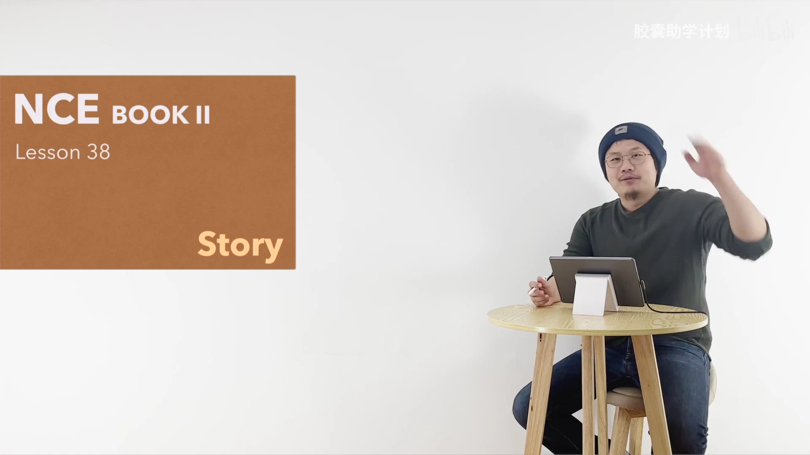

文字识别：NCE / BOOKII / Lesson 38 / Story

### 画面 00:00:04

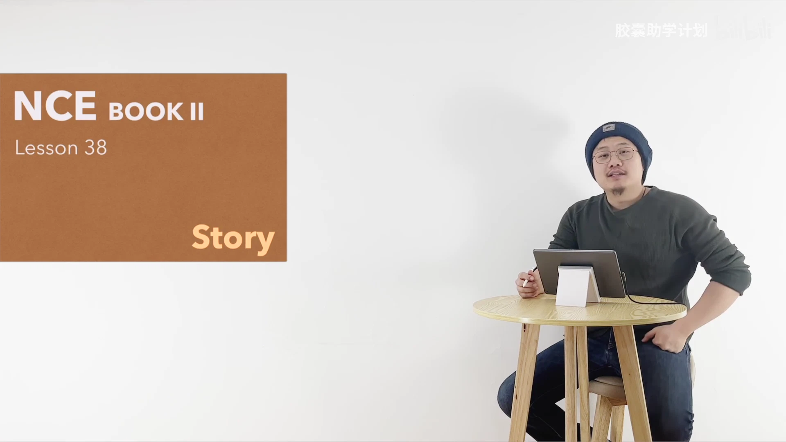

文字识别：NCE / BOOKII / Lesson 38 / Story

### 画面 00:00:09

文字识别：胶囊助学计划bl出 / •

### 画面 00:00:13

### 画面 00:00:15

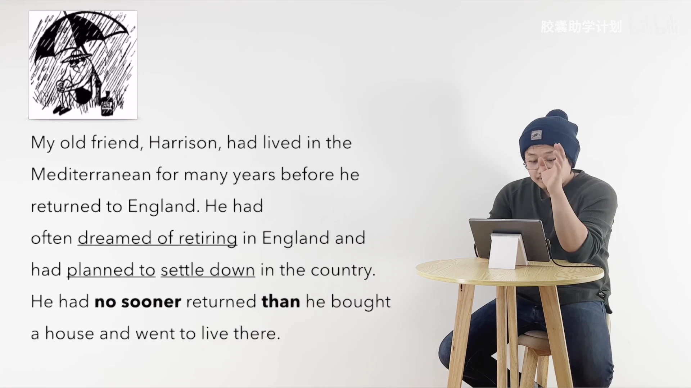

文字识别：My old friend, Harrison, had lived in the / Mediterranean for many years before he / returned to England. He had / often dreamed of retiring in England and / had planned to settle down in the country. / He had no sooner returned than he bought / a house and went to live there.

## 00:00:30–00:01:00

的英语老师 Leo 啊，我的英语老师就是 Leo，Leo 就是我的英语老师，在这儿就是我的老朋友就是 Harrison，Harrison 就是我的老朋友，我们管它叫同位语。同位语在今天还不是很重要，您知不知道什么叫同位语都啊，至少目前来说不是很重要，对吧？但是我们往后去学的时候，会学一个东西从句叫做同位语从句，从那个时候开始就变得重要起来了啊。您今天呢，只要知道它

### 画面 00:00:45

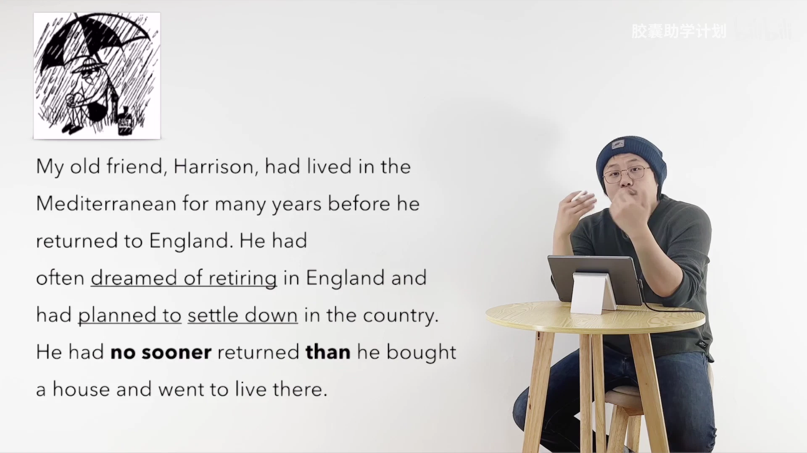

文字识别：My old friend, Harrison, had lived in the / Mediterranean for many years before he / returned to England. He had / often dreamed of retiring in England and / had planned to settle down in the country. / He had no sooner returned than he bought / a house and went to live there.

## 00:01:00–00:01:30

有这么个东西就可以了。说 had lived in the Mediterranean for many years。说已经住啊，一直都住 in the Mediterranean，在地中海 for many years，持续了很多很多年了。Before 在什么之前呢？你看，哎，在一个事儿之前，对吧？在一个动作之前，另一个动作先发生了。Had 加 but，对吧？在什么之前呢？He returned to England。在他回到英格兰之

### 画面 00:01:15

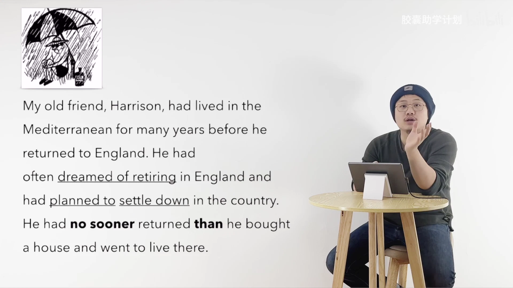

文字识别：My old friend, Harrison, had lived in the / Mediterranean for many years before he / returned to England. He had / often dreamed of retiring in England and / had planned to settle down in the country. / He had no sooner returned than he bought / a house and went to live there.

## 00:01:30–00:02:00

啊，在这儿我提一个小点，这个可能我们进入三册或者下半册啊，新二下半册进行的练习会开始变得多一点点。就是这个地方，我们可以其实做一个小的仿写啊，做一个小的仿写。在一件事情之前，另一件事情已经持续了很多年了。比如说，我就可以说说啊，呃，I had learned English for so many years

### 画面 00:01:45

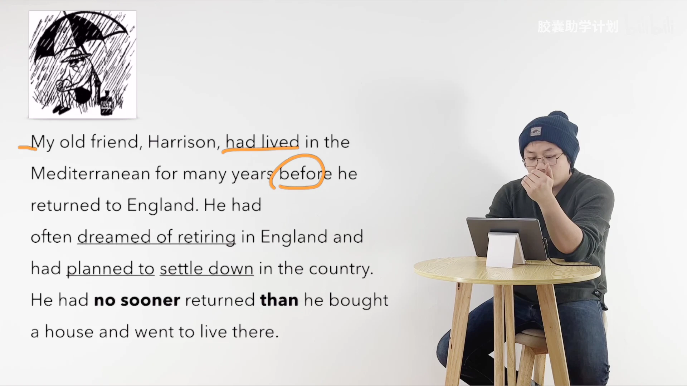

文字识别：My old friend, Harrison, had lived in the / Mediterranean for many years before he / returned to England. He had / often dreamed of retiring in England and / had planned to settle down in the country. / He had no sooner returned than he bought / a house and went to live there.

## 00:02:00–00:02:30

before I became I became an English teacher. Okay,好呃，在我成为一名英语老师之前，我学英语已经很多年了，对吧？Okay，大概是这个样子。这个我们呃照所谓的照葫芦画瓢是吧？以后我们再慢慢来啊。今天各位知道这么个思路就可以了。说 he had often他经常怎么样呢？Dreamed of retiring in England.说他经常梦想着退休在英格兰。那 dream of doing something就肯定是个习惯用法了。在英格兰退休

### 画面 00:02:15

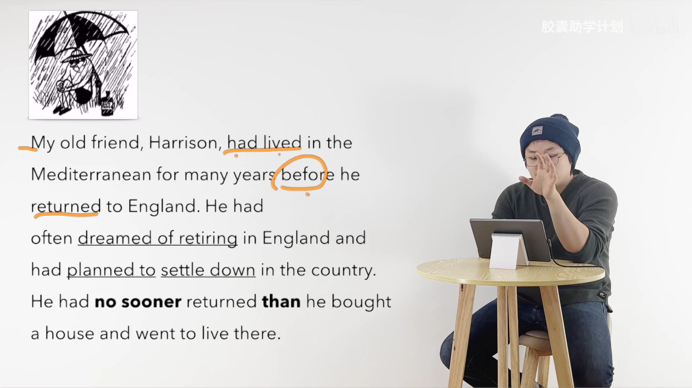

文字识别：My old friend, Harrison, had lived in the / Mediterranean for many years before he / returned to England. He had / often dreamed of retiring in England and / had planned to settle down in the country. / He had no sooner returned than he bought / a house and went to live there.

## 00:02:30–00:03:00

啊，或者退休回英格兰，and had planned to settle down in the country. 然后呢，已经 planned to do something, 计划好了, settle down, settle down 就是定居安居，是吧？哎哎，定居安居定在哪儿呢？In the country，在乡下。He had no sooner returned than he built a house and went to live there. 讲语法的那个视频，我们很清楚的讲解了这个句子，对吧？讲解了 no sooner than 表示一怎么怎

### 画面 00:02:45

文字识别：My old friend, Harrison, had lived in the / Mediterranean for many years before he / returned to England. He had / often dreamed of retiring in England and / had planned to settle down in the country. / He had no sooner returned than he bought / a house and went to live there.

## 00:03:00–00:03:30

么样就怎么怎么样，讲解了它的位置要放在 had 加 than 的中间，than 要引导第二个句子，对吧？所以这句话我们可以把它翻译成叫做呃，他几乎是刚一回来，他就买了个房子，然后去那儿住了。 Almost immediately，几乎是迅速，几乎是立刻。 He began to complain about the weather。他就开始抱怨这个天气。那 began to do something，之前我们

### 画面 00:03:05

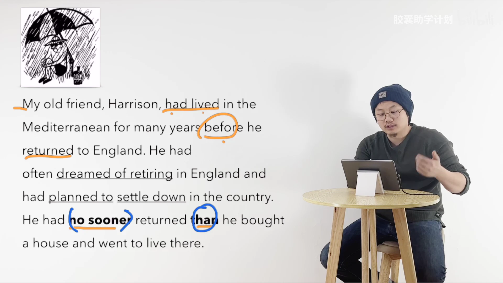

文字识别：My old friend, Harrison, had lived in the / Mediterranean for many years before he / returned to England. He had / often dreamed of retiring in England and / had planned to settle down in the country. / He had / ho soone returnedt / har / he bought / a house and went to live there.

### 画面 00:03:07

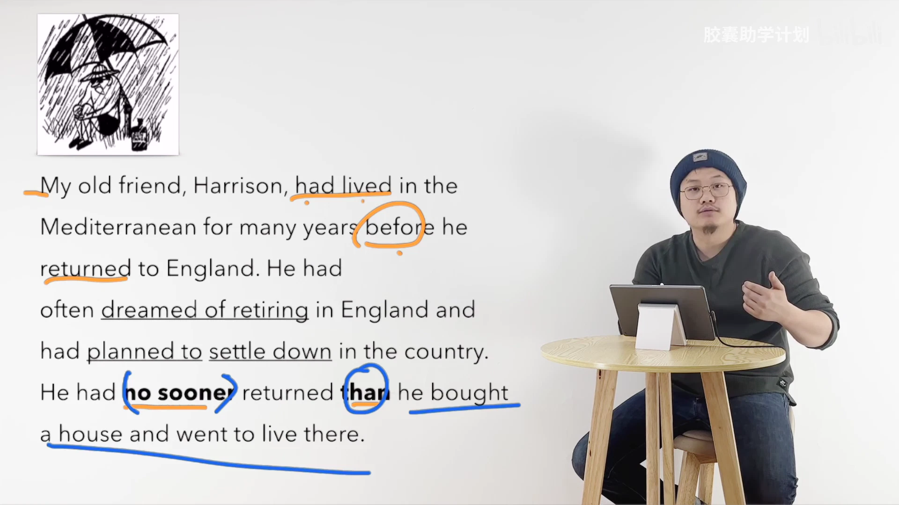

文字识别：My old friend, Harrison, had lived in the / Mediterranean for many years before he / returned to England. He had / often dreamed of retiring in England and / had planned to settle down in the country. / He had / ho soone)returned t / har / he bought / a house and went to live there.

### 画面 00:03:18

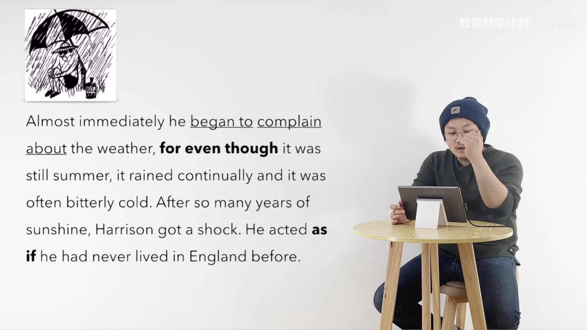

文字识别：Almost immediately he began to complain / about the weather, for even though it was / still summer, it rained continually and it was / often bitterly cold. After so many years of / sunshine, Harrison got a shock. He acted as / if he had never lived in England before.

## 00:03:30–00:04:00

学过了. Complain about something.哎，抱怨某某物，对吧？那complain about the weather叫做抱怨这个天气啊。For这里面有几个小的单词，我需要各位单独去记一下。第一个叫做for。For放在句首的时候，我们现在先不用进行特别精确的区分。初期对于各位来说，基本上和because就可以等

### 画面 00:03:48

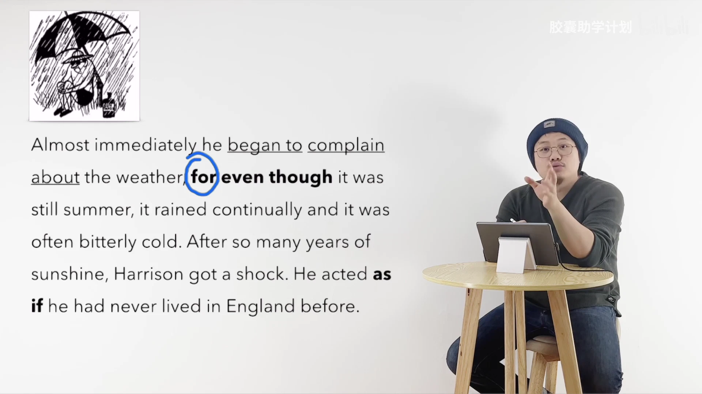

文字识别：Almost immediatelyhe began to complain / about the weatherforeven though it was / still summer, it rained continually and it was / often bitterly cold. After so many years of / sunshine, Harrison got a shock. He acted as / if he had never lived in England before.

## 00:04:00–00:04:30

等同等同去使用啊。for 再说一遍，你就等同去当做 because 就行了，就是因为啊。所以您直接在这个 for 旁边画一个圈，然后写上 because 因为。接下来这两个单词叫 even 再加 though。第一，我需要您去初级红皮书查一下，不知道什么是初级红皮书的，去看我们最开始的那个开篇视频，对吧？那里面解详细的解

### 画面 00:04:11

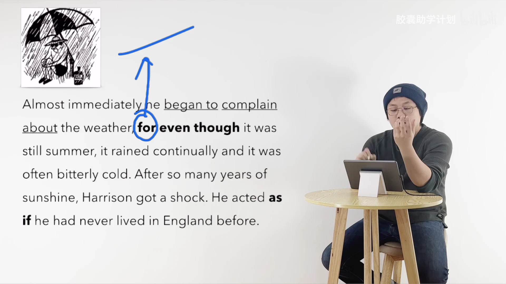

文字识别：Almost immediatelyhe began to complain / about the weatherforeven though it was / still summer, it rained continually and it was / often bitterly cold. After so many years of / sunshine, Harrison got a shock. He acted as / if he had never lived in England before.

### 画面 00:04:17

文字识别：Almost immediatelype began tocomplain / about the weatherforeven though it was / still summer, it rained continually and it was / often bitterly cold. After so many years of / sunshine, Harrison got a shock. He acted as / if he had never lived in England before.

## 00:04:30–00:05:00

释了什么叫初级红笔书。Even though我第一需要您去查一下，第二查完了之后可以尝试去把右边练习做一做啊。它其实是一个很小的连词，就表示是尽管即使。所以它这里的翻译叫做几乎是立刻，他就开始抱怨天气了。因为尽管 it was still summer，依旧是夏天，it rained continually and it was often bitterly

### 画面 00:04:47

文字识别：Almost immediatelyhe began tq/complain / about the weatherforeven though it was / still summer, it rained continually and it was / often bitterly cold. After so many years of / sunshine, Harrison got a shock. He acted as / if he had never lived in England before.

## 00:05:00–00:05:30

cold.说它经常持续不断的下雨，导致的是刺骨的寒冷。就是即使是夏天，这个雨下完了之后，也是特别的冻人，是吧？哈，也是刺骨的冷。Okay,那这个天气很有意思。After so many years of sunshine,在如此多年啊这个年头的这个太太阳光的照耀之后啊，那地中海是这个阳光特别充裕的一片

### 画面 00:05:17

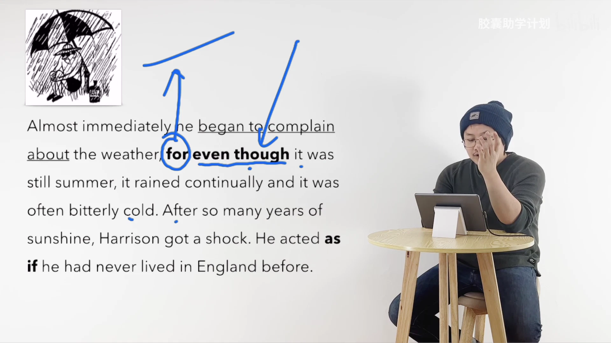

文字识别：Almost immediatelyhe began tq/complain / about the weatherforeven though it was / still summer, it rained continually and it was / often bitterly cold. After so many years of / sunshine, Harrison got a shock. He acted as / if he had never lived in England before.

### 画面 00:05:22

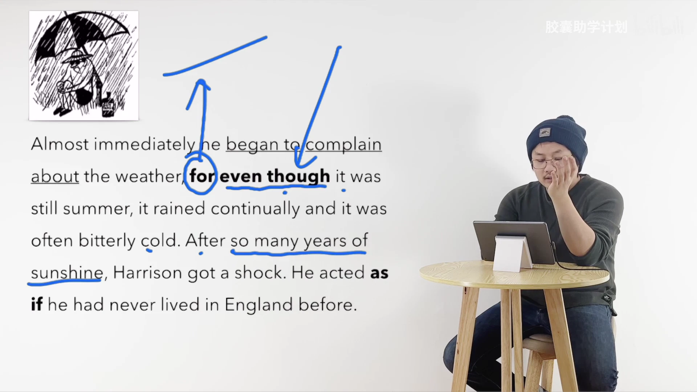

文字识别：Almost immediatelyhe began tq/complain / about the weatherforeven though it was / still summer, it rained continually and it was / often bitterly cold. After so many years of / sunshine, Harrison got a shock. He acted as / if he had never lived in England before.

## 00:05:30–00:06:00

地方，对吧？那他肯定习惯的习惯的天气实际上是天天晒太阳。然后现在回伦敦或者回英国了之后呢，英格兰之后呢是总是阴雨绵绵，对吧？Everything got a shock. Got a shock也算一个习惯用法。其实我们之前见过叫做 get a surprise，叫做这个呃大吃一惊。那 got a shock 其实也是就翻译成汉语就是震惊了，是吧？他震惊了。He acted act

### 画面 00:05:52

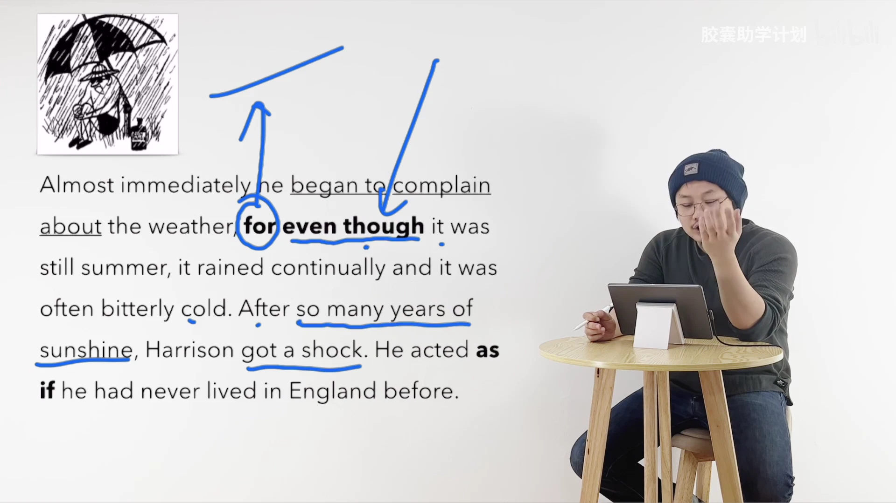

文字识别：Almost immediatelyhe began tqcomplain / about the weatherforeven though it was / still summer, it rained continually and it was / often bitterly cold. After so many years of / sunshine, Harrison got a shock. He acted as / if he had never lived in England before.

## 00:06:00–00:06:30

表现展现啊，他表现的注意，接下来又是两个小的单词，还是今天我们不着急讲，但是呢，需要各位拿红皮书先去自己查一下啊，哎，然后顺便做一下右边的练习，以后我们会专门去讲。那在这里你需要知道这两个单词合起来它的含义叫做好像就似乎是吧，就像说他表现的就像怎么样呢？He had never lived in England

### 画面 00:06:10

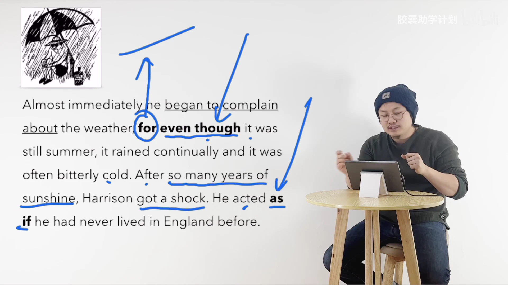

文字识别：Almost immediatelyhe began tqcomplain / about the weatherforeven though it was / still summer, it rained continually and it was / often bitterly cold. After so many years of / sunshine, Harrison got a shock. He acted as / if he had never lived in England before.

### 画面 00:06:29

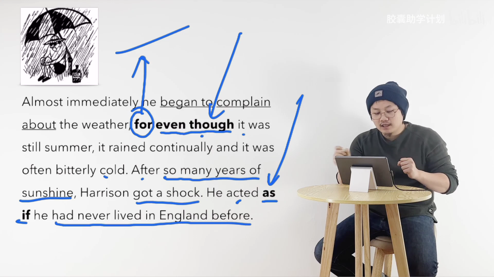

文字识别：Almost immediatelyhe began tqcomplain / about the weatherforeven though it was / still summer, it rained continually and it was / often bitterly cold. After so many years of / sunshine, Harrison got a shock. He acted as / if he had never lived in England before.

## 00:06:30–00:07:00

before. He以前从在没从来都没有在英格兰住过一样。好，所以这个地方各位需要注意啊。他其实表达的就是说，他可能从小在一到十五岁是在英格兰，从十六岁去了地中海住了二三十年之后，他特别想回到故土。在回来之后，发现英格兰，他小的时候英格兰就是这样的天气，对吧？但是当他在阳光明媚的地中海待了二三十年之后，当他再回到英格兰的时候，he

### 画面 00:06:59

文字识别：Almost immediatelyhe began tqcomplain / about the weatherforeven though it was / still summer, it rained continually and it was / often bitterly cold. After so many years of / sunshine, Harrison got a shock. He acted as / if he had never lived in England before.

## 00:07:00–00:07:30

acted as if he had never lived in England before.他展现的就像是他从来没有在英格兰住过。但其实这句话的意思是，这句话其实告诉你另一个潜台词，就是他其实是在英格兰以前住过的，对吧？Okay, continuing. In the end,最后，it was more than he could bear.啊，bear这是一个呃关键单词，就是跟stand有类似，对吧？Stand up那个stand，

### 画面 00:07:18

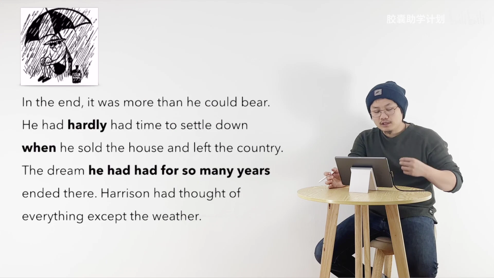

文字识别：In the end, it was more than he could bear. / He had hardly had time to settle down / when he sold the house and left the country. / The dream he had had for so many years / ended there. Harrison had thought of / everything except the weather.

## 00:07:30–00:08:00

只不过它表示的叫做无法忍受啊。所以it was more啊，超过了more than叫超过了he could bear，超过了他能忍受的。He had hardly had time to settle down when he sold the house and left the country.好了，注意这个地方啊。你看说他几乎是刚刚有时间定下来。刚才说了嘛，他一回来就定下来了，对吧？那一回来就定下来，发现天气不舒服，然后他几乎是刚定下来，他就把房子给

### 画面 00:07:47

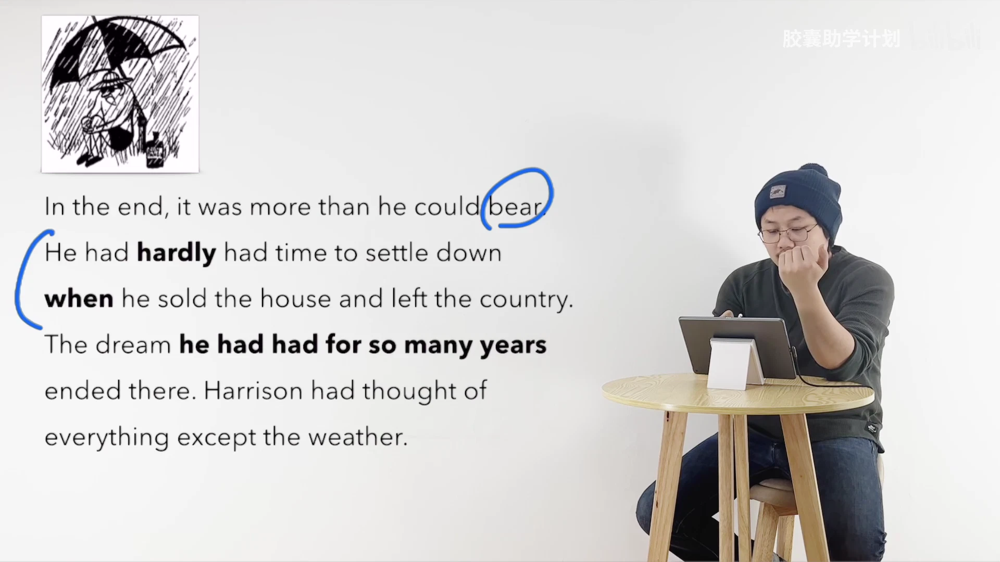

文字识别：In the end, it was more than he couldbear / He had hardly had time to settle down / when he sold the house and left the country. / The dream he had had for so many years / ended there. Harrison had thought of / everything except the weather.

## 00:08:00–00:08:30

卖了。I left the country,然后就离开了这个地方，离开了这个国家，对吧？Okay, when当啊不是当啊，对，在这地方注意不是当啊，就是说啊几乎是刚怎么怎么样就怎么怎么样，这两个单词合起来这样翻译，对吧？这是个结构啊。接下来，the dream he had had for so many years。注意这地方在这儿，我们补一个小单词叫which啊。The dream which he had had for so many years。

### 画面 00:08:06

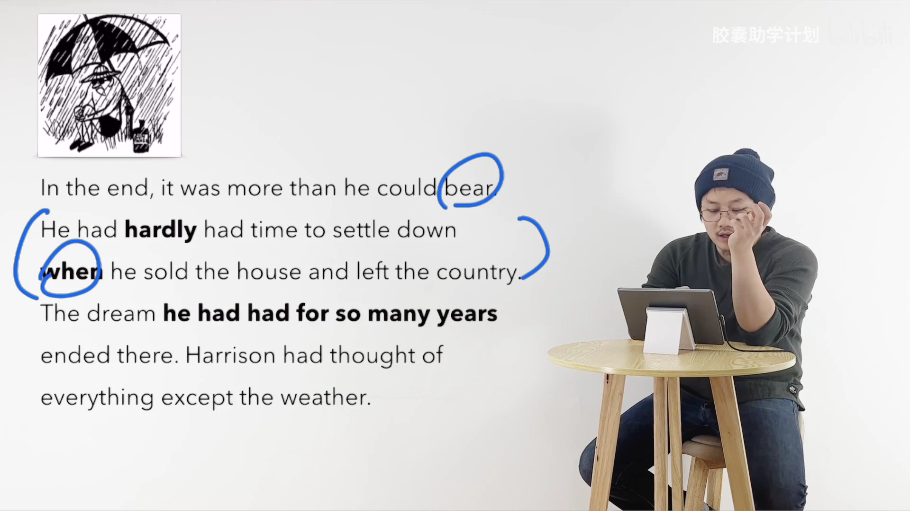

文字识别：In the end, it was more than he could(bear / He had hardly had time to settle down / wher / he sold the house and left the country. / 'The dream he had had for so many years / ended there. Harrison had thought of / everything except the weather.

### 画面 00:08:24

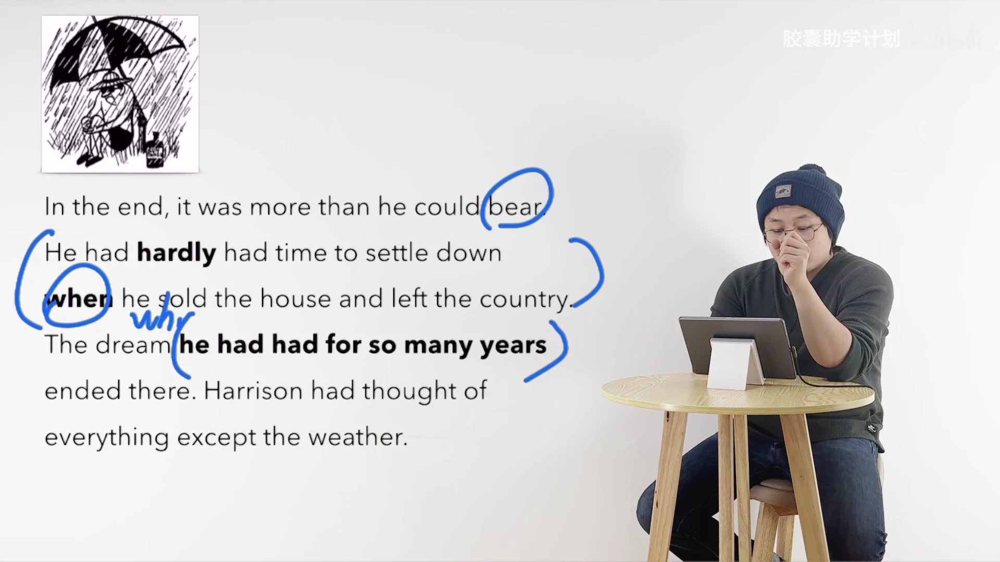

文字识别：In the end, it was more than he couldbear / He had hardly had time to settle down / wher /  he yold the house and left the country. / Wn / The dream he had had for so many years / ended there. Harrison had thought of / everything except the weather.

## 00:08:30–00:09:00

### 画面 00:08:33

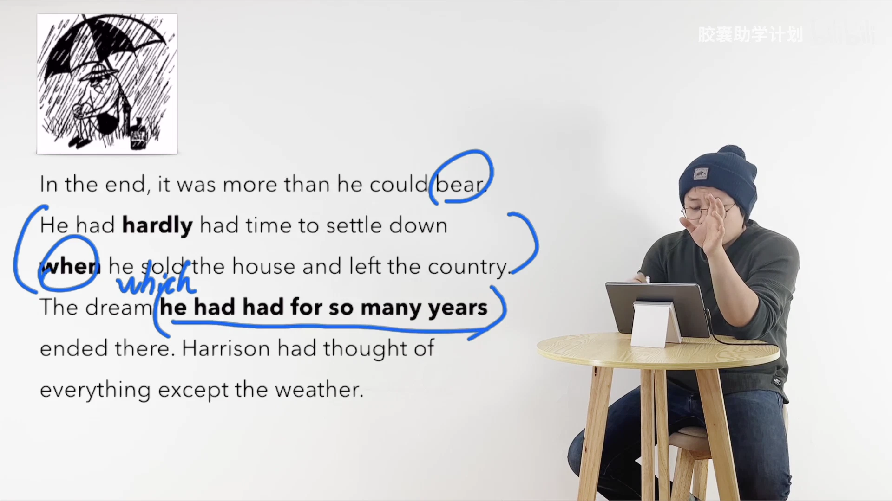

文字识别：In the end, it was more than he couldbear / He had hardly had time to settle down / wher / he yoldthe house and left the country. / whch / The dreamhe had had for so many years / ended there. Harrison had thought of / everything except the weather.

## 00:09:00–00:09:30

记得参考译文翻译的叫做梦想在那里破灭了，是吧？你看，如果让各位去翻译，你可不可能是这样去翻译的？叫做破灭，然后你就开始用字典去查一下破灭的英文单词是什么，然后你直接放到这里，对吧？但你看人家英文他用的是 ended there，翻译过来就其实就是梦想破灭了，OK？哎，就是他拥有这个梦想很多年，在那里就破灭了。Harrison

### 画面 00:09:03

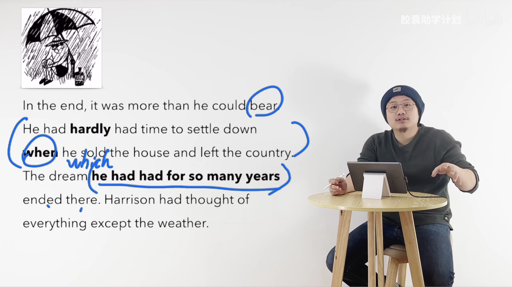

文字识别：In the end, it was more than he couldbear / He had hardly had time to settle down / wher / he golgthe house and left the country. / whch / The dreamhe had had for so many years / ended there. Harrison had thought of / everything except the weather.

## 00:09:30–00:10:00

had thought of everything except the weather.说 Harrison 呢，想到了一切，除了天气啊，一切他都想到了，除了这个天气，他啊没有想到以外，是吧？他都想到。OK，那习惯用法造句，我们就说这三个啊。先说第一个，dream of doing something，这个很容易，主语你随便找，时间、地点、方式随便找。其实这地方关键就是这儿的动词

### 画面 00:09:33

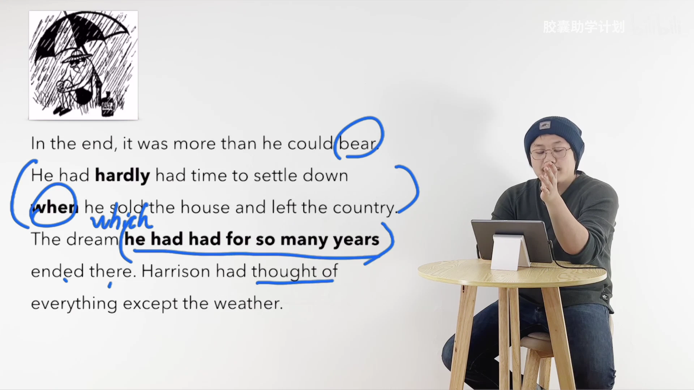

文字识别：In the end, it was more than he couldbear / He had hardly had time to settle down / wher / he golgthe house and left the country. / Whxh / The dreamhe had had for so many years / ended there. Harrison had thought of / everything except the weather.

### 画面 00:09:47

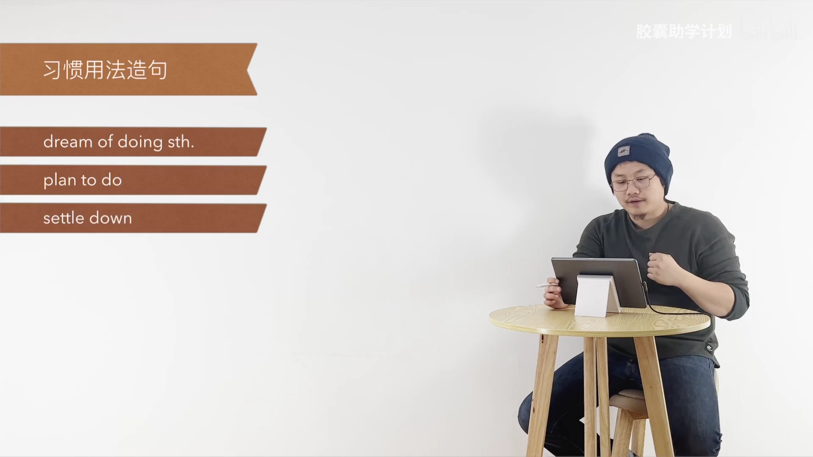

文字识别：习惯用法造句 / dream of doing sth. / plan to do / settle down

### 画面 00:09:49

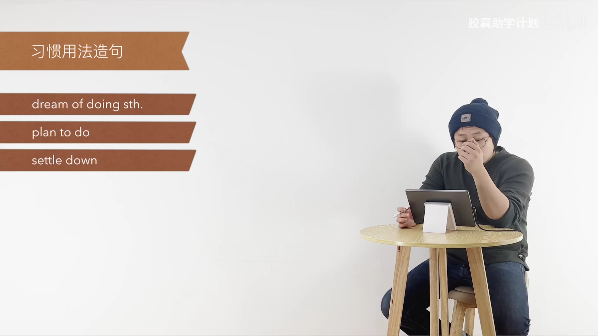

文字识别：习惯用法造句 / dream of doing sth. / plan to do / settle down

### 画面 00:09:51

文字识别：网：v.+v.变化 / 习惯用法造句指南 / 四句型转换 / 方式/地点/时间 / 其他习惯用法 / 其他单词+词性 / 原文摘抄+变 / 6123456 / dream of doing sth.

### 画面 00:09:53

文字识别：网：v.+v.变化 / 习惯用法造句指南 / 四句型转换 / 方式/地点/时间 / 其他习惯用法 / 其他单词+词性 / 原文摘抄+变 / 6123456 / dream of doing sth.

### 画面 00:09:55

文字识别：网：v.+v.变化 / 习惯用法造句指南 / 四句型转换 / 方式/地点/时间 / 其他习惯用法 / 其他单词+词性 / 原文摘抄+变 / 6123456 / dream of doing sth.

### 画面 00:09:59

文字识别：网：v.+v.变化 / 习惯用法造句指南 / 四句型转换 / 方式/地点/时间 / 其他习惯用法 / 其他单词+词性 / 原文摘抄+变 / 6123456 / dream of doing sth.

## 00:10:00–00:10:30

doing 嘛，我们找一个，比如说， they often dreamed of having a good meal when they were young。啊，比如说我们的祖父啊，我们的父辈啊，像我的父亲对吧？他们年轻的时候，如果是出生在农村那一代，很多地方就是吃不饱饭的，对吧？啊，这个我小的时候经常听我父亲说这件事儿。那所以我们就可以造一句话说，当哎他们还年轻的时候，很小的时候，他们经常梦想着能好好

### 画面 00:10:01

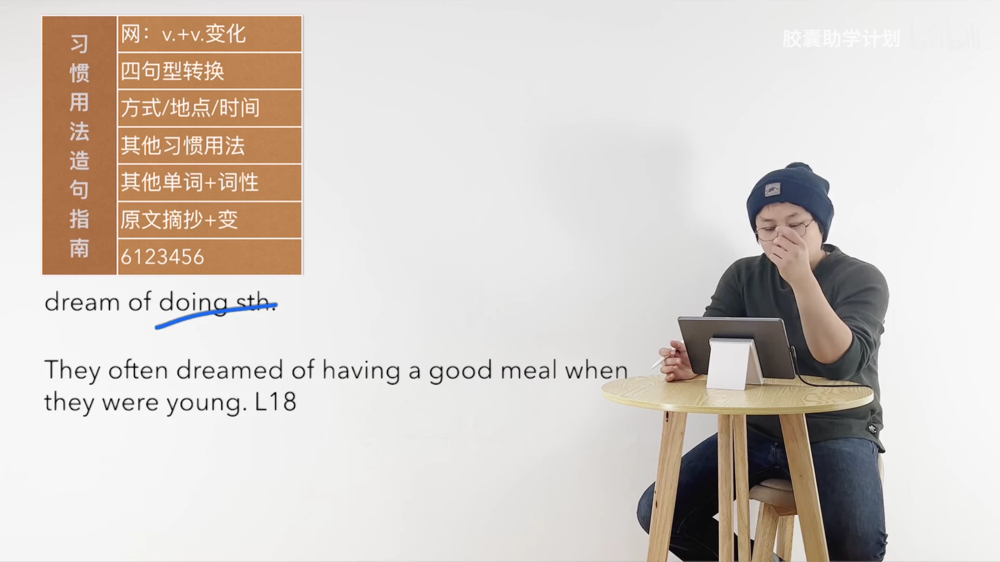

文字识别：网：v.+v.变化 / 习惯用法造句指南 / 四句型转换 / 方式/地点/时间 / 其他习惯用法 / 其他单词+词性 / 原文摘抄+变 / 6123456 / dream of doing sth. / They often dreamed of having a good meal when / they were young. L18

### 画面 00:10:04

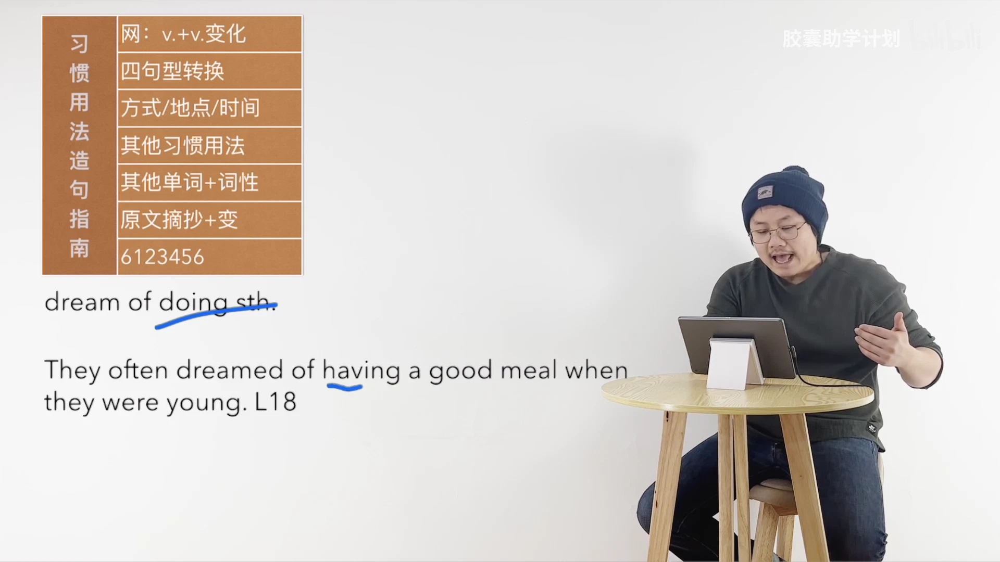

文字识别：网：v.+v.变化 / 习惯用法造句指南 / 四句型转换 / 方式/地点/时间 / 其他习惯用法 / 其他单词+词性 / 原文摘抄+变 / 6123456 / dream of doing sth. / They often dreamed of having a good meal when / they were young. L18

### 画面 00:10:06

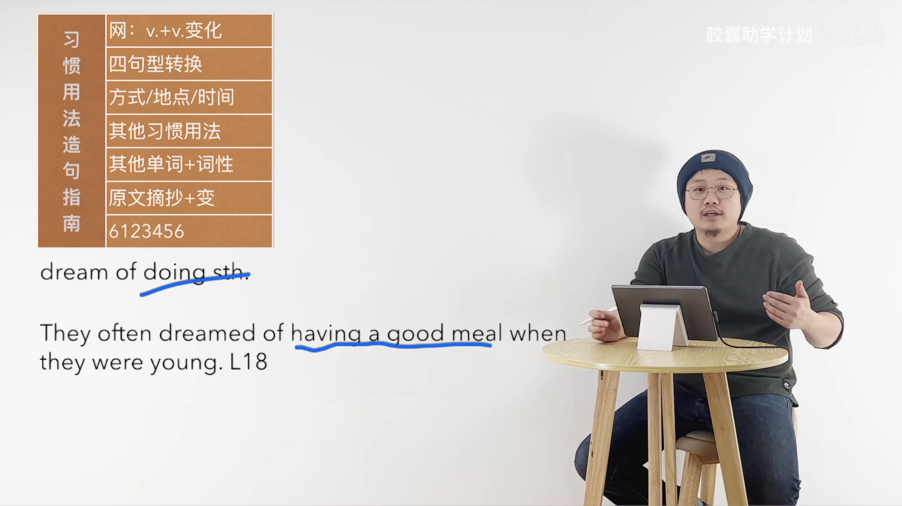

文字识别：网：v.+v.变化 / 习惯用法造句指南 / 四句型转换 / 方式/地点/时间 / 其他习惯用法 / 其他单词+词性 / 原文摘抄+变 / 6123456 / dream of doing sth. / They often dreamed of having a good meal when / they were young. L18

### 画面 00:10:10

文字识别：网：v.+v.变化 / 习惯用法造句指南 / 四句型转换 / 方式/地点/时间 / 其他习惯用法 / 其他单词+词性 / 原文摘抄+变 / 6123456 / dream of doing sth. / They often dreamed of having a good meal when / they were young. L18

### 画面 00:10:15

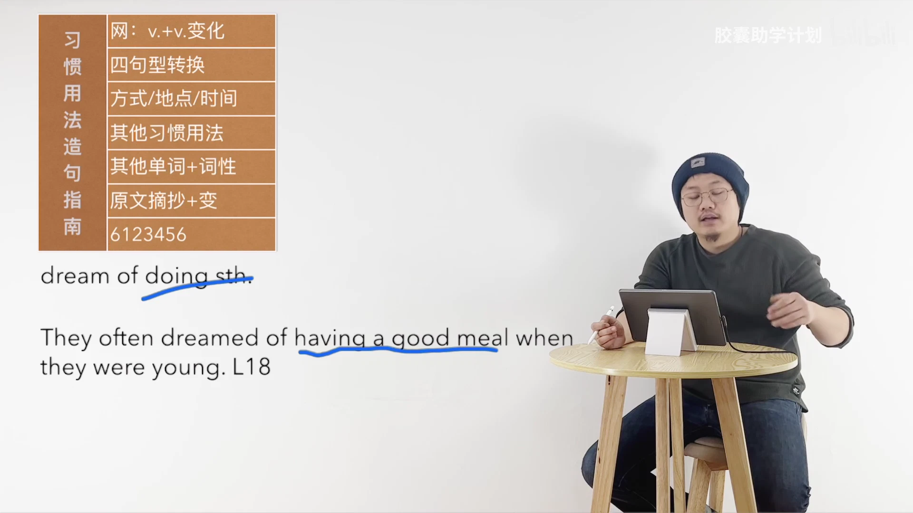

文字识别：网：v.+v.变化 / 习惯用法造句指南 / 四句型转换 / 方式/地点/时间 / 其他习惯用法 / 其他单词+词性 / 原文摘抄+变 / 6123456 / dream of doing sth. / They often dreamed of having a good meal when / they were young. L18

### 画面 00:10:20

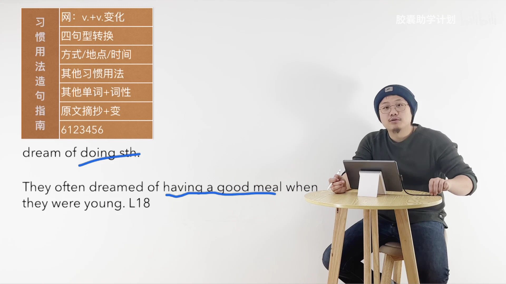

文字识别：网：v.+v.变化 / 习惯用法造句指南 / 四句型转换 / 方式/地点/时间 / 其他习惯用法 / 其他单词+词性 / 原文摘抄+变 / 6123456 / dream of doing sth. / They often dreamed of having a good meal when / they were young. L18

### 画面 00:10:25

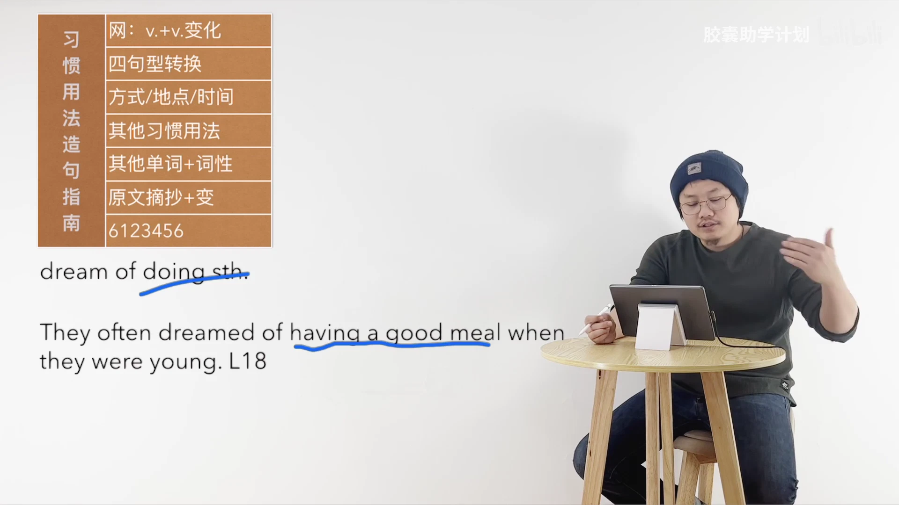

文字识别：网：v.+v.变化 / 习惯用法造句指南 / 四句型转换 / 方式/地点/时间 / 其他习惯用法 / 其他单词+词性 / 原文摘抄+变 / 6123456 / dream of doing sth. / They often dreamed of having a good meal when / they were young. L18

## 00:10:30–00:11:00

吃一顿饭。Okay, next one.那这是我们十八课说的Have a good meal.你就可以把这句话变成各种各样的四句型，对吧？四句型转换啊，不多说了。也可以再来一个说啊。那注意一个小点，因为When they were young，所以我选择的是一般过去时，对吧？然后下一句话我选择用了个一般现在时，说She always dreams of asking him for a lift.她总是梦想着找他搭一个便车，可能喜欢人家，是吧？Okay，

### 画面 00:10:30

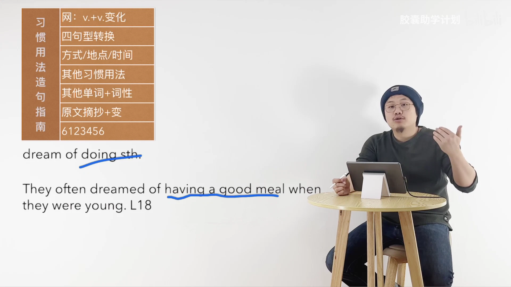

文字识别：网：v.+v.变化 / 习惯用法造句指南 / 四句型转换 / 方式/地点/时间 / 其他习惯用法 / 其他单词+词性 / 原文摘抄+变 / 6123456 / dream of doing sth. / They often dreamed of having a good meal when / they were young. L18

### 画面 00:10:35

文字识别：网：v.+v.变化 / 习惯用法造句指南 / 四句型转换 / 方式/地点/时间 / 其他习惯用法 / 其他单词+词性 / 原文摘抄+变 / 6123456 / dream of doing sth. / They often dreamed of having a good meal when / they were young. L18 / did/what/why/when/who...

### 画面 00:10:39

文字识别：网：V.+V变化 / 习惯用法造句指南 / 四句型转 / 方式/地点/时间 / 其他习惯用法 / 其他单词+词性 / 原文摘抄+变 / 6123456 / dream of doing sth. / They often dreamed of having a good meal when / they were young. L18 / did/what/why/when/who...

### 画面 00:10:41

文字识别：网：V.+V变化 / 习惯用法造句指南 / 四句型转换 / 方式/地点/时间 / 其他习惯用法 / 其他单词+词性 / 原文摘抄+变 / 6123456 / dream of doing sth. / They often dreamed of having a good meal when / they were young. L18 / did/what/why/when/who... / She always dreams of asking him for a lift. L14

### 画面 00:10:45

文字识别：网：v.+V变化 / 习惯用法造句指南 / 四句型转换 / 方式/地点/时间 / 其他习惯用法 / 其他单词+词性 / 原文摘抄+变 / 6123456 / dream of doing sth. / They often dreamed of having a good meal when / they were young. L18 / did/what/why/when/who... / She always dreams of asking him for a lift. L14

### 画面 00:10:48

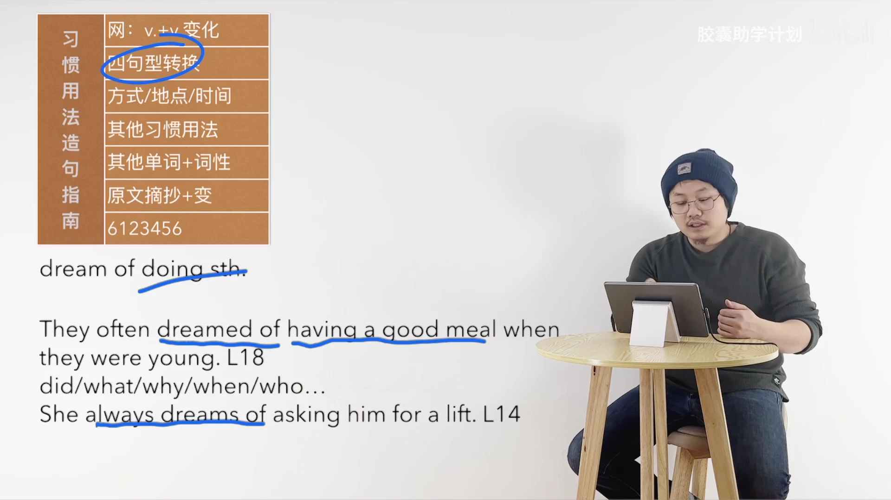

文字识别：网：v.+V变化 / 习惯用法造句指南 / 四句型转换 / 方式/地点/时间 / 其他习惯用法 / 其他单词+词性 / 原文摘抄+变 / 6123456 / dream of doing sth. / They often dreamed of having a good meal when / they were young. L18 / did/what/why/when/who... / She always dreams of asking him for a lift. L14

### 画面 00:10:50

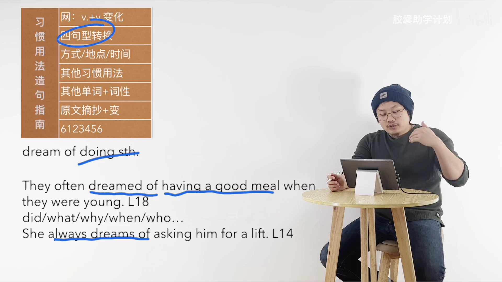

文字识别：网：V.+V变化 / 习惯用法造句指南 / 四句型转换 / 方式/地点/时间 / 其他习惯用法 / 其他单词+词性 / 原文摘抄+变 / 6123456 / dream of doing sth. / They often dreamed of having a good meal when / they were young. L18 / did/what/why/when/who... / She always dreams of asking him for a lift. L14

### 画面 00:10:55

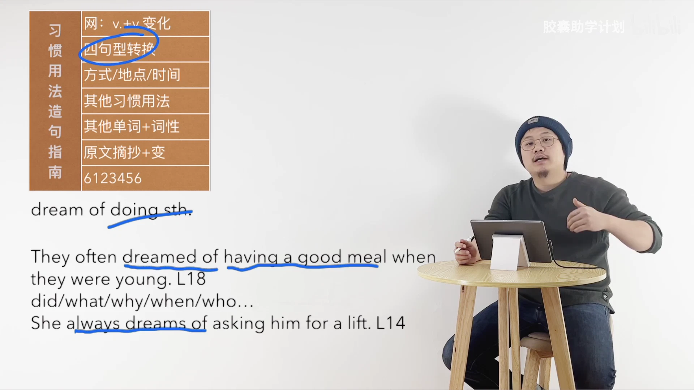

文字识别：网：V.+V变化 / 习惯用法造句指南 / 四句型转换 / 方式/地点/时间 / 其他习惯用法 / 其他单词+词性 / 原文摘抄+变 / 6123456 / dream of doing sth. / They often dreamed of having a good meal when / they were young. L18 / did/what/why/when/who... / She always dreams of asking him for a lift. L14

## 00:11:00–00:11:30

very good.那不多说，下一个习惯用法叫 plan to do something，计划着去做某件事情。比如说，they planned to move to Beijing，说他们计划着搬去北京啊。注意，你看很简单，move to somewhere，第六课我们学的对吧？Plan to do something。然后呢，说 they planned to work for me，他们计划要为我工作。您看我在这儿基本就是各种习惯用法了啊。Plan前面我都不变，再来说 they planned

### 画面 00:11:00

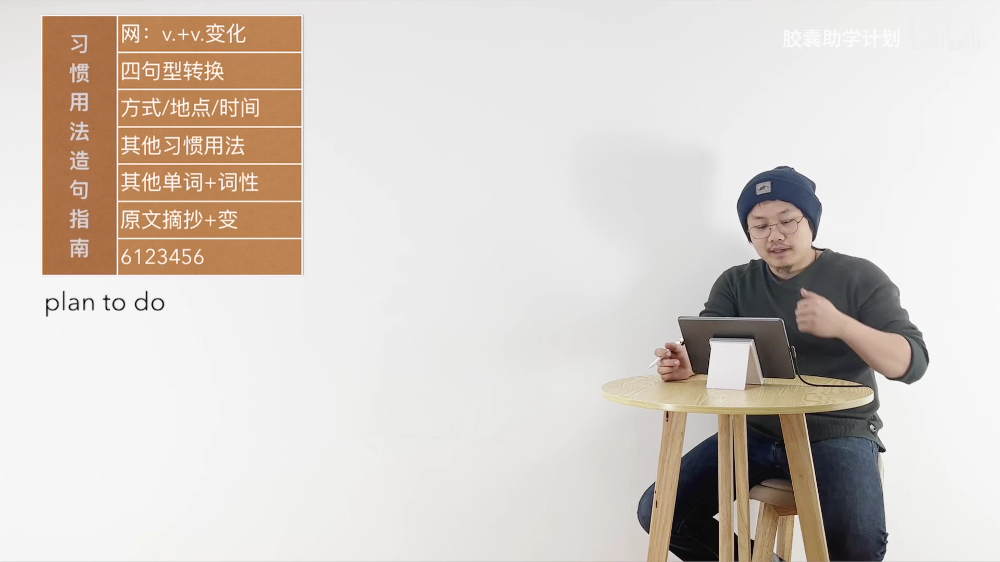

文字识别：网：v.+v.变化 / 习惯用法造句指南 / 四句型转换 / 方式/地点/时间 / 其他习惯用法 / 其他单词+词性 / 原文摘抄+变 / 6123456 / plan to do

### 画面 00:11:02

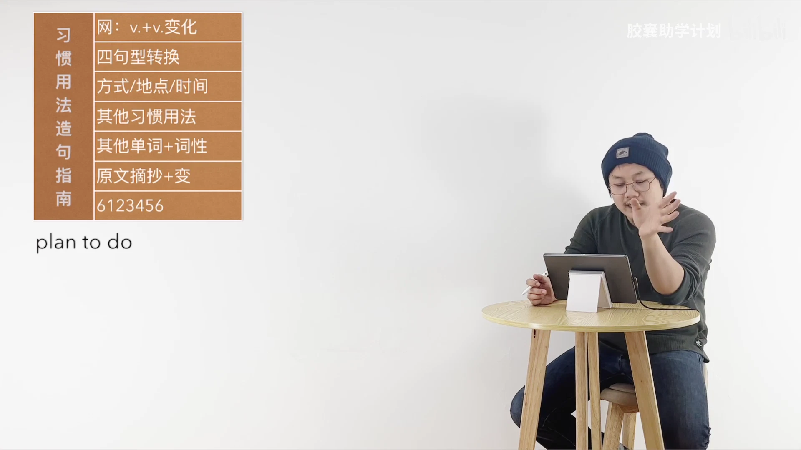

文字识别：网：v.+v.变化 / 习惯用法造句指南 / 四句型转换 / 方式/地点/时间 / 其他习惯用法 / 其他单词+词性 / 原文摘抄+变 / 6123456 / plan to do

### 画面 00:11:05

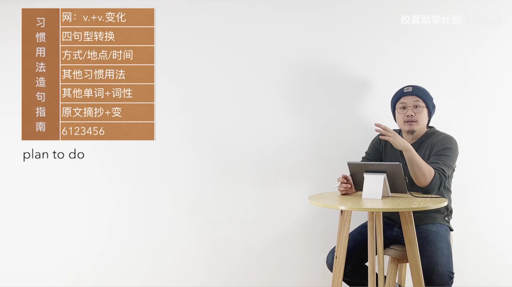

文字识别：网：v.+v.变化 / 习惯用法造句指南 / 四句型转换 / 方式/地点/时间 / 其他习惯用法 / 其他单词+词性 / 原文摘抄+变 / 6123456 / plan to do

### 画面 00:11:09

文字识别：网：v.+v.变化 / 习惯用法造句指南 / 四句型转换 / 方式/地点/时间 / 其他习惯用法 / 其他单词+词性 / 原文摘抄+变 / 6123456 / plan to do / They planned to move to Beijing. L6

### 画面 00:11:11

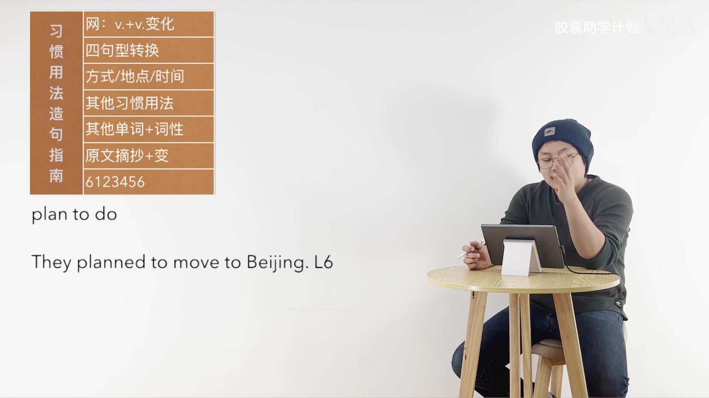

文字识别：网：v.+v.变化 / 习惯用法造句指南 / 四句型转换 / 方式/地点/时间 / 其他习惯用法 / 其他单词+词性 / 原文摘抄+变 / 6123456 / plan to do / They planned to move to Beijing. L6

### 画面 00:11:15

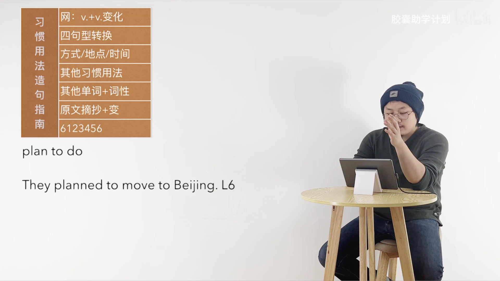

文字识别：网：v.+v.变化 / 习惯用法造句指南 / 四句型转换 / 方式/地点/时间 / 其他习惯用法 / 其他单词+词性 / 原文摘抄+变 / 6123456 / plan to do / They planned to move to Beijing. L6

### 画面 00:11:17

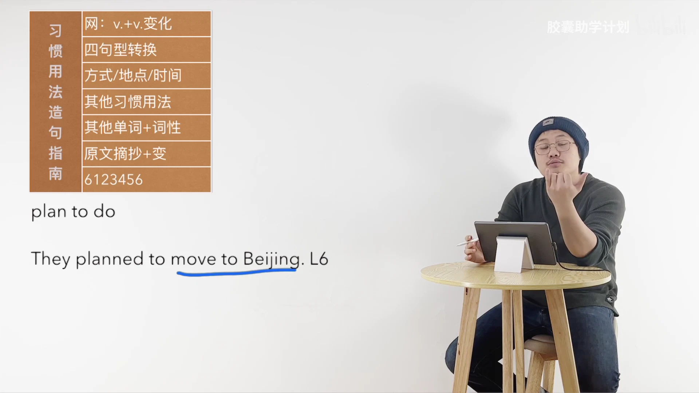

文字识别：网：v.+v.变化 / 习惯用法造句指南 / 四句型转换 / 方式/地点/时间 / 其他习惯用法 / 其他单词+词性 / 原文摘抄+变 / 6123456 / plan to do / They planned to move to Beijing. L6

### 画面 00:11:20

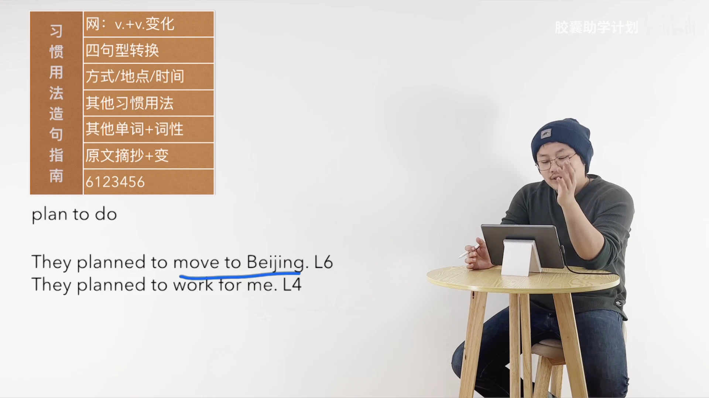

文字识别：网：v.+v.变化 / 习惯用法造句指南 / 四句型转换 / 方式/地点/时间 / 其他习惯用法 / 其他单词+词性 / 原文摘抄+变 / 6123456 / plan to do / They planned to move to Beijing. L6 / They planned to work tor me. L4

### 画面 00:11:24

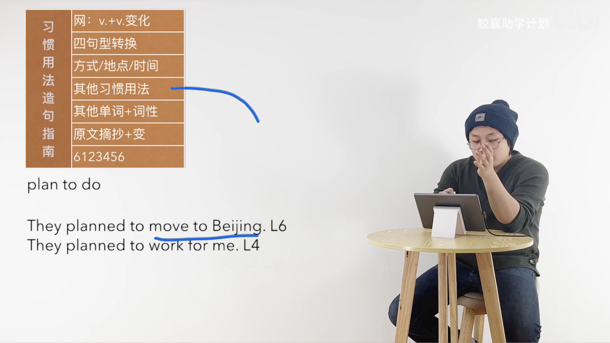

文字识别：网：v.+v.变化 / 习惯用法造句指南 / 四句型转换 / 方式/地点/时间 / 其他习惯用法 / 其他单词+词性 / 原文摘抄+变 / 6123456 / plan to do / They planned to move to Beijing. L6 / They planned to work tor me. L4

### 画面 00:11:26

文字识别：网：v.+v.变化 / 习惯用法造句指南 / 四句型转换 / 方式/地点/时间 / 其他习惯用法 / 其他单词+词性 / 原文摘抄+变 / 6123456 / plan to do / They planned to move to Beijiny / They planned to work for me. L4

## 00:11:30–00:12:00

to wrap it up as quickly as possible.他们计划着迅速把它给包裹起来。三十二课学的习惯用法，对吧？这是我们往下学英语的时候非常重要的一个点啊。OK, continue.接下来下一个叫做settle down啊，settle down啊，叫做定居定下来。比如说，He plan to settle down in the country.说他计划定下来在乡村啊，定居下来。好，

### 画面 00:11:30

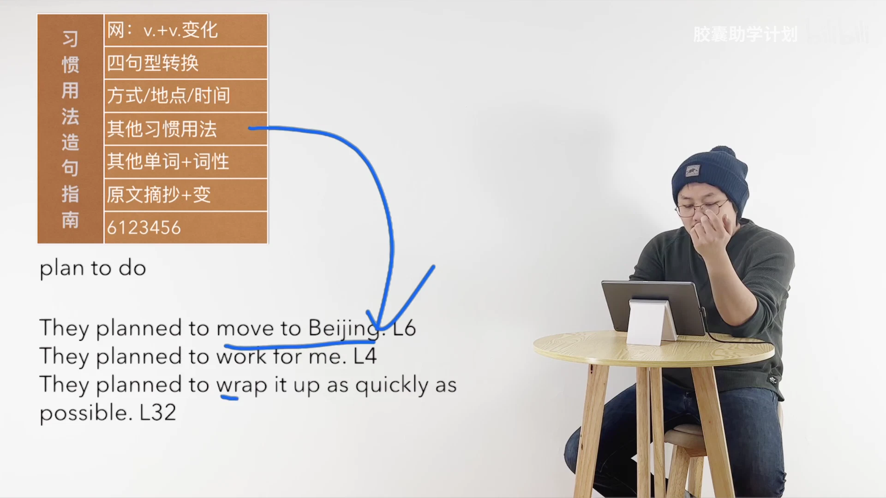

文字识别：网：v.+v.变化 / 习惯用法造句指南 / 四句型转换 / 方式/地点/时间 / 其他习惯用法 / 其他单词+词性 / 原文摘抄+变 / 6123456 / plan to do / They planned to move to Beijiny / They planned to / work tor me. L4 / They planned to wrap it up as quickly as / possible. L32

### 画面 00:11:32

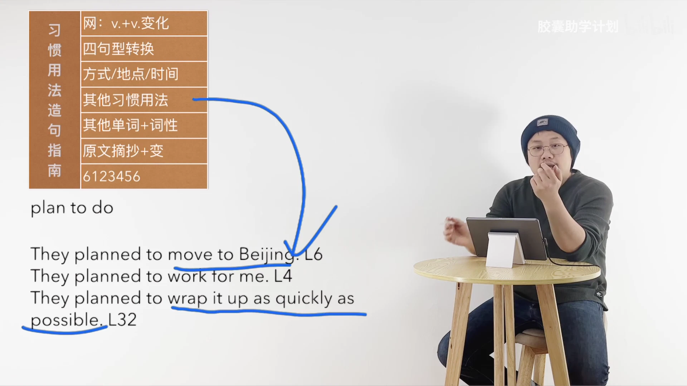

文字识别：网：v.+v.变化 / 习惯用法造句指南 / 四句型转换 / 方式/地点/时间 / 其他习惯用法 / 其他单词+词性 / 原文摘抄+变 / 6123456 / plan to do / They planned to move to Beijing / They planned to work tor me. L4 / They planned to wrap it up as quickly as / possible.L32

### 画面 00:11:35

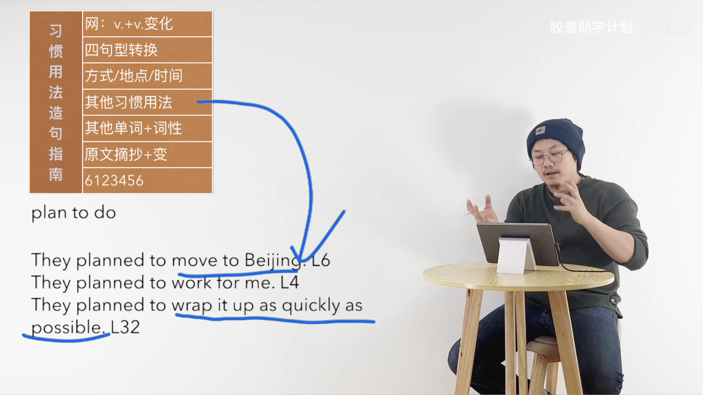

文字识别：网：v.+v.变化 / 习惯用法造句指南 / 四句型转换 / 方式/地点/时间 / 其他习惯用法 / 其他单词+词性 / 原文摘抄+变 / 6123456 / plan to do / They planned to move to Beijiny / They planned to work tor me. L4 / They planned to wrap it up as quickly as / possible.L32

### 画面 00:11:40

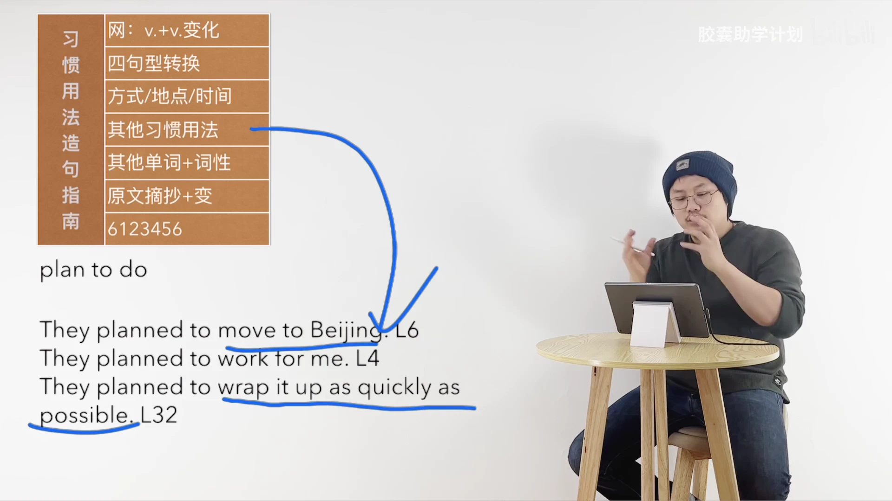

文字识别：网：v.+v.变化 / 习惯用法造句指南 / 四句型转换 / 方式/地点/时间 / 其他习惯用法 / 其他单词+词性 / 原文摘抄+变 / 6123456 / plan to do / They planned to move to Beijiny. / They planned to work tor me. L4 / They planned to wrap it up as quickly as / possible.L32

### 画面 00:11:44

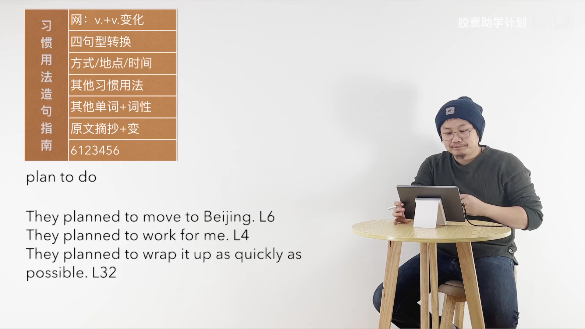

文字识别：网：v.+v.变化 / 习惯用法造句指南 / 四句型转换 / 方式/地点/时间 / 其他习惯用法 / 其他单词+词性 / 原文摘抄+变 / 6123456 / plan to do / They planned to move to Beijing. L6 / They planned to work for me. L4 / They planned to wrap it up as quickly as / possible. L32

### 画面 00:11:46

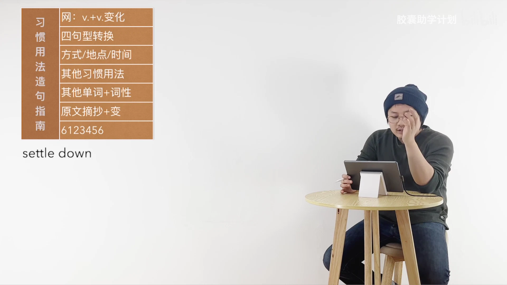

文字识别：网：v.+v.变化 / 习惯用法造句指南 / 四句型转换 / 方式/地点/时间 / 其他习惯用法 / 其他单词+词性 / 原文摘抄+变 / 6123456 / settle down

### 画面 00:11:49

文字识别：网：v.+v.变化 / 习惯用法造句指南 / 四句型转换 / 方式/地点/时间 / 其他习惯用法 / 其他单词+词性 / 原文摘抄+变 / 6123456 / settle down

### 画面 00:11:51

文字识别：网：v.+v.变化 / 习惯用法造句指南 / 四句型转换 / 方式/地点/时间 / 其他习惯用法 / 其他单词+词性 / 原文摘抄+变 / 6123456 / settle down

### 画面 00:11:55

文字识别：网：v.+v.变化 / 习惯用法造句指南 / 四句型转换 / 方式/地点/时间 / 其他习惯用法 / 其他单词+词性 / 原文摘抄+变 / 6123456 / settle down / He planned to settle down in the country.

## 00:12:00–00:12:30

你看肯定句给你了，你办个一般疑问句，叫 Did he plan to settle down in the country？很舒服吧？然后再加上各种特殊疑问词，settle down，您就学会了。OK，呃，recap本视频除了文章重要以外，那这些习惯用法也很重要，对吧？各位回去呢，加上作业就必然是拿他们去造句啊。然后呢，文章你要跟读至熟读成诵啊，我们好做下一个视频当中的练习，好吧？好，那

### 画面 00:12:00

文字识别：网：v.+v.变化 / 习惯用法造句指南 / 四句型转换 / 方式/地点/时间 / 其他习惯用法 / 其他单词+词性 / 原文摘抄+变 / 6123456 / settle down / He planned to settle down in the country. / Did he plan to settle down in the country?

### 画面 00:12:04

文字识别：网：v.+v.变化 / 习惯用法造句指南 / 四句型转换 / 方式/地点/时间 / 其他习惯用法 / 其他单词+词性 / 原文摘抄+变 / 6123456 / settle down / He planned to settle down in the country. / Did he plan to settle down in the country?

### 画面 00:12:06

文字识别：网：v.+v.变化 / 习惯用法造句指南 / 四句型转换 / 方式/地点/时间 / 其他习惯用法 / 其他单词+词性 / 原文摘抄+变 / 6123456 / settle down / He planned to settle down in the country. / Did he plan to settle down in the country? / who/why/when/where...

### 画面 00:12:10

文字识别：Recap / dream of doing sth. / Expression / plan to do / settle down

### 画面 00:12:12

文字识别：Recap / dream of doing sth. / Expression / plan to do / settle down

### 画面 00:12:15

文字识别：Recap / dream of doing sth. / Expression / plan to do / settle down

### 画面 00:12:18

### 画面 00:12:20

文字识别：1. / 习惯用法造句/对话 / 【习惯用法造句指南】 / 每个5句

### 画面 00:12:22

文字识别：习惯用法造句/对话 / 1. / 【习惯用法造句指南】 / 每个5句 / 文章跟读至熟读成诵 / 内化单词+语法+习惯用法 / 听力+口语+写作练习

### 画面 00:12:25

文字识别：习惯用法造句/对话 / 1. / 【习惯用法造句指南】 / 每个5句 / 文章跟读至熟读成诵 / 内化单词+语法+习惯用法 / 听力+口语+写作练习

### 画面 00:12:29

## 00:12:30–00:12:54

以上呢就是本期视频的全部内容了。如果各位喜欢我们的课程呢，欢迎各位关注、订阅、一键三连，分享给那些需要的朋友，来帮助我们快速成长。See you next time.

### 画面 00:12:42

文字识别：￥

### 画面 00:12:44

文字识别：CAPSULEACADEMY / 胶囊助学计划 / 小红书 / Lecturer / Leo / OE

### 画面 00:12:47

文字识别：CAPSULEACADEMY / 胶囊助学计划 / 小红书 / Fdit / OE

### 画面 00:12:50

文字识别：CAPSULEACADEMY / 胶囊助学计划 / 小红书 / Creator / □ / Leo & Berlin / OE

### 画面 00:12:52

文字识别：bilibili / 胶囊助学计划 / CAPSULEACADEMY / 胶囊助学计划 / 小红书 / OE

### 画面 00:12:54

文字识别：bilibili / 胶囊助学计划

