# L038 听说读写复述练习

快速机器解析：语音为单模型转写，未进行独立交叉校对或人工复核；画面每秒采样并按变化选帧，短时文字和标记可能遗漏。截图时间约有 1 秒误差。图片有损压缩；遇到疑点请按时间查看 Google Drive 原视频。

## 00:00:00–00:00:30

Hello everyone, welcome to Capsule Academy. This is Leo. Today we are going to learn new concept English Book Two, Lesson Thirty Eight Practices. 各位一定要知道啊，进行如下练习的唯一前提就是文章一定要熟读成诵，否则请勿开始。 Hope you gonna enjoy it. 那我们先看第一题 comprehension，练的是我们听懂一般疑问句和特殊疑问句的一个能力啊。那来，我们先看第一题，说 What's your

### 画面 00:00:00

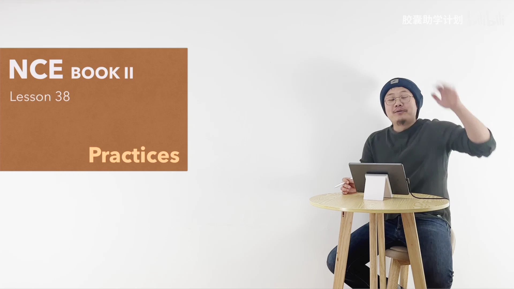

文字识别：NCE / BOOKII / Lesson 38 / Practices

### 画面 00:00:02

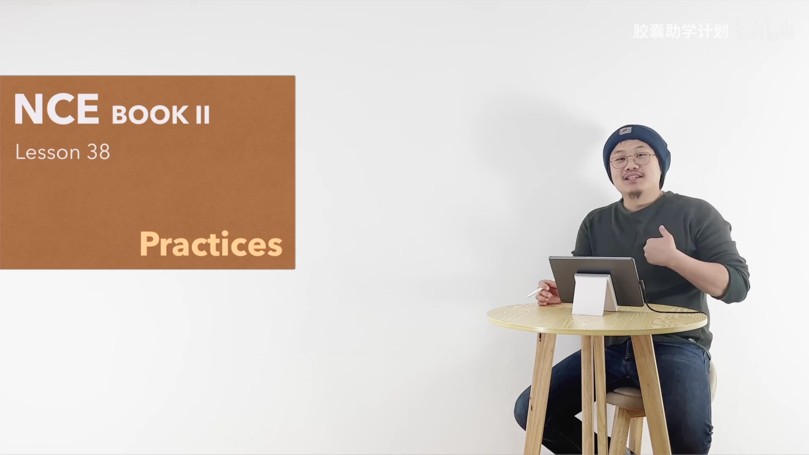

文字识别：NCE / BOOKII / Lesson 38 / Practices

### 画面 00:00:05

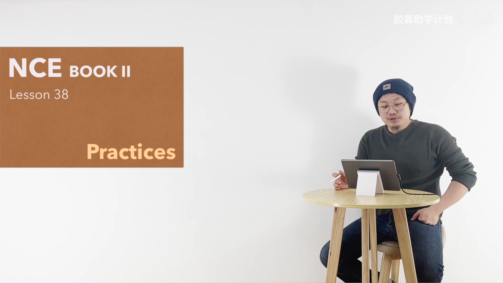

文字识别：NCE / BOOKI"I / Lesson 38 / Practices

### 画面 00:00:08

文字识别：进行如下练习唯一前提 / 文章跟读至熟读成诵 / 否则请勿开始

### 画面 00:00:16

文字识别：胶囊助学计划bill / •

### 画面 00:00:20

文字识别：胶囊助学计划

### 画面 00:00:22

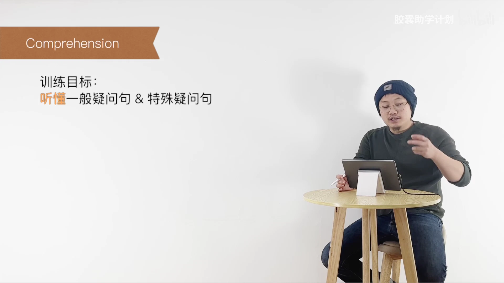

文字识别：Comprehension / 训练目标： / 听懂一般疑问句＆特殊疑问句

### 画面 00:00:27

文字识别：Comprehension

## 00:00:30–00:01:00

friend called? Harrison. Very good. Next one. Have you known him for long? Yes, I have. Next one. Where had he lived before he returned to England? In the Mediterranean. Next one. Say, how long had he lived there? For many years. Next one. Had he often dreamed of retiring in England? Yes, he had.

### 画面 00:00:37

文字识别：Comprehension / Have you known him for long? / Yes, I have.

### 画面 00:00:39

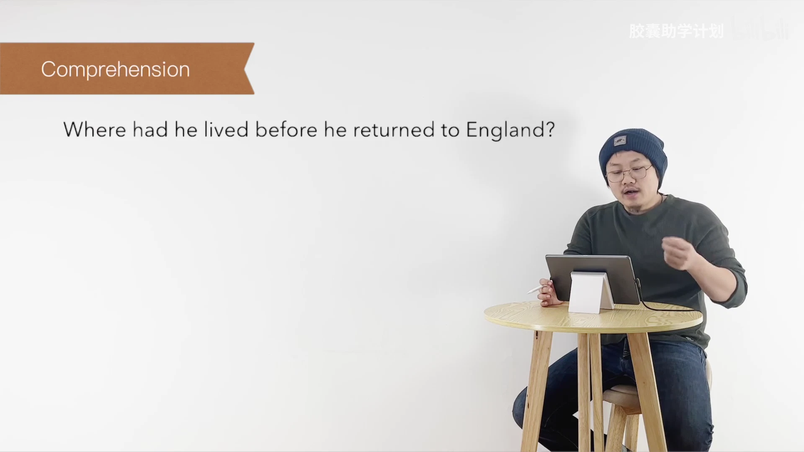

文字识别：Comprehension / Where had he lived before he returned to England?

### 画面 00:00:49

文字识别：Comprehension / How long had he lived there? / For many years.

### 画面 00:00:52

文字识别：Comprehension / Had he often dreamed of retiring in England?

## 00:01:00–00:01:30

Next one, where had he planned to settle down? In the country. Next one, what did he buy as soon as he returned? A house. Very good. Next one, what time of year was it? Summer. Very good. Next one, what did he begin to complain about? The weather. Very good. Next one, why didn't he like the weather?

### 画面 00:01:03

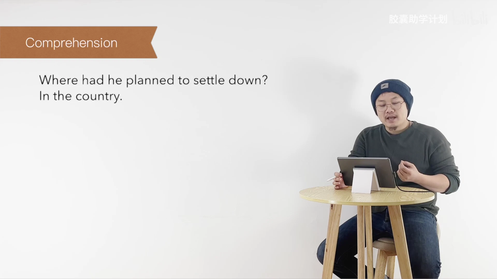

文字识别：Comprehension / Where had he planned to settle down? / In the country.

## 00:01:30–00:02:00

It rained continually and it was often bitterly cold. Next one, did he get a shock? Yes, he did. Next one, what had he been used to? Sunshine. Next one, how did he act? He acted as if he had never lived in England before.好，asking questions，练习的是我们

### 画面 00:01:30

文字识别：Comprehension / Why didn't he like the weather? / It rained continually and it was often bitterly cold.

### 画面 00:01:36

文字识别：Comprehension / Did he get a shock?

### 画面 00:01:51

文字识别：Comprehension / How did he act? / He acted as if he had never lived in England before.

### 画面 00:01:57

文字识别：Asking questions / 训练目标： / 会说一般疑问句＆特殊疑问句 / Accuracy / Fluency

## 00:02:00–00:02:30

发问的能力，对吧？我们能问出来一般疑问句和特殊疑问句来了。那先来一个例子吧。说 Ask me if Harrison is an old friend. 很简单，is提前，who那对 Harrison提问，对吧？直接提掉它就行了。说谁是老朋友啊？OK。接下来呢，我们一个一个来说。He lived in the Mediterranean. 现在过去完成时，对吧？撇地是had，had提句首就行了。Where对in the Mediterranean提问。Next one, 说He lived there for

### 画面 00:02:04

文字识别：Asking questions / T: Ask me if Harrison is an old friend.

### 画面 00:02:15

文字识别：Asking questions / T: Ask me if Harrison is an old friend. / S: Is Harrison an old friend? / T: Who…? / S: Who is an old friend?

### 画面 00:02:17

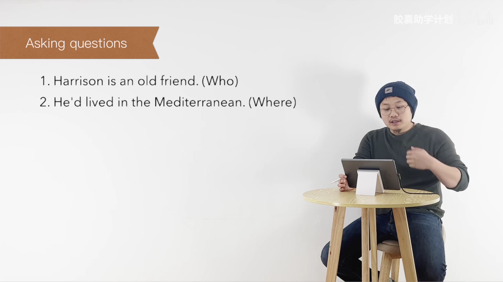

文字识别：Asking questions / 1. Harrison is an old friend. (Who) / 2. He'd lived in the Mediterranean. (Where)

### 画面 00:02:28

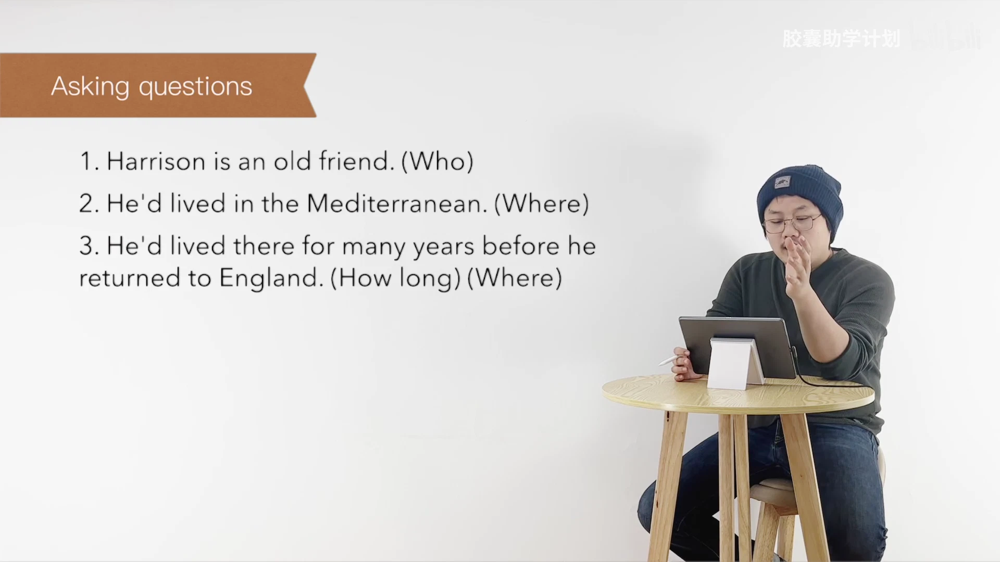

文字识别：Asking questions / 1. Harrison is an old friend. (Who) / 2. He'd lived in the Mediterranean. (Where) / 3. He'd lived there for many years before he / returned to England.(How long)(Where)

## 00:02:30–00:03:00

many years before he returned to England.注意一个小点，before后边这句话是从句，我们变一般疑问句要看主句，所以把had提前，对吧？那how long肯定是对for many years提问，where对there提问啊。第四题说 he'd often dreamed of retiring to England. Had往前一提，what对什么呢？Retiring to England提问，所以这句话的答案叫What had

### 画面 00:02:33

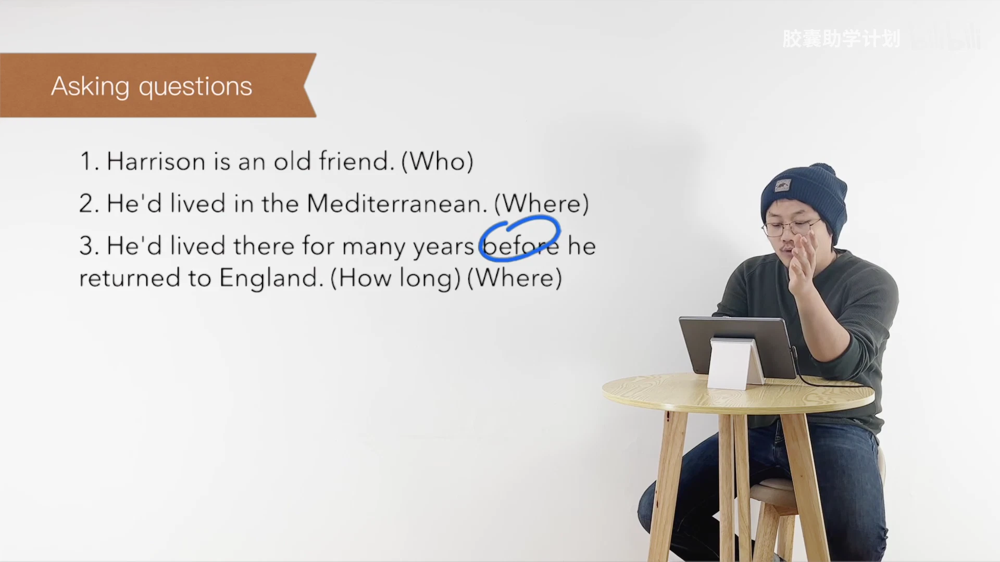

文字识别：Asking questions / 1. Harrison is an old friend. (Who) / 2. He'd lived in the Mediterranean.(Where) / 3. He'd lived there for many yearsbefore  / he / returned to England.(How long) (Where)

### 画面 00:02:35

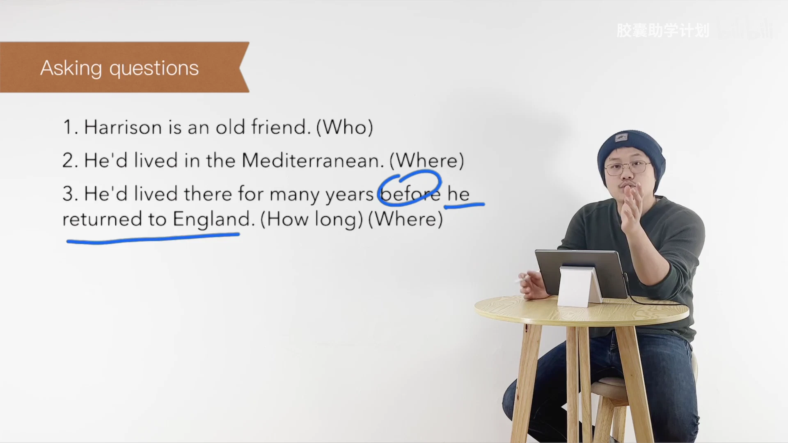

文字识别：Asking questions / 1. Harrison is an old friend. (Who) / 2. He'd lived in the Mediterranean.(Where) / 3. He'd lived there for many years / before / he / returned to England.(How long) (Where)

### 画面 00:02:42

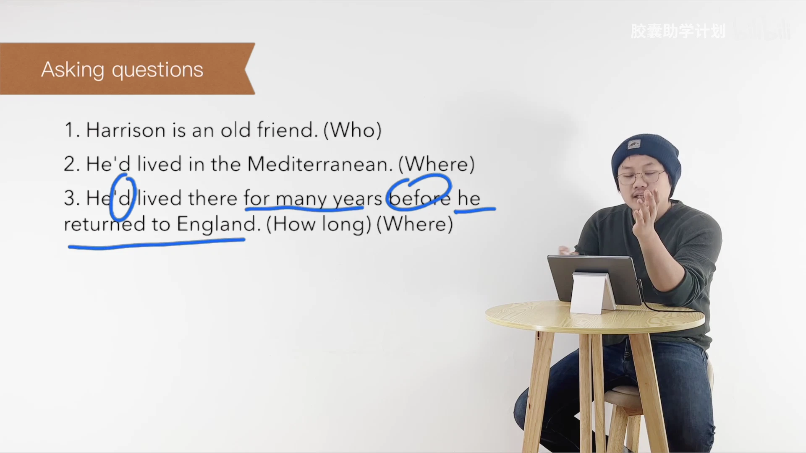

文字识别：Asking / questions / 1. Harrison is an old friend. (Who) / 2. He'd lived in the Mediterranean. (Where) / 3.He / lived there for many years / before / he / returned to England.(How long) (Where)

### 画面 00:02:46

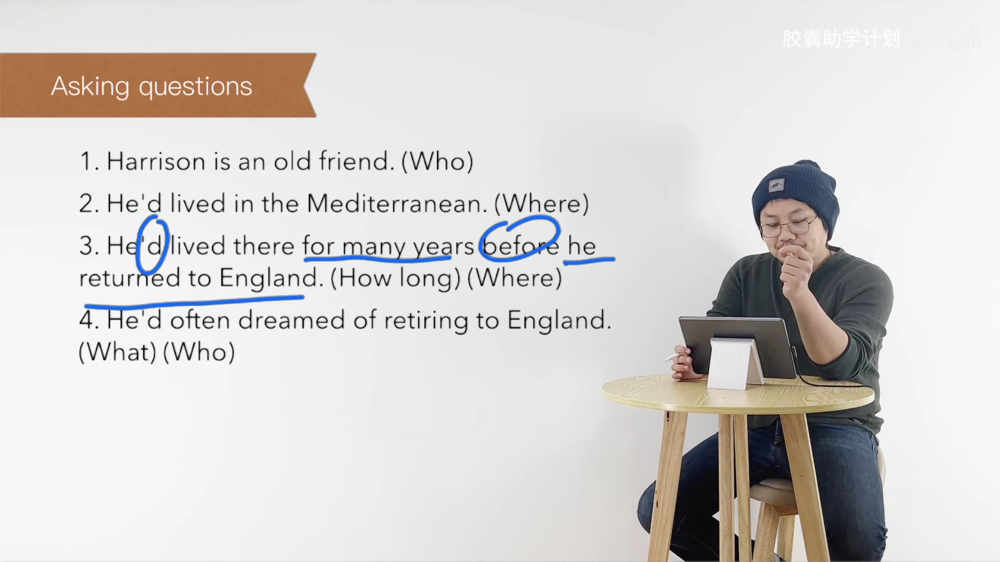

文字识别：Asking questions / 1. Harrison is an old friend. (Who) / 2. He'd lived in the Mediterranean. (Where) / 3.He / lived there for many years / sbefore / he / returned to England.(How long) (Where) / 4.He'd often dreamed of retiring to England. / (What) (Who)

## 00:03:00–00:03:30

he often dreamed of? 他经常梦想的什么事儿啊？ Who对主语提问直接踢掉，不用变一般疑问句。第五个，He bought a house in the country. Did的往前提，bought换回原形，叫 Did he buy a house in the country? Where那对in the country提问，叫 Where did he buy a house? Okay. 第六个，He went to live there. Did的提前，动词换回原形。 Where对there提问，Who对主语提问，不变一般疑问句。所以答案叫 Who

### 画面 00:03:16

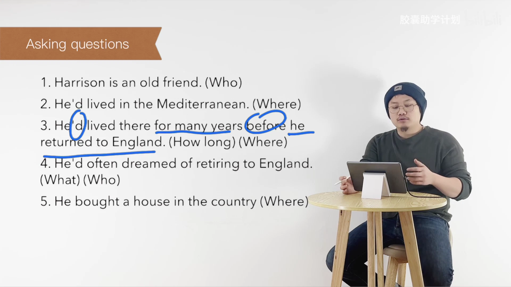

文字识别：Asking questions / 1. Harrison is an old friend. (Who) / 2. He'd lived in the Mediterranean. (Where) / 3.He / lived there for many years before! / he / returned to England.(How long) (Where) / 4. He'd often dreamed of retiring to England. / (What) (Who) / 5. He bought a house in the country (Where)

### 画面 00:03:20

文字识别：Asking questions

## 00:03:30–00:04:00

went to live there? Okay. 第七个 He began to complain about the weather. Did 往前一提 What about? 那其实就是对 weather 提问，对吧？好，其实应该是 What's the weather about? 啊，不是 What about? 啊，所以说 What did he begin to complain about? 啊， Okay. Why 整句提问， Who 对主语提问，把 he 一去掉就可以了。第八题 It rained continuously. Did 往前一提 How often 对 continually 提问，

### 画面 00:03:31

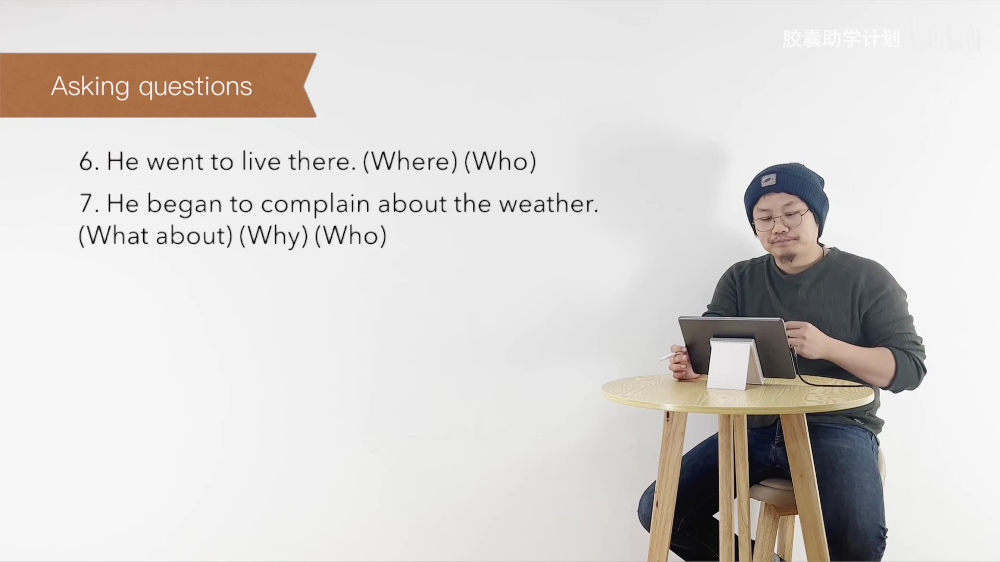

文字识别：Asking questions / 6. He went to live there.(Where) (Who) / 7. He began to complain about the weather. / (What about) (Why)(Who)

## 00:04:00–00:04:30

对吧? How often did it rain? Okay.第九个, Harrison got a shock. Did提前, who对主语提问不变一般疑问句, why对整个一般疑问句提问,直接加在句首,叫做Why did Harrison get a shock? Okay.好, He sold the house.那Did he sell the house?啊, What did he sell? When did he sell the house?玩一个.最后一个, Did提前, why加整句, who替代主语就可以了啊.

### 画面 00:04:01

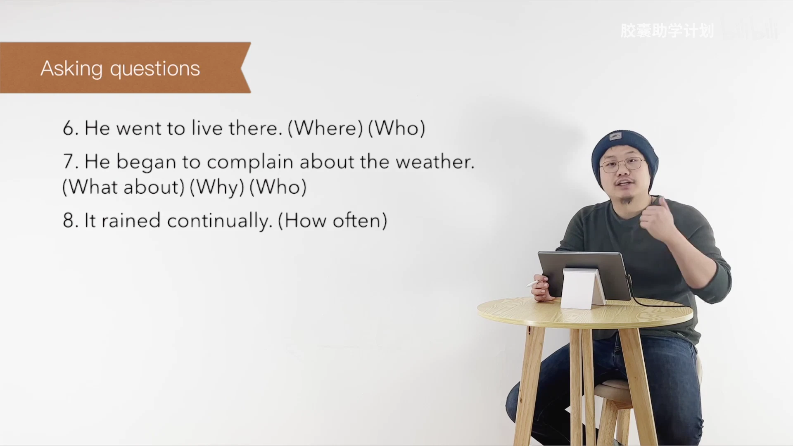

文字识别：Asking questions / 6. He went to live there.(Where) (Who) / 7. He began to complain about the weather. / (What about) (Why) (Who) / 8. It rained continually. (How often)

### 画面 00:04:16

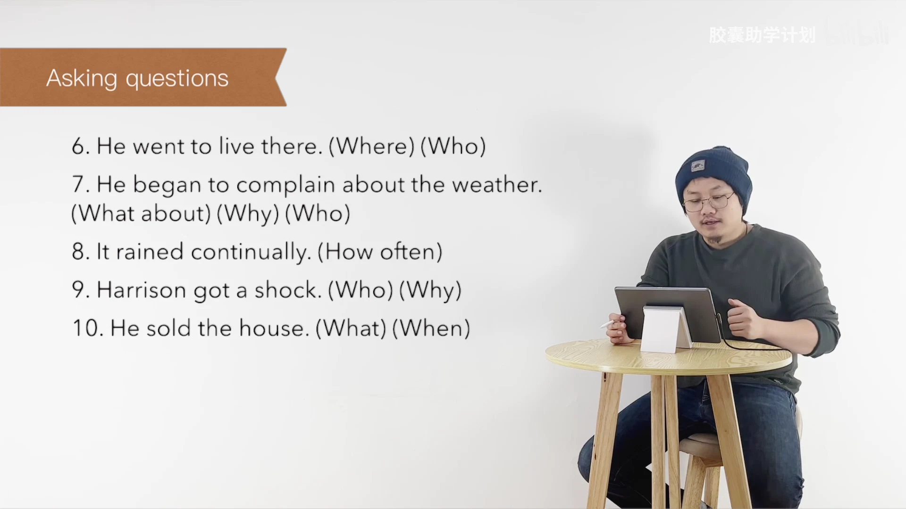

文字识别：Asking questions / 6. He went to live there.(Where) (Who) / 7. He began to complain about the weather. / (What about) (Why) (Who) / 8. It rained continually. (How often) / 9. Harrison got a shock. (Who) (Why) / 10. He sold the house.(What) (When)

### 画面 00:04:29

文字识别：Tell the story / 训练目标： / 口语复述能力 / Accuracy / Fluency

## 00:04:30–00:05:00

tell the story，口语复述，呃，还是那句话，再提一下各位，第一单元我已经做了大量的这个示范啊，您如果没有看，那不妨过去看一下，行吧？第二单元我们就不示范了。那这个地方呢，提一句叫做各位，文章读的很熟了之后，不用把它完全背下来，所以您不用特别管说我接下来复述是不是完全正确的呢？不用做这个担心，但你要足够的流畅，对吧？好，OK，呃，那看着这些关键

### 画面 00:04:48

文字识别：Tell the story / 训练目标： / 口语复述能力 / Accuracy / Fluency

### 画面 00:04:56

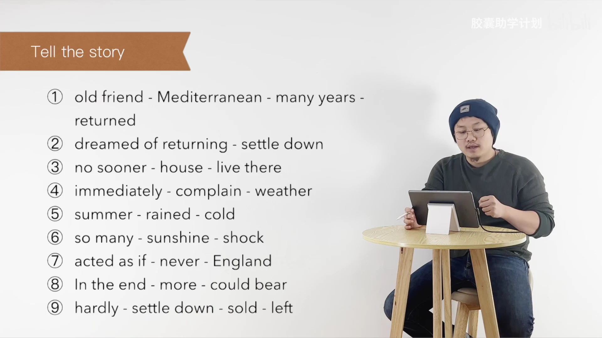

文字识别：Tell the story / ① old friend - Mediterranean - many years - / returned / dreamed of returning - settle down / no sooner - house - live there / immediately - complain - weather / summer - rained - cold / ⑥ so many- sunshine- shock / ) acted as if - never - England / ③ In the end - more - could bear / 8 / ⑨ hardly - settle down - sold - left

## 00:05:00–00:05:30

词就可以了。然后 summary writing 呢，是我们练习我们写作的复述能力。呃，各位写完摘要写作了之后，来这个地方去写一下啊。呃，这些最基本的点练习一下就可以了。有问题，视频下方留言告诉我们，好吧？然后 topic for discussion，这是老习惯，对于各位来说最难的一件事情，就是我们学英语一直学一直学，学到最后，希望能做到的事情，就是用英文的单词、语法、习惯用法去张嘴跟别人聊这些

### 画面 00:05:01

文字识别：Summary writing: Key / 训练目标： / 写作复述能力

### 画面 00:05:05

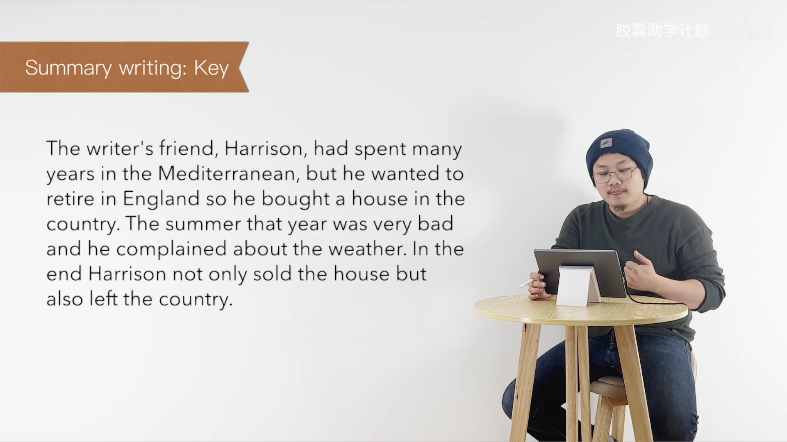

文字识别：Summary writing: Key / The writer's friend, Harrison, had spent many / years in the Mediterranean, but he wanted to / retire in England so he bought a house in the / country. The summer that year was very bad / and he complained about the weather. In the / end Harrison not only sold the house but / also left the country.

### 画面 00:05:15

文字识别：Topics for discussion / 训练目标： / 完全自由的对话 / Accuracy / Fluency

## 00:05:30–00:06:00

问题，或者写封邮件发给别人，对吧？那我们就看一下这些题有哪些。第一个说，Which foreign country would you like to live in? Why? 你想住在哪个国外的城啊国家？为什么？第二个，Have you ever looked forward to doing something and then been disappointed? Tell us about it. 说你有没有过特别期待做某件事情，然后又感到特别的失望？给我们讲讲这个事儿啊。第三个说，What effect can

### 画面 00:05:33

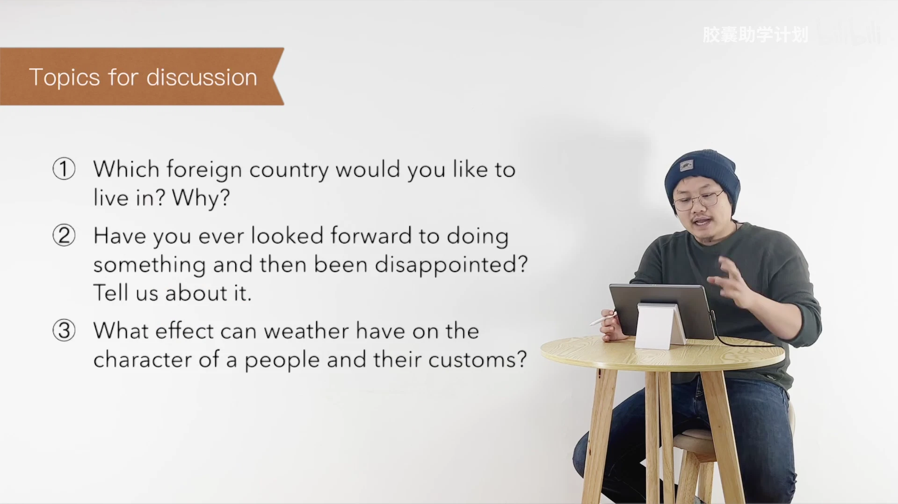

文字识别：Topics for discussion / Which foreign country would you like to / live in? Why? / Have you ever looked forward to doing / something and then been disappointed? / Tell us about it. / What effect can weather have on the / character of a people and their customs?

## 00:06:00–00:06:30

### 画面 00:06:03

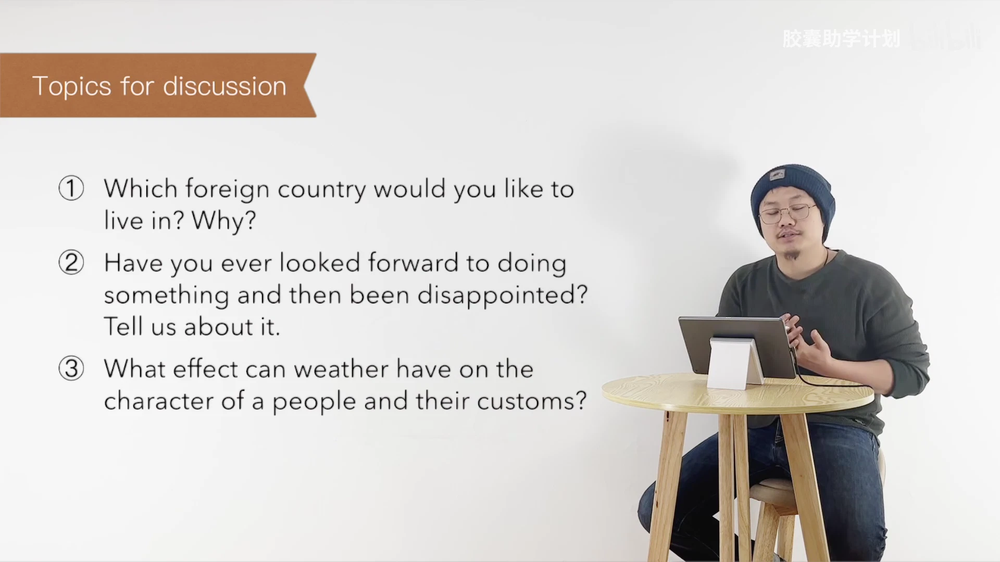

文字识别：Topics for discussion / Which foreign country would you like to / live in? Why? / Have you ever looked forward to doing / something and then been disappointed? / Tell us about it. / What effect can weather have on the / character of a people and their customs?

### 画面 00:06:12

### 画面 00:06:17

文字识别：1.Ask me if写&朗读 / 2. / 摘要写作写&答案

### 画面 00:06:19

文字识别：1.Ask me if写&朗读 / 摘要写作写&答案 / 3.Tell the story 口语复述

### 画面 00:06:21

文字识别：1.Ask me if写&朗读 / 摘要写作写&答案 / 3.Tell the story 口语复述

### 画面 00:06:23

文字识别：1.Ask me if写&朗读 / 2.摘要写作写&答案 / 3.Tell the story 口语复述 / 专栏 / 4.

### 画面 00:06:25

文字识别：👍

## 00:06:30–00:06:51

各位喜欢我们的课程呢，欢迎各位关注、订阅、一键三连、分享给那些需要的朋友，来帮助我们快速成长。See you next time.

### 画面 00:06:39

文字识别：CAPSULEACADEMY / 胶囊助学计划 / 小红书 / 品

### 画面 00:06:41

文字识别：CAPSULEACADEMY / 胶囊助学计划 / 小红书 / OE

### 画面 00:06:47

文字识别：CAPSULEACADEMY / 胶囊助学计划 / 小红书 / Creator / Leo & Berlin / OE

### 画面 00:06:49

文字识别：bilibili / 胶囊助学计划

### 画面 00:06:50

文字识别：bilibili / 胶囊助学计划

