# L039 语法 宾语从句

快速机器解析：语音为单模型转写，未进行独立交叉校对或人工复核；画面每秒采样并按变化选帧，短时文字和标记可能遗漏。截图时间约有 1 秒误差。图片有损压缩；遇到疑点请按时间查看 Google Drive 原视频。

## 00:00:00–00:00:30

Hello everyone, welcome to Capsule Academy. This is Leo. Today we're going to learn new concept English Book Two Lesson Thirty Nine Grammar. Hope you gonna enjoy it.呃，那本课我们最关键的语法实际上叫宾语从句啊。那在这个地方呢，我们实际上以练代讲啊。首先，其实最简单，我们就回顾一个知识点就够了。我们管宾语从句叫做一个句子去做

### 画面 00:00:00

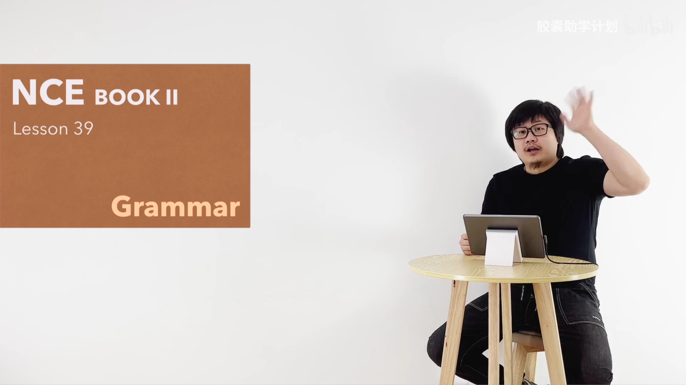

文字识别：NCE / BOOK"I / Lesson 39 / Grammar

### 画面 00:00:02

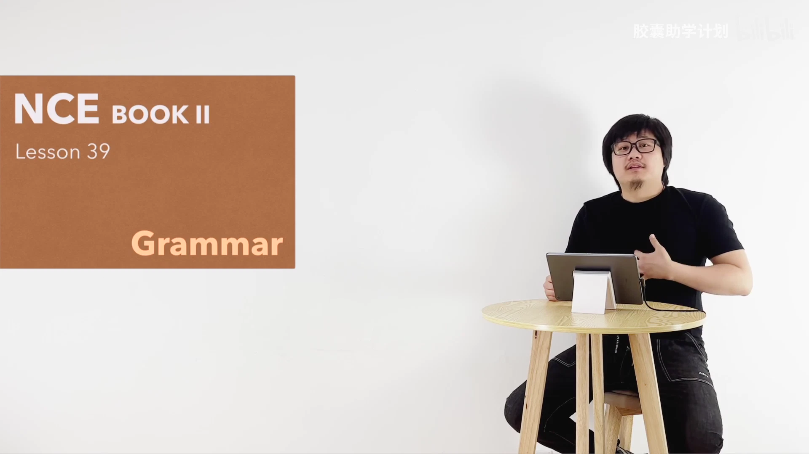

文字识别：NCE / BOOKⅡI / Lesson 39 / Grammar

### 画面 00:00:04

文字识别：NCE / BOOKII / Lesson 39 / Grammar

### 画面 00:00:06

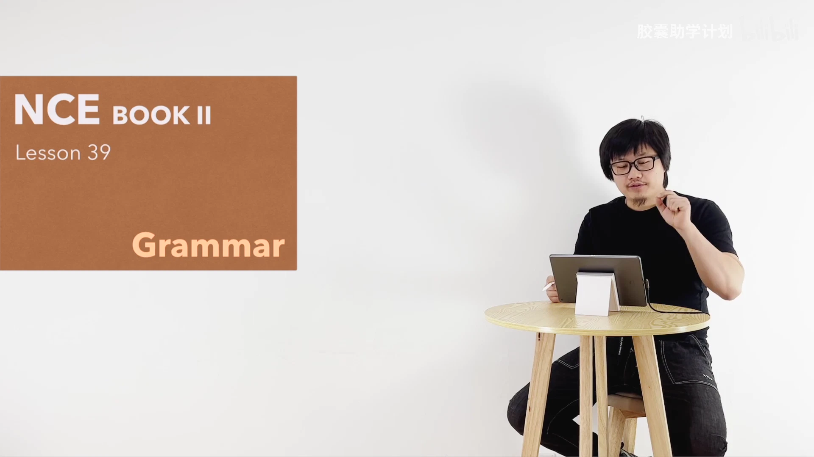

文字识别：NCE / BOOK"I / Lesson 39 / Grammar

### 画面 00:00:08

文字识别：NCE / BOOK"I / Lesson 39 / Grammar

### 画面 00:00:10

文字识别：胶囊助学计划b出出 / • / •

### 画面 00:00:14

### 画面 00:00:16

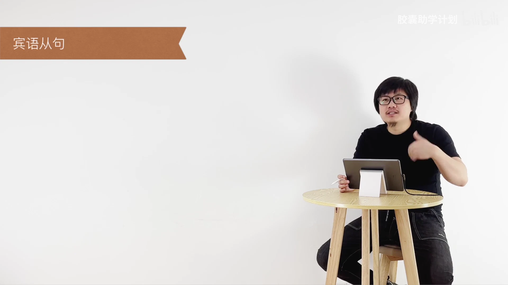

文字识别：宾语从句

### 画面 00:00:20

文字识别：宾语从句

### 画面 00:00:26

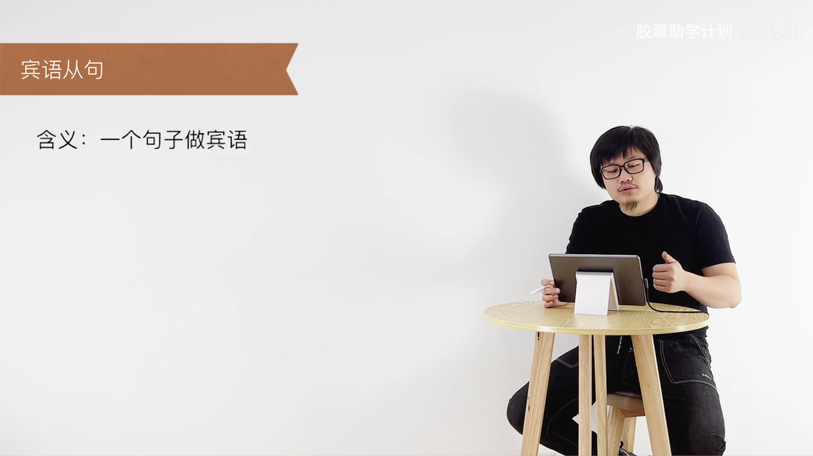

文字识别：宾语从句 / 含义：一个句子做宾语

## 00:00:30–00:01:00

宾语，我们管这个句子叫宾语从句。本课我们不会再重新全讲一遍了。对于各位来说，如果您宾语从句新一没有学过，听好，接下来首先新一的九十九课、一百零一课、一百三十三课、一百三十五课和一百三十九课，我们曾经花了五课，再加上如果他们偶数课的话，那就是十课的时间去讲这个知识点，叫宾语从句。

### 画面 00:00:36

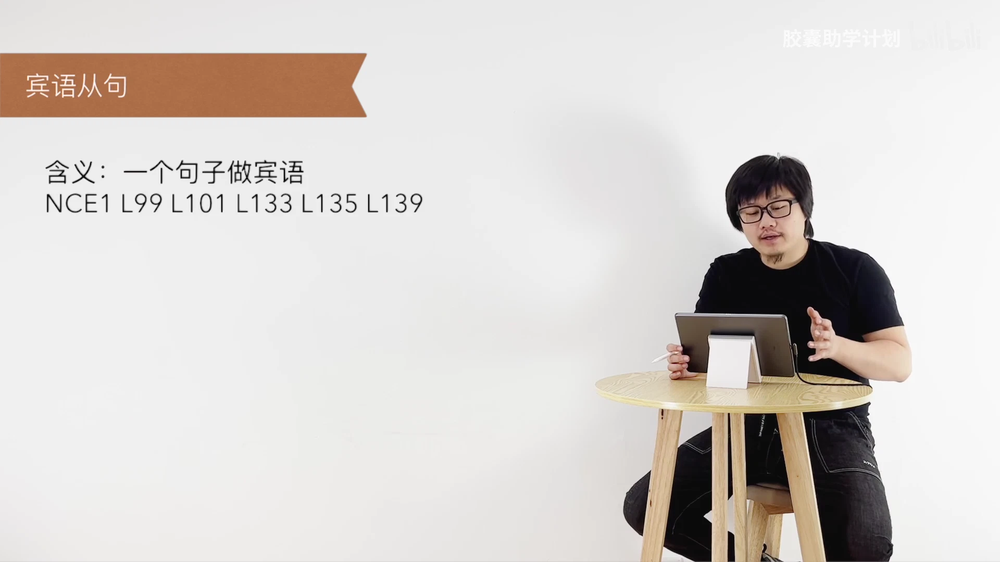

文字识别：宾语从句 / 含义：一个句子做宾语 / NCE1 L99 L101 L133 L135 L139

### 画面 00:00:40

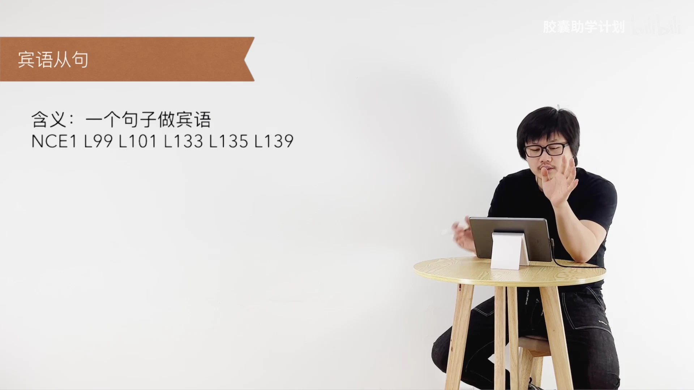

文字识别：宾语从句 / 含义：一个句子做宾语 / NCE1 L99 L101 L133 L135 L139

### 画面 00:00:45

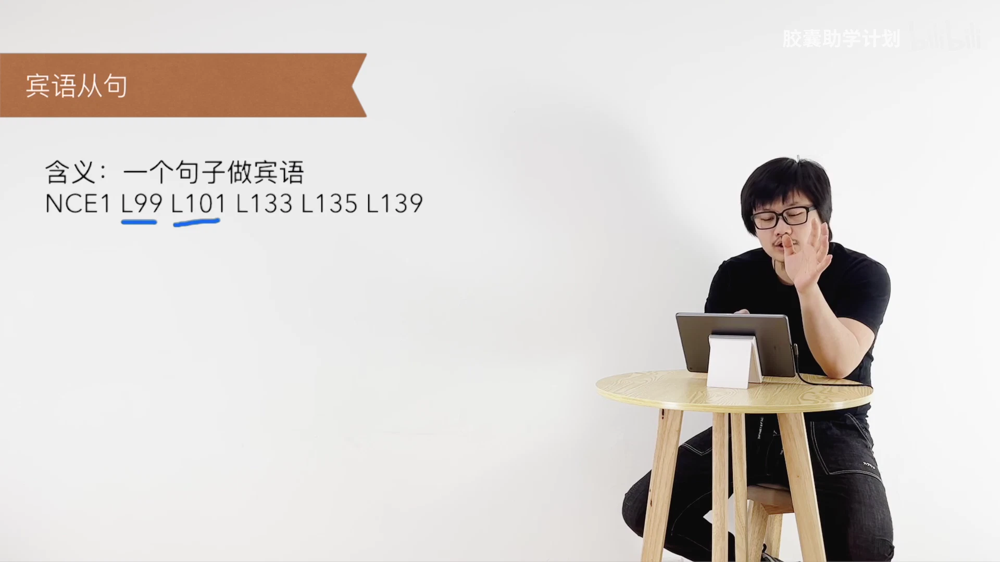

文字识别：宾语从句 / 含义：一个句子做宾语 / NCE1 L99 L101 L133 L135 L139

### 画面 00:00:50

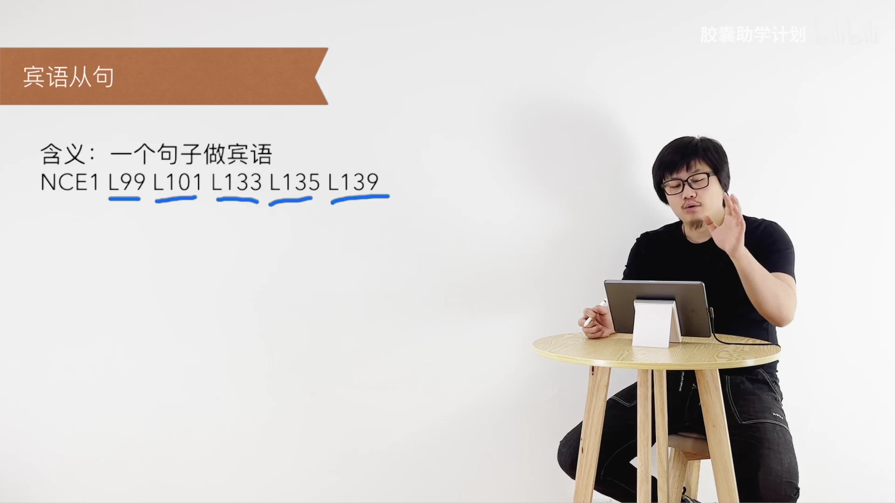

文字识别：宾语从句 / 含义：一个句子做宾语 / NCE1 L99 L101 L133 L135 L139

### 画面 00:00:58

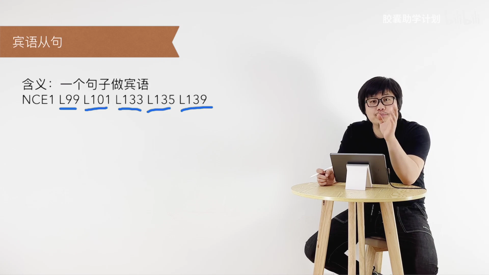

文字识别：宾语从句 / 含义：一个句子做宾语 / NCE1 L99 L101 L133 L135 L139

## 00:01:00–00:01:30

所以各位一定要做到的事情是，如果宾语从句您从来就没学过，那我建议你立刻关掉这个视频，把这几课记下来，然后去找到我们新一的视频，把九十九、一百零一、一百三十三、一百三十五、一百三十九全重新认认真真的看一遍，包括把练习都要做一遍，对吧？那本课我们就不重点去讲了，我们以练代讲啊。接下来我们要知道宾从，实际上在六一二三四五六当中，实

### 画面 00:01:01

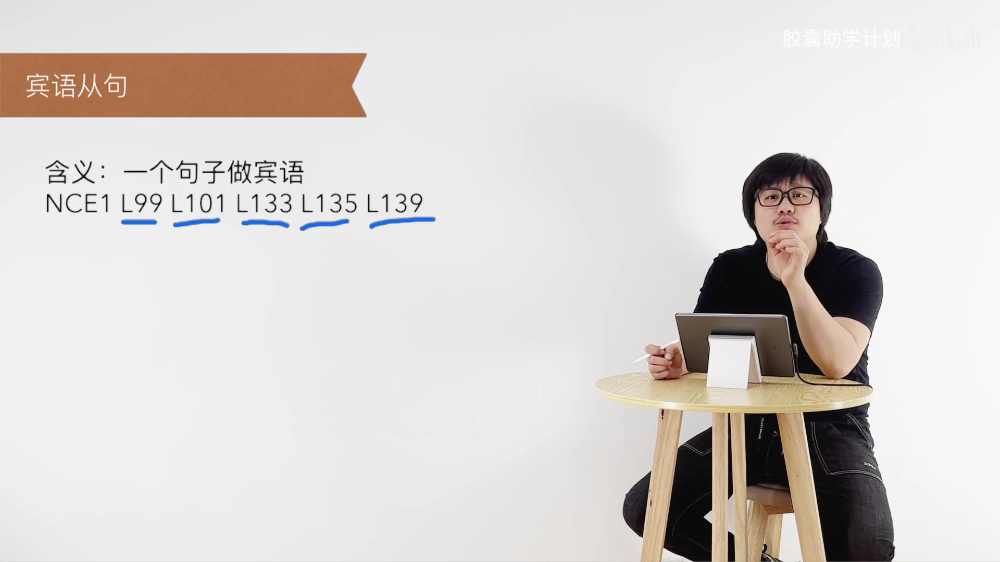

文字识别：宾语从句 / 含义：一个句子做宾语 / NCE1 L99 L101 L133 L135 L139

### 画面 00:01:05

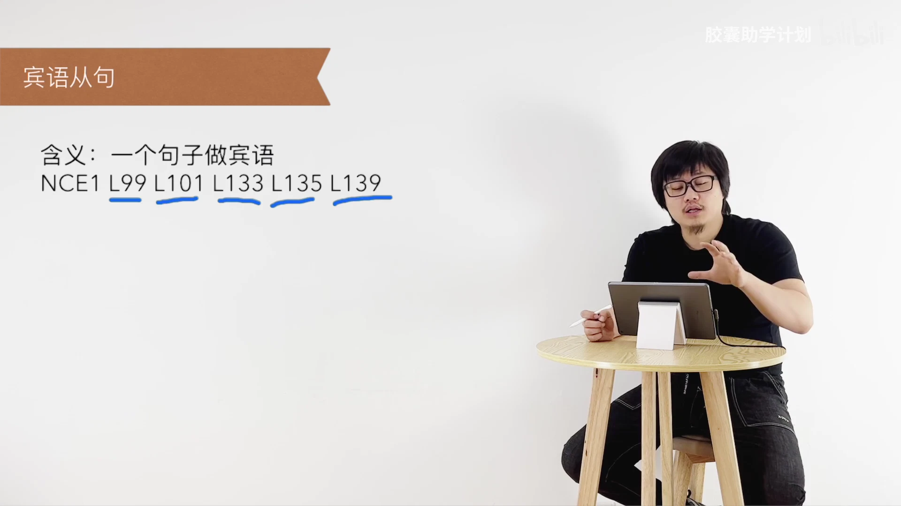

文字识别：宾语从句 / 含义：一个句子做宾语 / NCE1 L99 L101 L133 L135 L139

### 画面 00:01:10

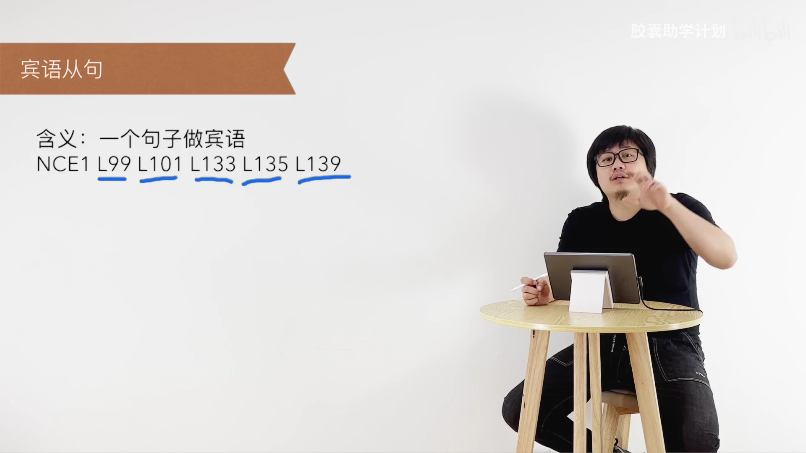

文字识别：宾语从句 / 含义：一个句子做宾语 / NCE1 L99 L101 L133 L135 L139

### 画面 00:01:21

文字识别：宾语从句 / 含义：一个句子做宾语 / NCE1 L99 L101 L133 L135 L139

### 画面 00:01:24

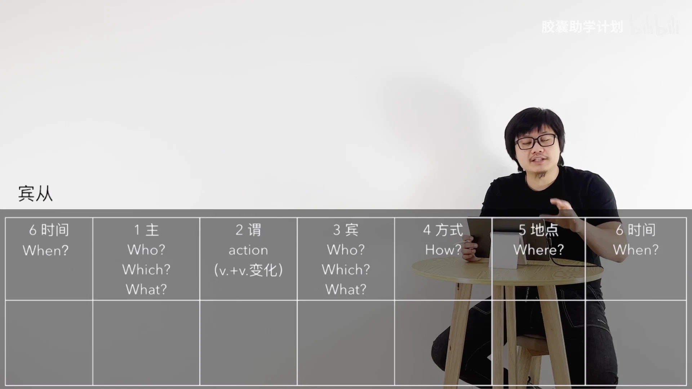

文字识别：宾从 / 6时间 / 1主 / 2谓 / 3宾 / 4方式 / 5地点 / 6时间 / When? / Who? / action / Who? / How? / Where? / When? / Which? / (v.+v.变化) / Which? / What? / What?

### 画面 00:01:27

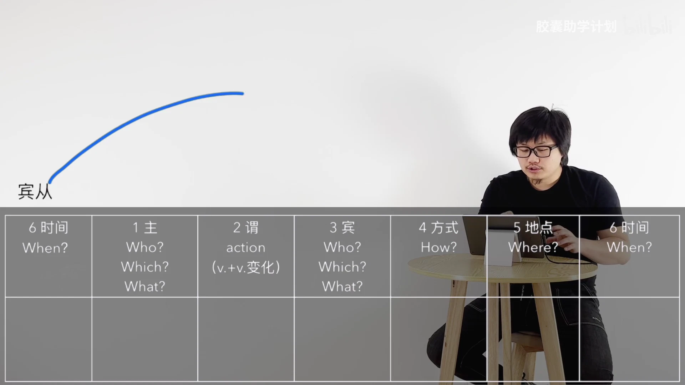

文字识别：宾从 / 6时间 / 1主 / 2谓 / 3宾 / 4方式 / 5地点 / 6时间 / When? / Who? / action / Who? / How? / Where? / When? / Which? / (v.+v.变化) / Which? / What? / What?

### 画面 00:01:29

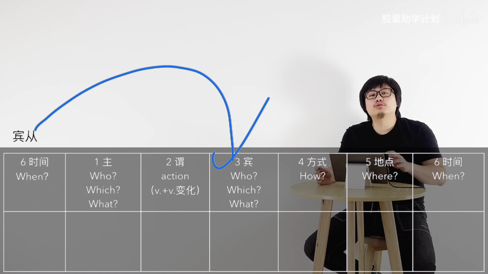

文字识别：宾从 / 6时间 / 1主 / 2谓 / 3宾 / 4方式 / 5地点 / 6时间 / When? / Who? / action / Who? / How? / Where? / When? / Which? / (v.+v.变化) / Which? / What? / What?

## 00:01:30–00:02:00

际上我们现在去这样的方式去看它，它就是一个句子去做了三，对吧？好，接下来以练代讲啊。好，比如说A说了一句话叫Are you surprised？C这个人没听见，问B了一句话，说What did he ask？问B啊，A说的是Are you surprised？然后呢，C没听清楚，C问B说A刚才说啥了？

### 画面 00:01:37

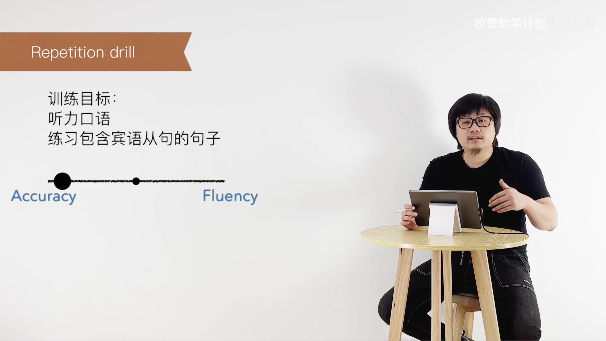

文字识别：Repetition drill / 训练目标： / 听力口语 / 练习包含宾语从句的句子 / Accuracy / Fluency

### 画面 00:01:39

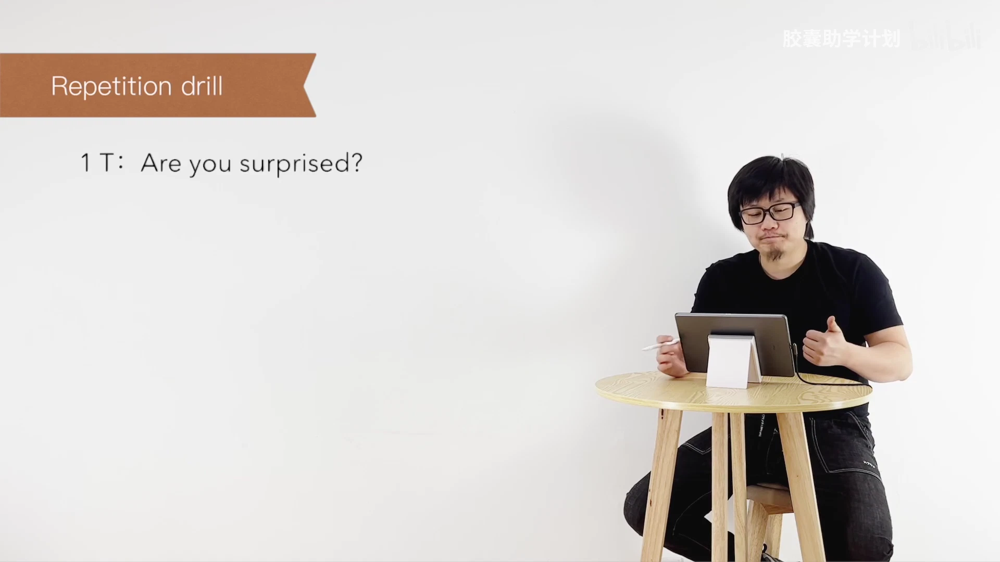

文字识别：Repetition drill / 1 T: Are you surprised?

### 画面 00:01:42

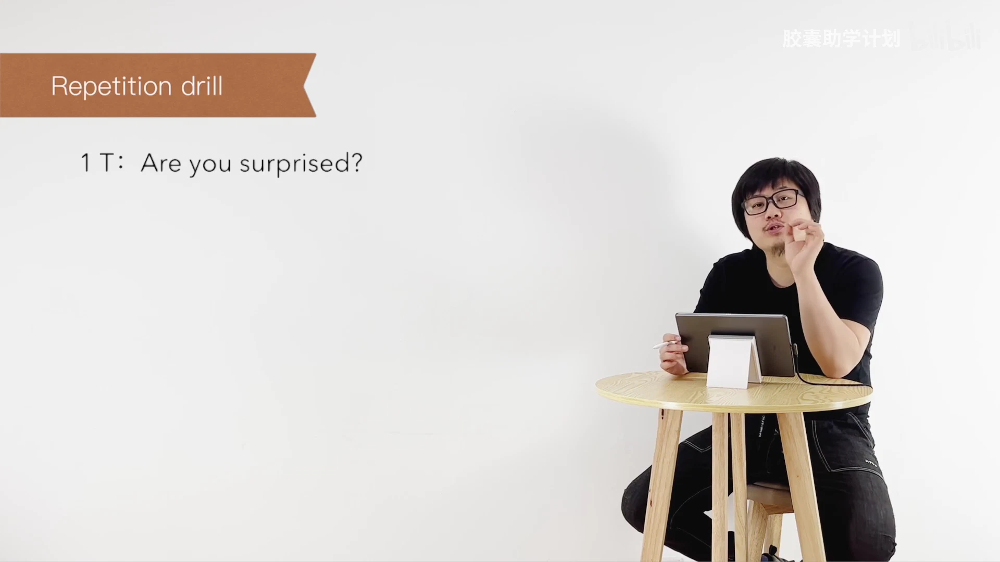

文字识别：Repetition drill / 1 T: Are you surprised?

### 画面 00:01:48

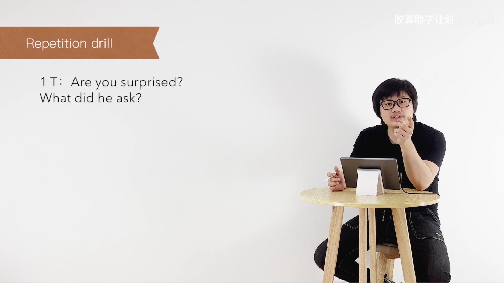

文字识别：Repetition drill / 1 T: Are you surprised? / What did he ask?

### 画面 00:01:53

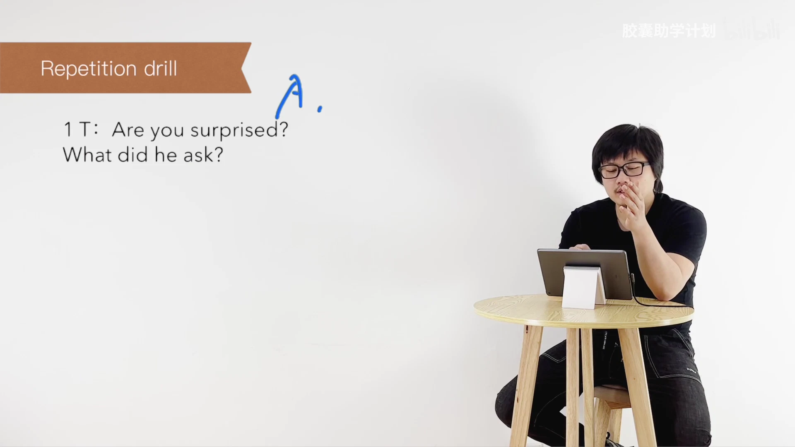

文字识别：Repetition drill / 1 T: Are you surprised? / What did he ask?

### 画面 00:01:57

文字识别：Repetition drill / 1 T: Are you surprised? / What did he ask? / C.l7

## 00:02:00–00:02:30

他刚才说啥了？What did he ask？那注意，那他问的就叫做he asked if you were surprised。什么叫以练代讲？就是如果您会了，我带你做这个练习，你其实就是复习一下。比如说我们几个关键点，第一个，什么时候用if？如果是一般疑问句变宾语从句，那我们就要用if，对吧？这是一百三十九课咱学的啊，新一百三十九课就要用if，因

### 画面 00:02:00

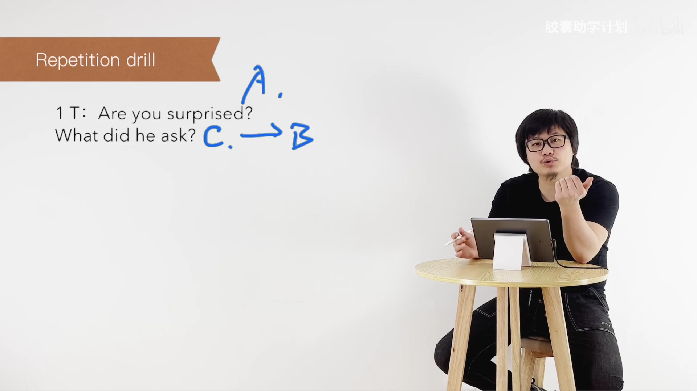

文字识别：Repetition drill / 1 T: Are you surprised? / C.lB / What did he ask?

### 画面 00:02:06

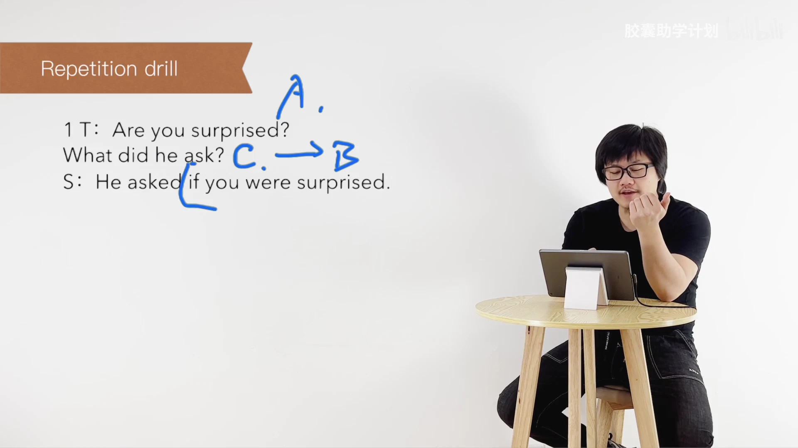

文字识别：Repetition drill / 1 T: Are you surprised? / C.lw / What did he ask? / S: He askedif you were surprised.

### 画面 00:02:08

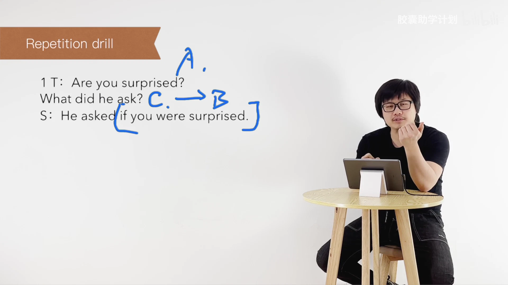

文字识别：Repetition drill / 1 T: Are you surprised? / C.B / What / did he ask? / S: He askedif you were surprised.

### 画面 00:02:10

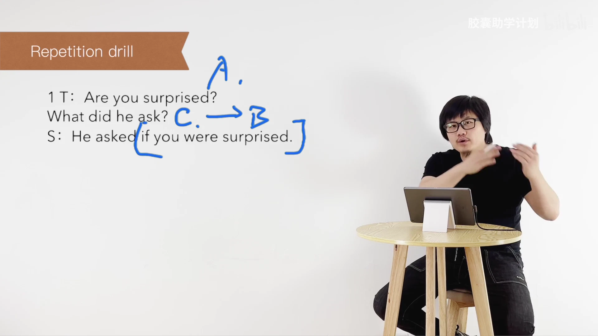

文字识别：Repetition drill / 1 T: Are you surprised? / C.lB / What did he ask? / S: He askedif you were surprised.

### 画面 00:02:15

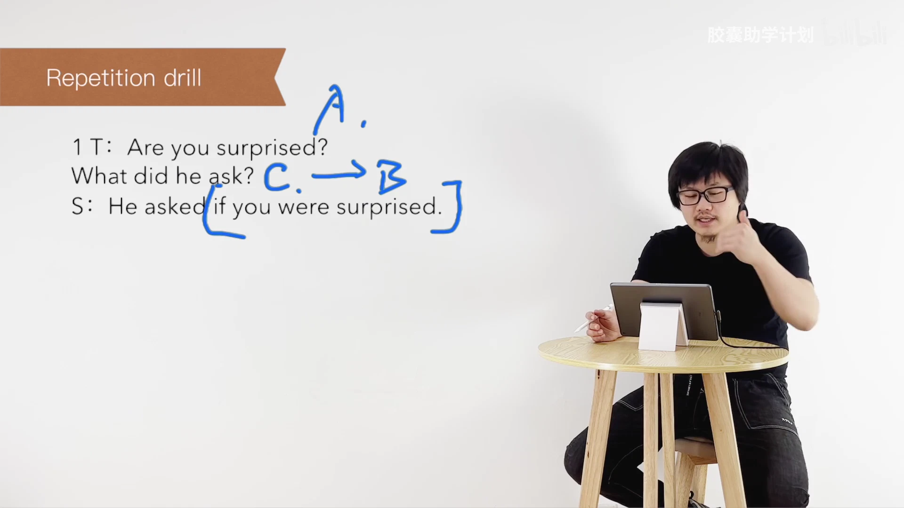

文字识别：Repetition drill / 1 T: Are you surprised? / C.lB / What did he ask? / S: He askedif you were surprised.

### 画面 00:02:20

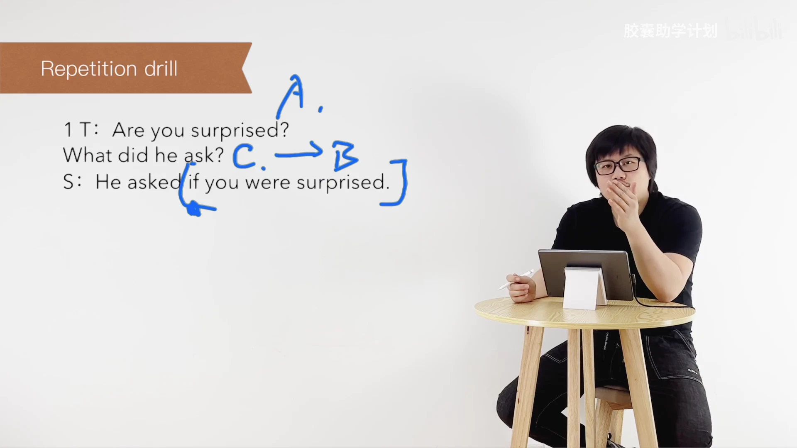

文字识别：Repetition drill / 1 T: Are you surprised? / C.lB / What did he ask? / S: He askedif you were surprised.

## 00:02:30–00:03:00

为 if 它本身要翻译，它叫做是否，对吧？说你是否感到很惊讶啊，说不出话是吧？那 he asked 这个地方又有一个 e d，后面本来叫 are you surprised，现在变成了 you were surprised。几个点，第一个叫做你要把一般疑问句变成肯定句，肯定语序。第二，如果主句是一般过去时，那后面要变成，呃呃，也要这个时态

### 画面 00:02:40

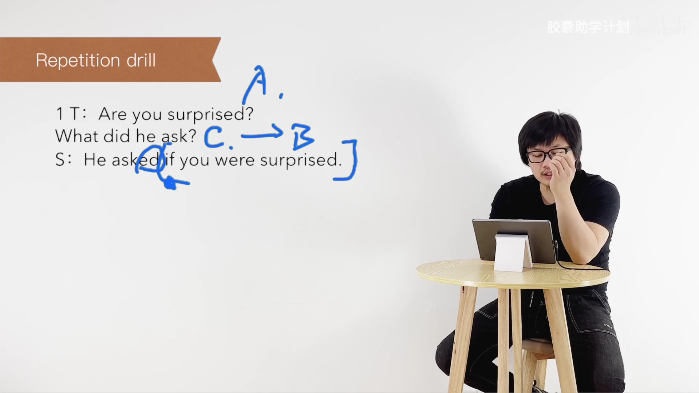

文字识别：Repetition drill / 1T： / Are / you / surprised? / C.—B / What / did he ask? / S:He / asked if you were s / surprised.

### 画面 00:02:43

文字识别：Repetition / drill / 1 T: / Are you surprised? / C.—B / What / did he / ask? / S:He / askedify / f you / were / surprised.

### 画面 00:02:45

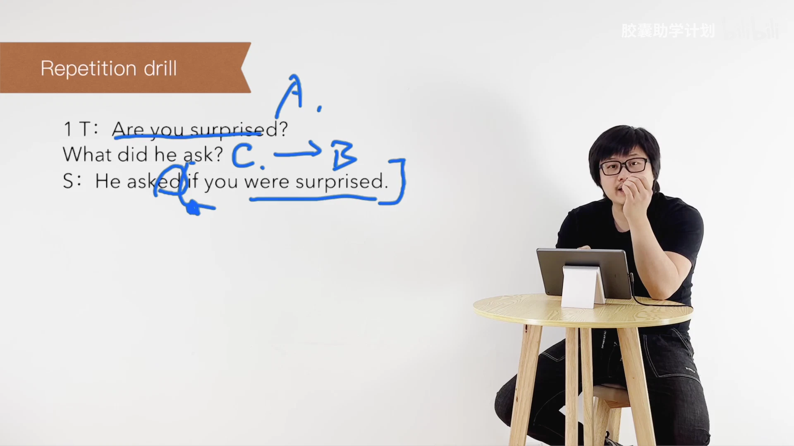

文字识别：Repetition / drill / 1 T: / Are you surprised? / C.—B / What / did he / ask? / S:He / askeddify / you / were / surprised.

### 画面 00:02:49

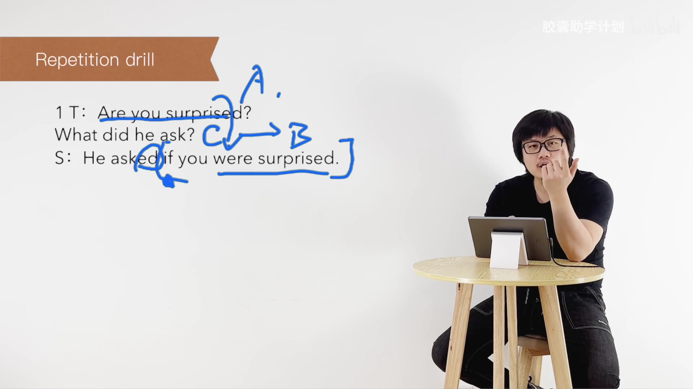

文字识别：Repetition / drill / 1 T: / Are you surprised? / C→B / What / did he / ask? / askedif youv / S: / :He / were / surprised.

### 画面 00:02:54

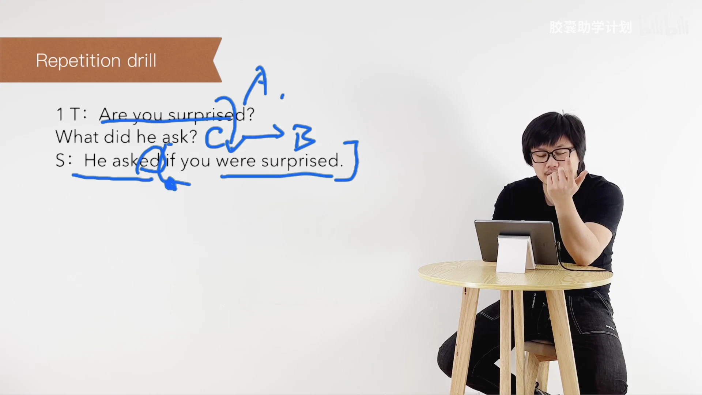

文字识别：Repetition / drill / 1 T: / Are you surprised? / C→B / What / did he / ask? / S: / : He / asked / were / surprised.

### 画面 00:02:56

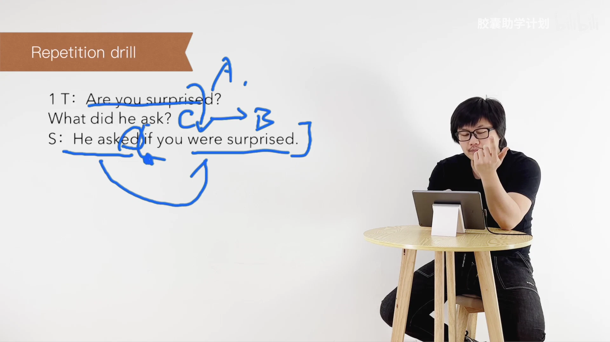

文字识别：Repetition / drill / 1 T: / Are you surprised? / C→B / What / did he / ask? / askedif youv / S: / : He / were / surprised.

### 画面 00:02:58

文字识别：Repetition / drill / 1 T: / Are you surprised? / C→B / What / did he / ask? / askedif you v / S:He / were / surprised.

## 00:03:00–00:03:30

要相应的去改变，这个是我们一百三十三课和一百三十五课学的，对吧？所以你看，如果我现在这样提，你有印象能回想起来，你就不用再去看刚才我说那些课程了。如果你一点印象没有，我务必回去看一下，好吧？磨刀不误砍柴工啊！下一题，比如说 Why are you surprised？还是啊，A说了一句话，C没听清楚，C问B说 What did he ask？他问什么了？那他问的就是你为什么这么惊讶，对

### 画面 00:03:00

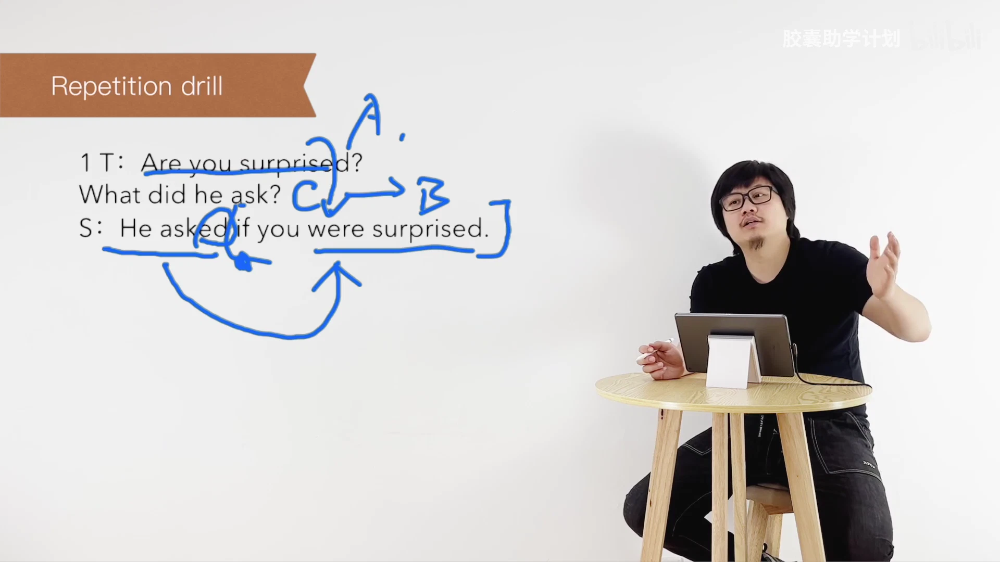

文字识别：Repetition / drill / 1 T: / Are you surprised? / C→B / What / did he / ask? / if youl / S：He / asked / were / surprised.

### 画面 00:03:05

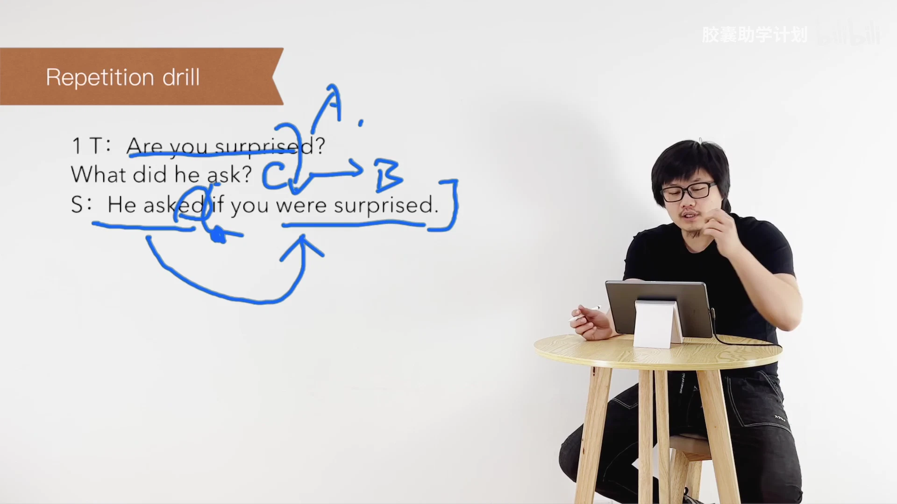

文字识别：Repetition / drill / 1 T: / Are you surprised? / C→B / What / did he / ask? / askeddifyouv / S: / : He / were / surprised.

### 画面 00:03:07

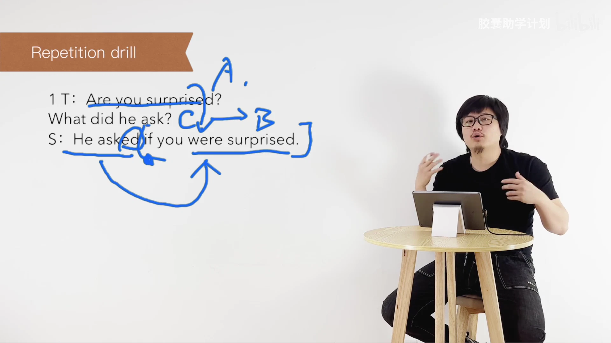

文字识别：Repetition / drill / 1 T: / Are you surprised? / C→B / What / did he / ask? / askedif you v / S:He / were / surprised.

### 画面 00:03:16

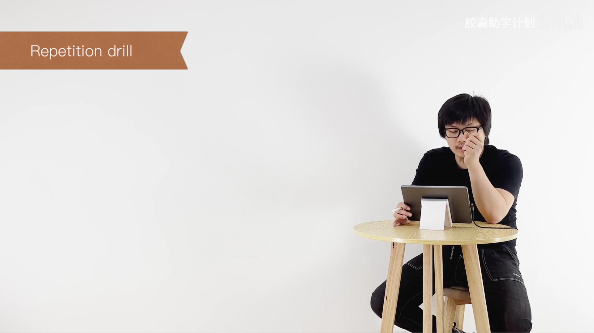

文字识别：Repetition drill

### 画面 00:03:21

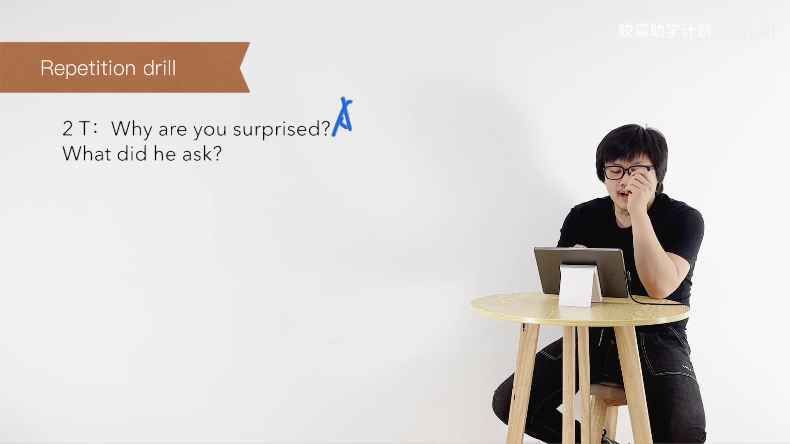

文字识别：Repetition drill / 2 T: Why are you surprised? / What did he ask?

### 画面 00:03:23

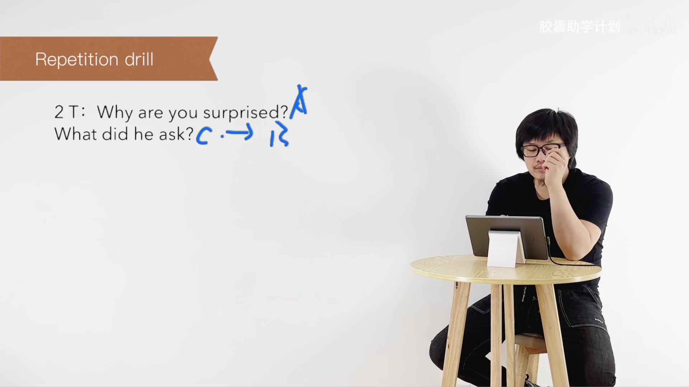

文字识别：Repetition drill / 2T： / Why are you surprised? / What did he ask?C ·→) / 12

### 画面 00:03:26

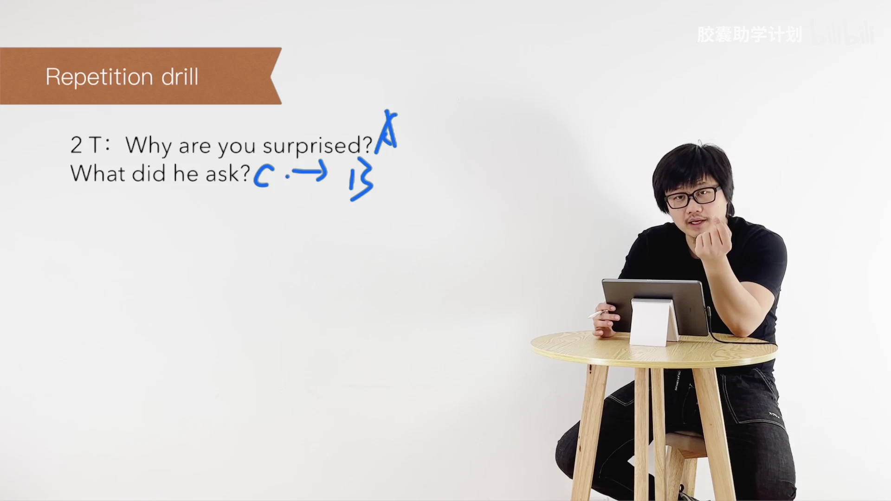

文字识别：Repetition drill / A / 2T： / Why are you surprised? / What did he ask?C ·→) / 13

## 00:03:30–00:04:00

吧？那他问的叫做 He asked why you were surprised. 注意几个点，第一，这个宾语从句 why 引导的，特殊疑问句变宾语从句的时候，特殊疑问词就变成了引导词，不能省略，因为要翻译。比如说这里叫为什么。第二， Are you surprised? 要变成 You were surprised. 这实际上是一百三十九课咱们学过的，要变成陈述句语序，不管一般疑问句还是特殊疑问句，都要

### 画面 00:03:36

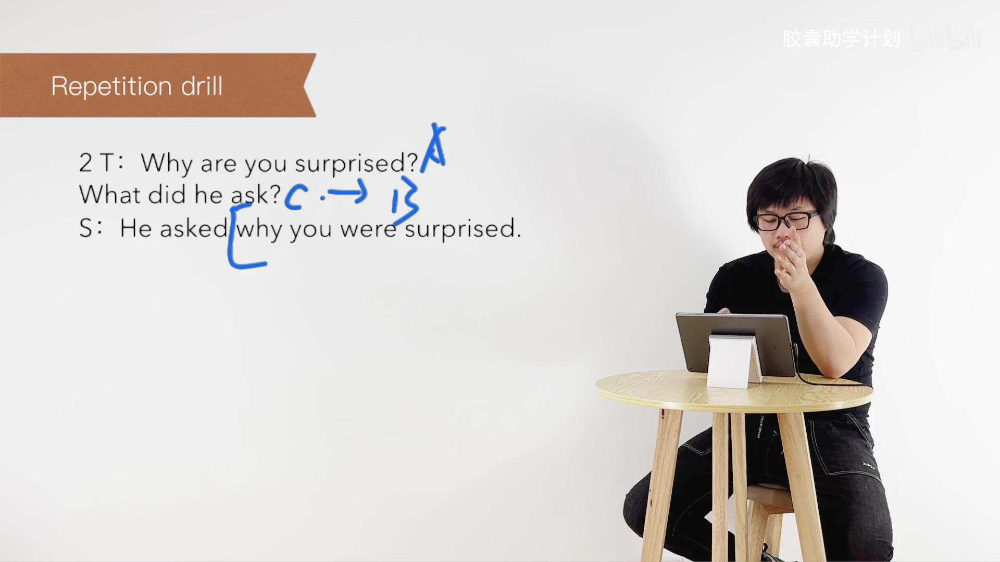

文字识别：Repetition drill / A / 2T： / Why a / ' are you surprised? / What / did he ask?C .l) / 13 / S: He askedwhy you were surprised.

### 画面 00:03:40

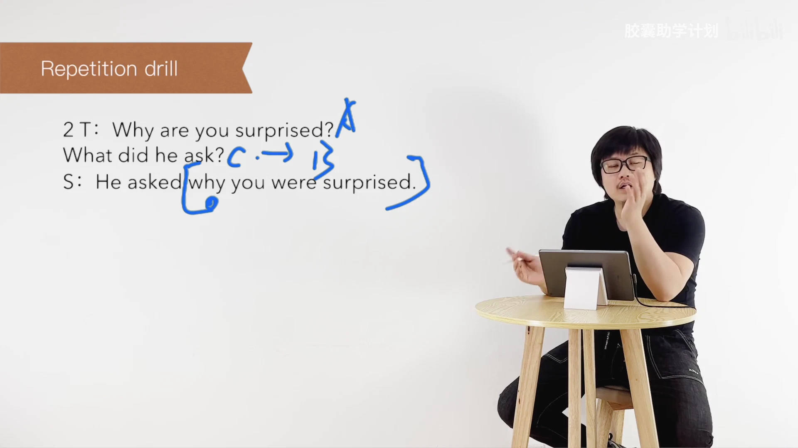

文字识别：Repetition drill / A / 2T: / Why / are you s / surprised? / What / did he ask?C ·l) / 13 / S：He / asked / why you were surprised.

### 画面 00:03:50

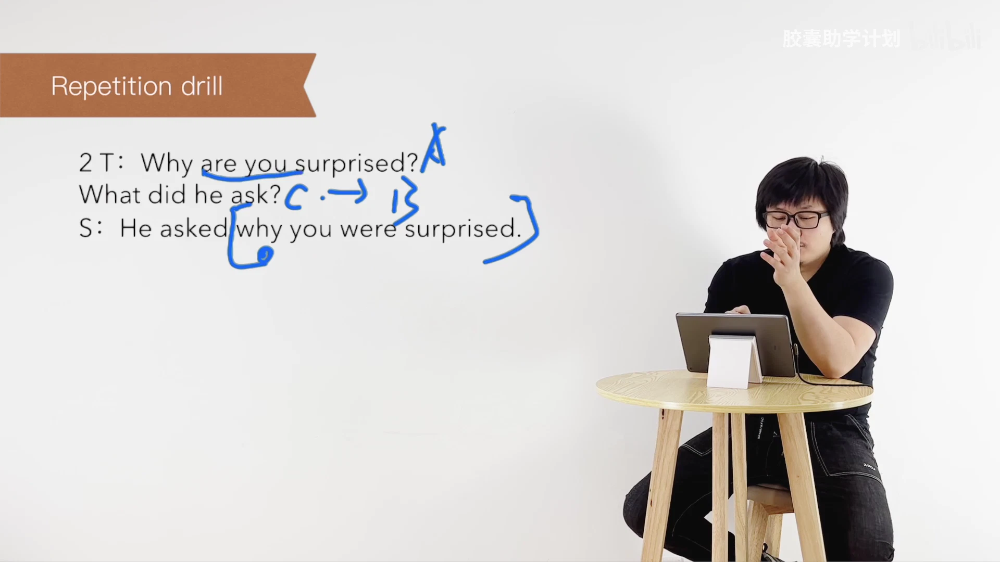

文字识别：Repetition drill / A / 2T： / Why / are you surprised? / What / did he ask?C.→) / 13 / S：He / asked / d why you were surprised.

### 画面 00:03:52

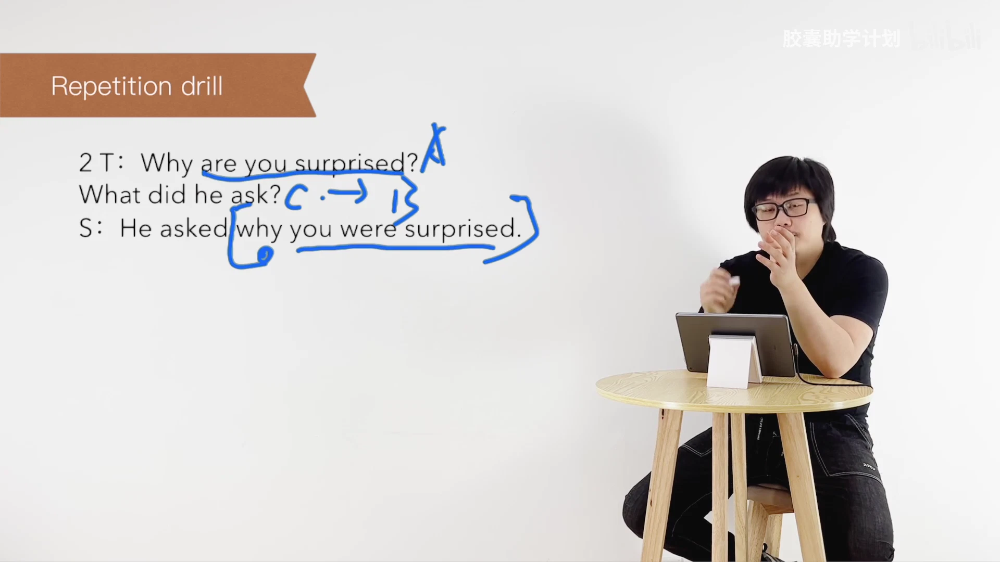

文字识别：Repetition drill / A / 2T: / Why / are you surprised? / did he ask?C.→) / What / 13 / S：He / asked / why / you were surprised.

## 00:04:00–00:04:30

变成陈述句的语序，OK？然后呢，He asked why he was surprised.然后注意一个小点，前面是一般过去时，所以当你把二换到you后面去的时候，一定要把它也换回这个时态。这是一百三十三、一百三十五，咱们学过的，对吧？所以很重要啊。Next one, say Will Jack arrive tomorrow? What did he ask?他之前问的啥？那他问的就是Jack明天会到

### 画面 00:04:08

文字识别：Repetition drill / 2T: / Why / are you surprised? / What / did he / e ask?C.→) / 13 / S:He / asked / dwhy / you were surprised.

### 画面 00:04:10

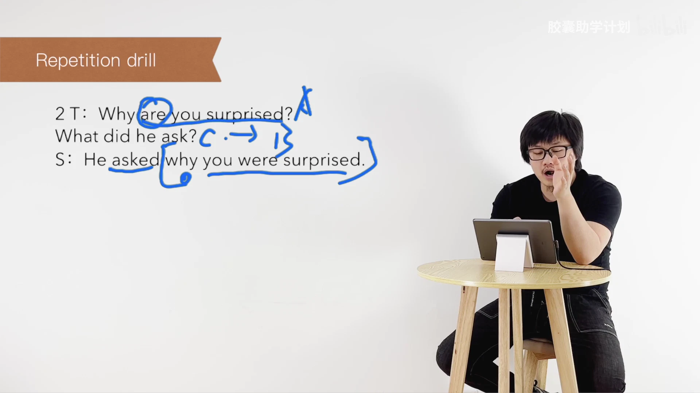

文字识别：Repetition drill / 2T: / Why / areyou surprised? / I he ask?C .—) / What / did I / 13 / S:He / asked / why / 'you were surprised.

### 画面 00:04:13

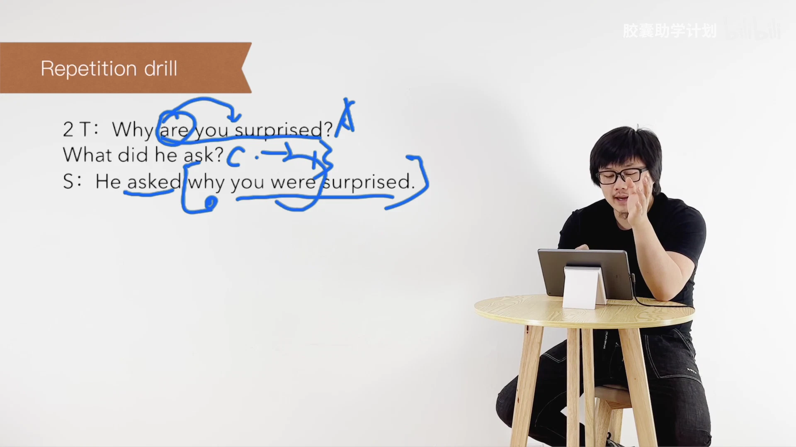

文字识别：Repetition / drill / 2T: / Why / areyou surprised? / he ask?C.l) / What / did / S: / He / asked / why / you / weresurprised.

### 画面 00:04:15

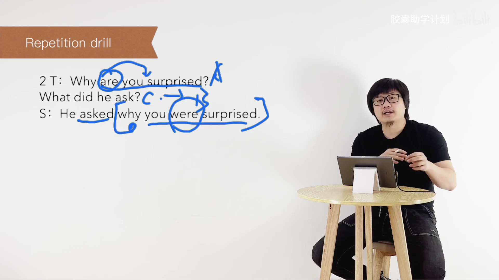

文字识别：Repetition / drill / A / 2T: / Why / are you surprised? / he ask?C.— / What / did / S: / He / asked / why / you / Weresurprised.

### 画面 00:04:22

文字识别：Repetition drill / 3 T: Will Jack arrive tomorrow?

## 00:04:30–00:05:00

吗？叫做 He asked if 一般疑问句变宾语从句，前面加 if。是哎，这不是时态，你也可以理解为是时态，只不过我们放在情态动词那课讲的，就一百三十五课啊。Will 时态倒退换成 would，对吧？所以这句话变成了 He asked if Jack would arrive tomorrow. There you go. Next one, say When will Jack arrive? What did he ask? That he asked

### 画面 00:04:30

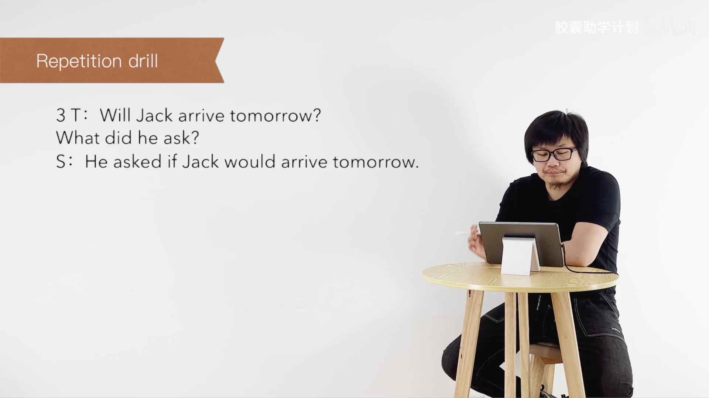

文字识别：Repetition drill / 3 T: Will Jack arrive tomorrow? / What did he ask? / S: He asked if Jack would arrive tomorrow.

### 画面 00:04:35

文字识别：Repetition drill / 3 T: Will Jack arrive tomorrow? / What did he ask? / S: He askedif Jack would arrive tomorrow.

### 画面 00:04:45

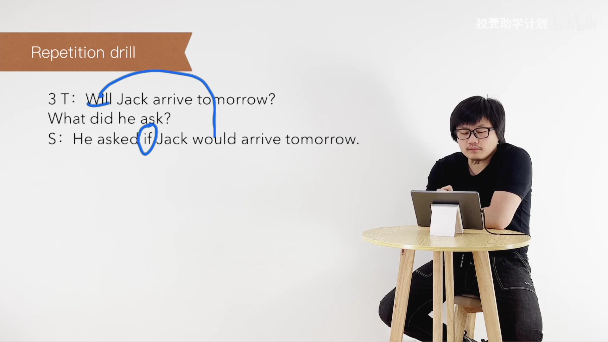

文字识别：Repetition drill / 3 T: Will Jack arrive tomorrow? / What did he ask? / S: He askedif Jack would arrive tomorrow.

### 画面 00:04:50

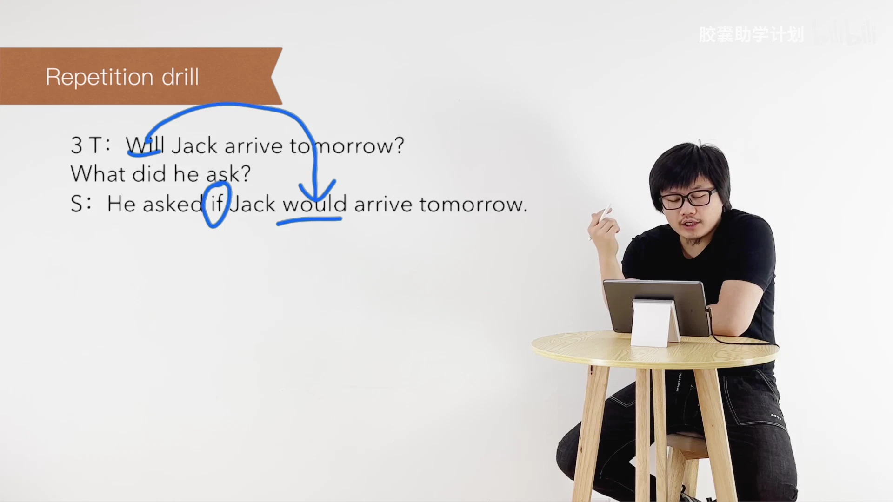

文字识别：Repetition drill / 3 T: Will Jack arrive tomorrow? / What did he ask? / S: He askedif Jack wolld arrive tomorrow.

### 画面 00:04:54

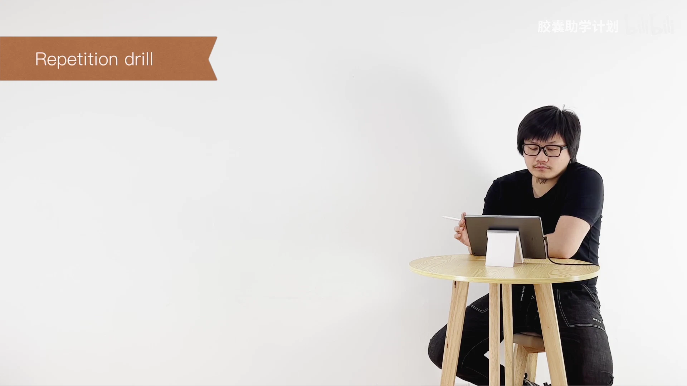

文字识别：Repetition drill

### 画面 00:04:59

文字识别：Repetition drill / 4 T: When will Jack arrive? / What did he ask? / S: He asked when Jack would arrive.

## 00:05:00–00:05:30

when Jack would arrive.几个关键点：第一，when别变，对吧？引导词。第二，will要放回Jack的后面去，换成陈述语序。一百三十九课学的。第二、第三，前面如果是一般过去时，那后面你要把will换成would。一百三十五课咱学的，对吧？这全是新一的知识啊。我们今天就是以以练代讲，复习一遍就完事儿了。OK，下一题。

### 画面 00:05:01

文字识别：Repetition drill / 4 T: When will Jack arrive? / What did he ask? / S: He asked vhen Jack would arrive.

### 画面 00:05:05

文字识别：Repetition drill / 4 T: When will Jack arrive? / What did he ask? / S: He asked vhen Jack would arrive.

### 画面 00:05:10

文字识别：Repetition drill / 4 T: When will Jack arrive? / What did he ask? / S: He asked vhen Jack would arrive.

### 画面 00:05:16

文字识别：Repetition drill / 4 T: When will Jack arrive? / What did he ask? / S: He asked / d vhen Jack would arrive.

### 画面 00:05:19

文字识别：Repetition drill / 4T： / When will Jack arrive? / What did he ask? / S: He asked / When Jack Would / arrive.

### 画面 00:05:28

文字识别：Repetition drill

## 00:05:30–00:06:00

has Mary ever been abroad before? What did he ask? 他问啥了？问的是 he asked if 是否？你看前面是个一般疑问句嘛？Mary had ever been abroad before. Had been.过去完成时，对吧？现在完成时变过去完成时。OK。第六题说 Why has Mary never been abroad before? 他为什么从来没出过

### 画面 00:05:30

文字识别：Repetition drill / 5 T: Has Mary ever been abroad before?

### 画面 00:05:36

文字识别：Repetition drill / 5 T: Has Mary ever been abroad before? / What did he ask? / S: He asked if Mary had ever been abroad / before.

### 画面 00:05:40

文字识别：Repetition drill / 5 T: Has Mary ever been abroad before? / What did he ask? / S: He askedfMary had ever been abroad / before.

### 画面 00:05:42

文字识别：Repetition drill / 5 T: Has Mary ever been abroad before? / What did he ask? / S: He askedfMary had ever been abroad / before.

### 画面 00:05:47

文字识别：Repetition drill / 5 T: Has Mary ever been abroad before? / What did he ask? / S: He askedfMary had ever been abroad / before.

### 画面 00:05:51

文字识别：Repetition drill / HasMary ever been abroad before? / 5 T: / What did he ask? / S: He askedfMary had ever been abroad / before.

### 画面 00:05:53

文字识别：Repetition drill / 5 T: / HasMary ever / been abroad before? / What did he ask? / S: He askedfMary had ever k / beer / abroad / before.

### 画面 00:05:55

文字识别：Repetition drill / 6 T: Why has Mary never been abroad before?

## 00:06:00–00:06:30

国？他问的啥？问的是为什么Mary从来没出过国？第一步，把它换成陈述句语序。第二步，主句一般过去时，时态后移，对吧？Next one, can you come tomorrow? What did he ask? 那叫做 he asked if you would come tomorrow. 你明天能来，对吧？他问的是是否你明天能来。玩一个。第八个叫做 When can

### 画面 00:06:01

文字识别：Repetition drill / 6 T: Why has Mary never been abroad before? / What did he ask? / S: He asked why Mary had never been abroad before.

### 画面 00:06:05

文字识别：Repetition drill / 6 T: Whyhas Mary never been abroad before? / What did he ask? / S: He asked Why Mary had never been abroad before.

### 画面 00:06:07

文字识别：Repetition drill / 6 T: Why has Mary never been abroad before? / What did he ask? / S: He askedNhy Mary had never been abroad before.

### 画面 00:06:11

文字识别：Repetition drill / 6T： / Why has Mary never been abroad before? / What / did he ask? / S: He asked / d Why Mary had never been abroad before.

### 画面 00:06:13

文字识别：Repetition drill / 6T： /  Why has Mary never been abroad before? / What / did he ask? / S: He asked / dWhy Mary had never been abroad before.

### 画面 00:06:15

文字识别：Repetition drill / 7 T: Can you come tomorrow?

### 画面 00:06:21

文字识别：Repetition drill / 7 T: Can you come tomorrow? / What did he ask? / S: He asked if you could come tomorrow.

### 画面 00:06:23

文字识别：Repetition drill / 7 T: Can you come tomorrow? / What did he ask? / S: He asked / if / you could come tomorrow

### 画面 00:06:28

文字识别：Repetition drill / 8 T: When can you come?

## 00:06:30–00:07:00

you come? 你什么时候能来? What did he ask? 他问的是什么呢? He asked when you could come. 你什么时候能来? When you could come, 对吧? 哎, next one. Did Jack arrive yesterday? What did he ask? 你看，这要注意一个小点了。一般过去时，时态在后迁的时候，要迁成过去完成时，对吧？我们看一下是不是。 He asked if Jack had arrived

### 画面 00:06:36

文字识别：Repetition drill / 8 T: When can you come? / What did he ask? / S: He askedwhen you could come.

### 画面 00:06:41

文字识别：Repetition drill / 8 T: When can you come? / What did he ask? / S: He asked when you could come.

### 画面 00:06:43

文字识别：Repetition drill / 9 T: Did Jack arrive yesterday?

## 00:07:00–00:07:30

yesterday,过去完成时。Okay, very good. Next one, when did Jack arrive? Jack什么时候到的呢？What did he ask? He asked when Jack had arrived. Did arrived.时态迁移。Okay,派对桌友练的肯定还是包含宾语从句的句子啊。那我们在这个地方只讲是吧？然后您下课自己去带。比如说，I wonder if

### 画面 00:07:01

文字识别：Repetition drill / 9 T: Did Jack arrive yesterday? / What did he ask? / S: He asked if Jack had arrived yesterday.

### 画面 00:07:04

文字识别：Repetition drill / 10 T: When did Jack arrive?

### 画面 00:07:12

文字识别：Repetition drill / 10 T: When did Jack arrive? / What did he ask? / S: He asked when Jack had arrived.

### 画面 00:07:14

文字识别：Repetition drill / 10 T: When did Jack arrive? / What did he ask? / S: He asked when Jack had arrived.

### 画面 00:07:18

文字识别：Pattern drill / 训练目标： / 写作口语 / 练习包含宾语从句的句子 / Accuracy / Fluency

### 画面 00:07:20

文字识别：Pattern drill / 训练目标： / 写作口语 / 练习包含宾语从句的句子 / Accuracy / Fluency

### 画面 00:07:24

文字识别：Pattern drill / 1T: sold the house / S1: I wonder if he's sold the house. / S2: I asked if he'd sold it, but no one knew. / bought the house / had lunch / phoned the doctor / sold the car / posted the parcel / had the operation

### 画面 00:07:27

文字识别：Pattern drill / 1T: sold the house / S1: I wonder if he's sold the house. / S2: I asked if he'd sold it, but no one knew. / bought the house / had lunch / phoned the doctor / sold the car / posted the parcel / had the operation

## 00:07:30–00:08:00

啊，那if后边是一个宾语从句，if引导的是一个，你可以理解为是个一般啊一般疑问句，对吧？是否啊？是否他已经卖了这个房子？I asked. 注意时态变了，一般过去时，他是否已经卖了？但没人知道。注意，这是had sold，这是had sold，对吧？现在完成时变过去完成时，往里边去带就好了，很简单。第二题，

### 画面 00:07:31

文字识别：Pattern drill / 1T: sold the house / S1: I wonder if he's sold the house. / S2: I asked if he'd sold it, but no one knew. / bought the house / had lunch / phoned the doctor / sold the car / posted the parcel / had the operation

### 画面 00:07:34

文字识别：Pattern drill / 1T: sold the house / S1: I wonder if he's sold the house. / S2: I asked if ne'd sold it, but no one knew. / bought the house / had lunch / phoned the doctor / sold the car / posted the parcel / had the operation

### 画面 00:07:36

文字识别：Pattern drill / 1T: sold the house / S1: I wonder if he's sold the house. / S2: I asked if he'd sold it, but no one knew. / bought the house / had lunch / phoned the doctor / sold the car / posted the parcel / had the operation

### 画面 00:07:57

文字识别：Pattern drill / 2 T: Has Mary met John? / S1: Did Mary say she'd met John? / S2: She didn't tell me whether she had or not. / Has John seen/been to that film? / Have the Smiths bought/sold the flat? / Have the children had lunch/eaten? / Has your secretary lost/found my letter?

## 00:08:00–00:08:30

Mary say she met John?说Mary说Mary说没说她是否已经碰见这个？Did Mary啊，叫Mary说她碰见John了吗？She didn't tell me.她没有告诉我whether she had or not.在这儿我们其实重点想讲的就是这一个，想提一句就可以了。你可以理解为这就是if。我们在文章当中也会见到啊，也就是说whether其实跟

### 画面 00:08:21

文字识别：Pattern drill / 2 T: Has Mary met John? / S1: Did Mary say she'd met John? / S2: She didn't tell me Whethe she had or not. / Has John seen/been to that film? / Have the Smiths bought/sold the flat? / Have the children had lunch/eaten? / Has your secretary lost/found my letter?

### 画面 00:08:23

文字识别：Pattern drill / 2 T: Has Mary met John? / S1: Did Mary say she'd met john? / S2: She didn't tell me Whethe she had or not. / Has John seen/been to that film? / Have the Smiths bought/sold the flat? / Have the children had lunch/eaten? / Has your secretary lost/found my letter?

### 画面 00:08:26

文字识别：Pattern drill / 2 T: Has Mary met John? / S1: Did Mary say she'd met john? / S2: She didn't tell me Whethe she had or not. / Has John seen/been to that film? / Have the Smiths bought/sold the flat? / Have the children had lunch/eaten? / Has your secretary lost/found my letter?

## 00:08:30–00:09:00

if都是后边引导了一个一般疑问句啊，它都是可以宾语从句的话，引导的都是一般疑问句，叫做是否他已经见到了。OK, next one,说Will Will they come tomorrow?他们明天会来吗？They didn't tell me when they注意这个撇地可不是had了，是would啊，他们没有告诉我他们什么时候会来。When they would come, OK, one more

### 画面 00:08:41

文字识别：Pattern drill / 3 T: they'll come -tomorrow / S1: Will they come tomorrow? / S2: They didn't tell me when they'd come. / they'll return home/go abroad -next week / she'll arrive/leave -this evening / he'll go to hospital/start work -tomorrow / he'll retire/settle down -next year

### 画面 00:08:51

文字识别：Pattern drill / 3 T: they'll come -tomorrow / S1: Will they come tomorrow? / S2: They didn't tell me when they'd come. / they'll return home/go abroad -next week / she'll arrive/leave -this evening / he'll go to hospital/start work -tomorrow / he'll retire/settle down -next year

### 画面 00:08:55

文字识别：Pattern drill / 3 T: they'll come -tomorrow / S1: Will they come tomorrow? / S2: They didn't tell me when they'd / Cone. / they'll return home/go abroad -next week / she'll arrive/leave -this evening / he'll go to hospital/start work -tomorrow / he'll retire/settle down -next year

## 00:09:00–00:09:30

往里带啊。那你看宾语从句嘛，When they would come。最后一个说，Our teacher asked，我们老师问到，Why Tom didn't come to the party？为什么 Tom 没有来这个聚会？Do you know why？你知道为什么吗？I have no idea why he didn't come。你看啊，Why Tom didn't come to the party？Do you know why？I have no idea why he didn't come。看了吗？全是 Tom

### 画面 00:09:01

文字识别：Pattern drill / 3 T: they'll come -tomorrow / S1: Will they come tomorrow? / S2: They didn't tell me when they'd come. / they'll return home/go abroad -next week / she'll arrive/leave -this evening / he'll go to hospital/start work -tomorrow / he'll retire/settle down -next year

### 画面 00:09:05

文字识别：Pattern drill / 4T： / Why / didn't Tom come to the party? / S1: / : Our teacher asked / why Tom / didn't / come to the party. Do you k /  know why? / S2: I've no idea why he / didn't come. / Jane come to/attend the lecture / Mary speak/pay / attention during / the class / John play in/watch the match / that boy answer/understand the question

## 00:09:30–00:10:00

didn't come. He didn't come. 全是一个肯定或者陈述句语序，对吧？注意语序是这个样子的。然后又是外引导的，都是两个宾语从句，是吧？各位往里一带就可以了啊。OK，不多说了。然后呢，本课我们要 recap 一下的话呢，就是宾语从句啊。然后呢，其实我们几乎没讲，就是以讲代呃，以练代讲，简单重复了一下。如果您这几课没有看过，那我这么讲可能对于各位来说基本

### 画面 00:09:35

文字识别：Pattern drill / 4T： / Why / didn't Tom come to the party? / S1: Our teacher asked / why Tom / didn't / come to the party. Do you k /  know why? / S2: I've no idea why he / didn't come. / Jane come to/attend the lecture / Mary speak/pay  / attention during t /  the class / John play in/watch the match / that boy answer/understand the question

### 画面 00:09:44

文字识别：Recap / Patterns / 宾语从句 / & / NCE1 L99 L101 L133 L135 L139 / Grammar

### 画面 00:09:46

文字识别：Recap / Patterns / 宾语从句 / & / NCE1 L99 L101 L133 L135 L139 / Grammar

### 画面 00:09:48

文字识别：Recap / Patterns / 语从句 / & / NCE1 L99 L101 L133 L135 L139 / Grammar

### 画面 00:09:50

文字识别：Recap / Patterns / 宾语从句 / & / NCE1 L99 L101 L133 L135 L139 / Grammar

### 画面 00:09:53

文字识别：Recap / Patterns / 宾语从句 / & / NCE1 L99 L101 L133 L135 L139 / Grammar

### 画面 00:09:55

文字识别：Recap / Patterns / 宾语从句 / NCE1 L99 L101 L133 L135 L139 / Grammar

### 画面 00:09:57

文字识别：Recap / Patterns / 宾语从句 / ＆ / NCE1 L99 L101 L133 L135 L139 / Grammar

### 画面 00:09:59

文字识别：Recap / Patterns / 宾语从句 / & / NCE1 L99 L101 L133 L135 L139 / Grammar

## 00:10:00–00:10:30

本上没什么用，所以呢，我个人建议就是回去一定要把这些看一下，对吧？OK，呃，家庭作业，pattern drill，呃，先写，再大声朗读，然后尝试回忆，给自己讲解一遍今天的核心语法，然后翻阅一下红皮书，好吧？那以上就是本期视频的全部内容了。如果各位喜欢我们的课程呢，欢迎各位关注、订阅、一键三连，分享给那些需要的朋友，来帮助我们快速成长。See you next

### 画面 00:10:01

文字识别：Recap / Patterns / 宾语从句 / & / NCE1 L99 L101 L133 L135 L139 / Grammar

### 画面 00:10:03

文字识别：Recap / Patterns / 宾语从句 / ＆ / NCE1 L99 L101 L133 L135 L139 / Grammar

### 画面 00:10:05

文字识别：Recap / Patterns / 宾语从句 / NCE1 L99 L101 L133 L135 L139 / Grammar

### 画面 00:10:07

文字识别：1.f / Pattern Drill写&朗读 / 专栏 / 4×4

### 画面 00:10:09

文字识别：1.f / Pattern Drill写&朗读 / 专栏 / 4×4

### 画面 00:10:11

文字识别：Pattern Drill 写&朗读 / 专栏 / 4×4 / 尝试回忆并给自己讲解一 / 遍今天的核心语法 / Study-Test / Learning Pyramid

### 画面 00:10:13

文字识别：Pattern Drill写&朗读 / 专栏 / 4×4 / 尝试回忆并给自己讲解一 / 遍今天的核心语法 / Study-Test / Learning Pyramid

### 画面 00:10:15

文字识别：1. / Pattern Drill 写&朗读 / 专栏 / 4×4 / 尝试回忆并给自己讲解一 / 遍今天的核心语法 / Study-Test / Learning Pyramid / 尝试翻阅红皮书（中级） / 通过目录或索引(Index) / 查找到本课语法

### 画面 00:10:17

### 画面 00:10:26

文字识别：-

## 00:10:30–00:10:42

time.

### 画面 00:10:30

### 画面 00:10:32

文字识别：CAPSULEACADEMY / 胶囊助学计划 / 小红书 / Lecturer / 口 / Leo / OE

### 画面 00:10:35

文字识别：CAPSULEACADEMY / 胶囊助学计划 / 小红书 / Fdi-

### 画面 00:10:38

文字识别：CAPSULEACADEMY / 胶囊助学计划 / 小红书 / Creator / Leo & Berlin

### 画面 00:10:40

文字识别：bilibili / 胶囊助学计划 / CAPSULEACADEMY / 胶囊助学计划 / 小红书 / OE

### 画面 00:10:42

文字识别：bilibili / 胶囊助学计划

