# L039 文章

快速机器解析：语音为单模型转写，未进行独立交叉校对或人工复核；画面每秒采样并按变化选帧，短时文字和标记可能遗漏。截图时间约有 1 秒误差。图片有损压缩；遇到疑点请按时间查看 Google Drive 原视频。

## 00:00:00–00:00:30

Hello everyone, welcome to Capsule Academy. This is Leo. Today we're going to learn New Concept English Book Two, Lesson Thirty Nine, Story. Hope you gonna enjoy it.好，那我们直接看文章啊。说Well, John Gilbert. Okay, 注意这是一个人，对吧？说当他 was in hospital，当他在医院的时候，He asked his doctor to tell him，他问要求

### 画面 00:00:00

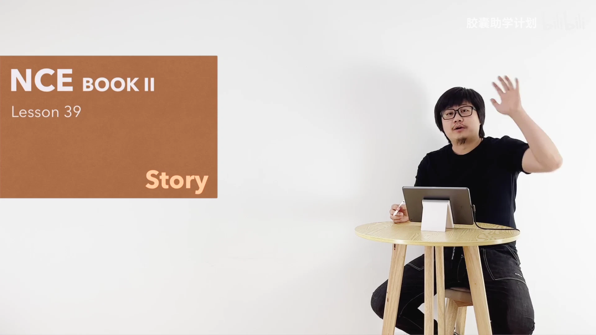

文字识别：NCE / BOOKⅡI / Lesson 39 / Story

### 画面 00:00:02

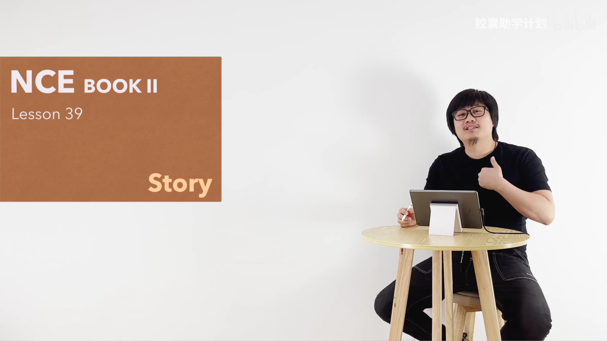

文字识别：NCE / BOOKⅡI / Lesson 39 / Story

### 画面 00:00:04

文字识别：NCE / BOOKⅡI / Lesson 39 / Story

### 画面 00:00:06

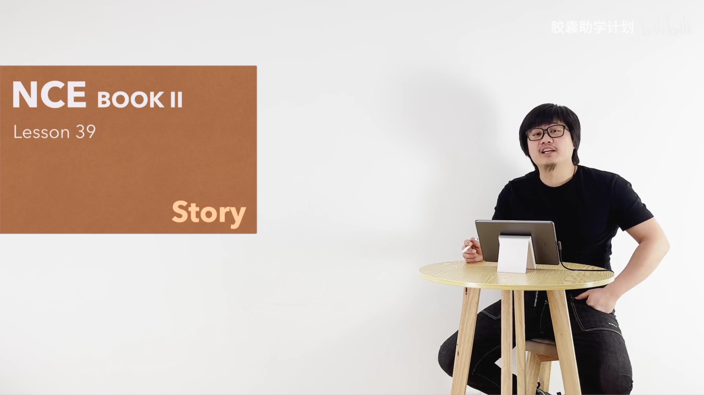

文字识别：NCE / BOOKⅡI / Lesson 39 / Story

### 画面 00:00:09

文字识别：胶囊助学计划 bilbl / • / •

### 画面 00:00:13

文字识别：胶囊助学计划

### 画面 00:00:15

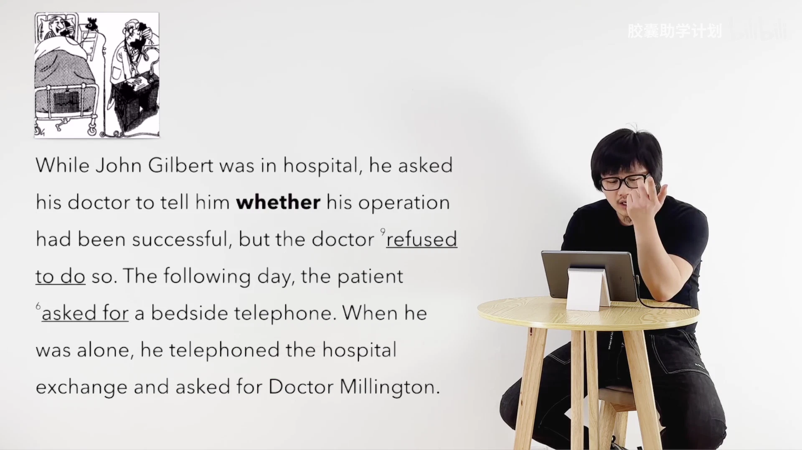

文字识别：While John Gilbert was in hospital, he asked / his doctor to tell him whether his operation / had been successful, but the doctor'refused / to do so. The following day, the patient / 'asked for a bedside telephone. When he / was alone, he telephoned the hospital / exchange and asked for Doctor Millington.

## 00:00:30–00:01:00

他的医生去告诉他，告诉他一件事儿。这件事儿，宾语从句，什么事儿呢？Whether his operation had been successful，说是否，你注意啊，whether我们就把它当if就可以了。说是否 his operation叫做他的手术 had been successful，是成功的。But the doctor，但是这个医生呢，refused to do so。这是我们第九课学过的一个知识点，叫refuse to do something，对吧？拒

### 画面 00:00:45

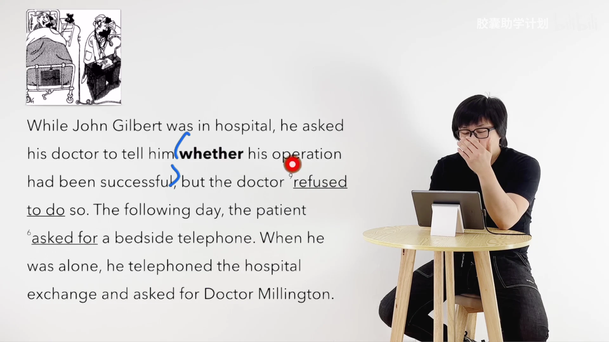

文字识别：While John Gilbert was in hospital, he asked / his doctor to tell him(whether his operation / had been successful)but the doctor'refused / to do so. The following day, the patient / 'asked for a bedside telephone. When he / was alone, he telephoned the hospital / exchange and asked for Doctor Millington.

## 00:01:00–00:01:30

绝怎么怎么样？Refuse to do so叫拒绝这样去做。The following day，讲单词部分我们提过了，叫第二天。The patient asked for the patient就是John Gilbert啊，说他呢就要了一个什么东西，叫a bedside telephone。好，你看bedside这个单词我们从来没学过，我也没讲过，但是我总觉得我给你讲几个单词，你可能就明白什么叫bedside了。Inside,

### 画面 00:01:15

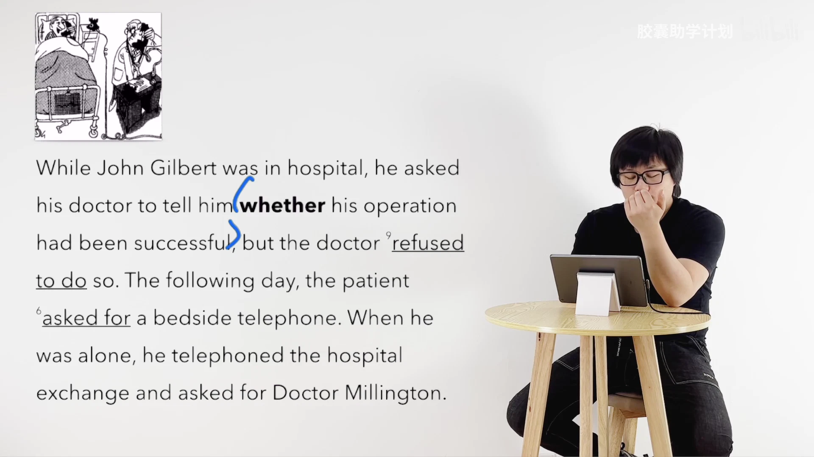

文字识别：While John Gilbert was in hospital, he asked / his doctor to tell him(whether his operation / had been successful,but the doctor'refused / to do so. The following day, the patient / 'asked for a bedside telephone. When he / was alone, he telephoned the hospital / exchange and asked for Doctor Millington.

## 00:01:30–00:02:00

outside, inside里边, outside外面, bedside床边对吧？那bedside telephone床边的一个电话对吧？他要了这么一个床边电话。When he was alone，当他一个人的时候，其实像这小半句，你就完全可以把它多读几遍，通过反复读文章记下来。然后我们经常说，当他当我一个人的时候，When I

### 画面 00:01:45

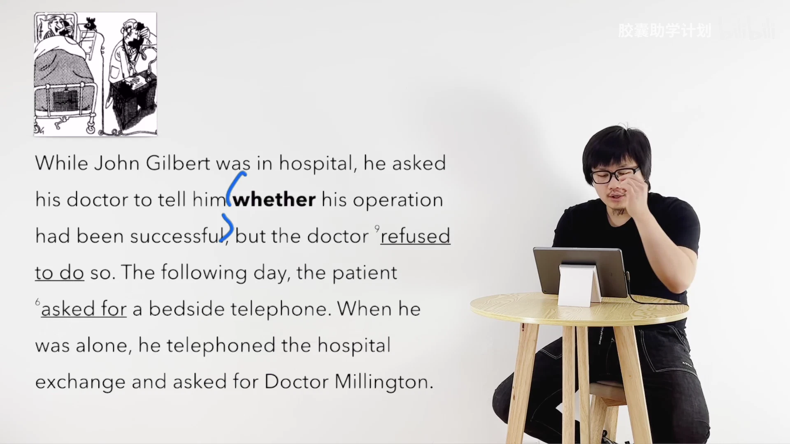

文字识别：While John Gilbert was in hospital, he asked / his doctor to tell him(whether his operation / had been successful,but the doctor'refused / to do so. The following day, the patient / 'asked for a bedside telephone. When he / was alone, he telephoned the hospital / exchange and asked for Doctor Millington.

## 00:02:00–00:02:30

was alone,对吧？He telephoned the hospital exchange.他给医院的交换台打了个电话，是吧？呃，我感觉现在可能我们都是人工的，是吧？呃，比如说，呃，往哪转接，请按一；往哪转接，请按二，对吧？都是这个样子。And ask for Doctor Millington.啊，然后呃，要找谁呢？Millington，这个我们管他就叫M吧，是吧？M医生啊。Next one.说When the

### 画面 00:02:09

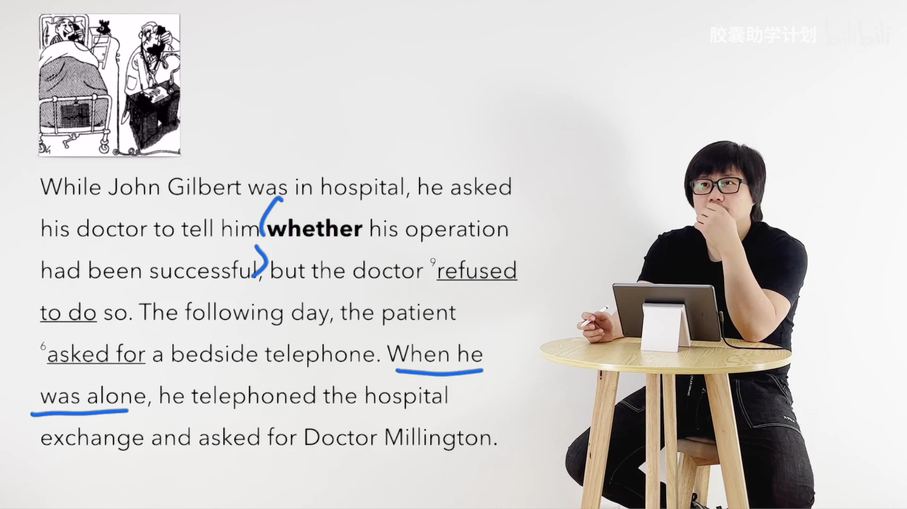

文字识别：While John Gilbert was in hospital, he asked / his doctor to tell him(whether his operation / had been successful,but the doctor'refused / to do so. The following day, the patient / 'asked for a bedside telephone. When he / was alone, he telephoned the hospital / exchange and asked for Doctor Millington.

### 画面 00:02:27

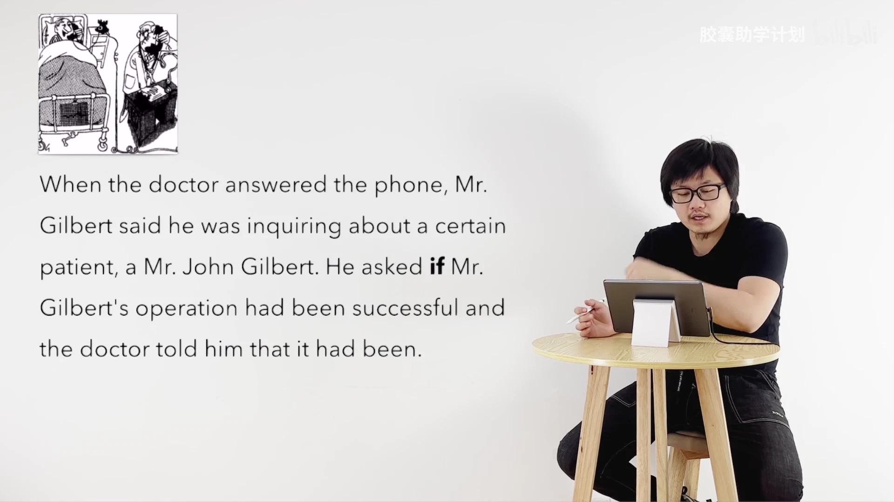

文字识别：When the doctor answered the phone, Mr. / Gilbert said he was inquiring about a certain / patient, a Mr. John Gilbert. He asked if Mr. / Gilbert's operation had been successful and / the doctor told him that it had been.

## 00:02:30–00:03:00

doctor answered the phone, Mr. Gilbert said he was inquiring about a certain patient, a Mr. John Gilbert.说当这个医生啊接这个电话的时候，Mr. Gilbert就说说的其实是一句话，说的是that宾语从句，对吧？各位回想一下啊，说的是什么呢？叫做He was inquiring about.好，他正在询问是一个哎某一个病人是谁呢？

### 画面 00:02:52

文字识别：When the doctor answered the phone, Mr. / Gilbert said he was inquiring about a certain / patient, a Mr. John Gilber. He asked if Mr. / Gilbert's operation had been successful and / the doctor told him that it had been.

## 00:03:00–00:03:30

叫做一个叫做 Mister John Gilbert 的人。也就是说，他其实给他的医生打电话，问他自己的病情，但是他装作另一个人，对吧？所以他问他自己的病情。 He asked. 他问说，If Mister Gilbert's operation had been successful. 他问啊，说是否 Mister Gilbert's 的手术呢是成功的？ And the doctor told him that it had been. 啊，

### 画面 00:03:22

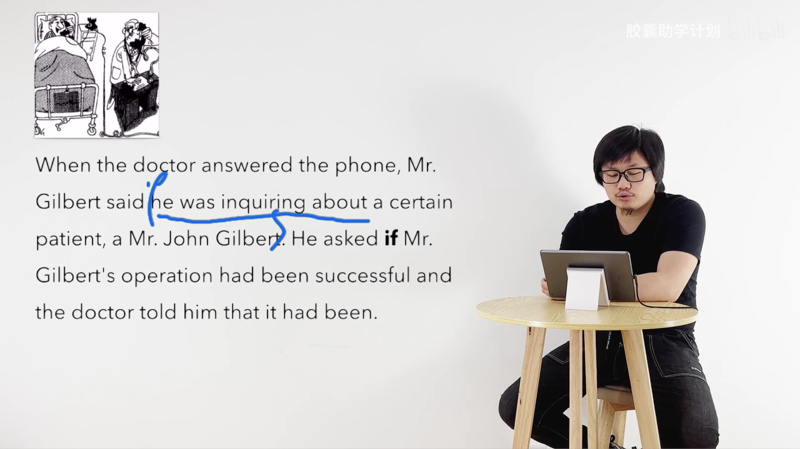

文字识别：When the doctor answered the phone, Mr. / Gilbert said he was inquiring about a certain / patient, a Mr. John Gilber?. He asked if Mr. / Gilbert's operation had been successful and / the doctor told him that it had been.

## 00:03:30–00:04:00

面其实省略了一个单词叫 successful。说然后啊，这个医生告诉他说他是成功的，对吧？Next one, he then asked.他然后又问到，你看后边这个地方就是一个宾语从句，由 when 引导的宾语从句。说 when Mr. Gilbert would be allowed to go home. Mr. Gilbert 将 be allowed to do something.第十课咱们学的，对吧？我们第十课学的是 now we are not allowed to

### 画面 00:03:38

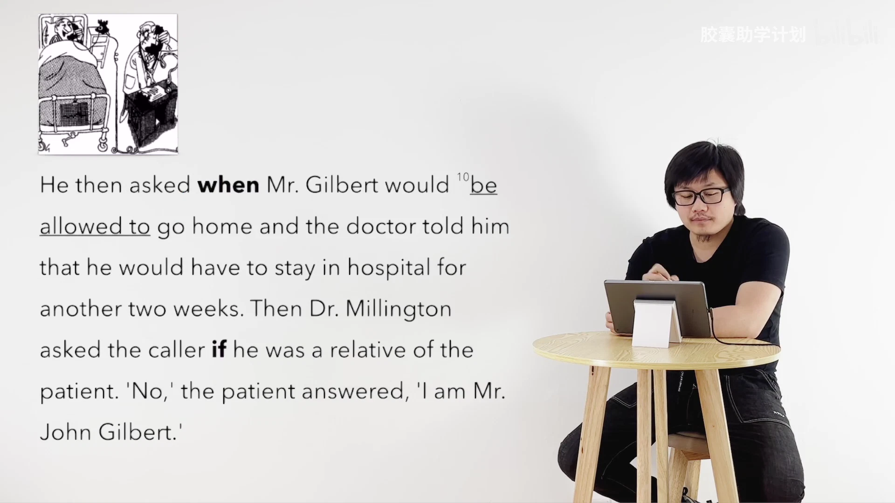

文字识别：He then asked when Mr. Gilbert would 1be / allowed to go home and the doctor told him / that he would have to stay in hospital for / another two weeks. Then Dr. Millington / asked the caller if he was a relative of the / patient.'No,' the patient answered, 'I am Mr. / John Gilbert.'

## 00:04:00–00:04:30

touch it, 是吧？就我们现在不被允许去摸这个五钢琴了。就是我们第十课学的那句话。那在这儿就变成了我不被允许回家。那在这儿想问的是, Mr. Gilbert将什么时候被允许回家？对不对？And the doctor told him, 医生告诉他什么呢？He would have to stay in hospital for another two weeks. 医生告诉他他将不得不停留在医院 for another two weeks,

### 画面 00:04:08

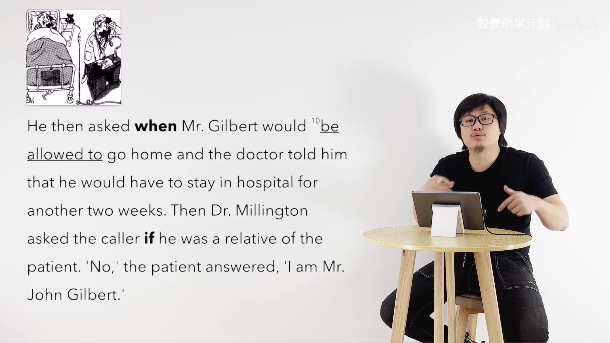

文字识别：He then asked when Mr. Gilbert would 'be / allowed to go home and the doctor told him / that he would have to stay in hospital for / another two weeks. Then Dr. Millington / asked the caller if he was a relative of the / patient.'No,' the patient answered, 'I am Mr. / John Gilbert.'

## 00:04:30–00:05:00

再来两周。那你看，would have to啊，这地方其实有几个知识点，我说一下，你可以记一下，然后自己去查一下啊。第一个叫做would have to，实际上我们在新二呃第十七课，我印象当中啊，我们学的是will have to。当然了，新一一百二十五课我们也学过啊，叫will have to。那在这儿怎么变成了would have to

### 画面 00:04:38

文字识别：He then asked when Mr. Gilbert would 'be / allowed to go home and the doctor told him / that he would have to stay in hospital for / another two weeks. Then Dr. Millington / asked the caller if he was a relative of the / patient.'No,' the patient answered, 'I am Mr. / John Gilbert.'

## 00:05:00–00:05:30

呢？原因是这里边用的是 told，这就要结合叫新概念一册一百三十三课那个语法。如果主句是一般过去时，那后面的这个从句你就要时态或者情态动词要往后迁一百啊，应该是一百三十五课咱们学的，对吧？所以就变成了 would have to 啊。再来，Then Doctor Millington asked the caller，问了这个什么呢？

### 画面 00:05:08

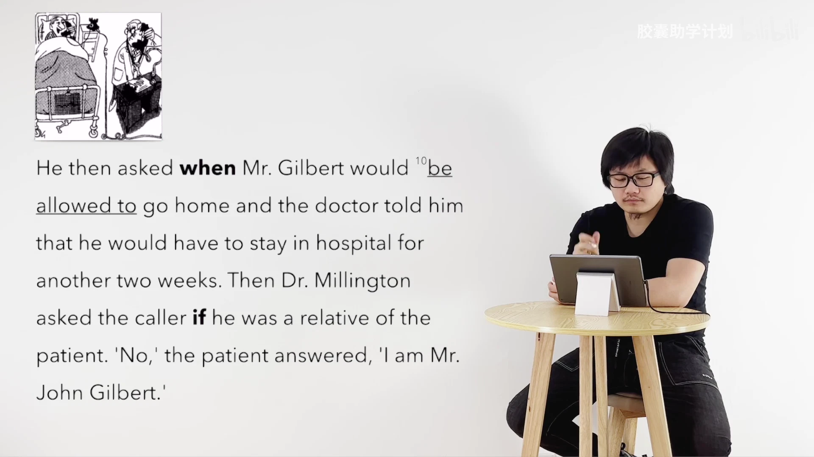

文字识别：He then asked when Mr. Gilbert would 1be / allowed to go home and the doctor told him / that he would have to stay in hospital for / another two weeks. Then Dr. Millington / asked the caller if he was a relative of the / patient.'No,' the patient answered, 'I am Mr. / John Gilbert.'

## 00:05:30–00:06:00

问了这个打电话的人，if叫做是否，he was a relative of the patient？问他是否是哎病人的这个亲戚是吧？亲人？No，the哎the patient answered说这个病人回答到，I'm Mr. John Gilbert。说我就是Mr. John Gilbert是吧？他无非其实就是他直接问医生，医生不告诉他，他要了个电话，装作另一个人给他打电话是吧？Okay，那本课的习惯用法其实都是我们之前

### 画面 00:05:38

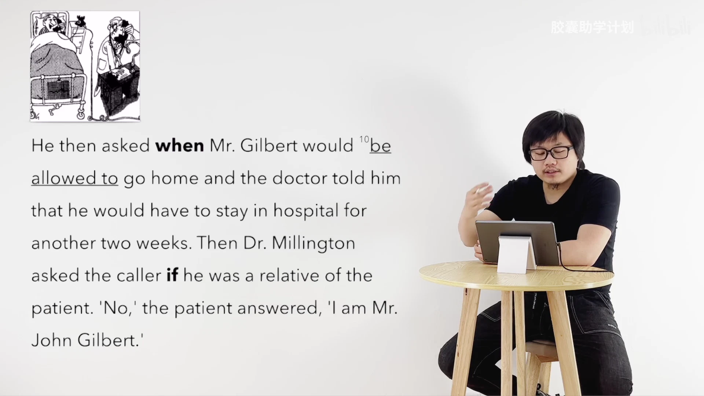

文字识别：He then asked when Mr. Gilbert would 1°be / allowed to go home and the doctor told him / that he would have to stay in hospital for / another two weeks. Then Dr. Millington / asked the caller if he was a relative of the / patient.'No,' the patient answered, 'I am Mr. / John Gilbert.'

### 画面 00:05:49

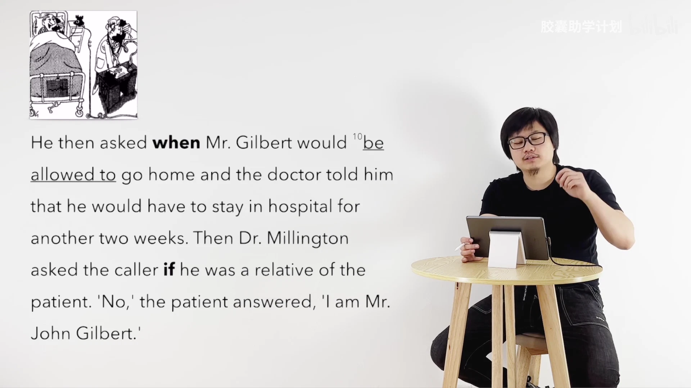

文字识别：He then asked when Mr. Gilbert would 1be / allowed to go home and the doctor told him / that he would have to stay in hospital for / another two weeks. Then Dr. Millington / asked the caller if he was a relative of the / patient.'No,' the patient answered, 'I am Mr. / John Gilbert.'

### 画面 00:05:57

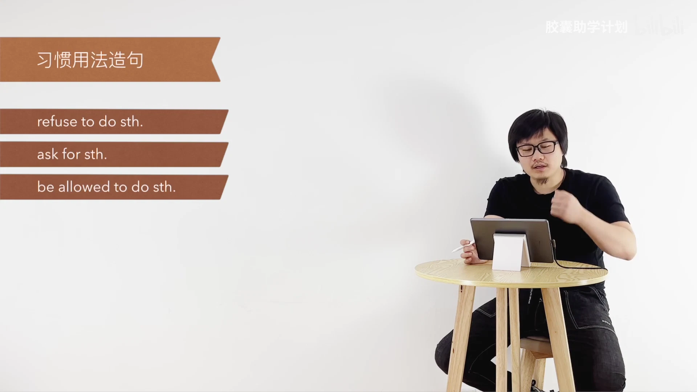

文字识别：习惯用法造句 / refuse to do sth. / ask for sth. / be allowed to do sth.

### 画面 00:05:59

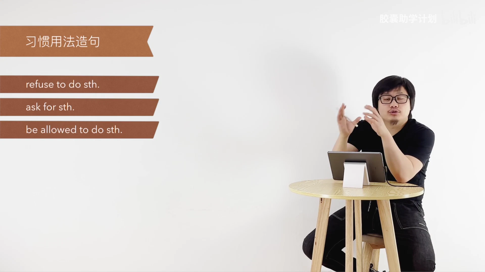

文字识别：习惯用法造句 / refuse to do sth. / ask for sth. / be allowed to do sth.

## 00:06:00–00:06:30

学过的啊，我们简单看一下就可以了，我们不再去造句了，叫 refuse to do something，拒绝做某事，ask for something 和 be allowed to do something，OK，好，recap expression 这三个啊，那老习惯习惯用法造句，您不妨可以再造一下，对吧？我们又再次见到了，就再次造造一下，但我上课就不给大家造了，因为之前造过了啊。然后呢，文章跟读至熟读成诵，这对我们下一

### 画面 00:06:01

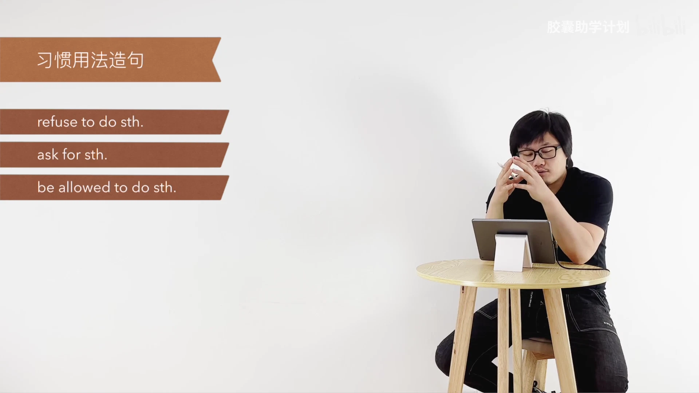

文字识别：习惯用法造句 / refuse to do sth. / ask for sth. / be allowed to do sth.

### 画面 00:06:05

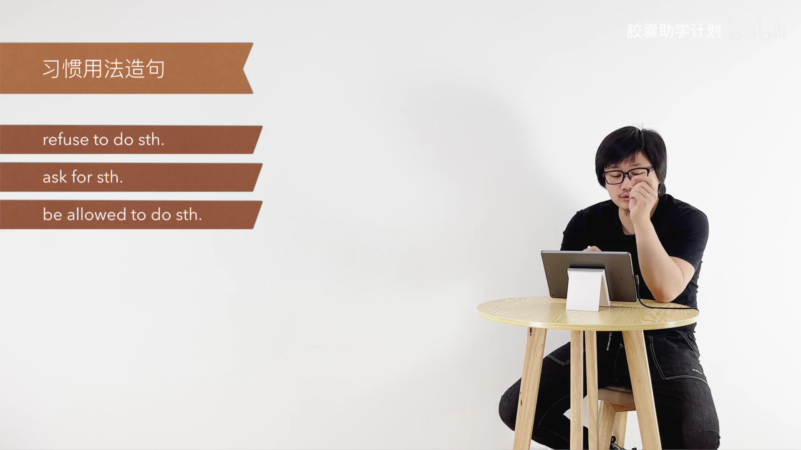

文字识别：习惯用法造句 / refuse to do sth. / ask for sth. / be allowed to do sth.

### 画面 00:06:10

文字识别：习惯用法造句 / refuse to do sth. / ask for sth. / be allowed to do sth.

### 画面 00:06:12

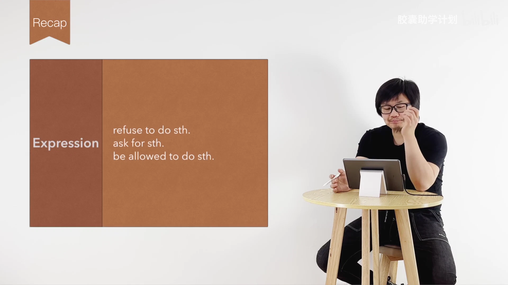

文字识别：Recap / refuse to do sth. / Expression / ask for sth. / be allowed to do sth.

### 画面 00:06:14

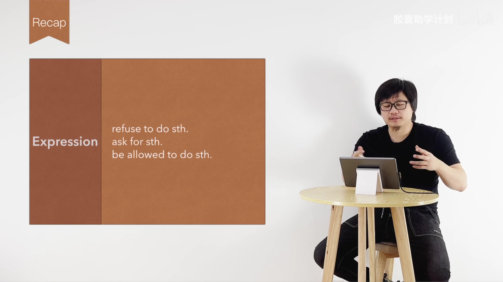

文字识别：Recap / refuse to do sth. / Expression / ask for sth. / be allowed to do sth.

### 画面 00:06:16

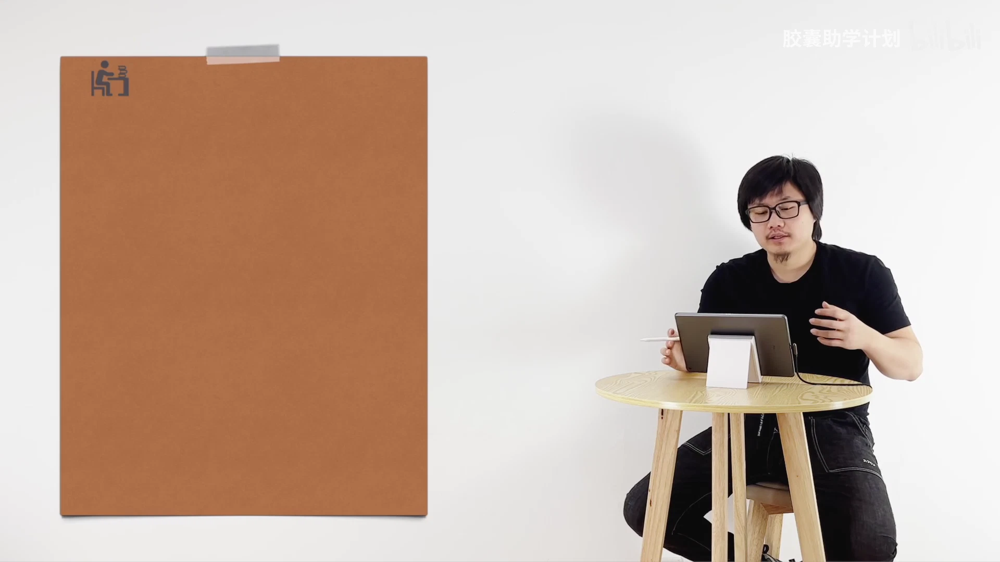

### 画面 00:06:18

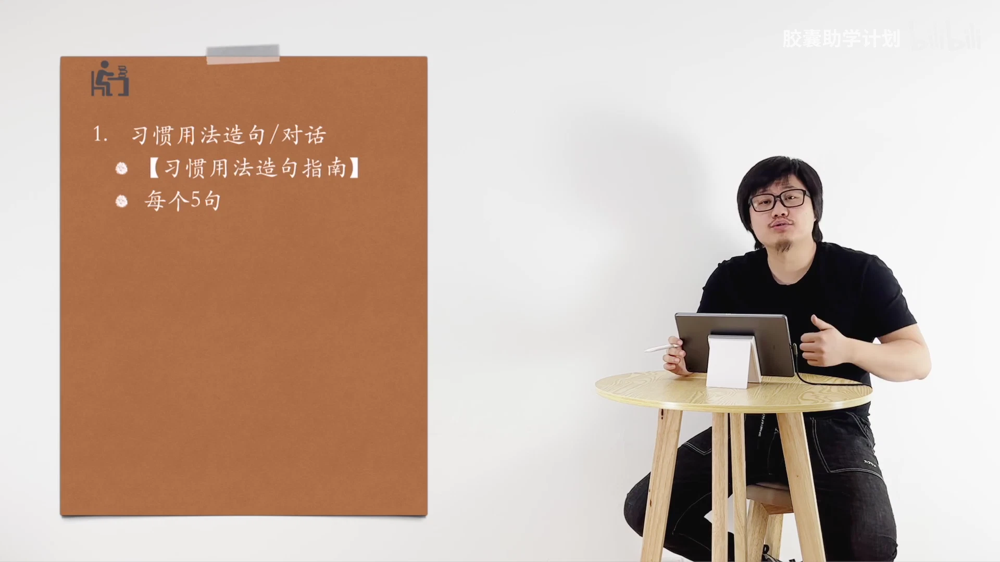

文字识别：1. / 习惯用法造句/对话 / 【习惯用法造句指南】 / 每个5句

### 画面 00:06:20

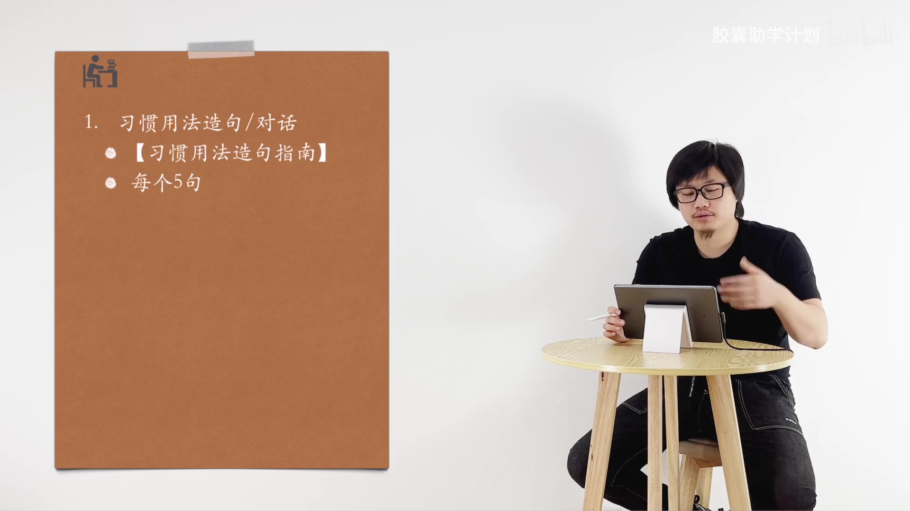

文字识别：1. / 习惯用法造句/对话 / 【习惯用法造句指南】 / 每个5句

### 画面 00:06:22

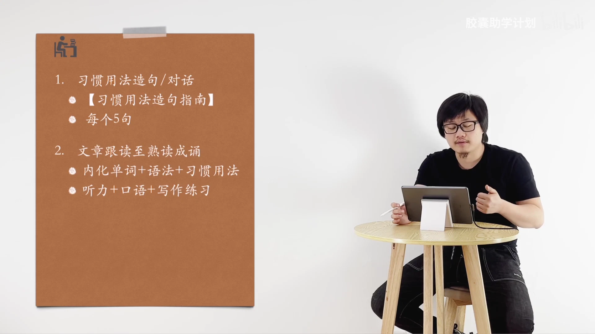

文字识别：习惯用法造句/对话 / 1. / 【习惯用法造句指南】 / 每个5句 / 文章跟读至熟读成诵 / 内化单词+语法+习惯用法 / 听力+口语+写作练习

### 画面 00:06:24

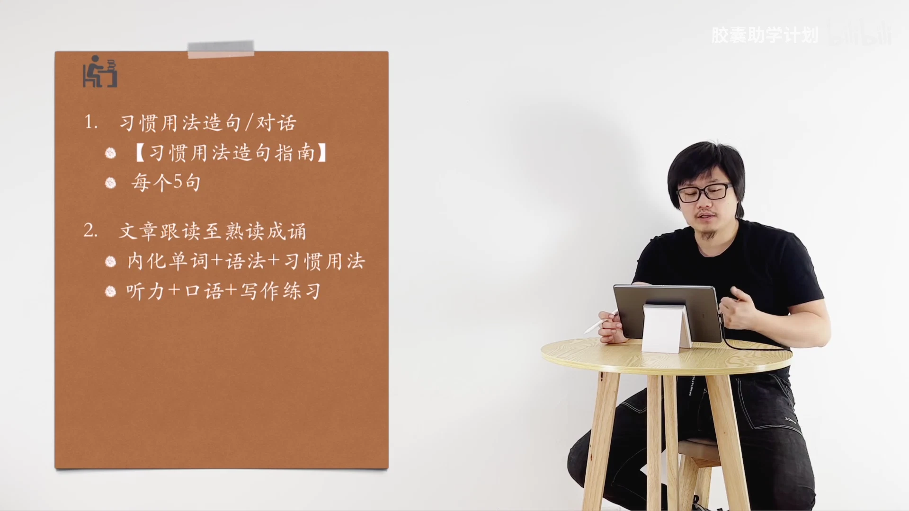

文字识别：习惯用法造句/对话 / 1. / 【习惯用法造句指南】 / 每个5句 / 文章跟读至熟读成诵 / 内化单词+语法+习惯用法 / 听力+口语+写作练习

### 画面 00:06:26

文字识别：习惯用法造句/对话 / 1. / 【习惯用法造句指南】 / 每个5句 / 文章跟读至熟读成诵 / 内化单词+语法+习惯用法 / 听力+口语+写作练习

### 画面 00:06:28

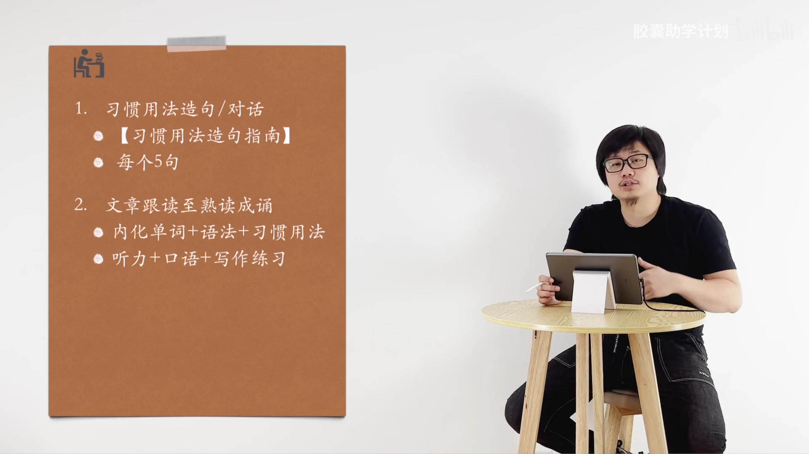

文字识别：习惯用法造句/对话 / 1. / 【习惯用法造句指南】 / 每个5句 / 文章跟读至熟读成诵 / 内化单词+语法+习惯用法 / 听力+口语+写作练习

## 00:06:30–00:06:58

个视频做练习是非常有帮助的，好吧？那如呃，以上就是本期视频的全部内容了。如果各位喜欢我们的课程呢，欢迎各位关注、订阅、一键三连，分享给那些需要的朋友，来帮助我们快速成长。See you next time.

### 画面 00:06:30

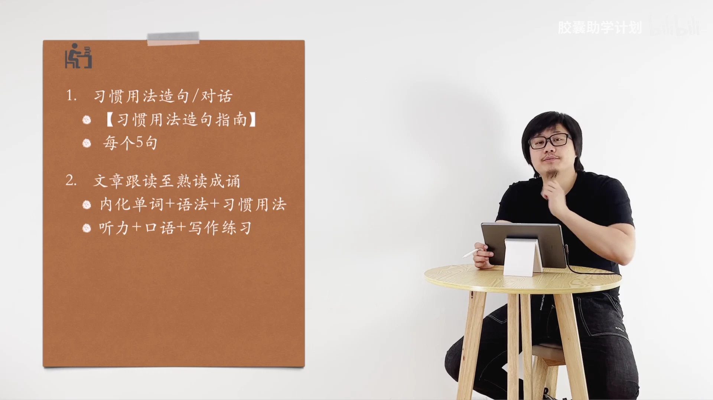

文字识别：1. / 习惯用法造句/对话 / 【习惯用法造句指南】 / 每个5句 / 文章跟读至熟读成诵 / 内化单词+语法+习惯用法 / 听力+口语+写作练习

### 画面 00:06:32

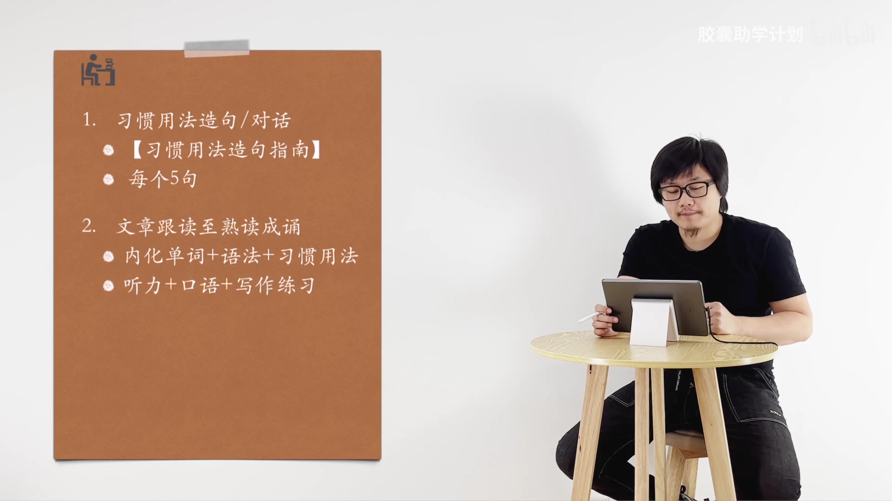

文字识别：习惯用法造句/对话 / 1. / 【习惯用法造句指南】 / 每个5句 / 文章跟读至熟读成诵 / 内化单词+语法+习惯用法 / 听力+口语+写作练习

### 画面 00:06:34

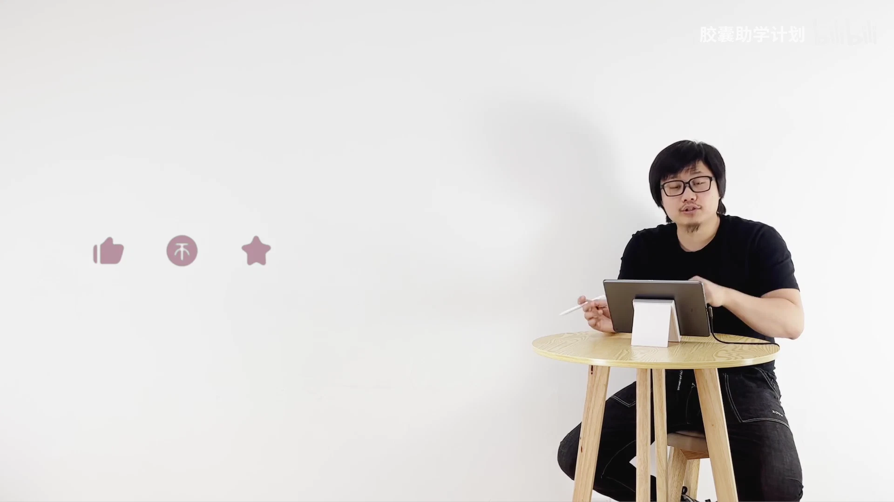

文字识别：￥

### 画面 00:06:46

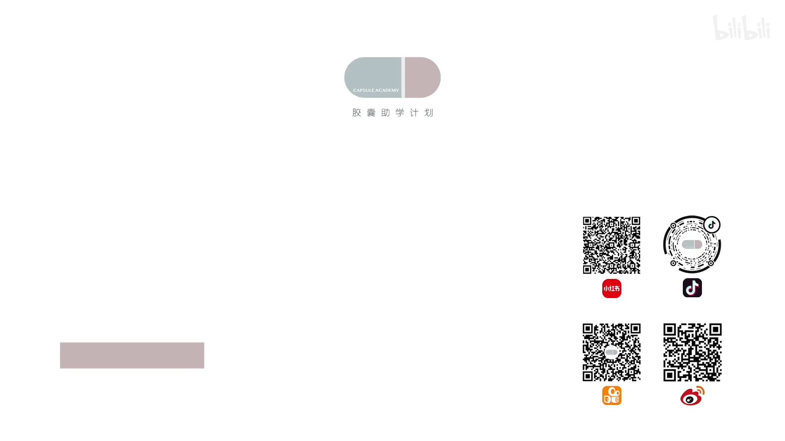

文字识别：CAPSULEACADEMY / 胶囊助学计划 / 小红书 / 品

### 画面 00:06:48

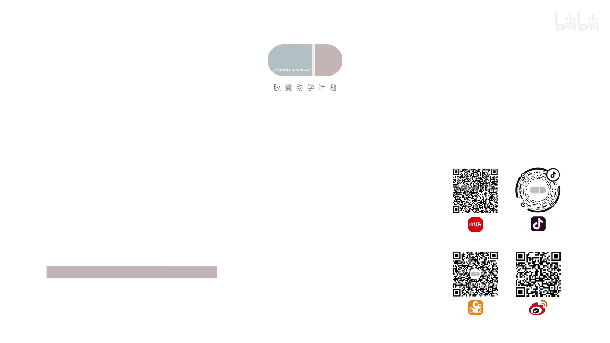

文字识别：CAPSULEACADEMY / 胶囊助学计划 / 『 / 小红书 / OE

### 画面 00:06:54

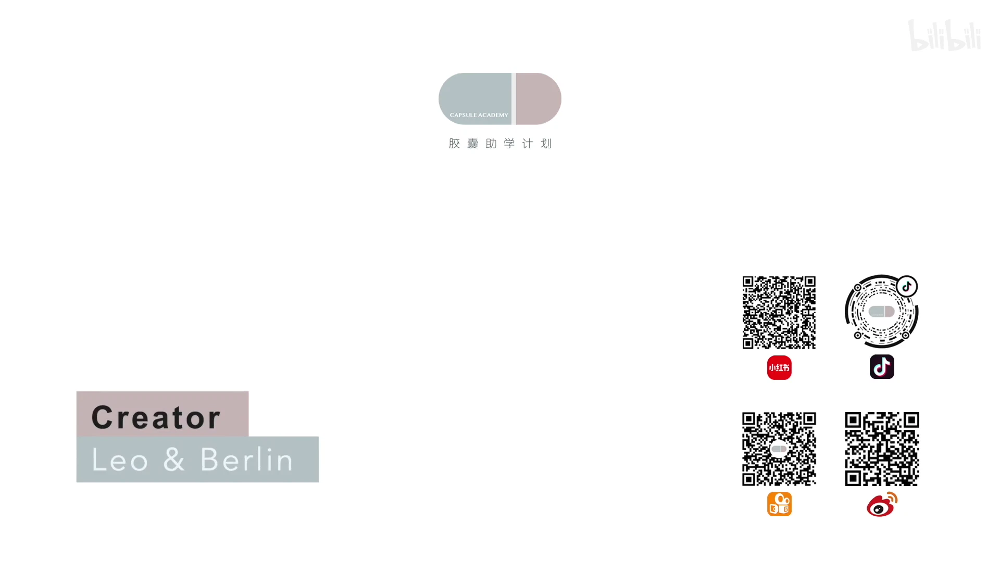

文字识别：CAPSULEACADEMY / 胶囊助学计划 / 小红书 / Creator / Leo & Berlin / OE

### 画面 00:06:56

文字识别：bilibili / 胶囊助学计划

### 画面 00:06:57

文字识别：bilibili / 胶囊助学计划

