# L039 听说读写复述练习

快速机器解析：语音为单模型转写，未进行独立交叉校对或人工复核；画面每秒采样并按变化选帧，短时文字和标记可能遗漏。截图时间约有 1 秒误差。图片有损压缩；遇到疑点请按时间查看 Google Drive 原视频。

## 00:00:00–00:00:30

Hello everyone, welcome to Capsule Academy. This is Leo. Today we are going to learn the Concept English Book Two Lesson Thirty Nine Practices. That note, ah,进行如下练习的唯一前提就是文章一定要跟读至熟读成诵，否则请勿开始。Hope you gonna enjoy it.好，那我们先看第一题 comprehension，对吧？叫做听懂一般疑问句和特殊疑问句的能力。那您可以在文章当中

### 画面 00:00:00

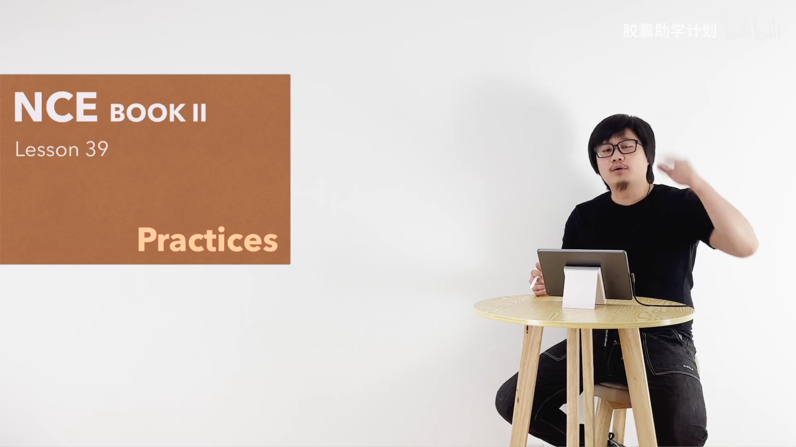

文字识别：NCE / BOOKⅡI / Lesson 39 / Practices

### 画面 00:00:02

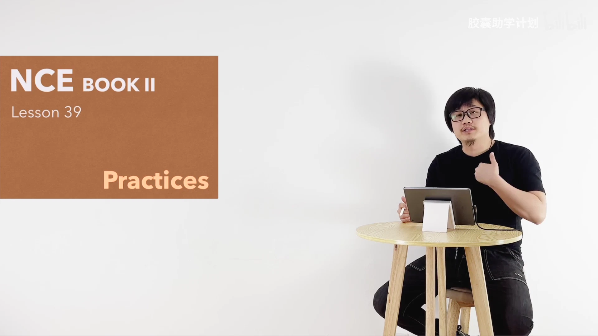

文字识别：NCE / BOOK I"I / Lesson 39 / Practices

### 画面 00:00:05

文字识别：NCE / BOOKII / Lesson 39 / Practices

### 画面 00:00:07

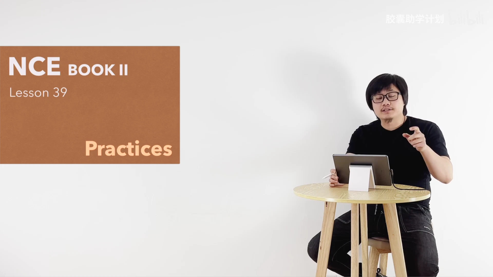

文字识别：NCE / BOOKI"I / Lesson 39 / Practices

### 画面 00:00:09

文字识别：进行如下练习唯一前提 / 文章跟读至熟读成诵 / 否则请勿开始

### 画面 00:00:18

文字识别：胶囊助学计划bll / •

### 画面 00:00:21

文字识别：胶囊助学计划 / 胶囊助学计划

### 画面 00:00:23

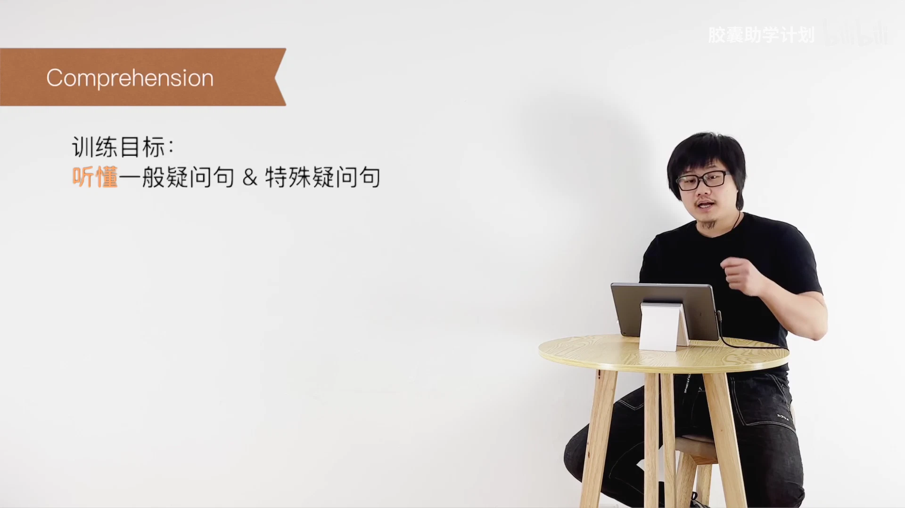

文字识别：Comprehension / 训练目标： / 听懂一般疑问句＆特殊疑问句

## 00:00:30–00:01:00

答案，但尽量不要看我这里问，对吧？我问您答，咱们练一下口语和听力。OK，第一题，Where was John Gilbert？答案In hospital。Next one，Had he had an operation？Yes，he had。Next one，What did he ask his doctor to tell him？Whether his operation had been successful。Next

### 画面 00:00:30

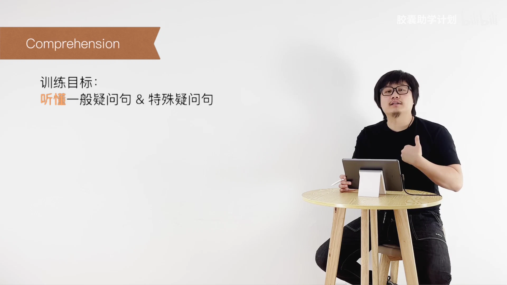

文字识别：Comprehension / 训练目标： / 听懂一般疑问句＆特殊疑问句

### 画面 00:00:36

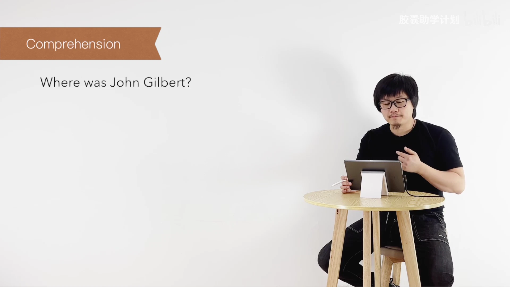

文字识别：Comprehension / Where Was John Gilbert?

### 画面 00:00:51

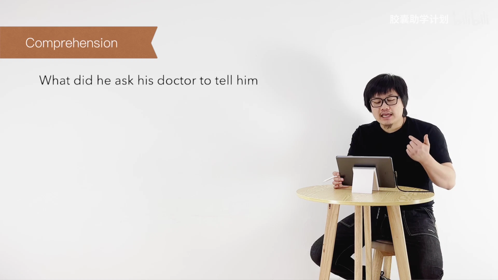

文字识别：Comprehension / What did he ask his doctor to tell him

### 画面 00:00:56

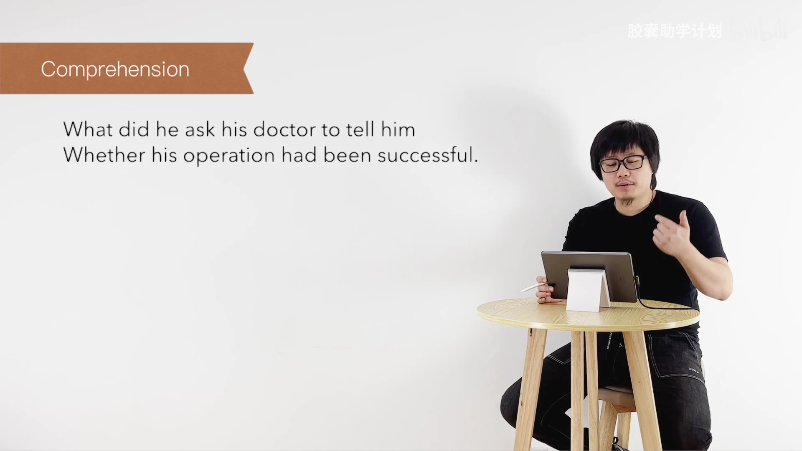

文字识别：Comprehension / What did he ask his doctor to tell him / Whether his operation had been successful.

### 画面 00:00:59

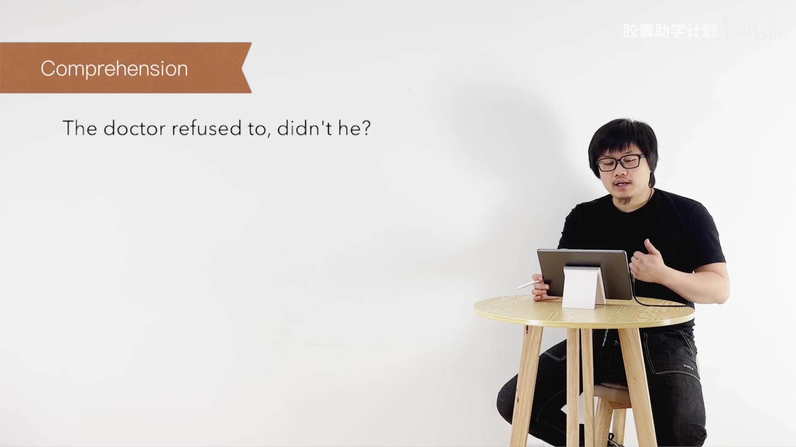

文字识别：Comprehension / The doctor refused to, didn't he?

## 00:01:00–00:01:30

the doctor refused to, didn't he? Yes, he did. Next one, what did the patient ask for the following day? For a bedside telephone. Next one, so when did he ring the hospital exchange? When he was alone. Next one, whom whom就是who啊? Who did he ask

### 画面 00:01:12

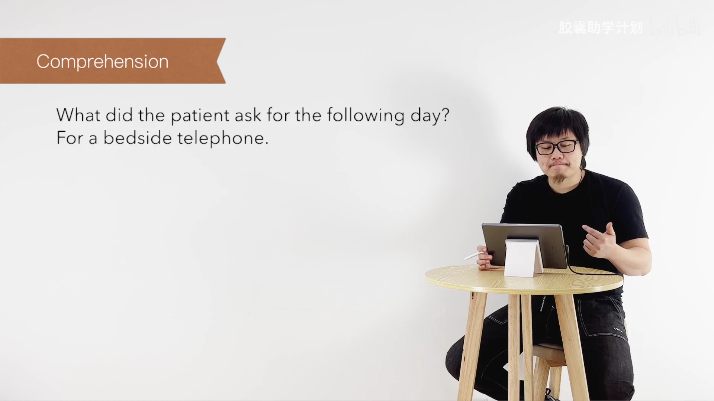

文字识别：Comprehension / What did the patient ask for the following day? / For a bedside telephone.

### 画面 00:01:16

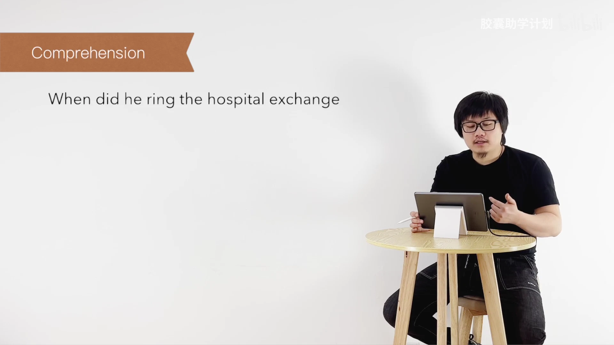

文字识别：Comprehension / When did he ring the hospital exchange

## 00:01:30–00:02:00

to speak to? Ah, Doctor Millington. Very good. Next one. So what did Mr. Gilbert say? He was inquiring about a certain patient, Mr. John Gilbert. Very good. Next one. Did he ask if Mr. Gilbert's operation had been successful? Yes, he did. Next one. What did the doctor

### 画面 00:01:39

文字识别：Comprehension / What did Mr. Gilbert say? / He was inquiring about a certain patient, Mr. / John Gilbert.

### 画面 00:01:47

文字识别：Comprehension / Did he ask if Mr. Gilbert's operation had / been successful?

### 画面 00:01:58

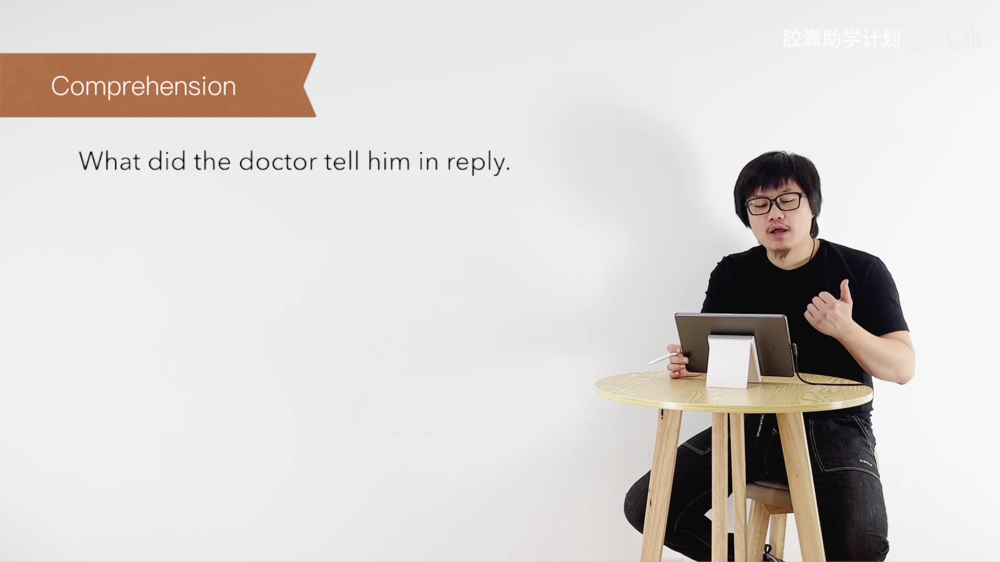

文字识别：Comprehension / What did the doctor tell him in reply.

## 00:02:00–00:02:30

tell him in reply? That the operation had been successful. Next one, what did he ask the doctor next? When Mr. Gilbert would be allowed to go home? Okay, next one, how long would he have to stay? For another two weeks.好，asking questions，练习的是我们会说一般疑问句和

### 画面 00:02:12

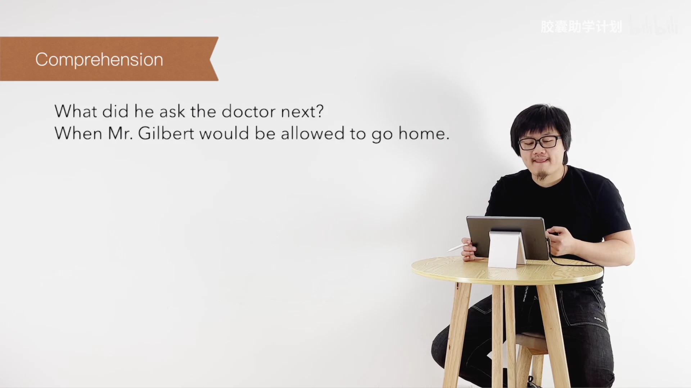

文字识别：Comprehension / What did he ask the doctor next? / When Mr. Gilbert would be allowed to go home.

### 画面 00:02:18

文字识别：Comprehension / How long would he have to stay?

### 画面 00:02:25

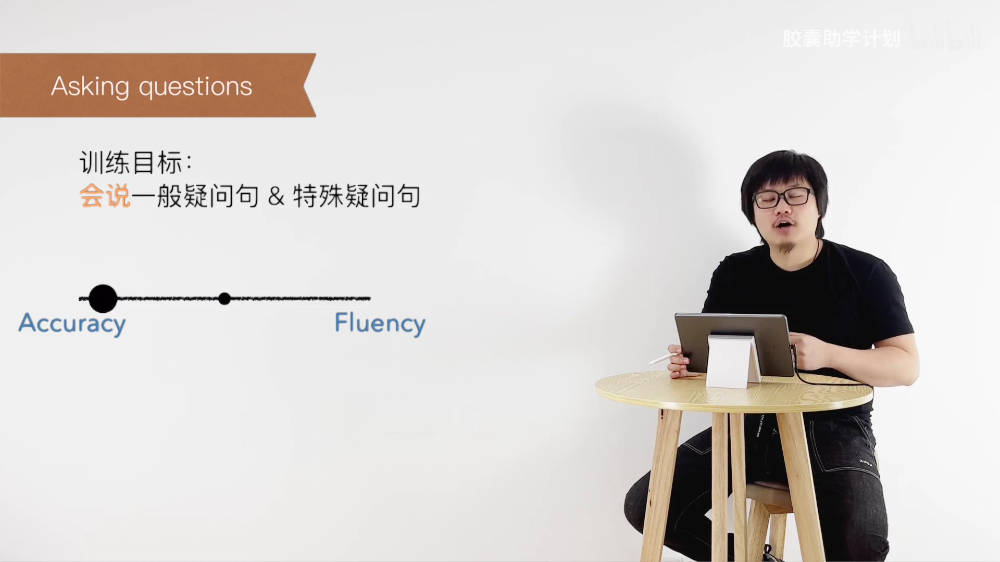

文字识别：Asking questions / 训练目标： / 会说一般疑问句＆特殊疑问句 / Accuracy / Fluency

## 00:02:30–00:03:00

特殊疑问句的能力。Okay, very good. Next one, say ask me if John Gilbert was in hospital.一般疑问句叫做Was John Gilbert in hospital? Where那叫做Where was John Gilbert?很简单，对吧？好，我们看第二个啊。注意这个撇d是had，对吧？叫做He had had an operation. Had提前What对an operation提问。He wanted to know whether it had been successful.

### 画面 00:02:32

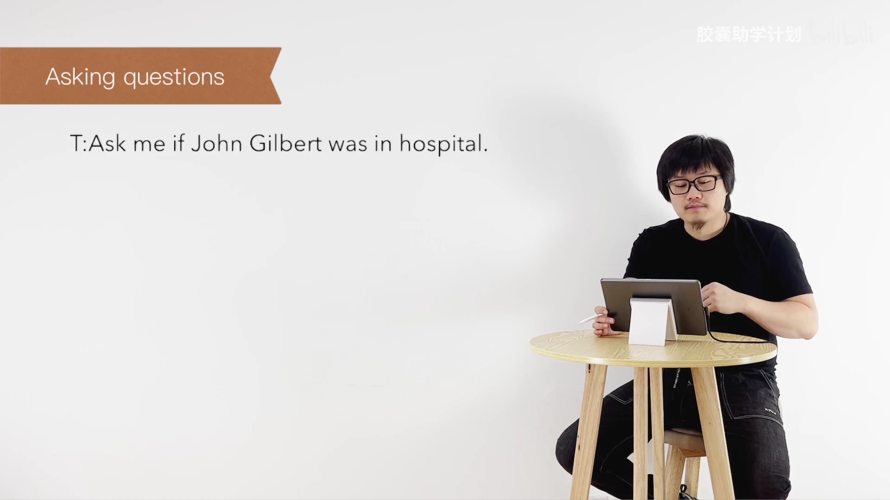

文字识别：Asking questions / T:Ask me if John Gilbert was in hospital.

### 画面 00:02:42

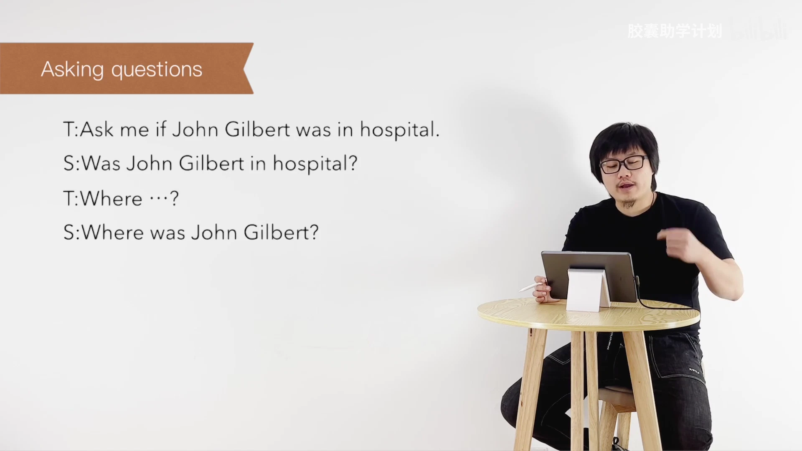

文字识别：Asking questions / T:Ask me if John Gilbert was in hospital. / S:Was John Gilbert in hospital? / T:Where…? / S:Where Was John Gilbert?

### 画面 00:02:44

文字识别：Asking questions

### 画面 00:02:47

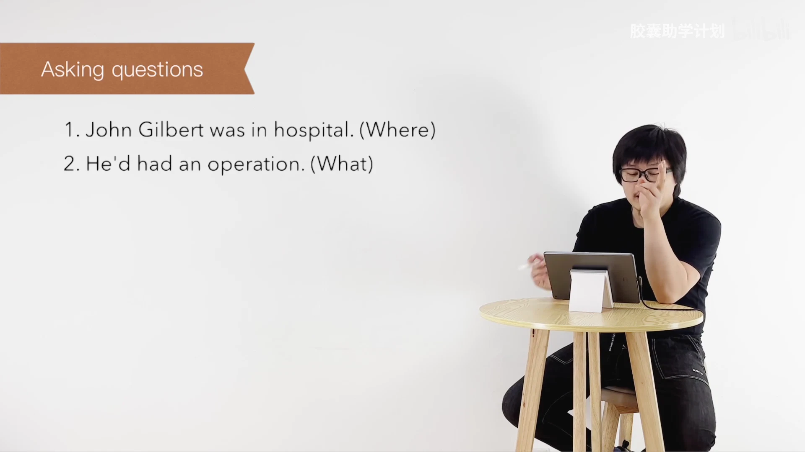

文字识别：Asking questions / 1. John Gilbert was in hospital. (Where) / 2. He'd had an operation. (What)

### 画面 00:02:53

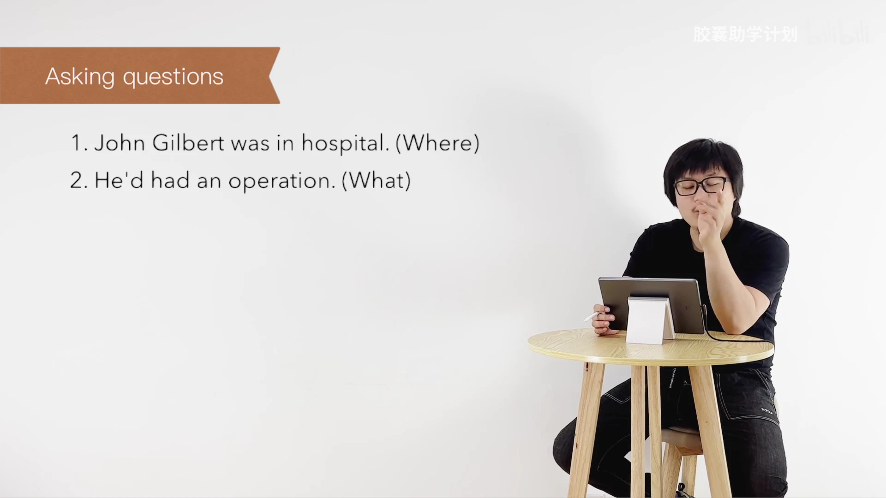

文字识别：Asking questions / 1. John Gilbert was in hospital. (Where) / 2. He'd had an operation. (What)

## 00:03:00–00:03:30

successful, did提前那what直接叫做what did he want to know,对吧？直接对整个后边这句话提问，宾语从句啊。He asked his doctor,啊doctor, did提前who你可以对主语提问，也可以对his doctor提问，都可以。那doctor refused to tell him, did提前what叫做what did the doctor refuse to

### 画面 00:03:00

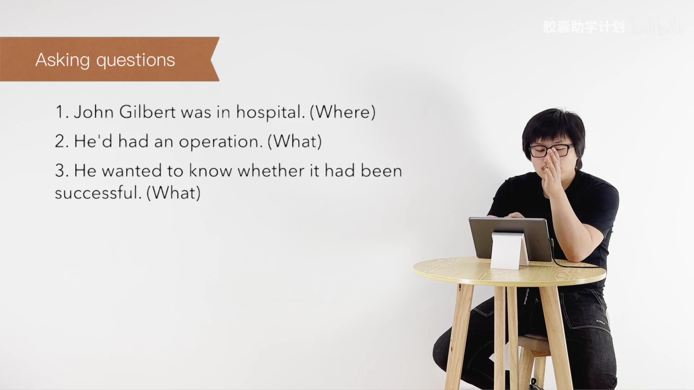

文字识别：Asking questions / 1. John Gilbert was in hospital. (Where) / 2. He'd had an operation. (What) / 3. He wanted to know whether it had been / successful.(What)

### 画面 00:03:20

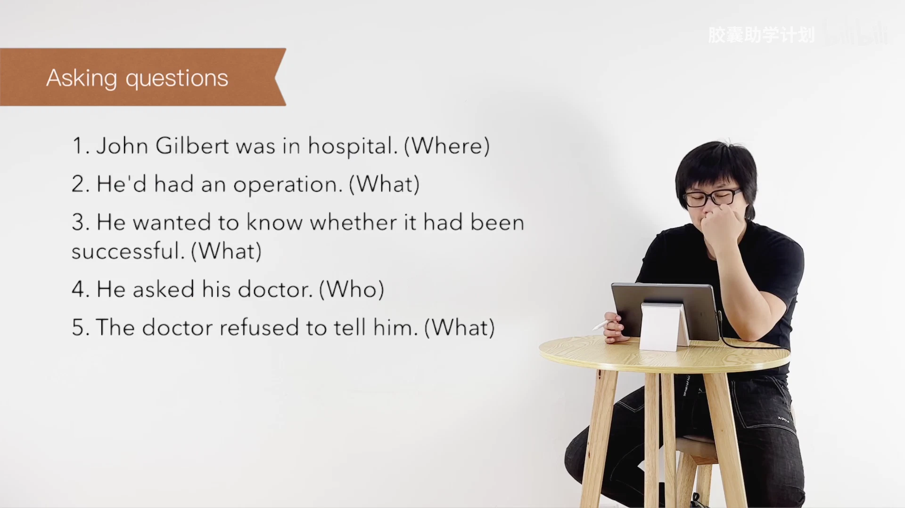

文字识别：Asking questions / 1. John Gilbert was in hospital. (Where) / 2. He'd had an operation. (What) / 3. He wanted to know whether it had been / successful.(What) / 4. He asked his doctor.(Who) / 5. The doctor refused to tell him. (What)

## 00:03:30–00:04:00

do. Ah, I think this is better. What did the doctor refuse to do? Ah, ah, do the called tell him. Okay, good. Next question, he asked for a bedside telephone. What did he ask for? First, the question is easy. General question. What did he ask for? What did he ask for? Very easy. Seventh question, he telephoned the hospital exchange when he was alone. Okay, first, we need to find a

### 画面 00:03:40

文字识别：Asking questions

### 画面 00:03:54

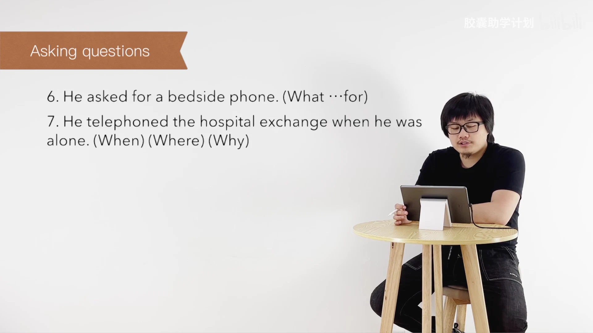

文字识别：Asking questions / 6. He asked for a bedside phone.(What …for) / 7. He telephoned the hospital exchange when he was / alone.(When)(Where)(Why)

### 画面 00:03:57

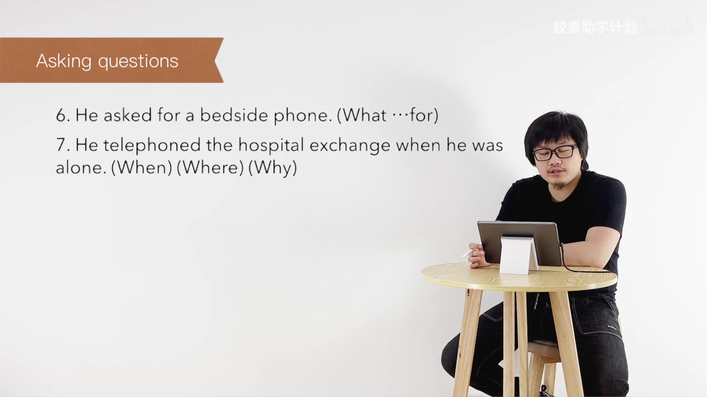

文字识别：Asking questions / 6. He asked for a bedside phone.(What …for) / 7. He telephoned the hospital exchange when he was / alone.(When)(Where)(Why)

## 00:04:00–00:04:30

确定有一个 telephone 的 did 提前变一般疑问句。When 对 When he was alone 提问，对吧？Where 对 the hospital exchange 提问？Why 对整句话提问？啊，第八题 He asked for Doctor Melenton. 那 did 提前 Who？那你就说 Who did he ask for？就行了，是吧？第九题 He said did 提前 What？直接对宾语从句提问？Who about 对

### 画面 00:04:00

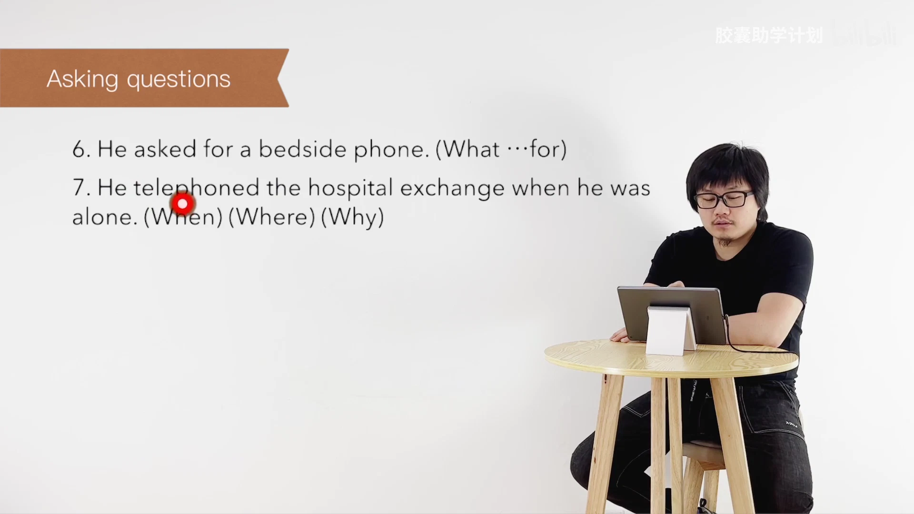

文字识别：Asking questions / 6. He asked for a bedside phone.(What ·for) / 7. He telephoned the hospital exchange when he was / alone.(WRen) (Where) (Why)

### 画面 00:04:22

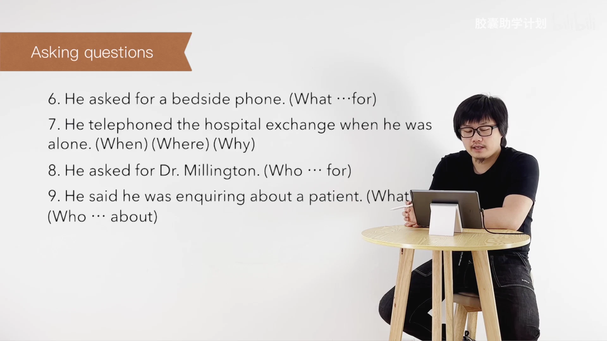

文字识别：Asking questions / 6. He asked for a bedside phone.(What …for) / 7. He telephoned the hospital exchange when he was / alone.(When)(Where)(Why) / 8. He asked for Dr. Millington. (Who … for) / 9. He said he was enquiring about a patient. (What) / (Who…about)

## 00:04:30–00:05:00

a patient 提问，对吧？呃，the patient's name was John Gilbert. Was 提前吧，这个 P S 是的的意思，对吧？那 What 是对 John Gilbert 提问啊？所以答案是 What was the patient's name? 啊，OK. Tell the story. 口语复述能力，呃，可以错一点点，不能太慢，所以文章一定要读的很熟。前两个单元有示范，

### 画面 00:04:44

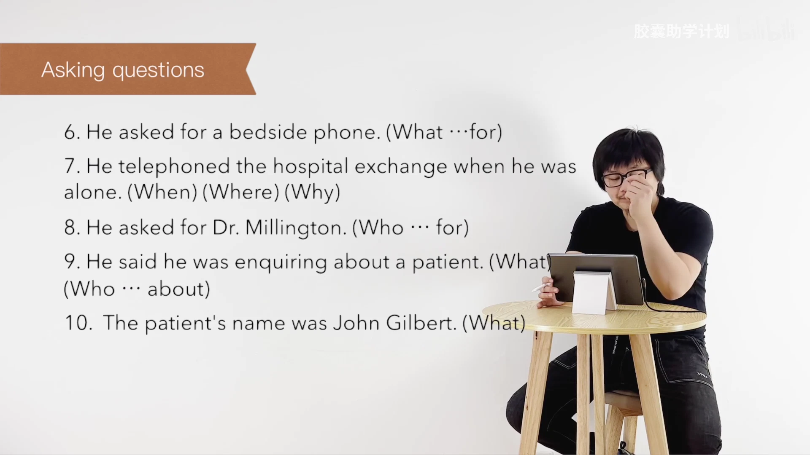

文字识别：Asking questions / 6. He asked for a bedside phone.(What …for) / 7. He telephoned the hospital exchange when he was / alone.(When)(Where)(Why) / 8. He asked for Dr. Millington. (Who … for) / 9. He said he was enquiring about a patient. (What) / (Who…about) / 10. The patient's name Was John Gilbert. (What)

### 画面 00:04:48

文字识别：Tell the story / 训练目标： / 口语复述能力 / Accuracy / Fluency

### 画面 00:04:51

文字识别：Tell the story / 训练目标： / 口语复述能力 / Accuracy / Fluency

### 画面 00:04:57

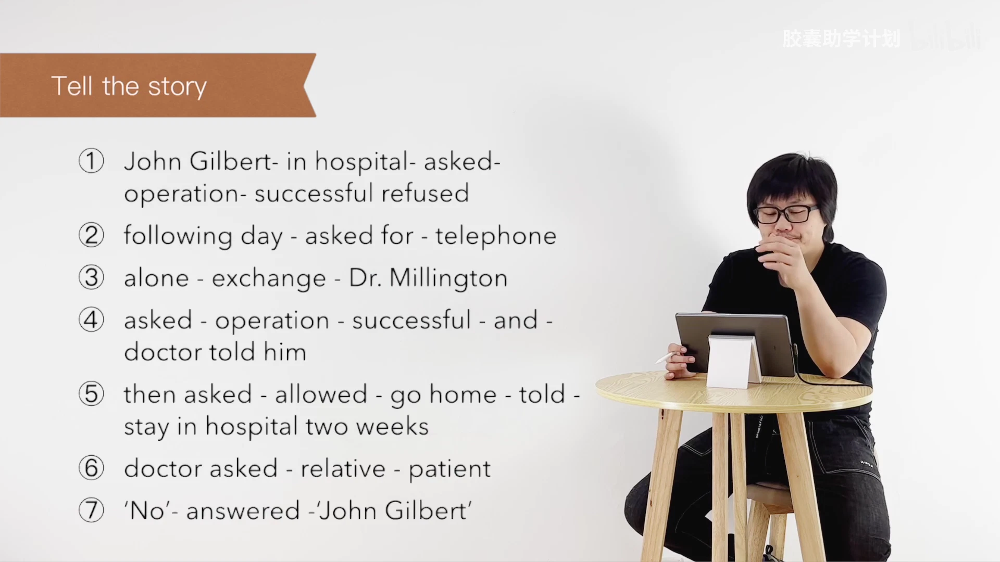

文字识别：Tell the story / John Gilbert- in hospital- asked- / operation- successful refused /  following day- asked for- telephone / alone - exchange - Dr. Millington / 3 / asked - operation - successful - and - / doctor told him / then asked - allowed - go home - told - / stay in hospital two weeks / doctor asked - relative - patient / 'No'- answered -'John Gilbert'

## 00:05:00–00:05:30

对吧？啊，第一个单元有示范，然后下一题呢？摘要写作练习的是我们写作复述能力，好吧？都在这个地方啊，不多说了。写完了之后来这儿对答案就可以了，有问题问一下。呃，完全自由的对话，topic for discussion，我们说一下都有哪些题啊？雅思托福口语题很多都跟这个很类似啊。比如说，Have you ever visited hospital or had an operation? Tell us about it。你有去过一个医院吗？或

### 画面 00:05:02

文字识别：Summary writing: Key / 训练目标： / 写作复述能力

### 画面 00:05:07

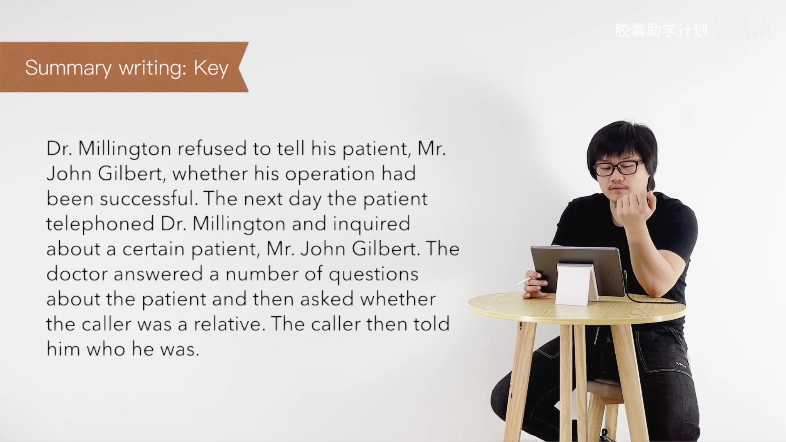

文字识别：Summary writing: Key / Dr. Millington refused to tell his patient, Mr. / John Gilbert, whether his operation had / been successful. The next day the patient / telephoned Dr. Millington and inquired / about a certain patient, Mr. John Gilbert. The / doctor answered a number of questions / about the patient and then asked whether / the caller was a relative. The caller then told / him who he was.

### 画面 00:05:12

文字识别：Topics for discussion / 训练目标： / 完全自由的对话 / Accuracy / Fluency

### 画面 00:05:17

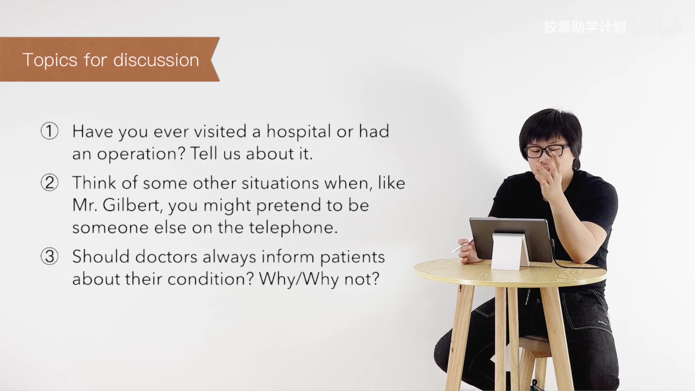

文字识别：Topics for discussion / Have you ever visited a hospital or had / an operation? Tell us about it. / Think of some other situations when, like / Mr. Gilbert, you might pretend to be / someone else on the telephone. / Should doctors always inform patients / about their condition? Why/Why not?

### 画面 00:05:20

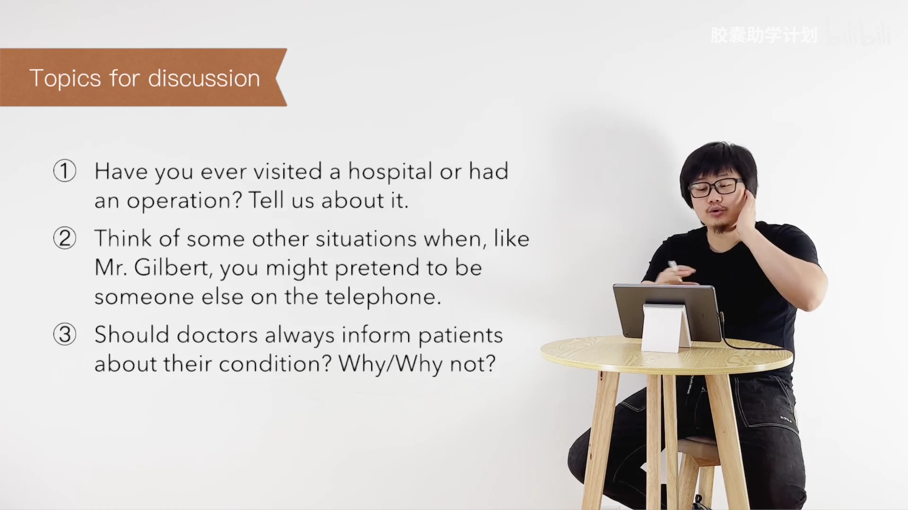

文字识别：Topics for discussion / Have you ever visited a hospital or had / an operation? Tell us about it. / Think of some other situations when, like / Mr. Gilbert, you might pretend to be / someone else on the telephone. / Should doctors always inform patients / about their condition? Why/Why not?

## 00:05:30–00:06:00

者有过这个动过手术吗？给我们讲一讲啊。第二题说，Think of some other situations when, like Mr. Gilbert, you might pretend to be someone else on the telephone。说你想一个其他的场景啊，在电话上你会装作你是其他人。最后一个叫做Show doctors always inform patients about their condition while why not？就是说医生总要通知病人他们的病

### 画面 00:05:50

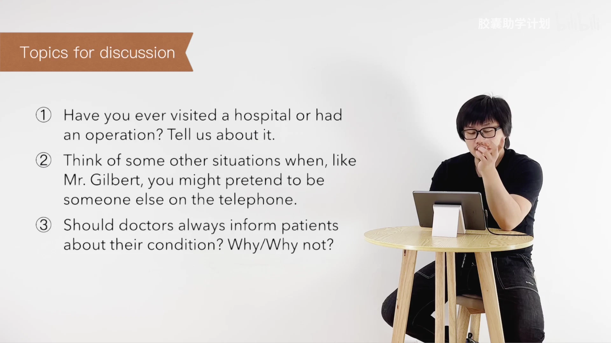

文字识别：Topics for discussion / Have you ever visited a hospital or had / an operation? Tell us about it. / Think of some other situations when, like / Mr. Gilbert, you might pretend to be / someone else on the telephone. / Should doctors always inform patients / about their condition? Why/Why not?

## 00:06:00–00:06:30

情吗？总要为什么总要啊？不总要为什么不总要？好吧。家庭作业 ask me if 先写再朗读，摘要写作先写对答案，条的 story 口语复述专栏当中都有。那以上呢就是本期视频的全部内容了。如果喜欢我们的课程呢，欢迎各位关注、订阅、一键三连啊。 See you next time.

### 画面 00:06:05

### 画面 00:06:07

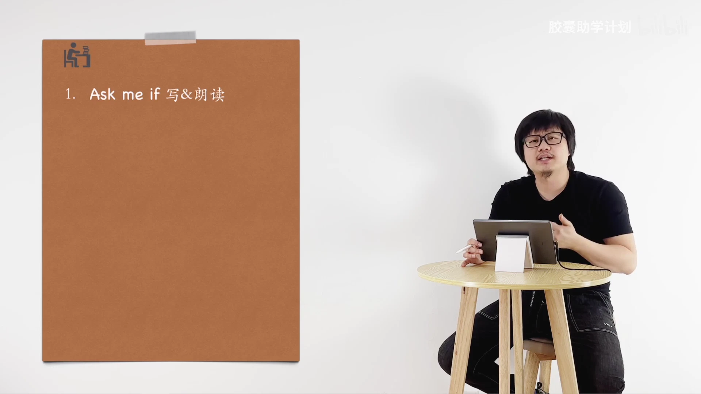

文字识别：1.Ask me if写&朗读

### 画面 00:06:09

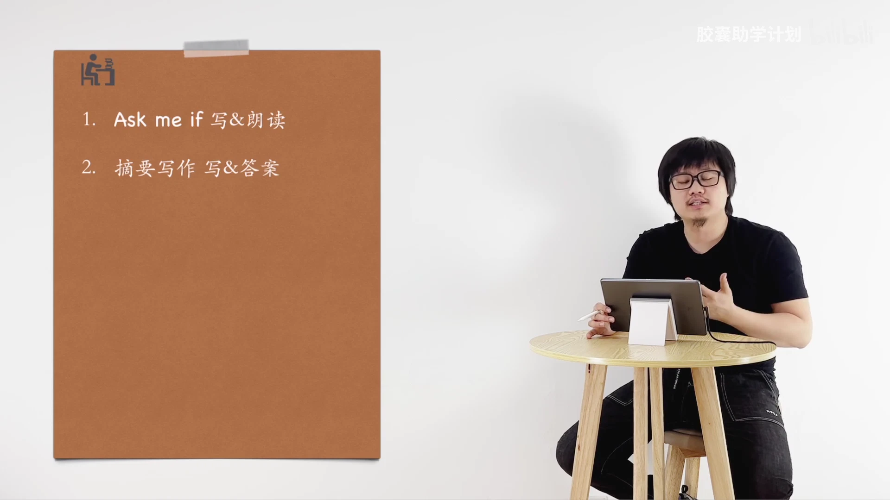

文字识别：1.Ask me if写&朗读 / 2.摘要写作写&答案

### 画面 00:06:11

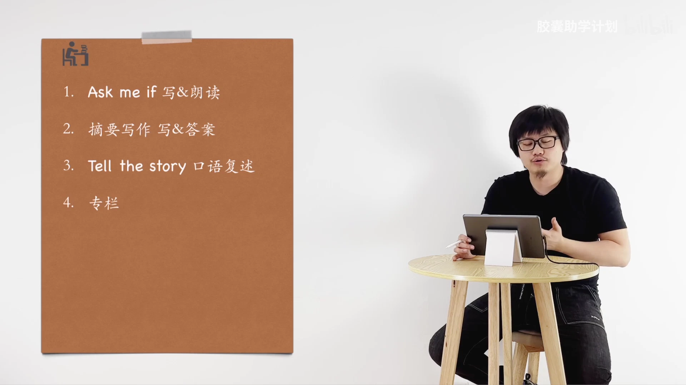

文字识别：1.Ask me if写&朗读 / 摘要写作写&答案 / 3.Tell the story 口语复述 / ·专栏 / 4.

### 画面 00:06:13

文字识别：👍

### 画面 00:06:22

文字识别：🌟

### 画面 00:06:24

文字识别：CAPSULEACADEMY / 胶囊助学计划 / 小红书 / Lecturer / Leo / OE

### 画面 00:06:27

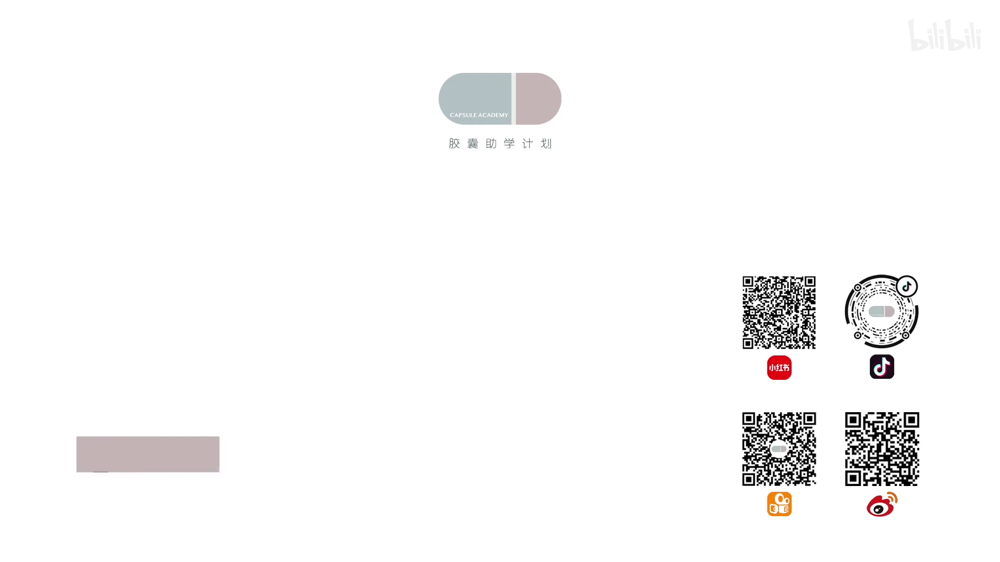

文字识别：CAPSULEACADEMY / 胶囊助学计划 / 小红书 / OE

## 00:06:30–00:06:35

### 画面 00:06:30

文字识别：CAPSULEACADEMY / 胶囊助学计划 / 小红书 / Creator / □ / Leo & Berlin / OE

### 画面 00:06:32

文字识别：bilbili / 胶囊助学计划 / CAPSULEACADEMY / 胶囊助学计划 / 小红书 / 8 / OE

### 画面 00:06:34

文字识别：bilibili / 胶囊助学计划

