# L040 语法 虚拟语气

快速机器解析：语音为单模型转写，未进行独立交叉校对或人工复核；画面每秒采样并按变化选帧，短时文字和标记可能遗漏。截图时间约有 1 秒误差。图片有损压缩；遇到疑点请按时间查看 Google Drive 原视频。

## 00:00:00–00:00:30

Hello everyone, welcome to Capsule Academy. This is Leo. Today we're going to learn New Concept English Book Two, Lesson Forty, Grammar. 老习惯，进入正式课程之前，我们先看一个问题。那本课我们要学习的叫做如何使用虚拟语气，这是一个非常重要的语法。 Hope you gonna enjoy it. Okay,好了，那我们实际上讲所有语法的时候呢，都有一个特点，

### 画面 00:00:00

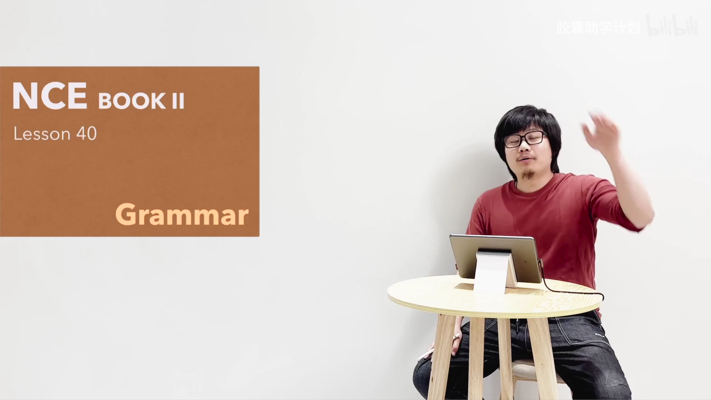

文字识别：NCE / BOOK"I / Lesson 40 / Grammar

### 画面 00:00:02

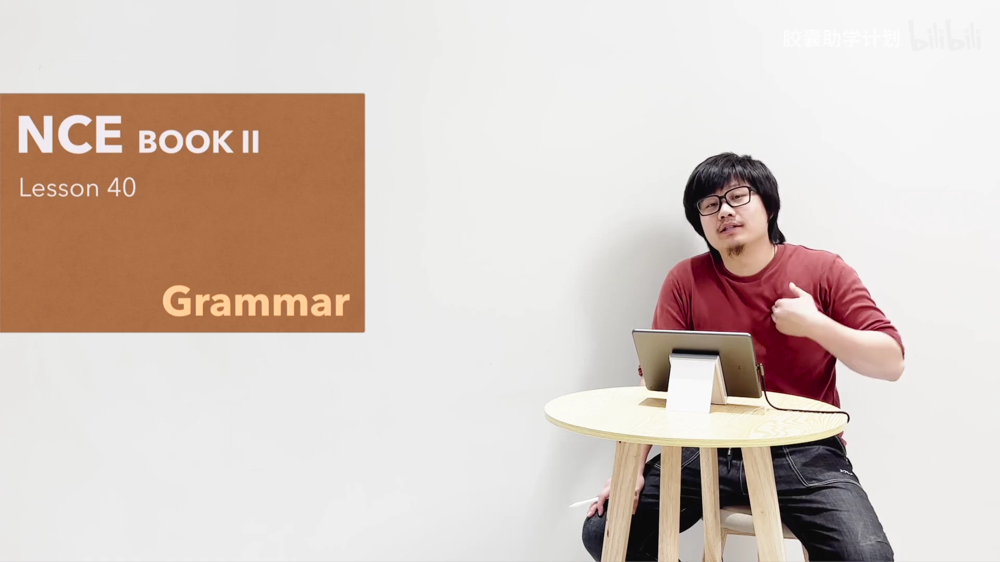

文字识别：NCE / BOOKII / Lesson 40 / Grammar

### 画面 00:00:08

### 画面 00:00:11

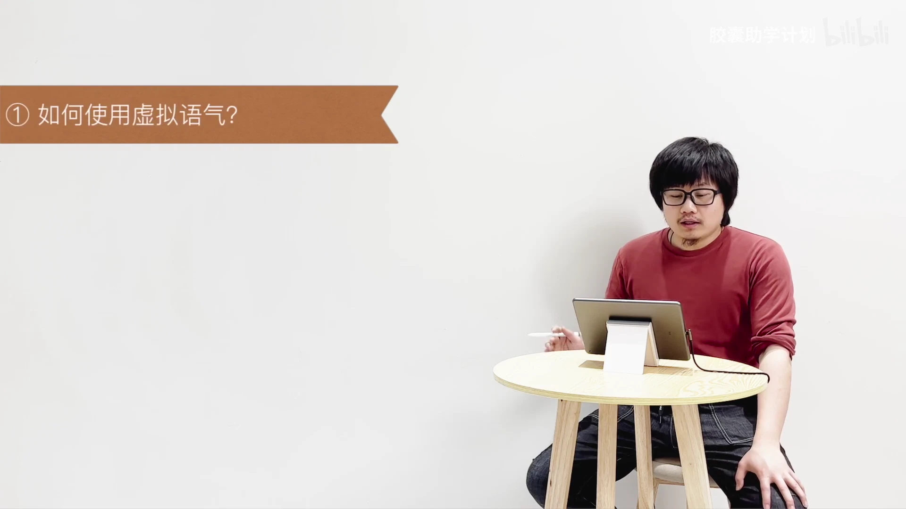

文字识别：①如何使用虚拟语气？

### 画面 00:00:13

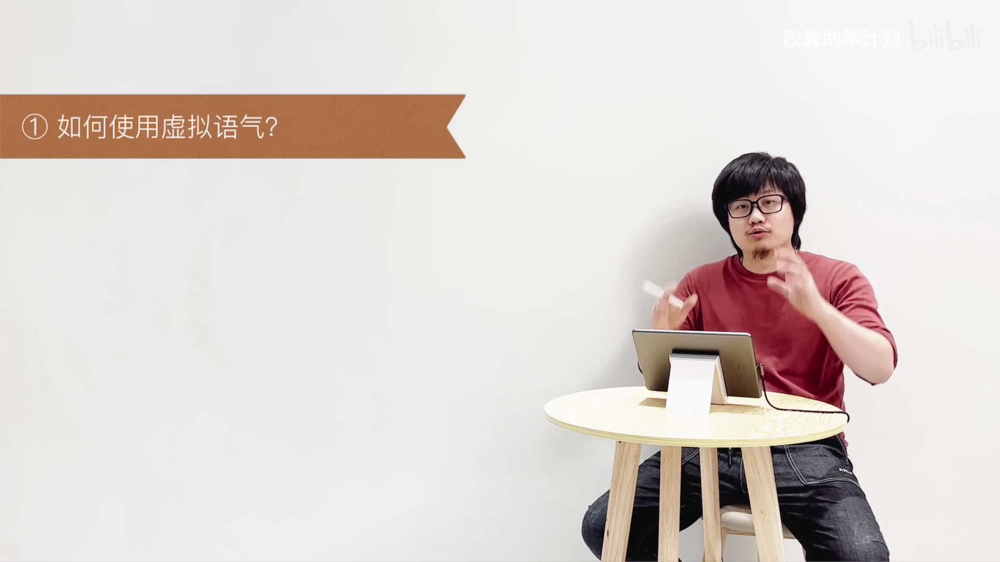

文字识别：①如何使用虚拟语气？

### 画面 00:00:19

文字识别：胶囊助学计划 bilbl / •

### 画面 00:00:23

文字识别：胶囊助学计划

### 画面 00:00:25

文字识别：虚拟语气

## 00:00:30–00:01:00

我们往往愿意讲英语语法的至少两个东西，对吧？啊，应该说至少三个东西。第一，它的名称啊，现在进行时，一般过去时，对吧？哎，这个什么被动啊，然后这个名称叫虚拟语气。从字面意思上来说，我们可能完全不懂。第二个，我们经常习惯要讲的叫做它的结构，也就是说它长成什么样子。我们先一起来看一下。首先，if后边加上did或者是were这个单词，哎，这个地方就很有意思。

### 画面 00:00:55

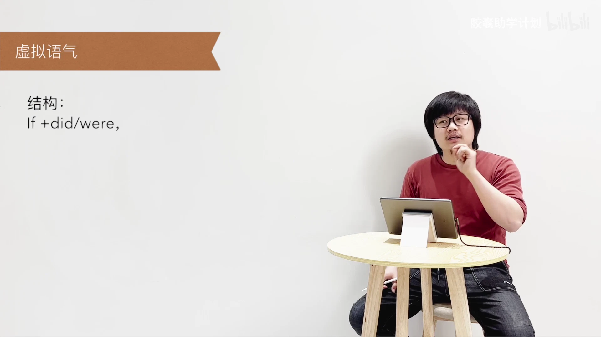

文字识别：虚拟语气 / 结构： / If +did/were,

## 00:01:00–00:01:30

你要注意，四十课是第二单元的第十六课。我们在第一单元第十六课的时候，对吧？停车停错位置。If you park your car in the wrong place, a traffic police will soon find it。在那一课当中，我们实际上就已经学过了 if 引导的条件状语从句。本课好像又是 if 引导的一个句子，只不过呢，当时后面叫做主将从现、主情从现，它都是从句是现

### 画面 00:01:03

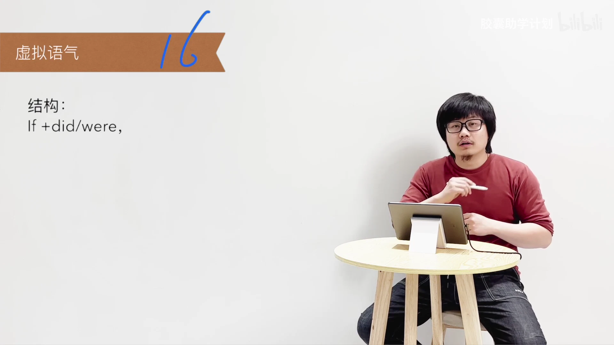

文字识别：虚拟语气 / 结构： / If +did/were,

## 00:01:30–00:02:00

在时，而在这里你看一下，它变成了一般过去时，对吧？很有意思。接下来主语，也就是其实是主句的主语啊，加上的是 would、 should、 could，或者是 might，后面再加一个单词叫做 do。而在第十六课的时候，我们当时的结构，主语后边加的是谁呢？是 will，是 shall，是 can，是 may，

### 画面 00:01:33

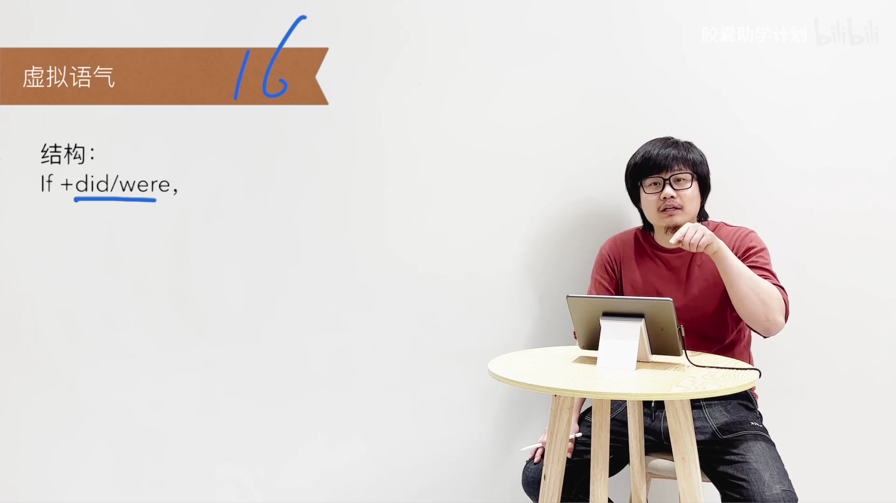

文字识别：虚拟语气 / 结构： / If +did/were,

## 00:02:00–00:02:30

是他们的现在时，是这些形态动词的现在时，对吧？所以，我们又回到了这个点上。我们学英语语法学到今天，一定要明白这样一件事情：英语语法有一个特点，往往是这样的。当我想表达不同含义的时候，要用不同的结构。同理，往往当我出现不同结构的时候，可能注意啊，是可能不是一定也它能表达一个新的含义。那今天咱们见

### 画面 00:02:03

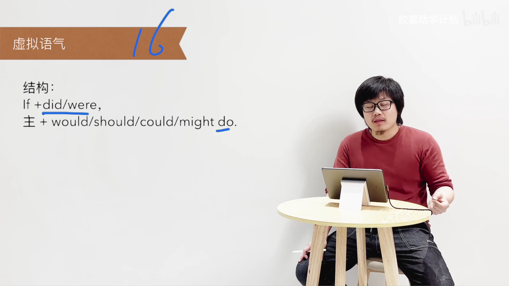

文字识别：虚拟语气 / 结构： / If +did/were, / 主+would/should/could/might do.

## 00:02:30–00:03:00

到的一个新的结构，它确实能表达一个新的含义。它的结构是什么呢？就是 if 后边是一般过去时，后边的主句呢是 would, should, could, might 后边加 do，而不是 will，对吧？比如说我们造一句话啊。当然这地方还有一个小的提醒，叫做这里的 did 并非表过去。你看各位非常熟悉时态，见到 did 和 would 就想说哦，那它是一般过去时，对不对？很抱歉，它还真

### 画面 00:02:33

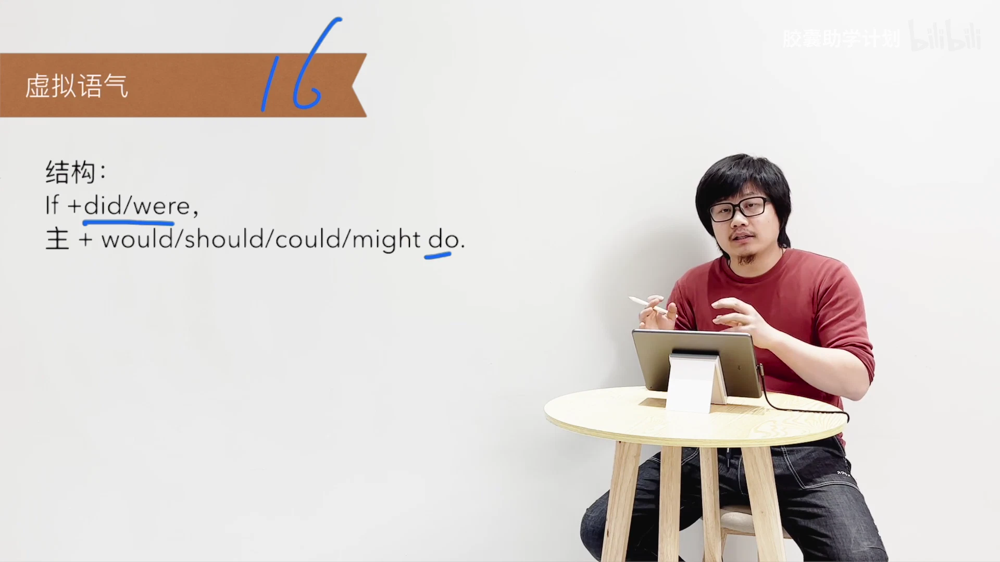

文字识别：虚拟语气 / 结构： / If +did/were, / 主+would/should/could/might do.

### 画面 00:02:37

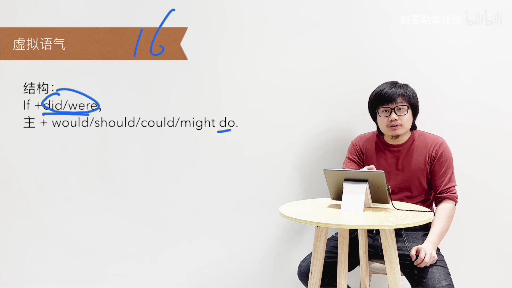

文字识别：虚拟语气 / 结构： / If +lid/were, / 主+would/should/could/might do.

### 画面 00:02:40

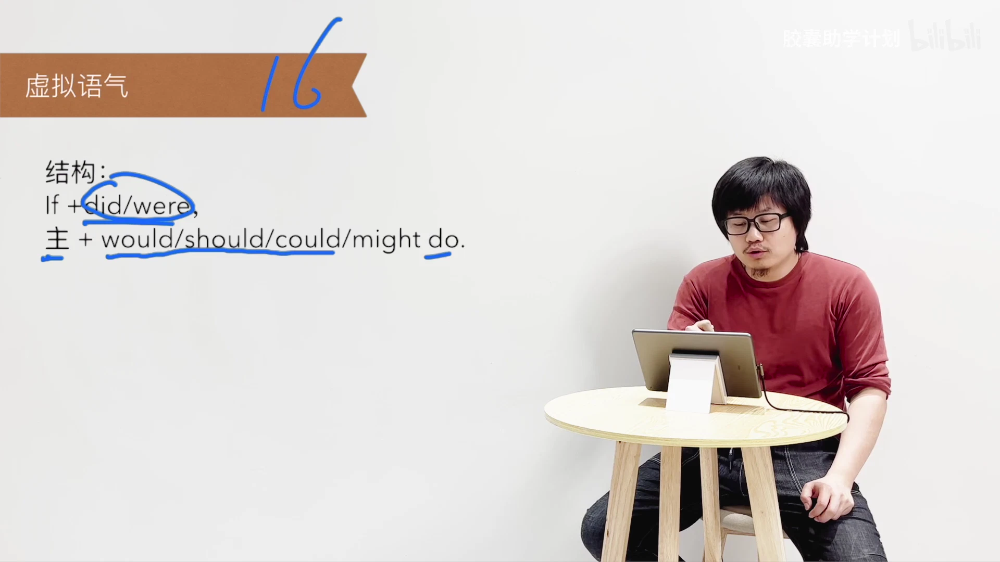

文字识别：虚拟语气 / 结构： / If +did/were, / 主 / + would/should/could/might do.

### 画面 00:02:48

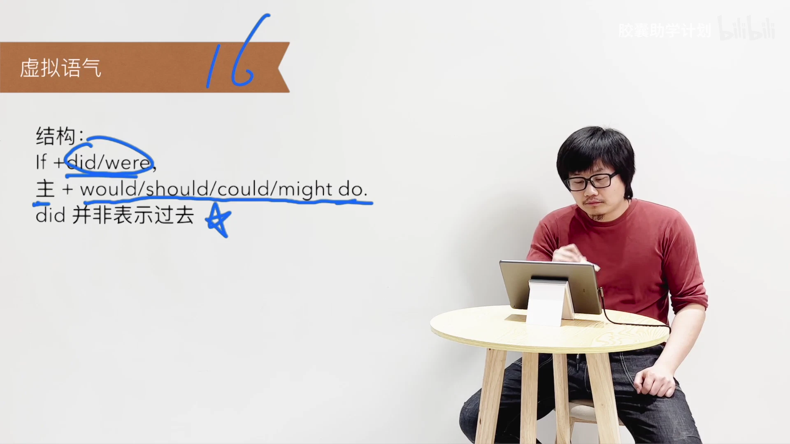

文字识别：虚拟语气 / 结构： / If +did/were / 主+would/should/could/might do. / aid 并非表示过去

## 00:03:00–00:03:30

不是一般过去时。一会儿我们看它是什么，您这个地方先记一下，好吧？然后比如说我们造一些句子，说 If I were you, I wouldn't do that。我们从字面意思先尝试翻一下，If叫如果，I我 were，嗯，首先这儿你可能就有疑惑了。按照你的理解，这里的were不应该用were，应该用什么呢？应该用was。新概念一册六十七课我们学了，我们当时学了，对吧？后边又用了很多遍，I后面应该用was，而不应该

### 画面 00:03:18

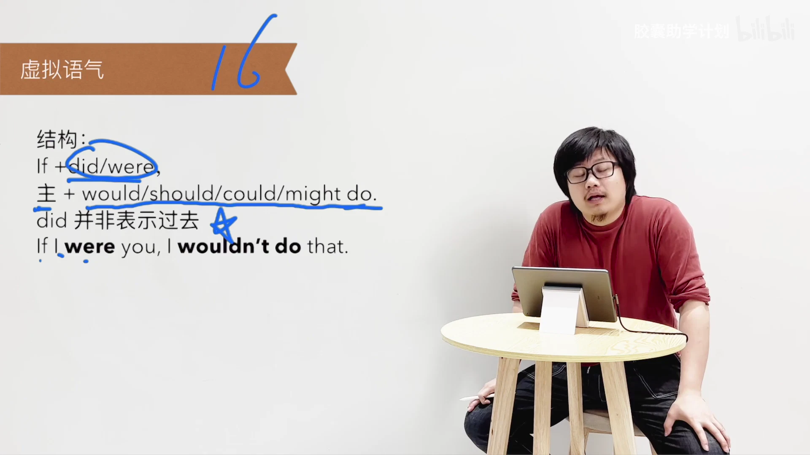

文字识别：虚拟语气 / 结构： / If +did/were / 主+would/should/could/might do. / did 并非表示过去 / 4 / If l.were you, I wouldn't do that.

## 00:03:30–00:04:00

用were。我是不是写错了呢？没写错。各位记住，就要用were，对吧？如果我是你，I wouldn't do that。叫我不会这样去做。那你可能就想了，那他和我们第十六课能不能这样说？叫If I am you，I won't do that。可不可以这样呢？不可以。我们一会儿说为什么，好吧？我们先看它满不满足这个结构。If引导的句子后边是were，在后边是wouldn't加do啊，没问题，完全符

### 画面 00:03:48

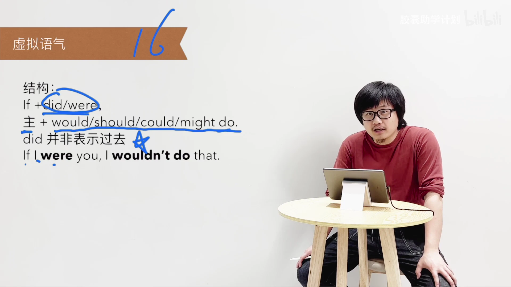

文字识别：虚拟语气 / 结构： / If +did/were / 主+would/should/could/might do. / did 并非表示过去 / If l were you, I wouldn't do that.

### 画面 00:03:55

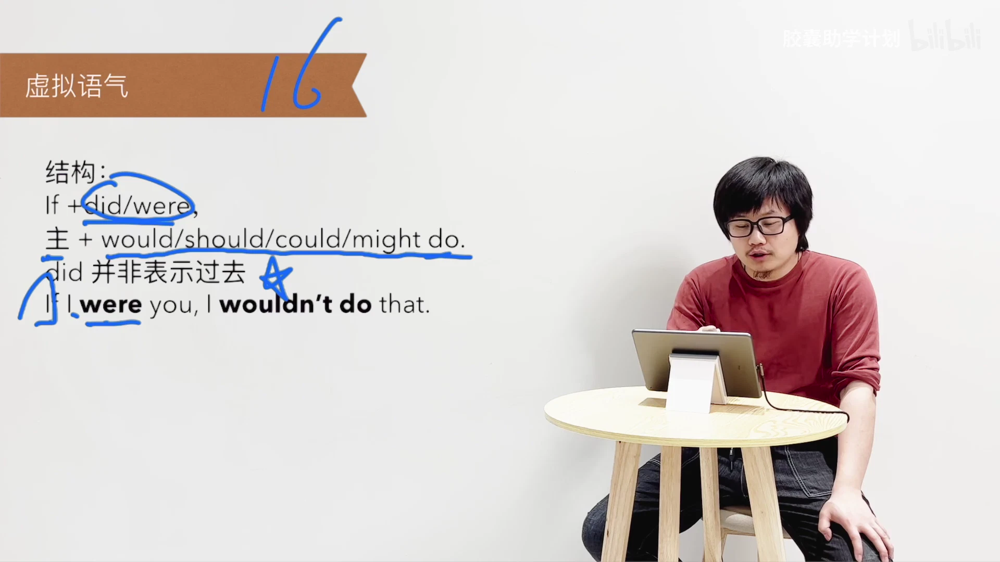

文字识别：虚拟语气 / 结构： / If +did/were / 主+would/should/could/might do. / did / 并非表示过去 / 4 / were /  you, I wouldn't do that.

## 00:04:00–00:04:30

合最上边的这个公式。这个公式各位要牢牢记住啊！也就是说，这个结构要牢牢记住。我们再来一句话：If I knew them better，如果我了解他们，更了解他们，I might invite them to dinner。我可能会邀请他们来，呃，吃晚饭。好，还是结构。我拿黑笔，其实加重，已经给各位加重了，对吧？结构是肯定满足它的。那字面意思叫刚才我说那句话。那于

### 画面 00:04:00

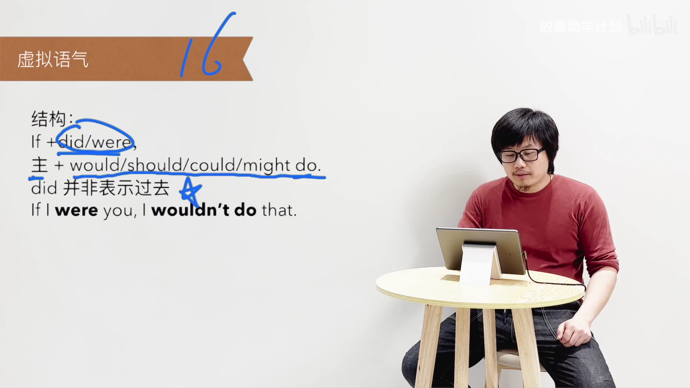

文字识别：虚拟语气 / 结构： / If +did/were / 主+ would/should/could/might do. / did 并非表示过去 / 4 / If I were you, I wouldn't do that.

### 画面 00:04:02

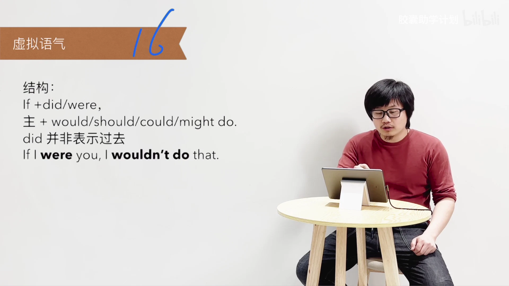

文字识别：虚拟语气 / 结构： / If +did/were, / 主+ would/should/could/might do. / did 并非表示过去 / If I were you, I wouldn't do that.

### 画面 00:04:04

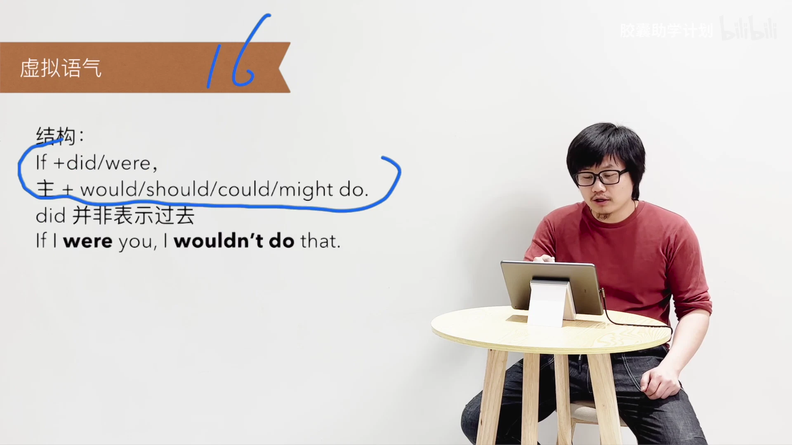

文字识别：虚拟语气 / 结构： / If +did/were, / 主± would/should/could/might do. / did 并非表示过去 / If I were you, I wouldn't do that.

### 画面 00:04:06

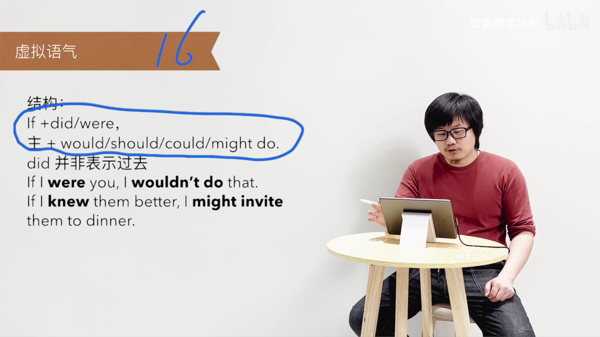

文字识别：虚拟语气 / 结构： / If +did/were, / 主± would/should/could/might do. / did  / 并非表示过去 / If I were you, I wouldn't do that. / If I knew them better, I might invite / them to dinner.

### 画面 00:04:23

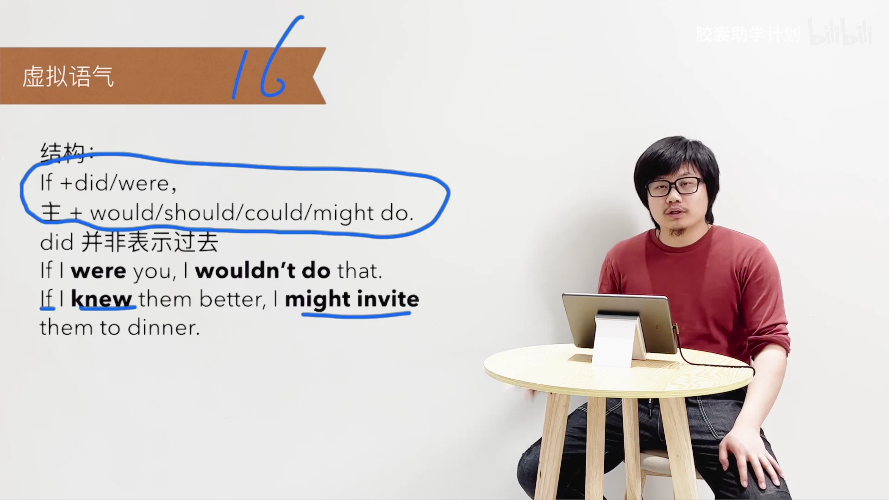

文字识别：虚拟语气 / 结构： / If +did/were, / 主± would/should/could/might do. / did / 并非表示过去 / If l were / you,lv / wouldn't do / that. / If knew / them / better, I might / invite / them to / dinner.

## 00:04:30–00:05:00

是如果你基础很好，你自然而然又想问一个问题，就是我能不能用十六课的语法叫做 if I know them better，我不用 knew，对吧？ I may invite them to dinner，能不能这样呢？ OK，我们带着这个疑惑啊，接下来我们刚才看了结构，我希望您记住了。接下来我们要说它的含义，含义非常的重要。我们说它为什么叫虚拟语气？ if 从句中的动作与现在事实相反。第一，它的

### 画面 00:04:43

文字识别：虚拟语气

## 00:05:00–00:05:30

含义叫if从句中的动作与现在的事实相反。你想一下刚才那句话，叫如果我是你，那你想一下我是你吗？现在的事实叫做我不是你，所以它不能用十六课咱们学的那个结构，在英文当中它要用虚拟语气，叫if I were you，要用这个结构，明白了吧？OK，再下再接下来，说话人认为if从句中动词发生的几率非常的低，

### 画面 00:05:06

文字识别：虚拟语气 / 含义： / 1.if从句中v.与现在事实相反

### 画面 00:05:22

文字识别：虚拟语气 / 含义： / 1.if从句中v.与现在事实相反 / 2. 说话人认为，if从句中v.发生的几率非常低

## 00:05:30–00:06:00

说话人认为我，比如说我说这句话，那就是我认为与客观事实没关系，就我认为低它就低，看见了吧？这是一个主观感受啊。If从句中动词发生的几率非常的低，我们拿一些句子去举例子吧。比如说结构是肯定满足的啊，were然后后边是wouldn't do，好吧？如果说If I were you, I wouldn't do that，这个结构没有问题，那它其实是什么呢？要么是与现在事实相

### 画面 00:05:43

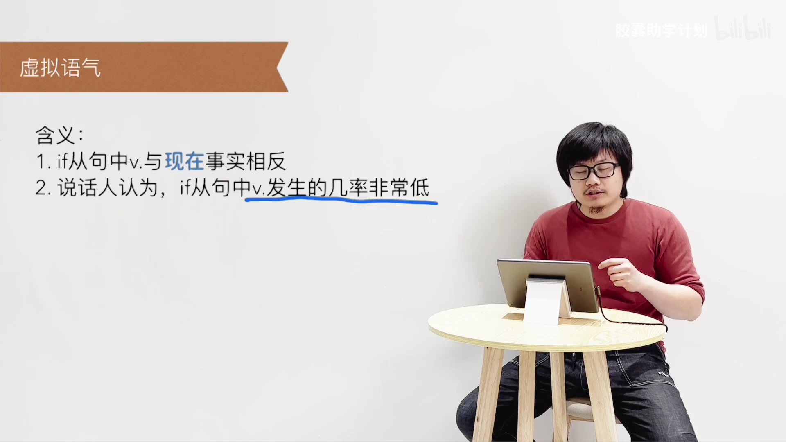

文字识别：虚拟语气 / 含义： / 1.if从句中v.与现在事实相反 / 2.说话人认为，if从句中v.发生的几率非常低

### 画面 00:05:59

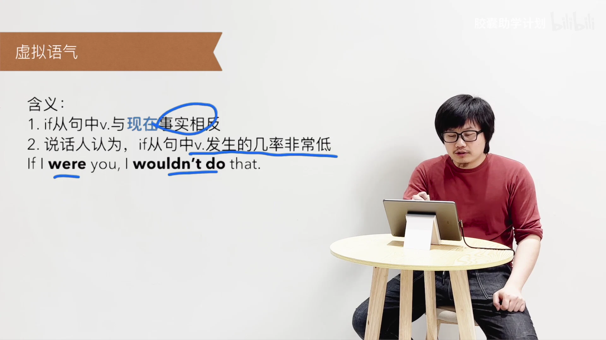

文字识别：虚拟语气 / 含义： / 1.if从句中v.与现在事实相皮 / 2.说话人认为，if从句中v.发生的几率非常低 / If I were you, I wouldn't do that.

## 00:06:00–00:06:30

反，要么是发生的概率极低，也就是这里。如果我是你，那就不是概率极低了，那就是直接与现在事实相反，所以它叫英文的虚拟语气。你不能说成 if I am you，必须要说 if I were you，这就是英文的习惯。各位听懂了吧？好，I wouldn't do that，叫我不会那么去做啊。Next one， if I knew them better， I might invite them to dinner。这是刚才咱们看的句子。那

### 画面 00:06:01

文字识别：虚拟语气 / 含义： / 1.if从句中v.与现在事实相 / 2.说话人认为，if从句中↓.发生的几率非常低 / If I were you, I wouldn't do that.

### 画面 00:06:22

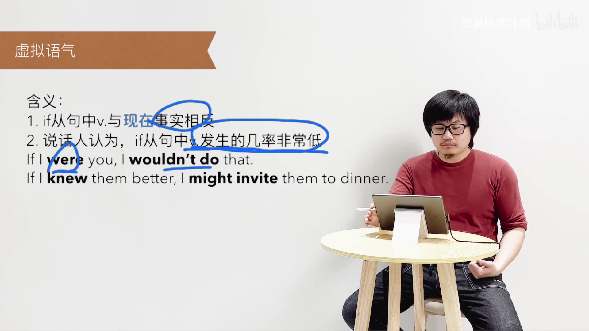

文字识别：虚拟语气 / 含义： / 1.if从句中v.与现在事实相 / 2.说话人认为，i / if从句中い发生的几率非常低 / If ly / Wer / you, I wouldn't do that. / If I knew / them better, I might invite them to dinner.

## 00:06:30–00:07:00

这里面只要它用了虚拟语气的结构，它就表达叫做要么与现在事实相反哇，要么发生情况几率极低。如果我更了解他们，那现在的事实可能是我没有更了解他们，或者说我没有呃有机会去更了解他们啊，对吧？所以你就这样去理解。换一句话来说，其实一和二的含义几乎是一致的。你这样去想，一件事情最低的概率是什么？

### 画面 00:06:52

文字识别：虚拟语气 / 含义： / 1.if从句中v.与现在事实相 / 2.说话人认为， / if从句中い发生的几率非常低 / Ifl / yer / you, I wouldn't do that. / If I knew / them better, I might invite / them to dinner.

## 00:07:00–00:07:30

就是不发生，叫做与现在事实相反，也就是零。听清楚了吧？所以这俩其实就你可以理解为叫做，一个是发生的概率是零点零三，一个发生的概率是零。但是本质上就是认为这件事儿不会发生，对吧？OK。其次，刚才我们说到了叫做这里这个 did 或者 were 并不表示过去，各位现现在应该能明白了。因为今天咱们学的叫做与现在

### 画面 00:07:20

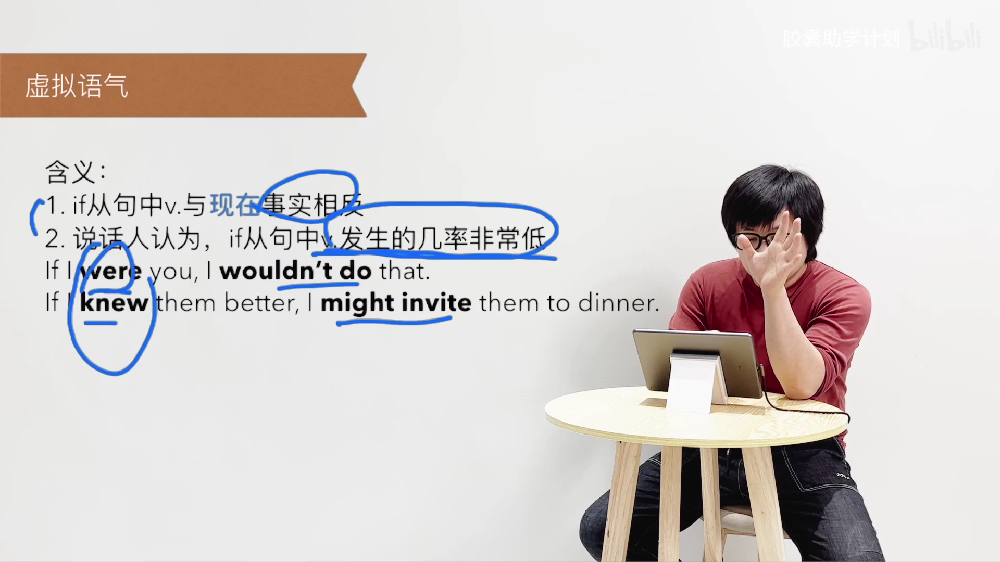

文字识别：虚拟语气 / 含义: / 1.if从句中v.与现在事实相 / 2. / 说话人认为， / if从句中い发生的几率非常低 / If Iyer you, l wouldn't do that. / If / knewthem better, I might invite / them to dinner.

### 画面 00:07:28

文字识别：虚拟语气 / 含义： / ^1.if从句中v.与 / 现在事实相 / 2.1 / 说人认为， / g，f从句中发生的几率非常低 / If Iyeryou, I wouldn't do that. / If / knewthem better, I might invite / them to dinner.

## 00:07:30–00:08:00

事实相反的虚拟语气。等六十四课的时候，对吧？四十加二十四，六十四课的时候，我们还会去学习叫做与过去事实相反的虚拟语气啊。我在这儿先不说了，对吧？我们卖一个关子啊。接下来我们再来一句话，比如说 It's cold outside. 啊，外边很冷。If I were you, I would put my coat on. 如果我是你，我会把我的外套穿上的，对吧？OK, very good. 叫做与现

### 画面 00:07:30

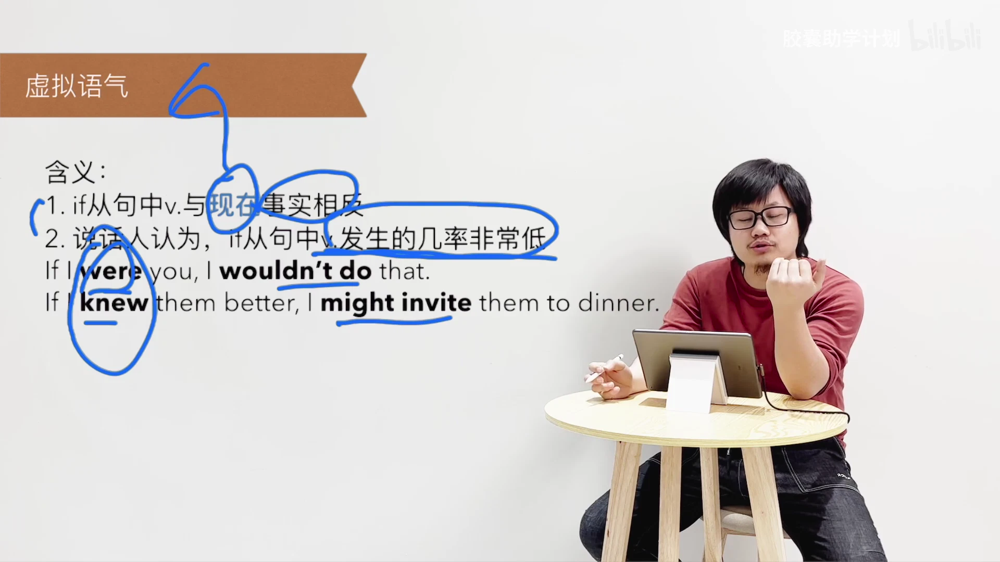

文字识别：虚拟语气 / 含义: / 1.if从句中v.与 / 现在事实相厅 / 2. / 说人认为 / ，f从句中发生的几率非常低 / If Iyeryou, I wouldn't do that. / If / knewthem better, I might invite / them to dinner.

### 画面 00:07:46

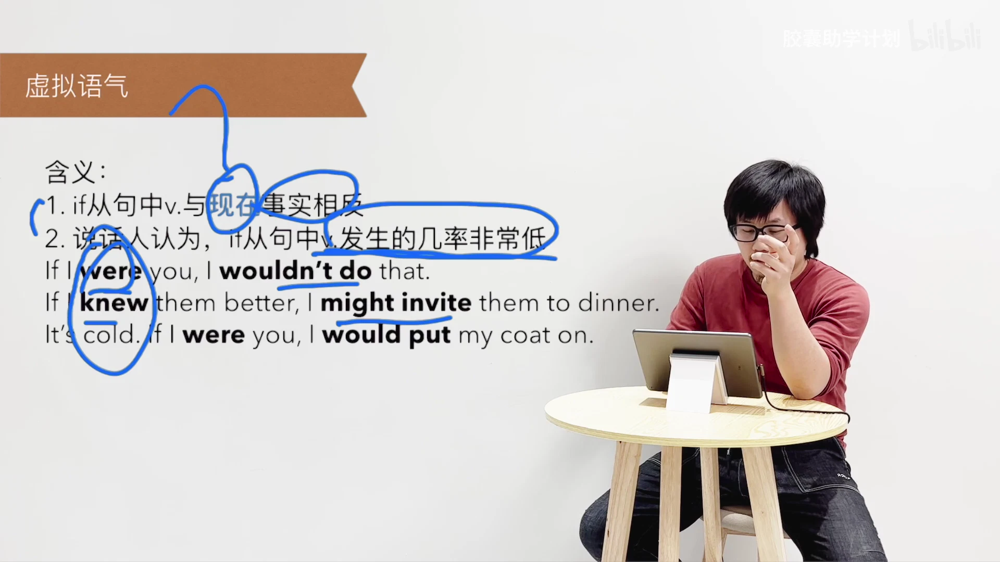

文字识别：虚拟语气 / 含义： / 1.if从句中v.与 / 现在事实相 / 2. / 说人认为 / ，f从句中发生的几率非常低 / If lWeryou,l / wouldn't do / that. / If / knewthem / better,I / might / invite / them to / dinner. / It's / cold.lf I were you,l / would / put / my coat / on.

### 画面 00:07:48

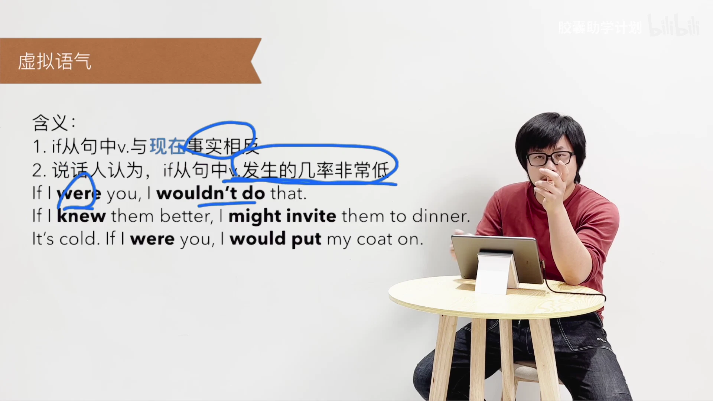

文字识别：虚拟语气 / 含义： / 1.if从句中v.与现在事实相 / 2.说话人认为， / if从句中い发生的几率非常低 / If一 / Wer / you, l wouldn't dot / that. / If I knew / them better, I might / invite / them to dinner. / It's cold. If l were you, I would / put my coat on.

## 00:08:00–00:08:30

在事实相反。呃，那这个地方我想提一点啊，我们就是放开了说，我们汉语当中有没有虚拟语气呢？巧了，我们汉语当中其实也有虚拟语气，只不过啊，各位其实能，我我先告诉各位有，并且我告诉各位，汉语当中的虚拟语气比英文当中的虚拟语气要难很多很多。为什么呢？因为英文你一旦看到了这

### 画面 00:08:18

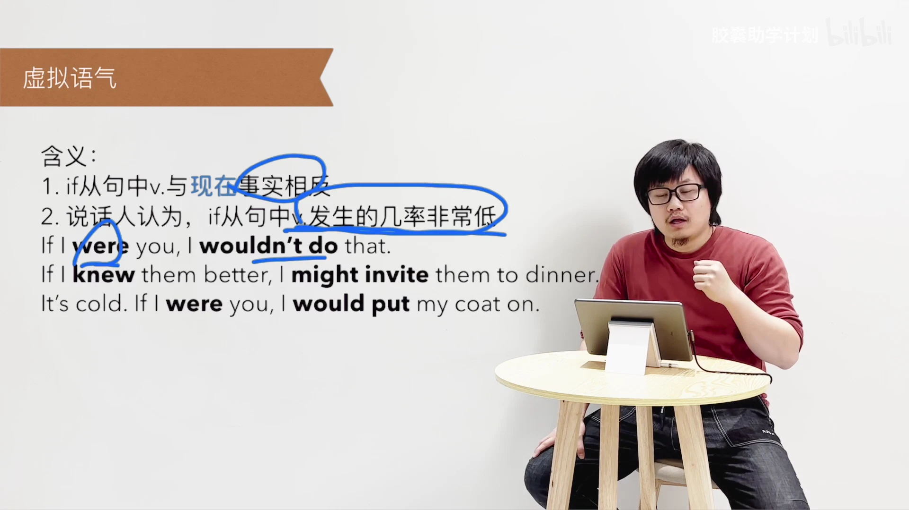

文字识别：虚拟语气 / 含义： / 1.if从句中v.与现在事实相 / 2.说话人认为， / if从句中↓发生的几率非常低 / If l / Wery / you, I wouldn't do that. / If I knew / them better, I might / invite / them to dinner. / It's cold. If l were you, I would / put my coat on.

## 00:08:30–00:09:00

样的结构，我现在加黑的这些东西，它必定是虚拟语气，听见了啊？而我们汉语靠什么去判断它是不是虚拟语气呢？靠如下的一些东西：第一，你对这个人说话人的了解程度，你对背景知识的了解程度，呃，你从他的语气、语调、面目表情、说话的时机、场合、方式当中去揣摩、去

### 画面 00:08:48

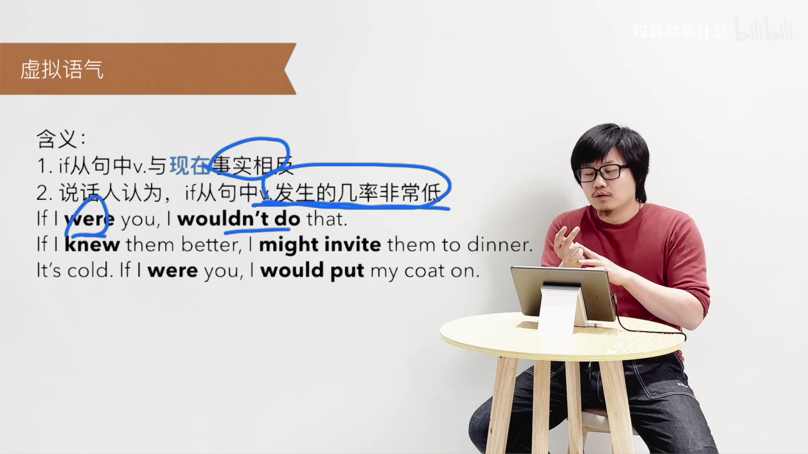

文字识别：虚拟语气 / 含义： / 1.if从句中v.与现在事实相 / 2.说话人认为， / if从句中↓发生的几率非常低 / If l / Wer / you, l wouldn't dot / that. / If I knew / them better, I might / invite / them to dinner. / It's cold. If l were you, I would / put my coat on.

## 00:09:00–00:09:30

推测，他说的是真的，也就是我们第十六课那个语法叫A发生B就发生，还是他在说一个虚拟语气，他认为这事儿就不可能，所以所有那些东西都是虚的。说起来就特呃，判断它是不是虚拟语气的时候就非常的困难。我刚才说这段话很抽象，如果各位不能理解啊，我把接下来这个例子说完了之后，你再回过刚才

### 画面 00:09:18

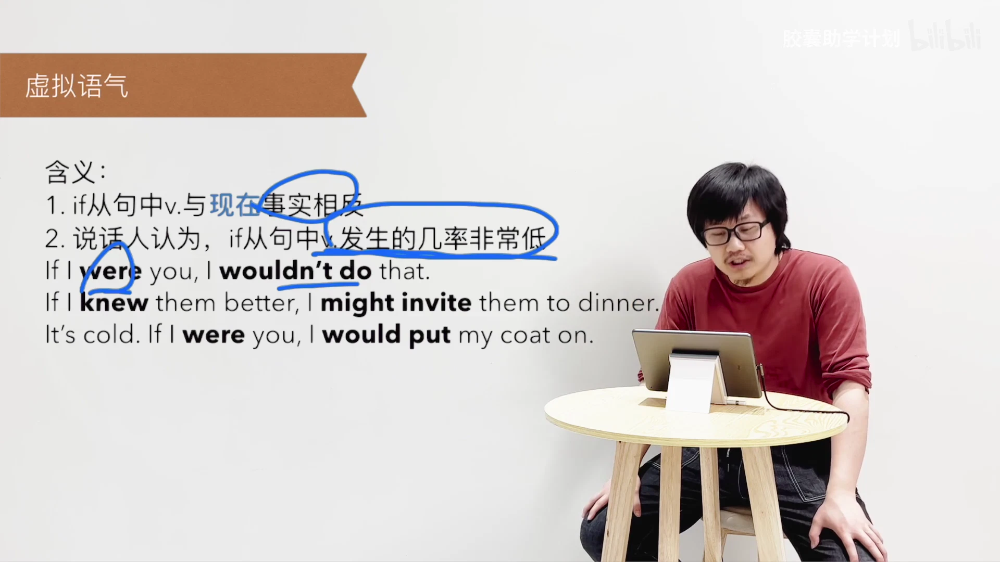

文字识别：虚拟语气 / 含义： / 1.if从句中v.与现在事实相 / 2.说话人认为，i / if从句中↓发生的几率非常低 / Ifl / Wer / you, I wouldn't do / that. / If I knew / them better, I might / invite / them to dinner. / It's cold. If l were you, I would / put my coat on.

## 00:09:30–00:10:00

那个那一段，再去听一下。比如说，我想给各位讲的例子就是很多年前的时候啊，我和我的同事那时候说说，今年冬天如果买不到火车票，我就骑自行车回家。好，他们听到的时候，大家哈哈一笑。大家的感受是什么呢？大家的感受是冬天骑自行车回家，我从北京回家要三百公里。大家觉得这事儿是我

### 画面 00:09:48

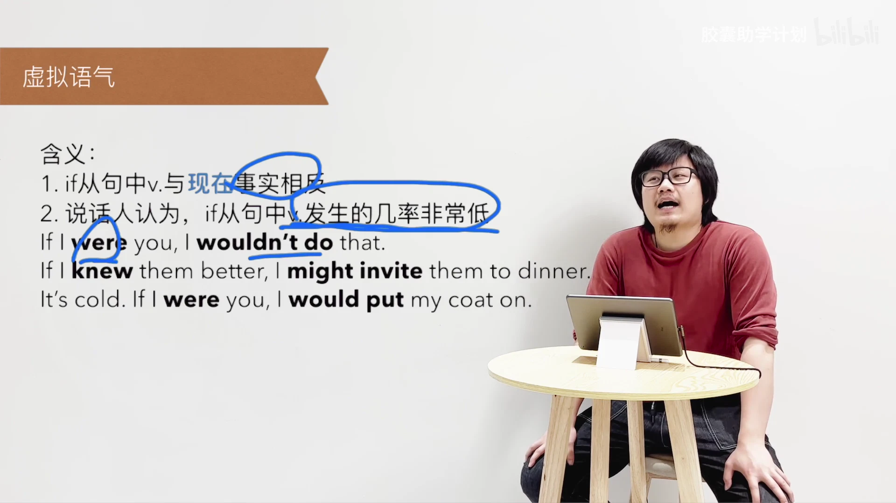

文字识别：虚拟语气 / 含义： / 1.if从句中v.与现在事实相 / 2.说话人认为，i / if从句中↓发生的几率非常低 / If l / yery / you, I wouldn't do that. / If I knew / them better, I might / invite / them to dinner. / It's cold. If l were you, I would / put my coat on.

## 00:10:00–00:10:30

在说虚拟语气，听见了吧？所以大家哈哈一笑，没有说，哎，你你打算怎么骑？你打算买什么装备，对吧？但我实际上说的不是虚拟语气，我说的是第十六课那个语法。如果买不到车票，我就骑车回家；如果坐不了公交车，我就打车。十六课的语法，各位听清楚了吧？那他们为什么会认为我说的是虚拟语气呢？因为他们对我不了解，不知道我的性格是什么样的，对吧？

### 画面 00:10:18

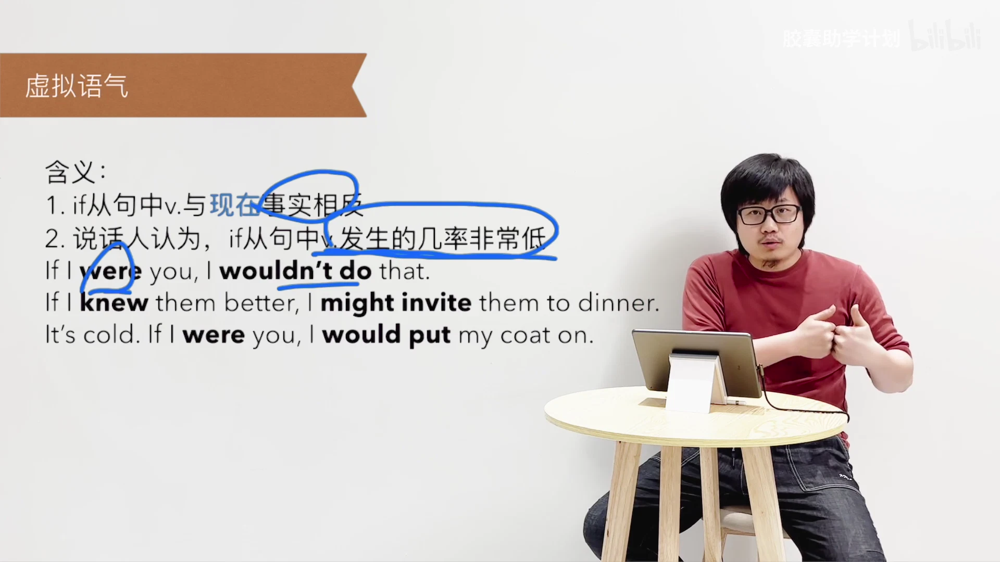

文字识别：虚拟语气 / 含义： / 1.if从句中v.与现在事实相 / 2.说话人认为，i / if从句中、发生的几率非常低 / If一 / yer / you, I wouldn't do that. / If I knew / them better, I might / invite / them to dinner. / It's cold. If l were you, I would / put my coat on.

## 00:10:30–00:11:00

吧？不知道我平常也骑自行车，不知道我以前干过类似的事情，所以他们会觉得我在说虚拟语气，开个玩笑，听清楚了吧？所以你再回到这个地方，这个这个页面上啊，刚才稍微说的偏了一点点。汉语的虚拟语气非常的复杂，它要有很多一系列虚的东西去决定，而英语的虚拟语气只要 if 后边那个是个一般过去时 were 或者一般过去时 did 各种动词，对吧？

### 画面 00:10:48

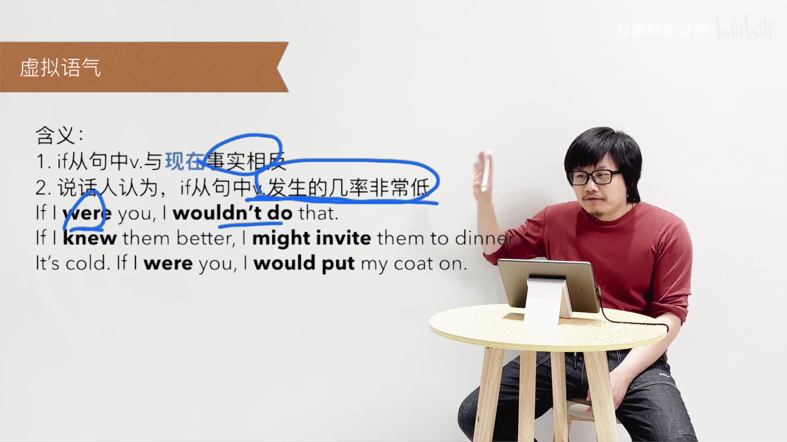

文字识别：虚拟语气 / 含义： / 1.if从句中v.与现在事实相 / 2.说话人认为， / if从句中い发生的几率非常低 / Ifly / yery / you, I wouldn't do t / that. / If I knew / them better, I might / invite / them to dinner / It's cold. If l were you, I would / put my coat on.

## 00:11:00–00:11:30

吧？它就是个虚拟语气了。OK，好，那这样说呢，还是有点虚。我们接下来，呃，利用一些练习去带着各位讲来了啊。比如说，What would you do if you saw him？你看见他，你会做什么？Apologize to him，对他说道歉。我们看一下最底下这句话，其实上面都不重要。最底下这句话是我想给各位讲的。这句的英文，If I saw him， I'd apologize to him。首先你要注意这个撇地是

### 画面 00:11:03

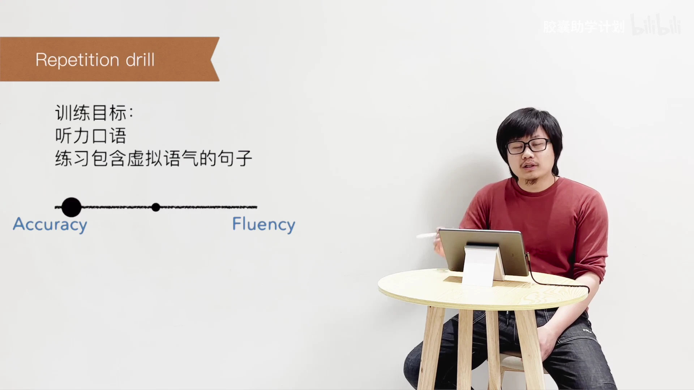

文字识别：Repetition drill / 训练目标： / 听力口语 / 练习包含虚拟语气的句子 / Accuracy / Fluency

### 画面 00:11:09

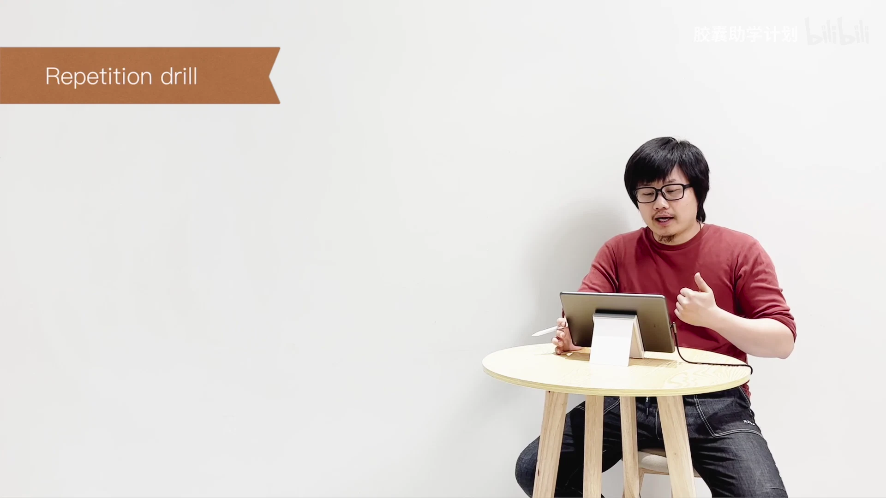

文字识别：Repetition drill

### 画面 00:11:15

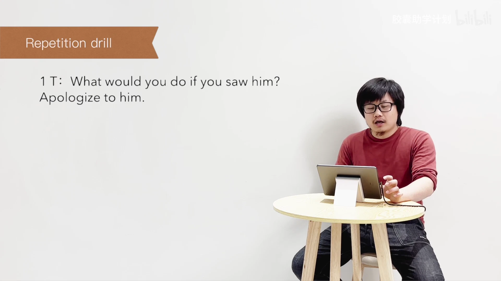

文字识别：Repetition drill / 1 T: What would you do if you saw him? / Apologize to him.

### 画面 00:11:20

文字识别：Repetition drill / 1T： / What would you do if you saw him? / Apologize / to / him. / S:_ If l saw / him, I'd apologize to him.

### 画面 00:11:29

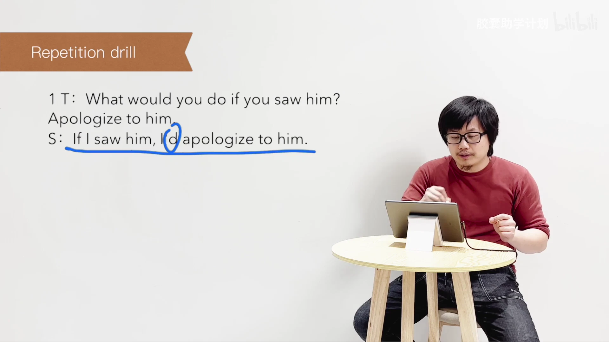

文字识别：Repetition drill / 1 T: / What / would / you do if you saw / him? / Apologize / to / him / S:_If l saw / him, / apologize to him. / C

## 00:11:30–00:12:00

would。如果我看见他，我会对他道歉。你看，那你会觉得说这个跟第十六课有什么区别？注意第十六课那个语法会把它说成叫If I see him, I will apologize to him，对吧？十六课的那句话说的叫做，我想给你传达的信息叫做，如果我看见他，我就会和他道歉。只要

### 画面 00:11:32

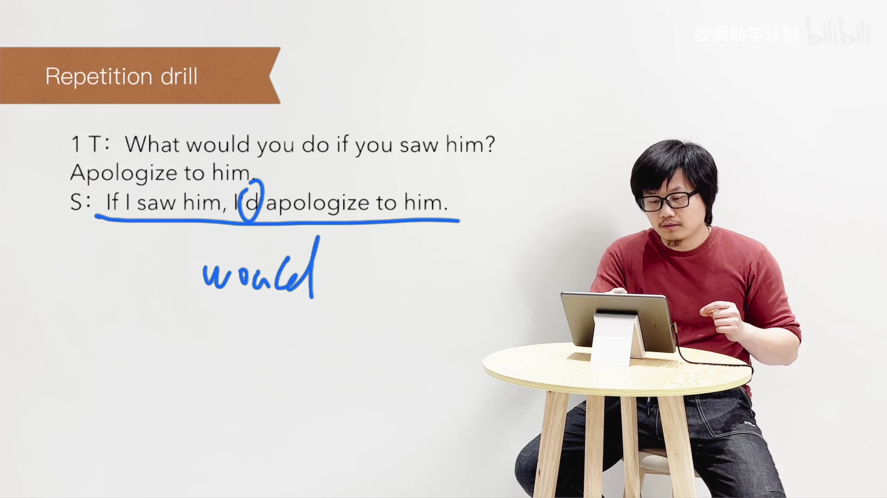

文字识别：Repetition drill / 1T: / What / would / you do if you saw / him? / Apologize / to / him. / S:_If l saw / him, / apologize to h / him. / wonld

## 00:12:00–00:12:30

A这个条件满足，B就会满足。那你可能就问了，这句话跟那句话翻译起来没区别？错，有区别，因为有结构的不同，所以它的潜台词是不一样的。说这句话的时候，这个人是这样想的，叫做：我觉得我可能也见不到他了，我也很难再跟他道歉了。为什么？因为它的含义叫与现在事实相反，或发生几率极

### 画面 00:12:02

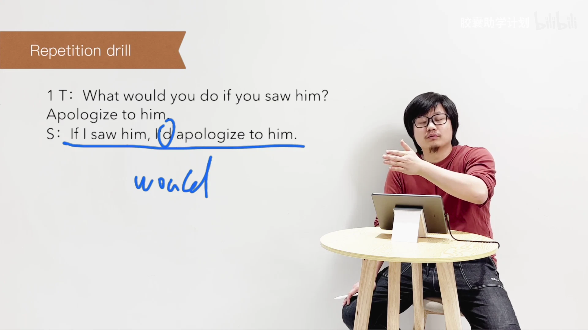

文字识别：Repetition drill / 1 T: / What / would / you do if you saw / him? / Apologize / to / him / S:_If I saw / him, / apologize to him. / wonld

### 画面 00:12:09

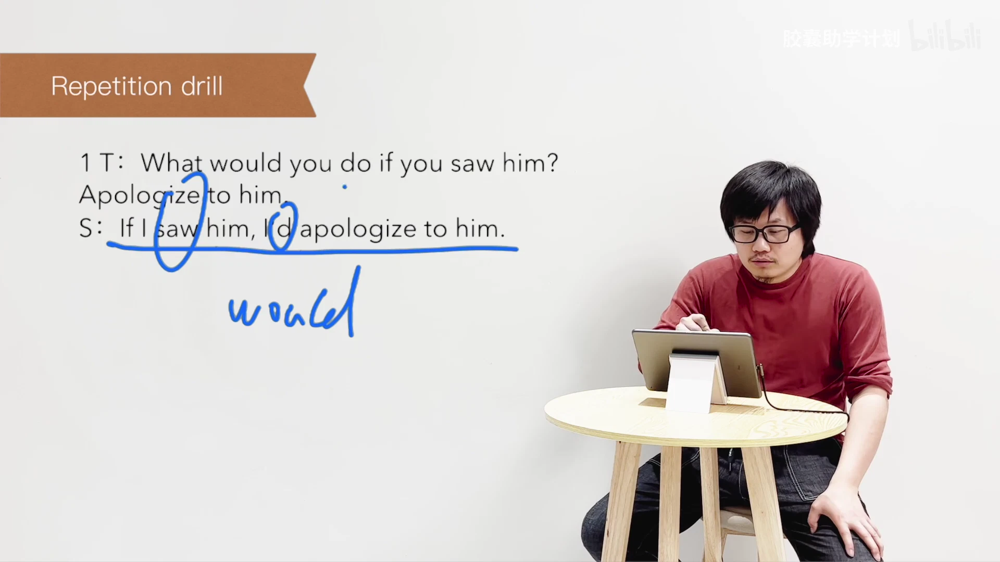

文字识别：Repetition / drill / 1 T: / What would / you do if you saw / him? / Apologizeto / him / S: / : lf saw / him, / apologize to / him. / wonld

### 画面 00:12:11

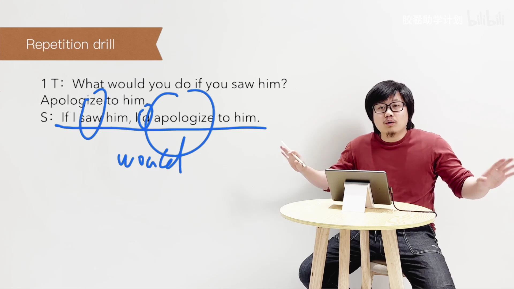

文字识别：Repetition / drilll / 1 T: / What would / you / do_if you / u saw / him? / Apologizeto / him / S: / _If l / saw / him, / apologize to / him. / wontt

## 00:12:30–00:13:00

低，所以当我用这个结构的时候，我说这句话的时候，我就其实在告诉你，我认为这件事发生的概率很低很低了，听见了吧？比如说，我给你举个例子，你就明白什么叫虚拟语气了。我说，如果我当了美国总统，我就会怎么怎么怎么样。好，你应该不会认为这是第十六课的语法，对吧？不是说我当了就会怎么怎么样，你明白我其实就是在开个玩笑，或者

### 画面 00:12:41

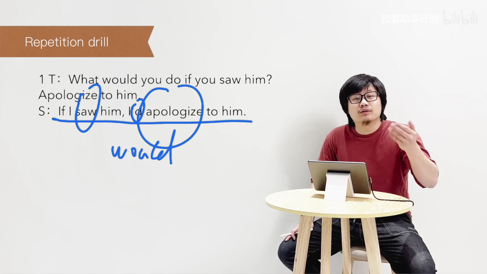

文字识别：Repetition / drill / 1T: / What would / you do if you saw / him? / Apologizeto / him, / S: / : lf l saw / him, / apologize to him. / wontt

### 画面 00:12:45

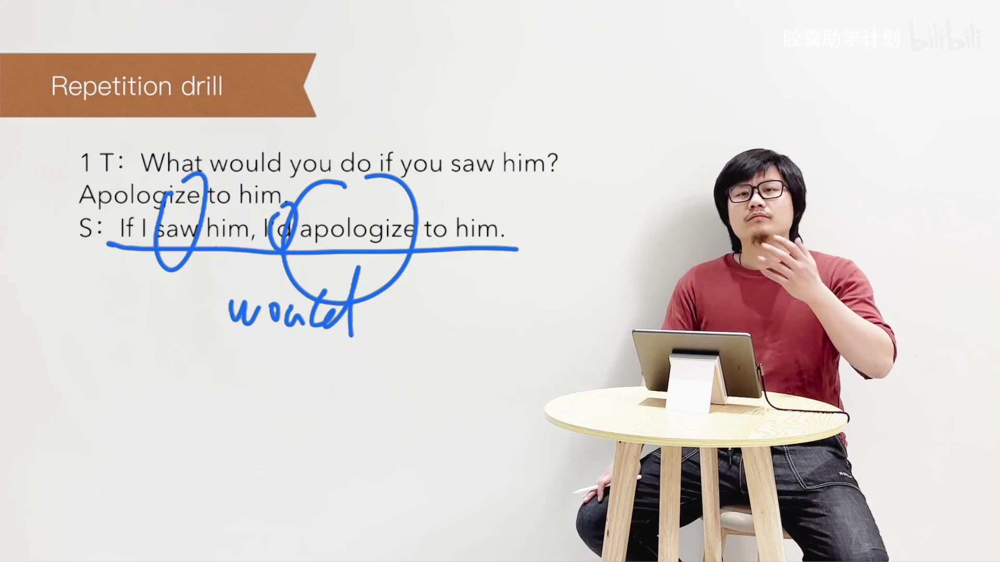

文字识别：Repetition / drill / 1 T: / What would / you do if you saw / him? / Apologizeto / him, / S: / _ If l  / saw / him, / apologizeto / him. / wontt

## 00:13:00–00:13:30

说个脑海当中假想的场景，因为我不可能当一个美国总统，对吧？后面的事情也没有办法发生。OK，好，接下来再往下看，比如说，If I were in your position and act differently，还是那句话，学虚拟语气这个语法的时候，这课就学这一个语法啊，关键的语法，你拿住两个点就行了。第一，if后边如果用

### 画面 00:13:10

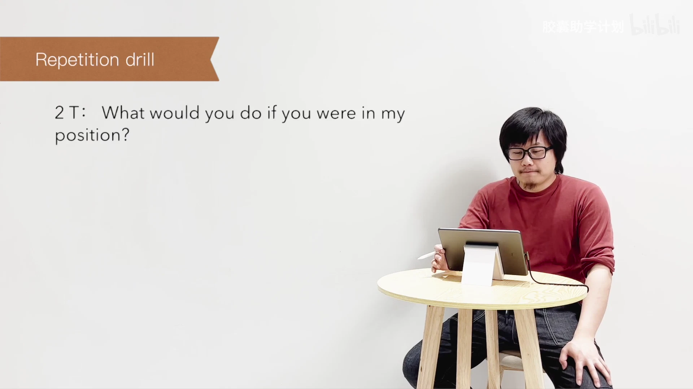

文字识别：Repetition drill / 2T： /  What would you do if you were in my / position?

### 画面 00:13:13

文字识别：Repetition drill / 2T： / What would you do if you were in my / position? / Act differently. / S: If I were in your position, 'd act differently.

### 画面 00:13:29

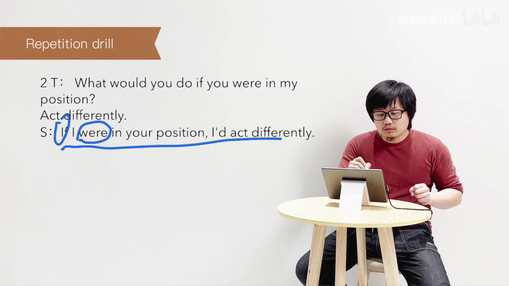

文字识别：Repetition drill / 2T： / What would you do if you were in my / position? / Actdifferently. / S / were in your position, 'd act differently.

## 00:13:30–00:14:00

动词，就是动词的一般过去式。如果用的是 was were，那你就不要用 was。不管是哪个人称，都用 were，这是英文的习惯。If I were in your position，如果我在你的位置上，那抱歉，与现在事实相反，我不在你的位置上，对吧？撇地 would act would 加 do 没问题。首先，第一虚拟虚虚拟语气，你要拿到的东西叫做结构，先判断这个结构是虚拟语气。

### 画面 00:13:49

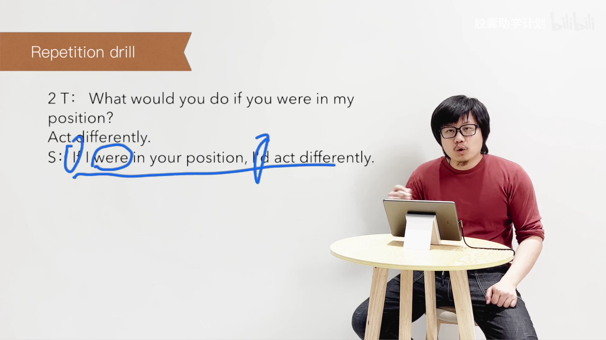

文字识别：Repetition drill / 2T： / What would you do if you were in my / position? / Actdifferently. / S / werein your position, / act differently.

## 00:14:00–00:14:30

二，你要记牢牢记住的一件事情，叫它的含义是什么呢？与现在事实相反，或说话人认为这件事情发生的概率极低。所以，if I were in your position，它的意思叫做与现在事实相反，对吧？如果我在你的位置上，我会表现的很不同。OK， one again。下一个，if he won a lot of money， he would spend it。首先，虚拟语气第一个知识

### 画面 00:14:19

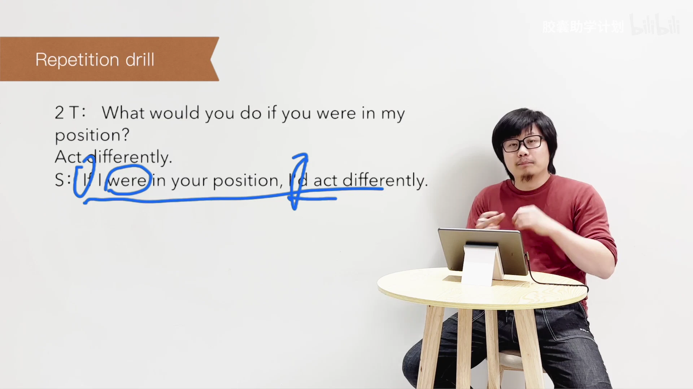

文字识别：Repetition drill / 2T: / What would you do if youy / were in my / position? / Actdifferently. / act differently. / S / were / in your position,

### 画面 00:14:22

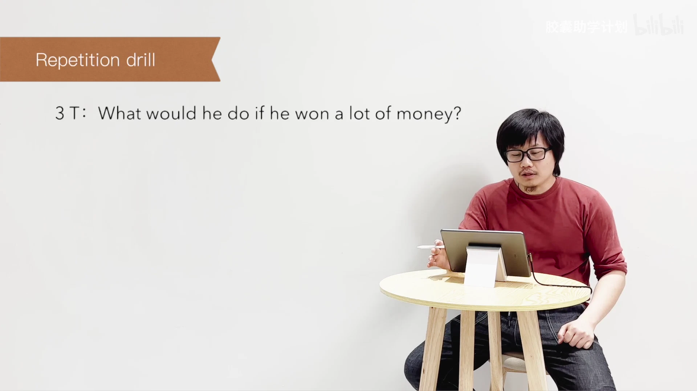

文字识别：Repetition drill / 3 T: What would he do if he won a lot of money?

### 画面 00:14:28

文字识别：Repetition drill / 3 T: What would he do if he won a lot of money? / Spend it. / S: If he won a lot of money, he'd spend it.

## 00:14:30–00:15:00

点你要拿到，叫做看结构。我现在一个圈儿，两个下划线，就是帮助你去判断它是虚拟语语气，对吧？这个结构。第二，这个语法你要拿到的第二个点叫做明白，他真正想表达的不是字面含义，不是说如果我赢很多钱，如果他赢很多钱，他就会把它花了，不是这个意思。是，我认为他也赢不了很多钱，他也没有办法花。听见了吧？这句话真正想表达的

### 画面 00:14:37

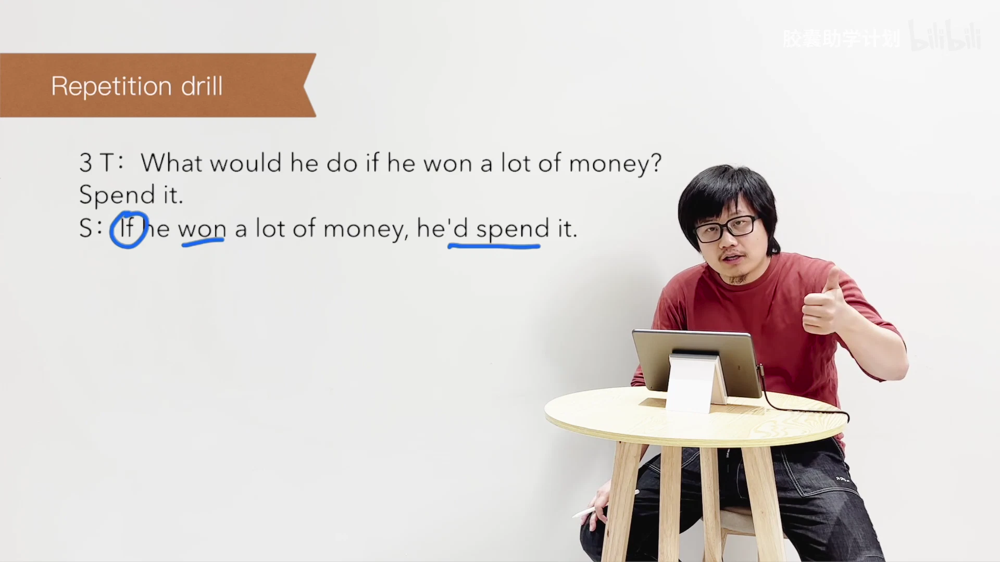

文字识别：Repetition drill / 3 T: What would he do if he won a lot of money? / Spend it. / S: / he won a lot of money, he'd spend it.

### 画面 00:14:44

文字识别：Repetition drill / 3 T: What would he do if he won a lot of money? / Spend it. / S: / he won a lot of money, he'd spend it.

## 00:15:00–00:15:30

是这个意思：是它不可能赢很多钱，发生情况几率极低。好吧，下一个。If I lost my way, I would ask a policeman. 第一步判断什么结构？牢牢记住啊，很简单，就两步。第一步判断结构，没问题，是虚拟语气。If后边是did，对吧？一般过去时，后边是would加do，没问题，虚拟语气。第二步你要做的事情是回想它的含

### 画面 00:15:07

文字识别：Repetition drill / 4 T: What would you do if you lost your way? / Ask a policeman.

### 画面 00:15:12

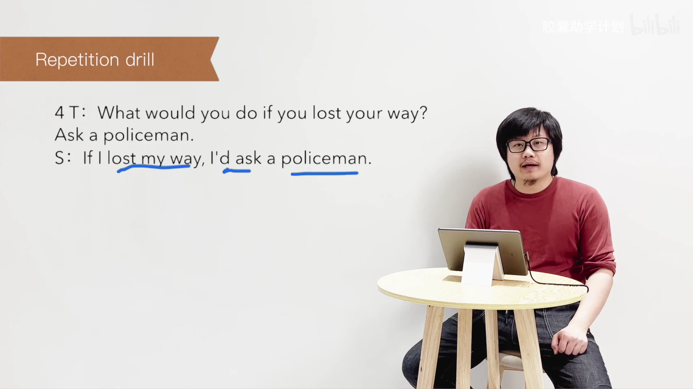

文字识别：Repetition drill / 4T： / What would you do if you lost your way? / Ask a policeman. / S: If I lost my way, I'd ask a policeman.

### 画面 00:15:16

文字识别：Repetition drill / 4T: What would you do if you lost your way? / Ask a policeman. / S: If l lost my way, I'd ask a policeman.

### 画面 00:15:20

文字识别：Repetition drill / 4T： / What would you do if you lost your way? / Aska policeman. / S: / I lost my way, I'd ask a policeman.

### 画面 00:15:24

文字识别：Repetition drill / 4T： / What would you do if you lost your way? / Aska policeman. / S: / I lost my way, 'd ask a policeman. / dd

## 00:15:30–00:16:00

义，与现在事实相反，或什么来着？发生情况几率极低，所以这句话的意思叫做，我不是说如果我迷路了，我就问警察，不是这个意思。如果我和你说这句话，用的是这句话啊，我想告诉你的事情是，放心吧，安拉，我不会迷路的啊，不会问警察的，放心吧啊，明白这个意思了吧？不是说如果我丢了，我就去问警察，他的意思是放心吧，

### 画面 00:15:54

文字识别：Repetition drill / 4T： / What would you do if you lost your way? / Aska / policeman. / S: / Ilost my / way, l' / aask / policeman. / dd

## 00:16:00–00:16:30

我不会迷路的，对吧？为什么？因为我认为 lost my way 这件事情发生的几率极低，能理解了吧？OK，好，Next one. If she were here, she would get the dinner ready. 如果她在这里，她会把晚饭做好。那现在的事实情况，第一判断结构 if were would get 虚拟语气与现在的虚拟语气，对吧？它的含义与现在事实相反，她

### 画面 00:16:03

文字识别：Repetition / drill / 4T: / What would /  you do if you lost your way? / Aska / polieeman. / S: / Tost my v / way, I'ask / policeman.

### 画面 00:16:09

文字识别：Repetition drill / 5 T: What would she do if she were here?

### 画面 00:16:14

文字识别：Repetition drill / 5 T: What would she do if she were here? / Get the dinner ready. / S: If she were here, she'd get the dinner ready.

### 画面 00:16:23

文字识别：Repetition drill / 5 T: What would she do if she were here? / Get the / dinner ready. / S: / she vere / here, she'd get the dinner ready.

## 00:16:30–00:17:00

现在不在这里，晚饭没有准备好，就这么简单。这句话听见了吧？不是说他在这儿，他会准备好。这句话想告诉你的是，他不在这儿，他没有办法把晚饭准备好。OK，好，我们带着大家走了五个，剩下的我希望您做的事情是自己给自己按照刚才我给我讲的方式给自己讲一遍。这是我课上经常用的一个方式，但是咱们现在是网络课程，没有办法这样去做，对吧？所以你要自己去给自己讲

### 画面 00:16:30

文字识别：Repetition drill / 5 T: What would she do if she were here? / Get the / dinner ready. / S: / she vere / here, shed ge the dinner ready.

### 画面 00:16:44

文字识别：Repetition drill

### 画面 00:16:46

文字识别：Repetition drill / 6 T: What would they do if they were on holiday? / Go fishing. / S: If they were on holiday, they'd go fishing.

## 00:17:00–00:17:30

啊！我只是带着各位翻译一下它的字面意思。If they were on holiday, they would go fishing. 如果他们在度假，他们会去钓鱼。这句话不是想表达这个意思。这句话想表达的意思是，还我再多说一个吧，叫做他们没有在度假，就这么简单，与现在事实相反，对吧？OK，下一个。If I lost my key, I'd climb through the window. 如果我丢了钥匙，我就顺窗户爬进去。

### 画面 00:17:01

文字识别：Repetition drill / 6 T: What would they do if they were on holiday? / Go fishing. / S: If they were on holiday, they'd go fishing.

### 画面 00:17:21

文字识别：Repetition drill / 7T：\ / What would / I you do if you lost your key? / Climb through / the window.

### 画面 00:17:27

文字识别：Repetition drill / 7T: / What would / you do if you lost your key? / Climb / through / the / window. / S: / : If l lost my / key, I'd climb / through / the window.

### 画面 00:17:29

文字识别：Repetition drill / 7T: / What would / you do if you lost your key? / Climb / through / the / window. / S: / : If l lost my / key, I'd climb / through / the window.

## 00:17:30–00:18:00

这句话想表达的不是这个意思，你给自己讲一遍啊！我只表达它的字面意思。下一题，If he came home early, he would take me out to dinner。好，你看啊，呃，我觉得给你讲两个小的场景啊，什么场景下使用这不同的两句话？如比如说，我们把它变成If he come home early, he will take me out to dinner，对吧？啊，

### 画面 00:17:36

文字识别：Repetition drill / 8 T: What would he do if he came home early?

### 画面 00:17:39

文字识别：Repetition drill / 8 T: What would he do if he came home early? / Take me out to dinner. / S: If he came home early, he'd take me out to dinner.

### 画面 00:17:41

文字识别：Repetition drill / 8 T: What would he do if he came home early? / Take me out to dinner. / S: If he came home early, he'd take me out to dinner.

### 画面 00:17:54

文字识别：Repetition drill / 8 T: What would he do if he came home early? / Take me out to dinner. / S: If he calpe home early, he'd take me out to dinner. / Cn

### 画面 00:17:56

文字识别：Repetition drill / 8 T: What would he do if he came home early? / Take me out to / dinner. / S: If he cape home early, he'd take me out to dinner. / wil.l / Cnl

### 画面 00:17:58

文字识别：Repetition drill / 8T： / What would he do if he came home early? / Take / me out to / dinner. / S:If he / e cane / e home early, he'd take me out to dinner. / wielok / Wnl

## 00:18:00–00:18:30

呃，我觉得啊，我给他编个号A B啊。你试想一下，看你能不能明白啊。说B这句，我们假设都是女人说的。说B的这个妻子，这个女人和她老公的关系特别好。说A这句话的妻子啊，和她老公的关系并不好啊，或者说她老公经常没有办法早回家。如果你明白刚才我为什

### 画面 00:18:06

文字识别：Repetition drill / 8T： / What would he do if he came home early? / Take / me out to / dinner. / Ce S: If he / e cane / e home early, he'd take me out to dinner. / wieloke / b. / Wne

## 00:18:30–00:19:00

么把 A 和 B 设置了这样的场景？那虚拟语气，今天咱们学的第四十课和第十六课那个语法的区别，我相信你基本就明白了，好吧？你试一下啊。好，当然你也可以在视频下方留个言，对吧？哎，这个评论一下，告诉我们为什么是这样的。我觉得这特别的好啊。下一个，说 What would she do if she couldn't get air ticket? If she couldn't get an a get an air ticket, she would go by boat.

### 画面 00:18:36

文字识别：Repetition drill / 8T： / What would he do if he came home early? / Take / me out to / dinner. / Ce S: If he / e caNe / : home early, he'd take me out to dinner. / weloke / Wnl / b.

### 画面 00:18:42

文字识别：Repetition drill

### 画面 00:18:53

文字识别：Repetition drill / 9 T: What would she do if she couldn't get / an air ticket? / Go by boat. / S: If she couldn't get an air ticket, she'd go / by boat.

### 画面 00:18:56

文字识别：Repetition drill / 9 T: What would she do if she couldn't get / an air ticket? / Go by boat. / S: If she couldn't get an air ticket, she'd go / by boat.

### 画面 00:18:59

文字识别：Repetition drill / 9 T: What would she do if she couldn't get / an air ticket? / Go by boat. / S: If she couldn't get an air ticket, she'd go / by boat.

## 00:19:00–00:19:30

好，重点来了。刚才我们说的叫发生情况几率极低，全是肯定。现在来了个否定。如果他没有办法买到机票，他会坐船去。好，我想问你这句话真正想表达的，你先思考一下，是不是说他要坐船去？第二，我想问的问题叫做，你觉得他能买到？他认为他能买到机票吗？他认为

### 画面 00:19:29

文字识别：Repetition drill / 9 T: What would she do if she couldn't get / an air ticket? / Go by boat. / S: If she couldn't get an air ticket, she'd go / by boat.

## 00:19:30–00:20:00

woman can buy a ticket? Okay, I think if you can answer my question, you understand the virtual tone. The chance of this happening is very low. Which thing couldn't get an air? This thing, the chance of not being able to buy a ticket is very low. The opposite of the positive, so he can buy a ticket. Next one. If I

### 画面 00:19:43

文字识别：Repetition drill / 9 T: What would she do if she couldn't get / an air ticket? / Go by boat / S: If sheCouldn't get an air ticket, she'd go / by boat.

### 画面 00:19:57

文字识别：Repetition drill / 10 T: What would you do if you didn't hear / from him? / Write him another letter.

## 00:20:00–00:20:30

didn't hear from him, I would write him another letter.字面意思，如果我没有听到他的消息，我会再给他写一封信的。各位，还像我之前那样给自己讲一遍，不妨暂停屏幕，好吧？OK。呃，那接下来呢，我们看一个小的电影片段。这个电影片段当中出现了无数次的虚拟语气啊。当我找到这个片段的时候，特别的开心。用的叫做

### 画面 00:20:01

文字识别：Repetition drill / 10 T: What would you do if you didn't hear / from him? / Write / him another letter. / S: If I didn'thear from him, I'd write him / another letter.

### 画面 00:20:03

文字识别：Repetition drill / 10 T: What would you do if you didn't hear / from him? / Write / him another letter. / S: If I didn't hear from him, I'd write him / another letter.

### 画面 00:20:18

文字识别： If I were your account,. / 午夜狂奔 / Midnight Run。 / (1988)

### 画面 00:20:29

文字识别： If I were your account.,. / 午夜狂奔 / Midnight Run。 / (1988)

## 00:20:30–00:21:00

If I were you, accountant. 如果我是你的会计，啊，注意啊，叫那我不是嘛，对吧？虚拟语气嘛，来了啊。 If I were your accountant, I'd have to strongly advise you against it. You would, huh? Well, you're not my accountant. No, I mean, if I were your accountant, I told you, I took you out here. No, I'm just saying that it's very, very tricky business. And if I were your accountant, I would really strongly have to advise you against it as a, as an accountant. You're not my accountant. I realize I'm not your accountant.

### 画面 00:20:39

文字识别：If I were your account,... / 午夜狂奔 / 我要是你的会计师绝对大力反对你的想法 / Midnight Run。 / If I were your accountant, I'd strongly advise you against it. / (1988)

### 画面 00:20:41

文字识别：If I were your account,... / 午夜狂奔 / 我要是你的会计师绝对大力反对你的想法 / Midnight Run。 / If I were your accountant, I'd strongly advise you against it. / (1988)

### 画面 00:20:43

文字识别：If I were your account,.. / 午夜狂奔 / 是吗可惜你不是我的会计师 / Midnight Run。 / You would? Well, you're not my accountant. / (1988)

### 画面 00:20:45

文字识别：If I were your account,.. / 午夜狂奔 / 我只是假设我是你的会计师就.... / Midnight Run。 / No, I mean, ifI were your accountant, I'd... / (1988)

### 画面 00:20:47

文字识别：If I were your account,.. / 午夜狂奔 / 不我就是说非常不好干 / Midnight Run。 / No, I'm just saying that it's a very very tricky business, / (1988)

### 画面 00:20:50

文字识别：If I were your account,.. / 午夜狂奔 / 如果我是你的会计师 / Midnight Run。 / and if I were your accountant, / (1988)

### 画面 00:20:52

文字识别：If I were your account,.. / 午夜狂奔 / 我一定会大力反对你投资餐饮 / Midnight Run。 / I would really strongly have to advise you against it, / (1988)

### 画面 00:20:54

文字识别： If I were your account,... / 午夜狂奔 / 作为作为你的会计师 / Midnight Run。 / as a... as an accountant. / (1988)

### 画面 00:20:56

文字识别：If I were your account,.. / 午夜狂奔 / -你不是我的会计师一我知道 / Midnight Run。 / -You're not my accountant. -I realize I'm not your accountant. / (1988)

### 画面 00:20:58

文字识别：If I were your account,.. / 午夜狂奔 / -你不是我的会计师-我知道 / Midnight Run。 / -You're not my accountant. -I realize I'm not your accountant. / (1988)

## 00:21:00–00:21:30

Okay, I'm just saying if I were you, accountant. Ah,这个地方accountant啊，少了一个a n t. Okay, very good.好，注意是吧？你看它的结构，你不妨回去再多看几遍。I would strongly,对吧？怎么怎么样啊？Okay, very good.呃, pattern drill,这是咱们老习惯了，练的就是跟虚拟语气相关的句子。这里我们就不讲了，我们只说一下这两个句子。各位下课自己去往里带啊。

### 画面 00:21:00

文字识别： If I were your account.,.. / 午夜狂奔 / Midnight Run。 / (1988)

### 画面 00:21:02

文字识别：If I were your account,.. / 午夜狂奔 / 我说假如我是你的会计师而已 / Midnight Run。 / I'm just saying if I were your accountant. / (1988)

### 画面 00:21:08

文字识别：If I were your accountam.t / 午夜狂奔 / 我说假如我是你的会计师而已 / Midnight Run。 / I'm just saying if I were your accountant. / (1988)

### 画面 00:21:19

文字识别：Pattern drill / 训练目标： / 写作口语 / 练习包含虚拟语气的句子 / Accuracy / Fluency

### 画面 00:21:23

文字识别：Pattern drill / 1 T: asked you to go to-the play / S1: Has she asked you to go to the play? / S2: No, she hasn't. But I'd go to it if she / asked me to. / told you to write/post-the letter / asked you to apologize to/thank-the boy / invited you to play for/join-her team / hired you to paint/decorate-his house

## 00:21:30–00:22:00

说 Has she asked you to go to the play? 啊，她已经邀请你去看这个话剧了吗？ No, she hasn't. She还没有. But I'd go to it if she asked me to.你看这回把if放到后面了，那还是同理。If后面这个句子是did，对吧？前面是would加do虚拟语气，字面意思叫如果她邀请我去，我会去的。但说话人认为他会不会？不会，对吧？往里去带虚拟语气的第一个练习，

### 画面 00:21:53

文字识别：Pattern drill / 1 T: asked you to go to-the play / S1: Has she asked you to go to the play? / S2: No, she hasn't. But I'd go to it if she / asked me to. / told you to write/post-the letter / asked you to apologize to/thank-the boy / invited you to play for/join-her team / hired you to paint/decorate-his house

### 画面 00:21:59

文字识别：Pattern drill / 2T: hit him, told you to / S1: Would you hit him if he told you to? / S2: Don't be silly! He'd never tell me to hit him. / read/write-his essay-paid you to / play for/join-his team-invited you to / marry/advise-him/her-asked you to / apply for/take-his job-advised you to

## 00:22:00–00:22:30

第二个练习，Would you hit him if he told you to?你会打他吗？如果他告诉你，Don't be silly,别蠢啦。He'd never tell me to him hit him.他永远都不会告诉我去打他的，对吧？OK，虚拟语气往里带啊。第三个，I will be driving to London soon.十三课学的，Will be doing将来进行时，我很快就要开车去伦敦了。I wouldn't drive now if I

### 画面 00:22:19

文字识别：Pattern drill / 3 T: drive-to London-busy roads / S1: I'l be driving to London soon. / S2: I wouldn't drive now if I were you. The / roads are too busy. / set out/sail-from Dover-rough sea / ride/go-to the station-thick fog / set off/leave-for Rome-bad weather / climb/walk-up the mountain-heavy snow

## 00:22:30–00:23:00

were you.注意，if I were you，如果我是你，我就不会开。虚拟语气与现在事实相反，对吧？The roads are too busy.说路啊，现在太那busy，busy。大家理解为说的是人，对吧？太这个匆忙了。那你如果说路就是太拥堵了，对吧？这个呃，这个车流量太大了啊。OK，那recap本课最重要的我们学的叫做虚拟语气，但同时注

### 画面 00:22:49

文字识别：Pattern drill / 3 T: drive-to London-busy roads / S1: I'l be driving to London soon. / S2: I wouldn't drive now if I were you. The / roads are too busy. / set out/sail-from Dover-rough sea / ride/go-to the station-thick fog / set off/leave-for Rome-bad weather / climb/walk-up the mountain-heavy snow

### 画面 00:22:54

文字识别：Recap / Patterns / ＆ / 虚拟语气 (现在) / Grammar

### 画面 00:22:56

文字识别：Recap / Patterns / ＆ / 虚拟语气 (现在) / Grammar

## 00:23:00–00:23:30

意，我们现在学的是虚拟语气当中的其中一个一类，叫做与现在事实相反的，好吧？以后我们还会学与过去事实相反的和混合的等等等等啊！不都说了？那接下来我们看一下家庭作业：第一，pattern drill，先写再朗读，对吧？然后尝试回忆，给自己讲解一遍今天的核心语法。那翻阅红皮书，找到今天的虚拟语气，去做这样的练习。OK，那以上呢就是本视频

### 画面 00:23:00

文字识别：Recap / Patterns / ＆ / 虚拟语气 (现在) / Grammar

### 画面 00:23:02

文字识别：Recap / Patterns / ＆ / 虚拟语气 (现在) / Grammar

### 画面 00:23:05

文字识别：Recap / Patterns / ＆ / 虚拟语气 (现在) / Grammar

### 画面 00:23:10

文字识别：Recap / Patterns / ＆ / 虚拟语气 (现在) / Grammar

### 画面 00:23:12

### 画面 00:23:14

文字识别：1.f / Pattern Drill 写&朗读 / 专栏 / 4×4

### 画面 00:23:16

文字识别：1.f / Pattern Drill 写&朗读 / 专栏 / 4×4

### 画面 00:23:18

文字识别：Pattern Drill写&朗读 / 专栏 / 4×4 / 尝试回忆并给自己讲解一 / 遍今天的核心语法 / Study-Test / Learning Pyramid

### 画面 00:23:20

文字识别：Pattern Drill写&朗读 / 专栏 / 4×4 / 尝试回忆并给自己讲解一 / 遍今天的核心语法 / Study-Test / Learning Pyramid

### 画面 00:23:22

文字识别：Pattern Drill写&朗读 / 专栏 / 4×4 / 尝试回忆并给自己讲解一 / 遍今天的核心语法 / Study-Test / Learning Pyramid / 尝试翻阅红皮书（中级） / 通过目录或索引(Index) / 查找到本课语法

### 画面 00:23:25

文字识别：Pattern Drill写&朗读 / 1. / 专栏 / 4×4 / 尝试回忆并给自己讲解一 / 遍今天的核心语法 / Study-Test / Learning Pyramid / 尝试翻阅红皮书（中级） / 通过目录或索引(Index) / 查找到本课语法

### 画面 00:23:27

文字识别：👍

## 00:23:30–00:23:53

的全部内容了。如果各位喜欢我们的课程呢，欢迎各位关注、订阅、一键三连，分享给那些需要的朋友，来帮助我们快速成长。See you next time.

### 画面 00:23:40

文字识别：￥

### 画面 00:23:42

文字识别：CAPSULEACADEMY / 胶囊助学计划 / 小红书 / Lecturer / Leo / OE

### 画面 00:23:45

文字识别：CAPSULEACADEMY / 胶囊助学计划 / 小红书 / Photographer / Berlin / OE

### 画面 00:23:47

文字识别：CAPSULEACADEMY / 胶囊助学计划 / 小红书 / Editor / Berlin / OE

### 画面 00:23:50

文字识别：CAPSULEACADEMY / 胶囊助学计划 / 小红书

### 画面 00:23:52

文字识别：bilibili / 胶囊助学计划

